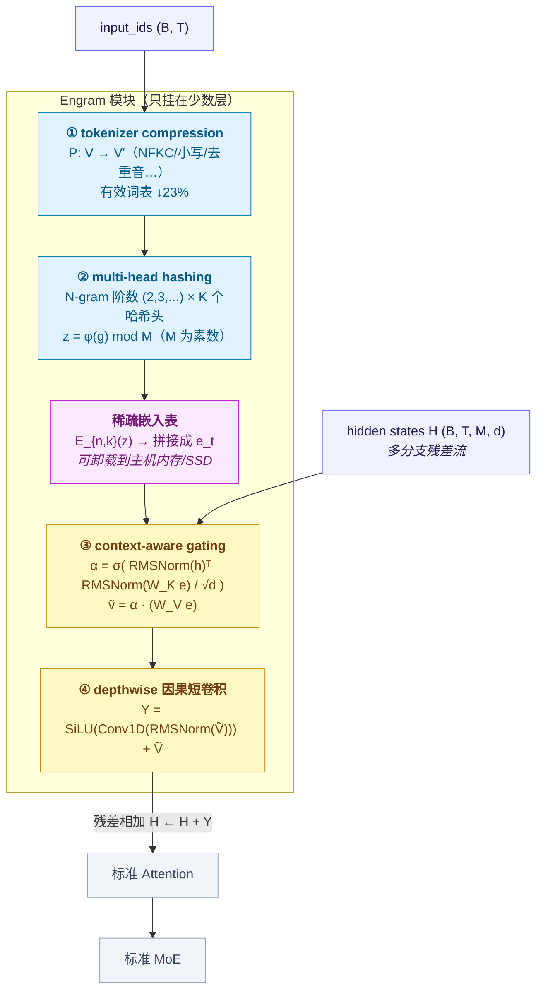

# Engram：DeepSeek 的条件记忆（Conditional Memory）原理详解

> 论文：*Conditional Memory via Scalable Lookup: A New Axis of Sparsity for Large Language Models*
> （Cheng et al., DeepSeek-AI + 北京大学，arXiv:2601.07372v1，2026-01-12）
> 官方实现：<https://github.com/deepseek-ai/Engram>（`engram_demo_v1.py`，Apache-2.0）
>
> 一句话结论：**Engram 给 Transformer 补上了一个它天生缺失的原语——"查表"。**
> 它用局部 token 组合（hashed N-gram）**确定性地**检索一张巨大的静态嵌入表，
> 再让当前上下文决定"这条记忆该用多少"。这样，静态知识不再靠堆叠网络层去"重算"出来，
> 而是 $O(1)$ 查出来。它和 MoE 的**条件计算**构成一对互补的稀疏轴，论文称之为**条件记忆**。
>
> 本文按「动机 → 机制 → 数值示例 → 规模律 → 证据 → 系统 → 对比 → 落地」展开。
> 所有公式都对照论文；凡属论文之外（官方代码、V4.1 技术报告、本文推算）的内容都明确标注来源。

## 目录

1. [Engram 是什么：命名与定位](#1-engram-是什么命名与定位)
2. [第一性原理：Transformer 没有"查表"这个原语](#2-第一性原理transformer-没有查表这个原语)
3. [两条互补的稀疏轴：条件计算 vs 条件记忆](#3-两条互补的稀疏轴条件计算-vs-条件记忆)
4. [架构总览](#4-架构总览)
5. [阶段一：hashed N-gram 稀疏检索](#5-阶段一hashed-n-gram-稀疏检索)
6. [阶段二：上下文感知门控（context-aware gating）](#6-阶段二上下文感知门控context-aware-gating)
7. [多分支集成与"放在哪一层"](#7-多分支集成与放在哪一层)
8. [一个可以从头算到尾的数值示例](#8-一个可以从头算到尾的数值示例)
9. [稀疏容量分配：U 型规模律](#9-稀疏容量分配u-型规模律)
10. [实验证据](#10-实验证据)
11. [机制分析：Engram 为什么有用](#11-机制分析engram-为什么有用)
12. [系统效率：确定性寻址换来的访存自由](#12-系统效率确定性寻址换来的访存自由)
13. [与其他技术的边界对比](#13-与其他技术的边界对比)
14. [在 DeepSeek-V4.1-Flash 中的 Engram](#14-在-deepseek-v41-flash-中的-engram)
15. [代码对照：论文公式 vs 官方实现](#15-代码对照论文公式-vs-官方实现)
16. [常见误解](#16-常见误解)
17. [局限与开放问题](#17-局限与开放问题)
18. [参考实现与资料来源](#18-参考实现与资料来源)

---

## 1. Engram 是什么：命名与定位

**Engram**（记忆痕迹）原本是神经科学概念，指一次经验在大脑中留下的物理/生化痕迹。
DeepSeek 借这个词命名一个**参数化的静态记忆模块**。

需要先说清楚它**不是**什么，因为名字容易引起误解：

| 名字听起来像 | 实际是 | 说明 |
|---|---|---|
| 检索增强（RAG） | **不是** | RAG 检索外部文档，Engram 检索模型自己**训练出来的**嵌入表，不依赖外部语料库 |
| 对话/会话记忆 | **不是** | Engram 不保存"上一轮说了什么"，它是**无状态的静态查表** |
| KV Cache | **不是** | KV Cache 缓存的是当前序列的动态中间结果，随序列增长；Engram 表与序列无关 |
| MoE 的变体 | **不是** | MoE 稀疏激活**计算**参数，Engram 稀疏访问**存储**参数；两者正交且互补 |

论文对它的原始定义是：

> Engram 是一个**条件记忆**（conditional memory）模块，把经典 N-gram 嵌入现代化，
> 通过**可扩展的 $O(1)$ 查表**为 LLM 提供知识检索原语。

关键词有三个：

1. **条件（conditional）**：用哪些记忆条目，取决于输入序列（局部上下文）；
2. **记忆（memory）**：被查出的内容是一张**静态**嵌入表里的行，不参与逐 token 的动态计算；
3. **可扩展（scalable）**：因为地址是确定性的，参数表可以膨胀到远超显存容量，卸载到主机内存/SSD。

---

## 2. 第一性原理：Transformer 没有"查表"这个原语

### 2.1 语言建模其实是两类异质任务

论文的出发点是一个朴素的观察：语言建模包含两种**性质完全不同**的子任务。

| 子任务 | 例子 | 需要什么 |
|---|---|---|
| **组合推理**（compositional reasoning） | 多步逻辑、数学推导、代码控制流 | 深、动态、逐层的计算 |
| **知识检索**（knowledge retrieval） | 命名实体、固定搭配、公式化表达 | 一次廉价的静态查找 |

论文引用语言学的研究指出：文本中有**相当大一部分**是"局部的、静态的、高度程式化的"——
比如"Alexander the Great"、"the Milky Way"、"四大发明"、"张仲景"。
经典 N-gram 模型能很好地捕捉这些规律，说明它们**本质上就是一次查表**。

### 2.2 但标准 Transformer 只能"用计算模拟检索"

标准 Transformer（Vaswani et al., 2017）里没有 lookup 原语。它的基本操作只有
Attention（token 间混合）与 FFN（逐位置变换）。因此要"认出"一个多 token 实体，
模型只能**逐层把特征拼出来**。

论文复现了 Ghandeharioun et al. (2024) 用 PatchScope 做的实体解析实验（论文 Table 3）。
目标是让模型表征"**Diana, Princess of Wales**"（末位 token 是 "Wales"）：

| 层 | 隐状态被翻译成的文本 | 含义 |
|---|---|---|
| 1–2 | "Country in the United Kingdom" | 只认出了 Wales |
| 3 | "Country in Europe" | 仍然是 Wales |
| 4 | "Title held by female sovereigns…" | 泛指的 Princess of Wales |
| 5 | "Title given to the wife of the Prince of Wales…" | 逐渐收窄 |
| 6 | "Diana, Princess of Wales (1961–1997), the first wife of Prince Charles…" | 才拼完整 |

**代价**：为了拼出一个**本可以直接查到的固定字符串**，模型花掉了 6 层深度。
论文的判断很直接：

> 这一过程本质上是对一张**静态查找表**做昂贵的运行时重建（expensive runtime reconstruction），
> 把宝贵的"顺序深度"浪费在了本可以更低价完成的操作上。

这就是 Engram 要解的矛盾。形式化地说：

$$
\underbrace{\text{静态知识}}_{\text{表里就有}} \;\longrightarrow\;
\underbrace{\text{用 } L \text{ 层网络重新算一遍}}_{\text{当前做法，贵}} \qquad\text{vs}\qquad
\underbrace{\text{直接查出来}}_{\text{Engram，} O(1)}
$$

### 2.3 不可回避的约束

为什么不能"干脆全部用查表"？因为**记忆不能替代计算**，这是论文后来用 U 型规模律（§9）
定量刻画的东西。先给出直觉：

- 可查的只有**局部、静态**的模式。语言里同时存在大量**上下文决定**的东西
  （指代、反事实、多义消解），这些**必须**靠计算；
- 查表的键只能是有限窗口的 token 组合，超出窗口的依赖它看不见；
- 哈希必然冲突，多义必然存在噪声，所以查出来的东西**不能无条件相信**。

于是正确的形态不是"二选一"，而是**给计算配一个记忆**，并让当前上下文对记忆做门控——
这正是 Engram 架构的全部内容。

---

## 3. 两条互补的稀疏轴：条件计算 vs 条件记忆

论文把"稀疏性"拆成两条正交的轴，这是理解 Engram 的最佳视角。

| 维度 | **条件计算**（Conditional Computation） | **条件记忆**（Conditional Memory） |
|---|---|---|
| 代表模块 | MoE（稀疏专家） | **Engram**（稀疏查表） |
| 稀疏的是什么 | 每个 token **激活哪些参数** | 每个 token **访问哪些存储行** |
| 选择依据 | 当前**隐状态**（动态、需训练 Router） | 当前**输入 token 序列**（确定、哈希） |
| 参数是否参与计算 | 是 | **否**（查出的行只是被读出来） |
| 每 token 成本 | $O(K)$ 个专家 FLOPs | $O(1)$ 次访存（与表大小无关） |
| 主要瓶颈 | 路由/通信/负载均衡 | 存储容量、访存带宽 |
| 能否卸载到 CPU/SSD | 不能（要算 GEMM） | **能**（确定性地址可预取） |

论文用三个参数量指标来精确表述这件事：

$$
P_{\text{tot}} = P_{\text{act}} + P_{\text{sparse}}
$$

| 符号 | 含义 |
|---|---|
| $P_{\text{tot}}$ | 总可训练参数（不含词表嵌入与 LM head） |
| $P_{\text{act}}$ | 每 token **激活**的参数，决定训练 FLOPs |
| $P_{\text{sparse}}$ | 不激活的"免费"参数预算 |

- 对 **MoE**：$P_{\text{act}}$ 由 top-$k$ 选中的专家决定，未被选中的专家计入 $P_{\text{sparse}}$；
- 对 **Engram**：每 token 只检索**常数个**槽位，所以**把表开大只增加 $P_{\text{tot}}$，不增加每 token FLOPs**。

这就是"新稀疏轴"的含义：**Engram 让参数容量可以沿一条不计入 FLOPs 的方向生长。**

---

## 4. 架构总览

给定输入序列 $X=(x_1,\dots,x_T)$ 与第 $\ell$ 层隐状态 $H^{(\ell)} \in \mathbb{R}^{T\times d}$，
Engram 对每个位置 $t$ 分两个功能阶段处理：



读图要点：

- **键来自 token 序列，查询来自隐状态**。地址的生成（①②）**完全不看隐状态**，
  这就是"确定性寻址"的来源，也是系统优化的前提（§12）。
- **值是可训练的静态嵌入**，它**不经过任何逐 token 的动态计算**就被读出。
- **融合才是上下文相关的**（③④）：同一段 N-gram 在不同语境下会被门控放大或抑制。
- **不是每层都放**。论文明确：Engram 的放置由**建模效果 + 系统延迟约束共同决定**（§7、§12）。

---

## 5. 阶段一：hashed N-gram 稀疏检索

### 5.1 词表压缩（Tokenizer Compression）

**问题**：标准 subword tokenizer 以"无损还原"为首要目标，会把语义等价的文本切成**不同的 ID**。
例如 `Apple` 与 `␣apple`、`apple` 与 `Apple`，在词表里是互不相干的 token。
对 N-gram **查表**来说这是灾难：明明同一个模式，哈希到了不同地址，统计被稀释。

**做法**：定义一个**满射**（surjective）投影

$$
\mathcal{P}: V \to V', \qquad x'_t = \mathcal{P}(x_t)
$$

把原始 token ID 折叠成**规范化文本等价类**的规范 ID。规范化流程（来自官方实现）：

```text
NFKC → NFD → StripAccents → Lowercase
     → 折叠空白([ \t\r\n]+ → 单空格) → Strip → 空白归一化
```

于是位置 $t$ 的后缀 N-gram 定义为

$$
g_{t,n} = \left(x'_{t-n+1},\ \dots,\ x'_t\right), \qquad n = 2,\dots,N
$$

**效果**：论文称 128k 词表的**有效词表缩小 23.43%**（Appendix C / Table 6）。
被合并最多的前几名（Table 6）：

| 排名 | 合并后 | 原始 token（部分） | 合并数量 |
|---|---|---|---|
| 1 | `␣` | `\t`, `\n`, `\r`, `␣`, `␣␣`, `\n\n`, `␣␣␣`, `␣\n`, … | 163 |
| 2 | `a` | `A`, `a`, `␣a`, `␣A`, `á`, `ä`, `ã`, `ą`, `␣à`, `␣å`, `â`, … | 54 |
| 3 | `o` | `O`, `o`, `␣o`, `␣O`, `ó`, `ö`, `ô`, `õ`, `ő`, `ò`, … | 40 |
| 4 | `e` | `E`, `e`, `␣e`, `␣E`, `é`, `è`, `␣é`, `ę`, `ě`, `ê`, … | 35 |
| 5 | `i` | `I`, `i`, `␣I`, `␣i`, `í`, `ì`, `î`, `ı̄`, `ï`, … | 28 |

> 直觉：这一步是在"**提高语义密度**"——把词表容量从"区分大小写/重音/空白"这种
> 对查表无用的维度上收回来，换给真正的高频模式。

### 5.2 多头哈希（Multi-Head Hashing）

**问题**：所有可能 N-gram 的组合空间是 |V'|^n 级，**不可能**直接参数化。
N-gram 阶数越高越稀疏，绝大多数组合在语料中出现 0 次或 1 次。

**做法**：沿用 hash embedding 的思路（Tito Svenstrup et al., 2017），
对**每个 N-gram 阶数 $n$**、**每个哈希头 $k$**，维护一张独立嵌入表 $\mathcal{E}_{n,k}$，
表长 $M_{n,k}$ 取**素数**：

$$
z_{t,n,k} \triangleq \varphi_{n,k}\!\left(g_{t,n}\right),
\qquad
e_{t,n,k} = \mathcal{E}_{n,k}\!\left[z_{t,n,k}\right]
$$

其中 $\varphi_{n,k}$ 是**轻量的乘法-XOR 哈希**（multiplicative-XOR hash）。官方实现的形式为：

$$
\text{mix} = \left(x'_{t} \cdot m^{(n)}_1\right) \oplus \left(x'_{t-1} \cdot m^{(n)}_2\right) \oplus \cdots \oplus \left(x'_{t-n+1} \cdot m^{(n)}_n\right),
\qquad
z = \text{mix} \bmod M_{n,k}
$$

（乘法系数 $m^{(n)}_i$ 是每层独立的**随机奇数**，由层号派生的种子生成。）

**两个设计选择及其理由**：

| 选择 | 理由 |
|---|---|
| **多头**（$K$ 个独立哈希头） | 单表一旦冲突，两个完全不同的 N-gram 就共享同一行参数，无法区分；多头让它们在**其他头**上还能分开，冲突从"必然混淆"降为"部分重叠" |
| **表长取素数 + 每头互不相同** | 素数表长配合乘法哈希能显著降低规律性冲突；各头表长互不相同，避免多个头同时冲突 |

最终的记忆向量是**所有检索结果的拼接**：

$$
e_t \triangleq \Big\Vert_{n=2}^{N}\ \Big\Vert_{k=1}^{K}\ e_{t,n,k}
$$

因此 $e_t$ 的维度是

$$
d_{\text{mem}} = (N-1)\times K \times \frac{D_{\text{embed}}}{K} = (N-1)\times D_{\text{embed}}
$$

（论文实现中 $D_{\text{embed}}$ 即"每阶嵌入维"。）

> **关键性质**：地址 $z_{t,n,k}$ **只依赖 token 序列**，与隐状态、与序列长度、与已生成内容都无关。
> 这带来三个后果：
> 1. 前向开始前就能算出所有地址 → **可以预取**（§12）；
> 2. 训练时表可以按行分片到多卡 → **参数容量随卡数线性扩展**；
> 3. 哈希是全局确定的 → 同一 token 序列在任意请求、任意时刻都命中同一行 → **可复现**。

---

## 6. 阶段二：上下文感知门控（context-aware gating）

### 6.1 为什么必须门控

检索出来的 $e_t$ 是**上下文无关的先验**（context-independent prior）。它有三个问题：

1. **静态**：同一个 N-gram 在所有语境下都返回同一行，无法适应上下文；
2. **冲突噪声**：哈希冲突让不同 N-gram 共享参数，读出来的行可能是"混合体"；
3. **多义（polysemy）**：同一个词/短语在不同上下文含义不同（Haber and Poesio, 2024）。

如果无条件把 $e_t$ 加进残差流，就是把噪声注入主干。因此需要一个机制：
"**这条记忆和当前上下文对得上吗？对得上就用，对不上就闭嘴。**"

### 6.2 用 Attention 的形式做门控

论文的灵感直接来自 Attention：**把当前隐状态当 Query，把检索到的记忆当 Key/Value**。

$$
k_t = W_K\, e_t, \qquad v_t = W_V\, e_t
$$

其中 $W_K, W_V$ 是可学习投影。为确保梯度稳定（Dehghani et al., 2023），
**在算门控前对 Query 和 Key 都做 RMSNorm**（Zhang and Sennrich, 2019），得到标量门控
$\alpha_t \in (0,1)$：

$$
\boxed{\ \alpha_t = \sigma\!\left(\frac{\operatorname{RMSNorm}(h_t)^{\top}\,\operatorname{RMSNorm}(k_t)}{\sqrt{d}}\right)\ }
$$

$\sigma$ 是 sigmoid。门控后的输出为

$$
\tilde{v}_t = \alpha_t \cdot v_t
$$

**语义对齐的解释**（论文原意）：如果检索到的记忆 $e_t$ 与当前上下文 $h_t$ **矛盾**，
则两者的归一化内积倾向于负值，$\alpha_t \to 0$，**噪声被自动抑制**；
反之则 $\alpha_t \to 1$，记忆被采纳。

> 注意这里有**两套 Q**：门控用的是**主干传下来的** $h_t$（已通过前面的 Attention
> 聚合了全局上下文），而 $W_K$ 的输入是**查出来的** $e_t$。这正是"上下文决定记忆用法"的实现方式。
>
> 与 Attention 的区别也很清楚：Attention 在 **token 之间**混合信息，
> Engram 门控在 **"当前 token 隐状态"与"该位置查到的记忆"之间**做对齐判定——
> 选择对象是**存储行**，不是其他 token。

### 6.3 短卷积：扩大感受野 + 增加非线性

门控后的 $\tilde{V} \in \mathbb{R}^{T\times d}$ 再过一层**深度可分离（depthwise）因果短卷积**：

$$
Y = \operatorname{SiLU}\!\Big(\operatorname{Conv1D}\big(\operatorname{RMSNorm}(\tilde{V})\big)\Big) + \tilde{V}
$$

配置：卷积核 $w=4$，**膨胀率 $\delta$ 设为最大 N-gram 阶数 $N$**，激活函数 SiLU（Elfwing et al., 2018）。
论文给出的理由是"扩大感受野、增强非线性"。

**为什么用膨胀卷积**：把 $\delta = N$ 意味着核的第 $j$ 个抽头看的是 $t - jN$ 位置。
这样不同抽头覆盖的**时间尺度**正好跨越若干个 N-gram 窗口——相当于在"局部模式"之上再叠一层
"局部模式之间的关系"。这与 Engram 的"局部性"定位是一致的。

> 官方实现里还把这条卷积的**输出层初始化为零**，
> 这样训练开始时 $Y \equiv \tilde{V}$（严格保持残差恒等映射），避免一开始就扰动主干。

### 6.4 残差集成

Engram 通过残差连接融入主干：

$$
H^{(\ell)} \leftarrow H^{(\ell)} + Y
$$

随后照常进入标准 Attention 与 MoE。**关键**：Engram **不作用于每一层**，
放置位置由建模收益与系统延迟约束共同决定（§7、§12）。

---

## 7. 多分支集成与"放在哪一层"

### 7.1 多分支（mHC）下的参数共享策略

论文没有用标准单流残差（He et al., 2016），而是采用**多分支架构**作为默认主干
（Larsson et al., 2017; Szegedy et al., 2015; Xie et al., 2025; Zhu et al., 2025），
因为其建模能力更强。设分支数 $M$，残差流被扩展为 $M$ 条并行分支。

Engram 本身**与拓扑无关**，但适配多分支时做了一个**效率/表达力折中**：

| 组件 | 是否跨分支共享 | 目的 |
|---|---|---|
| 稀疏嵌入表 $\mathcal{E}$ | **共享**（一份） | 表是最大的参数量，必须共享，否则容量爆炸 |
| Value 投影 $W_V$ | **共享**（一份） | 让投影能融合成一个稠密 GEMM |
| Key 投影 $W_K^{(m)}$ | **各分支独立**（$M$ 份） | 让每个分支有自己的门控行为 |

第 $m$ 个分支的门控为

$$
\alpha_t^{(m)} = \sigma\!\left(\frac{\operatorname{RMSNorm}\big(h_t^{(m)}\big)^{\top}\operatorname{RMSNorm}\big(W_K^{(m)} e_t\big)}{\sqrt{d}}\right)
$$

记忆被这些独立门控调制后作用于**共享**的 Value 向量：

$$
u_t^{(m)} = \alpha_t^{(m)} \cdot \left(W_V\, e_t\right)
$$

**收益**（论文明确点出）：这套设计让 $(1 + M)$ 个线性投影**合并成一个稠密 FP8 矩阵乘法**，
从而最大化现代 GPU 的计算利用率。

> 论文默认配置为 **Manifold-Constrained Hyper-Connections (mHC)**，$M=4$。
> 也就是说，一个 token 在每层 Engram 上会产生 **$M$ 个不同的门控标量**。

### 7.2 放置深度：一个真实的权衡

论文做了单模块插入层扫（1→12 层，固定 1.6B Engram 预算），结论是**存在内在权衡**：

```text
放得早  →  能在主干消耗深度之前"卸载"局部模式重建  ✔ 建模收益
          但隐状态还没通过 Attention 聚合足够全局上下文     ✘ 门控精度差
          且各分支的表征还没分化出足够差异                 ✘ 细粒度调制能力弱
放得晚  →  门控的 Query 更强、分支更分化                  ✔ 门控质量高
          但已经浪费了前几层深度                           ✘ 建模收益下降
```

实测（3B MoE 主干，12 层，0.56B 激活，100B token，1.6B Engram）：

| 配置 | 验证损失 | 说明 |
|---|---|---|
| 3B MoE 基线 | 1.808 | 无 Engram |
| 单模块插在 **Layer 2** | **1.770** | 单点插入的最优 |
| 单模块插在 Layer 1 | 差于 Layer 2 | 门控精度不足 |
| 越往后插 | 单调变差 | 卸载局部模式的时机太晚 |
| **拆成两个小模块放在 Layer 2 和 Layer 6** | **1.768** | **参考配置，最优** |

**结论**：**一次 Attention 已经足够**给出门控所需的上下文 Query；
而同等的参数预算拆成"早 + 中"两个模块（各减小 $d_{\text{mem}}$）比单点插入更好——
既获得了早期干预，又获得了后期更强的上下文门控。

论文正式预训练配置（Engram-27B）取 **Layer 2 与 Layer 15**（$N$-gram 阶数 $\{2,3\}$，8 头，维度 1280）。

> 分层放置还有一个**系统副作用**：多个模块分布在不同深度，
> 让主机的预取/传输可以与更多前序层计算重叠（§12）。

---

## 8. 一个可以从头算到尾的数值示例

为把 §5–§6 的公式串起来，下面用一个极小规模例子完整演算一个位置。
**本节的数字都是为手算构造的**（论文配置是 $d_{\text{mem}}=1280$、$d=2560$、$T$ 很长），
但**流程与公式与论文完全一致**。

### 8.0 设定

- 压缩后词表 $V'=\{a=3,\ b=4,\ c=5\}$，pad $=0$；
- 当前序列（位置 $0,1,2$）：$x'=[a,b,c]=[3,4,5]$，为位置 $t=2$ 做 Engram；
- $N$-gram 阶数 $n\in\{2,3\}$，哈希头 $K=2$；
- 乘法系数（每阶一个）$m=[97,\ 89,\ 83]$；
- 表长（素数）：$M_{2,1}=13,\ M_{2,2}=17,\ M_{3,1}=11,\ M_{3,2}=19$；
- 每头嵌入维 $=2$，故 $d_{\text{mem}}=4\times2=8$；主干隐维 $d=4$。

### 8.1 构造后缀 N-gram

$$
g_{2,2}=(x'_1,x'_2)=(4,5), \qquad g_{3,3}=(x'_0,x'_1,x'_2)=(3,4,5)
$$

### 8.2 乘法-XOR 哈希 + 取模

$n=2$（用到 $m_1,m_2$）：

$$
\text{mix}_2 = (5\times 97)\oplus(4\times 89) = 485 \oplus 356 = 257
$$

$n=3$（用到 $m_1,m_2,m_3$）：

$$
\text{mix}_3 = 485 \oplus 356 \oplus (3\times 83) = 257 \oplus 249 = 504
$$

取模（表长均为素数）：

$$
z_{2,1}=257 \bmod 13=10,\quad z_{2,2}=257\bmod 17=2,\quad
z_{3,1}=504\bmod 11=9,\quad z_{3,2}=504\bmod 19=10
$$

注意：**同一个 `mix` 在不同头下落到不同地址**，这就是多头缓解冲突的机制。

### 8.3 查表并拼接

假设这四张表在训练中学到了如下行：

| 表 | 命中地址 | 检索值 |
|---|---|---|
| $\mathcal{E}_{2,1}$ | 10 | $[0.5,\ -0.2]$ |
| $\mathcal{E}_{2,2}$ | 2 | $[0.1,\ 0.9]$ |
| $\mathcal{E}_{3,1}$ | 9 | $[0.3,\ 0.4]$ |
| $\mathcal{E}_{3,2}$ | 10 | $[-0.6,\ 0.2]$ |

按 $n$ 再按 $k$ 拼接：

$$
e_t = [0.5,\ -0.2,\ \ 0.1,\ 0.9,\ \ 0.3,\ 0.4,\ \ -0.6,\ 0.2] \in \mathbb{R}^{8}
$$

### 8.4 投影出 Key / Value

设当前分支隐状态 $h_t=[1.0,\ -1.0,\ 0.5,\ 0.0]$。取

$$
W_K =
\begin{bmatrix}
0.5 & 0.5 & 0 & 0 & 0 & 0 & 0 & 0\\
0 & 0 & 1 & 0 & 0 & 0 & 0 & 0\\
0 & 0 & 0 & 1 & 0 & 0 & 0 & 0\\
0 & 0 & 0 & 0 & 1 & 1 & 0 & 0
\end{bmatrix},
\qquad
W_V =
\begin{bmatrix}
1 & 0 & 0 & 0 & 0 & 0 & 0 & 0\\
0 & 0 & 1 & 1 & 0 & 0 & 0 & 0\\
0 & 0 & 0 & 0 & 1 & 0 & 1 & 0\\
0 & 0 & 0 & 0 & 0 & 1 & 0 & 1
\end{bmatrix}
$$

得

$$
k_t = W_K e_t = [0.15,\ 0.10,\ 0.90,\ 0.70],
\qquad
v_t = W_V e_t = [0.50,\ 1.00,\ -0.30,\ 0.60]
$$

### 8.5 计算门控 $\alpha_t$（论文式 (4)）

RMSNorm（取 $\operatorname{RMS}(x)=\sqrt{\text{mean}(x_i^2)}$，增益为 1）：

$$
\operatorname{RMS}(h_t)=\sqrt{\tfrac{1+1+0.25+0}{4}}=0.75
\;\Rightarrow\;
\operatorname{RMSNorm}(h_t)=[1.333,\ -1.333,\ 0.667,\ 0]
$$

$$
\operatorname{RMS}(k_t)=\sqrt{\tfrac{0.0225+0.01+0.81+0.49}{4}}=0.577
\;\Rightarrow\;
\operatorname{RMSNorm}(k_t)=[0.260,\ 0.173,\ 1.559,\ 1.213]
$$

内积与缩放（$d=4$，$\sqrt d = 2$）：

$$
\operatorname{RMSNorm}(h_t)^{\top}\operatorname{RMSNorm}(k_t)
= 1.333(0.260)+(-1.333)(0.173)+0.667(1.559)+0
= 1.156
$$

$$
\frac{1.156}{2} = 0.578
\qquad\Rightarrow\qquad
\alpha_t = \sigma(0.578) = \frac{1}{1+e^{-0.578}} \approx \mathbf{0.64}
$$

**读法**：上下文与这条记忆**中度对齐**——不矛盾，但也不强共鸣，所以只放行约 64%。

### 8.6 门控 + 短卷积 + 残差

门控输出：

$$
\tilde{v}_t = \alpha_t v_t = [0.32,\ 0.64,\ -0.19,\ 0.38]
$$

短卷积：$\operatorname{Conv1D}$ 取 $w=4$、$\delta=N=3$。在**位置 $t=2$** 时，
四个抽头看的是 $t,\ t-3,\ t-6,\ t-9$，其中后三个位置**越界**（序列从 0 开始），
故只有当前抽头有效，卷积退化为逐通道乘一个标量（取 $w_0=0.5$）：

$$
\operatorname{RMS}(\tilde v_t)=0.416
\Rightarrow \operatorname{RMSNorm}(\tilde v_t)=[0.769,\ 1.538,\ -0.457,\ 0.913]
$$

$$
\operatorname{Conv1D}(\cdot) = 0.5\times[0.769,\ 1.538,\ -0.457,\ 0.913] = [0.385,\ 0.769,\ -0.228,\ 0.457]
$$

SiLU（$x\sigma(x)$）逐项：

| 输入 | 0.385 | 0.769 | −0.228 | 0.457 |
|---|---|---|---|---|
| $\operatorname{SiLU}$ | 0.229 | 0.525 | −0.101 | 0.280 |

$$
Y = \operatorname{SiLU}(\cdot) + \tilde v_t
= [0.229+0.32,\ 0.525+0.64,\ -0.101-0.19,\ 0.280+0.38]
= [0.55,\ 1.17,\ -0.29,\ 0.66]
$$

残差集成：

$$
H^{(\ell)}_t \leftarrow h_t + Y = [1.55,\ 0.17,\ 0.21,\ 0.66]
$$

### 8.7 这个例子说明了什么

1. **地址与隐状态无关**：$z$ 只由 $[3,4,5]$ 决定，$h_t$ 完全没参与（§12 预取的前提）；
2. **多头确实在分散风险**：$n=2$ 的两个头分别落到地址 10 与 2，冲突概率远低于单头；
3. **门控不是开关，而是连续旋钮**：$\alpha_t=0.64$ 表示"部分采纳"；
4. **记忆的贡献是可被上下文否决的**：只要 $h_t$ 与 $k_t$ 反号，相同的 $e_t$ 就会被压到接近 0。

---

## 9. 稀疏容量分配：U 型规模律

### 9.1 问题形式化

论文提出**稀疏容量分配问题（Sparsity Allocation）**：

> 给定固定的总参数预算与固定训练算力（iso-parameter & iso-FLOPs），
> 应该如何在 **MoE 专家** 与 **Engram 记忆** 之间切分 $P_{\text{sparse}}$？

定义**分配比例** $\rho\in[0,1]$ 为分配给 MoE 的稀疏参数份额：

$$
P_{\text{MoE}}^{(\text{sparse})} = \rho\, P_{\text{sparse}},
\qquad
P_{\text{Engram}} = (1-\rho)\,P_{\text{sparse}}
$$

- $\rho = 1$：**纯 MoE**（所有非激活参数都是路由专家）；
- $\rho < 1$：减少路由专家数量，把释放出的参数给 Engram 嵌入表。

**受控实验协议**：两个算力档，均保持 $\frac{P_{\text{tot}}}{P_{\text{act}}}\approx 10$：

| 算力档 | $P_{\text{tot}}$ | $P_{\text{act}}$ | 基线（$\rho=1$）专家数 |
|---|---|---|---|
| $C=2\times10^{20}$ FLOPs | ≈5.7B | 568M | 106 |
| $C=6\times10^{20}$ FLOPs | ≈9.9B | 993M | 99 |

不同 $\rho$ 只调整"路由专家数 + Engram 槽位数"，其余训练流程与超参完全一致。

### 9.2 结果：U 型曲线

论文 Figure 3（左）给出三个结论：

1. **U 型**：验证损失对 $\rho$ **先降后升**，纯 MoE（$\rho=100\%$）不是最优；
2. **最优区间稳定**：两档算力下最优都在 **$\rho \approx 75\%\sim80\%$**，
   即**把约 20%–25% 的稀疏参数预算让给 Engram**；
3. **收益可量化**：$C=6\times10^{20}$ 档，验证损失从 $\rho=100\%$ 的 **1.7248**
   降到 $\rho\approx80\%$ 的 **1.7109**（$\Delta = 0.0139$）。

有一个反直觉的数字：**即使把 MoE 份额砍到 $\rho\approx40\%$**
（5.7B 模型只剩 46 个专家、9.9B 模型 43 个），Engram 仍然**追平**纯 MoE 基线。

**U 型两侧的含义**（论文原话的转述）：

$$
\begin{cases}
\rho \to 100\% & \text{模型缺少静态模式的专用存储，只能靠深度与计算低效重建它们}\\
\rho \to 0\% & \text{模型失去条件计算能力，需要动态上下文推理的任务受损——记忆不能替代计算}
\end{cases}
$$

> 这是全篇最重要的定性结论之一：**记忆与计算不是替代关系，而是互补关系**，
> 且存在一个稳定的最优配比。

### 9.3 无限记忆机制：对数线性的可预测旋钮

第二组实验反过来问：如果**放开**参数预算，Engram 自己怎么 scale？

**协议**：固定 MoE 主干（$P_{\text{tot}}\approx3$B，$P_{\text{act}}=568$M，训 100B token 至收敛），
在其上挂 Engram 表，把槽位数 $M$ 从 $2.58\times10^{5}$ 扫到 $1.0\times10^{7}$
（最多增加约 **13B** 参数）。对照基线是 **OverEncoding**（Huang et al., 2025a），
它用平均的方式把 N-gram 嵌入合入词表嵌入。

**结果**（Figure 3 右）：

$$
\text{验证损失} \sim -\alpha \log M \qquad \text{（严格对数线性，即幂律）}
$$

即 **Engram 提供了一个"只加存储、不加算力"的可预测 scale 旋钮**。
论文强调：OverEncoding 同样受益于更大的表，但**同样的存储预算下 Engram 的扩展潜力大得多**。

论文还特意说明了为何不与 **SCONE**（Yu et al., 2025）直接对比：
SCONE 面向推理阶段、含额外模块（f-gram model）与额外训练 FLOPs，
**不满足本文的严格 iso-compute 约束**。

---

## 10. 实验证据

### 10.1 大规模预训练（Table 1）

四个模型，**激活参数完全相同（3.8B）**，训 **262B** token，数据课程一致：

| 配置 | Dense-4B | MoE-27B | **Engram-27B** | **Engram-40B** |
|---|---|---|---|---|
| 总参数 | 4.1B | 26.7B | 26.7B | 39.5B |
| 激活参数 | 3.8B | 3.8B | 3.8B | 3.8B |
| 专家（共享 + 路由，top-$k$） | — | 2 + 72 (top-6) | **2 + 55 (top-6)** | 2 + 55 (top-6) |
| Engram 参数 | — | — | **5.7B** | **18.5B** |

注意 **Engram-27B 的构造方式**：它**严格派生自 MoE-27B**，
只是把路由专家从 **72 减到 55**，把释放出来的参数变成 5.7B 的 Engram 记忆
（即 $\rho = 74.3\%$）。总参数保持 26.7B 不变——这是一个干净的
**iso-parameter + iso-FLOPs** 对照。

关键结果（节选）：

| 类别 | 基准 | Dense-4B | MoE-27B | **Engram-27B** | 提升 |
|---|---|---|---|---|---|
| 语言建模 | Pile (loss) | — | 2.091 | **1.960** | ↓0.131 |
| 语言建模 | Validation (loss) | — | 1.768 | **1.634** | ↓0.134 |
| 知识推理 | MMLU (5-shot) | 48.6 | 57.4 | **60.4** | **+3.0** |
| 知识推理 | MMLU-Pro | 21.1 | 28.3 | **30.1** | **+1.8** |
| 知识推理 | CMMLU | 47.9 | 57.9 | **61.9** | **+4.0** |
| 知识推理 | C-Eval | 46.9 | 58.0 | **62.7** | +4.7 |
| 知识推理 | AGIEval | 29.1 | 38.6 | **41.8** | +3.2 |
| 知识推理 | TriviaQA (EM) | 33.0 | 48.8 | **50.7** | +1.9 |
| 知识推理 | CCPM | 72.2 | 79.6 | **87.1** | +7.5 |
| 通用推理 | **BBH (EM)** | 42.8 | 50.9 | **55.9** | **+5.0** |
| 通用推理 | **ARC-Challenge** | 59.3 | 70.1 | **73.8** | **+3.7** |
| 阅读理解 | **DROP (F1)** | 41.6 | 55.7 | **59.0** | **+3.3** |
| 代码 | HumanEval | 26.8 | 37.8 | **40.8** | **+3.0** |
| 代码 | MBPP | 35.4 | 46.6 | **48.2** | +1.6 |
| 数学 | GSM8K | 35.5 | 58.4 | **60.6** | **+2.2** |
| 数学 | MATH | 15.2 | 28.3 | **30.7** | **+2.4** |

**最值得注意的一点**：记忆模块"理应"更擅长**知识类**任务，
但论文观察到**通用推理（BBH +5.0、ARC-C +3.7）与代码/数学（HumanEval +3.0、MATH +2.4）
的收益反而更大**。这直接引出 §11 的机制解释。

Engram-40B（把记忆从 5.7B 扩到 18.5B）在大多数基准上进一步提升，
但**并非全面碾压** Engram-27B。论文判断这是**欠训练**造成：
40B 与基线的损失差距在训练末期仍在扩大，说明扩大的记忆容量尚未在 262B token 预算内饱和。

### 10.2 长上下文扩展（Table 2）

协议：预训练后接 **YaRN** 做上下文扩展，32768 token 上下文、5000 步（30B 长文本 token），
YaRN 超参 $s=10,\ \alpha=1,\ \beta=32,\ f=0.707$。

论文设计了四组对照，并**明确指出一个方法论问题**：

> 长上下文能力**不只由注意力机制与位置编码决定**，它与基座的**通用建模能力**强耦合。
> 因此严格的架构对比必须**对齐基座损失**，而不是只对齐训练步数。

于是有了 **Iso-Loss 设置**：Engram-27B (46k 步) 与 MoE-27B (50k 步) **预训练损失相同**。

结果：

| 模型 | LongPPL(32k) Book / Paper / Code | RULER NIAH: MQ | VT | FWE | QA |
|---|---|---|---|---|---|
| MoE-27B (50k, loss 1.63) | 4.38 / 2.91 / 2.49 | 84.2 | 77.0 | 73.0 | 34.5 |
| **Engram-27B (46k, loss 1.63)** | **4.19 / 2.84 / 2.45** | **97.0** | **87.2** | **98.6** | **37.5** |
| **Engram-27B (50k, loss 1.62)** | **4.14 / 2.82 / 2.44** | **97.0** | **89.0** | 99.3 | 40.5 |
| Engram-27B (41k, loss 1.66，≈82% 算力) | 4.37 / 2.92 / 2.50 | 89.5 | 83.2 | **99.6** | **44.0** |

（MQ = Multi-Query NIAH，VT = Variable Tracking，FWE = Frequent Words Extraction）

三个结论：

1. **Iso-Loss 下架构优势清晰**：Multi-Query NIAH **97.0 vs 84.2**、VT **87.2 vs 77.0**；
2. **Iso-FLOPs 下差距进一步扩大**，Engram-27B (50k) 全面最优；
3. **极端设置（≈82% 算力）**：提前停止的 Engram-27B (41k) 在 LongPPL 上追平、
   在 RULER 上超过**完整训练**的 MoE-27B——说明架构本身有内在优势。

> 直觉解释：把局部依赖交给查表之后，**注意力容量被腾出来专注全局上下文**。

---

## 11. 机制分析：Engram 为什么有用

### 11.1 假设：Engram 等效于"增加模型深度"

论文的中心假设是：

> 通过给模型一个显式的知识查找能力，Engram 让模型**跳过了早期特征组合阶段**，
> 从而**等效于增加模型的深度**。

用两个可解释性工具验证：**LogitLens** 与 **CKA**。

### 11.2 LogitLens：预测收敛更快

用最终 LM Head 投影每一层的中间隐状态，计算该中间分布与最终输出分布的
**KL 散度**——衡量一个隐状态"离可预测有多近"。

结果（Figure 4a）：Engram-27B 与 Engram-40B **在每一层都比 MoE 基线 KL 更小**，
且**差距在早期层最显著**。Engram 曲线的**下降更陡**，说明
**特征组合完成得更快**——模型在网络层次更早的位置就达到了高置信、可用的预测。

### 11.3 CKA：浅层等价于深层

**CKA（Centered Kernel Alignment）** 衡量两组表征的结构相似度：

$$
\operatorname{CKA}(K,L) = \frac{\operatorname{HSIC}(K,L)}{\sqrt{\operatorname{HSIC}(K,K)\,\operatorname{HSIC}(L,L)}}
$$

其中 $K=XX^{\top}$、$L=YY^{\top}$ 是 Gram 矩阵（线性核），HSIC 是 Hilbert-Schmidt 独立性指标。
实验在 **Few-NERD** 数据集上，取命名实体最后一个 token 的隐状态
（即最考验"实体识别"的位置）。

为量化"层对应关系"，论文定义了**软对齐指数** $a_j$——
Engram 第 $j$ 层在 MoE 侧的最相似若干层的加权质心：

$$
a_j = \frac{\sum_{i\in\mathcal{I}_j} S_{i,j}\cdot i}{\sum_{i\in\mathcal{I}_j} S_{i,j}},
\qquad
\mathcal{I}_j = \operatorname{argtop}k_i\left(S_{i,j}\right),\quad k=5
$$

结果（Figure 4b–c）：相似度热力图的高相似对角带**明显上移**，即 $a_j > j$ 在大范围层成立。
最直观的例子：

$$
\textbf{Engram-27B 的第 5 层} \;\approx\; \textbf{MoE 基线的第 12 层}
$$

这与 LogitLens 的结论一致：**Engram 在更浅的层就得到了更深的表征**，
即"**等效增加有效深度**"的假设成立。

### 11.4 结构消融（Figure 5）

**参考配置**：12 层 3B MoE（0.56B 激活）主干 + 1.6B Engram（$\{2,3\}$-gram，
插在 Layer 2 与 Layer 6），训 100B token，验证损失 **1.768**（基线 1.808，$\Delta = 0.04$）。

**哪些组件最重要**（去掉后损失退化最大的前三名）：

| 排名 | 被消融的组件 | 结论 |
|---|---|---|
| 1 | **多分支内的分支独立融合** | 退化最大，说明"每分支独立门控"很关键 |
| 2 | **上下文感知门控** | 退化次大，说明"不能无条件采纳记忆" |
| 3 | **词表压缩** | 退化第三，说明"提高语义密度"有实质收益 |

**影响较小的改动**：

- 去掉**短卷积**：只有**边际退化**；
- 把容量分给 **4-gram**（固定 1.6B 预算下）：**略次优**，
  论文推测是稀释了更常见的 2/3-gram 模式的容量，但**不排除在更大记忆规模下更高阶 N-gram 会变有益**。

### 11.5 敏感性分析：记忆到底存了什么

做法很激进：推理时**完全屏蔽 Engram 的稀疏嵌入输出**，主干不变。
（论文明确提示这会造成训练-推理不一致，可能引入噪声，
因此只重点看**信噪比最高**的两个极端：事实知识与阅读理解。）

结果呈现出**尖锐的功能二分**（Figure 6）：

| 任务类别 | 保留的性能（相对基线） | 例子 |
|---|---|---|
| **事实知识** | **29%–44%（崩溃式下降）** | TriviaQA 仅 **29%** |
| 常识推理 | 44%–76% | — |
| 算法推理 | 36%–68% | — |
| **阅读理解** | **81%–93%（几乎不受影响）** | C3 高达 **93%** |

**结论**：Engram 确实是**参数化知识的主要仓库**；
而需要"从上下文里找答案"的任务主要依赖主干的 Attention 机制，与 Engram 关系不大。

### 11.6 门控可视化（Figure 7）

可视化 Engram-27B 的门控标量 $\alpha_t$，发现**明显的选择性**：

| 语言 | 强激活位置（示例） |
|---|---|
| 英语 | 多 token 命名实体：**"Alexander the Great"**、**"the Milky Way"**；程式化短语：**"By the way"**、**"Princess of Wales"** |
| 中文 | 固定表达与历史实体：**"四大发明"**、**"张仲景"** |

> 定性结论：Engram 成功识别并处理了**程式化的语言依赖**，
> 有效把主干从"记住这些静态关联"中解放出来。
>
> 注：论文脚注说明，$M=4$ 个分支 × 2 层 = 每 token 共 **8 个门控标量**，
> 并非每个分支都有可解释的激活模式，图中展示的是与语义模式匹配最相关的那几个。

---

## 12. 系统效率：确定性寻址换来的访存自由

这是 Engram 相对 MoE 最"工程"的一个优势，也是论文把 **infrastructure-aware efficiency**
列为一等设计原则的原因。

### 12.1 训练：表按行分片 + All-to-All

训练时需要容纳巨大的嵌入表，做法是标准模型并行：

```
所有 GPU 各自持有一部分表行
        │
        ▼  前向：All-to-All 收集本 rank 需要的行
   稀疏嵌入行聚合
        │
        ▼  反向：All-to-All 把梯度发回行的所有者
   表参数更新
```

于是**总存储容量随加速器数量线性扩展**。（V4.1 报告补充了更多细节，见 §14。）

### 12.2 推理：预取 + 重叠（核心优势）

**关键区别**：

| | 选择依据 | 何时可知 | 能否预取 |
|---|---|---|---|
| MoE 路由 | **运行时隐状态** | 必须算完 Router 才知道 | **不能** |
| **Engram 检索** | **输入 token 序列** | **前向开始前就知道** | **可以** |

因此论文的方案是：

```
t=0:  token 序列已知 → 立即计算所有 Engram 地址 → 启动异步预取（PCIe / RDMA）
      │
      ├── 异步传输（host memory → HBM）  ┐
      │                                  │ 重叠
      └── 前序 Transformer 块的计算      ┘
      │
      ▼
   Engram 层执行时，嵌入已经在 HBM 里 → GPU 不停顿
```

**论文实测**（Table 4）：把 **100B 参数**的 Engram 表**全部放在主机内存**，
每次前向都要跨 PCIe 取（这是**保守基线**，故意不用任何缓存优化）：

| 主干 | 基线吞吐 (tok/s) | +100B Engram（CPU Offload） | 损失 |
|---|---|---|---|
| 4B-Dense | 9,031.62 | 8,858.28 | **−1.9%** |
| 8B-Dense | 6,315.52 | 6,140.02 | **−2.8%** |

（硬件 H800，工作负载：512 条序列，长度 $\text{Uniform}(100,1024)$，
实现基于 nano-vLLM，表常驻主机 DRAM，预取与**第一个** Transformer 块计算重叠。）

**两个关键论断**：

1. **每步有效通信量随"激活槽位数"扩展，而不是随表总大小扩展**——
   这是 $O(1)$ 检索的直接后果；
2. 这个实验是**下界**：一旦用上 §12.3 的多级缓存，"开销可忽略"是保守说法。

### 12.3 多级缓存层次（Zipf 分布）

N-gram 频次天然服从 **Zipf 分布**（Chao and Zipf, 1950; Piantadosi, 2014）：
**极少数模式占据绝大多数访问**。这为**多级存储层次**提供了统计基础：

```text
高频模式  →  GPU HBM      （最快，容量最小）
         →  Host DRAM     （快，容量大）
低频长尾  →  NVMe SSD     （慢，容量最大）
```

论文结论：这种分层让 Engram **可以扩展到海量存储容量而对有效延迟影响极小**。

### 12.4 为什么"放得深"对系统有利、但"放得早"对建模有利

论文把这个矛盾讲得很清楚，也说明了为什么 Engram 的放置是**软硬件协同设计（co-design）**问题：

$$
\begin{cases}
\text{建模性能} & \text{偏好早期介入（卸载局部模式重建，§7.2/§11）}\\
\text{系统延迟} & \text{偏好放得更深（更长的计算窗口来掩盖预取延迟）}
\end{cases}
$$

**结论**：最优放置必须**同时**满足建模与系统延迟两个约束——
这就是为什么 Engram-27B 选择"Layer 2 + Layer 15"这种**分层放置**：
既早期干预，又让预取窗口横跨更多层。

---

## 13. 与其他技术的边界对比

### 13.1 与 MoE 的对比

| 维度 | MoE（条件计算） | Engram（条件记忆） |
|---|---|---|
| 稀疏对象 | 计算路径（专家 FFN） | 存储行（嵌入表） |
| 选择依据 | 隐状态（动态） | token 序列（静态/确定） |
| 选择机制 | 可学习 Router + Top-K | 乘法-XOR 哈希 + 取模 |
| 是否需要负载均衡 | **需要**（专家塌缩/热点） | **不需要**（无"热点专家"概念；但需控制哈希冲突） |
| 每 token 计算 | $K$ 个专家的 GEMM | 0（只有投影 + 门控） |
| 通信模式 | All-to-All（token 搬运） | 确定性的行读取 + 预取 |
| 能否放 CPU/SSD | 不能 | **能**（≤2.8% 开销） |
| 最优容量配比 | $\approx 75\%\text{--}80\%$ | $\approx 20\%\text{--}25\%$ |

**一句话**：MoE 回答"**用哪些参数算**"，Engram 回答"**读哪些知识**"。

### 13.2 与 N-gram 相关工作的对比

论文把 Engram 与近期"嵌入扩展"类工作做了明确区分。
相关工作可分成几条线：

| 工作 | 做法 | 与 Engram 的差异 |
|---|---|---|
| **FastText**（Bojanowski et al., 2017） | 子词 N-gram 嵌入 | 词表示学习，不是 LM 内模块 |
| **infini-gram**（Liu et al., 2024b） | 无界 N-gram 统计 | 外部统计模型，非端到端训练参数 |
| **Per-Layer Embeddings** / **DeepEmbed** | 加大嵌入表 | 与 Engram 定位不同，未做稀疏容量分配的受控对比 |
| **SuperBPE**（Liu et al., 2025） | 把多词表达式并成"superword" token | 改 tokenizer，不改架构；可能损害罕见组合 |
| **SCONE**（Yu et al., 2025） | 辅助编码模型做 n-gram 嵌入 | **含额外模块与额外训练 FLOPs，面向推理**，不满足 iso-compute 约束 |
| **OverEncoding**（Huang et al., 2025a） | 哈希 N-gram 嵌入与词表嵌入**平均** | Engram 的实验对照；论文指出它在**稀疏 MoE 主干上即使非等参设置也难有有意义提升** |
| **BLT**（Pagnoni et al., 2025） | 字节级哈希 N-gram 嵌入 | 工作在 byte 级，目标不同 |

论文明确列出与这些工作的**两条根本差异**：

1. **建模与评测协议**：已有方法多把 N-gram 嵌入视为**外部增强**，
   而没有在**严格 iso-parameter + iso-FLOPs** 协议下验证其效率；
   论文把条件记忆当成**一等建模原语**，在 Sparsity Allocation 框架里严格评测，
   因此能证明它优于纯 MoE 基线；
2. **系统视角**：已有方法几乎都把嵌入**放在输入层（Layer 0）**，
   这**天然串行化了访存与计算**；Engram 则**把记忆注入更深的层**，
   从而让通信与计算可以重叠，并利用 Zipf 分布做多级缓存。

> 第 2 点很关键：**同一份算法，放在 Layer 0 和放在 Layer 2/Layer 15，
> 系统成本完全不同。** 这是"算法-系统协同设计"的一个干净案例。

### 13.3 与"记忆网络"的对比

论文区分了两大类记忆增强方法：

| 类别 | 代表工作 | 特点 | 与 Engram 的关系 |
|---|---|---|---|
| **参数化记忆** | PKM（Lample et al., 2019）、PEER（He, 2024）、UltraMem（Huang et al., 2025b,c）、Memory+（Berges et al., 2025） | 把大规模稀疏 KV 存储集成进模型层，容量大、FLOPs 影响小 | **最接近的分支**；Engram 的差异是用 N-gram 哈希键 + 上下文门控 + 显式系统优化 |
| **非参数化记忆** | REALM（Guu et al., 2020）、RETRO（Borgeaud et al., 2022）、PlugLM（Cheng et al., 2023a） | 知识存储与模型处理解耦，外部可编辑、可扩展的 KV 存储 | Engram **不解耦**：表是模型的可训练参数 |

### 13.4 与"知识存储机制"研究的关系

论文把 Engram 与既有可解释性结论放在一起看，逻辑链很清晰：

- FFN 被广泛认为充当 **key-value memory**（Geva et al., 2021）：第一层做模式检测（key），
  第二层把信息投进残差流（value）；
- 存在负责存储具体事实的**"知识神经元"**（Dai et al., 2022）；
- 因果追踪把事实回忆的信息流定位到具体 FFN 层（Meng et al., 2022），
  并催生了 ROME / MEMIT 这类**免训练知识编辑**方法。

**Engram 的定位**：既然 FFN 已经在扮演 KV memory，那就**给它配一个显式、可扩展、
$O(1)$ 访问的外部表**，不必再让 FFN 去"重算"静态模式。
§11.5 的消融（屏蔽 Engram 后事实知识只剩 29–44%）正是这个定位的直接证据。

---

## 14. 在 DeepSeek-V4.1-Flash 中的 Engram

作为 Engram 的**生产落地**，DeepSeek-V4.1-Flash 技术报告给出了重要补充。

### 14.1 配置

| 项 | 值 |
|---|---|
| 参数量 | **196B**（两个模块，均分） |
| 放置层 | **第 1 和第 14 层**（0-indexed） |
| N-gram 阶数 | $\{2, 3, 4\}$ |
| 哈希头数 | **8** |
| 每阶嵌入维 | **2048** |
| 每头表长 | 约 **16M** 条，表长取**互不相同的素数** |
| 精度 | 嵌入表与 K/V 投影均为 **FP8** |
| 与主干关系 | 552B 骨干参数之外的独立 196B |

（放置在第 1、14 层是为了**平衡训练流水线各 stage 的内存占用**。）

### 14.2 相对原版 Engram 的两处改动

报告明确列出**两处修改**：

| 改动 | 内容 | 理由 |
|---|---|---|
| **去掉短因果卷积** | 移除 §6.3 的 depthwise 卷积 | **收益不抵推理栈复杂度** |
| **换优化器** | 嵌入表从 Adam 改为**动量更新 + Sinkhorn 平衡** | Adam 会让优化器状态内存**暴涨** |

### 14.3 Sinkhorn 平衡更新（Algorithm 1）

**动机**：对 Engram 这种超大嵌入表用 Adam，优化器状态（一阶+二阶矩）内存开销不可接受。
改用"动量 + Sinkhorn 平衡"，**只需一份动量缓冲**（与 Muon 同级），且**实证优于 Adam**。

算法要点：对 Nesterov 动量更新 $G_t$，寻找对角缩放矩阵 $D_r, D_c$ 使

$$
\Delta_t = \sqrt{n}\,U^{(K)} = \sqrt{n}\,D_r G_t D_c,
\qquad
\frac{1}{n}\sum_{j=1}^{n}\left(\Delta_t\right)^2_{ij} \approx 1,
\qquad
\frac{1}{m}\sum_{i=1}^{m}\left(\Delta_t\right)^2_{ij} \approx 1
$$

即**交替做行/列归一化**（$K=11$ 次奇数轮迭代），近似**均衡更新矩阵的行 RMS 与列 RMS**。
这里利用了 **token–feature 结构**：一行对应一个 token 索引或 N-gram 身份，
一列对应一个隐特征。近零行（$\rho_i \le \tau\bar\rho$）被掩蔽以保数值稳定。
有效学习率调整为 $\tilde\eta_t = \gamma\eta_t$（$\gamma = 0.18$，接近 Moonlight 的 0.2），
以匹配 Adam 的更新幅度。超参 $K=11,\ \tau=10^{-3},\ \varepsilon=10^{-20}$。

> 可以理解为：把 SinkGD 的思想从线性层权重扩展到**嵌入表/预测头**，
> Sinkhorn 平衡在这里扮演 Muon 中 Newton–Schulz 正交化的角色。
> 同一个更新规则也用于**词表嵌入与预测头**。

其他相关配置：

- Engram 学习率 **×5**（`Following (Cheng et al., 2026b)`）；
- Engram 投影层（线性变换）用 **Muon**，与主干一致；
- 训练 45T token，batch 固定 100.6M token。

### 14.4 训练基础设施（§3.1.3）

| 机制 | 做法 |
|---|---|
| 表分片 | 嵌入表**按行**分片到专属的 **Engram 并行进程组**；组大小权衡"单卡内存 vs 通信范围" |
| 优化器状态 | 进一步在**每份表分区的副本间**再分片 |
| **整批预取** | 因为地址只依赖 token 序列，**每个流水线 stage 开始处理 micro-batch 之前**就为**整个本地 batch** 发起嵌入预取，最大限度减少对流水线执行的干扰 |
| 梯度回传 | 反向期间缓冲嵌入梯度，在**主干反向结束后**发回其属主 rank |
| 多模态集成 | 嵌入预取与梯度传输**调度到与视觉编码器的前向/反向重叠** |
| 精度 | 嵌入以 **FP8 存储与读取**，检索值与缩放因子**直接喂给后续 GEMM** |
| Sinkhorn 的 kernel 融合 | Sinkhorn 归一化**跨迭代保持行/列缩放向量**，避免反复写整张归一化矩阵；行归一化与列统计累积**融合进单个 kernel** |
| RL rollout | Engram 表**常驻 GPU 显存**，减少主机内存压力、避免主机内存碎片导致的 OOM |

### 14.5 推理侧

- **确定性寻址 → 后台 RDMA 预取**：嵌入从**主机内存**预取；
- **第一个模块的预取与第一个 Transformer 块的计算重叠**；
- V4.1 的部署采用 **EPD 分离**（Encoder / Prefill / Decode 独立扩缩、执行重叠）。

> 与 §12 的实测（100B 表、CPU offload、≤2.8% 开销）合并来看，
> **"记忆卸载到主机内存"已在生产模型中成为默认实践**。

---

## 15. 代码对照：论文公式 vs 官方实现

官方仓库 `engram_demo_v1.py` 是理解 Engram 最快的入口（423 行，去掉了 Attention/MoE/mHC 的干扰）。
但它**与论文公式存在一处值得注意的差异**，这里如实列出。

### 15.1 默认配置（代码 vs 论文 Engram-27B）

| 项 | 代码 `EngramConfig` | 论文 Engram-27B (Table 5) |
|---|---|---|
| N-gram 阶数 | `max_ngram_size = 3`（即 $\{2,3\}$） | $\{2,3\}$ ✅ |
| 哈希头数 | `n_head_per_ngram = 8` | 8 ✅ |
| 每阶嵌入维 | `n_embed_per_ngram = 512` | 1280（`Engram Dim`） |
| 插入层 | `layer_ids = [1, 15]` | **论文称 layers 2 和 15** ⚠️ |
| 卷积核 | `kernel_size = 4` | $w=4$ ✅ |
| 分支数 | `hc_mult = 4` | mHC $M=4$ ✅ |

> ⚠️ 插入层的差异：代码默认 `[1, 15]`，论文正文与 Table 5 写的是 **`[2, 15]`**
> （0-indexed 语境下），V4.1 报告写的是 **`[1, 14]`**。
> 不同版本/不同模型的层号约定可能不同，**引用时建议以对应论文的表述为准**。

### 15.2 门控实现的差异（重要）

**论文式 (4)**：

$$
\alpha_t = \sigma\!\left(\frac{\operatorname{RMSNorm}(h_t)^{\top}\operatorname{RMSNorm}(k_t)}{\sqrt d}\right)
$$

**官方代码**（`Engram.forward`）在 sigmoid 之前**多了一步带符号平方根**：

```python
def engram_gate(normed_query, normed_key, hidden_size):
    """官方实现：sigmoid 前多一步带符号开方，压缩内积幅度。"""
    s = (normed_key * normed_query).sum(dim=-1) / hidden_size ** 0.5
    s = s.abs().clamp_min(1e-6).sqrt() * s.sign()   # 带符号开方，压缩幅度
    return s.sigmoid().unsqueeze(-1)
```

即实现为

$$
\alpha_t = \sigma\!\left(\operatorname{sign}(s_t)\sqrt{\left|s_t\right|}\right),
\qquad
s_t = \frac{\operatorname{RMSNorm}(h_t)^{\top}\operatorname{RMSNorm}(k_t)}{\sqrt d}
$$

**效果**：把内积的**幅度压缩**（$|s|\to\sqrt{|s|}$）后再过 sigmoid，
使门控**更不容易饱和**、梯度更平滑。

> **提示**：本文 §6.2 以论文公式为主线；若你要复现数值，请以官方代码为准。
> 这一差异属于"实现细节优化"，不改变门控的语义（仍然是"上下文与记忆的对齐程度"）。

### 15.3 哈希实现要点（代码）

```python
def ngram_hash(tokens, multipliers, table_sizes, n):
    """tokens[k] = x'_{t-k}；multipliers 是每层独立的随机奇数（r*2+1）。
    乘法-XOR：m0·x_t ⊕ m1·x_{t-1} ⊕ m2·x_{t-2} ⊕ ...
    """
    mix = tokens[0] * multipliers[0]
    for k in range(1, n):
        mix = mix ^ (tokens[k] * multipliers[k])   # 等价于 np.bitwise_xor
    return [mix % size for size in table_sizes]      # 每个头落进不同素数长度的表
```

与 §5.2、§8.2 完全一致。另有两点值得注意：

1. **pad 处理**：序列左侧用 `pad_id` 填充（代码中会先把 `pad_id` 也映射到压缩后空间），
   这样**序列开头的 N-gram 也有确定的、不与其他模式冲突的地址**；
2. **表长选择**：`find_next_prime` 从 `vocab_size - 1` 往上找，
   并维护 `seen_primes` 集合，**保证所有头/所有阶的表长互不相同**，进一步降低相关性冲突。

---

## 16. 常见误解

| 误解 | 纠正 |
|---|---|
| "Engram 就是 RAG" | 不检索外部文档。表是**模型自己的可训练参数**，检索键是**局部 token 组合** |
| "Engram 是长上下文方案" | 它不是注意力机制。它**间接**改善长上下文——因为把局部依赖外包，注意力容量被解放（§10.2） |
| "Engram 存事实，所以只对知识题有用" | 论文实测**推理/代码/数学的收益更大**（BBH +5.0、HumanEval +3.0）；原因是**有效深度增加**（§11） |
| "查出来的记忆可以直接用" | 必须过**上下文门控**；消融显示去掉 gating 退化显著（§11.4） |
| "参数越多越好" | 存在**U 型最优**：Engram 占稀疏预算约 **20–25%** 最好（§9.2） |
| "哈希冲突是致命的" | 用**多头 + 素数表长**把冲突从"必然混淆"降为"部分重叠"；且门控可以抑制冲突带来的噪声 |
| "Engram 可以替代 MoE" | 相反：$\rho\to0$ 时性能变差，**记忆不能替代计算**（§9.2） |
| "Engram 是静态的，所以不需要训练" | 插入位置、嵌入表、$W_K/W_V$、卷积都需**端到端训练**；且训练/推理行为耦合（如去卷积、换优化器） |

---

## 17. 局限与开放问题

论文及实践留下的边界：

1. **依赖 tokenizer**：N-gram 键建立在 tokenizer 输出（经压缩）之上。
   换 tokenizer 会改变所有地址 → **不能把 Engram 表从一个模型迁移到另一个模型**。
   字节级方案（如 BLT）可以规避这点，但论文未探索。
2. **窗口有限**：N-gram 只看局部上下文（论文最大 3，V4.1 到 4）。
   超出窗口的依赖仍完全依赖注意力。
3. **冲突与多义是固有问题**：多头哈希只是缓解，不是消除；
   门控是第二道防线，但门控本身依赖 $h_t$ 的质量。
4. **"有效深度"结论的普适性待验证**：LogitLens + CKA 的证据很有说服力，
   但论文自述 40B 相对 27B 未全面占优、归因于欠训练——**记忆容量是否会在某个规模饱和，尚未定论**。
5. **系统收益强依赖实现质量**：≤2.8% 的开销来自"确定性寻址 + 预取重叠"。
   放到不同互联（PCIe vs NVLink vs RDMA）、不同框架（vLLM/SGLang）下，
   实际开销需重新测量。论文的测试基于 nano-vLLM 原型，**不是生产引擎**。
6. **优化器耦合**：V4.1 用 Sinkhorn 平衡替代 Adam 主要是**内存**驱动。
   这与 Muon/SinkGD 一系同源，但超参（$\gamma=0.18$、$K=11$）是否普适仍需验证。
7. **是否需要专门的数据配比**：N-gram 收益与语料中"程式化模式"的比例相关，
   不同语种/领域的最优配置可能不同（论文只报告了中英结果）。

---

## 18. 参考实现与资料来源

### 18.1 一手来源

| 资源 | 位置 |
|---|---|
| 论文 | arXiv:2601.07372v1 — *Conditional Memory via Scalable Lookup: A New Axis of Sparsity for Large Language Models* |
| 论文 PDF（仓库内） | `deepseek-ai/Engram` → `Engram_paper.pdf` |
| 官方演示实现 | `deepseek-ai/Engram` → `engram_demo_v1.py`（Apache-2.0） |
| 架构图（可编辑） | `deepseek-ai/Engram` → `drawio/Engram.drawio` |
| 生产落地 | *DeepSeek-V4.1-Flash: Pushing the Limits of KV Cache Compression*（§2.4.2、§2.5、§3.1.3、§4.2.1） |
| 本仓库内的 V4.1 解读 | `docs/llm_paper_read/llm/DeepSeek-V4.1-Flash-论文解读.md`（§7.2、§8.2） |

### 18.2 论文关键图表索引

| 内容 | 位置 |
|---|---|
| Engram 架构图 | Figure 1 |
| 训练/推理系统实现（分片 + 预取） | Figure 2 |
| 稀疏分配 U 型曲线 + 无限记忆规模律 | Figure 3 |
| LogitLens KL 散度 + CKA 热力图 | Figure 4 |
| 层敏感性与组件消融 | Figure 5 |
| 屏蔽 Engram 后的性能保留度 | Figure 6 |
| 门控可视化（中英示例） | Figure 7 |
| 实体解析（层 1–6 逐步拼出 "Diana, Princess of Wales"） | Table 3 |
| 预训练主结果 | Table 1 |
| 长上下文结果 | Table 2 |
| 端到端推理吞吐（100B 表 CPU offload） | Table 4 |
| 超参总表 | Table 5 |
| 词表压缩 Top-5 合并 | Table 6 |

### 18.3 关键公式速查

$$
\begin{aligned}
&\text{压缩 token：} && x'_t = \mathcal{P}(x_t) \\
&\text{后缀 N-gram：} && g_{t,n} = \left(x'_{t-n+1},\dots,x'_t\right) \\
&\text{哈希寻址：} && z_{t,n,k} = \varphi_{n,k}(g_{t,n}),\quad e_{t,n,k} = \mathcal{E}_{n,k}[z_{t,n,k}] \\
&\text{记忆向量：} && e_t = \big\Vert_{n=2}^{N}\big\Vert_{k=1}^{K} e_{t,n,k} \\
&\text{Key/Value：} && k_t = W_K e_t,\quad v_t = W_V e_t \\
&\text{门控（论文式 4）：} && \alpha_t = \sigma\!\left(\frac{\operatorname{RMSNorm}(h_t)^{\top}\operatorname{RMSNorm}(k_t)}{\sqrt d}\right) \\
&\text{门控输出：} && \tilde v_t = \alpha_t v_t \\
&\text{短卷积（式 5）：} && Y = \operatorname{SiLU}\big(\operatorname{Conv1D}(\operatorname{RMSNorm}(\tilde V))\big) + \tilde V \\
&\text{残差集成：} && H^{(\ell)} \leftarrow H^{(\ell)} + Y \\
&\text{多分支门控（式 6）：} && \alpha_t^{(m)} = \sigma\!\left(\frac{\operatorname{RMSNorm}(h_t^{(m)})^{\top}\operatorname{RMSNorm}(W_K^{(m)} e_t)}{\sqrt d}\right) \\
&\text{容量分配（式 7）：} && P_{\text{MoE}}^{(\text{sparse})} = \rho P_{\text{sparse}},\quad P_{\text{Engram}} = (1-\rho)P_{\text{sparse}} \\
&\text{软对齐指数（式 9）：} && a_j = \frac{\sum_{i\in\mathcal{I}_j} S_{i,j}\, i}{\sum_{i\in\mathcal{I}_j} S_{i,j}}
\end{aligned}
$$

### 18.4 一句话总结

> **Engram 把"静态知识"从"必须逐层算出来"变成"一次 $O(1)$ 查出来"，
> 用一条新的稀疏轴（条件记忆）补上 Transformer 缺失的查表原语；
> 它与 MoE 的条件计算互补、存在稳定最优配比，
> 并通过"当前上下文对检索结果做门控"避免记忆噪声污染主干。
> 由于寻址完全由输入决定，参数表可以膨胀并卸载到主机内存，
> 使**模型容量第一次可以沿一条不计入 FLOPs、也不受显存容量硬约束的方向生长**。**

