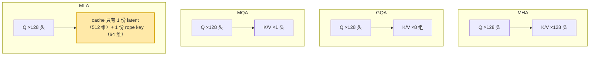
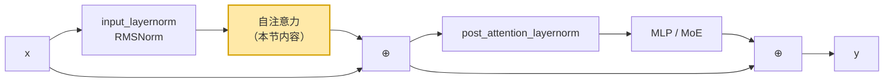
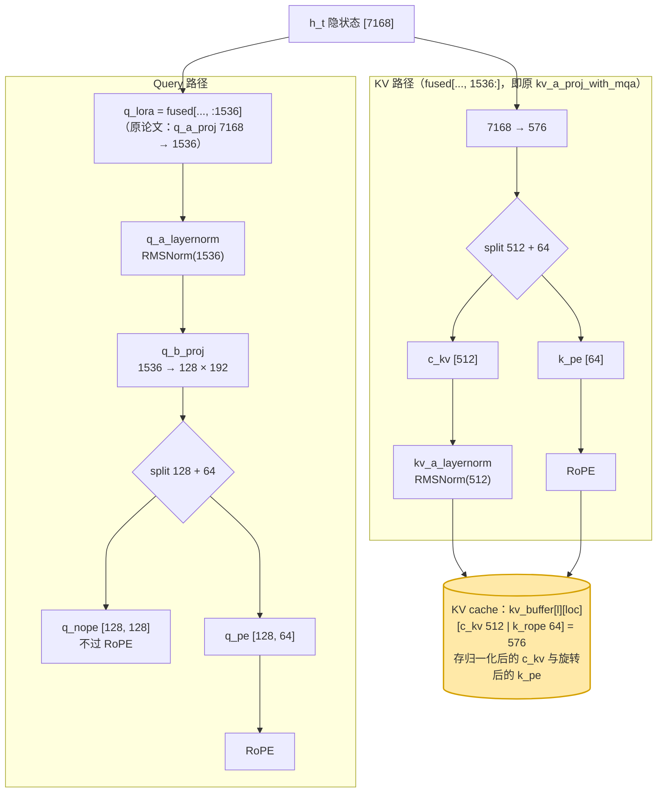
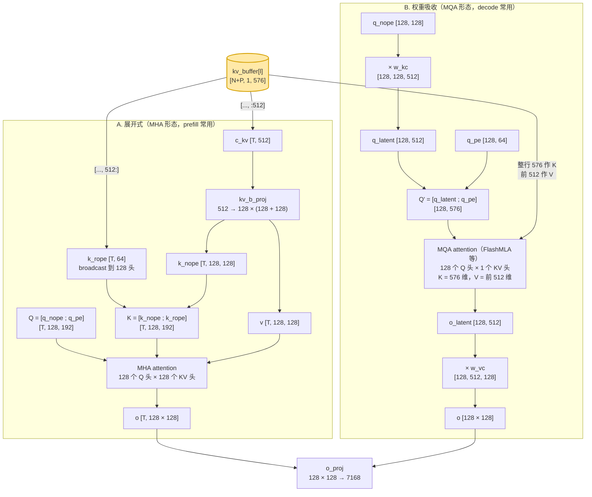
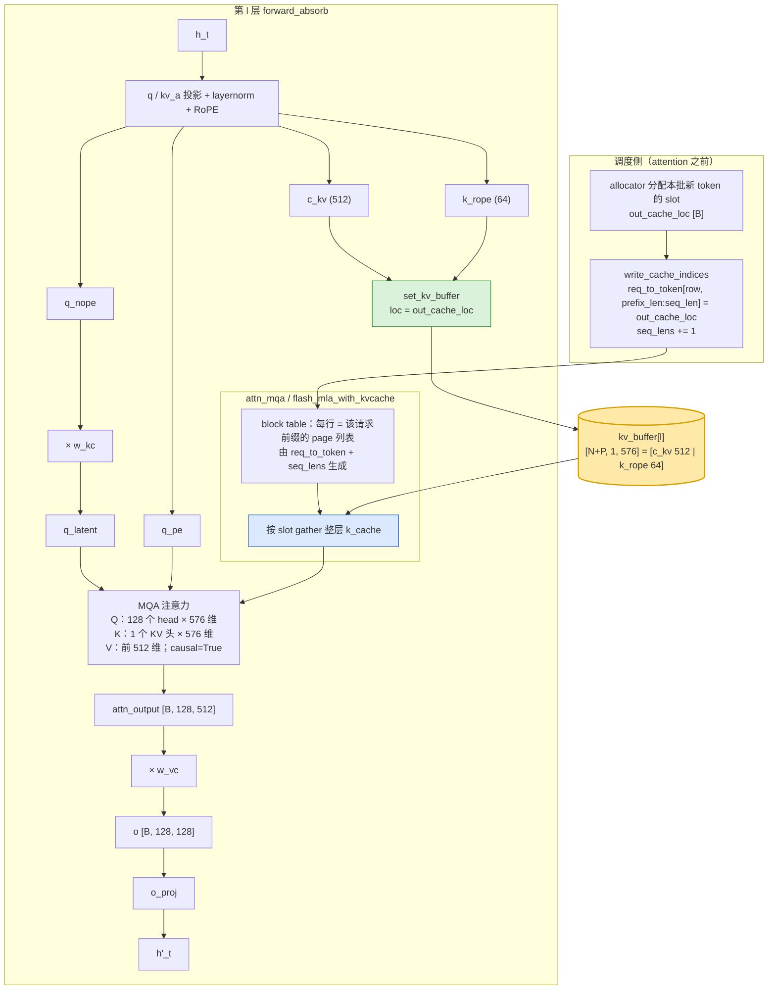
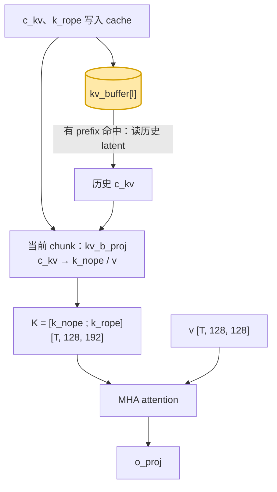

# 多头潜在注意力（Multi-head Latent Attention, MLA）原理与结构详解

> 本文系统介绍 DeepSeek 系列提出的多头潜在注意力（MLA）：数学原理、低秩 KV 压缩、
> 解耦 RoPE 与矩阵吸收（matrix absorption）技巧、完整网络结构与投影、复杂度与显存收益，
> 以及 SGLang 中针对 MLA 的双前向路径、专用 KV cache 池、多种 MLA attention backend
> 与注意力/KV cache 读写配合的实现。
>
> 以 DeepSeek-V3 为例，图中模块名与 sglang 代码（`deepseek_v2.py`、
> `deepseek_common/attention_forward_methods/` 等）中的变量名一致。
> KV cache 的存储布局见 [`kv_cache_core_fields_zh.md` §4.2](../mem_cache/kv_cache_core_fields_zh.md)。

## 目录

1. [为什么需要 MLA](#1-为什么需要-mla)
2. [MLA 在注意力家族中的位置](#2-mla-在注意力家族中的位置)
3. [MLA 的数学定义与低秩压缩](#3-mla-的数学定义与低秩压缩)
4. [解耦 RoPE](#4-解耦-rope)
5. [完整网络结构](#5-完整网络结构)
6. [注意力计算过程：展开式与权重吸收](#6-注意力计算过程展开式与权重吸收)
7. [权重吸收的推导](#7-权重吸收的推导)
8. [复杂度与显存收益分析](#8-复杂度与显存收益分析)
9. [注意力结构与 KV cache 的配合](#9-注意力结构与-kv-cache-的配合)
10. [SGLang 中的 MLA 实现](#10-sglang-中的-mla-实现)
11. [支持 MLA 的模型](#11-支持-mla-的模型)
12. [局限与权衡](#12-局限与权衡)

---

## 1. 为什么需要 MLA

GQA/MQA 通过减少 KV 头数来压缩 KV cache（见 `MHA_MQA_GQA.md`），但它是「粗粒度」的：
要么共享整组 K/V，要么不共享，质量损失与压缩率难以解耦。

MLA 的核心思想更激进：**不直接缓存每个头的 Key/Value，而是把它们压缩成一个低维的
「潜在向量」（latent vector）$c^{KV}$，推理时只缓存这个潜在向量，用到时再即时解压。**

这带来两个好处：

1. **KV cache 极致压缩**：每个 token 每层只需缓存一个 $d_c$ 维的潜在向量
   （DeepSeek-V2 中 $d_c = 512$），而非 $h_{kv}$ 组完整的 $d_k$ 维 K/V。
2. **质量几乎无损**：低秩压缩是「可学习」的连续压缩，相比 GQA 的「离散丢头」，
   在同等甚至更小的 KV cache 下能保持接近 MHA 的质量。

但天真的「缓存潜在向量、用时解压」会与 RoPE 位置编码冲突，也会在 decode 时引入额外
矩阵乘。MLA 用**解耦 RoPE**和**矩阵吸收**两个技巧解决这两个问题。

---

## 2. MLA 在注意力家族中的位置



关键区别在于 **cache 里存的是什么**：

- MHA / GQA / MQA 存的是**已经算好的 K 和 V**，共享关系表现为「几个 Q 头看同一个 KV 头」；
- MLA 存的是**压缩表示**（latent），共享关系表现为「所有 Q 头看同一份 latent，但各自用不同的 $W^{UK}_i / W^{UV}_i$ 把它还原成自己的 K、V」。

所以 MLA 在**访存上像 MQA**（只有 1 个 KV 头），在**表达能力上接近 MHA**（每个头的 K/V 相互独立）。这是它既能大幅压缩 cache 又不掉点的原因。

---

## 3. MLA 的数学定义与低秩压缩

### 3.1 一句话：缓存「压缩前的原料」

在进入公式前，先用一张图对比 MHA 与 MLA 的数据流。核心差异只有一处：**缓存什么**。

```
════════════════════ MHA（标准多头注意力）════════════════════
   维度：D=5120，h=128，d_k=192（nope128 + rope64），d_v=192（取 d_v=d_k）

              h_t  (D=5120)
                │
    ┌───────────┼───────────┐
    │ W^Q       │ W^K       │ W^V          ← 三个独立投影，一步到位
    │5120×24576 │5120×24576 │5120×24576      （=D × h·d_k）
    ▼           ▼           ▼
   q_t         k_t         v_t
(h·d_k)     (h·d_k)     (h·d_v)     ← h=128，每头 d_k=d_v=192
=128×192    =128×192    =128×192
 =24576      =24576      =24576
                │           │
                ▼           ▼
        ╔═════════════════════════════════╗
        ║  KV Cache: 存 k_t,v_t           ║  ← 每 token 每层
        ║   (每个头各存一份)               ║    h·d_k + h·d_v
        ╚═════════════════════════════════╝    = 2·h·d_k = 49152 维
                │                              随头数 h 线性膨胀 ❌
                ▼
          Attention(q, k, v) → o_t → W^O → D
          Q=h×d_k=24576，K=h×d_k=24576，V=h·d_v=24576；每头 o=d_v=192
                                    [24576×5120]（= h·d_v × D）


════════════════════ MLA（多头潜在注意力）════════════════════
   维度：D=5120，h=128，q_lora_rank=1536，kv_lora_rank=512，
         nope=128，rope=64

                    h_t  (D=5120)
                          │
        ┌─────────────────┴─────────────────┐
        │ W^DQ [5120×1536]                  │ W^DKV [5120×576]  ← 先降维到低秩
        ▼                                   ▼
     c^Q (1536)                    c^KV (512) + k_pe (64)
        │                                   │
        │ W^UQ [1536×24576]                 │           ← rope 段所有头共享
        ▼                                   ▼
   q_t (h·192)=24576        ╔═══════════════════════════╗
  = [nope128|rope64]        ║ KV Cache: 只存             ║
        │                   ║  [c^KV(512) | k_pe(64)]   ║ ← 每 token 每层
        │                   ║  = 576 维，与头数 h 无关    ║    576 维
        │                   ╚═══════════════════════════╝    比 MHA 小 ~85×
        │                               │
        │                               ▼ W^UK [512×16384], W^UV [512×16384]
        │                        （用时才解压；decode 时         （= d_c × h·128）
        │                          被"吸收"消除，见 §7）
        │                               │
        │                               ▼
        │                  k^C_t：每头 128(nope)，合计 h·128 = 16384
        │                  v^C_t：每头 128，      合计 h·128 = 16384
        │                               │
        └───────────────┬───────────────┘
                        ▼
     Attention：Q=h×192(nope128+rope64)，K=h×192(nope128+rope64 共享)，
                V=h×128；每头输出 v_head_dim=128
                        ▼
            o_t = h×128 = 16384 → W^O → D
                                      [16384×5120]（= h·v_head_dim × D）
```

**逐项对比**：

| 维度 | MHA | MLA |
| --- | --- | --- |
| 投影方式 | $h_t \xrightarrow{W^Q/W^K/W^V}$ 直接产出 Q/K/V | 先降维到低秩 $c$，用时再升维 |
| **缓存内容** | 每个头完整的 $k_t, v_t$ | 只存潜在向量 $[c^{KV} \mid k_{pe}]$ |
| **缓存大小**（每 token 每层） | $2\cdot h\cdot d_k = 49152$ 维 | $d_c + d_{rope} = 576$ 维 |
| 与头数 $h$ 的关系 | **线性增长** ❌ | **无关** ✅ |
| 位置编码 | RoPE 直接施加在 $k_t$ 上 | 拆出独立 rope 段（见 §4） |
| 解压成本 | 无需解压 | 需 $W^{UK},W^{UV}$；decode 时可吸收消除（见 §7） |

一句话概括：**MHA 缓存「解压后的结果」，MLA 缓存「压缩前的原料」**——用少量即时计算换取数十倍的显存节省。

> 与 GQA/MQA 的区别：后者是**减少头数**（离散地丢弃 KV 头），MLA 是**降低秩**（连续地压缩表示），
> 保留了全部 $h$ 个头的表达能力。三者对比见 `MHA_MQA_GQA.md`。

**读图要点（常见疑问）**：

- **`nope=128` / `rope=64` 怎么理解**：每头 key 的 $d_k=192$ 拆成两段——
  **nope**（**No-RoPE**，128 维）是**内容部分**，不施加位置旋转，由 latent 升维得到
  （$k^{nope}_i = W^{UK}_i c^{KV}$，每头不同），正因为不带位置旋转，$W^{UK}$ 才能在
  decode 时被吸收进 Query 侧（见 §7）；**rope**（64 维）是**位置部分**，先做 RoPE 再缓存
  （$k^{R}_t = R_{\theta,t}W^{KR}h_t$），且**所有头共享同一份**（不是每头 64 维）。
  一句话：$192 = 128_{\text{内容}} + 64_{\text{位置}}$。
- **V 不加 RoPE**：位置信息只影响注意力权重 $\mathrm{softmax}(q\cdot k)$，RoPE 只作用在
  **Q、K** 上；V 是被权重加权求和的内容，本身不含位置语义，因此 V 侧没有 rope 段
  （$v^{C}_t = W^{UV}c^{KV}$）。所以 cache 的 576 维 = `c^KV(512) + k_pe(64)` 里，
  rope 只挂在 K 一侧。
- **打分仍然分 head**：MLA 保留全部 $h$ 个 query 头，每个头有独立的 $q_i$ 与
  $W^{UK}_i/W^{UV}_i$，得分 $q_i \cdot k_i$ 逐头计算（$k_i$ 含各自 nope + 共享 rope）。
  「共享」只体现在两处：① 存储——KV cache 只有一份 latent，不是每头一份；② rope 段
  $k^{R}$ 全头共用同一向量。因此 MLA 表达能力接近 MHA，而 cache 占用像 MQA。

### 3.2 低秩联合压缩

设输入隐藏向量为 $h_t \in \mathbb{R}^{D}$。MLA 先把它降维到一个潜在向量：

$$
c^{KV}_t = W^{DKV}\, h_t \in \mathbb{R}^{d_c}
$$

其中 $W^{DKV}$ 是降维（down-projection）矩阵，$d_c \ll h \cdot d_k$。**KV cache 只存
$c^{KV}_t$。** 需要时再用升维（up-projection）矩阵 $W^{UK}, W^{UV}$ 还原出每个头的
Key 与 Value：

$$
k^{C}_t = W^{UK} c^{KV}_t, \qquad v^{C}_t = W^{UV} c^{KV}_t
$$

Query 端同样做低秩压缩（缓解训练显存、提升稳定性），但 Query 不需缓存：

$$
c^{Q}_t = W^{DQ} h_t, \qquad q^{C}_t = W^{UQ} c^{Q}_t
$$

DeepSeek-V2/V3 的典型维度：`q_lora_rank=1536`、`kv_lora_rank=512`、
`qk_nope_head_dim=128`、`qk_rope_head_dim=64`、`v_head_dim=128`。

> **「降维联合、升维拆分」**：压缩时 K 和 V **共用同一条**降维通路——一个 $W^{DKV}$ 把二者
> 联合压成同一个 latent $c^{KV}$，这正是 "Joint Compression" 的含义；解压时则用**两个独立**
> 矩阵分别还原：$W^{UK}$ 出每头 K 的 nope 段、$W^{UV}$ 出每头 V，两者参数互不共享。
>
> - 共享的 rope key $k_{pe}$ 来自另一条 $W^{KR}$，工程上常与 $W^{DKV}$（及 Query 的 $W^{DQ}$）
>   融合成**一次 GEMM**（SGLang 的 `fused_qkv_a_proj_with_mqa`），所以体感是「一个矩阵」；
> - 升维也常合并为一个 `kv_b_proj`（$d_c \to h\cdot(d_{nope}+d_v)$），但逻辑上仍是
>   $W^{UK}$、$W^{UV}$ 两个投影。
>
> 一句话：**压是 K/V 联合成一个 latent，解是 K、V 各用一个矩阵**——这正是既能共享 cache
> 又保住每头表达力的关键。

### 3.3 符号与维度（DeepSeek-V3）

| 符号 | 代码字段 | 值 | 含义 |
| --- | --- | --- | --- |
| $d_{model}$ | `hidden_size` | $7168$ | 隐状态维度 |
| $n_h$ | `num_attention_heads` | $128$ | Q 头数（TP 后为 `num_local_heads`） |
| $d_c'$ | `q_lora_rank` | $1536$ | Q 的低秩压缩维度 |
| $d_c$ | `kv_lora_rank` | $512$ | KV latent 维度，也是 V 的维度 |
| $d_h^{\text{nope}}$ | `qk_nope_head_dim` | $128$ | 每头 K 的「非位置」部分维度 |
| $d_h^{R}$ | `qk_rope_head_dim` | $64$ | 每头 K 的 RoPE 部分维度（所有头共享一份） |
| $d_v$ | `v_head_dim` | $128$ | 每头 V 的维度 |
| $d_h$ | `qk_head_dim` | $192$ | $= d_h^{\text{nope}} + d_h^{R}$ |
| — | `self.scaling` | $192^{-0.5} \approx 0.0722$ | softmax 缩放，注意分母是 $192$ 而不是 $128$ |

### 3.4 维度变化全流程（以 DeepSeek-V2 配置跟踪一个 token）

下面跟踪**一个 token** 的隐藏向量从输入到输出的维度变化（暂不考虑张量并行切分，即看单卡全量）。配置：

| 超参 | 值 |
|------|----|
| `hidden_size` $D$ | 5120 |
| `num_heads` $h$ | 128 |
| `q_lora_rank` | 1536 |
| `kv_lora_rank` $d_c$ | 512 |
| `qk_nope_head_dim` | 128 |
| `qk_rope_head_dim` | 64 |
| `qk_head_dim`（= nope + rope） | 192 |
| `v_head_dim` | 128 |

#### Query 侧（不缓存，每步重算）

| 步骤 | 投影 | 维度变化 |
|------|------|---------|
| 输入隐藏向量 | — | $D = 5120$ |
| Query 降维 | $W^{DQ}$ | $5120 \to 1536$（$c^Q$） |
| Query 升维 | $W^{UQ}$ | $1536 \to h\cdot 192 = 128\times192 = 24576$ |
| 拆分到每头 | reshape | $24576 \to (128\text{ 头},\ 192)$ |
| 每头再拆 nope/rope | split | $192 \to 128(\text{nope}) + 64(\text{rope})$ |

#### Key/Value 侧（只缓存潜在向量）

| 步骤 | 投影 | 维度变化 |
|------|------|---------|
| 输入隐藏向量 | — | $D = 5120$ |
| KV 降维（含共享 rope） | $W^{DKV}$ | $5120 \to d_c + 64 = 512 + 64 = 576$ |
| **缓存** | — | 只存这 **576** 维：`[c^KV(512) \| k_pe(64)]` |
| K/V 升维 | $W^{UK},W^{UV}$ | $512 \to h\cdot(128_{\text{nope}}+128_v)=128\times256=32768$ |
| 拆分到每头 | reshape/split | 每头 $k^{nope}=128$、$v=128$；$k^{rope}=64$ 为所有头共享 |

#### 注意力与输出

| 步骤 | 操作 | 维度变化 |
|------|------|---------|
| 每头 Q/K 内积 | $q\cdot k$（nope 128 + rope 64） | 得标量打分（每头、每个历史 token 一个） |
| 加权求和 | $\sum \text{softmax}\cdot v$ | 每头输出 $= v\_head\_dim = 128$ |
| 多头拼接 | concat | $128\text{ 头}\times128 = 16384$ |
| 输出投影 | $W^O$（`o_proj`） | $16384 \to D = 5120$ |

可见**首尾都是 $D=5120$**：MLA 只改变了中间「如何产生并缓存 Q/K/V」，
对外仍是「输入 $D$ 维 → 输出 $D$ 维」的标准注意力块。

#### 关键对比：缓存维度

- **MLA 每 token 每层缓存**：$d_c + d_{rope} = 512 + 64 = 576$ 维。
- **等价 MHA 每 token 每层缓存**：$2\cdot h\cdot d_k$。若按 $h=128$、$d_k=192$
  计为 $2\times128\times192 = 49152$ 维。

二者相差约 **85 倍**——这正是 §8 显存收益的来源。注意 `o_proj` 的输入维是
$h\cdot v\_head\_dim$ 而非 $h\cdot qk\_head\_dim$，因为输出走的是 value 头维。

> SGLang 对应实现：`fused_qkv_a_proj_with_mqa` 产出 `q_lora + kv_lora + qk_rope`
> （`deepseek_v2.py:1131`），`kv_b_proj` 做 K/V 升维（`:1187`），
> `o_proj` 输入维为 `num_heads * v_head_dim`（`:1197`）。

### 3.5 每 token 缓存量对比（DeepSeek-V3 数值）

| 方案 | 每 token 每层缓存元素数 | DeepSeek-V3 数值 |
| --- | --- | --- |
| 标准 MHA（按 128 头展开） | $n_h \times (d_h^{\text{nope}} + d_h^{R} + d_v)$ | $128 \times (128 + 64 + 128) = 40960$ |
| MLA | $d_c + d_h^{R}$ | $512 + 64 = 576$ |

压缩比约为 $\frac{40960}{576} \approx 71$ 倍。

### 3.6 三个容易踩的点

1. **cache 里存的 latent 是「归一化之后」的**：$\tilde{\mathbf{c}}^{KV}_t = \mathrm{RMSNorm}(\mathbf{c}^{KV}_t)$ 才是写进 cache 的值，up-projection 也作用在它上面。原始投影输出 $\mathbf{c}^{KV}_t$ 不落盘。
2. **cache 里存的 rope key 是「旋转之后」的**：$\mathbf{k}^{R}_t$ 写入前已经过 RoPE，读出后可直接参与点积。
3. **$\mathbf{k}^{R}_t$ 不做 RMSNorm**，只有 $\mathbf{c}^{KV}_t$ 做。

---

## 4. 解耦 RoPE

问题在于：RoPE（旋转位置编码）是**位置相关**的旋转，作用在 Q、K 上。如果把 RoPE
施加在「解压后的 $k^C$」上，那么 $W^{UK}$ 就不能再被吸收进 Query 侧（见 §7），
矩阵吸收技巧失效，缓存潜在向量的意义大打折扣。

MLA 的解法是**把每个头的维度拆成两部分**。这两段的命名直接来自「是否施加 RoPE」：

- **nope 部分**（$d_{nope}=128$）：**nope = No-RoPE，即「不加 RoPE」**。这一段位置无关，
  走低秩压缩/解压通路（decode 时走矩阵吸收）。正因为它不带位置旋转，升维矩阵 $W^{UK}$
  才能被预乘吸收进 Query 侧（见 §7），KV 压缩才有意义。
- **rope 部分**（$d_{rope}=64$）：**rope = RoPE（旋转位置编码）**。这一段单独走一条携带
  位置信息的通路并施加 RoPE，在所有头间共享（类似 MQA 的一组），与潜在向量一起缓存
  （布局 `[c^KV | k_pe]`）。

换句话说，拆分的根本动因是 **RoPE 与矩阵吸收冲突**：RoPE 是位置相关的旋转，若施加在
「解压后的 $k^C$」上，$W^{UK}$ 就无法再被吸收（§7 技巧失效）。于是 MLA 把位置信息隔离到
rope 这一小段单独处理，让 nope 段保持位置无关、可压缩可吸收。两段在打分时**分别计算再相加**
（详见附录 A.5）。

更形式化地看：如果对完整的 key 直接做 RoPE，那么

$$
\mathbf{k}_{s,i} = R_s\,W^{UK}_i\,\tilde{\mathbf{c}}^{KV}_s
$$

它带有位置相关的旋转 $R_s$（$s$ 是历史位置）。decode 时若想把 $W^{UK}$ 提前乘进当前 query，就必须处理 $R_s$，而 $R_s$ 依赖于每个历史位置 $s$，**无法提前消掉**——这正是标准 RoPE + 低秩压缩无法共存的原因。

MLA 把 key 拆成两段，让位置信息只走一小段低秩通路：

- **nope 段**（$d_h^{\text{nope}}=128$）：完全由 latent 线性生成、不带位置信息 → **可以吸收进 query**；
- **rope 段**（$d_h^{R}=64$）：只由 $W^{KR}$ 生成、所有头共享 $\mathbf{k}^{R}_t$，是唯一带位置信息的部分 → **不吸收**，照常参与点积。

点积按段相加即可：

$$
\mathbf{q}_{t,i}^{\top}\mathbf{k}_{s,i}
= \underbrace{{\mathbf{q}^{C}_{t,i}}^{\top}\mathbf{k}^{C}_{s,i}}_{\text{可吸收}}
+ \underbrace{{\mathbf{q}^{R}_t}^{\top}\mathbf{k}^{R}_s}_{\text{照常算}}
$$

于是 cache 里只需要「512 维未旋转的 latent + 64 维旋转后的 rope key」，位置信息一点不丢，而吸收操作又能成立。

最终 Query/Key 由两部分拼接而成：$q_t = [q^{nope}_t; q^{rope}_t]$，
$k_t = [k^{nope}_t; k^{rope}_t]$。SGLang 中这一拆分清晰可见：

```python
# python/sglang/srt/models/deepseek_common/attention_forward_methods/forward_mha.py:191
_, q_pe = q.split([self.qk_nope_head_dim, self.qk_rope_head_dim], dim=-1)
kv_a, _ = latent_cache.split([self.kv_lora_rank, self.qk_rope_head_dim], dim=-1)
...
k_pe = latent_cache[:, :, self.kv_lora_rank :]
if self.rotary_emb is not None:
    q_pe, k_pe = self.rotary_emb(positions, q_pe, k_pe)
```

注意缓存的 `latent_cache` 布局就是 `[c^{KV} (kv_lora_rank) | k_pe (qk_rope_head_dim)]`，
前段是待解压的潜在向量、后段是共享的带位置 Key。

---

## 5. 完整网络结构

### 5.1 在 decoder layer 中的位置



注意两点：

- 归一化在 attention **模块之外**（pre-norm 结构），模块内部只有投影矩阵，没有额外的 norm；
- 模块内一共 5 个 GEMM + 2 个 RMSNorm：$W^{DQ}$、$W^{UQ}$、$W^{DKV}$、`kv_b_proj`（即 $W^{UK}$ 与 $W^{UV}$ 合并后的形式）、$W^{O}$，以及 `q_a_layernorm`、`kv_a_layernorm`。

### 5.2 权重清单（以 TP = 1 为例）

| 权重 | 形状 | 参数量 | 作用 |
| --- | --- | --- | --- |
| `fused_qkv_a_proj_with_mqa` | $7168 \times 2112$ | 15.1 M | 一次 GEMM 同时算出 q_lora(1536)、c_kv(512)、k_pe(64) |
| ↳ 等价拆分 | `q_a_proj` $7168 \times 1536$ + `kv_a_proj_with_mqa` $7168 \times 576$ |  | 原论文/多数实现的写法，sglang 融合成一个矩阵 |
| `q_a_layernorm` | RMSNorm(1536) | — | 对 q_lora 做归一化 |
| `q_b_proj` | $1536 \times 24576$ | 37.7 M | q_lora → $128 \times 192$ |
| `kv_a_layernorm` | RMSNorm(512) | — | 对 c_kv 做归一化，**输出即写入 cache 的 latent** |
| `kv_b_proj` | $512 \times 32768$ | 16.8 M | latent → $128 \times (128\ \text{K} + 128\ \text{V})$ |
| `o_proj` | $16384 \times 7168$ | 117.4 M | 多头输出拼回 $d_{model}$ |
| `w_kc` | $128 \times 128 \times 512$ | 8.4 M | `kv_b_proj` 的 K 部分，decode 时吸收进 Q（§7） |
| `w_vc` | $128 \times 512 \times 128$ | 8.4 M | `kv_b_proj` 的 V 部分，decode 时吸收进输出（§7） |
| `rotary_emb` | cos/sin cache | — | 只作用于 64 维的 q_pe / k_pe |

单层 attention 参数合计约 $187$ M。同头数、同头维度的朴素 MHA（q 直投 + 独立的 k_proj/v_proj）约为 $587$ M，MLA 只有它的约 $1/3$。

TP 相关：`q_b_proj` 按 `attn_tp_rank` 做列切分、`o_proj` 做行切分；而 `fused_qkv_a_proj_with_mqa`（以及拆分写法里的 `kv_a_proj_with_mqa`）用 `ReplicatedLinear` **不切分**——因为它的输出里包含所有头共享的 $d_h^{R}$ 维 k_pe，切了就要额外通信。

### 5.3 Query 通路

| 步骤 | 公式 | 形状变化 |
| --- | --- | --- |
| 1 | $\mathbf{q}^{\text{lora}} = W^{DQ}\,\mathbf{h}_t$ | $7168 \to 1536$ |
| 2 | $\hat{\mathbf{q}}^{\text{lora}} = \mathrm{RMSNorm}(\mathbf{q}^{\text{lora}})$ | $1536$ |
| 3 | $\mathbf{q}_t = W^{UQ}\,\hat{\mathbf{q}}^{\text{lora}}$ | $1536 \to 128 \times 192$ |
| 4 | 切分：$\mathbf{q}^{C}_t$（128 维）、$\mathbf{q}^{R}_t$（64 维） | $128 \times 192 \to 128 \times 128$ + $128 \times 64$ |
| 5 | $\mathbf{q}^{R}_t \leftarrow \operatorname{RoPE}(\mathbf{q}^{R}_t, t)$ | $128 \times 64$ |

**只有 192 维里的 64 维（rope 段）过 RoPE，nope 段不动。**

### 5.4 KV 通路

| 步骤 | 公式 | 形状变化 |
| --- | --- | --- |
| 1 | $[\mathbf{c}^{KV}_t;\ \mathbf{k}^{R}_t] = W^{DKV}\,\mathbf{h}_t$ | $7168 \to 512 + 64$ |
| 2 | $\tilde{\mathbf{c}}^{KV}_t = \mathrm{RMSNorm}(\mathbf{c}^{KV}_t)$ | $512$ |
| 3 | $\mathbf{k}^{R}_t \leftarrow \operatorname{RoPE}(\mathbf{k}^{R}_t, t)$ | $64$ |
| 4 | 写入 cache：$\tilde{\mathbf{c}}^{KV}_t$ 落到 `kv_buffer[loc][:512]`，$\mathbf{k}^{R}_t$ 落到 `kv_buffer[loc][512:]` | 每 token 576 个元素 |

$\mathbf{k}^{R}_t$ 不做归一化，$\tilde{\mathbf{c}}^{KV}_t$ 不过 RoPE——这两条是 §7 吸收推导成立的前提。

### 5.5 完整投影图



---

## 6. 注意力计算过程：展开式与权重吸收

同一次前向有两条等价的计算路径，都从同一份 576 维的 cache 中读取，sglang 按 forward mode 选择。



### 6.1 A. 展开式（MHA 形态，prefill）

适用于 prefill：当前 chunk 的 K/V 就在算力侧，不需要「先写 cache 再读回」，且可以直接复用高度优化的标准 FlashAttention 类 kernel。

输入：$\tilde{\mathbf{c}}^{KV}_{1..T}$（$T$ 为本轮 token 数，可能来自 cache 也可能是刚算出的）。

1. **展开 K/V**（一次 GEMM `kv_b_proj`）：输入 $[T, 512]$，输出 $[T, 128 \times 256]$，reshape 成 $[T, 128, 256]$ 后按最后一维切两半

$$
\mathbf{k}^{C}_{s,i} = W^{UK}_i \tilde{\mathbf{c}}^{KV}_s \in \mathbb{R}^{128},\qquad
\mathbf{v}_{s,i} = W^{UV}_i \tilde{\mathbf{c}}^{KV}_s \in \mathbb{R}^{128}
$$

2. **拼上 rope 段**（$\mathbf{k}^{R}_s$ 只有一份，广播给 128 个头）

$$
\mathbf{k}_{s,i} = \left[\mathbf{k}^{C}_{s,i};\ \mathbf{k}^{R}_s\right] \in \mathbb{R}^{192}
$$

3. **Query 侧同样拼接**（$\mathbf{q}^{C}$ 不过 RoPE，$\mathbf{q}^{R}$ 过 RoPE）

$$
\mathbf{q}_{t,i} = \left[\mathbf{q}^{C}_{t,i};\ \mathbf{q}^{R}_t\right] \in \mathbb{R}^{192}
$$

4. **逐头点积 + 因果 softmax + 加权求和**

$$
a_{t,s,i} = \frac{\exp\!\left(\mathbf{q}_{t,i}^{\top}\mathbf{k}_{s,i}\,/\,\sqrt{192}\right)}{\sum_{s' \le t}\exp\!\left(\mathbf{q}_{t,i}^{\top}\mathbf{k}_{s',i}\,/\,\sqrt{192}\right)},\qquad
\mathbf{o}_{t,i} = \sum_{s \le t} a_{t,s,i}\,\mathbf{v}_{s,i} \in \mathbb{R}^{128}
$$

5. **输出投影**

$$
\mathbf{y}_t = W^{O}\left[\,\mathbf{o}_{t,1}; \ldots; \mathbf{o}_{t,n_h}\,\right]
$$

每 token 每头要读 192（K）+ 128（V）维，共 128 个头，于是 cache 读取量为 $128 \times 320 = 40960$ 个元素。

### 6.2 B. 权重吸收（MQA 形态，decode）

适用于 decode：单条 query 要扫完整段历史，瓶颈在访存而不是算力。

1. **把 $W^{UK}$ 吸收进 query 的 nope 段**（$w_kc$ 形状 $[n_h, 128, 512]$）

$$
\mathbf{q}'_{t,i} = \left[\,W^{UK\top}_i\,\mathbf{q}^{C}_{t,i};\ \mathbf{q}^{R}_t\,\right] \in \mathbb{R}^{512 + 64}
$$

2. **一次 MQA 风格的注意力**（只有 1 个 KV 头）

$$
a_{t,s,i} = \operatorname{softmax}_{s}\!\left(\frac{{\mathbf{q}'_{t,i}}^{\top}\left[\tilde{\mathbf{c}}^{KV}_s;\ \mathbf{k}^{R}_s\right]}{\sqrt{192}}\right),\qquad
\mathbf{o}^{\text{latent}}_{t,i} = \sum_{s \le t} a_{t,s,i}\,\tilde{\mathbf{c}}^{KV}_s \in \mathbb{R}^{512}
$$

K 是整行 576 维（latent + rope），V 是前 512 维 latent；**V 与 K 共用同一块显存，只是切片视图**。

3. **把 $W^{UV}$ 挪到注意力之后**（$w_vc$ 形状 $[n_h, 512, 128]$）

$$
\mathbf{o}_{t,i} = W^{UV}_i\,\mathbf{o}^{\text{latent}}_{t,i} \in \mathbb{R}^{128}
$$

4. **输出投影**：$\mathbf{y}_t = W^{O}\left[\,\mathbf{o}_{t,1}; \ldots; \mathbf{o}_{t,n_h}\,\right]$

每 token 从 cache 读取的元素数只有 576。

### 6.3 两种实现的对比

#### 原理区别

两者的本质区别是**升维矩阵 $W^{UK}$、$W^{UV}$ 放在哪一侧乘**，利用的是矩阵乘法结合律：

$$
\underbrace{{\mathbf{q}^{C}_{t,i}}^{\top}\big(W^{UK}_i\,\tilde{\mathbf{c}}^{KV}_s\big)}_{\text{A. 展开：先升维 K}}
=
\underbrace{\big({W^{UK}_i}^{\top}\mathbf{q}^{C}_{t,i}\big)^{\top}\tilde{\mathbf{c}}^{KV}_s}_{\text{B. 吸收：Q 降到 latent 空间}}
$$

$$
\underbrace{\sum_{s} a_{t,s,i}\,\big(W^{UV}_i\,\tilde{\mathbf{c}}^{KV}_s\big)}_{\text{A. 展开：先升维 V}}
=
\underbrace{W^{UV}_i\Big(\sum_{s} a_{t,s,i}\,\tilde{\mathbf{c}}^{KV}_s\Big)}_{\text{B. 吸收：注意力后再升维}}
$$

- **A. 展开式（MHA 形态）**：先用 `kv_b_proj` 把 latent 展开成每个头的 $\mathbf{k}^{C}_{s,i}$、$\mathbf{v}_{s,i}$，再拼上 $\mathbf{k}^{R}_s$，交给标准 MHA kernel 计算。升维的计算量与 **KV 长度** 成正比。
- **B. 权重吸收（MQA 形态）**：把 $W^{UK}$ 并到 Q 侧，把 $W^{UV}$ 挪到注意力之后。注意力直接在 latent $[\tilde{\mathbf{c}}^{KV}_s;\ \mathbf{k}^{R}_s]$ 上做，所有头共享这 1 份 KV。升维的计算量只与 **Q 长度** 成正比。
- **RoPE 段不能吸收**：$\mathbf{q}^{R\top}\mathbf{k}^{R}$ 中间夹着与位置相关的旋转矩阵，无法和固定权重合并，所以只能单独拼接。这正是采用解耦 RoPE 的原因。
- **cache 与 kernel 的分工**（以展开式为例）：
  - 模型层先通过 `_set_mla_kv_buffer` 把 latent（576 维）写入 KV pool。
  - 展开得到的 K/V 只是当前层的**临时激活张量**（PyTorch allocator 分配，用完即释放，不进 KV pool）。
  - 调用 kernel 时传 `save_kv_cache=False`，kernel 只负责计算。
  - 有 prefix 时：prefix 的 latent 从 cache 读出后再展开。one-shot 路径一次性读出；chunked 路径分块读出，并用 `merge_state_v2` 按 LSE 合并各块结果，以控制展开张量的显存峰值。
- **如何选择**：
  - prefill 阶段 Q 长，算力是瓶颈，展开后的计算量更小，而且能复用 FlashAttention，因此用 A。
  - decode 阶段 Q 只有 1 个 token、历史很长，访存是瓶颈，每 token 只读 576 维更有利，因此用 B。

#### 数值示例

为便于手算，取 1 个头，latent 维度 $d_c = 2$，nope 段维度 $d_h = 3$，历史共 2 个 token，并忽略 RoPE 段和缩放因子：

$$
\tilde{\mathbf{c}}_1 = \begin{bmatrix}1\\2\end{bmatrix},\quad
\tilde{\mathbf{c}}_2 = \begin{bmatrix}2\\0\end{bmatrix},\quad
\mathbf{q}^{C} = \begin{bmatrix}1\\1\\0\end{bmatrix}
$$

**示例 1：吸收 $W^{UK}$，注意力分数相同**

$$
W^{UK} = \begin{bmatrix}1&0\\0&1\\1&1\end{bmatrix}\in\mathbb{R}^{3\times 2}
$$

- **A. 展开式**：先对每个 token 升维，再做点积。

$$
\mathbf{k}_1 = W^{UK}\tilde{\mathbf{c}}_1 = \begin{bmatrix}1\\2\\3\end{bmatrix},\quad
\mathbf{k}_2 = W^{UK}\tilde{\mathbf{c}}_2 = \begin{bmatrix}2\\0\\2\end{bmatrix}
\;\Rightarrow\;
\mathbf{q}^{C\top}\mathbf{k}_1 = 3,\quad \mathbf{q}^{C\top}\mathbf{k}_2 = 2
$$

- **B. 权重吸收**：先把 q 降到 latent 空间（只算 1 次），再直接和 latent 做点积。

$$
\mathbf{q}' = W^{UK\top}\mathbf{q}^{C} = \begin{bmatrix}1&0&1\\0&1&1\end{bmatrix}\begin{bmatrix}1\\1\\0\end{bmatrix} = \begin{bmatrix}1\\1\end{bmatrix}
\;\Rightarrow\;
\mathbf{q}'^{\top}\tilde{\mathbf{c}}_1 = 3,\quad \mathbf{q}'^{\top}\tilde{\mathbf{c}}_2 = 2
$$

两种方式得到的分数都是 $[3, 2]$。区别在于：A 要对**每个 KV token** 各做一次升维（共 2 次），B 只对 **query** 做 1 次。历史越长，B 省下的升维计算越多。注意：这个玩具例子里 $d_c < d_h$，所以点积反而变短了；真实模型中 $d_c = 512 > d_h^{\text{nope}} = 128$，吸收后每个头的点积会从 192 维变长到 576 维，这正是 B 在算力上的代价。

**示例 2：吸收 $W^{UV}$，注意力输出相同**

$$
W^{UV} = \begin{bmatrix}1&1\\0&1\\2&0\end{bmatrix}\in\mathbb{R}^{3\times 2}
$$

为便于计算，取注意力权重 $a = [0.75,\ 0.25]$（接近 $\operatorname{softmax}([3,2]) \approx [0.73,\ 0.27]$）。

- **A. 展开式**：先把每个 token 的 V 升维，再加权求和。

$$
\mathbf{v}_1 = W^{UV}\tilde{\mathbf{c}}_1 = \begin{bmatrix}3\\2\\2\end{bmatrix},\quad
\mathbf{v}_2 = W^{UV}\tilde{\mathbf{c}}_2 = \begin{bmatrix}2\\0\\4\end{bmatrix}
\;\Rightarrow\;
\mathbf{o} = 0.75\,\mathbf{v}_1 + 0.25\,\mathbf{v}_2 = \begin{bmatrix}2.75\\1.5\\2.5\end{bmatrix}
$$

- **B. 权重吸收**：先在 latent 上加权求和，最后只做 1 次升维。

$$
\mathbf{o}^{\text{latent}} = 0.75\,\tilde{\mathbf{c}}_1 + 0.25\,\tilde{\mathbf{c}}_2 = \begin{bmatrix}1.25\\1.5\end{bmatrix}
\;\Rightarrow\;
\mathbf{o} = W^{UV}\mathbf{o}^{\text{latent}} = \begin{bmatrix}1.25+1.5\\1.5\\2.5\end{bmatrix} = \begin{bmatrix}2.75\\1.5\\2.5\end{bmatrix}
$$

两种方式的输出相同。这里 B 中 V 直接用 latent $\tilde{\mathbf{c}}_s$ 本身，也就是 cache 里那一份数据，所以 decode 时不需要展开任何 K/V。

#### 量化对比

| 维度 | A. 展开式 | B. 权重吸收 |
| --- | --- | --- |
| 每个头的 Q 维度 | $192$ | $576$ |
| KV 头数 | $128$ | $1$ |
| 每 token 读取的 KV 元素数 | $128 \times (192 + 128) = 40960$（需要先由 cache 展开） | $576$ |
| 每个 (query, key) 对的计算量 | $128 \times (192 + 128) = 40960$ MAC | $576 + 512 = 1088$ MAC |
| 额外开销 | 无 | 每 token 两次 BMM（$w_{kc}$ 吸收、$w_{vc}$ 还原），合计约 $2\,n_h\,d_h^{\text{nope}}\,d_c$ MAC |
| 适用场景 | prefill（计算密集，$T$ 大，可直接复用标准 FlashAttention kernel） | decode（访存密集，query 少、历史长） |

两者在数学上完全等价，但由于浮点运算顺序不同，**数值结果不完全一致**：吸收式改变了 softmax 输入的计算路径（先对 Q 做一次线性变换再点积），在 fp8/低精度下差异会更明显，因此同一请求的不同阶段（prefill 用 A、decode 用 B）切换时可能出现轻微 logits 抖动。

### 6.4 两条路径的调度

MLA 在不同阶段用不同策略，由一个枚举调度（`forward_methods.py`，含 `MHA`、`MLA`、`MHA_CHUNKED_KV` 等模式）：

- **MHA 路径（prefill）**：序列较长、本就要算全 $n\times n$ 注意力，此时把潜在向量
  **解压成完整 per-head K/V** 反而能直接复用高效的 FlashAttention kernel。
  `forward_mha.py` 通过 `kv_b_proj` 还原 `k_nope`/`v` 再拼上 `k_pe`。
- **MLA absorb 路径（decode）**：一次一个 query token、要对长历史做注意力，
  访存敏感。此时走 §7 的吸收路径，**直接在压缩潜在向量上注意力**，省下解压与显存。

为支撑两条路径，DeepSeek 模型侧构造了**两个** `RadixAttention` 实例：

- `attn_mqa`：维度为潜在空间（`v_head_dim = kv_lora_rank`），服务 absorb 路径
  （`deepseek_v2.py:1229`）。
- `attn_mha`：维度为 `qk_nope + qk_rope`，服务 prefill 解压路径
  （`deepseek_v2.py:1240`）。

---

## 7. 权重吸收的推导

decode 阶段（一次只算一个新 token，但要对全部历史 KV 做注意力）是访存瓶颈所在。
若每步都把整段历史的潜在向量解压成完整 K/V，反而增加了计算与中间显存。

**矩阵吸收（matrix absorption）** 利用矩阵乘结合律，把升维矩阵预先「吸收」进相邻的
权重，从而让注意力**直接在压缩的潜在向量上进行**，全程不解压。

`w_kc` 和 `w_vc` 就是把 `kv_b_proj` 的权重按 K、V 两部分拆开后得到的：

$$
W^{UK} \rightarrow \texttt{w\_kc} \in \mathbb{R}^{n_h \times d_h^{\text{nope}} \times d_c},\qquad
W^{UV} \rightarrow \texttt{w\_vc} \in \mathbb{R}^{n_h \times d_c \times d_v}
$$

利用矩阵乘法结合律，可以把 $W^{UK}$ 并入 query、把 $W^{UV}$ 挪到注意力之后：

$$
\mathbf{q}_{t,i}^{C\top}\,\mathbf{k}^{C}_{s,i}
= \mathbf{q}_{t,i}^{C\top}\,W^{UK}_i\,\tilde{\mathbf{c}}^{KV}_s
= \big(W^{UK\top}_i\,\mathbf{q}^{C}_{t,i}\big)^{\top}\tilde{\mathbf{c}}^{KV}_s
$$

$$
\mathbf{o}_{t,i} = \sum_s a_{t,s,i}\,W^{UV}_i\,\tilde{\mathbf{c}}^{KV}_s = W^{UV}_i \sum_s a_{t,s,i}\,\tilde{\mathbf{c}}^{KV}_s
$$

注意力打分 $q^{nope\top} k^{nope} = (W^{UQ}c^Q)^\top (W^{UK}c^{KV})
= (c^Q)^\top (W^{UQ\top} W^{UK})\, c^{KV}$。括号里的 $W^{UQ\top}W^{UK}$ 可在
权重加载时预乘成一个矩阵 `w_kc`，于是 Query 被「吸收」到潜在空间，直接与缓存的
$c^{KV}$ 做内积。同理输出端用 `w_vc` 把潜在空间的注意力结果吸收回值空间。

因此 decode 时 kernel 只需读取 576 维的 latent，不必把每个头的 K、V 展开到 $128 \times 256$ 维，访存量大幅下降。

拆分在权重加载阶段一次完成（`kv_b_proj` 原始形状 $[128 \times 256,\ 512]$）：

```python
# python/sglang/srt/models/deepseek_common/deepseek_weight_loader.py:555
w_kc, w_vc = w.unflatten(
    0, (-1, self_attn.qk_nope_head_dim + self_attn.v_head_dim)
).split([self_attn.qk_nope_head_dim, self_attn.v_head_dim], dim=1)
```

```683:707:python/sglang/srt/models/deepseek_common/deepseek_weight_loader.py
w_kc, w_vc = w.unflatten(
    0, (-1, self_attn.qk_nope_head_dim + self_attn.v_head_dim)
).split([self_attn.qk_nope_head_dim, self_attn.v_head_dim], dim=1)
...

if not use_deep_gemm_bmm:
    self_attn.w_kc = bind_or_assign(
        self_attn.w_kc, w_kc.transpose(1, 2).contiguous().transpose(1, 2)
    )
    w_vc = w_vc.contiguous().transpose(1, 2)
```

- `w.unflatten(0, (-1, 256))` → $[128, 256, 512]$，再按 dim=1 切成 $w_{kc}: [128, 128, 512]$、$w_{vc}: [128, 128, 512]$；
- `w_kc` 保持 $[n_h, d_h^{\text{nope}}, d_c]$ 布局（转置两次是为了拿连续内存）；
- `w_vc` 转成 $[n_h, d_c, d_v]$，这样 decode 里可以做 `bmm(attn_output, w_vc)`。

**注意 $d_h^{R}=64$ 那部分不在 $w_{kc}$/$w_{vc}$ 里**：rope 段既不吸收也不还原，始终以 576 维 cache 里那 64 维的原始形态参与计算。

decode 路径中把 Query 吸收进潜在空间（与 `w_kc` 做 batched matmul）：

```python
# python/sglang/srt/models/deepseek_common/attention_forward_methods/forward_mla.py:291
q_nope_out = torch.bmm(q_nope.transpose(0, 1), self.w_kc)
```

注意力在潜在维度上完成后，再用 `w_vc` 把结果吸收回 `v_head_dim` 输出空间：

```python
# python/sglang/srt/models/deepseek_common/attention_forward_methods/forward_mla.py:448
attn_bmm_output = torch.bmm(
    attn_output.transpose(0, 1),
    self.w_vc.to(torch.bfloat16) * self.w_scale,
    ...
)
```

---

## 8. 复杂度与显存收益分析

### 8.1 KV cache 显存

| 类型 | 每 token 每层缓存量 | 相对 MHA（DeepSeek-V2 配置） |
|------|------------------|----------------|
| MHA  | $2 \cdot h \cdot d_k$               | $1\times$ |
| GQA  | $2 \cdot h_{kv} \cdot d_k$          | $h_{kv}/h$ |
| MLA  | $d_c + d_{rope}$（潜在 + 共享 rope） | 约 $1/h_{kv}$ 量级，且 $\ll$ GQA |

MLA 每 token 每层只缓存 `kv_lora_rank + qk_rope_head_dim = 512 + 64 = 576` 个元素，
而等价 MHA 需缓存 $2 \times 128 \times 128 \approx 3.3$ 万个元素。压缩比可达数十倍，
同时质量接近 MHA——这是 MLA 相比 GQA 的核心优势。

### 8.2 计算复杂度

prefill 与标准注意力同阶 $O(n^2 D)$。decode 阶段经矩阵吸收后，注意力在 $d_c$ 维潜在
空间进行，避免了逐 token 解压，把访存换成了少量额外 matmul，整体更适配带宽受限的 decode。

---

## 9. 注意力结构与 KV cache 的配合

第 5 节画了「怎么写入」，第 6 节画了「怎么读」，这一节把两者串成一次完整前向：

> **同一层内部，先把本轮新 token 的 latent 写进 cache，再用注意力 kernel 从同一份 cache 里按 slot 读回全部前缀（含刚写入的当前 token）。**

### 9.1 一层 MLA 的完整数据流（decode，权重吸收）



绿色节点是写 cache，蓝色节点是读 cache。写入的 `k`、`v` 参数实际是同一份 576 维 latent（`c_kv` 与 `k_rope` 拼在一起），池子里按列切开：`get_key_buffer` 返回整行 576，`get_value_buffer` 只返回前 512。

```4158:4186:python/sglang/srt/mem_cache/memory_pool.py
    def set_kv_buffer(
        self,
        layer: RadixAttention,
        loc_info,
        cache_k: torch.Tensor,
        cache_v: torch.Tensor,
        layer_id_override: Optional[int] = None,
    ):
        loc, _, _ = unwrap_write_loc(loc_info)
        maybe_detect_oob(loc, 0, self.size + self.page_size, "set_kv_buffer (MLA)")
        layer_id = (
            layer_id_override if layer_id_override is not None else layer.layer_id
        )
        assert not self.dsa_kv_cache_store_fp8
        parallel = get_parallel()
        if parallel.dcp_enabled:
            valid_mask = loc % parallel.attn_dcp_size == parallel.attn_dcp_rank
            if not valid_mask.all():
                loc = loc[valid_mask]
                cache_k = cache_k[valid_mask]
        if cache_k.dtype != self.dtype:
            cache_k = cache_k.to(self.dtype)

        if self.store_dtype != self.dtype:
            self.kv_buffer[layer_id - self.start_layer][loc] = cache_k.view(
                self.store_dtype
            )
        else:
            self.kv_buffer[layer_id - self.start_layer][loc] = cache_k
```

后端（以 FlashMLA 为例）在 `forward_decode` 里顺序执行「先写、后读」，读写落在同一层同一个 buffer 上：

```411:421:python/sglang/srt/layers/attention/flashmla_backend.py
        cache_loc = forward_batch.out_cache_loc

        if k is not None:
            assert v is not None
            if save_kv_cache:
                self.token_to_kv_pool.set_kv_buffer(
                    layer,
                    cache_loc,
                    k,
                    v,
                )
```

随后用重建出的 block table 去调 kernel：

```463:468:python/sglang/srt/layers/attention/flashmla_backend.py
            # todo: need check all causal True or False?
            o, lse = flash_mla_with_kvcache(
                q=reshape_q,
                k_cache=k_cache.view(-1, PAGE_SIZE, 1, self.kv_cache_dim),
                block_table=self.forward_metadata.block_kv_indices[:bs],
                cache_seqlens=forward_batch.seq_lens.to(torch.int32),
```

### 9.2 为什么要「先写后读」

当前 token $t$ 的 $\tilde{\mathbf{c}}^{KV}_t$、$\mathbf{k}^{R}_t$ 必须参与自己的注意力计算，而 kernel 只认 cache 里的连续 page，所以：

1. **调度侧先定位**：本轮新 token 的 slot 由 allocator 给出（`out_cache_loc`），写进 `req_to_token[r, prefix_len:seq_len]`，同时 `seq_lens` 加 1；
2. **层内先写**：把 $\tilde{\mathbf{c}}^{KV}_t$、$\mathbf{k}^{R}_t$ 落到这些 slot；
3. **kernel 再读全前缀**：block table 覆盖到含当前 token 的完整前缀，`causal=True` 保证当前 query 只能看到 $s \le t$。

于是历史 token 和当前 token 走同一条读取路径，不需要为「当前 token 还没进 cache」做特判。第 1 步的落表发生在调度侧：

```54:66:python/sglang/srt/mem_cache/allocation.py
def write_cache_indices(
    out_cache_loc: torch.Tensor,
    req_pool_indices_tensor: torch.Tensor,
    req_pool_indices_cpu: torch.Tensor,
    # ... 其余索引与长度张量 ...
    req_to_token_pool: ReqToTokenPool,
):
```

### 9.3 slot → page 的映射（读写共用一张表）

```mermaid
flowchart LR
    subgraph R2T["req_to_token[row]：每请求一行"]
        direction LR
        T0["t0 → slot 4"] --- T1["t1 → slot 5"] --- T2["t2 → slot 6"] --- T3["t3 → slot 7"] --- T4["t4 → slot 10（当前）"]
    end
    subgraph BT["block_kv_indices[row]：PAGE_SIZE=64"]
        direction LR
        B0["page0 → slot 0..63"] --- B1["page1 → slot 64..127"]
    end
    R2T -->|"create_flashmla_kv_indices_triton"| BT
    BT -->|"flash_mla_with_kvcache"| GATHER["按 page 下标 gather 整层 k_cache<br/>页内形状 [PAGE_SIZE, 1, 576]"]
    GATHER --> KERN["kernel 侧 K / V<br/>只读 576 维 latent"]
    style GATHER fill:#ffe9a8,stroke:#d4a000,stroke-width:2px
```



写侧直接用 slot（`out_cache_loc`）索引，读侧先把 slot 按 `PAGE_SIZE` 折成 page 下标再交给 kernel，两侧共用 `req_to_token` 这一张 token→slot 表。slot 与 page 的分配细节见 [`kv_cache_core_fields_zh.md` §3](../mem_cache/kv_cache_core_fields_zh.md)。

### 9.4 prefill（展开式）与 cache 的配合

prefill 用 §6.1 的展开式：当前 chunk 的 K/V 在算力侧临时展开，不必先写进 cache 再读回，但算出的 latent 仍要写入 cache 供后续 decode 复用。



`mha_one_shot` 路径里，历史 latent 是按索引从 cache 读出来的，再和当前 chunk 一起经 `kv_b_proj` 展开：

```243:251:python/sglang/srt/models/deepseek_common/attention_forward_methods/forward_mha.py
                    kv_a, k_pe = self._get_mla_kv_buffer(
                        forward_batch.fetch_mha_one_shot_kv_indices(),
                        q.dtype,
                        forward_batch,
                    )
        kv = self.kv_b_proj(kv_a)[0]
        kv = kv.view(-1, self.num_local_heads, self.qk_nope_head_dim + self.v_head_dim)
        k_nope = kv[..., : self.qk_nope_head_dim]
        v = kv[..., self.qk_nope_head_dim :]
```

decode 侧则完全不展开，直接把吸收后的 query 和整行 latent 交给 MQA kernel：

```736:749:python/sglang/srt/models/deepseek_common/attention_forward_methods/forward_mla.py
                attn_output = self.attn_mqa(
                    q_nope_out,
                    k_nope,
                    k_nope,
                    forward_batch,
                    q_rope=q_pe,
                    k_rope=k_pe,
                    **extra_args,
                    **(
                        dict(topk_indices=topk_indices)
                        if topk_indices is not None
                        else {}
                    ),
                )
```

| 阶段 | 当前 token 的 K/V 来源 | 历史前缀的 K/V 来源 | cache 角色 |
| --- | --- | --- | --- |
| prefill（无 prefix 命中，ragged） | 临时张量直接算 | 不存在 | 只写 |
| prefill（有 prefix 命中 / `mha_one_shot`） | 临时展开 | 从 cache 读 latent 再 `kv_b_proj` 展开 | 写 + 读 |
| decode（权重吸收） | 先写入 cache，再随前缀一起读 | 从 cache 读 latent（不展开） | 写 + 读 |

---

## 10. SGLang 中的 MLA 实现

### 10.1 低秩投影的构造

DeepSeek 模型在 `deepseek_v2.py` 中构造降维/升维投影。当 `q_lora_rank` 存在时，
Query 降维与 KV 降维融合在一个投影里：

```python
# python/sglang/srt/models/deepseek_v2.py:1131
self.fused_qkv_a_proj_with_mqa = ReplicatedLinear(
    self.hidden_size,
    self.q_lora_rank + self.kv_lora_rank + self.qk_rope_head_dim,
    ...
)
```

KV 升维投影 `kv_b_proj`（即 §7 中拆出 `w_kc`/`w_vc` 的来源）：

```python
# python/sglang/srt/models/deepseek_v2.py:1187
self.kv_b_proj = ColumnParallelLinear(
    self.kv_lora_rank,
    self.num_heads * (self.qk_nope_head_dim + self.v_head_dim),
    ...
)
```

`w_kc` / `w_vc` 初始为 `None`（`deepseek_v2.py:1252`），在权重加载阶段由
`kv_b_proj` 权重拆分填充（见 §7）。

### 10.2 专用 KV 池：`MLATokenToKVPool`

与 MHA 池按「头数 × 头维」分配不同，MLA 池每 token 每层只存**一个**潜在向量
（含共享的 rope 段）：

```python
# python/sglang/srt/mem_cache/memory_pool.py:1471
self.kv_cache_dim = (
    override_kv_cache_dim
    if self.nsa_kv_cache_store_fp8
    else (kv_lora_rank + qk_rope_head_dim)
)
```

缓冲区形状是 `(size, 1, kv_cache_dim)`——头维退化为 1，正体现「不分头、只存潜在向量」：

```python
# python/sglang/srt/mem_cache/memory_pool.py:1496
self.kv_buffer = [
    torch.zeros(
        (self.size + self.page_size, 1, self.kv_cache_dim),
        dtype=self.store_dtype,
        device=self.device,
    )
    for _ in range(self.layer_num)
]
```

`get_value_buffer` 取潜在向量的前 `kv_lora_rank` 段（`memory_pool.py:1539`），
`set_mla_kv_buffer`（`:1566`）负责写入。该池还派生出 FP4 量化版 `MLATokenToKVPoolFP4`
与 NSA 版 `NSATokenToKVPool`。

### 10.3 多种 MLA 专用 attention backend

由于 MLA 的潜在空间注意力与标准注意力 kernel 不同，SGLang 提供了一组专用 backend：

| backend | 文件 |
|---------|------|
| FlashInfer MLA | `python/sglang/srt/layers/attention/flashinfer_mla_backend.py` |
| FlashMLA | `python/sglang/srt/layers/attention/flashmla_backend.py` |
| CUTLASS MLA | `python/sglang/srt/layers/attention/cutlass_mla_backend.py` |
| TRT-LLM MLA | `python/sglang/srt/layers/attention/trtllm_mla_backend.py` |

### 10.4 数据流总览

```
hidden h_t
  │
  ├─ W^DKV → c^KV (kv_lora_rank)  ┐
  └─ (rope 段) k_pe (qk_rope_dim) ┘→ 拼接后存入 MLATokenToKVPool: [c^KV | k_pe]
  ▼
prefill?
  ├─ 是 → MHA 路径：kv_b_proj 解压成完整 K/V → FlashAttention（attn_mha）
  └─ 否(decode) → absorb 路径：
        q_nope @ w_kc 吸收进潜在空间
        在 c^KV 上做注意力（attn_mqa）
        结果 @ w_vc 吸收回 v 空间
  ▼
解耦 RoPE：q_pe / k_pe 单独加旋转位置编码后拼接
```

### 10.5 与 sglang 代码的对应

| 概念 | 代码位置 |
| --- | --- |
| 权重定义、`scaling`、`attn_mqa` / `attn_mha` | `srt/models/deepseek_v2.py:1802-1946`（`DeepseekV2AttentionMLA.__init__`） |
| Q/KV 投影 + 写 cache（prefill 走 MHA 形态） | `deepseek_common/attention_forward_methods/forward_mha.py:141-254`（`forward_normal_prepare`） |
| Q/KV 投影 + 写 cache（decode 走吸收形态） | `deepseek_common/attention_forward_methods/forward_mla.py:279-670`（`forward_absorb_prepare`） |
| 展开式注意力的调用 | `srt/models/deepseek_v2.py:2123`（`AttnForwardMethod.MHA` → `forward_normal_core`） |
| 吸收式注意力的调用 | `srt/models/deepseek_v2.py:2135`（`AttnForwardMethod.MLA` → `forward_absorb_core`） |
| $w_{kc}$ / $w_{vc}$ 的切分 | `deepseek_common/deepseek_weight_loader.py:683-707` |
| MLA cache 读写 | `srt/mem_cache/memory_pool.py:4045`（`MLATokenToKVPool`） |
| prefill / decode 用哪个后端 | `srt/models/deepseek_v2.py:2021-2048`（`dispatch_attn_forward_method`，交给 backend handler 决定） |

`AttnForwardMethod` 的可选值在 `deepseek_common/attention_forward_methods/forward_methods.py:4`：prefill 侧对应 `MHA`、`MHA_ONE_SHOT`（短前缀一次算完）、`MHA_CHUNKED_KV`（长前缀分块避免 OOM），decode 侧对应 `MLA`（即 §6.2 的吸收式），另有 ROCm / NPU / CPU 的变体。

---

## 11. 支持 MLA 的模型

MLA 由 DeepSeek 提出，SGLang 中通过共享 `DeepseekV2AttentionMLA` 与
`deepseek_common` 复用逻辑的模型包括：

- **DeepSeek-V2 / V3 / V3.2**（`deepseek_v2.py`）及其 NextN/MTP 变体（`deepseek_nextn.py`）。
- **DeepSeek-VL2 / DeepSeek-OCR**（多模态，`deepseek_vl2.py`、`deepseek_ocr.py`）。
- **GLM-4-MoE-Lite**（`glm4_moe_lite.py`）、**LongCat-Flash**（`longcat_flash.py`）。
- **Kimi-Linear / Kimi-VL**（`kimi_linear.py`、`kimi_vl.py`，与线性注意力混合）。
- **Bailing-MoE-linear、Sarvam-MoE、MiniCPM3** 等。

---

## 12. 局限与权衡

- **实现复杂度高**：双前向路径、矩阵吸收、解耦 RoPE、两个 RadixAttention 实例、
  专用 KV 池与多套 backend，远比 GQA 的「一个 `num_kv_heads`」复杂，调试与维护成本高。
- **prefill / decode 行为不一致**：两条路径数值上需保持一致，量化（FP8/FP4）下尤其要
  小心 `w_scale` 等缩放因子的对齐（见 `forward_mla.py` 中大量 dtype 分支）。
- **与前缀缓存/稀疏注意力的叠加**：MLA 进一步与 NSA（DeepSeek-V3.2 稀疏注意力）组合时，
  KV 池需存 FP8 量化潜在向量（`nsa_kv_cache_store_fp8`），复杂度再升一层。
- **模型必须为 MLA 训练**：MLA 是一种训练期就确定的架构，不能把已训练好的 MHA/GQA
  模型「免训练」转成 MLA。

---

## 参考实现位置

| 模块 | 文件路径 |
|------|---------|
| MLA 投影与双 attention 实例 | `python/sglang/srt/models/deepseek_v2.py` |
| prefill 解压路径 | `python/sglang/srt/models/deepseek_common/attention_forward_methods/forward_mha.py` |
| decode 吸收路径 | `python/sglang/srt/models/deepseek_common/attention_forward_methods/forward_mla.py` |
| 路径调度枚举 | `python/sglang/srt/models/deepseek_common/attention_forward_methods/forward_methods.py` |
| w_kc/w_vc 权重拆分 | `python/sglang/srt/models/deepseek_common/deepseek_weight_loader.py` |
| MLA KV 池 | `python/sglang/srt/mem_cache/memory_pool.py` |
| MLA attention backend | `python/sglang/srt/layers/attention/{flashinfer_mla,flashmla,cutlass_mla,trtllm_mla}_backend.py` |

---

## 附录 A：MLA 数值计算示例

为直观理解 §3~§7 的低秩压缩、解耦 RoPE 与矩阵吸收，下面用一组**极小维度**的具体数字
完整走一遍 MLA 的计算流程，并验证「矩阵吸收」与「先解压再注意力」在数值上等价。

### A.0 维度约定（玩具配置）

| 符号 | 含义 | 取值 |
|------|------|------|
| $D$ | 隐藏维 | 4 |
| $d_c$ | 潜在向量维（kv_lora_rank） | 2 |
| $d_{nope}$ | nope 部分头维 | 2 |
| $d_{rope}$ | rope 部分头维 | 2 |
| $h$ | 头数 | 1（单头便于手算） |

注意力总头维 $d_k = d_{nope} + d_{rope} = 4$。下面只演示 **1 个 query token 对 1 个历史 token**
做注意力（decode 场景），足以体现矩阵吸收。

### A.1 权重与输入（设定）

输入隐藏向量（当前 query token 与 1 个历史 token）：

$$
h_q = [1,\ 0,\ 1,\ 0],\qquad h_1 = [0,\ 1,\ 0,\ 1]
$$

降维矩阵（KV 与 Query 各一个，取简单 0/1 形式）：

$$
W^{DKV} = \begin{bmatrix} 1 & 0 & 0 & 0 \\ 0 & 1 & 0 & 0 \end{bmatrix},\qquad
W^{DQ}  = \begin{bmatrix} 0 & 0 & 1 & 0 \\ 0 & 0 & 0 & 1 \end{bmatrix}
$$

升维矩阵（潜在 $d_c=2$ → nope 头维 $d_{nope}=2$）：

$$
W^{UK} = \begin{bmatrix} 1 & 1 \\ 0 & 1 \end{bmatrix},\qquad
W^{UQ} = \begin{bmatrix} 1 & 0 \\ 1 & 1 \end{bmatrix},\qquad
W^{UV} = \begin{bmatrix} 2 & 0 \\ 0 & 1 \end{bmatrix}
$$

为聚焦核心，下面 **rope 部分先记为零向量**（$q^{rope}=k^{rope}=[0,0]$），
即位置贡献为 0，A.5 再单独说明 RoPE 如何并入。

### A.2 低秩压缩（§3）

潜在向量（只缓存历史 token 的 $c^{KV}$）：

$$
c^{KV}_1 = W^{DKV} h_1 = [0,\ 1]
$$

Query 压缩：

$$
c^{Q} = W^{DQ} h_q = [1,\ 0]
$$

**KV cache 里只存 $c^{KV}_1 = [0,1]$（2 个数）**，而非完整的 per-head K/V。

### A.3 路径一：先解压再注意力（prefill / MHA 路径）

解压历史 token 的 nope Key、以及 Value：

$$
k^{nope}_1 = W^{UK} c^{KV}_1 = \begin{bmatrix}1&1\\0&1\end{bmatrix}\begin{bmatrix}0\\1\end{bmatrix} = [1,\ 1]
$$

$$
v_1 = W^{UV} c^{KV}_1 = \begin{bmatrix}2&0\\0&1\end{bmatrix}\begin{bmatrix}0\\1\end{bmatrix} = [0,\ 1]
$$

解压 Query 的 nope 部分：

$$
q^{nope} = W^{UQ} c^{Q} = \begin{bmatrix}1&0\\1&1\end{bmatrix}\begin{bmatrix}1\\0\end{bmatrix} = [1,\ 1]
$$

注意力打分（nope 内积 + rope 内积，rope 段为 0）：

$$
\text{score} = q^{nope}\cdot k^{nope}_1 + q^{rope}\cdot k^{rope}_1 = (1\cdot1 + 1\cdot1) + 0 = 2
$$

只有 1 个历史 token，softmax 后权重为 1，故注意力输出 = $v_1 = [0,\ 1]$。

### A.4 路径二：矩阵吸收（decode / absorb 路径，§7）

不解压，先把升维矩阵预乘成吸收矩阵：

$$
W^{abs} = (W^{UQ})^\top W^{UK}
= \begin{bmatrix}1&1\\0&1\end{bmatrix}\begin{bmatrix}1&1\\0&1\end{bmatrix}
= \begin{bmatrix}1&2\\0&1\end{bmatrix}
$$

> 说明：打分 $q^{nope}\!\cdot k^{nope} = (W^{UQ}c^{Q})^\top(W^{UK}c^{KV})
> = (c^{Q})^\top\big((W^{UQ})^\top W^{UK}\big) c^{KV} = (c^{Q})^\top W^{abs}\, c^{KV}$。

直接在**潜在空间**用 $c^Q$、$c^{KV}$ 计算打分，全程不解压：

$$
\text{score} = (c^{Q})^\top W^{abs}\, c^{KV}_1
= [1,\ 0]\begin{bmatrix}1&2\\0&1\end{bmatrix}\begin{bmatrix}0\\1\end{bmatrix}
= [1,\ 2]\begin{bmatrix}0\\1\end{bmatrix} = 2
$$

与 A.3 的 score = 2 **完全一致**，验证了矩阵吸收的等价性。

注意力在潜在空间得到的加权结果就是 $c^{KV}_1=[0,1]$（单 token，权重为 1），
再用 $W^{UV}$ 吸收回值空间：

$$
\text{out} = W^{UV} c^{KV}_1 = [0,\ 1]
$$

同样与 A.3 的输出 $[0,1]$ 一致。

### A.5 解耦 RoPE 如何并入（§4）

上面把 rope 段设为 0 以聚焦吸收。实际中 rope 段**不参与吸收**，而是单独计算后**加到打分上**：

$$
\text{score} = \underbrace{(c^{Q})^\top W^{abs}\, c^{KV}}_{\text{nope，潜在空间吸收}}
\;+\; \underbrace{q^{rope}\cdot k^{rope}}_{\text{rope，带位置，直接内积}}
$$

下面把 $q^{rope}$、$k^{rope}$ 的值**真正用 RoPE 算出来**，而非凭空假设。

#### A.5.1 RoPE 旋转的定义

RoPE 把 rope 维度两两分组，对处在位置 $p$ 的向量，第 $g$ 组（角频率 $\theta_g$）施加一个旋转角
$\alpha = p\,\theta_g$ 的二维旋转矩阵：

$$
R(p\,\theta_g) =
\begin{bmatrix} \cos(p\theta_g) & -\sin(p\theta_g) \\ \sin(p\theta_g) & \cos(p\theta_g) \end{bmatrix}
$$

本例 $d_{rope}=2$，恰好只有 1 组，取角频率 $\theta_0 = \tfrac{\pi}{2}$（玩具取值，便于手算）。

#### A.5.2 旋转前的 rope 分量与位置

设旋转前（投影出但尚未加位置）的 rope 分量均为单位向量 $[1,\ 0]$：

$$
\tilde{q}^{rope} = [1,\ 0],\qquad \tilde{k}^{rope}_1 = [1,\ 0]
$$

设当前 query token 在位置 $m = 2$，历史 key（$t_1$）在位置 $n = 1$。

#### A.5.3 施加旋转

query 在位置 $m=2$，旋转角 $\alpha_q = m\theta_0 = 2\cdot\tfrac{\pi}{2} = \pi$：

$$
q^{rope} = R(\pi)\,\tilde{q}^{rope}
= \begin{bmatrix}\cos\pi & -\sin\pi \\ \sin\pi & \cos\pi\end{bmatrix}\begin{bmatrix}1\\0\end{bmatrix}
= \begin{bmatrix}-1 & 0 \\ 0 & -1\end{bmatrix}\begin{bmatrix}1\\0\end{bmatrix}
= [-1,\ 0]
$$

key 在位置 $n=1$，旋转角 $\alpha_k = n\theta_0 = 1\cdot\tfrac{\pi}{2} = \tfrac{\pi}{2}$：

$$
k^{rope}_1 = R(\tfrac{\pi}{2})\,\tilde{k}^{rope}_1
= \begin{bmatrix}\cos\tfrac{\pi}{2} & -\sin\tfrac{\pi}{2} \\ \sin\tfrac{\pi}{2} & \cos\tfrac{\pi}{2}\end{bmatrix}\begin{bmatrix}1\\0\end{bmatrix}
= \begin{bmatrix}0 & -1 \\ 1 & 0\end{bmatrix}\begin{bmatrix}1\\0\end{bmatrix}
= [0,\ 1]
$$

#### A.5.4 rope 项打分与「相对位置」性质

rope 项即旋转后两向量的内积：

$$
q^{rope}\cdot k^{rope}_1 = [-1,\ 0]\cdot[0,\ 1] = 0
$$

RoPE 的关键性质是：旋转后内积只依赖**相对位置** $m-n$。验证——把两次旋转合并，
$q^{rope}\cdot k^{rope} = (R(\alpha_q)\tilde q)^\top (R(\alpha_k)\tilde k)
= \tilde q^\top R(\alpha_k-\alpha_q)\,\tilde k$，这里
$\alpha_k - \alpha_q = (n-m)\theta_0 = -\tfrac{\pi}{2}$：

$$
\tilde q^{\top} R(-\tfrac{\pi}{2})\,\tilde k
= [1,0]\begin{bmatrix}0 & 1 \\ -1 & 0\end{bmatrix}\begin{bmatrix}1\\0\end{bmatrix}
= [0,\ 1]\begin{bmatrix}1\\0\end{bmatrix} = 0
$$

与直接内积结果一致，说明打分只与相对距离 $m-n=1$ 有关。

#### A.5.5 合并到总打分

把 A.4 的 nope 项（=2）与此处 rope 项（=0）相加：

$$
\text{score} = \underbrace{2}_{\text{nope}} + \underbrace{0}_{\text{rope}} = 2
$$

> 若改设 query 也在位置 $m=1$（与 key 同位，相对距离 0），则 $\alpha_q=\alpha_k=\tfrac{\pi}{2}$，
> 旋转后 $q^{rope}=k^{rope}_1=[0,1]$，rope 项 $=1$，总打分变为 $2+1=3$。
> 可见 rope 项随相对位置变化，正是位置信息的来源。

这正是 §4 中「nope 走吸收通路、rope 走独立带位置通路、二者打分相加」的数值体现：
rope 段经 RoPE 旋转后保留了相对位置信息，且**不能被吸收进 $W^{abs}$**（旋转是位置相关的），
因此必须把 $k^{rope}$（即 `k_pe`）与潜在向量**一起缓存**（布局 `[c^KV | k_pe]`，见 §4）。

### A.6 显存直观对比

本例中 MLA 每个历史 token 只缓存 $c^{KV}=[0,1]$ 共 **2 个数**（外加共享的 rope 段）；
而等价 MHA 需缓存完整的 $k=[k^{nope};k^{rope}]$ 与 $v$，即 $4+2=6$ 个数。
随着真实维度（$d_c=512$ vs $2\times h\times d_k$）放大，这一压缩比可达数十倍，
即 §8 所述的核心显存收益。
