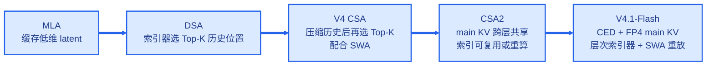
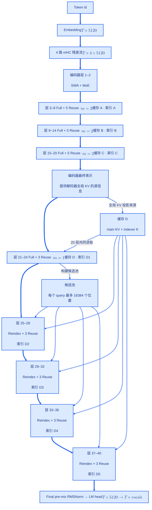
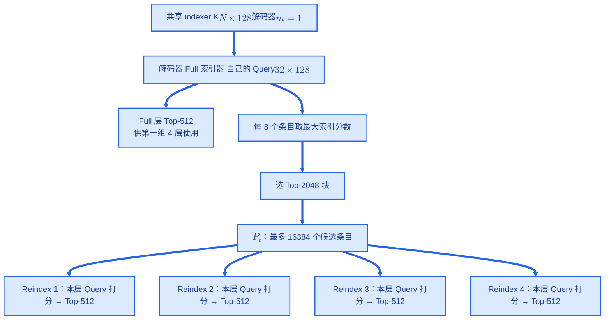
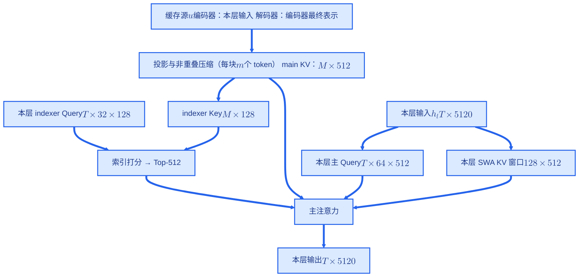
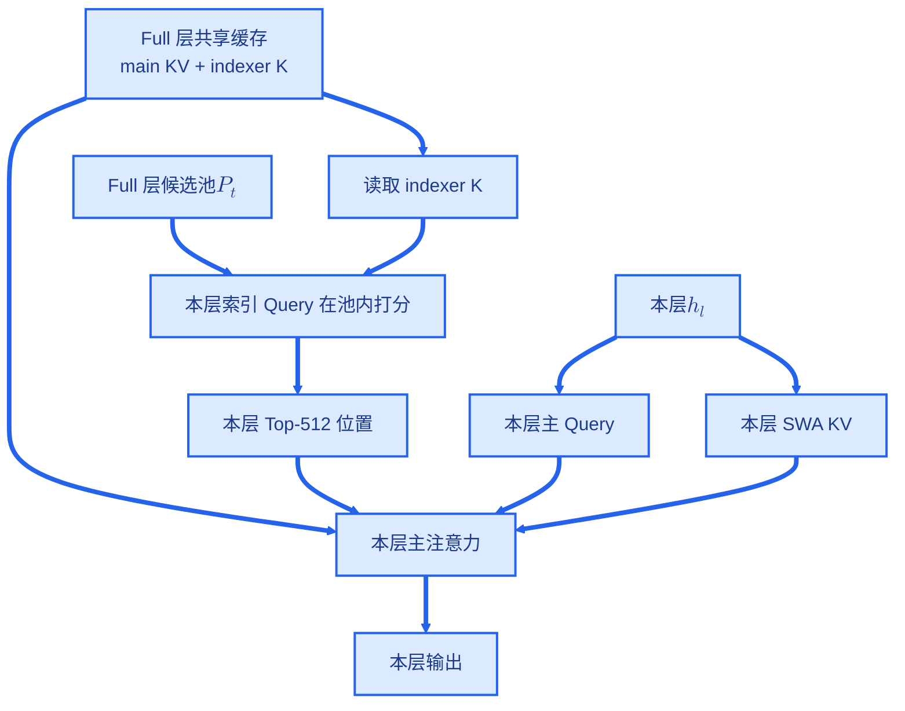
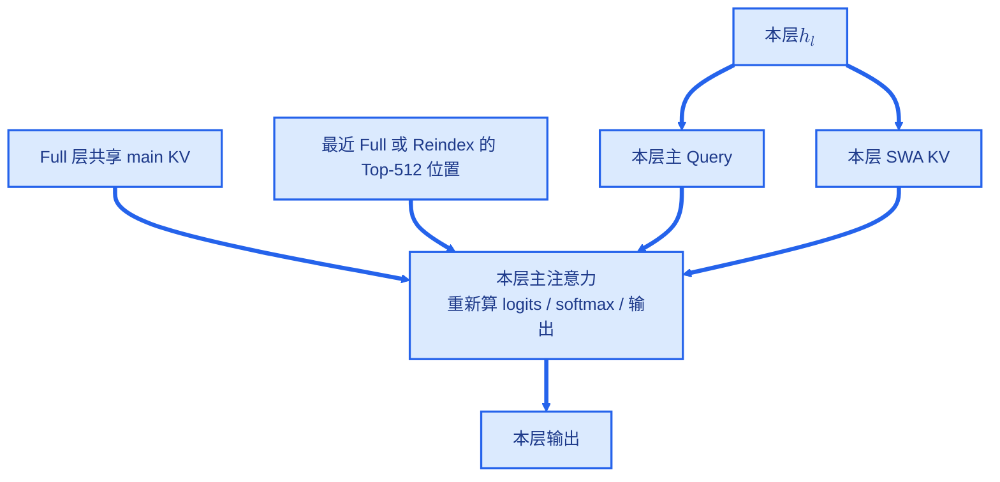
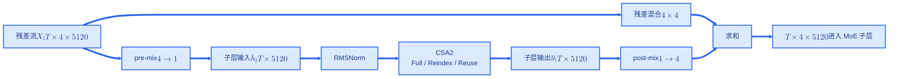

# CSA2 原理与结构详解：结合 DeepSeek-V4.1-Flash

> **CSA2（Compressed Sparse Attention 2）结合小维度 main KV、序列压缩、跨层缓存复用与稀疏索引复用。**
> 每层用自己的 query，在“共享的历史记忆 + 本层最近窗口”上重新计算注意力。
>
> 本文参考 [`MLA.md`](MLA.md) 的组织方式，依次展开动机、公式、维度、网络结构、数值例子、缓存读写与成本。
> 模型配置与 CSA2 行为依据仓库内的 [V4.1-Flash 论文解读](../../papers/llm/DeepSeek-V4.1-Flash-论文解读.md) §2–§6；
> 原报告 PDF 在当前工作区未找到，在线模型配置也未能读取，因此这些数值属于**已有笔记记录，尚未独立核验**。
> 本文的推导、估算和教学伪代码会标明口径；现有 `dsv4/` 代码仅作为前代对照。

## 目录

1. [核心思想与演进](#1-核心思想与演进)
2. [V4.1-Flash 中的层级布局](#2-v41-flash-中的层级布局)
3. [符号与张量维度](#3-符号与张量维度)
4. [main KV 如何产生](#4-main-kv-如何产生)
5. [索引器如何选择历史](#5-索引器如何选择历史)
6. [Full、Reindex、Reuse 的完整数据流](#6-fullreindexreuse-的完整数据流)
7. [主注意力计算与输出](#7-主注意力计算与输出)
8. [CED 与 mHC：放回模型整体](#8-ced-与-mhc放回模型整体)
9. [从压缩到输出的数值例子](#9-从压缩到输出的数值例子)
10. [Prefill、Decode 与缓存读写](#10-prefilldecode-与缓存读写)
11. [缓存容量与计算复杂度](#11-缓存容量与计算复杂度)
12. [与 MLA、CSA、HCA 的关系](#12-与-mlacsahca-的关系)
13. [实现对照、权衡与参考](#13-实现对照权衡与参考)

---

## 1. 核心思想与演进

### 1.1 长上下文的三项成本

对长度为 \(N\) 的序列，注意力服务主要付出三项成本：

| 成本 | 由什么决定 | CSA2 的措施 |
|---|---|---|
| 历史缓存容量 | \(\text{缓存条目数}\times\text{每条字节数}\times\text{独立缓存层数}\) | 小维度 KV、序列压缩、Full 层拥有缓存、FP4 |
| 主注意力访存与计算 | 每个 query 实际读取的 KV 数 | Top-512 历史条目 + 最近 128 个 SWA 条目 |
| 索引计算 | \(\text{索引器调用次数}\times\text{搜索域大小}\) | Reuse 复用索引，Reindex 在固定候选池内打分 |

**Top-K 降低读取量；跨层共享降低存储量；两者分别解决不同成本。**

### 1.2 从 MLA 到 CSA2



MLA 解释“一个历史 token 存多大”；CSA2 进一步解释“生成多少历史条目、多少层共同使用、每步选哪几个”。

### 1.3 一句话理解三种模式

- **Full**：建记忆、建索引，自己计算注意力。
- **Reindex**：读取已有记忆，按本层需求重新检索，自己计算注意力。
- **Reuse**：读取已有记忆和检索结果，按本层 query 重新计算注意力。

**共享的是 main KV / indexer K / 条目位置；各层的 query、SWA、注意力权重和输出仍各自计算。**

---

## 2. V4.1-Flash 中的层级布局

### 2.1 模型规格

以下数值沿用已有论文解读。

| 项目 | 配置 |
|---|---|
| 骨干参数 | 552B，另有 Engram 196B |
| 激活参数 | prefill 8B / decode 16B |
| 主干层数 | 40：因果编码器 20 + 解码器 20 |
| 隐藏维度 \(D\) | 5120 |
| mHC 残差流数 | 4 |
| Query 头数 \(H\) | 64 |
| 注意力工作维度 \(d\) | 512 |
| Query 低秩维度 \(r_q\) | 1280 |
| 索引 Query 头数 \(H_I\) | 32 |
| 索引维度 \(d_I\) | 128 |
| 稀疏选择 \(K\) | 512 |
| SWA 窗口 \(W\) | 128 |
| MoE | 1 共享 + 384 路由专家，激活 6 个路由专家；中间维 2304 |
| 上下文 | 最长 1M token |

### 2.2 展开每一组的所有者

下面用 **1 起始层号**；编码器、解码器均计入 40 层主干。

| 全局层号 | 区域 | 模式顺序 | 压缩率 \(m\) | main KV 所有者 | 索引所有者 |
|---|---|---|---|---|---|
| 1–2 | 编码器 | SWA、SWA | — | 本层局部 KV | — |
| 3–8 | 编码器组 1 | Full + 5 Reuse | 2 | 第 3 层 | 第 3 层 |
| 9–14 | 编码器组 2 | Full + 5 Reuse | 2 | 第 9 层 | 第 9 层 |
| 15–20 | 编码器组 3 | Full + 5 Reuse | 2 | 第 15 层 | 第 15 层 |
| 21–24 | 解码器组 1 | Full + 3 Reuse | 1 | 第 21 层 | 第 21 层 |
| 25–28 | 解码器组 2 | Reindex + 3 Reuse | 1 | 第 21 层 | 第 25 层 |
| 29–32 | 解码器组 3 | Reindex + 3 Reuse | 1 | 第 21 层 | 第 29 层 |
| 33–36 | 解码器组 4 | Reindex + 3 Reuse | 1 | 第 21 层 | 第 33 层 |
| 37–40 | 解码器组 5 | Reindex + 3 Reuse | 1 | 第 21 层 | 第 37 层 |

据此得到：

- 38 个 CSA2 层：4 Full + 4 Reindex + 30 Reuse；另外 2 层仅 SWA。
- 编码器有 3 套独立全局缓存，每套被 6 层读取。
- 解码器有 1 套独立全局缓存，被 20 层读取；其中 5 个索引产出层提供 5 组检索结果。
- 40 层各有自己的 SWA 缓存。

### 2.3 整体结构图



**图中 \(m\) 表示 main KV 的序列压缩率**：它决定条目数量，每条 main KV 都是 512 维。

- 编码器 \(m=2\)：每 2 个相邻源 token 聚合成 1 个条目，例如 8 个 token 生成 4 个 main KV 条目。
- 解码器 \(m=1\)：每个源 token 对应 1 个条目，例如 8 个 token 生成 8 个 main KV 条目；仍通过跨层共享、FP4 存储和 Top-512 稀疏读取降低成本。

每个主干层的 Attention 和 MoE 子层由 mHC 残差混合包裹。Engram 位于编码器第 2、15 层，改变隐状态中的内容；CSA2 用这些隐状态生成 query 和缓存。

### 2.4 编码器组展开

每组第 1 层是 Full，生成本组的 main KV、indexer K 和 Top-512 位置；其余 5 层是 Reuse，读取这些结果，各自重新计算主注意力。实线表示层间残差流，虚线表示读取本组共享的缓存和索引。

```mermaid
flowchart TB
    IN["层 1–2 · SWA + MoE<br/><br/>输入 $$X_l$$：$$T\times4\times5120$$<br/>SWA KV：$$\min(N,128)\times512$$ / 层"]
    subgraph G1["编码器组 1 · 层 3–8 · $$m=2$$ · 残差流 $$T\times4\times5120$$"]
        direction LR
        L3["层 3 · Full<br/><br/>$$h_l$$：$$T\times5120$$<br/>主 Q：$$T\times64\times512$$<br/>索引 Q：$$T\times32\times128$$<br/>SWA KV：$$128\times512$$"] --> L4["层 4 · Reuse<br/><br/>主 Q：$$T\times64\times512$$<br/>SWA KV：$$128\times512$$"] --> L5["层 5 · Reuse<br/><br/>主 Q：$$T\times64\times512$$<br/>SWA KV：$$128\times512$$"] --> L6["层 6 · Reuse<br/><br/>主 Q：$$T\times64\times512$$<br/>SWA KV：$$128\times512$$"] --> L7["层 7 · Reuse<br/><br/>主 Q：$$T\times64\times512$$<br/>SWA KV：$$128\times512$$"] --> L8["层 8 · Reuse<br/><br/>主 Q：$$T\times64\times512$$<br/>SWA KV：$$128\times512$$"]
        L3 -- "生成" --> CA["缓存 A<br/><br/>main KV：$$\lfloor N/2\rfloor\times512$$<br/>indexer K：$$\lfloor N/2\rfloor\times128$$<br/>索引 A：$$T\times512$$ 位置"]
        CA -.-> L4
        CA -.-> L5
        CA -.-> L6
        CA -.-> L7
        CA -.-> L8
    end
    subgraph G2["编码器组 2 · 层 9–14 · $$m=2$$ · 残差流 $$T\times4\times5120$$"]
        direction LR
        L9["层 9 · Full<br/><br/>$$h_l$$：$$T\times5120$$<br/>主 Q：$$T\times64\times512$$<br/>索引 Q：$$T\times32\times128$$<br/>SWA KV：$$128\times512$$"] --> L10["层 10 · Reuse<br/><br/>主 Q：$$T\times64\times512$$<br/>SWA KV：$$128\times512$$"] --> L11["层 11 · Reuse<br/><br/>主 Q：$$T\times64\times512$$<br/>SWA KV：$$128\times512$$"] --> L12["层 12 · Reuse<br/><br/>主 Q：$$T\times64\times512$$<br/>SWA KV：$$128\times512$$"] --> L13["层 13 · Reuse<br/><br/>主 Q：$$T\times64\times512$$<br/>SWA KV：$$128\times512$$"] --> L14["层 14 · Reuse<br/><br/>主 Q：$$T\times64\times512$$<br/>SWA KV：$$128\times512$$"]
        L9 -- "生成" --> CB["缓存 B<br/><br/>main KV：$$\lfloor N/2\rfloor\times512$$<br/>indexer K：$$\lfloor N/2\rfloor\times128$$<br/>索引 B：$$T\times512$$ 位置"]
        CB -.-> L10
        CB -.-> L11
        CB -.-> L12
        CB -.-> L13
        CB -.-> L14
    end
    subgraph G3["编码器组 3 · 层 15–20 · $$m=2$$ · 残差流 $$T\times4\times5120$$"]
        direction LR
        L15["层 15 · Full<br/><br/>$$h_l$$：$$T\times5120$$<br/>主 Q：$$T\times64\times512$$<br/>索引 Q：$$T\times32\times128$$<br/>SWA KV：$$128\times512$$"] --> L16["层 16 · Reuse<br/><br/>主 Q：$$T\times64\times512$$<br/>SWA KV：$$128\times512$$"] --> L17["层 17 · Reuse<br/><br/>主 Q：$$T\times64\times512$$<br/>SWA KV：$$128\times512$$"] --> L18["层 18 · Reuse<br/><br/>主 Q：$$T\times64\times512$$<br/>SWA KV：$$128\times512$$"] --> L19["层 19 · Reuse<br/><br/>主 Q：$$T\times64\times512$$<br/>SWA KV：$$128\times512$$"] --> L20["层 20 · Reuse<br/><br/>主 Q：$$T\times64\times512$$<br/>SWA KV：$$128\times512$$"]
        L15 -- "生成" --> CC["缓存 C<br/><br/>main KV：$$\lfloor N/2\rfloor\times512$$<br/>indexer K：$$\lfloor N/2\rfloor\times128$$<br/>索引 C：$$T\times512$$ 位置"]
        CC -.-> L16
        CC -.-> L17
        CC -.-> L18
        CC -.-> L19
        CC -.-> L20
    end
    IN --> G1
    G1 --> G2
    G2 --> G3
    G3 --> EH["编码器最终表示<br/><br/>$$N\times5120$$ → 进入解码器"]
    classDef blue fill:#dbeafe,stroke:#2563eb,stroke-width:2px,color:#1e3a8a
    class IN,L3,L4,L5,L6,L7,L8,CA,L9,L10,L11,L12,L13,L14,CB,L15,L16,L17,L18,L19,L20,CC,EH blue
    linkStyle default stroke:#2563eb,stroke-width:4px,color:#1e3a8a
```

### 2.5 解码器组展开

20 层共用一套缓存 D，它由层 21 从编码器最终表示投影得到。层 21 是 Full，在全可见域检索得到索引 D1，同时构建候选池 \(P_t\)。后面 4 组的第 1 层是 Reindex，用本层的索引 Query 在 \(P_t\) 内重新打分，得到新的 Top-512；同组另外 3 层 Reuse 沿用这份索引。

```mermaid
flowchart TB
    EH["编码器最终表示<br/><br/>$$N\times5120$$"]
    EH -- "投影 $$5120\rightarrow512$$ · $$m=1$$" --> DK["缓存 D · 层 21 生成并拥有<br/><br/>main KV：$$N\times512$$<br/>indexer K：$$N\times128$$"]
    subgraph DG1["解码器组 1 · 层 21–24 · 残差流 $$T\times4\times5120$$"]
        direction LR
        L21["层 21 · Full<br/><br/>$$h_l$$：$$T\times5120$$<br/>主 Q：$$T\times64\times512$$<br/>索引 Q：$$T\times32\times128$$<br/>SWA KV：$$128\times512$$"] --> L22["层 22 · Reuse<br/><br/>主 Q：$$T\times64\times512$$<br/>SWA KV：$$128\times512$$"] --> L23["层 23 · Reuse<br/><br/>主 Q：$$T\times64\times512$$<br/>SWA KV：$$128\times512$$"] --> L24["层 24 · Reuse<br/><br/>主 Q：$$T\times64\times512$$<br/>SWA KV：$$128\times512$$"]
        L21 -- "全域打分 $$T\times N$$" --> I1["索引 D1<br/><br/>$$T\times512$$ 位置"]
        L21 -- "每 8 条取最大 → Top-2048 块" --> POOL["候选池 $$P_t$$<br/><br/>$$T\times16384$$ 位置（上限）"]
        I1 -.-> L22
        I1 -.-> L23
        I1 -.-> L24
    end
    subgraph DG2["解码器组 2 · 层 25–28 · 残差流 $$T\times4\times5120$$"]
        direction LR
        L25["层 25 · Reindex<br/><br/>$$h_l$$：$$T\times5120$$<br/>主 Q：$$T\times64\times512$$<br/>索引 Q：$$T\times32\times128$$<br/>SWA KV：$$128\times512$$"] --> L26["层 26 · Reuse<br/><br/>主 Q：$$T\times64\times512$$<br/>SWA KV：$$128\times512$$"] --> L27["层 27 · Reuse<br/><br/>主 Q：$$T\times64\times512$$<br/>SWA KV：$$128\times512$$"] --> L28["层 28 · Reuse<br/><br/>主 Q：$$T\times64\times512$$<br/>SWA KV：$$128\times512$$"]
        L25 -- "池内打分 $$T\times16384$$" --> I2["索引 D2<br/><br/>$$T\times512$$ 位置"]
        I2 -.-> L26
        I2 -.-> L27
        I2 -.-> L28
    end
    subgraph DG3["解码器组 3 · 层 29–32 · 残差流 $$T\times4\times5120$$"]
        direction LR
        L29["层 29 · Reindex<br/><br/>$$h_l$$：$$T\times5120$$<br/>主 Q：$$T\times64\times512$$<br/>索引 Q：$$T\times32\times128$$<br/>SWA KV：$$128\times512$$"] --> L30["层 30 · Reuse<br/><br/>主 Q：$$T\times64\times512$$<br/>SWA KV：$$128\times512$$"] --> L31["层 31 · Reuse<br/><br/>主 Q：$$T\times64\times512$$<br/>SWA KV：$$128\times512$$"] --> L32["层 32 · Reuse<br/><br/>主 Q：$$T\times64\times512$$<br/>SWA KV：$$128\times512$$"]
        L29 -- "池内打分 $$T\times16384$$" --> I3["索引 D3<br/><br/>$$T\times512$$ 位置"]
        I3 -.-> L30
        I3 -.-> L31
        I3 -.-> L32
    end
    subgraph DG4["解码器组 4 · 层 33–36 · 残差流 $$T\times4\times5120$$"]
        direction LR
        L33["层 33 · Reindex<br/><br/>$$h_l$$：$$T\times5120$$<br/>主 Q：$$T\times64\times512$$<br/>索引 Q：$$T\times32\times128$$<br/>SWA KV：$$128\times512$$"] --> L34["层 34 · Reuse<br/><br/>主 Q：$$T\times64\times512$$<br/>SWA KV：$$128\times512$$"] --> L35["层 35 · Reuse<br/><br/>主 Q：$$T\times64\times512$$<br/>SWA KV：$$128\times512$$"] --> L36["层 36 · Reuse<br/><br/>主 Q：$$T\times64\times512$$<br/>SWA KV：$$128\times512$$"]
        L33 -- "池内打分 $$T\times16384$$" --> I4["索引 D4<br/><br/>$$T\times512$$ 位置"]
        I4 -.-> L34
        I4 -.-> L35
        I4 -.-> L36
    end
    subgraph DG5["解码器组 5 · 层 37–40 · 残差流 $$T\times4\times5120$$"]
        direction LR
        L37["层 37 · Reindex<br/><br/>$$h_l$$：$$T\times5120$$<br/>主 Q：$$T\times64\times512$$<br/>索引 Q：$$T\times32\times128$$<br/>SWA KV：$$128\times512$$"] --> L38["层 38 · Reuse<br/><br/>主 Q：$$T\times64\times512$$<br/>SWA KV：$$128\times512$$"] --> L39["层 39 · Reuse<br/><br/>主 Q：$$T\times64\times512$$<br/>SWA KV：$$128\times512$$"] --> L40["层 40 · Reuse<br/><br/>主 Q：$$T\times64\times512$$<br/>SWA KV：$$128\times512$$"]
        L37 -- "池内打分 $$T\times16384$$" --> I5["索引 D5<br/><br/>$$T\times512$$ 位置"]
        I5 -.-> L38
        I5 -.-> L39
        I5 -.-> L40
    end
    EH --> DG1
    DG1 --> DG2
    DG2 --> DG3
    DG3 --> DG4
    DG4 --> DG5
    DG5 --> OUT["Final pre-mix → RMSNorm → LM head<br/><br/>$$T\times4\times5120\rightarrow T\times5120\rightarrow T\times\mathrm{vocab}$$"]
    DK -. "20 层共同读取 main KV $$N\times512$$" .-> DG1
    DK -.-> DG2
    DK -.-> DG3
    DK -.-> DG4
    DK -.-> DG5
    DG1 -. "共享 $$P_t$$" .-> DG2
    DG1 -.-> DG3
    DG1 -.-> DG4
    DG1 -.-> DG5
    classDef blue fill:#dbeafe,stroke:#2563eb,stroke-width:2px,color:#1e3a8a
    class EH,DK,L21,L22,L23,L24,I1,POOL,L25,L26,L27,L28,I2,L29,L30,L31,L32,I3,L33,L34,L35,L36,I4,L37,L38,L39,L40,I5,OUT blue
    linkStyle default stroke:#2563eb,stroke-width:4px,color:#1e3a8a
```

---

## 3. 符号与张量维度

### 3.1 统一口径

公式采用行向量右乘权重；表格省略 batch 轴。\(T\) 表示本次处理的 query 数，\(N\) 表示因果可见前缀长度。
缓存容量随 \(N\) 变化，query 激活随 \(T\) 变化。教学推导按完整非重叠块提交：

\[
M_m(N)=\left\lfloor\frac{N}{m}\right\rfloor.
\]

真实实现的部分块、位置对齐与提交时机，需要 V4.1 实现进一步确认；后面的例子均采用上述完整块口径。

### 3.2 输入、Query 与缓存

| 张量 | 形状 | 生命周期 |
|---|---|---|
| token id | \((T,)\) | 输入 |
| mHC 残差流 \(X_l\) | \((T,4,5120)\) | 本层激活 |
| 子层输入 \(h_l\) | \((T,5120)\) | 本层 pre-mix 结果 |
| Query 潜在向量 \(c_l^Q\) | \((T,1280)\) | 本层重算 |
| 主 Query \(Q_l\) | \((T,64,512)\) | 本层重算 |
| main KV \(C_f\) | \((M_m(N),512)\) | Full 层拥有、跨层复用 |
| indexer Key \(K_f^I\) | \((M_m(N),128)\) | 与 main KV 同所有者 |
| indexer Query \(Q_l^I\) | \((T,32,128)\) | Full / Reindex 的索引激活 |
| 稀疏索引 \(S_l\) | \((T,\min(512,M_m(N)))\) | 本 query、当前复用组 |
| 解码器候选池 \(P_t\) | 最多 16384 个条目位置 / query | 本 query、跨解码器索引层共享 |
| SWA KV \(B_l\) | \((\min(N,128),512)\) | 每层独立的窗口缓存 |
| 每头注意力结果 | \((T,64,512)\) | 本层激活，按工作维度示意 |
| 子层输出 | \((T,5120)\) | 返回 mHC 残差更新 |

\(64\times512=32768\) 是多头工作空间，512 是单个共享缓存条目的维度。

### 3.3 逻辑投影清单

以下是便于读公式的**逻辑权重形状**，实际实现可以融合、分组或低秩分解。

| 投影 | 输入 → 输出 | 逻辑权重形状 |
|---|---|---|
| Query 下投影 \(W_l^{DQ}\) | \(5120\rightarrow1280\) | \((5120,1280)\) |
| Query 上投影 \(W_l^{UQ}\) | \(1280\rightarrow64\times512\) | \((1280,32768)\) |
| Full 层 main KV 投影 \(W_f^{KV}\) | \(5120\rightarrow512\) | \((5120,512)\) |
| 池化分数投影 \(W_f^G\) | \(5120\rightarrow512\) | \((5120,512)\)，通道门控示意 |
| indexer Key 投影 \(W_f^{IK}\) | \(512\rightarrow128\) | \((512,128)\) |
| SWA KV 投影 | \(5120\rightarrow512\) | \((5120,512)\)，逻辑示意 |
| 输出投影 | \(64\times512\rightarrow5120\) | \((32768,5120)\)，有效映射示意 |

indexer Query 的输入来源、Output LoRA 的分组/秩、RoPE 子空间维度与具体融合布局，现有 V4.1 笔记没有足够证据，本文保留为实现待核对项。

---

## 4. main KV 如何产生

### 4.1 一个条目是什么

main KV 是**主注意力读取的全局历史缓存**，每个条目是跨头共享的 512 维历史表示。其位置编号对应压缩后的条目序列。

| 缓存 | 存什么 | 用途 |
|---|---|---|
| **main KV** | 每条 512 维的历史表示 | 主注意力读取，计算输出 |
| **indexer K** | 每条 128 维的检索表示，由 main KV 投影得到 | 索引器打分，选 Top-512 |
| **SWA KV** | 最近 128 个原始位置的局部表示 | 提供最近内容的精确信息 |

流程：**索引器选出位置 → 按位置读取 main KV → 本层 Query 计算注意力权重并聚合**，同时读取本层 SWA KV。

例如索引器选中 \(\{3,10,25\}\)，主注意力就读取 `main_kv[3]`、`main_kv[10]`、`main_kv[25]`。
其中 **main** 表示“供主注意力使用”，**KV** 表示这份共享表示承担 Key/Value 功能。Full 层生成它，Reindex / Reuse 层共享读取。

- 编码器 \(m=2\)：两个相邻源位置形成一个历史条目。
- 解码器 \(m=1\)：每个源位置形成一个历史条目。

这与“存储 64 套 Key 和 64 套 Value”的布局有很大区别：缓存侧只有一份小向量，query 侧保留多头表达能力。

### 4.2 非重叠压缩的数学示意

CSA2 保留学习式压缩思想，并采用非重叠源块；已有笔记记录压缩阶段移除了绝对位置偏置。
下面用逐通道 softmax 池化写出这一思想，属于**原理示意，尚未核对 V4.1 算子的具体形式**。

令 Full 层的缓存源表示为 \(u_i\)：

\[
z_i=u_iW_f^{KV},\qquad g_i=u_iW_f^G,
\qquad z_i,g_i\in\mathbb R^{512}.
\]

对第 \(j\) 个源块：

\[
\mathcal B_j=\{jm,jm+1,\ldots,jm+m-1\},
\]

\[
p_{i,a}=\frac{\exp(g_{i,a})}{\sum_{r\in\mathcal B_j}\exp(g_{r,a})},
\qquad
\widetilde c_{j,a}=\sum_{i\in\mathcal B_j}p_{i,a}z_{i,a}.
\]

\(a\) 是通道编号；每个通道可以偏向块内不同位置。然后将池化结果进行归一化、位置编码和量化，得到可缓存的条目：

\[
c_j=\operatorname{Postprocess}(\widetilde c_j,\pi_j).
\]

\(\pi_j\) 是压缩条目使用的位置标签。RMSNorm / RoPE / 量化的精确顺序与位置规则应由原报告或模型实现确认；已有笔记明确记录 **main KV 在 RoPE 后量化**。

### 4.3 两种压缩率的具体覆盖

| 条目 | 编码器 \(m=2\) 的源位置 | 解码器 \(m=1\) 的源位置 |
|---|---|---|
| \(c_0\) | 0、1 | 0 |
| \(c_1\) | 2、3 | 1 |
| \(c_2\) | 4、5 | 2 |
| \(c_3\) | 6、7 | 3 |

按完整块口径，8 个源位置在编码器生成 4 个条目，在解码器生成 8 个条目。

当 \(m=1\) 时，块内 softmax 权重为 1，因此序列维度保持原长度，投影、跨层共享、量化和稀疏读取仍产生收益。

### 4.4 三类分数各自负责什么

| 分数 | 产生时机 | 依赖当前 query | 用途 |
|---|---|---|---|
| 池化分数 \(g_i\) | 写入历史条目时 | 否 | 决定源 token 如何合成摘要 |
| 索引分数 \(s_{t,j}\) | Full / Reindex 检索时 | 是 | 决定读哪些历史条目 |
| 注意力 logit \(\ell_{t,h,j}\) | 每个注意力层 | 是 | 决定被读取条目的最终权重 |

压缩条目可跨 query 长期复用；检索结果随 query 变化；主注意力权重逐层变化。

---

## 5. 索引器如何选择历史

### 5.1 indexer Key 从 main KV 投影

Full 层为每个 main KV 条目生成一个 128 维索引 Key：

\[
k_j^I=\operatorname{IndexerPostprocess}(c_jW_f^{IK}).
\]

主缓存和索引缓存有一一对应的条目位置。选中索引位置 \(j\)，就读取主缓存中的 \(c_j\)。
索引 Key 使用 128 维轻量表示，主注意力读取 512 维 main KV。

### 5.2 多头索引打分

已有笔记给出 32 个索引 Query 头、每头 128 维。用一个泛化表达式表示打分：

\[
s_{l,t,j}=\operatorname{Aggregate}_{a=1}^{32}
\left(q_{l,t,a}^I\cdot k_j^I\right),
\qquad
S_{l,t}=\operatorname{TopK}_{j\in\mathcal V_t}(s_{l,t,j},512).
\]

\(\mathcal V_t\) 是当前因果可见的候选条目集合。头间权重、激活函数和缩放因子属于具体索引器实现，本文不指定未经核验的公式。

**Top-K 的结果是条目位置列表，主注意力会使用本层 Query 重新打分。**

### 5.3 层次候选池

解码器第一个 Full 层对全部可见条目打分，产生两个结果：

1. 本层的 Top-512 历史条目；
2. 供后续 Reindex 使用的较大候选池。

候选池生成过程：

\[
b_{t,r}=\max_{j\in\mathcal G_r}s_{t,j},\qquad
\mathcal G_r=\{8r,\ldots,8r+7\},
\]

\[
R_t=\operatorname{TopK}_r(b_{t,r},2048),
\qquad
P_t=\bigcup_{r\in R_t}(\mathcal G_r\cap\mathcal V_t).
\]

每个 query 最多得到 \(2048\times8=16384\) 个候选条目。后续 Reindex 层用自己的索引 Query，在 \(P_t\) 内选 Top-512。



### 5.4 两种“块”

| 类型 | 单位 | 是否生成新 KV |
|---|---|---|
| 压缩块 | 编码器每 2 个源 token | 是，合成一个 main KV 条目 |
| 候选选择块 | 解码器每 8 个现有条目 | 否，只把条目位置组成候选池 |

候选池是**索引位置集合**。同一 query 的后续层共同使用该集合，各层仍能选出不同的 Top-512。

---

## 6. Full、Reindex、Reuse 的完整数据流

### 6.1 各层分别做什么

| 操作 | Full | Reindex | Reuse |
|---|---|---|---|
| 本层主 Query | 计算 | 计算 | 计算 |
| 本层 SWA KV | 计算 | 计算 | 计算 |
| main KV | 生成、拥有 | 读取 Full 缓存 | 读取 Full 缓存 |
| indexer Key | 生成、拥有 | 读取 Full 缓存 | 沿用缓存所有者 |
| indexer Query / 打分 | 全可见域检索 | 解码器候选池内检索 | 使用已有条目位置 |
| Top-K 位置 | 生成 | 生成 | 读取最近索引产出层 |
| 主注意力 | 本层重新计算 | 本层重新计算 | 本层重新计算 |
| 输出投影 / MoE | 本层计算 | 本层计算 | 本层计算 |

### 6.2 Full 层



### 6.3 Reindex 层



### 6.4 Reuse 层



### 6.5 复用边界

缓存复用组和索引复用组是两套边界：

- 编码器：每 6 层同时换一套 main KV 和一份索引。
- 解码器：20 层持续读同一套 main KV，每 4 层换一份索引。
- 一个新 query 进入时，Full / Reindex 会生成该 query 的检索结果；Reuse 使用的是**同一个 query 在前面层产生的结果**。

可用两个所有者标识解释运行时逻辑：

\[
\text{kv\_owner}(l),\qquad \text{index\_owner}(l).
\]

例如第 30 层读取第 21 层的缓存和第 29 层的 Top-K 位置，同时计算第 30 层自己的主 Query 和 SWA。

---

## 7. 主注意力计算与输出

### 7.1 拼接局部与历史

对 query 位置 \(t\)，可见 SWA 原始位置为：

\[
\mathcal W_t=\{\max(0,t-W+1),\ldots,t\}.
\]

CSA2 将选中的 main KV 条目和本层 SWA KV 作为两类历史槽：

\[
\mathcal A_{l,t}=
\{(\mathrm{main},j):j\in S_{l,t}\}
\;\cup\;
\{(\mathrm{swa},i):i\in\mathcal W_t\}.
\]

带来源标签的写法表示两类缓存槽各自参与计算。一个压缩条目可能涵盖最近窗口中的源位置，两类表示可以同时提供信息。

单 query 的有效历史槽数上界：

\[
|\mathcal A_{l,t}|\le512+128=640.
\]

短前缀时，实际条目数由因果可见历史决定。

### 7.2 从 Query 到最终权重

用通用注意力公式表示每个主 Query 头：

\[
\ell_{l,t,h,j}=\operatorname{Score}(q_{l,t,h},k_j),
\qquad
\alpha_{l,t,h,j}=\frac{\exp(\ell_{l,t,h,j})}
{\sum_{r\in\mathcal A_{l,t}}\exp(\ell_{l,t,h,r})},
\]

\[
o_{l,t,h}=\sum_{j\in\mathcal A_{l,t}}\alpha_{l,t,h,j}v_j.
\]

主工作维度示意中，\(k_j,v_j\) 来自同一份 512 维缓存表示；实际 RoPE、Value 变换、sink 以及融合路径需要模型实现确认。
V4 中的统一 softmax + sink 可作为阅读对照，本文不把其精确 kernel 行为当作已核验的 V4.1 事实。

### 7.3 输出投影与多头表达能力

按 512 维每头输出示意：

\[
(o_{l,t,1},\ldots,o_{l,t,64})\in\mathbb R^{32768},
\qquad
 y_{l,t}=\operatorname{OutputProject}_l(o_{l,t})\in\mathbb R^{5120}.
\]

不同头有不同 Query，同一共享 KV 会获得不同注意力权重。各层输出投影不同，因此 Reuse 层仍能形成不同表示。
输出投影的有效输入输出维度与实际存储的权重分解，应分开理解。

### 7.4 位置编码

CSA2 的三个位置概念：

1. 原始 token 位置，用于因果顺序与 SWA；
2. main KV 条目位置，用于稀疏索引与缓存读取；
3. 压缩条目的 RoPE 标签，用于位置相关的主注意力计算。

已有笔记记录“压缩阶段移除绝对位置编码”，同时保留 RoPE 后量化的描述。本文只据此区分池化位置偏置和注意力位置编码，不补填前代的 RoPE 维度与 theta。

---

## 8. CED 与 mHC：放回模型整体

### 8.1 缓存源和 Query 源分开

令 \(H_E\) 表示编码器最终输出提供的缓存源信息。解码器 Full 层的全局投影由它生成：

\[
z_i=\bar H_{E,i}W_f^{KV},\qquad
g_i=\bar H_{E,i}W_f^G.
\]

\(\bar H_E\in\mathbb R^{N\times5120}\) 在本文中表示**提供给 KV 投影的单流表示**。
模型内部 mHC 残差流为 \((N,4,5120)\)，其到该投影源的具体混合方式尚未核验，因此用 \(\bar H_E\) 明确抽象边界。

与此同时，每个解码器层从自己的 \(h_l\) 生成主 Query 和 SWA：

\[
Q_l=\operatorname{QueryProject}_l(h_l),
\qquad B_l=\operatorname{SWAProject}_l(h_l).
\]

**CED 决定全局缓存从哪里来；CSA2 决定哪些层共享它、如何读取它。**

### 8.2 mHC 子层边界

每 token 的 4 路残差状态为 \(X_l\in\mathbb R^{4\times5120}\)。Single-Pass mHC 的示意更新：

\[
h_l=A_{l-1}X_l,
\qquad
X_{l+1}=B_lX_l+C_lF_l(h_l),
\]

\[
A_{l-1}\in\mathbb R^{1\times4},\quad
B_l\in\mathbb R^{4\times4},\quad
C_l\in\mathbb R^{4\times1}.
\]

\(F_l\) 可以是 CSA2 注意力子层或 MoE 子层。为避免与 main KV 的 \(C_f\) 混淆，阅读时注意 mHC 中 \(C_l\) 表示残差扩展系数。



4 路残差流用于信息传递；64 个主 Query 头用于注意力表达；32 个索引 Query 头用于检索。这三个“头/路”维度分别服务不同任务。

### 8.3 为什么 prefill 可以偏重编码器

解码器全局 KV 能在编码器输出就绪后直接投影构建。解码器本层 SWA 仍依赖自己的层内状态，因此部署采用最近 128 个 token 的 bounded replay 恢复局部状态。

已有笔记对工作量的概括：

\[
\underbrace{20N}_{\text{编码器完整前缀}}
+\underbrace{20W}_{\text{解码器短尾部重放}},
\qquad W=128.
\]

这里计的是需要执行主干层的 token 数，真实 FLOPs 还取决于全局 KV 投影、索引与 MoE；该式用于解释为何长前缀的主干计算接近减半。

---

## 9. 从压缩到输出的数值例子

以下采用教学参数：\(N=8,m=2,d=2,K=2,W=2\)，单头；缓存和分数均为演示值。
忽略归一化、RoPE 与量化，池化过程使用 §4 的数学示意。

### 9.1 八个源 token 压成四个条目

| 条目 | 源位置 | 待聚合向量 \(z\) | 池化权重 | 得到的 main KV |
|---|---|---|---|---|
| \(c_0\) | 0、1 | \((1,0),(3,0)\) | \(\left(\frac{1}{4},\frac{3}{4}\right)\) | \((2.5,0)\) |
| \(c_1\) | 2、3 | \((0,1),(0,3)\) | \(\left(\frac{1}{2},\frac{1}{2}\right)\) | \((0,2)\) |
| \(c_2\) | 4、5 | \((1,1),(3,3)\) | \(\left(\frac{1}{2},\frac{1}{2}\right)\) | \((2,2)\) |
| \(c_3\) | 6、7 | \((2,0),(0,2)\) | \(\left(\frac{1}{2},\frac{1}{2}\right)\) | \((1,1)\) |

例如 \(c_0\) 的分数为 \((0,\ln3)\)，softmax 权重就是 \(\left(\frac{1}{4},\frac{3}{4}\right)\)。

### 9.2 Full 层选择位置

设 Full 索引器的分数为：

| 条目 | \(c_0\) | \(c_1\) | \(c_2\) | \(c_3\) |
|---|---|---|---|---|
| 索引分数 | 0.9 | 0.1 | 0.8 | 0.2 |

Top-2 得到 \(S_F=\{0,2\}\)。该结果让主注意力读取 \(c_0,c_2\)。

### 9.3 主注意力重新计算权重

设本层 SWA 缓存为 \(b_6=(2,0),b_7=(0,2)\)，主 Query 为 \(q_F=(1,0)\)，教学分数用直接点积：

| 槽 | Value（教学例取 \(\mathrm{Key}=\mathrm{Value}\)） | 主 logit | \(e^{\text{logit}}\) |
|---|---|---|---|
| main \(c_0\) | \((2.5,0)\) | 2.5 | 12.1825 |
| main \(c_2\) | \((2,2)\) | 2 | 7.3891 |
| SWA \(b_6\) | \((2,0)\) | 2 | 7.3891 |
| SWA \(b_7\) | \((0,2)\) | 0 | 1 |

\[
Z=27.9606,\qquad
\alpha_F\approx(0.4357,0.2643,0.2643,0.0358),
\]

\[
o_F=\sum_j\alpha_{F,j}v_j\approx(2.1465,0.6001).
\]

索引分数负责挑出 \(c_0,c_2\)；最终权重取决于本层主 Query。

### 9.4 Reuse 层：同位置、不同结果

Reuse 使用相同 \(S_F=\{0,2\}\) 和相同 main KV。为了只展示 Query 的作用，暂取相同 SWA 演示值，令本层 Query 为 \(q_R=(0,1)\)：

\[
\ell_R=(0,2,0,2),\qquad
\alpha_R\approx(0.0596,0.4404,0.0596,0.4404),
\]

\[
o_R\approx(1.1490,1.7616).
\]

真实 Reuse 层还会有自己的 SWA 和输出投影，因此表示差异更丰富。

### 9.5 Reindex 层：共享缓存、改变位置

设另一个索引层对相同缓存给出分数：

\[
s_{RI}=(0.1,0.9,0.3,0.8),\qquad S_{RI}=\{1,3\}.
\]

它读取 \(c_1,c_3\)，后面的 Reuse 层继续使用 \(\{1,3\}\)。缓存仍是原来的 \(c_0,\ldots,c_3\)。
此段示意三模式关系；实际 V4.1-Flash 的 Reindex 位于 \(m=1\) 解码器。

### 9.6 缩小版层次候选池

假设解码器有 8 个 main KV 条目，每块 2 个，选 2 个块：

| 候选块 | 条目 | Full 索引分数 | 块内最大值 |
|---|---|---|---|
| 0 | 0、1 | 0.1、0.2 | 0.2 |
| 1 | 2、3 | 0.9、0.3 | 0.9 |
| 2 | 4、5 | 0.4、0.8 | 0.8 |
| 3 | 6、7 | 0.5、0.6 | 0.6 |

选块 1、2，得到 \(P_t=\{2,3,4,5\}\)。后续 Reindex 可在这个池内分别选 \(\{3,5\}\) 或 \(\{2,4\}\)。
这保留了“先粗选较大搜索域，再逐层精选五百余个”的结构。

---

## 10. Prefill、Decode 与缓存读写

### 10.1 缓存状态分成三类

| 状态 | 所有者 | 生命周期 |
|---|---|---|
| main KV + indexer K | Full 层 | 随前缀增长，可用于前缀复用 |
| SWA KV | 每个主干层 | 最近窗口、活跃会话 |
| Top-K / 候选池 | 当前 query 的索引产出层 | 当前前向及跨层消费 |

压缩器还需要保存未完成块的源状态。该状态的字段布局、页大小和分配策略属于实现问题。

### 10.2 Decode 一个 token

以新位置 \(t\) 为例：

1. 编码器依次更新本层 SWA；Full 层根据新源位置更新压缩状态，并在条目可提交时写 main KV / indexer K。
2. 编码器各 Full 层用当前 query 生成 Top-K，随后 5 个 Reuse 层读取该结果。
3. 编码器最终表示就绪，解码器 Full 层更新 \(m=1\) 全局缓存。
4. 解码器 Full 索引器产生本 query 的 Top-512 和候选池。
5. 解码器 4 个 Reindex 分别在该候选池中检索；每个结果供接下来 3 个 Reuse 层使用。
6. 40 层的主注意力仍使用各自 Query / SWA；最后生成下一个 token 的 logits。

**写入必须先于当前 query 对应的因果读取。** 是否包含刚完成压缩条目，按模型的位置和因果掩码规则决定。

### 10.3 Prefill 多个 token

prefill 可并行计算多个 Query，但每个 query 的可见范围不同：

\[
S_{l,t}\subseteq\mathcal V_t,\qquad
P_t\subseteq\mathcal V_t.
\]

应把 Top-K 看成“每个 query 一行索引”，而不是给整个 prompt 生成一个统一索引列表。
压缩块也只能使用该 query 因果可见的源位置。

解码器 bounded replay 对尾部 token 执行逐层状态恢复，已有全局缓存可直接读取。重放段起点 \(s\) 时，局部可见窗口取：

\[
\{\max(s,t-W+1),\ldots,t\}.
\]

### 10.4 教学伪代码

以下只表达控制流，省略量化、位置编码、mHC、批处理、TP/PP 和异步调度；它不是仓库现有接口。

```python
# Conceptual forward for a single query; writes respect causal visibility.
kv_owner = kv_owner_for_layer(layer_id)
index_owner = index_owner_for_layer(layer_id)
q = make_main_query(layer_hidden)
swa = update_local_window(layer_id, layer_hidden)

if mode == "Full":
    source = encoder_final if in_decoder else layer_hidden
    update_main_and_indexer_cache(kv_owner, source, ratio)
    scores = index_scores(make_index_query(layer_hidden), indexer_k[kv_owner])
    sparse_positions[index_owner] = causal_topk(scores, k=512)
    if in_decoder:
        candidate_pool = select_blocks(scores, block_size=8, num_blocks=2048)
elif mode == "Reindex":
    scores = index_scores_in_pool(
        make_index_query(layer_hidden), indexer_k[kv_owner], candidate_pool
    )
    sparse_positions[index_owner] = causal_topk(scores, k=512)

positions = sparse_positions[index_owner]
selected_main_kv = gather(main_kv[kv_owner], positions)
attention_output = main_attention(q, selected_main_kv, swa)
output = output_project(attention_output)
```

### 10.5 前缀缓存与持久化

已有笔记记录两类保留策略：

- 全局 KV 可保留在 SSD / 主机持久缓存，用于长前缀复用。
- SWA 放在短生命周期的内存池；miss 时以最近 128 个 token 的 bounded replay 恢复。

跨层共享的缓存应按物理所有者保存一次，并在恢复时重建读者关系。Top-K 与候选池由当前 query 的索引层重新生成。

---

## 11. 缓存容量与计算复杂度

### 11.1 跨层共享先省多少条目

忽略完整块取整，对长度 \(N\)：

\[
M_{\mathrm{shared}}=3\cdot\frac N2+1\cdot N=2.5N.
\]

若每个 CSA2 层独立存自己的全局缓存：

\[
M_{\mathrm{independent}}=18\cdot\frac N2+20\cdot N=29N.
\]

相同压缩率和条目格式下，跨层共享使缓存条目总数变为：

\[
\frac{2.5N}{29N}=\frac{2.5}{29}\approx8.62\%,
\]

即约 **11.6 倍容量缩减**。这是与“同布局、每层独立缓存”的假想基线对比；论文记录的“相对 V4-Flash 约 \(1/4\)”采用不同架构基线。

### 11.2 FP4 main KV 的单条字节数

按已有笔记的 E2M1 + 每 16 通道一个 E4M3 scale：

\[
B_{\mathrm{main}}=512\cdot\frac48+\frac{512}{16}\cdot1
=256+32=288\ \mathrm B.
\]

这里包括数据和一级 scale，省略页对齐、allocator 元数据及额外状态。

索引 Key 的 FP4 数据负载是：

\[
B_{\mathrm{index,data}}=128\cdot\frac48=64\ \mathrm B.
\]

V4.1 索引 scale 的具体格式没有独立核验，下面将其记为 \(s_I\) 字节：

\[
B_{\mathrm{global}}(N)\approx2.5N\,(288+64+s_I).
\]

若每条索引 Key 的 scale 占 4 字节，条件估算得到：

\[
2.5\times(288+64+4)=890\ \mathrm{B/token}.
\]

这与已有笔记的 890 B/token 相符，提供一个**数值一致性检验**；scale 的 4 字节假设仍需原配置验证。

### 11.3 一百万 token 的数量级

用 \(N=10^6\) 及上述条件估算：

\[
B_{\mathrm{global}}\approx890\times10^6\ \mathrm B
=890\ \mathrm{MB}\approx0.829\ \mathrm{GiB}.
\]

这是一个请求、全部独立全局缓存所有者的逻辑容量估算。并发请求、碎片、压缩状态、工作区和分布式放置另计。

SWA 的纯 FP8 数据负载：

\[
B_{\mathrm{SWA,data}}=40\times128\times512\times1
=2,621,440\ \mathrm B=2.5\ \mathrm{MiB}.
\]

它与长序列长度无关，但随活跃请求数增长；scale 和页分配开销另计。

### 11.4 主注意力计算

对 38 个 CSA2 层，一次 decode 的主 attention 工作量数量级为：

\[
O\bigl(38\,H\,d\,(K+W)\bigr),
\qquad H=64,d=512,K=512,W=128.
\]

另外 2 个纯 SWA 层的工作量为 \(O(2HdW)\)。忽略短前缀，每个主 Query 的读取集合固定在约 640 个槽以内。

这里统计注意力的打分与聚合，不包括 Query / 输出投影、MoE、压缩及索引器。

### 11.5 索引器计算

编码器 3 个 Full 索引器，每个面对约 \(N/2\) 个条目；解码器首个 Full 索引器面对 \(N\) 个条目；4 个 Reindex 面对最多 16384 个候选。

每 query 的打分候选条目数约为：

\[
3\cdot\frac N2+N+4\cdot16384
=2.5N+65536.
\]

乘以索引头数和维度后，打分算术数量级为：

\[
O\bigl(H_Id_I(2.5N+65536)\bigr).
\]

**长上下文增长项仍由 Full 索引器承担。** 层次索引器使后续 Reindex 的搜索成本有界；Reuse 则省去索引调用。
Top-K 选择和块最大值归约还会增加实现成本。

prefill 会为多个因果 query 搜索历史，完整 Full 索引的累计候选量仍可随 \(N^2\) 增长；稀疏主 attention 与索引器的复杂度应分别核算。

### 11.6 索引状态的内存

若位置使用 32 位整数，decode 单 query：

\[
B_{\mathrm{TopK,row}}=512\times4=2048\ \mathrm B,
\]

\[
B_{\mathrm{pool,row}}=16384\times4=65536\ \mathrm B.
\]

prefill 批量保存 \(T\) 行候选池会达到 \(64T\,\mathrm{KiB}\)，所以实际实现可能采用分块消费、生命周期释放和流水线传递。
这部分属于工作状态，不能只看 main KV 数据量就忽略它。

---

## 12. 与 MLA、CSA、HCA 的关系

| 维度 | V2/V3 MLA | V3.2 DSA | V4 CSA / HCA | V4.1 CSA2 |
|---|---|---|---|---|
| 缓存表达 | latent + 解耦 RoPE Key | 延续 MLA | 512 维工作缓存，压缩历史 | 小维度 main KV，跨层共享 |
| 历史选择 | 全历史 | Top-K 原始位置 | CSA Top-K 压缩条目；HCA 全压缩条目 | Top-K main KV，索引可复用/重算 |
| 序列压缩 | 保持历史条目数 | 保持历史条目数 | CSA \(4\times\) 重叠；HCA \(128\times\) 分块 | 编码器 \(2\times\) 非重叠；解码器 \(1\times\) |
| SWA | 非此机制的核心 | 非 DSA 单分支组成 | 每层局部窗口 | 每层独立 SWA |
| 跨层缓存所有权 | 常规逐层独立 | 常规逐层独立 | 前代路径逐层构建 | Full 层拥有，其余层读取 |
| 跨层索引复用 | — | — | 前代 CSA 各层检索 | Reuse / Reindex 解耦 |
| 全局源表示 | 本层输入 | 本层输入 | 本层输入 | 解码器通过 CED 读编码器最终表示 |
| 主要容量收益 | 每条缓存维度小 | 历史读取稀疏 | 序列压缩 | \(\text{条目维度}\times\text{序列压缩}\times\text{层共享}\times\text{FP4}\) |

阅读关系：

- [`MLA.md`](MLA.md)：理解低维缓存、多头 Query、权重吸收与输出映射。
- [`DeepSeekV4_attention.md`](DeepSeekV4_attention.md)：理解前代重叠 CSA、HCA、SWA 和 `dsv4/` 缓存。
- 本文：理解缓存所有者与索引所有者如何分离，以及 CED 如何提供全局信息。

V4.1 的当前记录布局由 SWA 与 CSA2 构成。前代的 \(128\times\) HCA 配置适用于 V4 对照，不沿用到本文的 40 层布局。

---

## 13. 实现对照、权衡与参考

### 13.1 当前 SGLang 仓库能确认什么

检查时，`python/sglang/srt/models/deepseek_v4.py` 的注意力压缩率仍限定在 0、4、128；
`python/sglang/srt/layers/attention/dsv4/compressor.py` 也只支持 \(4\times\) / \(128\times\)。
当前前向代码未找到 CSA2 的 Full / Reindex / Reuse 和编码器 \(2\times\) / 解码器 \(1\times\) 分支。

| 阅读目标 | 前代文件 | 能提供的对照 |
|---|---|---|
| Query / KV / 输出通路 | `python/sglang/srt/models/deepseek_v4.py` | V4 工作空间与前向组织 |
| 压缩器 | `python/sglang/srt/layers/attention/dsv4/compressor.py` | 前代投影、池化、状态池 |
| 索引器 | `python/sglang/srt/layers/attention/dsv4/indexer.py`、`fp4_indexer.py` | 轻量检索、量化、Top-K |
| 主注意力 | `python/sglang/srt/layers/attention/deepseek_v4_backend.py` | SWA + extra KV 的读取组织 |
| 缓存与元数据 | `python/sglang/srt/layers/attention/dsv4/metadata.py` | 前代条目与页语义 |
| 低秩 attention | `MLA.md` 引用的 `deepseek_v2.py` 与 `deepseek_common/` | MLA 展开/吸收原理 |

`dsv4/` 文件可解释前代部件，但 CSA2 的共享缓存句柄、跨层候选池、两级所有者表需要对应的新实现才能确认。

### 13.2 确定信息与待核验细节

| 口径 | 本文包含的内容 |
|---|---|
| 已有 V4.1 论文解读记录 | 40 层布局、2/1 压缩率、三模式、16384 候选池、FP4 main KV、维度规格、CED / replay |
| 本文推导 | 层号所有者表、11.6 倍假想基线容量比、890 B 的条件字节拆分、复杂度、数值例子 |
| 原理示意 | 逐通道池化、逻辑投影矩阵、通用主 attention、教学伪代码 |
| 实现待核验 | 压缩提交时机、RoPE 维度/标签、indexer Query 来源、索引 scale、sink、Output LoRA、mHC 到 CED 源的混合 |

后续拿到原报告或权重配置后，应优先补齐待核验项，再绑定 V4.1 的算子与缓存字段。

### 13.3 权衡

- **跨层共享记忆**：大幅节省容量，限制各层独立生成历史表示的自由度；多组编码器 Full 缓存和解码器 Reindex 提供补偿。
- **索引复用**：省去重复检索，同组多层使用相同位置；各层 Query 和 SWA 仍可调整权重。
- **候选池约束**：后续 Reindex 成本固定，搜索范围由首个 Full 层决定；模型需要训练感知候选域。
- **轻压缩与 FP4**：减少历史信息的空间占用，也引入池化和量化误差。
- **SWA 重放**：持久缓存只保留全局数据，缓存恢复时通过短尾部计算获得近似局部状态。
- **实现状态增多**：需要同时管理物理缓存所有者、索引所有者、候选池和各层局部窗口，尤其注意请求、query 和微批之间的隔离。

### 13.4 参考资料

1. [DeepSeek-V4.1-Flash 论文解读](../../papers/llm/DeepSeek-V4.1-Flash-论文解读.md)：§2 架构与维度，§3 CED，§4 CSA2，§5 FP4，§6 replay。
2. [MLA 原理与结构详解](MLA.md)：组织方式、低秩缓存、多头工作空间与输出映射。
3. [稀疏注意力](sparse_attention.md)：DSA、CSA、CSA2 的演进对照。
4. [DeepSeek-V4 注意力](DeepSeekV4_attention.md)：前代 SWA + CSA / HCA 机制。
5. [mHC Mixer](../../op/mhc_mixer.md)：4 路残差状态与混合算子。
6. [V4.1-Flash 模型页面](https://huggingface.co/deepseek-ai/DeepSeek-V4.1-Flash)：本次在线读取未成功，配置仍待核验。

**最终记忆图景：编码器用三套较细摘要形成全局表示；解码器从编码器产出建一套共享记忆，每四层调整一次检索位置；每层用自己的 Query 和最近窗口重新理解这些记忆。**
