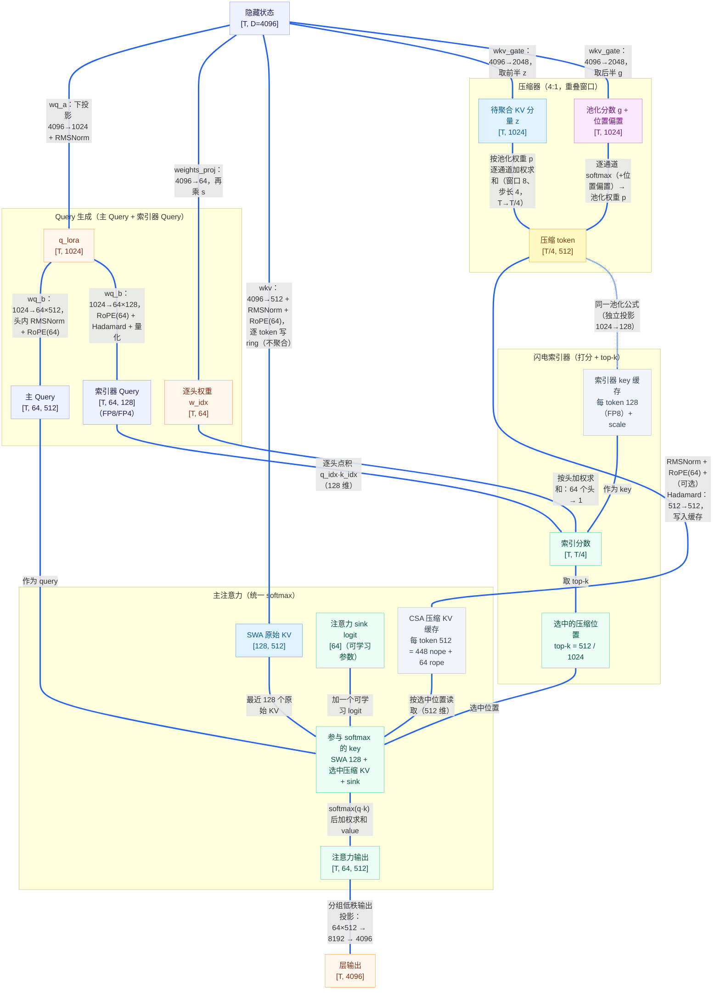
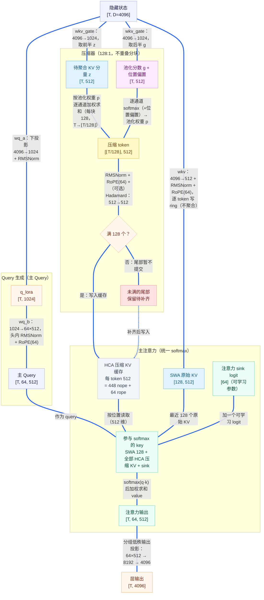
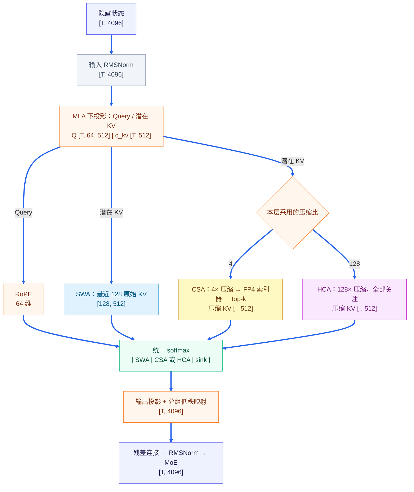

# DeepSeek-V4-Pro 注意力（DSv4：SWA + CSA + HCA）原理

> 承接 [`sparse_attention.md`](sparse_attention.md)。DSv4 在 V3.2 DSA「闪电索引器 + top-k」之上，
> 加回了**压缩**与**滑窗**，用三类注意力分工：
>
> - **SWA**（滑动窗口）：最近 128 个原始 token，最精确；
> - **CSA**（Compressed Sparse Attention）：**4× 压缩 + top-k 选择**，挑历史重点；
> - **HCA**（Heavy Compression Attention）：**128× 压缩 + 全部关注**，覆盖全局。
>
> **每层在 CSA 与 HCA 之间二选一**：单层实际计算为 **SWA + CSA + sink** 或 **SWA + HCA + sink**，
> 所有参与的 key 进入同一个 softmax。

## 目录

1. [演进](#1-演进)
2. [为什么分两级压缩](#2-为什么分两级压缩)
3. [压缩 token 的生成（CSA / HCA 通用）](#3-压缩-token-的生成csa--hca-通用)
4. [CSA](#4-csa)
5. [HCA](#5-hca)
6. [单 softmax 融合](#6-单-softmax-融合)
7. [与 V3.2 DSA / NSA 对照](#7-与-v32-dsa--nsa-对照)
8. [注意力之外的架构差异](#8-注意力之外的架构差异)
9. [局限与权衡](#9-局限与权衡)
10. [附录 A：数值示例](#附录-a数值示例)
11. [附录 B：Hadamard 变换——加减混合，换坐标系](#附录-bhadamard-变换加减混合换坐标系)
12. [附录 C：注意力 sink](#附录-c注意力-sink)

---

## 1. 演进

| 模型 | 结构 |
|---|---|
| 原始 NSA | 压缩 + 选择 + 滑窗，三分支各自 softmax 后门控加权 |
| V3.2 DSA | 仅「索引器打分 + top-k 选择」单分支 |
| DSv4 | 滑窗 + 压缩选择（CSA）或重度压缩（HCA），拼进同一个 softmax |

---

## 2. 为什么分两级压缩

长上下文 decode 的矛盾：历史 token 多，全看太贵，又要保住重要信息。

- **轻压缩（4:1）**：保留细节，但 token 仍多，需要 top-k 截断，未选中区域丢失；
- **重压缩（128:1）**：token 少到可以全看，但只剩粗略轮廓。

DSv4 两者都用：**CSA 看清重点，HCA 覆盖全局，SWA 提供最近的精确信息。**

---

## 3. 压缩 token 的生成（CSA / HCA 通用）

CSA 与 HCA 采用相同的压缩机制，只是窗口不同。

**① 投影。** 隐藏状态 $x_i$ 经可学习的线性投影输出两部分：

- $z_i$：待聚合的 KV 分量；
- $g_i$：逐通道池化分数，再加可学习位置偏置：$g_i \leftarrow g_i + a_{\mathrm{pos}(i)}$。

**② 窗口内逐通道 softmax 加权池化**：

$$
p_i(d)=\frac{e^{g_i(d)}}{\sum_{j\in W}e^{g_j(d)}},\qquad
\mathrm{comp}_W(d)=\sum_{i\in W} p_i(d)\, z_i(d)
$$

权重可学习、逐通道独立，能突出窗口内的重要 token。

**③ 后处理。** RMSNorm → 独立 RoPE → 可选 Hadamard 旋转，生成压缩表示并写入缓存。Hadamard 的直观解释见[附录 B](#附录-bhadamard-变换加减混合换坐标系)。

**④ 窗口划分：**

| | CSA（压缩比 4:1） | HCA（压缩比 128:1） |
|---|---|---|
| 窗口 | 重叠滑动：步长 4，每个压缩 token 覆盖 8 个 token（前后两组） | 不重叠分块：每块 128 个 |
| 通道分组 | 前后两组各有一套特征通道 | 一套特征通道 |
| 产出 | 每 4 个新 token 产 1 个 | 每满 128 个产 1 个，尾部保留待后续补齐 |

**两套压缩器。** CSA 层使用两套压缩器，池化公式相同，但投影参数与缓存各自独立：

- **注意力压缩器** → 主注意力使用的压缩 KV；
- **索引器压缩器**（仅 CSA 层）→ 索引器 Key，供闪电索引器打分。

### 3.1 SWA / CSA / HCA 的 KV 映射对比

三类注意力的 KV 都来自隐藏状态 $x$ 经线性投影，但**粒度**不同：SWA 逐 token 映射（不聚合），只有两条压缩通路才做池化。

| | 投影 | 粒度 | 是否有池化 |
|---|---|---|---|
| SWA | $W_{kv}$ | 1 token → 1 个 KV 槽 | 无（逐 token 独立映射，保留精确原始 KV） |
| CSA | $W^{\text{gate}}_{kv}\to z,g$ | 8 个 token（步长 4）→ 1 | 有，压缩比 4:1 |
| HCA | $W^{\text{gate}}_{kv}\to z,g$ | 128 个 token → 1 | 有，压缩比 128:1 |

要点：

- SWA 用**共享的** $W_{kv}$ 对每个 token 各算一份 512 维向量 $c_i=\mathrm{RoPE}_{64}\big(\mathrm{RMSNorm}(W_{kv}x_i)\big)$，一个 token 对应一个槽，按 $\mathrm{pos}\bmod 128$ 覆盖写入环；K 与 V 是同一个向量，故只存一份。
- 压缩通路用**另一套**投影 $W^{\text{gate}}_{kv}$（CSA $4096\to2048$、HCA $4096\to1024$）产生待聚合分量 $z$ 与逐通道池化分数 $g$，再按可学习权重 $p$ 加权求和，把多个 token 先压成 1 个。
- 因此"逐通道 softmax 池化"只出现在 CSA / HCA，SWA 边上的计算是"逐 token 独立映射 + RoPE + 写 ring"，二者不要混淆。

### 3.2 Query 的生成（主 Query 与索引器 Query）

DSv4 的两类 Query 都从**同一份下投影 $q_{\mathrm{lora}}$** 出发再各自升维；差别只在升维后的归一化、旋转与量化。

**① 共享下投影。** 隐藏状态 $x$ 经线性下投影到 1024 维后做一次 RMSNorm：

$$
q_{\mathrm{lora}}=\mathrm{RMSNorm}(W_{q_a}x)\in\mathbb{R}^{T\times1024}
$$

这份 $q_{\mathrm{lora}}$ 被主注意力与索引器**共用**，所以索引器无需再学一套低秩投影。下投影还可与潜在 KV 合并为一个线性层：

$$
x\longrightarrow\big[\ \underbrace{1024}_{q_{\mathrm{lora}}}\ \big|\ \underbrace{512}_{\text{共享 KV}}\ \big]
$$

**② 主 Query（CSA / HCA 层通用）。** $q_{\mathrm{lora}}$ 经 $W_{q_b}$ 升到 $64\times512$，先在**每个头内部**做一次 RMSNorm，再只对 64 维 rope 子空间做 RoPE：

$$
q=\mathrm{RoPE}_{64}\Big(\mathrm{RMSNorm}_{\text{head}}\big(W_{q_b}\,q_{\mathrm{lora}}\big)\Big)\in\mathbb{R}^{T\times64\times512},
\qquad 512=448_{\text{nope}}+64_{\text{rope}}
$$

**③ 索引器 Query（仅 CSA 层）。** 同样吃 $q_{\mathrm{lora}}$，但用一套**独立的** $W^{idx}_{q_b}$ 投到更小的索引头空间，再依次做 RoPE → Hadamard 旋转 → 低精度量化：

$$
q_{idx}=\mathrm{Quant}_{\mathrm{FP8/FP4}}\Big(\mathrm{Hadamard}\big(\mathrm{RoPE}_{64}(W^{idx}_{q_b}\,q_{\mathrm{lora}})\big)\Big)\in\mathbb{R}^{T\times64\times128}
$$

另外索引器还有一条**由原输入 $x$ 生成**的逐头门控权重（$d_{idx}=128$ 为索引头维，$n_{heads}$ 为头数）：

$$
w_{idx}=s\cdot W_{w}(x)\in\mathbb{R}^{T\times64},\qquad s=d_{idx}^{-1/2}\,n_{heads}^{-1/2}
$$

打分时先用 $q_{idx}$ 与索引器 Key 逐头点积，再按 $w_{idx}$ 加权求和：

$$
\mathrm{logit}=\sum_{h}w_{idx,h}\,(q_{idx,h}\cdot k_{idx,h})
$$

**④ 两类 Query 对照：**

| | 主 Query | 索引器 Query |
|---|---|---|
| 输入 | 共享 $q_{\mathrm{lora}}$ | 共享 $q_{\mathrm{lora}}$ |
| 升维 | $1024\to64\times512$ | $1024\to64\times128$ |
| 头内 RMSNorm | 有 | 无 |
| RoPE | 有（64 维） | 有（64 维） |
| Hadamard | 无 | 有 |
| 精度 | 完整精度通路 | FP8 或 FP4 + UE8M0 |
| 用途 | 统一 softmax 打分 | 索引打分 + top-k |
| 作用层 | CSA 与 HCA 层 | 仅 CSA 层 |

---

## 4. CSA

> **4× 重叠压缩 + 索引器 top-k（512 / 1024）**

流程：压缩器生成 4× 压缩 token → 闪电索引器（FP8/FP4）对其打分 → 取 top-k → 主注意力在选中的
压缩 token + SWA 原始 token 上计算。对应 NSA 的「选择分支」。

### 4.1 例子：16 个 token

前缀 $x_0,\ldots,x_{15}$；为便于展示取 top-k $=2$、SWA 窗口 $=4$。

**① 压缩：16 个位置 → 4 个压缩 token**

| 压缩 token | 0 | 1 | 2 | 3 | 4 | 5 | 6 | 7 | 8 | 9 | 10 | 11 | 12 | 13 | 14 | 15 |
|---|---|---|---|---|---|---|---|---|---|---|---|---|---|---|---|---|
| $a_0$ | ● | ● | ● | ● | | | | | | | | | | | | |
| $a_1$ | ● | ● | ● | ● | ● | ● | ● | ● | | | | | | | | |
| $a_2$ | | | | | ● | ● | ● | ● | ● | ● | ● | ● | | | | |
| $a_3$ | | | | | | | | | ● | ● | ● | ● | ● | ● | ● | ● |

每行错开 4 格、跨度 8 格，相邻行重叠 4 格。$a_0$ 前面没有上一组，该部分分数置 $-\infty$。

**② 池化（以 $a_1$ 一个通道为例，位置偏置取零）**

| $i$ | 0 | 1 | 2 | 3 | 4 | 5 | 6 | 7 |
|---|---|---|---|---|---|---|---|---|
| $z_i$ | 1 | 2 | 3 | 4 | 5 | 6 | 7 | 8 |
| $g_i$ | 0 | 0 | 0 | 0 | 0 | 0 | 0 | $\ln 9$ |

$$
p=\left[\tfrac1{16},\ldots,\tfrac1{16},\tfrac9{16}\right],\qquad
\widetilde a_1=\frac{1+2+\cdots+7+9\times8}{16}=6.25
$$

普通平均为 4.5，加权池化把权重集中到位置 7。

**③ 索引器选 top-2**

| | $a_0$ | $a_1$ | $a_2$ | $a_3$ |
|---|---|---|---|---|
| 索引分数 | 0.2 | **2.8** | 0.6 | **1.7** |

选中 $\{a_1,a_3\}$，主注意力读取这两个位置的压缩 KV。

**④ 主注意力**

$$
\underbrace{\{x_{12},x_{13},x_{14},x_{15}\}}_{\text{SWA}}
\cup
\underbrace{\{a_1,a_3\}}_{\text{CSA}}
$$

6 个 KV 槽 + sink logit 一起 softmax，注意力分数由主 query/key 重新计算。

### 4.2 CSA 数据流

---

## 5. HCA

> **128× 不重叠压缩 + 全部关注**

128K 上下文压完约 1K 个 token，直接全看，开销低。HCA 用少量粗粒度 token 覆盖整个历史，
对应 NSA 的「压缩分支」。

### 5.1 例子：400 个 token

前缀 $x_0,\ldots,x_{399}$，压缩比 128，SWA 窗口 128。

**① 分块，只提交完整块**

| 来源 | 覆盖位置 | 参与注意力 |
|---|---|---|
| $c_0$ | 0–127 | 是 |
| $c_1$ | 128–255 | 是 |
| $c_2$ | 256–383 | 是 |
| 未满块 | 384–399（16 个） | 否，保留待后续补齐 |
| SWA | 272–399 | 是（原始 KV） |

$$
N_{\mathrm{HCA}}=\left\lfloor\frac{400}{128}\right\rfloor=3
$$

未满的尾部由 SWA 覆盖。

**② 池化（$c_0$ 一个通道）。** 前 127 个 $z_i=2,\ g_i=0$；最后一个 $z_{127}=10,\ g_{127}=\ln127$：

$$
p_{127}=\tfrac12,\quad \sum_{i<127}p_i=\tfrac12,\quad \widetilde c_0=\tfrac12\cdot2+\tfrac12\cdot10=6
$$

普通平均为 2.06，加权池化能突出关键 token。

**③ 主注意力**

$$
\underbrace{\{x_{272},\ldots,x_{399}\}}_{\text{SWA：128}}
\cup
\underbrace{\{c_0,c_1,c_2\}}_{\text{HCA：全部}}
$$

131 个 KV 槽 + sink 一起 softmax，各压缩 token 的权重由主注意力分数决定。

### 5.2 HCA 数据流

---

## 6. 单 softmax 融合

| 路 | 压缩 | 选择 | 类比 | 作用 |
|---|---|---|---|---|
| SWA | 无 | 最近 128 | 正在读的几页 | 局部精确 |
| CSA | 4×（重叠） | top-512/1024 | 精读关键章节 | 重点细节 |
| HCA | 128×（不重叠） | 全部 | 浏览全书目录 | 全局概览 |

每层把 SWA 与 CSA（或 HCA）的 key 拼接，加一个 sink logit，一起做一次 softmax。
sink 参与归一化、不贡献 value，用于稳定数值。

**decode 每步关注的 key 数：**

- CSA 层：$128 + k$（$k=512$ 或 $1024$），与上下文长度无关；
- HCA 层：$128 + \lfloor n/128\rfloor$，随 $n$ 线性增长但缩小 128 倍。

额外开销是压缩器池化和索引器打分，二者都很轻量。

### 6.1 覆盖范围会重叠

三类注意力按**不同粒度**描述历史，并不是把历史严格切成互不相交的区域，因此同一段原始 token 可能被两条路同时覆盖：

- **CSA 与 SWA**（§4.1 例）：$a_3$ 压缩位置 $8\!-\!15$，SWA 覆盖 $12\!-\!15$，这 4 个 token 既是 CSA 压缩 token 的一部分，又以原始 KV 出现；
- **HCA 与 SWA**（§5.1 例）：$c_2$ 覆盖 $256\!-\!383$，SWA 覆盖 $272\!-\!399$，重叠区间为 $272\!-\!383$。

CSA 与 HCA 描述的历史范围同样会重叠，但**二者不会出现在同一层**（每层只选其一），因此不存在同层重复。

重叠不会去重：同一层里，原始 KV（SWA）与压缩 KV（CSA 或 HCA）是 softmax 中**相互独立的条目**，各自带一份 query–key 分数和 value。这正是设计意图——最近窗口给精确表示，压缩 token 给摘要表示，二者互补。

### 6.2 DSv4 注意力块结构

---

## 7. 与 V3.2 DSA / NSA 对照

| 维度 | 原始 NSA | V3.2 DSA | DSv4 |
|---|---|---|---|
| 滑窗 | 有 | 无 | SWA，窗口 128 |
| 选择 | top-k 块 | top-k 位置 | CSA：4× 压缩 + top-512/1024 |
| 压缩 | 单一块大小 | 无 | HCA：128×，全部关注 |
| 融合 | 三分支门控加权 | 单分支 | 统一 softmax（含 sink） |
| 索引器精度 | — | FP8 | FP4 + UE8M0 |
| 与 MLA | 独立 | 基于 MLA | 基于 MLA |

DSv4 延续 NSA 的信息构成（局部 / 重点 / 全局），但采用统一 softmax，而不是三分支门控融合。

---

## 8. 注意力之外的架构差异

- **分组低秩输出投影**：用分组与低秩分解完成注意力输出映射。
- **mHC**：通过受约束的多路残差连接控制跨层信息流。
- **MoE**：按输入动态选择少量专家参与计算。
- **低精度专家表示**：使用低精度格式减少专家权重的存储与访存成本。

---

## 9. 局限与权衡

- **压缩有损**：多个 token 聚合后，部分细节无法恢复；重压缩的损失通常更明显。
- **选择可能遗漏信息**：CSA 只读取选中的压缩位置，未选中的内容不参与该层主注意力。
- **额外计算**：压缩池化与索引打分也有开销，不能只计算主注意力读取的 KV 数量。
- **HCA 并非常数开销**：每步关注的压缩条目数仍随上下文长度增长，只是缩小约 128 倍。
- **需要联合训练**：索引器、压缩器与注意力主干需共同学习，不能直接用固定池化替代而假定质量不变。

---

## 附录 A：数值示例

演示「压缩池化 → 索引器选择 → 单 softmax 融合」。为一次看全三类信息，本例把 CSA 与 HCA 放在一起，
并把窗口缩到教学尺度；实际每层只用其中一种。

历史 8 个 token，单头，$d=2$，query $q=[1,0]$：

| $i$ | 0 | 1 | 2 | 3 | 4 | 5 | 6 | 7 |
|---|---|---|---|---|---|---|---|---|
| $k_i$ | $[0.2,0]$ | $[0.4,0.2]$ | $[0.1,0.5]$ | $[0.1,0.7]$ | $[0.3,0.6]$ | $[0.2,0.9]$ | $[1,0]$ | $[0.7,0.7]$ |
| $v_i$ | $[2,1]$ | $[4,2]$ | $[1,6]$ | $[0,8]$ | $[3,7]$ | $[2,9]$ | $[10,0]$ | $[8,8]$ |
| $g_i$ | 0.1 | 0.2 | 0.3 | 0.4 | 0.5 | 1.5 | — | — |

分工：SWA 取位置 6、7；HCA 把 0–5 压成 1 个 token $c$；CSA 把 0–5 压成 $a_0$（0–2）、$a_1$（3–5），选 top-1。

**A.1 SWA**：$k_6=[1,0],v_6=[10,0]$；$k_7=[0.7,0.7],v_7=[8,8]$。

**A.2 HCA 池化**：

$$
p=\mathrm{softmax}(g_{0..5})=[0.098,0.108,0.119,0.132,0.146,0.397]
$$

$$
k_c\approx[0.30,0.62],\qquad v_c\approx[2.07,6.50]
$$

**A.3 CSA**（简化为组内均值）：

$$
k_{a_0}=[0.233,0.233],\ v_{a_0}=[2.33,3.00];\qquad k_{a_1}=[0.200,0.733],\ v_{a_1}=[1.67,8.00]
$$

索引器用独立 query $q_{idx}=[2,1]$ 打分：$s(a_0)=0.699$，$s(a_1)=1.133$，选中 $a_1$。

**A.4 主注意力打分** $q\cdot k/\sqrt2$：

| 来源 | $v$ | logit |
|---|---|---|
| SWA 6 | $[10,0]$ | 0.707 |
| SWA 7 | $[8,8]$ | 0.495 |
| HCA $c$ | $[2.07,6.50]$ | 0.212 |
| CSA $a_1$ | $[1.67,8.00]$ | 0.141 |
| sink | — | 0 |

**A.5 统一 softmax**：

$$
\alpha=[0.287,\ 0.232,\ 0.175,\ 0.163,\ 0.142]
$$

**A.6 输出**（sink 不贡献 value）：

$$
\text{out}=0.287[10,0]+0.232[8,8]+0.175[2.07,6.50]+0.163[1.67,8.00]\approx[5.36,\ 4.30]
$$

**A.7 与 NSA 对比**：NSA 做三次 softmax 再门控 $o=g_w o_{win}+g_c o_{cmp}+g_s o_{sel}$；
DSv4 把所有 key 拼进一次 softmax，省去门控参数与多次归一化。

---

## 附录 B：Hadamard 变换——加减混合，换坐标系

**直观理解：用“加减组合”重新表示一个向量，让每个输出维度混合多个输入维度的信息。** 它不是压缩 token，而是保持维度不变地换一个坐标系；也不是逐元素相乘的 Hadamard product。

最简单的二维归一化变换：

$$
H_2=\frac{1}{\sqrt{2}}\begin{bmatrix}1&1\\1&-1\end{bmatrix},\qquad
H_2\begin{bmatrix}a\\b\end{bmatrix}
=\begin{bmatrix}(a+b)/\sqrt{2}\\(a-b)/\sqrt{2}\end{bmatrix}.
$$

例如，原来集中在一个维度上的大值被分散到两个维度：

$$
\begin{bmatrix}10\\0\end{bmatrix}
\longrightarrow
\begin{bmatrix}10/\sqrt{2}\\10/\sqrt{2}\end{bmatrix}
\approx\begin{bmatrix}7.07\\7.07\end{bmatrix}.
$$

**为什么不改变相似度？** 归一化 Hadamard 矩阵是正交矩阵。Q、K 同时使用同一个变换时，向量长度和点积都不变：

$$
H_d^\top H_d=I,\qquad
\|H_dx\|_2=\|x\|_2,\qquad
(H_dq)^\top(H_dk)=q^\top k.
$$

**在 DSA / CSA 索引器中的作用**：先混合 Q/K 通道，再做 FP8 / FP4 量化，通常能缓解少数通道异常大的问题，降低量化误差，使索引打分与 top-k 更稳定。这里“点积不变”指**量化前的数学等价性**；量化后仍有误差。混合也不保证任意输入的最大值都变小，例如二维的两个相同值会集中到一个输出维度。

常用的高维快速 Hadamard 变换按加减蝶形递推实现（维度通常为 $2$ 的幂），计算复杂度为 $O(d\log d)$，再乘归一化因子，无需学习参数。该旋转是可选的，不应理解成主注意力或 HCA 都必须执行它。

**一句话：换一个更适合低精度量化的坐标系，量化前不改变 Q/K 的相似度。**

---

## 附录 C：注意力 sink

**是什么。** sink 是一个**可学习的额外 logit**（每个注意力头一个标量，DSv4 中头数为 64，即形状 $[64]$），在 softmax 里充当一个“虚拟 key”：**参与归一化分母，但不贡献 value**。

$$
\alpha_{i}=\frac{e^{s_i}}{e^{s_{\text{sink}}}+\sum_{j}e^{s_j}},\qquad
\mathrm{out}=\sum_{j}\alpha_j v_j
$$

**为什么需要它。**

- **给注意力一个“谁都不看”的出口**：当所有真实 key 都不相关时，概率质量可被 sink 吸收，而不是被迫摊到无关 key 上；
- **允许 $\sum_j\alpha_j<1$**：把归一化从“必须恰好分配完”放宽为“可以不分配”，缓解强行归一化带来的偏置，数值更稳定；
- **不改变输出内容**：sink 的 value 为零，它只影响分母（即权重再分配），不直接往输出里添项。

**在 DSv4 中。** 每个注意力头有一个可学习的 sink logit（float32），与 SWA 的 128 个 key、选中的 CSA 压缩 KV（或全部 HCA 压缩 KV）的 logit 拼在一起，做同一次 softmax（见 §4.2、§6.2 图）。[附录 A](#附录-a数值示例) 中把 sink 的 logit 记为 0，对应“中性”基准；实际取值由训练得到。

**一句话：sink 是一个只进分母、不带 value 的可学习 logit，让注意力可以有“不关注任何 key”的选项。**
