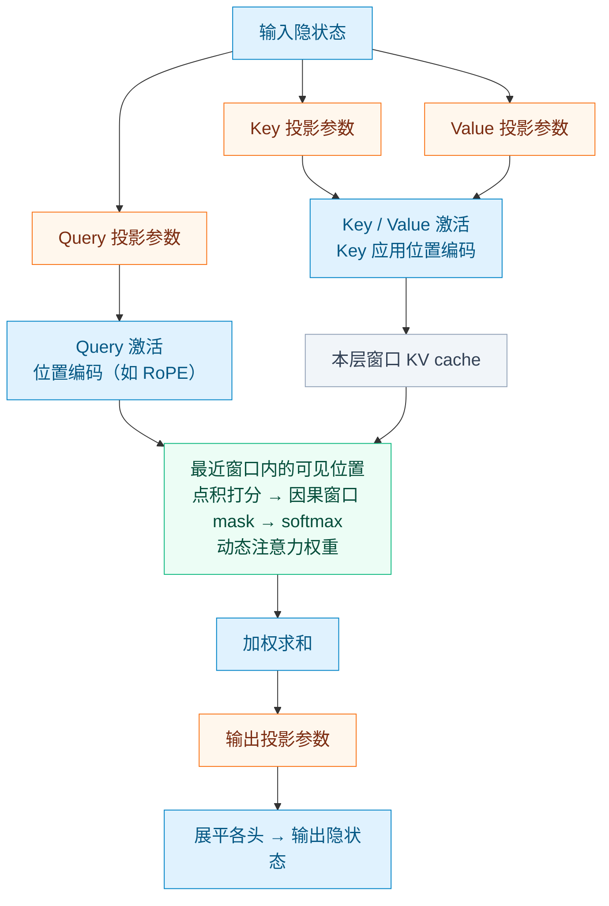
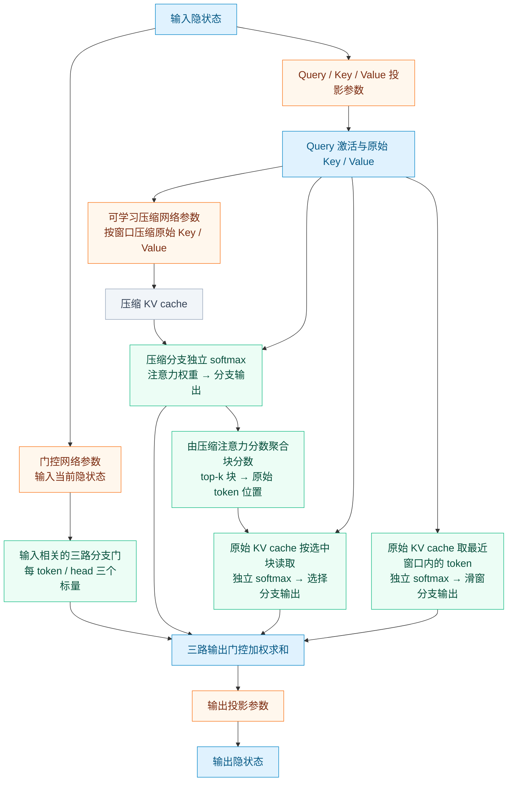
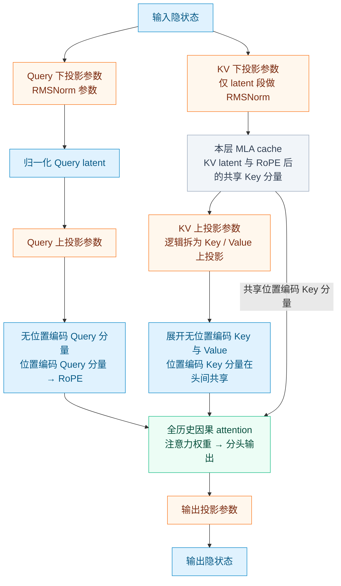
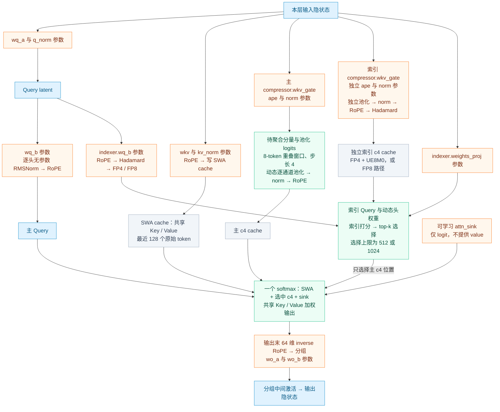
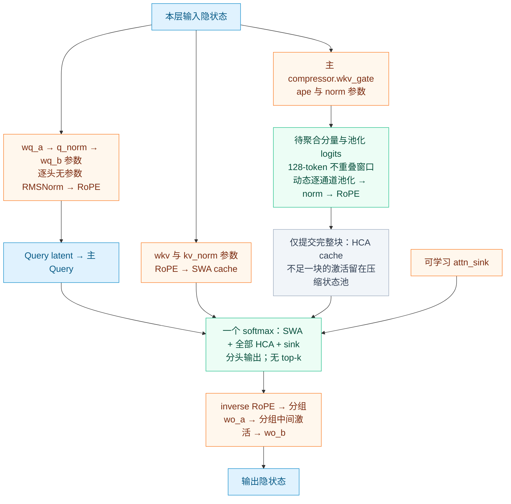
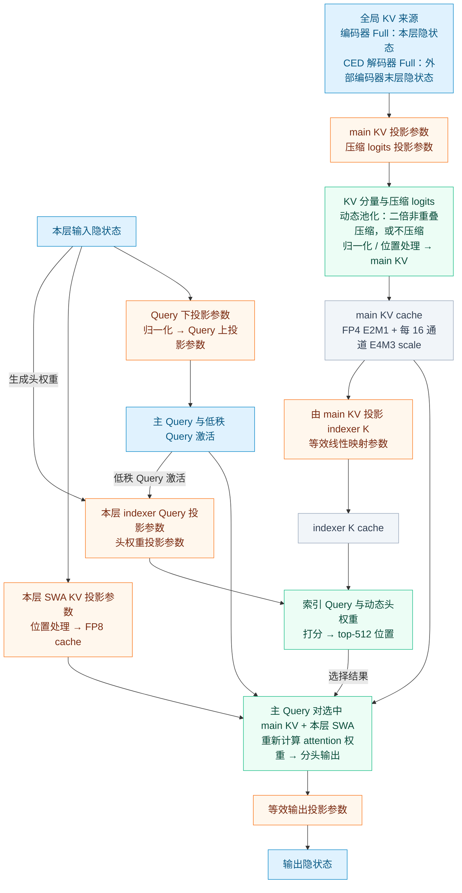
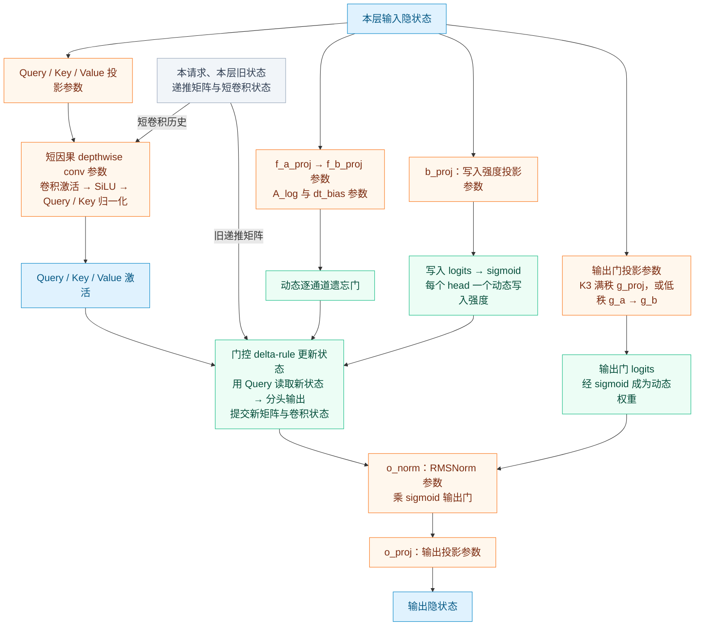

# 稀疏注意力（Sparse Attention）全景：NSA / DSA / DSv4 / CSA2 及 SGLang 实现

> 本文把仓库 `docs/learn/` 下与**稀疏注意力**相关的内容汇总成一篇总览：
>
> - **原理**：原始 NSA 三分支 → DeepSeek-V3.2 DSA（闪电索引器 + top-k）→ DeepSeek-V4 多路（SWA + CSA / HCA）
>   → DeepSeek-V4.1-Flash 的 CSA2（跨层 KV 复用）；
> - **实现**：SGLang 中 DSA backend、索引器、top-k、page table 集成、DSv4 backend；
> - **内存**：DSA 的 KV 池布局、indexer K cache、容量估算、host 池与 HiSparse 分层稀疏；
> - **并行**：DSA 的上下文并行（CP）、与 SP / DP-attention 的约束；
> - **其他模型的实现**：GLM-5.3（DSA 的生产落地）、GLM-5.3-Flash（MLA + DSA + KDA 混合）、Kimi-K3（KDA 线性注意力 + MLA 混合）；
> - **启动参数、源码索引与延伸阅读**。
>
> **命名澄清**：SGLang 早期把 DeepSeek-V3.2 的 DSA 放在 `nsa/` 目录、叫 `nsa` backend；PR #25821
> 已统一改名为 **DSA**（`layers/attention/dsa/`、`dsa_backend.py`、`--attention-backend dsa`）。
> 旧的 `nsa/`、`nsa_backend.py`、`--nsa-*` 参数仅作**废弃兼容别名**保留。无论新旧命名，代码实现的都是
> **DeepSeek-V3.2 的 DSA 单分支**，并**不包含**原始 NSA 论文的压缩分支与滑窗分支。

## 目录

1. [为什么需要可训练稀疏注意力](#1-为什么需要可训练稀疏注意力)
2. [稀疏注意力谱系总览](#2-稀疏注意力谱系总览)
3. [原始 NSA 的三分支设计](#3-原始-nsa-的三分支设计)
4. [DeepSeek-V3.2 DSA：闪电索引器 + top-k](#4-deepseek-v32-dsa闪电索引器--top-k)
5. [复杂度与显存收益分析](#5-复杂度与显存收益分析)
6. [SGLang 中的 DSA 实现](#6-sglang-中的-dsa-实现)
7. [DeepSeek-V4（DSv4）：SWA + CSA / HCA](#7-deepseek-v4dsv4swa--csa--hca)
8. [DeepSeek-V4.1-Flash：CSA2 与跨层索引复用](#8-deepseek-v41-flashcsa2-与跨层索引复用)
9. [KV cache：池布局、容量与 host 池](#9-kv-cache池布局容量与-host-池)
10. [HiSparse：分层稀疏注意力](#10-hisparse分层稀疏注意力)
11. [并行：CP / SP / DP-attention 与稀疏注意力](#11-并行cp--sp--dp-attention-与稀疏注意力)
12. [稀疏注意力在其他模型中的落地：GLM-5.3 与 Kimi-K3](#12-稀疏注意力在其他模型中的落地glm-53-与-kimi-k3)
13. [支持的模型](#13-支持的模型)
14. [启动参数速查](#14-启动参数速查)
15. [局限与权衡](#15-局限与权衡)
16. [参考实现位置](#16-参考实现位置)
17. [相关文档索引](#17-相关文档索引)
18. [附录 A：DSA 数值计算示例](#附录-adsa-数值计算示例)

---

## 1. 为什么需要可训练稀疏注意力

标准注意力是 $O(n^2)$ 的：每个 query 都要对全部历史 key 打分。长上下文（128K+）下，
prefill 计算量与 decode 访存都急剧上升。

朴素的稀疏注意力（如固定模式的局部窗口、strided）虽能降复杂度，但有两个缺陷：

1. **模式是预先固定的**，无法学习「哪些历史 token 真正重要」。
2. **训练与推理脱节**：很多稀疏方案只在推理期近似，模型并未针对稀疏模式训练，质量受损。

「原生 / 可训练稀疏注意力」的目标是：**让稀疏选择本身可学习，训练和推理用同一套稀疏机制**，
从而在大幅降低计算/访存的同时保持质量。NSA、DSA、DSv4、CSA2 都属于这一思路。
另有一条路是**结构上的「混合注意力」**：让不同层用不同机制（全注意力 / 稀疏选择 / 线性注意力）交替，
用线性注意力的固定状态换取长上下文成本——GLM-5.3-Flash 与 Kimi-K3 属于此类（§12）。

---

## 2. 稀疏注意力谱系总览

| 方案 | 代表模型 | 稀疏粒度 | 选择依据 | 分支 / 融合方式 | SGLang backend |
|------|---------|---------|---------|----------------|----------------|
| 固定窗口 SWA | Mistral、Gemma、GPT-OSS | 最近 $w$ 个 token | 无（固定） | 单分支 | 各通用 backend + SWA 池（见 [`SWA.md`](SWA.md)） |
| 原始 NSA（论文） | — | 块 | 压缩分支的块打分 | 压缩 + 选择 + 滑窗，门控加权 | **未实现** |
| **DSA** | DeepSeek-V3.2、GLM-5.x、LongCat、Dots3 | **token**（page_size=1） | 闪电索引器（FP8） | 单分支 top-k | `dsa`（旧名 `nsa`） |
| **DSv4** | DeepSeek-V4 | 压缩 token（$4\times$ / $128\times$） | CSA 层：FP4 索引器；HCA 层：不选 | SWA + CSA 或 SWA + HCA，**单 softmax** + sink | `dsv4`（旧名 `compressed`） |
| **CSA2**（论文） | DeepSeek-V4.1-Flash | 压缩 token（$m\in\{1,2\}$） | 索引器，跨层 Reindex / Reuse | 稀疏 + SWA | 论文层面，见 §8 |
| **混合 MLA + DSA + KDA** | GLM-5.3-Flash | 逐层不同 | DSA 层用索引器；KDA 层不做选择 | 层内混合（MLA / DSA / KDA） | `dsa` + KDA state 池 |
| **混合 KDA + MLA** | Kimi-K3 | 结构稀疏（线性注意力层不存逐 token KV） | 无（不检索） | 线性注意力层与 MLA 层逐层交替 | 通用 backend + KDA state 池 |

一句话区分：**DSA 选 token，DSv4 / CSA2 选压缩 token**；
**只有 DSv4 把几路 key 拼进同一个 softmax**，原始 NSA 则是三路各自 softmax 再门控加权；
**GLM-5.3-Flash 与 Kimi-K3 走的是「混合注意力」路线**——逐层换用 DSA / 线性注意力 / 全注意力，
其中 DSA 层仍在单层内做 token 检索，KDA 层则维护递归状态（§12）。

### 2.1 读图约定：参数权重、激活形状与动态权重

以下每张图**只展开一个 attention block**，不画整网、FFN / MoE 或其他层。输入 $X$ 是本层 attention 的输入隐状态（已完成外层 pre-norm）；输出 $Y$ 交回外层残差 / mHC。混合模型只是按配置选用下列某一种 block，**不是把 MLA、DSA、KDA 串在同一层**。

- **橙色参数节点**：训练得到的 $W$、$\gamma$、$b$ 等参数；**蓝色节点**：前向产生的激活；**绿色节点**：运行时计算的注意力权重、门控或选择结果；**灰色节点**：KV / state cache。
- 线性权重统一写成 $W\in\mathbb{R}^{d_{\mathrm{out}}\times d_{\mathrm{in}}}$，对应 PyTorch `Linear.weight`，前向是 $XW^\top$。**这与按“输入维 × 输出维”写矩阵的记法相反。**融合 GEMM 只合并存储 / 执行，不表示新增一套权重；不展开 TP 分片及量化打包后的物理形状。
- $M$ 为本次前向 token 数（可理解为 $B\times T$），$N$ 为一个 query 可见的历史长度，$D$ 为 hidden size；$H$、$H_{kv}$ 分别为 query、KV 头数，$d_k$、$d_v$ 为头维，$r_q$、$r_{kv}$ 为低秩维，$H_I$、$d_I$ 为索引头数、头维，$K$ 为 top-k 数。图下表格中的 $[M,\ldots]$ 是激活形状，缓存写 $[N,\ldots]$ 是**单请求、单层**逻辑形状。
- **参数权重不等于动态权重**：投影 $W$ 固定；索引头权重 $\omega$、压缩池化权重 $p$、分支门 $g$、注意力权重 $A$ 都由输入计算。精度只标有明确依据的缓存 / 索引路径；**FP8 / FP4 KV 不代表所有模型权重和激活也用同样精度**。
- 图下表格中的注意力权重 $A$ 是数学上的逻辑张量，FlashAttention / FlashMLA 通常不会完整物化；$w$、$K$ 表示上限，实际数量受因果可见长度限制。$n_c$ 表示已提交且可见的压缩条目数，不含尚未完成的尾块；KDA 表格中的 $c$ 为短卷积 kernel size。
- **DSA 单层图直接标注模块计算、参数形状与计算前后维度**，使用 Mermaid 的 `$$...$$` 数学标签（需要 Mermaid 10.9+）；其余图的形状与公式仍见图下表格。Markdown 行内公式使用 `$...$`，独立公式使用 `$$...$$`。为避免误读，DSv4 的 **CSA 层与 HCA 层分别画**；CSA2 的模式表描述同一 block 的替换路径，复用来源仅作为外部输入。

### 2.2 固定窗口 SWA：标准 Q/K/V 投影 + 局部 mask

下面以通用 GQA / MQA 形式画单层；MHA 是 $H_{kv}=H$，MQA 是 $H_{kv}=1$。SWA 改的是**可见位置集合**，不是投影结构。



| 图中对象 | 参数 / 激活的逻辑形状 |
| --- | --- |
| 输入 / 输出隐状态 | $X,Y\in\mathbb{R}^{M\times D}$ |
| Query 投影 | $W_Q\in\mathbb{R}^{(H d_k)\times D}$ |
| Key / Value 投影 | $W_K\in\mathbb{R}^{(H_{kv}d_k)\times D}$，$W_V\in\mathbb{R}^{(H_{kv}d_v)\times D}$ |
| 当前 Query / Key / Value | $Q:[M,H,d_k]$，$K:[M,H_{kv},d_k]$，$V:[M,H_{kv},d_v]$ |
| 窗口 KV cache | $K:[w,H_{kv},d_k]$，$V:[w,H_{kv},d_v]$ |
| 注意力权重 / 分头输出 | $A:[M,H,w]$，$O:[M,H,d_v]$ |
| 输出投影 | $W_O\in\mathbb{R}^{D\times(Hd_v)}$ |

对头 $h$：

$$
\begin{aligned}
A_{t,h,s} &= \operatorname{softmax}_{s\in\mathcal{W}_t}\!\left(\frac{q_{t,h}^{\top}k_s}{\sqrt{d_k}}\right), \\
o_{t,h} &= \sum_{s\in\mathcal{W}_t}A_{t,h,s}v_s.
\end{aligned}
$$

这里 $w$ 是最多可见位置数，序列开头实际不足 $w$。具体模型可额外带投影 bias、Q/K norm 或 sink，例如 GPT-OSS 的 `sinks`，它们不是 SWA 的必需组件。

### 2.3 原始 NSA：三路 attention 权重 + 输入相关分支门

这是**论文级结构示意**，不绑定具体 hidden size、压缩网络或 SGLang 参数名。$n_c$ 为压缩块数，$n_s$ 为选中块包含的原始 token 数；top-k **块**不等于 top-k **token**。



| 图中对象 | 参数 / 激活的逻辑形状 |
| --- | --- |
| 输入 / 输出隐状态 | $X,Y:[M,D]$ |
| Query / Key / Value 投影 | $W_Q:[Hd_k,D]$，$W_K:[H_{kv}d_k,D]$，$W_V:[H_{kv}d_v,D]$ |
| Query 与原始 KV | $Q:[M,H,d_k]$，$K:[N,H_{kv},d_k]$，$V:[N,H_{kv},d_v]$ |
| 压缩网络参数 | $\theta_K,\theta_V$（具体形状由压缩网络决定） |
| 压缩 KV cache | $K_{\mathrm{cmp}}:[n_c,H_{kv},d_k]$，$V_{\mathrm{cmp}}:[n_c,H_{kv},d_v]$ |
| 三路注意力权重 | $A_{\mathrm{cmp}}:[M,H,n_c]$，$A_{\mathrm{sel}}:[M,H,n_s]$，$A_{\mathrm{win}}:[M,H,w]$ |
| 门控网络 / 分支门 | 参数 $\theta_{\mathrm{gate}}$；动态门 $g_{\mathrm{cmp}},g_{\mathrm{sel}},g_{\mathrm{win}}$，合计形状 $[M,H,3]$ |
| 分支输出 / 融合输出 | $O_{\mathrm{cmp}},O_{\mathrm{sel}},O_{\mathrm{win}},O:[M,H,d_v]$ |
| 输出投影 | $W_O:[D,Hd_v]$ |

$$
o_{t,h}=g^{\mathrm{cmp}}_{t,h}o^{\mathrm{cmp}}_{t,h}
+g^{\mathrm{sel}}_{t,h}o^{\mathrm{sel}}_{t,h}
+g^{\mathrm{win}}_{t,h}o^{\mathrm{win}}_{t,h}.
$$

三路 $A$ **分别归一化**，$g$ 是另一组动态权重；不要把压缩分支 $A^{\mathrm{cmp}}$ 当作门控参数，也不要把门控默认当成三路 softmax（论文采用 sigmoid 门控）。

### 2.4 MLA / DSA：同一主注意力骨架，DSA 额外增加索引器

**（a）单层 MLA 主干。** 使用展开式显示所有逻辑权重；实际 decode 可通过矩阵吸收避免展开历史 K/V，不会增加新训练参数。此图也适用于混合模型中的**全注意力 MLA 层**。



| 图中对象 | 参数 / 激活的逻辑形状 |
| --- | --- |
| 输入 / 输出隐状态 | $X,Y:[M,D]$ |
| Query 下投影 / RMSNorm 参数 | $W_{Qa}:[r_q,D]$，$\gamma_Q:[r_q]$ |
| Query latent / 上投影 | $c_Q:[M,r_q]$，$W_{Qb}:[H(d_{\mathrm{nope}}+d_R),r_q]$ |
| Query 分量 | $Q_{\mathrm{nope}}:[M,H,d_{\mathrm{nope}}]$，$Q_R:[M,H,d_R]$ |
| KV 下投影 / latent RMSNorm 参数 | $W_{KVa}:[r_{kv}+d_R,D]$，$\gamma_{KV}:[r_{kv}]$ |
| 本层 MLA cache | $c_{KV}:[N,r_{kv}]$，$K_R:[N,d_R]$（RoPE 后、头间共享） |
| KV 上投影 | $W_{KVb}:[H(d_{\mathrm{nope}}+d_v),r_{kv}]$，逻辑拆为 $W_{Kb},W_{Vb}$ |
| 展开 Key / Value | $K_{\mathrm{nope}}:[N,H,d_{\mathrm{nope}}]$，$V:[N,H,d_v]$ |
| 注意力权重 / 分头输出 | $A:[M,H,N]$，$O:[M,H,d_v]$ |
| 输出投影 | $W_O:[D,Hd_v]$ |

**（b）单层 DSA：计算与维度直接标在模块和连线上。** 以下使用 V3.2 的典型尺寸，所有形状均为逻辑、未做 TP 分片的形状；$M$ 是本次前向 token 数，$N$ 是单请求历史长度，$K=2048$ 是选择上限。主 Query / cache 均来自**本层**。图中实线展示展开式，虚线展示 decode 常用的等价吸收式，**两种主注意力路径二选一，不是串行执行**；两者共用同一索引器和输出投影。

```mermaid
%%{init: {"themeVariables": {"fontSize": "20px"}}}%%
flowchart TB
    X["$$\begin{gathered}\text{本层输入隐状态}\\X:[M,7168]\end{gathered}$$"]:::act

    subgraph PROJ["本层 MLA 投影：共享 Query latent，独立主 KV"]
        QA["$$\begin{gathered}\text{q\_a\_proj / q\_a\_layernorm}\\W_{Qa}:[1536,7168],\ \gamma_Q:[1536]\\c_Q=\operatorname{RMSNorm}(XW_{Qa}^{\top})\\{}[M,7168]\to[M,1536]\end{gathered}$$"]:::param
        CQ["$$\begin{gathered}\text{归一化 Query latent：两路共享}\\c_Q:[M,1536]\end{gathered}$$"]:::act
        QB["$$\begin{gathered}\text{q\_b\_proj：主 Query 上投影}\\W_{Qb}:[24576,1536]\\Q_{\rm raw}=\operatorname{reshape}(c_QW_{Qb}^{\top})\\{}[M,1536]\to[M,24576]\to[M,128,192]\end{gathered}$$"]:::param
        QN["$$\begin{gathered}\text{拆出主无位置 Query}\\Q_{\rm nope}:[M,128,128]\end{gathered}$$"]:::act
        QR["$$\begin{gathered}\text{拆出位置 Query，仅此段做 RoPE}\\Q_R=\operatorname{RoPE}(\widetilde Q_R)\\{}[M,128,64]\to[M,128,64]\end{gathered}$$"]:::act
        MQ["$$\begin{gathered}\text{沿头维拼接：展开式主 Query}\\Q=\operatorname{concat}(Q_{\rm nope},Q_R)\\{}[M,128,128]+[M,128,64]\to[M,128,192]\end{gathered}$$"]:::act
        KA["$$\begin{gathered}\text{kv\_a\_proj\_with\_mqa：主 KV 下投影}\\W_{KVa}:[576,7168]\\Z_{KV}=XW_{KVa}^{\top}\\{}[M,7168]\to[M,576]\end{gathered}$$"]:::param
        KN["$$\begin{gathered}\text{沿最后一维拆分，仅 latent 做 RMSNorm}\\\gamma_{KV}:[512]\\c_{KV}=\operatorname{RMSNorm}_{\gamma_{KV}}(Z_{KV}[\ldots,:512])\\k_R=\operatorname{RoPE}(Z_{KV}[\ldots,512:])\\{}[M,576]\to[M,512]+[M,64]\end{gathered}$$"]:::act
        MC["$$\begin{gathered}\text{按 slot 写入本层主 MLA cache}\\C_{KV}:[N,512],\ K_R:[N,64]\\\text{每位置 576 元素，所有主头共享}\\\text{BF16 或 FP8，依 backend 配置}\end{gathered}$$"]:::cache
    end

    subgraph INDEX["闪电索引器：全历史低维打分，只输出位置"]
        IQ["$$\begin{gathered}\text{indexer.wq\_b：独立索引 Query 投影}\\W_{IQ}:[8192,1536]\\\widetilde Q_I=\operatorname{reshape}(c_QW_{IQ}^{\top})\\{}[M,1536]\to[M,8192]\to[M,64,128]\end{gathered}$$"]:::param
        QI["$$\begin{gathered}\text{前 64 维 RoPE，全 128 维 Hadamard，再 FP8}\\Q_I:[M,64,128]\to Q_I^{\rm FP8}:[M,64,128]\\s_Q:[M,64,1]\end{gathered}$$"]:::act
        IK["$$\begin{gathered}\text{indexer.wk / k\_norm：直接投影本层 X}\\W_{IK}:[128,7168],\ \gamma_K,b_K:[128]\\\widetilde K_I=\operatorname{LayerNorm}(XW_{IK}^{\top})\\{}[M,7168]\to[M,128]\end{gathered}$$"]:::param
        KI["$$\begin{gathered}\text{前 64 维 RoPE，全 128 维 Hadamard，再 FP8}\\\text{按 slot 写索引 cache，64 个索引头共享}\\K_I^{\rm FP8}:[N,128],\ s_K:[N,1]\\\text{每位置 128 B 数据 + 4 B scale}\end{gathered}$$"]:::cache
        IW["$$\begin{gathered}\text{indexer.weights\_proj：动态头权重}\\W_\omega:[64,7168]\\\omega^{\rm raw}=XW_\omega^{\top}\\{}[M,7168]\to[M,64]\end{gathered}$$"]:::param
        G["$$\begin{gathered}\text{头数、点积缩放与 Query scale 融合}\\G_{t,j,1}=\omega^{\rm raw}_{t,j}\,64^{-1/2}128^{-1/2}s_{Q,t,j}\\{}[M,64]\to[M,64,1]\\\text{无 sigmoid，也不做头间 softmax}\end{gathered}$$"]:::dynamic
        L["$$\begin{gathered}\text{每个索引头对全部历史位置点积，再 ReLU}\\L_{t,j,s}=\operatorname{ReLU}\left(s_{K,s}(q_{t,j}^{I,\rm FP8})^{\top}k_s^{I,\rm FP8}\right)\\{}[M,64,128]\times[N,128]\to[M,64,N]\end{gathered}$$"]:::dynamic
        S["$$\begin{gathered}\text{沿索引头加权求和}\\I_{t,s}=\sum_{j=1}^{64}G_{t,j,1}L_{t,j,s}\\{}[M,64,N]\to[M,N]\\\text{与点积、ReLU 融合，不要求物化 L}\end{gathered}$$"]:::dynamic
        J["$$\begin{gathered}\text{因果 mask 后沿历史轴取 top-k 位置}\\J_t=\operatorname{TopK}_s(I_{t,s}),\ J:[M,2048]\\K_t=\min(2048,N_t)\\\text{所有 128 个主头共用 J；无效槽位 padding}\end{gathered}$$"]:::dynamic
    end

    CJ["$$\begin{gathered}\text{按 J 读取主 latent 与位置 Key}\\C_J[t,u,:]=C_{KV}[J_{t,u},:]\\K_{R,J}[t,u,:]=K_R[J_{t,u},:]\\{}[N,512]\to[M,2048,512]\\{}[N,64]\to[M,2048,64]\end{gathered}$$"]:::cache

    subgraph EXPAND["主注意力 A：逻辑展开式，只对选中位置重新打分"]
        KB["$$\begin{gathered}\text{kv\_b\_proj：逐头展开主 Key / Value}\\W_{KVb}:[32768,512]\\Z_J=C_JW_{KVb}^{\top}\\{}[M,2048,512]\to[M,2048,32768]\end{gathered}$$"]:::param
        KV["$$\begin{gathered}\text{reshape / 拆分 / 调轴}\\K_{{\rm nope},J}:[M,128,2048,128]\\V_J:[M,128,2048,128]\end{gathered}$$"]:::act
        KJ["$$\begin{gathered}\text{位置 Key 在头间广播，沿头维拼接}\\K_J=\operatorname{concat}(K_{{\rm nope},J},K_{R,J})\\{}[M,128,2048,128]+[M,1,2048,64]\\\to[M,128,2048,192]\end{gathered}$$"]:::act
        E["$$\begin{gathered}\text{主 Query / Key 点积：不使用索引分数 I}\\E_{t,h,u}=\lambda_{\rm attn}q_{t,h}^{\top}k_{t,h,u}\\{}[M,128,192]\times[M,128,2048,192]\\\to E:[M,128,2048]\end{gathered}$$"]:::dynamic
        A["$$\begin{gathered}\text{仅有效选中位置做 softmax}\\A=\operatorname{softmax}_{u}(E+\mathrm{mask})\\{}[M,128,2048]\to[M,128,2048]\\\text{无效位置 mask 为 }-\infty\end{gathered}$$"]:::dynamic
        SUM["$$\begin{gathered}\text{对主 Value 加权求和}\\O_{t,h}=\sum_u A_{t,h,u}V_J[t,h,u,:]\\{}[M,128,2048]\times[M,128,2048,128]\\\to O:[M,128,128]\end{gathered}$$"]:::act
    end

    subgraph ABSORB["主注意力 B：decode 等价吸收式，与 A 二选一"]
        AQ["$$\begin{gathered}\text{w\_kc BMM：Key 上投影吸收到主 Query}\\\overline q_{t,h}=W_{Kb,h}^{\top}q_{{\rm nope},t,h}\\W_{Kb,h}:[128,512]\\{}[M,128,128]\to[M,128,512]\end{gathered}$$"]:::param
        QABS["$$\begin{gathered}\text{拼接主 RoPE Query}\\Q_{\rm abs}=\operatorname{concat}(\overline Q,Q_R)\\{}[M,128,512]+[M,128,64]\to[M,128,576]\end{gathered}$$"]:::act
        EA["$$\begin{gathered}\text{直接对选中 latent / 位置 Key 打分}\\E_{t,h,u}=\lambda_{\rm attn}\left(\overline q_{t,h}^{\top}c_{J_{t,u}}+q_{R,t,h}^{\top}k_{R,J_{t,u}}\right)\\E:[M,128,2048],\ A=\operatorname{softmax}_u(E+\mathrm{mask})\\\text{无需展开历史 192 维 Key / 128 维 Value}\end{gathered}$$"]:::dynamic
        U["$$\begin{gathered}\text{kernel 对 512 维 latent 加权求和}\\U_{t,h}=\sum_u A_{t,h,u}c_{J_{t,u}}\\{}[M,128,2048]\times[M,2048,512]\\\to U:[M,128,512]\end{gathered}$$"]:::act
        VB["$$\begin{gathered}\text{w\_vc BMM：求和后再做 Value 上投影}\\o_{t,h}=W_{Vb,h}U_{t,h},\ W_{Vb,h}:[128,512]\\{}[M,128,512]\to O:[M,128,128]\end{gathered}$$"]:::param
    end

    O["$$\begin{gathered}\text{两条等价路径得到同形状分头输出}\\O:[M,128,128]\end{gathered}$$"]:::act
    WO["$$\begin{gathered}\text{展平各头，再 o\_proj}\\W_O:[7168,16384],\ Y=\operatorname{flatten}(O)W_O^{\top}\\{}[M,128,128]\to[M,16384]\to[M,7168]\end{gathered}$$"]:::param
    Y["$$\begin{gathered}\text{本层输出隐状态}\\Y:[M,7168]\end{gathered}$$"]:::act
    NOTE["$$\begin{gathered}\text{主注意力缩放：展开式与吸收式相同}\\\lambda_{\rm attn}=192^{-1/2}\ \text{（YaRN 可加 mscale 修正）}\\\text{索引 Query 128 维，展开主 Query 192 维，吸收主 Query 576 维}\\\text{形状是逻辑张量，不要求物化全部选中 KV / 注意力权重}\end{gathered}$$"]:::note

    X --> QA --> CQ --> QB
    QB --> QN --> MQ
    QB --> QR --> MQ
    X --> KA --> KN --> MC
    CQ -->|"共享 latent，独立投影参数"| IQ --> QI
    X --> IK --> KI
    X --> IW --> G
    QI --> L
    KI -->|"读取历史 FP8 Key 与 Key scale"| L
    QI -->|"Query scale"| G
    L --> S
    G --> S --> J
    J -->|"仅决定读取位置，不传递主注意力权重"| CJ
    MC --> CJ --> KB --> KV --> KJ --> E --> A --> SUM --> O
    CJ -->|"位置 Key 广播到 128 个主头"| KJ
    KV -->|"选中主 Value"| SUM
    MQ --> E
    QN -.-> AQ -.-> QABS -.-> EA -.-> U -.-> VB -.-> O
    QR -.-> QABS
    CJ -.-> EA
    CJ -.-> U
    O --> WO --> Y
    classDef param fill:#fff7ed,stroke:#f97316,color:#7c2d12;
    classDef act fill:#e0f2fe,stroke:#0284c7,color:#075985;
    classDef dynamic fill:#ecfdf5,stroke:#10b981,color:#064e3b;
    classDef cache fill:#f1f5f9,stroke:#94a3b8,color:#334155;
    classDef note fill:#faf5ff,stroke:#a855f7,color:#581c87;
```

图中 $J$ 用请求内逻辑位置表示，实际由 metadata / page table 映射到 cache slot（§6.3）；不足 2048 个可见位置时仅有效槽位参与主 softmax。FP8 的 scale 不算 Key 的额外逻辑通道。Hadamard 通过加减混合 Q/K 通道缓解低精度量化中的异常大值，量化前保持点积不变（[直观解释与二维例子](CSA_HCA.md#附录-bhadamard-变换加减混合换坐标系)）。图中 Hadamard 是未融合索引路径的表示，`use_dsa_indexer_fusion` 可同时省略 Q/K 的该旋转；`wk_weights_proj` 也可融合索引 Key 与头权重投影，均不新增参数。

**top-k 减少读取，不删除未选位置的 cache**；主 cache 的 576 个逻辑元素与索引 cache 的 128 个 FP8 元素独立存储。图中的投影沿最后一维执行，权重按 $[d_{\mathrm{out}},d_{\mathrm{in}}]$ 标注；吸收式 BMM 的单头公式用列向量表示，`w_kc` / `w_vc` 来自原有 KV 上投影的分块与布局变换，不新增参数。单请求单步 decode 令 $M=1$；普通 attention TP 分片主头轴，索引器保留完整索引头轴。

实现对照：`models/deepseek_v2.py` 的 `prepare_qkv_latent` / `q_b_proj_forward`，`models/deepseek_common/attention_forward_methods/forward_mla.py` 的 Query latent 分流、`w_kc` / `w_vc` BMM，以及 `dsa/dsa_indexer.py` 的 `_get_q_k_bf16`、`_get_logits_head_gate`、`forward_cuda`。

Kimi-K3 的 MLA 若启用 `use_output_gate`，还在 $W_O$ 前乘输出门 $\sigma(XW_g^\top)$，其中 $W_g$ 形状为 $[H d_v,D]$，门激活为 $[M,H,d_v]$；这是模型变体，不是所有 MLA 的必备部分。

### 2.5 DSv4：单层 SWA + CSA，或单层 SWA + HCA

DSv4 不是把 V3.2 的 `kv_a → kv_b` 原样搬过来：本层用 `wkv` 产生 **512 维共享 K/V 表示**，压缩器则**直接投影本层 X**；注意力压缩器与索引压缩器独立，不能画成“同一个 latent 解出三路”。以下用符号 $D,H,r_q$，主头维 $d=512$、RoPE 维 64、$d_I=128$、$G=\text{o_groups}$、$r_o=\text{o_lora_rank}$。

**（a）一个 CSA 层，`compress_ratio=4`。**



| 图中对象 | 参数 / 激活的逻辑形状 |
| --- | --- |
| 输入 / Query latent / 主 Query | $X:[M,D]$，$c_Q:[M,r_q]$，$Q:[M,H,512]$ |
| Query 投影与归一化参数 | $W_{q_a}:[r_q,D]$，$\gamma_q:[r_q]$，$W_{q_b}:[512H,r_q]$ |
| SWA 投影 / 归一化 / cache | $W_{kv}:[512,D]$，$\gamma_{kv}:[512]$，缓存 $[w,512]$，$w=128$ |
| 主压缩器参数 | $W_{kv,\mathrm{gate}}:[2048,D]$，$b^{\mathrm{ape}}:[4,1024]$，$\gamma_c:[512]$ |
| 主池化分量 / logits / cache | $z,g:[M,2,512]$，动态逐通道权重 $p$，缓存 $[n_c,512]$，$n_c\approx N/4$ |
| 索引压缩器参数 | $W^I_{kv,\mathrm{gate}}:[512,D]$，$b^{I,\mathrm{ape}}:[4,256]$，$\gamma_I:[128]$ |
| 索引 cache | $K_I:[n_c,128]$（FP4 + UE8M0，或 FP8 路径） |
| 索引 Query / 头权重投影 | $W_{IQ}:[128H_I,r_q]$，$W_\omega:[H_I,D]$ |
| 索引激活 / 分数 / 选择结果 | $Q_I:[M,H_I,128]$，$\omega:[M,H_I]$，$I:[M,n_c]$，$J:[M,K]$，$K\in\{512,1024\}$ |
| Sink / 主注意力 / 分头输出 | $b^{\mathrm{sink}}:[H]$，$A:[M,H,w+K+1]$，$O:[M,H,512]$ |
| 分组输出投影 / 中间激活 | $W_{o_a}:[G,r_o,512H/G]$，$W_{o_b}:[D,Gr_o]$，中间激活 $[M,G,r_o]$ |
| 输出隐状态 | $Y:[M,D]$ |

**（b）一个 HCA 层，`compress_ratio=128`：没有索引器。**



| 图中对象 | 参数 / 激活的逻辑形状 |
| --- | --- |
| 输入 / Query latent / 主 Query | $X:[M,D]$，$c_Q:[M,r_q]$，$Q:[M,H,512]$ |
| Query 投影与归一化参数 | $W_{q_a}:[r_q,D]$，$\gamma_q:[r_q]$，$W_{q_b}:[512H,r_q]$ |
| SWA 投影 / 归一化 / cache | $W_{kv}:[512,D]$，$\gamma_{kv}:[512]$，缓存 $[w,512]$ |
| 主压缩器参数 | $W_{kv,\mathrm{gate}}:[1024,D]$，$b^{\mathrm{ape}}:[128,512]$，$\gamma_c:[512]$ |
| 池化分量 / logits / cache | $z,g:[M,512]$，动态逐通道权重 $p$，缓存 $[n_h,512]$，$n_h=\lfloor N/128\rfloor$ |
| Sink / 主注意力 / 分头输出 | $b^{\mathrm{sink}}:[H]$，$A:[M,H,w+n_h+1]$，$O:[M,H,512]$ |
| 分组输出投影 / 中间激活 | $W_{o_a}:[G,r_o,512H/G]$，$W_{o_b}:[D,Gr_o]$，中间激活 $[M,G,r_o]$ |
| 输出隐状态 | $Y:[M,D]$ |

压缩池化权重与主注意力权重是**两次不同的 softmax**：

$$
\begin{aligned}
p_{i,d} &= \operatorname{softmax}_{i\in\mathcal{B}}\!\left(g_{i,d}+b^{\mathrm{ape}}_{i,d}\right), \\
c_{\mathcal{B},d} &= \sum_{i\in\mathcal{B}}p_{i,d}z_{i,d}.
\end{aligned}
$$

$$
\begin{aligned}
A_{t,h} &= \operatorname{softmax}\!\left(
\left[\left\{\frac{q_{t,h}^{\top}c_s}{\sqrt{512}}\right\}_{s\in\mathcal{W}_t\cup\mathcal{C}_t},\ b^{\mathrm{sink}}_h\right]
\right), \\
o_{t,h} &= \sum_{s\in\mathcal{W}_t\cup\mathcal{C}_t}A_{t,h,s}c_s.
\end{aligned}
$$

sink 占归一化质量但对应零 value；$\mathcal{C}_t$ 在 CSA 层是选中的压缩位置，在 HCA 层是全部已完成块。压缩 logits $g$、池化权重 $p$、索引头权重 $\omega$ 均为激活，`ape` 与 `attn_sink` 才是参数。`wo_a` 这里按逻辑分组形状写，实际 `Linear.weight` 为 $[G r_o,Hd/G]$。`DeepSeekV4Config` 默认 $D=4096,H=64,r_q=1024,H_I=64,G=8,r_o=1024$，不是所有发布型号的固定配置。详见 `models/deepseek_v4.py`、`dsv4/compressor.py`、`dsv4/indexer.py`；实际 dtype 取决于 checkpoint / backend / 量化配置。

### 2.6 CSA2：一个 Full block，其他模式只替换外部缓存 / 索引输入

下面是 **V4.1-Flash 论文级逻辑图**，不是 SGLang 类名映射。采用以下尺寸：

$$
\begin{aligned}
D &= 5120, & H &= 64, & d &= 512, & r_q &= 1280, \\
H_I &= 32, & d_I &= 128, & K &= 512, & w &= 128.
\end{aligned}
$$

输出投影以等效 $W_O$ 标注，不据此断言实际参数是否做了分组低秩分解。



| 图中对象 | 参数 / 激活的逻辑形状 |
| --- | --- |
| 本层输入 / 全局 KV 来源 / 输出 | $X,U,Y:[M,5120]$ |
| Query 下投影 / 上投影 | $W_{Qa}:[1280,5120]$，$W_{Qb}:[32768,1280]$ |
| 主 Query / 低秩激活 | $Q:[M,64,512]$，$c_Q:[M,1280]$ |
| 本层 SWA 投影 / FP8 cache | $W_{\mathrm{SWA}}:[512,5120]$，缓存 $[128,512]$ |
| Main KV / 压缩 logits 投影 | $W_{KV},W_Z:[512,5120]$ |
| KV 分量 / 压缩 logits / 动态池化 | $C,Z:[M,512]$，权重 $p$；$m=2$ 为非重叠压缩，$m=1$ 不压缩 |
| Main KV / indexer K cache | 主缓存 $[n_c,512]$，索引缓存 $[n_c,128]$ |
| 索引 Key 等效投影 | $W_{IK}:[128,512]$（输入来自 main KV） |
| 索引 Query / 头权重投影 | $W_{IQ}:[4096,1280]$，$W_\omega:[32,5120]$ |
| 索引激活 / 分数 / 选择结果 | $Q_I:[M,32,128]$，$\omega:[M,32]$，$I:[M,n_c]$，$J:[M,512]$ |
| 分头输出 / 等效输出投影 | $O:[M,64,512]$，$W_O:[5120,32768]$ |

| 同一层的静态模式 | 图中保留的本层计算 | 替换为外部输入的部分 |
|---|---|---|
| Full | 主 Q、本层 SWA、main KV、indexer K、indexer Q / 头权重、top-k、输出 | CED 解码器仅全局 KV 来源 U 来自编码器末层 |
| Reindex | 主 Q、本层 SWA、indexer Q / 头权重、重新 top-k、输出 | main KV 与 indexer K 从最近 Full 层复用；解码器可只对共享候选池打分 |
| Reuse | 主 Q、本层 SWA、主 attention、输出 | main KV、indexer K、top-k 全部复用；不执行本层索引计算 |

**没有画第二个 block**：共享 cache、候选池与索引都是本层的外部输入。main KV 由 $U$ 产生，SWA 始终由本层 $X$ 产生；indexer K 来自 main KV，**没有 DSv4 那条独立隐状态压缩器路径**。图下表格中的索引投影为便于对照而使用的逻辑记号，未展开论文未在本地解读中列出的全部 norm / 位置处理参数；Full / Reindex / Reuse 语义与 FP4 格式详见 §8 和论文解读 §3–§5。

### 2.7 KDA：一个线性注意力 block 的参数、动态门与固定状态

这张图对应 Kimi-K3 / Kimi-Linear 的 KDA 家族结构，以 $d_k=d_v=d$ 表示。不是 top-k attention：**没有历史 token 的 softmax 权重矩阵，也没有索引器**。



| 图中对象 | 参数 / 激活的逻辑形状 |
| --- | --- |
| 输入 / 输出隐状态 | $X,Y:[M,D]$ |
| Query / Key / Value 投影 | $W_Q,W_K,W_V:[Hd,D]$ |
| 短卷积参数 / 激活 | $W_{\mathrm{conv}}:[3Hd,1,c]$，$Q,K,V:[M,H,d]$ |
| 遗忘门低秩投影 | $W_{f_a}:[d,D]$，$W_{f_b}:[Hd,d]$ |
| 遗忘门参数 / 激活 | $A_{\log}:[H]$，$b_{dt}:[Hd]$，$\alpha:[M,H,d]$ |
| 写入强度投影 / 激活 | $W_\beta:[H,D]$，$\beta:[M,H]$ |
| 满秩 / 低秩输出门投影 | $W_g:[Hd,D]$，或 $W_{g_a}:[d,D]$、$W_{g_b}:[Hd,d]$ |
| 输出门 logits | $g^{\mathrm{out}}:[M,H,d]$ |
| 单请求、单层旧状态 | $S:[H,d,d]$，短卷积状态 $[c-1,3Hd]$ |
| 分头输出 / RMSNorm 参数 | $O:[M,H,d]$，$\gamma_o:[d]$ |
| 输出投影 | $W_O:[D,Hd]$ |

对一个 head（省略 head 下标），动态门与状态更新为：

$$
\begin{aligned}
\alpha_t &= \exp\!\left[-\exp(A_{\log})\,
\operatorname{softplus}\!\left(W_{f_b}W_{f_a}x_t+b_{dt}\right)\right], \\
\beta_t &= \sigma(W_\beta x_t).
\end{aligned}
$$

$$
\begin{aligned}
S_t &= (I-\beta_tk_tk_t^\top)\operatorname{Diag}(\alpha_t)S_{t-1}
+\beta_tk_tv_t^\top, \\
o_t &= S_t^\top q_t, \\
\widehat{o}_t &= \operatorname{RMSNorm}_{\gamma_o}(o_t)\odot\sigma(g_t^{\mathrm{out}}).
\end{aligned}
$$

$W_f,W_\beta,W_g,A_{\log},b_{dt},\gamma_o$ 是参数，$\alpha,\beta,g^{\mathrm{out}},S$ 是输入相关的激活 / 状态。`safe_gate` 会替换遗忘门公式，`no_kda_lora` 变体可把低秩门投影改成满秩；具体门配置由模型决定。Q/K/V 的短卷积状态与 $S$ 都不随 $N$ 增长，逻辑形状见上表，TP 物理分片见 §12.3。实现对照：`models/kimi_k3.py` 的 `KimiK3DeltaAttention`、`models/kimi_linear.py` 的 `KimiDeltaAttention`。

---

## 3. 原始 NSA 的三分支设计

DeepSeek 的 NSA 论文提出把注意力拆成三条互补分支，再用一个**可学习的门控（gate）**加权融合：

1. **压缩分支（compressed / coarse）**：把历史 KV 按块聚合成粗粒度的「压缩 token」，
   query 先对这些压缩块做注意力，获得全局概览。
2. **选择分支（selected / fine-grained）**：基于压缩分支的打分，挑出 top-k 个最重要的
   块，对这些块内的原始 token 做细粒度注意力。
3. **滑窗分支（sliding window）**：固定关注最近的若干 token，保证局部连续性
   （即 [`SWA.md`](SWA.md) 中的 SWA）。

三条分支输出经门控加权求和：

$$
o = g_c \cdot o_{\text{cmp}} + g_s \cdot o_{\text{sel}} + g_w \cdot o_{\text{win}}
$$

> **注意**：这是论文设计。SGLang **并未**实现这三分支——`dsa/` 实现的是 DeepSeek-V3.2 的 DSA
> 单分支（§4）；而「压缩 + 选择 + 滑窗」的信息构成要到 DSv4 才以另一种融合方式回归（§7）。

---

## 4. DeepSeek-V3.2 DSA：闪电索引器 + top-k

DeepSeek-V3.2 简化为单分支的 **DSA（DeepSeek Sparse Attention）**，核心是一个轻量的
**闪电索引器（lightning indexer）**：

**1）索引打分**：用一组低维（`index_head_dim = 128`）、少头（`index_n_heads = 64`）的 Query/Key 投影，
对全部历史位置算一个廉价的 FP8 打分：

$$
I_{t,s} = \sum_{j=1}^{H^{I}} w_{t,j}\cdot \operatorname{ReLU}\!\left(q^{I}_{t,j}\cdot k^{I}_{s}\right)
$$

其中 $H^{I}$ 为索引头数，$q^{I}_{t,j}$ 为第 $j$ 个索引头的 query，$k^{I}_{s}$ 为位置 $s$ 的索引 key
（所有索引头共享，MQA 形式），$w_{t,j}$ 为由当前 token 投影出的 per-head 门控权重。
打分头少、维度低、用 FP8，故称「闪电」。

**2）top-k 选择**：对每个 query，取打分最高的 `index_topk`（V3.2 为 2048）个历史位置。

**3）稀疏注意力**：仅在这 top-k 个位置上做完整精度的注意力（基于 MLA 的潜在向量）。

与原始 NSA 的差异：DSA 去掉了压缩分支与滑窗分支，只保留「可学习的 top-k 选择」，
并把它与 MLA 的低秩 KV 缓存深度耦合。索引器中的 per-head 门控 $w_{t,j}$ 用于打分（而非三分支融合）：

```python
# python/sglang/srt/layers/attention/dsa/dsa_indexer.py:365
def _get_logits_head_gate(self, x, q_scale):
    weights = self._weights_proj_bf16_in_fp32_out(x)
    weights = weights * self.n_heads**-0.5
    weights = weights.unsqueeze(-1) * q_scale * self.softmax_scale
    return weights
```

**两个扩展变体**（GLM / LongCat 等模型在 DSA 框架内复用）：

- **强制保留首尾 token**：配置 `index_init_tokens` / `index_local_tokens` 时，索引器在 top-k 前把
  开头若干 token 与最近若干 token 的 logits 置为 $+\infty$，保证它们一定被选中——相当于把 attention sink
  与滑窗「塞进」top-k（`_mask_init_and_local_tokens`，`dsa_indexer.py:758`）。
- **跨层复用 top-k**：部分层不跑索引器，直接复用上一层的 `topk_indices`（详见 §8.3）。

---

## 5. 复杂度与显存收益分析

设序列长 $n$、选择数 $k = \text{index\_topk}$（$k \ll n$）。

| 阶段 | 标准（MLA）注意力 | DSA |
|------|-----------------|-----|
| 索引打分 | — | $O(n)$ 廉价 FP8 打分 |
| 注意力计算（每 query） | $O(n)$ 个 key | $O(k)$ 个 key |

decode 时每个 query 原本要对全部 $n$ 个历史潜在向量做注意力，DSA 把它降到固定的 $k$ 个。
当上下文极长（$n \gg k$）时，注意力部分近似变为**常数访存**，是长上下文 decode 的关键加速。
代价是多了一个 $O(n)$ 的索引打分，但因其低维 + FP8，远比全精度注意力廉价。

显存上，DSA **不减少** KV 存储——它复用 MLA 的潜在 KV cache，并**额外**维护一份 FP8 的索引器 K cache
（每 token 每层 132 B，§9.2）。DSA 省的是「每步要读多少 KV」，而不是「要存多少 KV」；
要省存储需配合 HiSparse（§10，把全量 KV 放到主机内存）或 DSv4 / CSA2 的序列压缩（§7、§8）。

---

## 6. SGLang 中的 DSA 实现

`python/sglang/srt/layers/attention/dsa/` 目录包含索引器与配套组件：

| 文件 | 作用 |
|------|------|
| `dsa_indexer.py` | 闪电索引器 `Indexer`：打分 + top-k（paged / ragged / CP 路径） |
| `dsa_indexer_metadata.py` | 索引器元数据 `DSAIndexerMetadata`（`topk_transform` 等） |
| `dsa_topk_backend.py` | top-k kernel 选择：`sgl-kernel` / `torch` / `flashinfer` |
| `paged_mqa_logits_backend.py` | paged MQA logits kernel 选择：`deepgemm` / `cutedsl` / `aiter` |
| `dsa_npu_indexer.py` | 昇腾 NPU 索引器 mixin |
| `dsa_prefill_cuda_graph.py` | prefill 的 CUDA graph 支持 |
| `dsa_backend_mtp_precompute.py` | MTP / 投机解码的元数据预计算 |

上一层的 `dsa_backend.py` 是 backend 总入口（`DeepseekSparseAttnBackend`）。

### 6.1 模型识别：何时启用 DSA

`is_deepseek_dsa` 判定：模型架构在白名单内 **且** 配置里设置了 `index_topk`：

```python
# python/sglang/srt/configs/model_config.py:133
def is_deepseek_dsa(config) -> bool:
    return (
        _hf_arch(config)
        in (
            "DeepseekV3ForCausalLM", "DeepseekV32ForCausalLM", "DeepseekV3ForCausalLMNextN",
            "MistralLarge3ForCausalLM", "PixtralForConditionalGeneration",
            "GlmMoeDsaForCausalLM", "GlmMoeDsaForCausalLMNextN",
            "LongcatFlashForCausalLM", "LongcatFlashForCausalLMNextN",
            "Dots3NoteForCausalLM", "Dots3NoteForCausalLMNextN",
        )
        and _hf_attr(config, "index_topk") is not None
    )
```

相关超参由 `get_dsa_index_head_dim`（`:181`）、`get_dsa_index_topk`（`:231`）、
`get_dsa_index_n_heads`（`:267`）读取。命中后 `model_overrides/deepseek_v2.py:45` 会在用户未指定时
自动设 `attention_backend = "dsa"`。DeepSeek-V4 走另一个判定 `is_deepseek_v4`（`:173`，只看架构名）。

### 6.2 索引器：打分与 top-k 选择

`Indexer`（`dsa_indexer.py:202`）用低维投影 + FP8 MQA 打分 kernel 对历史位置打分，再取 top-k。

- **ragged（变长 prefill）路径** `_get_topk_ragged`（`:1019`）：调用 `deep_gemm.fp8_mqa_logits`
  （ROCm 上为 aiter 的 `fp8_mqa_logits`）打分，再 `metadata.topk_transform(logits, self.index_topk, ks=ks)`；
  长序列下会按显存预算对 logits 分块（`_should_chunk_mqa_logits`）。
- **paged（decode）路径** `_get_topk_paged`（`:792`）：调用 `deep_gemm.fp8_paged_mqa_logits` 打分，
  再经 `metadata.topk_transform(logits, self.index_topk)`（`:953`）选择。
- **CP 路径** `_get_topk_ragged_with_cp`（`:1309`）：上下文并行下的 prefill 打分（§11）。

top-k kernel 本身由 `--dsa-topk-backend`（`sgl-kernel` 默认）选择；`SGLANG_DSA_FUSE_TOPK`（默认开）
把 top-k 与「索引 → 页表」变换融合进一个 kernel。PAGED / RAGGED 两种 `topk_transform` 方法由
`get_topk_transform_method`（`dsa_backend.py:3365`）分派：FP8 KV + `flashmla_sparse(_q8)` prefill 走 RAGGED，
其余走 PAGED。

### 6.3 page table 集成：把 top-k 当成 page_size=1 的页表

索引器自身按 **page_size = 64** 读取 indexer K cache（CUDA 路径断言 `page_size == 64`，
`dsa_indexer.py:815`；HIP 另有 page_size=1 / 16 的分支），用的是 `metadata.get_page_table_64()`。

选出的 `topk_indices` 随后被当作**页大小为 1** 的页表交给稀疏注意力 kernel
（`dsa_backend.py:1967` 注释「here, we use page size = 1」，随后 `page_table_1 = topk_indices` 或经
`transform_index_page_table_prefill` 变换）。启用 HiSparse 时还会经
`translate_loc_to_hisparse_device` 把逻辑位置翻译到 device 热缓冲区（§10）。

### 6.4 backend 前向流程

`DeepseekSparseAttnBackend`（`dsa_backend.py:289`）在 `init_forward_metadata`（`:777`）构建页表与按 topk
裁剪的序列长度。`forward_extend`（`:1874`）与 `forward_decode`（`:2184`）接收上游算好的 `topk_indices`，
pad 后构建 page_size=1 页表，再分派到具体 kernel：

| 实现 | 入口 | 说明 |
|------|------|------|
| FA3 | `_forward_fa3`（`:2354`） | `flash_attn_with_kvcache`，仅 Hopper，bf16 q/kv |
| FlashMLA 稀疏 | `_forward_flashmla_sparse`（`:2392`） | `flash_mla_sparse_fwd`，Hopper / Blackwell，bf16 |
| FlashMLA 稀疏 Q8KV8 | `_forward_flashmla_sparse_q8kv8`（`:2546`） | 原生 FP8 稀疏 prefill |
| FlashInfer 稀疏 MLA | `_forward_flashinfer_sparse_mla`（`:2766`） | — |
| FlashMLA KV | `_forward_flashmla_kv`（`:2795`） | `flash_mla_with_kvcache`，bf16 q + fp8 k_cache |
| 稠密 MHA 回退 | `_forward_standard_mha`（`:2856`） | 短序列 prefill（默认阈值 2048 token） |
| TileLang | `_forward_tilelang`（`:2923`） | GPU / HPU / NPU |
| aiter | `_forward_aiter`（`:2941`） | AMD，decode |
| trtllm | `_forward_trtllm`（`:3109`） | Blackwell，`trtllm-mla` 稀疏 kernel |

可选 kernel 由 `--dsa-prefill-backend` / `--dsa-decode-backend` 控制（§14）。H200 默认
`flashmla_sparse` prefill + `fa3` decode + bf16 KV；B200 默认 `flashmla_auto` prefill + `flashmla_kv` decode
以及 `fp8_e4m3` KV。`flashmla_auto` 在 FP8 KV 且 $\text{total\_kv\_tokens} < 512 \times \text{total\_q\_tokens}$
时选 `flashmla_sparse`，否则选 `flashmla_kv`。多步投机解码用 `DeepseekSparseAttnMultiStepBackend`（`:3427`）。

### 6.5 数据流总览

```text
请求到达（MLA 潜在 KV cache + FP8 索引器 K cache）
  │
  ▼
闪电索引器 Indexer.forward          # 低维 FP8 打分全部历史位置（page_size=64 读 indexer K）
  │   └─ fp8_mqa_logits / fp8_paged_mqa_logits
  │   └─ （可选）强制保留 init / local token；跨层 skip_topk 时直接复用上一层结果
  ▼
top-k 选择                          # 每 query 取 index_topk 个最重要位置
  │   └─ topk_transform → topk_indices（可与页表变换融合）
  ▼
把 topk_indices 作为 page_size=1 页表（HiSparse 时再翻译到 device 热缓冲）
  │
  ▼
稀疏注意力 kernel（FlashMLA / FA3 / TileLang / trtllm ...）
  │   └─ 仅在 k 个选中位置上做 MLA 注意力；短序列回退稠密 MHA
  ▼
输出
```

---

## 7. DeepSeek-V4（DSv4）：SWA + CSA / HCA

> 完整原理、结构图与数值例子见 [`DeepSeekV4_attention.md`](DeepSeekV4_attention.md)，本节只汇总要点。

DSv4 在 V3.2 DSA「闪电索引器 + top-k 单分支」之上，把**压缩**与**滑窗**加了回来：

| 路 | 压缩 | 选择 | 角色 | 代码前缀 |
|----|------|------|------|---------|
| **SWA** | 不压，最近 128 个原始 token | 固定 | 局部，最清晰 | `swa_` / `c1_` |
| **CSA**（Compressed Sparse Attention） | $4\times$，**重叠**窗口（步长 4、每个输出覆盖 8 个 token） | 索引器 top-512 / 1024 | 重点检索 | `c4_` |
| **HCA**（Heavy Compression Attention） | $128\times$，**不重叠**分块，只提交凑满的块 | 不选，全看 | 全局兜底 | `c128_` |

关键事实：

**1）按层二选一**：每层按 `compress_ratios` 选 CSA 或 HCA，真实单层是 **SWA + CSA + sink** 或
**SWA + HCA + sink**，不是三路同层（`deepseek_v4_backend.py` 的 `forward`）。只有 `compress_ratio == 4`
的层挂索引器（`get_num_indexer_layers`，`model_config.py:275`）。

**2）压缩 token 的生成**：`wkv_gate` 投影出待聚合分量 $z_i$ 与池化分数 $g_i$（加可学习位置偏置），
在窗口内**逐通道 softmax 加权池化**：

$$
\begin{aligned}
p_i(d) &= \frac{e^{g_i(d)}}{\sum_{j\in W}e^{g_j(d)}}, \\
\mathrm{comp}_W(d) &= \sum_{i\in W} p_i(d)\, z_i(d).
\end{aligned}
$$

再经 RMSNorm → 独立 RoPE（`compress_rope_theta=40000`）→ 可选 Hadamard 旋转写入缓存。
注意力压缩器与索引器压缩器**各自独立投影、独立缓存**。

**3）单 softmax 融合**：参与该层的几路 key 与一个 sink logit（只参与归一化、不贡献 value）拼进
**同一个 FlashMLA kernel 的 softmax**，而非 NSA 的三路门控加权。

**4）索引器 FP4**：索引 K 从 V3.2 的 FP8 进一步压到 FP4（E2M1）+ UE8M0 微缩放
（`--enable-deepseek-v4-fp4-indexer`）。

**5）复杂度直觉**：一次 decode 的全精度 key 数约为：

$$
\underbrace{128}_{\text{SWA}} + \underbrace{512}_{\text{CSA top-k}}
\quad\text{或}\quad
\underbrace{128}_{\text{SWA}} + \underbrace{\frac{n}{128}}_{\text{HCA}}
$$

与 DSA 不同，DSv4 的 CSA / HCA **同时减少了 KV 存储**（序列维度压缩 $4\times$ / $128\times$）。

| 维度 | 原始 NSA（论文） | V3.2 DSA（`dsa/`） | DSv4（`dsv4/`） |
|------|-----------------|--------------------|-----------------|
| 滑窗 | 有 | **无** | 有，window=128 |
| 选择 | top-k 块 | top-k token（page_size=1） | CSA：$4\times$ 压缩 + top-512/1024 |
| 压缩 | 粗粒度块 | **无** | HCA：$128\times$ 压缩，稠密 |
| 融合 | 三分支门控加权 | 单分支 | 单 kernel 统一 softmax + sink |
| 索引器精度 | — | FP8 | FP4 + UE8M0 |
| 页语义 | — | indexer 64 / 注意力 1 | `page_size==256` 硬约束；SWA 256 / CSA 64 / HCA 2 |

---

## 8. DeepSeek-V4.1-Flash：CSA2 与跨层索引复用

> 详见 [`../../papers/llm/DeepSeek-V4.1-Flash-论文解读.md`](../../papers/llm/DeepSeek-V4.1-Flash-论文解读.md) §1.3、§4。
> 本节是**论文层面**的设计，不对应 SGLang 现有代码路径。

### 8.1 KV 压缩的三个乘法维度

论文把 KV 压缩归纳为三个可以**相乘**的维度：

1. **条目维度**：GQA 减少 KV 头数；MLA 让所有头共享一个小 latent；
2. **序列维度**：每 $m$ 个 token 压缩成一个条目（V4 的 CSA / HCA）；
3. **层维度**：部分层复用其他层的缓存或稀疏选择（YOIO、HySparse、IndexCache）。

DSA 只做「计算稀疏」，不在任何维度上减少存储；DSv4 做了序列维度；CSA2 补上层维度。

### 8.2 CSA2 相对 CSA 的简化

CSA2 保留 CSA 骨架（索引器给 main KV 条目打分 → top-K → 只对选中条目 + 本层 SWA KV 做注意力），并：

- **去掉重叠**：CSA 中每个 main KV 条目由 $2m$ 个原始条目生成，CSA2 取消重叠；
- **去掉绝对位置编码**：压缩时不再标注 $2m$ 个源条目的位置；
- **indexer K 由 main KV 直接投影**，不再从隐状态独立压缩。

### 8.3 三种静态层模式

| 模式 | main KV | indexer K | Top-K 索引 | 索引计算 |
|---|---|---|---|---|
| **Full** | 本层计算 | 本层从 main KV 投影 | 本层新算 | 全范围打分 |
| **Reindex** | 复用最近 Full 层 | 随之复用 | 本层用自己的 indexer Q 重新打分 | 只打分 |
| **Reuse** | 复用 | 复用 | 复用最近产出索引的层 | **无** |

设计哲学：**缓存共享与索引复用解耦**。V4.1-Flash 的 20 层编码器 CSA2 层用 $m=2$，20 层解码器 CSA2 层用 $m=1$，
配合 FP4 main KV（E2M1 + 每 16 通道一个 E4M3 scale，SWA KV 保持 FP8），全局 KV 每 token 仅约 890 字节。

**层次稀疏索引器**（仅 CED 解码器）：第一个 Full 层除选自己的 Top-512 外，还按块（每块 8 个位置）取块内最大分数、
选出 2048 个块组成 16384 个候选位置的共享候选池；后续 Reindex 层只在池内打分，索引成本从
$O(\text{上下文长度})$ 降到 $O(1)$。

**SGLang 中的近似对应**：DSA 框架已支持「跨层复用 top-k」——`dsa_layer_skips_topk`（`model_config.py:236`）
按 `cli_factor`（LongCat）、`index_topk_pattern`、`index_topk_freq` / `index_skip_topk_offset` 决定某层是否跳过
索引器并复用上一层 `topk_indices`（`models/deepseek_v2.py:1838` 的 `skip_topk` / `next_skip_topk`，参考
arXiv:2603.12201 IndexCache）。这相当于 CSA2 的 **Reuse 模式**，但只复用索引、不共享 main KV。

---

## 9. KV cache：池布局、容量与 host 池

> 字段级细节见 [`../../mem_cache/kv_cache_core_fields_zh.md`](../../mem_cache/kv_cache_core_fields_zh.md) §4、
> 容量算例见 [`../../mem_cache/kv_cache_capacity_zh.md`](../../mem_cache/kv_cache_capacity_zh.md) §3、
> host 池见 [`../../mem_cache/host_kv_cache_fields_zh.md`](../../mem_cache/host_kv_cache_fields_zh.md) §4–§5。

### 9.1 主 KV：`DSATokenToKVPool` 的 latent 布局

`DSATokenToKVPool`（`memory_pool.py:4636`）继承 `MLATokenToKVPool`，主 KV 仍是 MLA latent
（$d_c = 512$ 的 `c_kv` + $d_h^{R} = 64$ 的 `k_rope`）。DSA + FP8 时采用带 scale 的 656 字节布局：

| 场景 | `kv_cache_dim` | 每 slot 字节 |
| --- | --- | --- |
| bf16（默认） | $576$ | $512 \times 2 + 64 \times 2 = 1152\ \text{B}$ |
| 普通 fp8（如 `trtllm`） | $576$ | $512 + 64 = 576\ \text{B}$ |
| **DSA + fp8**（`flashmla_*`） | $656$ | $\underbrace{512}_{c_{kv}\ \text{fp8}} + \underbrace{16}_{4\ \text{个 fp32 scale}} + \underbrace{128}_{k_{rope}\ \text{bf16}}$ |

$$
\begin{aligned}
\text{kv\_cache\_dim} &= d_c + \frac{d_c}{\text{quant\_block\_size}} \times 4
+ d_h^{R} \times \operatorname{bytes}(\text{bf16}), \\
\text{quant\_block\_size} &= 128.
\end{aligned}
$$

`k_rope` 对精度敏感，不做量化。

### 9.2 索引器 K cache

DSA 额外维护一份 indexer K cache（不在 `kv_buffer` 中），按页存放 FP8 数据 + fp32 scale：

`index_k_with_scale_buffer[layer]` 的 dtype 为 `uint8`，逻辑形状为：

$$
\left[N_{\mathrm{pages}},\ P\left(d_I+\frac{d_I}{B_q}\times 4\right)\right]
$$

其中 $N_{\mathrm{pages}}$ 对应 `num_pages`，$P$ 对应 `page_size`，$d_I=128$ 对应 `index_head_dim`（代码断言），$B_q=128$ 对应 `quant_block_size`。每 token、每层占用：

$$
128\ \mathrm{B}\ \text{（FP8 数据）}+4\ \mathrm{B}\ \text{（FP32 scale）}=132\ \mathrm{B}
$$

### 9.3 容量估算

每 token 的 `cell_size`：

$$
\text{cell\_size} = L \times \text{kv\_cache\_dim} \times \text{bytes} \;+\; L_{\text{idx}} \times
\left(d_{\text{index}} + \frac{d_{\text{index}}}{128} \times 4\right)
$$

以 [`kv_cache_capacity_zh.md`](../../mem_cache/kv_cache_capacity_zh.md) 的 43 层算例：

| 组成 | 每 token（43 层） |
| ---- | ----------------- |
| 主 MLA latent（bf16） | $49{,}536\ \mathrm{B}$ |
| DSA indexer（fp8 + scale） | $132 \times 43 = 5{,}676\ \mathrm{B}$ |
| **cell_size（bf16 latent）** | $\approx 53.9\ \mathrm{KB}/\mathrm{token}$ |
| **cell_size（fp8 latent）** | $\approx 29.7\ \mathrm{KB}/\mathrm{token}$ |

indexer 约占 $10\%\sim 19\%$；对比同规模 MHA（$\approx 320\ \mathrm{KB}/\mathrm{token}$），MLA + DSA 仍只有其 $\frac{1}{6}\sim\frac{1}{10}$。

### 9.4 host 池（分层缓存 / HiCache）

| 池 | 每 token 内容 | 备注 |
| --- | --- | --- |
| `MLATokenToKVPoolHost` | 每层 `kv_cache_dim` 个元素 | `override_kv_cache_dim` 支持 656 布局；混入 `HiSparseHostPoolMixin` |
| `DSAIndexerPoolHost`（`pool_host/dsa.py:49`） | 量化 index K + scale | $\text{indexer\_size\_per\_token} = d_{\text{index}} + \frac{d_{\text{index}}}{128}\times4$；slot 与 MLA host 池一一对应 |
| `DeepSeekV4PagedHostPool` / `DeepSeekV4StateHostPool` | V4 压缩 KV / 压缩状态 | `LogicalHostPool` 提供 page 锚点 |

---

## 10. HiSparse：分层稀疏注意力

> 用户指南：`docs/docs/advanced_features/hisparse_guide.mdx`。

**动机**：DSA / DSv4 每步只读 top-k 个 KV，但 GPU 上仍要常驻**全长** KV，限制了 decode 并发。
HiSparse 让 GPU 只保留一个小的「热」缓冲区，全量 KV 放在 CPU pinned memory：

- 每个请求在 GPU 上只占固定大小的 device buffer（如 4K token），与序列长度无关；
- 由 CUDA kernel 按 top-k 结果**按需换入**（swap-in）；
- 对 prefill 完全透明，只在 PD 分离的 **decode 实例**上开启。

**每步 decode 流程**：

1. forward decode 生成下一个 token；
2. 索引器 top-k 选择；
3. swap-in：短序列（$\text{seq\_len} \le \text{device\_buffer\_size}$）全在 buffer 中走快路径；长序列做
   命中检测 → LRU 重排 → miss 时 host → device 拷贝；
4. 用 top-k 的 device 位置做 decode 注意力；
5. 异步把上一个 token 的 KV 从 device 备份到 host（eager backup）。

**PD 集成（Direct-to-Host）**：prefill 端经 RDMA 把 KV 直接写进 decode 端 host 池，绕开 decode GPU，
消除传输期显存尖峰。DeepSeek-V4 只把 C4 KV 写 host；c4_indexer 与 C128 KV 仍走 device-to-device。

**配置**：`--enable-hisparse` + `--hisparse-config '{"top_k": 2048, "device_buffer_size": 4096, "host_to_device_ratio": 2}'`
（`parse_hisparse_config` 默认 `top_k=2048`、`device_buffer_size=2*top_k`、`host_to_device_ratio=2`，
且要求 $\text{device\_buffer\_size} \ge \text{top\_k}$）。与 decode 端 radix cache 不兼容。

**实现**：`HiSparseDSATokenToKVPool`（`mem_cache/hisparse_memory_pool.py:28`）、
`HiSparseTokenToKVPoolAllocator`（`mem_cache/allocator/hisparse.py:15`）、
`HiSparseC4DevicePool`（`mem_cache/deepseek_v4_memory_pool.py:177`，V4）、
`HiSparseCoordinator`（`managers/hisparse_coordinator.py:145`）。

---

## 11. 并行：CP / SP / DP-attention 与稀疏注意力

> 详见 [`../../distributed/CP.md`](../../distributed/CP.md)、[`../../distributed/SP.md`](../../distributed/SP.md)、
> [`../../distributed/DP_attention.md`](../../distributed/DP_attention.md)。

- **DP-attention（推荐）**：V3.2 的 kernel 针对 `dp_size=8` 定制，推荐 `--dp 8 --enable-dp-attention`。
  纯 TP 也可运行，但在 PD 分离场景验证不充分。
- **上下文并行（prefill CP，实验性，仅 Hopper 验证）**：`--enable-prefill-cp` + `--cp-strategy`：
  - `zigzag`（原 `in-seq-split`）：序列均匀切给各 CP rank，每个 rank 算自己分片的索引器结果，再 all-gather
    整个 KV cache。限制：prefill batch size 为 $1$、`moe_dense_tp_size=1`、`moe_a2a_backend="deepep"`，且
    `tp_size > dp_size`。
  - `interleave`（原 `round-robin-split`，DSA 默认）：按 `token_idx % cp_size` 分配 token，额外支持 fused MoE、
    FP8 KV 与多 batch prefill，但不能与 DP-attention 同开。
  - MLA / DSA 下 all-gather 的是**压缩后的 KV latent**（`cp_all_gather_reorganized_into_tensor`），zigzag 下各 rank
    token 数可能不等，需 padding 对齐；索引器走 `_get_topk_ragged_with_cp`。
  - 旧参数 `--enable-nsa-prefill-context-parallel` / `--enable-dsa-prefill-context-parallel` /
    `--nsa-prefill-cp-mode` / `--dsa-prefill-cp-mode` 均为废弃别名。
- **CP 下切分 KV 层**：`--enable-dsa-cache-layer-split` 把 DSA 的 GPU KV / indexer cache 按层切到各 CP rank，
  降低单卡 KV 显存（目前仅支持 mooncake 传输后端）。
- **CP decode attention TP**：`--enable-cp-decode-attn-tp` 在 decode 时把「被 CP 复制的」注意力线性层按 CP 分片，
  等价于一次普通 TP GEMM，从而省掉复制。白名单（`CP_DECODE_ATTN_TP_SUPPORTED_ARCHS`，`layers/cp/cp_decode_attn_tp.py`）
  目前只有 DeepSeek-V4 与 **GLM-5.x**（`GlmMoeDsaForCausalLM`）。
- **SP（序列并行）**：MLA 类模型的 SP 优化在 `init_context` 中明确要求**非 DSA**模型。

---

## 12. 稀疏注意力在其他模型中的落地：GLM-5.3 与 Kimi-K3

前面的 DSA / DSv4 是 DeepSeek 系的主线。本节看两个把稀疏 / 混合注意力做成产品级形态的模型：
**GLM-5.3**（纯粹的 DSA 落地）与 **GLM-5.3-Flash / Kimi-K3**（把 DSA 或线性注意力与 MLA 混在一起）。

### 12.1 GLM-5.3：DSA 的另一个生产落地

GLM-5.3 用的就是本文 §4–§6 讲的 **DSA**，只是把索引器与 kernel 选择接到了自己的模型上：

- **模型与识别**：`GlmMoeDsaForCausalLM`（含 NextN/MTP 变体）在代码上**直接继承** `DeepseekV2ForCausalLM`
  （`models/glm4_moe.py:1444`），注意力即「MLA + DSA 索引器」。架构名命中 `is_deepseek_dsa` 白名单后，
  SGLang 自动设 `--attention-backend dsa`。78 层、256 路由专家（top-8）、1M 上下文、单层 MTP，
  索引器 `index_topk = 2048`。
- **KV dtype 与 kernel 的自动选择**（`arg_groups/overrides.py` 的 `_dsa_kv_cache_dtype_default`、
  `_dsa_split_backend_resolution`，适用于整个 DSA 家族）：

  | 条件 | KV dtype | prefill kernel | decode kernel |
  |------|---------|----------------|---------------|
  | 计算能力 $\ge 10$（Blackwell 及以后） | `fp8_e4m3` | `trtllm` | `trtllm` |
  | Hopper + fp8 KV | `fp8_e4m3` | `flashmla_kv`（可手动换 `flashmla_sparse_q8`） | `flashmla_kv` |
  | Hopper + 默认 bf16 | `bfloat16` | `flashmla_sparse` | `fa3` |
  | Blackwell + bf16 | `bfloat16` | `flashmla_sparse` | `trtllm` |
  | **GLM + SM120/SM121 + fp8 KV** | `fp8_e4m3` | `flashinfer_sparse_mla` | `flashinfer_sparse_mla` |
  | AMD ROCm | 取决于 recipe | `tilelang` | `tilelang` |

  > TileLang 的 DSA kernel 只在 ROCm 上支持 fp8 KV；CUDA 下配 fp8 KV 会直接报错（`_check_tilelang_dsa_fp8_kv`）。

- **三种「索引复用」杠杆**（都是 DSA 框架内的通用机制，GLM 全用上了）：
  1. **跨层复用（IndexCache）**：`index_topk_pattern` / `index_topk_freq` / `index_skip_topk_offset` →
     `dsa_layer_skips_topk`（`model_config.py:236`），见 §8.3。
  2. **MTP 步骤内复用**：`index_share_for_mtp_iteration` 让投机解码的多个草稿步共用首步的 topk
     （仅 `--speculative-eagle-topk 1` 有效，因为 `topk>1` 会重排行、索引错位）。实现是
     `IndexTopKShareState`（`layers/attention/index_topk_share.py`），在 `eagle_worker_v2` 里以 context manager
     挂到 `forward_batch.reuse_dsa_topk_indices` 上；PD 分离时草稿种子的宽度由 `get_dsa_seed_metadata_dim` 决定。
  3. **CP 下算力分摊**：`--enable-prefill-cp --cp-strategy interleave` 配合
     `--enable-dsa-cache-layer-split`（LayerSplit，KV 显存最多降约 75%）；GLM 也在 CP decode attention TP
     白名单内（§11）。
- **已知约束**：`--enable-two-batch-overlap` 与「索引复用」（`index_topk_freq > 1` 或 `index_topk_pattern` 含 `S`）
  **互斥**——TBO 的算子路径不跨层传递 topk，共享层会在没有索引的情况下跑稀疏注意力，因此启动时直接报错
  （`arg_groups/model_hook.py`）。

### 12.2 GLM-5.3-Flash：同一模型里三种注意力并存

GLM-5.3-Flash（320B 总参 / 18B 激活）与上面的 GLM-5.3 不是一回事：它的 **45 个文本层里混合了
MLA 全注意力层、DSA 稀疏层与 KDA 线性注意力层（原理见 §12.3）**三种机制，另有 24 层视觉编码器与内置 MTP 草稿层。

- **内存**：因为层结构不统一，服务时要同时维护**分页 DSA KV 池**与**KDA state 池**；KDA state 池往往
  先于 KV 池触顶，成为并发上限（用 `--mamba-full-memory-ratio` 或 `--max-mamba-cache-size` 调整）。
- **backend 成对切换**：Blackwell 用 fp8 KV + TRT-LLM DSA；Hopper 用 bf16 KV + TileLang DSA；
  TileLang DSA 配 fp8 KV 在 CUDA 上是非法组合（§12.1 的校验）。
- **PD 分离**：要同时搬 DSA 分页 KV 与 KDA 递归 state。
- **支持代码**：在 GLM-5.3-Flash 支持分支（PR #36507，含 #36708 的隐状态捕获）上，而非 main。

### 12.3 KDA（Kimi Delta Attention）原理与 SGLang 实现

KDA 是一种**门控 delta-rule 线性注意力**。它不保存逐 token 的 KV，每个 head 只维护一个固定大小的状态矩阵
$S_t \in \mathbb{R}^{d_k \times d_v}$，并在每个 token 上原地更新。和 DSA「从长 KV 里挑出 top-k 去读」不同，
KDA 的思路是**直接不存长 KV**。

**1）递推公式。** 对每个 head、第 $t$ 个 token：

$$
\begin{aligned}
S_t &= \left(I - \beta_t\, k_t k_t^{\top}\right)\operatorname{Diag}(\alpha_t)\, S_{t-1}
+ \beta_t\, k_t v_t^{\top}, \\
o_t &= S_t^{\top} q_t.
\end{aligned}
$$

- $\operatorname{Diag}(\alpha_t)$：**逐通道遗忘门**，$\alpha_t \in (0,1)^{d_k}$，先按通道衰减旧记忆；
- $\left(I - \beta_t k_t k_t^{\top}\right)$：**delta 规则**，先擦掉旧状态里沿 $k_t$ 方向的内容，再写入
  $\beta_t k_t v_t^{\top}$，相当于用 $v_t$ 修正 $S$ 对 $k_t$ 的预测，而不是简单累加；
- $\beta_t \in (0,1)$：每个 head 一个标量写入强度。

和同族方法相比：GatedDeltaNet（Qwen3-Next 使用）的遗忘门是**每个 head 一个标量**，KDA 细化成**每个通道一个值**
（$d_k$ 维向量），因此对记忆的控制更细。去掉门和 delta 项，就退化成普通线性注意力 $S_t = S_{t-1} + k_t v_t^{\top}$。

**2）门的计算**（`kernels/ops/attention/fla/kda.py:1000` 附近）：

$$
\begin{aligned}
g_t &= -\exp(A_{\log}) \cdot \operatorname{softplus}\!\left(W_{f_b} W_{f_a} x_t + b_{dt}\right), \\
\alpha_t &= \exp(g_t).
\end{aligned}
$$

- $W_{f_a}$、$W_{f_b}$ 是低秩投影 `f_a_proj`（$D\to d$）和 `f_b_proj`（$d\to H\cdot d$）；
  $A_{\log}$ 每个 head 一个值，$b_{dt}$ 是 `dt_bias`。
- 由于 $g_t \le 0$，所以 $\alpha_t \in (0,1]$。传入 `lower_bound` 时改用「safe gate」：
  $g_t = \text{lower\_bound}\cdot\sigma\!\left(\exp(A_{\log})(\cdot)\right)$，把衰减限制在一个范围内。
- $\beta_t = \sigma(W_b x_t)$（`b_proj`，每个 head 一个值）。

**3）单层结构**（`KimiK3DeltaAttention`，`models/kimi_k3.py:1386`）：

```text
输入隐状态 ─┬─ Query / Key / Value 投影 → 短因果卷积 → Query / Key / Value 激活
           ├─ 遗忘门低秩投影 → 逐通道遗忘门
           ├─ 写入强度投影 → 每个 head 的写入强度
           └─ 输出门投影 → 输出门
Query / Key / Value 与动态门 → KDA 递推 → 门控 RMSNorm → 输出投影
```

短卷积由 `qkv_conv1d` 实现，卷积核长度由 `short_conv_kernel_size` 配置。动态门对应 $g_t$、$\beta_t$ 与 $g_t^{\mathrm{out}}$；门控归一化由 `FusedRMSNormGated` 实现：

$$
\widehat{o}_t = \operatorname{RMSNorm}_{\gamma_o}(o_t)\odot\sigma(g_t^{\mathrm{out}}).
$$

K3 开启了 `use_full_rank_gate`，输出门用满秩 `g_proj`，否则走低秩 `g_a_proj → g_b_proj`。在 TP 下，
$q,k,v,g$ 的投影会融合成一个大 GEMM（`fused_qkvg_proj`），`f_a`/`b` 这几个小 GEMV 放到旁路 stream 上并行执行。

**4）state 池：KDA 的「KV cache」。** 每个请求、每个 KDA 层只保存两块固定大小的状态
（`KimiLinearStateShape.create`，`configs/mamba_utils.py:271`）：

| 状态 | 形状（每 TP rank） | 含义 |
|------|------------------|------|
| `temporal`（SSM state） | $\left(\frac{H}{\mathrm{TP}},\ d,\ d\right)$ | 递推矩阵 $S$ |
| `conv` | $\left(c-1,\ \frac{3Hd}{\mathrm{TP}}\right)$ | q/k/v 短卷积的滑窗（注意是 $[c-1,\mathrm{dim}]$ 转置布局） |

这里 $c$ 为短卷积核长度，$\mathrm{TP}$ 为张量并行度；$K$ 仍保留为前文的 top-k 数，避免混用。

和 MLA 对比：MLA 每层 KV 的大小 $\propto L$（序列长度），KDA 每层 state 的大小 $\propto H d^2$，**与 $L$ 无关**。
序列越长，KDA 层越省显存。代价是 state 按请求整块分配，**可容纳的请求数**由 state 池的槽位数决定，
所以在混合模型里，state 池往往先于 KV 池耗尽（§12.2、§12.4）。这套池与 Mamba 共用：它挂在 `req_to_token_pool.mamba_pool` 上，
用 `--mamba-full-memory-ratio` / `--max-mamba-cache-size` 设置它的大小。

**5）计算形态与 kernel**（`layers/attention/linear/kda_backend.py`）：

| 阶段 | 计算方式 | 默认 kernel | 可选 backend（`--linear-attn-*-backend`） |
|------|---------|------------|------------------------------------------|
| prefill / extend | **分块并行**：块内用 WY 表示做矩阵乘，块间按递推传 state，整体 $O(L)$ | `chunk_kda`（Triton） | `triton` / `helion` / `flashkda` / `cutedsl`（SM100）/ `nvidia_kda`（SM100）/ `ptx_kda`（SM103），硬件不满足时自动回退 Triton |
| decode | **逐 token 递推**，每步 $O(H d^2)$，与上下文长度无关 | `fused_recurrent_kda` | `triton` / `helion` / `cutedsl` / `flashinfer`（SM100） |
| target_verify（MTP/EAGLE） | 对草稿 token 逐步递推，把每一步的中间 state 写入 `intermediate_ssm` 暂存，接受后按接受长度提交 | Triton fused verify | `triton`（支持 chain + tree）/ `flashinfer`（只支持 chain，要求 `topk=1`）/ `nv_cutedsl` |

`KDAKernelDispatcher` 按 decode / prefill / verify 三个阶段**分别**选择 kernel，`KDAAttnBackend` 继承
`MambaAttnBackendBase`，与 Mamba2 / GDN 共用 metadata、前缀缓存 state 跟踪（mamba track）和 CUDA Graph 等基础设施。

**6）和 DSA 的对比。**

| 维度 | DSA | KDA |
| --- | --- | --- |
| 省的是什么 | 每步**读**的 KV 量（top-k） | **存**的 KV 量（固定 state） |
| 是否保留完整历史 | 是，KV 全部保留，按需挑选 | 否，历史被压缩进 $S$，有信息损失 |
| decode 复杂度 | $O(L)$ 打分 + $O(k)$ 注意力 | $O(H d^2)$，与 $L$ 无关 |
| 显存随 $L$ 的变化 | 线性 | 不增长 |
| 弱项 | 索引器本身仍是 $O(L)$ | 精确召回能力弱，所以要和 MLA 全注意力层交错使用 |

这也是 GLM-5.3-Flash / Kimi-K3 采用**混合层**的原因：KDA 层负责便宜的长程状态，少量 MLA（或 DSA）层负责精确检索。

### 12.4 Kimi-K3：KDA 线性注意力 + MLA 的混合主干

Kimi-K3（2.8T 总参，896 专家激活 16）的骨干在 93 层里**让 Kimi Delta Attention（KDA，线性注意力）与 MLA 交错**：

- 代码上 `KimiK3MLAAttention` 继承 `DeepseekV2AttentionMLA`（`models/kimi_k3.py:1902`），即 §9 那套 MLA 潜在 KV；
  `KimiK3DeltaAttention`（`:1386`）是线性注意力层，**不缓存逐 token KV，只维护固定大小的递归 state**。
  哪些层是哪一种由配置的 `linear_attn_config`（`kda_layers` / `full_attn_layers`）给出（`configs/kimi_linear.py:117`）。
- **与 DSA 的区别**：K3 **没有索引器、不做 top-k 选择**。它省的是**结构维度**的成本（线性注意力层不随序列增长存 KV），
  而不是在序列维度上挑 token——对照 §8.1 的「压缩三维度」，K3 走的是「层维度 + 条目维度」，DSA 走的是「读的量」。
- **两个池**：分页 MLA KV 池 + KDA state 池，比例由 `--mamba-full-memory-ratio` 决定；state 池通常是并发上限。
- **backend**：Blackwell `trtllm_mla`，DCP 下 `cutedsl_mla`，H100/H200 `flashmla`（`configs/model_config.py:153` 的 `is_kimi_k3`）；
  DCP 是唯一能切分 MLA KV 的轴（`--dcp-size`），低时延配置则不做 DCP、让 MLA KV 在 TP 内复制。
  HiCache 同时把 MLA KV 与 KDA/mamba state 分层到 L1/L2/L3。

### 12.5 易混淆：不是推理稀疏注意力的「稀疏」

- **DFlash 训练**：多个草稿块拼成长序列，用一张稀疏 **mask**（块内双向、跨块不可见）一次 forward 训几百个块
  （[`../../speculative/dflash.md`](../../speculative/dflash.md) §5.2），这是训练期 mask 稀疏，不是 KV 选择。
- **DSpark**：在 DeepSeek-V4 上做投机验证时，只需改 index-attention 与 compress kernel 以支持
  物理 / 逻辑序列解耦（[`../../speculative/dspark.md`](../../speculative/dspark.md)）。

---

## 13. 支持的模型

| 方案 | 模型（架构名） | 启用条件 |
|------|---------------|---------|
| DSA | DeepSeek-V3.2（`DeepseekV32ForCausalLM`、`DeepseekV3ForCausalLM` / NextN） | 配置含 `index_topk` |
| DSA | GLM-5.3 / 5.2 / 5.1（`GlmMoeDsaForCausalLM` / NextN，top-2048） | 同上（见 §12.1） |
| DSA | LongCat（`LongcatFlashForCausalLM` / NextN，`cli_factor` 跨层复用） | 同上 |
| DSA | Dots3-Note（`Dots3NoteForCausalLM` / NextN） | 同上 |
| DSA | `MistralLarge3ForCausalLM`、`PixtralForConditionalGeneration` | 同上 |
| DSv4 | DeepSeek-V4（`DeepseekV4ForCausalLM` / NextN / DSpark） | 架构名即可 |
| 混合 MLA + DSA + KDA | GLM-5.3-Flash | 架构名 + 支持分支（§12.2、§12.3） |
| 混合 KDA + MLA | Kimi-K3（`KimiK3ForConditionalGeneration`、`KimiK3LinearForCausalLM`） | 架构名（§12.3、§12.4） |

DSA / DSv4 模型本身都是 MLA 模型——稀疏选择叠加在 MLA 潜在 KV 之上，二者强耦合。
GLM-5.3-Flash 与 Kimi-K3 是例外：它们在 MLA 之外还混入线性注意力层，需要额外的 KDA state 池。

---

## 14. 启动参数速查

| 参数 | 默认 | 说明 | 废弃别名 |
|------|------|------|---------|
| `--attention-backend dsa` | DSA 模型自动设置 | DSA backend | `nsa` |
| `--attention-backend dsv4` | V4 自动设置 | DSv4 backend | `compressed` |
| `--dsa-prefill-backend` | 按硬件自动 | `flashmla_sparse` / `flashmla_sparse_q8` / `flashmla_kv` / `flashmla_auto` / `flashinfer_sparse_mla` / `fa3` / `tilelang` / `aiter` / `trtllm` | `--nsa-prefill-backend` |
| `--dsa-decode-backend` | 按硬件自动 | 同上 | `--nsa-decode-backend` |
| `--dsa-topk-backend` | `sgl-kernel` | top-k kernel：`sgl-kernel` / `torch` / `flashinfer`（`torch` 需关 `SGLANG_DSA_FUSE_TOPK`） | — |
| `--speculative-dsa-topk-backend` | — | 草稿模型的 top-k kernel | — |
| `--dsa-paged-mqa-logits-backend` | `auto` | 索引器 paged logits：`deepgemm` / `cutedsl`（仅 SM100） / `aiter` | — |
| `--dsv4-prefill-backend` | `auto` | V4 稀疏 prefill：`flashmla_sparse` / `flashmla_sparse_q8` | — |
| `--enable-deepseek-v4-fp4-indexer` | — | V4 FP4 索引器 | — |
| `--enable-prefill-cp` / `--cp-strategy` | 关 / — | prefill 上下文并行，`zigzag` / `interleave` | `--enable-nsa-prefill-context-parallel`、`--nsa-prefill-cp-mode` |
| `--enable-dsa-cache-layer-split` | 关 | CP 下按层切分 DSA KV / indexer cache | — |
| `--enable-hisparse` / `--hisparse-config` | 关 / — | 分层稀疏（decode 实例） | `--hierarchical-sparse-attention-extra-config` |
| `--enable-cp-decode-attn-tp` | 关 | decode 时按 CP 分片复制的注意力线性层（V4 / GLM-5.x） | — |
| `--json-model-override-args '{"index_topk_pattern": "..."}'` | — | 跨层复用 topk（IndexCache），见 §8.3 | — |
| `--mamba-full-memory-ratio` / `--max-mamba-cache-size` | — | KDA / mamba state 池与 MLA KV 池的比例或上限（GLM-5.3-Flash、Kimi-K3） | — |

相关环境变量：`SGLANG_DSA_FUSE_TOPK`（旧名 `SGLANG_NSA_FUSE_TOPK`，默认开）、`SGLANG_OPT_USE_TOPK_V2`、
`SGLANG_DSA_PREFILL_DENSE_ATTN_KV_LEN_THRESHOLD`（旧名 `SGLANG_NSA_...`，未手动设置时默认取模型的 `index_topk`）。

Blackwell 上把 `--dsa-prefill-backend` 和 `--dsa-decode-backend` 都设为 `trtllm` 并配 `fp8_e4m3` KV（576 维布局）
可提速 $3\sim 5$ 倍，但**影响精度**。

---

## 15. 局限与权衡

- **与论文 NSA 不同**：`dsa/` 实现的是 V3.2 DSA 单分支，**没有**压缩分支和滑窗分支。若按原始 NSA 三分支门控
  融合理解，会与代码不符。
- **强依赖 MLA**：DSA / DSv4 的稀疏注意力建立在 MLA 潜在向量之上，无法独立用于普通 MHA / GQA 模型。
  混合注意力路线（GLM-5.3-Flash、Kimi-K3）不依赖这一点，但代价是要同时管理 KV 池与 KDA state 池，
  且 KDA state 池常成为并发上限。
- **只省读不省存**：DSA 的 KV 存储反而比纯 MLA 多一份 indexer K（约 $+10\%\sim +19\%$），省存储要靠 HiSparse 或
  DSv4 / CSA2 的序列压缩。
- **索引打分开销**：top-k 选择需要 $O(n)$ 的索引打分与排序；上下文不够长时（$n$ 与 $k$ 接近），稀疏收益被
  索引开销抵消，故保留 `_forward_standard_mha` 稠密回退（短 prefill 默认阈值 2048）。
- **多套页语义并存**：DSA 索引器假设 `page_size == 64`，稀疏注意力侧又把选择结果当作 page_size=1；DSv4 硬编码
  `page_size==256`，SWA / CSA / HCA 页大小各不相同。元数据正确性要求高。
- **必须为稀疏训练**：DSA / DSv4 / CSA2 的索引器都是可学习模块，不能免训练加到现成模型上。
- **索引复用有互斥项**：跨层复用 topk 与 `--enable-two-batch-overlap` 不能同开；MTP 步骤内复用只在
  `--speculative-eagle-topk 1` 下生效（§12.1）。
- **CP 仍是实验特性**：仅 Hopper 验证，`zigzag` 与 `interleave` 各有并行组合限制。

---

## 16. 参考实现位置

| 模块 | 文件路径 |
|------|---------|
| 模型识别 / 超参 / 跨层复用 | `python/sglang/srt/configs/model_config.py`（`is_deepseek_dsa`、`is_deepseek_v4`、`dsa_layer_skips_topk`） |
| DSA backend / KV dtype 自动选择 | `python/sglang/srt/arg_groups/overrides.py`、`arg_groups/model_overrides/deepseek_v2.py` |
| backend 注册 | `python/sglang/srt/layers/attention/attention_registry.py`（`dsa`、`nsa` 别名、`dsv4`、`compressed` 别名） |
| DSA backend 总入口 | `python/sglang/srt/layers/attention/dsa_backend.py` |
| 闪电索引器（打分 + top-k） | `python/sglang/srt/layers/attention/dsa/dsa_indexer.py` |
| top-k / logits kernel 选择 | `dsa/dsa_topk_backend.py`、`dsa/paged_mqa_logits_backend.py` |
| 旧 NSA 兼容层 | `python/sglang/srt/layers/attention/nsa/`、`nsa_backend.py`（废弃转发） |
| DSv4 backend | `layers/attention/deepseek_v4_backend.py`、`deepseek_v4_backend_hip_radix.py`、`dsv4/` |
| DSA / V4 KV 池 | `mem_cache/memory_pool.py`（`DSATokenToKVPool`）、`mem_cache/deepseek_v4_memory_pool.py` |
| host 池 | `mem_cache/pool_host/dsa.py`、`pool_host/mla.py`、`pool_host/hisparse.py` |
| HiSparse | `mem_cache/hisparse_memory_pool.py`、`mem_cache/allocator/hisparse.py`、`managers/hisparse_coordinator.py` |
| GLM DSA 模型 | `python/sglang/srt/models/glm4_moe.py`（`GlmMoeDsaForCausalLM`）、`models/deepseek_v2.py`（MLA + 索引器主体） |
| 跨层 top-k 复用（模型侧） | `python/sglang/srt/models/deepseek_v2.py`（`skip_topk` / `next_skip_topk`） |
| MTP 步骤内 topk 复用 | `python/sglang/srt/layers/attention/index_topk_share.py`、`speculative/eagle_worker_v2.py` |
| CP decode attention TP | `python/sglang/srt/layers/cp/cp_decode_attn_tp.py`、`layers/cp/utils.py` |
| Kimi-K3 混合注意力 | `python/sglang/srt/models/kimi_k3.py`、`configs/kimi_k3.py`、`configs/kimi_linear.py`、`arg_groups/kimi_k3_hook.py` |
| KDA backend / kernel 分派 | `python/sglang/srt/layers/attention/linear/kda_backend.py`（`KDAKernelDispatcher`、`KDAAttnBackend`）、`linear/kernels/kda_*.py` |
| KDA 算子（chunk / recurrent / 门） | `python/sglang/kernels/ops/attention/fla/kda.py`（`chunk_kda`、`fused_recurrent_kda`、`kda_gate_chunk_cumsum`） |
| KDA state 形状 | `python/sglang/srt/configs/mamba_utils.py`（`KimiLinearStateShape`） |
| 启动参数 | `python/sglang/srt/server_args.py` |

---

## 17. 相关文档索引

| 主题 | 文档 |
|------|------|
| DSv4 SWA / CSA / HCA 详解与数值例子 | [`DeepSeekV4_attention.md`](DeepSeekV4_attention.md) |
| MLA（DSA 的底座） | [`MLA.md`](MLA.md) |
| 滑动窗口注意力 | [`SWA.md`](SWA.md) |
| V4.1-Flash 论文（CSA2、FP4 KV、层次稀疏索引器） | [`../../papers/llm/DeepSeek-V4.1-Flash-论文解读.md`](../../papers/llm/DeepSeek-V4.1-Flash-论文解读.md) |
| Engram（与 V4.1 配合的条件记忆） | [`Engram.md`](../Engram.md) |
| KV 池字段（DSA 656 布局） | [`../../mem_cache/kv_cache_core_fields_zh.md`](../../mem_cache/kv_cache_core_fields_zh.md) |
| KV 容量算例（含 DSA indexer） | [`../../mem_cache/kv_cache_capacity_zh.md`](../../mem_cache/kv_cache_capacity_zh.md) |
| host 池（`DSAIndexerPoolHost`） | [`../../mem_cache/host_kv_cache_fields_zh.md`](../../mem_cache/host_kv_cache_fields_zh.md) |
| 上下文并行 | [`../../distributed/CP.md`](../../distributed/CP.md) |
| V3.2 部署指南（kernel 选择、CP） | `docs/basic_usage/deepseek_v32_zh.md` |
| GLM-5.3 部署（DSA / MTP / CP / LayerSplit） | `docs/cookbook/autoregressive/GLM/GLM-5.3.mdx` |
| GLM-5.3-Flash（MLA + DSA + KDA 混合） | `docs/cookbook/autoregressive/GLM/GLM-5.3-Flash.mdx` |
| Kimi-K3 部署（KDA + MLA、DCP、HiCache） | `docs/cookbook/autoregressive/Moonshotai/Kimi-K3.mdx` |
| HiSparse 指南 | `docs/docs/advanced_features/hisparse_guide.mdx` |

---

## 附录 A：DSA 数值计算示例

为直观理解 §4 的「闪电索引器 → top-k 选择 → 稀疏注意力」三步，下面用一组**极小维度**的
具体数字，演示一个 query 如何只在 top-k 个历史位置上做注意力，并与稠密注意力对比。

### A.0 设定

- 历史序列长度 $n = 6$（位置 $0,\ldots,5$），当前 decode 一个新 query
- top-k 选择数 $k = \text{index\_topk} = 2$
- 索引器低维 $d_{\mathrm{idx}} = 2$；注意力头维 $d = 2$，单头

### A.1 第一步：闪电索引器打分

索引器用**低维廉价**投影得到 query 的索引向量 $q^{\mathrm{idx}}$ 与各历史位置的索引向量 $k^{\mathrm{idx}}_j$
（实际为 FP8 且多头加权 + ReLU，这里简化为单头点积）：

$$
q^{\mathrm{idx}} = [1,\ 1]
$$

| 位置 $j$ | $k^{\mathrm{idx}}_j$ | 索引打分 $s_j = q^{\mathrm{idx}}\cdot k^{\mathrm{idx}}_j$ |
|---------|-------------|------|
| 0 | $[0.1,\ 0.0]$ | $0.1$ |
| 1 | $[0.9,\ 0.8]$ | $1.7$ |
| 2 | $[0.2,\ 0.1]$ | $0.3$ |
| 3 | $[1.0,\ 1.0]$ | $2.0$ |
| 4 | $[0.0,\ 0.3]$ | $0.3$ |
| 5 | $[0.4,\ 0.2]$ | $0.6$ |

这一步是 $O(n)$ 的：对全部 6 个位置各算一次低维内积，廉价。

### A.2 第二步：top-k 选择

取打分最高的 $k=2$ 个位置：

$$
\text{排序后：}\quad s_3 = 2.0 > s_1 = 1.7 > s_5 = 0.6 > \cdots
$$

$$
\Rightarrow \text{topk\_indices} = \{3,\ 1\}
$$

其余位置 $\{0,2,4,5\}$ 被**丢弃**，不参与后续注意力。这组索引随后被当作
**`page_size=1` 的页表**交给稀疏注意力 kernel（见 §6.3）。

### A.3 第三步：仅在 top-k 位置做完整注意力

只对选中的位置 $\{1, 3\}$ 取出**全精度**的 Q/K/V（基于 MLA 潜在向量解出），做标准注意力。
设 query $q = [1,\ 0]$，选中位置的 K/V：

| 位置 $j$ | $k_j$ | $v_j$ |
|---------|-------|-------|
| 1 | $[1,\ 0]$ | $[10,\ 0]$ |
| 3 | $[0,\ 1]$ | $[0,\ 20]$ |

打分（$\sqrt{d}=\sqrt{2}$）：

$$
\begin{aligned}
s'_1 &= \frac{[1,0]\cdot[1,0]}{\sqrt{2}} = \frac{1}{\sqrt{2}}\approx 0.707, \\
s'_3 &= \frac{[1,0]\cdot[0,1]}{\sqrt{2}} = 0.
\end{aligned}
$$

softmax：

$$
\text{权重} = \operatorname{softmax}([0.707,\ 0]) \approx [0.670,\ 0.330]
$$

输出：

$$
\text{out} \approx 0.670\cdot[10,0] + 0.330\cdot[0,20] = [6.70,\ 6.60]
$$

注意 softmax 的归一化**只在选中的 2 个位置上做**，这是稀疏注意力与稠密的关键区别。

### A.4 对比稠密注意力

稠密注意力要对全部 6 个位置算 K/V 内积、softmax、加权——既要访存 6 份 KV，
也要算 6 个打分。DSA 把它降到固定的 $k=2$ 份：

| 指标 | 稠密（MLA） | DSA（$k=2$） |
|------|-----------|--------------|
| 索引打分次数 | 0 | 6（低维 FP8，廉价） |
| 全精度注意力的 key 数 | 6 | 2 |

当上下文极长（如 $n=128\text{K}$、$k=2048$）时：

- 全精度注意力的 key 数从 $n$ 降到固定的 $k$，decode 访存近似变为**常数**；
- 多出的索引打分是 $O(n)$ 但低维 + FP8，远比全精度注意力廉价。

这正是 §5 复杂度表的数值体现：DSA 用一次廉价的 $O(n)$ 打分，换取把昂贵的注意力
从 $O(n)$ 压到 $O(k)$。

> **注意**：本例的索引打分（A.1）与最终注意力打分（A.3）用的是**两套不同的 Q/K**——
> 前者是索引器的低维 FP8 投影（只为「选谁」），后者是 MLA 的全精度潜在向量（真正算注意力）。
> 这与 §4「索引器轻量打分、选中后才用完整精度」的描述一致。DSv4 多路融合的数值例子见
> [`DeepSeekV4_attention.md` 附录 A](DeepSeekV4_attention.md#附录-adsv4-多路注意力数值示例)。
