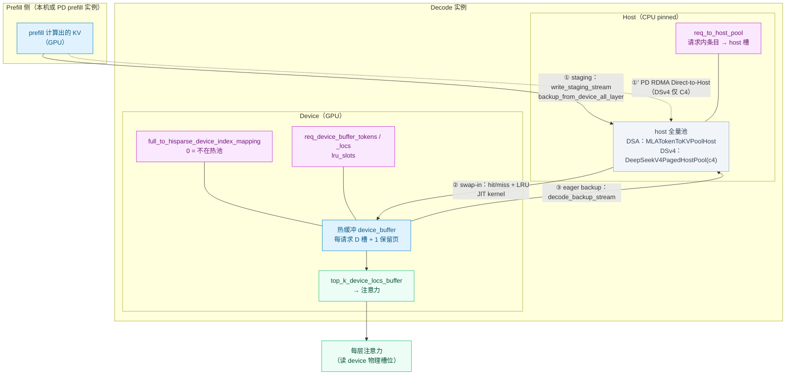
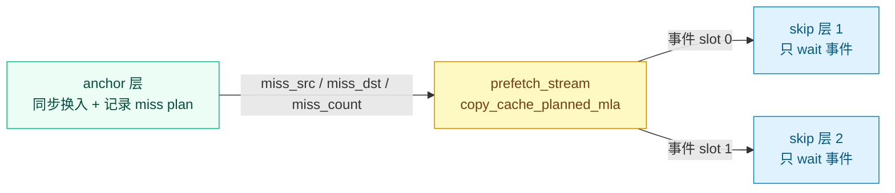

# HiSparse 分层稀疏 KV 缓存详解（Host 全量 + Device 热缓冲）

> 本文讲解 SGLang 中 **HiSparse（Hierarchical Sparse Attention，分层稀疏注意力）** 的存储模型与数据流：
> 全量主 KV 放在 **CPU pinned memory（host）**，GPU 只保留一块**容量固定的热缓冲（device buffer）**，
> 每层注意力按索引器选出的 **top-k** 结果把真正需要的 KV 换入（swap-in）。
>
> 与同目录 [`hicache_transfer_zh.md`](hicache_transfer_zh.md) 的区别：**HiCache 是 L1/L2/L3 级联缓存（为了更大的缓存总量与前缀命中率）；
> HiSparse 是把「解码期真正要读的主 KV」搬出显存（为了更高的 decode 并发）**。两者的 host 池实现有交集，但目标与触发路径不同。
>
> 所有描述均对账当前仓库代码，关键位置标注 `文件:行号`。

---

## 0. 一句话结论

**HiSparse 不改注意力公式，只改 KV 的存放位置与搬运方式**：

- 每请求在 GPU 上只占 `device_buffer_size` 个固定槽位（与序列长度无关）；
- 全量主 KV 常驻 host 池，按请求**按页分配**（`alloc_paged_token_slots`）；
- 每层注意力前由一个 JIT 核函数完成「命中检测 → LRU 淘汰 → miss 从 host 换入」，输出统一的 device 物理槽位表
  （`top_k_device_locs_buffer`）；
- 新产生的 KV 通过独立 stream **异步备份**回 host。

它省的是**显存占用**，不是读取量——DSA 本身已经把「读」降到了 top-k 量级。

---

## 1. HiSparse / HiCache / DSA 三者的关系

| 机制 | 作用层次 | 搬什么 | 目标 | 关键类 |
| --- | --- | --- | --- | --- |
| **DSA（注意力算法）** | 算法层 | 不搬数据 | 用索引器 + top-k **减少被读的 KV 数量** | `dsa/indexer.py`、`dsa_backend.py` |
| **HiSparse** | 存储层 | 主 KV 在 host ↔ device 热缓冲之间按需换入 | 减少**主 KV 的 GPU 常驻**，提升 decode 并发 | `managers/hisparse_coordinator.py` |
| **HiCache** | 存储层 | KV 在 L1(GPU)/L2(host)/L3(storage) 间级联 | 扩大**可缓存总量**、提高前缀命中 | `cache_controller.py`、`hiradix_cache.py` |

- HiSparse 依赖「模型本身只读一小部分 KV」这一性质，所以**只支持 DSA 系模型**（DeepSeek-V3.2 / GLM-5.x 等）与 **DeepSeek-V4**。
- HiSparse 与 HiCache 的 host 池实现有复用：DSA 通路的 host 池就是 `MLATokenToKVPoolHost` **混入** `HiSparseHostPoolMixin`
  （`mem_cache/pool_host/hisparse.py:11`），从而获得「按请求按页分配 host 槽位」的能力。
- 代码里另有一套**通用稀疏框架** `mem_cache/sparsity/`（`SparseCoordinator` + Quest / DSA 算法 + backend adaptor）。
  它是尚未接线的实验骨架（`DSABackendAdaptor.adapt_for_attn_metadata` 仍是 TODO），**生产 HiSparse 走的是 `HiSparseCoordinator`**；
  `hisparse_coordinator.py:1-3` 的文件头注释也写明二者未来计划合并。

---

## 2. 为什么要 HiSparse

长上下文 decode 的矛盾：**算得少、但要存得多**。

- DSA 每步只读 top-k（如 2048）个历史位置，计算/访存已经很小；
- 但全序列 128K 的 KV 仍要常驻显存，直接卡住并发请求数。

HiSparse 的做法是把「不常读的部分」从显存移到主机内存：

| 维度 | 收益 / 代价 |
| --- | --- |
| GPU 显存 | **显著下降**：每请求只占 `device_buffer_size` 个槽位（默认 4096），与序列长度解耦 |
| 主机内存 | **上升**：需为全量 KV 预留 pinned memory（由 `host_to_device_ratio` 决定倍数） |
| 计算量 | 基本相同（top-k 位置不变） |
| 访存 | **增加**：miss 的 KV 要走 host→device 拷贝，热点命中时开销趋近于零 |
| 复杂度 | 多一套 host 池、映射表、异步流与逐层换入核函数 |

> 注意：**有上限的是「被下放主 KV 的热缓冲」，不是整个模型的 GPU 内存**。索引器缓存、压缩状态池、映射表等仍按容量配置常驻显存。

---

## 3. 三个索引空间与映射表

HiSparse 最容易搞混的是「一个下标到底指哪个空间」。代码里同时存在三种口径：

| 空间 | 含义 | 谁产生 | 典型用途 |
| --- | --- | --- | --- |
| **full 逻辑空间** | 分配器对外返回的规范 token 槽位（`out_cache_loc`） | `logical_attn_allocator` | `req_to_token`、调度与元数据 |
| **压缩逻辑空间** | full 逻辑空间按压缩率折算后的条目空间（DSv4 为 `full // 4`） | `translate_loc_from_full_to_compressed` | C4 层的 host 槽位与热池条目 |
| **device 热池物理槽位** | GPU 热缓冲里的真实槽位 | `hisparse_attn_allocator` | 换入核函数落点、注意力读取 |

三者由一张 GPU 上的映射表打通：

```python
# mem_cache/allocator/hisparse.py:51（DSA） / :304（DSv4）
self.full_to_hisparse_device_index_mapping = torch.cat([
    torch.zeros(<逻辑容量> + self.page_size, dtype=torch.int64, device=...),
    torch.tensor([-1], dtype=torch.int64, device=...),   # 末尾 -1 哨兵
])
```

| 取值 | 语义 |
| --- | --- |
| `> 0` | 该逻辑槽位当前**在热池里**的物理槽位号 |
| `0` | 该逻辑槽位**不在热池**（数据只在 host，或该槽位尚未使用） |
| `-1` | 哨兵：让 `last_loc = -1`（序列首个 token 的前驱）翻译后仍为 `-1`，不越界 |

- 分配器构造完成后通过 `register_mapping(weakref.proxy(...))` 把这张表注册给 KV 池
  （`allocator/hisparse.py:66`、`hisparse_memory_pool.py:62`、`deepseek_v4_memory_pool.py` 的 `HiSparseC4DevicePool.register_mapping`）；
  之后池在 `set_*_kv_buffer` / `get_*_kv_buffer` 前会先把 loc 经这张表翻译成热池槽位。
- `clear()` 只清 `mapping[:-1]`，**保留末尾哨兵**（`allocator/hisparse.py:245`）。

---

## 4. 逐请求数据结构（`HiSparseCoordinator`）

这些张量都在协调器构造时按「最大槽数 × 最大上下文长度」一次性预分配
（`hisparse_coordinator.py:244-348`），运行期只做原地更新：

| 字段 | 形状 / dtype | device | 语义 |
| --- | --- | --- | --- |
| `req_to_device_buffer` | `(max_num_req_slots, padded_buffer_size)` int64 | GPU | 请求内第 i 个（压缩）条目 → 热池物理槽位 |
| `req_device_buffer_size` | `(max_num_req_slots,)` int64 | CPU | 该请求当前已分配的热缓冲长度（便于按页 grow） |
| `req_to_host_pool` | `(max_num_req_slots, max_compressed_ctx + page_size)` int64，初值 `-1` | GPU | 请求内第 i 个（压缩）条目 → host 池槽位 |
| `req_to_host_pool_allocated_len` | `(max_num_req_slots,)` int64 | CPU | 该请求已在 host 池分配的条目数（分页续分配的起点） |
| `req_device_buffer_tokens` | `(layer_num, max_num_req_slots, padded_buffer_size)` int32，初值 `-1` | GPU | **每层**热槽当前缓存的是哪个请求内位置；核函数据此判 hit/miss |
| `req_device_buffer_token_locs` | 同上 | GPU | **每层**热槽对应的 device KV 物理槽位 |
| `lru_slots` | `(layer_num, max_num_req_slots, device_buffer_size)` int16 | GPU | 每层、每请求的 LRU 顺序 |
| `top_k_device_locs_buffer` | `(max_num_req_slots, top_k)` int32，初值 `-1` | GPU | **换入输出**：选中的 device 物理槽位表（固定地址，CUDA-graph 安全） |
| `num_real_reqs` | `(1,)` int32 | GPU | 本批真实请求数；graph replay 前由调用方填充，填充块 early-return |
| `padded_buffer_size` | python int | — | `device_buffer_size + page_size`，末尾一页是「最新条目」的**保留槽** |

关键点：

- **保留槽**：热缓冲的下标 `device_buffer_size` 处专门放「本轮刚产生的条目」，因此容量计算要把
  `req_to_device_buffer` / `req_device_buffer_token_locs` 开到 `padded_buffer_size`。
  代码里用 `clamp(max=device_buffer_size)` 解析保留槽（`hisparse_coordinator.py:696`、`:876`）。
- **LRU 宽度只有 `device_buffer_size`**（不含保留槽），请求结束时整体复位为 `_lru_init`。
- 这张表与 `ReqToTokenPool.req_to_token` **完全不是一回事**：后者是「token → full 逻辑槽位」，前者是「请求内条目 → host/热池物理槽位」。

---

## 5. 容量模型

设 `device_buffer_size = D`、`top_k = K`、`host_to_device_ratio = R`。

**（1）每请求的热缓冲上限**

$$
\text{热缓冲槽位上限} = D \quad(\text{实现再预留 1 页作为保留槽})
$$

**（2）整体容量比**（DSA 通路）

$$
\text{logical\_size\_full} = \text{size} \times R,\qquad
\text{size\_hisparse} = \text{size}
$$

`HiSparseTokenToKVPoolAllocator` 内部维护两个 `PagedTokenToKVPoolAllocator`：一个管 full 逻辑空间（`_size_full`），
一个管 GPU 热池（`_size_hisparse`）；`available_size()` 取二者较小值（`allocator/hisparse.py:78-82`）。

**（3）DSv4 通路（C4 压缩）**

C4 层每 4 个 token 压成 1 个条目，于是：

$$
\text{C4 host 条目数} \approx \left\lfloor \frac{N}{4} \right\rfloor,\qquad
\text{C4 device 条目数} = \left\lfloor \frac{N}{4R} \right\rfloor
$$

其中 $N$ 是 full token 容量，且 $R$ 通过 `c4_shrink_factor = parse_hisparse_config().host_to_device_ratio`
作用到 device 侧 C4 池（`model_executor/pool_configurator.py:794-802`）。可用量按压缩率放大后与逻辑空间比较：

$$
\text{available\_size} = \min\big(\text{logical\_avail},\ \text{hisparse\_avail} \times 4\big)
$$

（`allocator/hisparse.py:377-381`）

> 因此 **`R` 既不是「整个 DSv4 KV 显存的缩减倍数」，也不是「每请求热缓冲大小」**：C4 indexer 与 C128 池仍按全量保留。

**（4）配置约束**

| 约束 | 位置 |
| --- | --- |
| `device_buffer_size >= top_k` | `sparsity/factory.py:84-87` |
| `swap_in_block_size ∈ [1, 1024]` 且为整数 | `sparsity/factory.py:88-95` |
| 模型为 DSA 或 DeepSeek-V4 | `arg_groups/hisparse_hook.py:94-97` |
| 必须 `--disable-radix-cache` | `arg_groups/hisparse_hook.py:99-101` |
| 不兼容 `--disaggregation-decode-enable-radix-cache` | `arg_groups/pd_disaggregation_hook.py:76-82` |

---

## 6. 端到端数据流



三条主干路径：**① 准入（写 host）→ ② 换入（读 host）→ ③ 增量备份（写 host）**。

### 6.1 准入通路 A：staging（本机 prefill 后搬运）

`admit_request_into_staging(req)`（`hisparse_coordinator.py:442`）：

1. 标记 `req.hisparse_staging = True`；
2. 取该请求 prefill 已占的 full 槽位，经 `translate_loc_from_full_to_hisparse_device` 换成热池索引空间；
3. `mem_pool_host.alloc_paged_token_slots(...)` 在 host 池按页分配落点，并写入 `req_to_host_pool`；
4. 在独立 stream `write_staging_stream` 上：`start_event.wait(stream)` → `backup_from_device_all_layer(io_backend="kernel")` → `finish_event.record()`；
   对跨流使用的临时索引张量调用 `record_stream` 防止提前释放；
5. 把 `HiSparseAct(start_event, finish_event, req)` 压入 `ack_staging_queue`。

**此时还没有分配 device 热缓冲**——它延迟到 staging 完成、请求真正进入 decode 时。

### 6.2 就绪收割（staging → running）

`collect_ready_reqs()`（`:703`）在调度循环里轮询队列：

- FIFO 语义：遇到第一个未完成（`finish_event.query() == False`）即停；
- TP > 1 时对「各 worker 完成数」做 `all_reduce(MIN)`，保证各 rank 的调度状态一致（`:718-726`）；
- 对就绪请求 `alloc_device_buffer(req)`，置 `_skip_first_backup = True`（prefill 已备份过，第一步无需重复备份）、
  `hisparse_staging = False`。

`model_executor/model_runner.py:1119` 负责创建协调器；`managers/scheduler.py:3423` 附近的 `_build_hisparse_decode_batch`
把就绪请求单独构批（HiSparse 有自己的 prefill→decode 转换，跳过常规的 last_batch 合并）。

### 6.3 准入通路 B：direct（PD 直连 host）

`admit_request_direct(req)`（`:491`）：KV 已由 RDMA 直接落在 decode 的 host 池，**没有任何 staging DMA**：

1. 立即 `alloc_device_buffer(req)`；
2. 按 host 长度分叉：
   - **短序列**（`host_len <= device_buffer_size`）：`_preload_to_device_buffer` 逐层把 host 池全部条目**预加载**进热缓冲
     （因为核函数的短序列快路径会直接返回热缓冲槽位、不做 host 加载，`:515-522`）；
   - **长序列**：把 `req_device_buffer_tokens[:, req_idx, :device_buffer_size]` 置 `-1`，使所有 top-k 查找判 miss，
     强制走 host 加载；
3. 置 `hisparse_staging = False`、`_skip_first_backup = True`。

> 这里有个易错的细节：`alloc_device_buffer` 会把热槽标记成「已缓存 0..buf-1」（对 staging 正确），
> direct 通路必须**显式修正**这个标记（`admit_request_direct` 的 docstring `:498-510` 就是在讲这件事）。

### 6.4 decode 每步：映射更新 + 增量备份

`prepare_for_decode` 中调用 `map_last_loc_to_buffer(...)`（`hisparse_coordinator.py:738`），它做两件事：

1. **先做上一步的增量备份**`_eager_backup_previous_token`（`:817`）：
   - 跳过 `_skip_first_backup` 标记的请求（读后即清）；
   - 对 DSv4，只有 `(seq_len - 1) % compress_ratio == 0` 的步才产生了新的完整压缩条目（`:854`）；
   - 计算上一个压缩条目在热缓冲里的位置：`compressed_pos = (seq_len - 1) // compress_ratio - 1`，
     短序列直接用该下标，长序列钳到保留槽（`:866-878`）；
   - 在 host 池为这 1 个条目分配槽位，然后在 `decode_backup_stream` 上发起跨层备份，
     完成后 `record(_backup_done_event)`，置 `_has_pending_backup = True`。
2. **再更新本轮映射**：普通通路顺带 `_grow_device_buffers`（短序列按页扩容，一次性批量分配，`:614`）；
   DSv4 通路仅在 `seq_len % compress_ratio == 0` 时把新产生的压缩条目写进
   `full_to_hisparse_device_index_mapping`（`:788-815`）。

**单飞（single-flight）备份**：同一时刻最多一个未决备份，`wait_for_pending_backup()`（`:920`）在换入前、
`map_last_loc_to_buffer` 开头、`request_finished` 前被调用，保证「要读的 host 数据一定已经落盘」。

### 6.5 每层换入

注意力后端在每层前调用 `swap_in_selected_pages(...)`：

- DSA：`layers/attention/dsa_backend.py:2260` —— `page_table_1 = coordinator.swap_in_selected_pages(req_pool_indices, seq_lens, topk_indices, layer.layer_id)`；
- DSv4：`dsv4/indexer.py:851` —— 换入结果回写到 `core_metadata.c4_sparse_page_indices`。

返回值就是该层要用的 device 物理槽位表，直接作为 FlashMLA / 稀疏注意力的 page table 使用。

> prefill/extend 路径不做换入，而是把 full 槽位一次性翻译成热池索引（`translate_loc_to_hisparse_device`，
> `dsa_backend.py:2007` 附近有 "todo hisparse: to cover more backends" 的注释）。

### 6.6 回收

| 场景 | 入口 | 行为 |
| --- | --- | --- |
| 正常结束 | `request_finished(req)`（`:1082`） | 等生产者流与未决备份 → 释放热池槽位与 host 槽位 → 清空映射表对应项 → 复位全部逐请求状态（含 LRU） |
| 抢占（retract） | `retract_req(req)`（`:1074`） | staging 中 → `abort_staging_request`；否则 → `request_finished` |
| staging 中打断 | `abort_staging_request(req)`（`:1035`） | 从队列剔除 → 同步 staging 流 → `free_hisparse(...)` 释放设备 KV → 释放 host 槽并复原映射 |

`request_finished` 的两个要点：

- 用 `req.kv.kv_allocated_len` 而不是 seq_len 来算释放范围（投机解码下 seq_len 可能领先于已分配量，防止 double-free，`:1090-1097`）；
- 释放热池槽位前先 `torch.unique(...)` 去重并只释放 `> 0` 的槽位（`:1104`）。

调用点：`managers/scheduler_components/batch_result_processor.py:123` / `:1299`、`disaggregation/decode.py:2522` / `:2560`。

---

## 7. 换入核函数细节

实现位于 `python/sglang/kernels/ops/kvcache/hisparse.py`，CUDA 源在 `python/sglang/kernels/jit/csrc/kvcacheio/hisparse.cuh`：

| 函数 | 作用 |
| --- | --- |
| `load_cache_to_device_buffer_mla` | 普通 MLA 通路（device / host 都是线性布局，stride = `item_size_bytes`） |
| `load_cache_to_device_buffer_dsv4_mla` | DSv4 通路（C4 打包布局） |
| `copy_cache_planned_mla` | 只重放 miss plan 的纯 IO 拷贝（共享索引预取用） |
| `load_cache_to_device_buffer_spec_mla` | 多草稿步换入（`HiSparseSpecState` 携带 hash bank 与打包 CLOCK 状态）；**当前协调器未调用** |

`_run_swap_in_kernel`（`hisparse_coordinator.py:1135`）传给核函数的参数：

| 参数 | 值 / 来源 | 说明 |
| --- | --- | --- |
| `top_k_tokens` | 本层索引器输出 | 请求内逻辑位置 |
| `device_buffer_tokens` | `req_device_buffer_tokens[layer_id]` | 命中判断依据 |
| `device_buffer_locs` | `req_device_buffer_token_locs[layer_id]` | 命中时的返回槽位 |
| `host_cache_locs` | `req_to_host_pool` | miss 时的 host 来源 |
| `lru_slots` | `lru_slots[layer_id]` | 淘汰顺序 |
| `item_size_bytes` | 池的每条目字节 | — |
| `num_top_k` / `hot_buffer_size` | `top_k` / `device_buffer_size` | — |
| `page_size` | `1` | 逐条目寻址 |
| `block_size` | `swap_in_block_size`（默认 960） | 核函数分块 |
| `num_real_reqs` / `skip_io` | — | CUDA graph 与基准探针 |

**命中 / 淘汰逻辑（概念）**：对每个请求，依次检查 top-k 位置是否已在热缓冲（`hit` → 直接返回槽位）；
未命中的位置从 host 换入，必要时按 LRU 淘汰旧条目并更新 `device_buffer_tokens/locs`；
结果写入固定地址的 `top_k_device_locs_buffer`。

### 7.1 CUDA Graph 兼容

- 所有输入输出都用**预分配固定地址**的缓冲（`top_k_device_locs_buffer`、`_miss_*` 等）；
- 批大小在 graph 下固定，真实请求数由 `num_real_reqs` 标量告知核函数，
  capture 时 `fill_(bs)`、replay 前 `fill_(raw_bs)`（`model_executor/runner/decode_cuda_graph_runner.py:1020` / `:1435`），
  填充块 early-return。

### 7.2 共享索引预取（shared-index prefetch / plan-then-IO）

当模型在一段连续的「skip 层」里复用某个 **anchor 层**的 top-k 选择（DSA 的 `index_topk_freq` / `index_topk_pattern`）
时，skip 层的换入目标在 anchor 算出索引的瞬间就已知。HiSparse 自动利用这一点：



- anchor 层用 `record_plan=True` 调 `_run_swap_in_kernel`，把「哪些 host 槽 → 哪些热槽」记进 `_miss_{src,dst,count}`；
- 记完后 `prefetch_stream.wait_stream(当前流)`（保证 plan 已写好），在侧流上对每个 skip 层跑
  `copy_cache_planned_mla`，让 host→device 的 IO **与中间层的计算重叠**；
- skip 层只等对应事件，然后直接返回 anchor 的槽位表（lockstep 复用，无需重新规划）。

约束：仅 DSA 模型；PP > 1 或投机解码下自动禁用并告警回退同步换入（`resolve_shared_index_layers` `:82`）；
pattern 长度与层数不匹配时也回退；`SGLANG_DISABLE_HISPARSE_PREFETCH=1` 可关闭。

---

## 8. 池与分配器接线

| 维度 | DSA 通路（V3.2 / GLM-5.x） | DSv4 通路 |
| --- | --- | --- |
| device 主 KV 池 | `HiSparseDSATokenToKVPool`（`hisparse_memory_pool.py:28`），容量 = 热池 `size` | `HiSparseC4DevicePool`（`deepseek_v4_memory_pool.py:443`），只作 C4 子池 |
| indexer K | **仍在 GPU**，`index_buf_size = size × host_to_device_ratio`（`hisparse_memory_pool.py:58`） | 仍在 GPU（`c4_indexer_kv_pool`），不参与换入 |
| host 全量池 | `MLATokenToKVPoolHost` + `HiSparseHostPoolMixin`，容量 ≈ device × `host_to_device_ratio` | `DeepSeekV4PagedHostPool(pool_name="dsv4_hisparse_c4")`，只镜像 C4 主 KV |
| 映射表长度 | `_size_full + page_size + 1` | `c4_logical_size + hisparse_page_size + 1` |
| 分配器 | `HiSparseTokenToKVPoolAllocator`（`allocator/hisparse.py:15`），`compress_ratio = 1` | `DeepSeekV4HiSparseTokenToKVPoolAllocator`（`:270`），`compress_ratio = 4` |
| 页大小 | 与模型 `page_size` 一致 | 对外仍报 `page_size`，热池/host 用 `hisparse_page_size = page_size // 4` |
| 压缩换算 | 恒等（`translate_loc_from_full_to_compressed` 返回原值） | `(loc + 1) % 4 == 0 → loc // 4` |

**分配器双空间**：`HiSparseTokenToKVPoolAllocator` 内部持两个 `PagedTokenToKVPoolAllocator`
（`logical_attn_allocator` 管 full 逻辑空间、`hisparse_attn_allocator` 管 GPU 热池），核心方法：

| 方法 | 语义 |
| --- | --- |
| `alloc` | DSA 专用（仅 `page_size == 1`）：逻辑与热池同时分配，写映射，返回**逻辑**索引 |
| `alloc_extend` | prefill/extend：两边分别按页分配，写映射，返回逻辑索引 |
| `alloc_decode` | decode：**只分配逻辑**（热池页面不动，映射不变） |
| `alloc_logical_only` | 只占逻辑空间、不占热池——**PD direct-to-host 通路专用** |
| `alloc_device_buffer` | 为请求的热缓冲挑热池槽位（复用已有映射、按页补齐、必要时整页释放） |
| `free_hisparse` / `free_hisparse_indices` | 归还热池槽位并把映射清零 |
| `free_group_begin` / `free_group_end` | DSA 通路为空实现（free 必须立刻清映射）；DSv4 通路有逻辑侧延迟释放 |

host 槽位分配在 `pool_host/hisparse.py`：

- `alloc_paged_token_slots(req_to_host_pool, req_to_host_pool_allocated_len, req_pool_idx, start_pos, num_tokens)`：
  按请求按页分配，推进 `req_to_host_pool_allocated_len`，返回 token 粒度的 host 下标；
- `allocated_host_indices(...)`：取回该请求已分配的 host 下标（回收时用）。

---

## 9. PD 分离：Direct-to-Host

PD 分离是 HiSparse 的推荐（当前也是官方要求的）部署形态：**prefill 实例把 KV 经 RDMA 直接写进 decode 实例的 host 池**，
decode 侧完全不经过 GPU 中转，省掉一次 staging DMA 与显存峰值。

`disaggregation/decode.py` 的相关处理：

| 位置 | 行为 |
| --- | --- |
| `_init_kv_manager`（`:588`） | `transfer_kv_pool = hisparse_coordinator.mem_pool_host`，`mem_kinds = ["DRAM"]`（host 池作为 RDMA 目标） |
| 同上（`:613-623`） | **DSv4 只覆盖前 `c4_layer_num` 个 buffer**（即 C4 主 KV），其余层追加 `device_kv_data_ptrs[c4_layer_num:]` 且 mem-kind 为 `VRAM`——所以 C4 indexer 与 C128 仍是 device-to-device |
| `kv_transfer_page_size`（`:1509`） | 取 `allocator.hisparse_page_size`（DSv4 为压缩后页大小），只发 prefix 之外的增量 |
| 准入预算（`:1298-1305`） | `hisparse_req_budget = hisparse_attn_allocator.available_size() // padded_buffer_size - len(transfer_queue)`，预算耗尽即停止接纳 |
| 预分配（`:2013`、`:2098`） | `assert prefix_len == 0`（**HiSparse 与 decode 侧 L1 radix cache 不兼容**）；只分配逻辑索引（`alloc_logical_only`），再由 `mem_pool_host.alloc_paged_token_slots` 分配 host 落点 |
| 传输目的（`:2090`） | HiSparse 下返回 **host_indices**（否则返回 `kv_loc`），prefill 侧无需任何 HiSparse 特判 |
| 元数据（`:1636`） | DSv4 hisparse 需额外携带 `device_page_indices`（C4 indexer / C128 共享的逻辑页 ID），**要求 Mooncake backend**，否则抛 `NotImplementedError` |
| KV 到达（`:2971`） | 对每个请求 `admit_request_direct(req)`，然后入 waiting 队列 |

> `hisparse_guide.mdx` 也明确：**prefill 实例不需要 `--enable-hisparse`**，它完全不感知 HiSparse；开关只加在 decode 实例上。
>
> 非 PD 的 PP 分离路径也会在解码传输队列中直接调用 `admit_request_direct`（`managers/scheduler_pp_mixin.py:1682`）。

---

## 10. 与其它机制的关系与限制

| 机制 | 关系 |
| --- | --- |
| radix cache | **必须关闭**（`hisparse_hook.py:99`）；decode 侧 `--disaggregation-decode-enable-radix-cache` 与之互斥 |
| 投机解码（MTP/EAGLE） | 共享索引预取禁用；`request_finished` 用 `kv_allocated_len` 防 double-free；online C128 与 MTP 不兼容 |
| unified-KV（DSv4 ROCm） | **不支持**：unified-KV 下 `c4_kv_pool` 为 `None`，分配器无法挂载，启动即报错（`hisparse_hook.py:105-122`） |
| DP attention / DCP | `should_use_dsa_fused_topk` / `should_remap_pd_dsa_seed_to_local_slots` 排除 HiSparse |
| DSA 融合 top-k | decode 时强制 `force_unfused=True`（`dsa_backend.py:3390`），以便产出 `raw_indices` 供换入使用；`dsa_drop_wide_page_table`、RAGGED prefill fast-path、MHA dense fast-path 均排除 HiSparse |
| beam search | 与 HiSparse 互斥（`beam_search/coordinator.py:133`） |
| NPU（DSv4） | 不支持：NPU KV 池构造时直接 assert 拒绝 HiSparse 的 C4 device pool（`hardware_backend/npu/dsv4/dsv4_memory_pool.py:263`） |

---

## 11. 配置、校验与启动示例

### 11.1 参数

| 参数 | 类型 / 默认 | 说明 |
| --- | --- | --- |
| `--enable-hisparse` | flag，默认关闭 | 在 **decode 实例**上开启（`server_args.py:3207`） |
| `--hisparse-config` | JSON 字符串，默认 `None` | 别名为 `--hierarchical-sparse-attention-extra-config`（`server_args.py:3210`） |

`--hisparse-config` 字段（`sparsity/factory.py:79-100`）：

| 字段 | 默认 | 说明 |
| --- | --- | --- |
| `top_k` | `2048` | 每步换入的 top-k 数；若模型 config 带 `index_topk` 则以后者为准（`model_runner.py:1119` 附近） |
| `device_buffer_size` | `2 * top_k`（4096） | 每请求热缓冲槽位上限；DSv4 下以 **C4 压缩条目**计 |
| `host_to_device_ratio` | `2` | host 与 device 的容量比；DSv4 下即 `c4_shrink_factor` |
| `swap_in_block_size` | `960` | 换入核函数分块，取值范围 `[1, 1024]` |
| `algorithm` / `backend` / `min_sparse_prompt_len` / `page_size` | `None` | 供 `sparsity/` 通用框架使用；剩余未知字段进 `sparse_extra_config` |

> `host_to_device_ratio` 需按主机内存容量配置：`hisparse_guide.mdx` 给的经验值是 **约 1 TB → 5**、**约 2 TB → 10**。

### 11.2 校验链

`arg_groups/hisparse_hook.py:validate_hisparse`：

1. 模型必须是 DSA（`is_deepseek_dsa`）或 DSv4（`is_deepseek_v4`）；
2. 必须 `--disable-radix-cache`；
3. DSv4 + ROCm 时若走 unified-KV 路径直接报错；
4. KV dtype 属于 `bfloat16` / `auto` / `fp8_e4m3`（DSA 通路进一步要求 `bfloat16` 或 `fp8_e4m3`）；
5. DSA prefill / decode backend 必须在白名单内（CUDA：`flashmla_sparse` / `flashmla_kv` / `flashinfer_sparse_mla`；ROCm：`tilelang` / `aiter`）。

### 11.3 启动示例（PD 分离）

```bash
# Decode 实例（开启 HiSparse）
python3 -m sglang.launch_server \
    --model-path /path/to/model --trust-remote-code \
    --port 8000 --host 0.0.0.0 \
    --context-length 81920 \
    --tp-size 8 --dp-size 8 --enable-dp-attention \
    --mem-fraction-static 0.85 \
    --disable-radix-cache \
    --disaggregation-mode decode \
    --disaggregation-ib-device mlx5_0,mlx5_1,mlx5_2,mlx5_3 \
    --nnodes 1 --node-rank 0 \
    --enable-hisparse \
    --hisparse-config='{"top_k":2048,"device_buffer_size":6144,"host_to_device_ratio":10,"swap_in_block_size":960}'
```

prefill 实例不加 `--enable-hisparse`（见 `docs/docs/advanced_features/hisparse_guide.mdx`）。

---

## 12. 观测与调试

| 项目 | 说明 |
| --- | --- |
| `HiSparseTokenStats` | `(device_tokens, device_token_usage, host_tokens, host_token_usage)`（`hisparse_coordinator.py:65`），由 `get_token_stats()`（`:424`）提供 |
| `PoolStats` | `managers/scheduler_components/pool_stats_observer.py:281` 把 HiSparse 统计并入 `PoolStats`（`is_hisparse` / `hisparse_device_tokens` / `hisparse_host_tokens` 等字段），随池统计日志与 `SchedulerStats` 输出 |
| `SGLANG_DEBUG_HISPARSE_SKIP_IO=1` | 计时探针：换入流程照跑但**跳过 host→device 的 KV 字节**，用于测「IO 为零」的性能下限。**输出是垃圾数据，仅限 benchmark** |
| `SGLANG_DISABLE_HISPARSE_PREFETCH=1` | 关闭共享索引预取，回退同步换入（A/B 对比用） |

---

## 13. 参考实现位置

| 模块 | 文件 |
| --- | --- |
| 协调器（主逻辑） | `python/sglang/srt/managers/hisparse_coordinator.py` |
| device 池（DSA） | `python/sglang/srt/mem_cache/hisparse_memory_pool.py` |
| device 池（DSv4 C4） | `python/sglang/srt/mem_cache/deepseek_v4_memory_pool.py`（`HiSparseC4DevicePool` `:443`） |
| 分配器 | `python/sglang/srt/mem_cache/allocator/hisparse.py` |
| host 池分页 mixin | `python/sglang/srt/mem_cache/pool_host/hisparse.py` |
| host 池（DSv4） | `python/sglang/srt/mem_cache/memory_pool_host.py`（`DeepSeekV4PagedHostPool` `:206`） |
| 换入核函数 | `python/sglang/kernels/ops/kvcache/hisparse.py`、`python/sglang/kernels/jit/csrc/kvcacheio/hisparse.cuh` |
| 参数与校验 | `python/sglang/srt/server_args.py`、`python/sglang/srt/arg_groups/hisparse_hook.py`、`arg_groups/pd_disaggregation_hook.py` |
| 配置解析（通用稀疏框架） | `python/sglang/srt/mem_cache/sparsity/factory.py`、`sparsity/core/sparse_coordinator.py` |
| 调度/后端接入 | `managers/scheduler.py`、`managers/scheduler_components/batch_result_processor.py`、`layers/attention/dsa_backend.py`、`dsv4/indexer.py` |
| PD 集成 | `python/sglang/srt/disaggregation/decode.py` |
| 池装配 | `python/sglang/srt/mem_cache/kv_cache_configurator.py`、`model_executor/pool_configurator.py`、`mem_cache/hybrid_cache/hybrid_pool_assembler.py` |

---

## 14. 延伸阅读

- [HiCache 三级 KV 缓存传输机制详解](hicache_transfer_zh.md)（L1/L2/L3 与传输路径，与本文的 host 池实现有交集）
- [KV Cache 核心字段详解 §4.7](kv_cache_core_fields_zh.md#47-deepseek-v4-的压缩池csa--hca)（DSv4 压缩池与 HiSparse 的容量关系）
- [host 侧 KV 池字段](host_kv_cache_fields_zh.md)（`DeepSeekV4PagedHostPool` / `HiSparseHostPoolMixin`）
- [稀疏注意力总览 §10](../arch/attention/sparse_attention.md#10-hisparse分层稀疏注意力)（HiSparse 在稀疏注意力谱系中的位置）
- [HiSparse 启动指南](../../docs/advanced_features/hisparse_guide.mdx)
