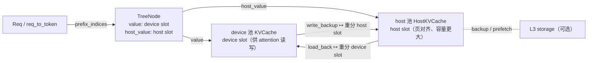

# Host 侧 KV Cache 详解：HiCache 的 L2 主机内存池

> 本文是 `mem_cache/kv_cache_core_fields_zh.md`（device 侧 KV 池）的姊妹篇，聚焦 HiCache 在**主机内存（L2）**里的 KV 池：类结构、字段、索引与容量。
>
> 传输流程（write / load-back / prefetch / backup / evict、`HiCacheController`、后台线程）见 `docs/learn/mem_cache/hicache_transfer_zh.md`，本文不重复，只讲「池本身长什么样」。
>
> 相关源码：
> - `srt/mem_cache/pool_host/base.py`：`HostKVCache`（基类）、`host_memory_budget_bytes`、`sync_fixed_hicache_size`
> - `srt/mem_cache/pool_host/mha.py`：`MHATokenToKVPoolHost`
> - `srt/mem_cache/pool_host/mla.py`：`MLATokenToKVPoolHost`
> - `srt/mem_cache/pool_host/dsa.py`：`DSAIndexerPoolHost`
> - `srt/mem_cache/pool_host/mamba.py`：`MambaPoolHost`
> - `srt/mem_cache/pool_host/common.py`：`HostTensorAllocator`、`ShmHostTensorAllocator`
> - `srt/mem_cache/memory_pool_host.py`：`LogicalHostPool`、V4 host 池
>
> 记号：$P$ 表示 `page_size`，$L$ 表示层数，$H_{kv}$ 表示 KV head 数，$D$ 表示 `head_dim`，$N$ 表示 device 池 token 容量，$N_{host}$ 表示 host 池 token 容量。

---

## 1. 定位：host 池是什么

HiCache 把 KV 从「只在 GPU 显存」扩展为三级：**L1 GPU 显存（device 池）→ L2 主机内存（host 池）→ L3 外部存储**。host 池就是 L2：

- **内容与 device 池逐字节等价**：同样按层存 K/V（MLA 存 latent，Mamba 存 state），只是放在 CPU 侧、容量更大。
- **独立的一套 slot 空间**：host 池有自己的 `size` / `page_size` / `free_slots`，slot 编号与 device slot **没有数值对应关系**，二者靠前缀树节点上的 `value`（device）/ `host_value`（host）两条索引关联。
- **只服务前缀复用**：它不是「请求的运行时 KV」，而是「可被淘汰、可被回载的备份」。请求真正参与计算用的仍是 device 池。

| 维度 | device 池（`KVCache`） | host 池（`HostKVCache`） |
| --- | --- | --- |
| 介质 | GPU 显存 | CPU（pin memory / shm / mmap） |
| 谁分配 slot | `TokenToKVPoolAllocator` | `HostKVCache.alloc`（自带 free list） |
| slot 索引存放处 | `req_to_token`、`TreeNode.value` | `TreeNode.host_value` |
| 谁写谁读 | attention kernel 直接读写 | `HiCacheController` 搬运（DMA / kernel） |
| 命中后 | 直接复用 | 先 `load_back` 回 device 才能用 |

---

## 2. 类清单与源码位置

| 类 | 父类 | 源码位置 | 适用结构 |
| --- | --- | --- | --- |
| `HostKVCache` | `abc.ABC` | `pool_host/base.py:113` | 抽象基类：slot 分配 + 搬运接口 |
| `MHATokenToKVPoolHost` | `HostKVCache` | `pool_host/mha.py:69` | MHA / GQA（full 主线） |
| `MLATokenToKVPoolHost` | `HostKVCache` | `pool_host/mla.py:51` | DeepSeek MLA（含 DSA 变体） |
| `DSAIndexerPoolHost` | `HostKVCache` | `pool_host/dsa.py:49` | DSA indexer 的 index K 池 |
| `MambaPoolHost` | `HostKVCache` | `pool_host/mamba.py:41` | Mamba / 线性注意力 state |
| `LogicalHostPool` | 独立（不继承） | `memory_pool_host.py:73` | V4 纯逻辑锚点池，不持有数据 |
| `DeepSeekV4PagedHostPool` / `DeepSeekV4StateHostPool` | `HostKVCache` | `memory_pool_host.py:206` / `:651` | V4 压缩 KV / state |

装配入口：`srt/arg_groups/hicache_hook.py`（按模型结构选择 host 池类）与 `srt/mem_cache/hybrid_cache/`（混合模型的池组装）；`MLATokenToKVPoolHost` 通过 `pool_host/hisparse.py` 的 `HiSparseHostPoolMixin` 与 HiSparse 交互。

---

## 3. `HostKVCache` 基类：公共字段与方法

所有 host 池都从 `HostKVCache`（`pool_host/base.py:113`）继承，公共字段在 `__init__` 中奠定，slot 分配逻辑与 `alloc` / `free` 全部由基类实现；子类只需给出「每 token 多大」和「怎么搬」。

### 3.1 公共字段

| 字段 | 类型 | 含义 |
| --- | --- | --- |
| `device_pool` | `KVCache` | 对应的 device 池；host 池的层数 / dtype / head 配置都由它派生 |
| `pool_label` | `str` | 池标签（默认 `"kv"`），多池（如 draft）时区分 |
| `size` | `int` | host token 容量 $N_{host}$（页对齐后的**物理**值） |
| `page_size` | `int` | host 页大小（= 传入 page_size $÷$ `dcp_size`） |
| `page_num` | `int` | 页数，`size // page_size + 1`（多一页，同 device 池的 padding 页） |
| `layout` | `str` | 内存布局，见 §4.2 |
| `dtype` | `torch.dtype` | 取自 `device_pool.store_dtype`（fp8 时为 `uint8`） |
| `size_per_token` | `int` | 每 token 在所有层上的主机字节数（子类实现 `get_size_per_token`） |
| `start_layer` / `end_layer` | `int` | 由 device 池继承，用于层分片对齐 |
| `device` | `str` | 固定 `"cpu"` |
| `pin_memory` | `bool` | 是否 pin（`cudaHostRegister` / `pin_memory`） |
| `allocator` | `HostTensorAllocator` 等 | 底层分配方式，见 §3.4 |
| `kv_buffer` | `torch.Tensor` | 真正的数据缓冲区，形状随 layout（见 §4.2） |
| `fd` | `int \| None` | shm/mmap 分配器暴露的 fd（供 storage 后端零拷贝） |
| `lock` | `threading.RLock` | 分配与状态变更的锁（`@synchronized`） |
| `mem_state` | `Tensor(uint8)`，长度 `logical_size` | 每 slot 状态标记 |
| `free_slots` | `Tensor(int64)` | 可直接分配的空闲 slot |
| `release_slots` | `List[Tensor]` + `num_release_slots` | 延迟归还的 slot；`alloc` 不够时才合并 |
| `slot_used` | `Tensor(bool)`，长度 `logical_size` | 记录 slot 是否已分配，用于 double-free / double-alloc 检测 |
| `dcp_size` / `dcp_rank` | `int` | DCP（decode context parallel）配置；`page_size` / `size` / `page_num` 为物理口径，`logical_size` 为加宽后的逻辑口径 |

`logical_size` / `logical_page_size` 是 property：DCP 关闭时等于 `size` / `page_size`；开启时是 `size × dcp_size`（多个 rank 共享一行）。

### 3.2 容量是怎么定出来的

```150:159:python/sglang/srt/mem_cache/pool_host/base.py
        self.size_per_token = self.get_size_per_token()
        if host_size > 0:
            self.size = sync_fixed_hicache_size(
                int(host_size * 1e9 // self.size_per_token), host_size
            )
        else:
            self.size = int(device_pool.size * host_to_device_ratio)
        # Align up the host memory pool size to the page size
        self.page_num = self.size // self.page_size + 1
        self.size = self.page_num * self.page_size
```

1. **定额**（`--hicache-size`，单位 GB）：$\text{size} = \lfloor \text{GB} \times 10^9 / \text{size\_per\_token} \rfloor$，再在 PP 组内 `all_reduce(MIN)` 对齐（`sync_fixed_hicache_size`，`:62`），保证各 stage 容量一致。
2. **按比例**（`--hicache-ratio`）：$\text{size} = \lfloor N \times \text{ratio} \rfloor$，即相对 device 池的倍数。
3. **页对齐**：`page_num = size // page_size + 1`，`size = page_num × page_size`。
4. **内存校验**：`requested_bytes = size × size_per_token` 必须不超过 `host_memory_budget_bytes()`（`:51`，= psutil 可用内存 − 保留量，再除以同机的 rank 数），否则直接报错。
5. `size ≤ device_pool.size` 时告警（L2 命中率会下降），提示调大 ratio。

### 3.3 公共方法与索引

| 方法 | 入参 | 出参 | 说明 |
| --- | --- | --- | --- |
| `alloc` | `need_size: int` | `Optional[torch.Tensor]` | 必须按 `logical_page_size` 对齐；从 `free_slots` 头部取；写 `slot_used`；不足返回 `None` |
| `free` | `indices: torch.Tensor` | `int`（释放个数） | 延迟归还：先 append 到 `release_slots`，`alloc` 不够时才合并；校验 `slot_used` 防 double-free |
| `available_size` | 无 | `int` | `len(free_slots) + num_release_slots` |
| `clear` | 无 | 无 | 重置 `mem_state` / `free_slots = arange(0, logical_size)` / `release_slots` / `slot_used` |
| `destroy` | 无 | 无 | 进程退出前 `cudaHostUnregister` 大块 pinned 缓冲（幂等） |
| `maybe_dcp_kernel_indices` | `indices: Tensor` | `Tensor` | DCP 下把「加宽逻辑 slot」折叠成「本 rank 物理 slot」 |
| `get_size_per_token` | 无 | `int` | **抽象**：每 token 字节数 |
| `init_kv_buffer` | 无 | `Tensor` | **抽象**：按 layout 分配缓冲区 |
| `load_to_device_per_layer` | `device_pool, host_indices, device_indices, layer_id, io_backend, is_draft` | 无 | **抽象**：L2→L1 逐层搬运 |
| `backup_from_device_all_layer` | `device_pool, host_indices, device_indices, io_backend` | 无 | **抽象**：L1→L2 整批搬运 |
| `get_data_page` / `get_dummy_flat_data_page` / `set_from_flat_data_page` | 见签名 | `Tensor` / 无 | 按页读/写（供 L3 storage 非零拷贝路径） |
| `is_stride_page_aligned` | `page_size_bytes=4096` | `bool` | 每页 stride 是否 4096 对齐；决定 NIXL O_DIRECT 能否直读 |

要点：**host slot 的分配粒度是页**（`alloc` 断言 `need_size % logical_page_size == 0`），且 `free` 只记账不立即合并——这与 device 侧 allocator 的 `release_pages` 是同一思路。

### 3.4 分配器类型

`allocator` 由 `get_allocator_from_storage(allocator_type)`（`pool_host/common.py:71`）决定，`allocator_type` 又来自 `--hicache-storage-backend`：

| 类型 | 类 | 底层 |
| --- | --- | --- |
| `default` | `HostTensorAllocator`（`common.py:19`） | `mmap` + 可选 `cudaHostRegister` |
| `shm` | `ShmHostTensorAllocator`（`common.py:34`） | 共享内存，暴露 `fd` / `mm` |
| `mooncake` / `mori` | 各自 allocator | 与传输引擎共享内存 |

---

## 4. `MHATokenToKVPoolHost`（full attention 为例）

MHA / GQA 的 host 池，每个 token 在所有层上存 $2LH_{kv}D$ 个元素。

### 4.1 字段

| 字段 | 类型 | 含义 |
| --- | --- | --- |
| `head_num` / `head_dim` | `int` | 从 `device_pool` 取，本 rank 的 KV head 数与 head 维度 |
| `element_dim` | `int` | `head_num × head_dim`，单层 K（或 V）每 token 的元素数 |
| `target_layer_num` | `int` | 目标模型层数（不含 draft） |
| `layer_num` | `int` | `target_layer_num + len(mtp_draft_device_pools)`，含 MTP/draft 层 |
| `token_stride_size` | `int` | 单层每 token 字节数，`head_num × head_dim × itemsize` |
| `layout_dim` | `int` | 每 token 在一层上的布局跨度，`token_stride_size × layer_num` |
| `kv_buffer` | `torch.Tensor` | `[2, ...]`：第 0 项 K、第 1 项 V（`k_buffer` / `v_buffer` 是它的 property） |
| `k_data_refs` / `v_data_refs` | `List[Tensor]` | 每层一个视图；`page_first` 下是 `kv_buffer.transpose(0,1)` 的切片 |
| `k_data_ptrs` / `v_data_ptrs` | `Tensor(uint64)` | 各层 K/V 的首地址，供 DMA kernel 直接寻址 |
| `packed_device_k_data_ptrs` 等 | `Tensor` / `List` | 投机解码时把 target + draft device 池打包 |
| `staging_k_buffer` / `staging_v_buffer` | `Tensor \| None` | `page_first` + JIT 时的写回中转缓冲 |
| `can_use_jit` / `can_use_write_back_jit` | `bool` | 是否走 JIT 搬运 kernel |

### 4.2 四种 layout 与 buffer 形状

```162:186:python/sglang/srt/mem_cache/pool_host/mha.py
    def init_kv_buffer(self):
        if self.layout == "layer_first":
            dims = (2, self.layer_num, self.size, self.head_num, self.head_dim)
        elif self.layout == "page_first":
            dims = (2, self.size, self.layer_num, self.head_num, self.head_dim)
        elif self.layout == "page_first_direct":
            dims = (
                2,
                self.page_num,
                self.layer_num,
                self.page_size,
                self.head_num,
                self.head_dim,
            )
        elif self.layout == "page_head":
            dims = (
                2,
                self.page_num,
                self.head_num,
                self.page_size,
                self.layer_num,
                self.head_dim,
            )
        else:
            raise ValueError(f"Unsupported layout: {self.layout}")
```

| `--hicache-mem-layout` | 形状 | 特点 |
| --- | --- | --- |
| `layer_first` | `[2, L, N_host, H, D]` | 同一层的 token 连续，整层搬运友好 |
| `page_first`（默认） | `[2, N_host, L, H, D]` | page 内的层连续；支持 staged write-back JIT |
| `page_first_direct` | `[2, page_num, L, page_size, H, D]` | 显式页维度，便于按页 IO / 对齐 |
| `page_head` | `[2, page_num, H, page_size, L, D]` | head 优先的页布局 |
| `page_first_kv_split`（MLA） | K/V 分开分配 | 昇腾等要求 K、V 独立缓冲 |

- 布局只改变**张量维度顺序**，不改变每 token 字节数。
- `page_first` / `page_first_direct` 在分配时会传 `registration_granularity_bytes = page_size × layout_dim`，让 pin 注册按页粒度进行（`mha.py:197-201`）。

### 4.3 每 token 字节数与数值示例

```153:160:python/sglang/srt/mem_cache/pool_host/mha.py
    def get_size_per_token(self):
        self.head_num = self.device_pool.head_num
        self.head_dim = self.device_pool.head_dim
        self.layer_num = self.target_layer_num + len(self.mtp_draft_device_pools)
        return self.head_dim * self.head_num * self.layer_num * self.dtype.itemsize * 2
```

$$
\text{size\_per\_token}_{\text{MHA}} = 2 \times L \times H_{kv}^{\text{local}} \times D \times \text{bytes(dtype)}
$$

**它与 device 侧的 `cell_size` 完全相等**——因为 host 备份的就是同一份 KV（见 `kv_cache_core_fields_zh.md` §4.4）。

以 Llama-3-8B（$L=32$、$H_{kv}=8$、$D=128$、bf16，TP=1）为例：

- 每 token：$2 \times 32 \times 8 \times 128 \times 2 = 131072\ \text{B} = 128\ \text{KiB}$
- 若 device 池 $N = 327{,}680$ tokens，`--hicache-ratio 2.0`：$N_{host} = 655{,}360$ tokens
- host 占用：$655{,}360 \times 128\ \text{KiB} = 80\ \text{GiB}$

MLA 的 host 池（`mla.py:125`）则是：

$$
\text{size\_per\_token}_{\text{MLA}} = L \times \text{kv\_cache\_dim} \times \text{bytes(dtype)}, \qquad \text{kv\_cache\_dim} = d_c + d_h^{R}
$$

DSA 额外用 `DSAIndexerPoolHost` 单独存 index K（`dsa.py:79`）：$\text{indexer\_size\_per\_token} = d_{\text{index}} + \frac{d_{\text{index}}}{\text{quant\_block\_size}} \times 4$。

### 4.4 数据引用与地址表

- `k_buffer` / `v_buffer` 是 `kv_buffer[0]` / `kv_buffer[1]` 的 property；`k_data_refs` 在 `page_first` 下通过 `transpose(0,1)` 得到「每层一个 view」，**不拷贝数据**。
- `k_data_ptrs` / `v_data_ptrs` 是 `uint64` 张量，放在 **device_pool.device** 上，供搬运 kernel 直接按地址寻址（与 device 池的 `k_data_ptrs` 用法一致）。
- `MLATokenToKVPoolHost.get_contiguous_buf_infos()`（`pool_host/mla.py:117`）返回 `(data_ptrs, data_lens, item_lens)`，格式与 device 池相同，用于把 host 内存注册给传输引擎；MHA host 则直接用 `k_data_ptrs` / `v_data_ptrs`。

---

## 5. 其他 host 池

| 池 | 每 token 内容 | 备注 |
| --- | --- | --- |
| `MLATokenToKVPoolHost` | 每层 `kv_cache_dim` 个元素（latent + RoPE key） | `layout` 多一个 `page_first_kv_split`（K/V 分开）；`override_kv_cache_dim` 支持 DSA+fp8 的 656 布局 |
| `DSAIndexerPoolHost` | 只存 indexer 的量化 index K + scale | `size` / `page_num` 直接借用 `anchor_host`（MLA host 池），slot 与 MLA 池**一一对应** |
| `MambaPoolHost` | Mamba state：`temporal_buffer` + `conv_buffer`（逐层） | `page_size = 1`；state 大小固定、与序列长度无关，与 device 侧 `MambaPool` 对应 |
| `LogicalHostPool` | 不存数据（纯 slot 分配） | V4 用：压缩侧子池借用它分配的 FULL 索引作为 **page 锚点**，保证多子池寻址一致 |
| `DeepSeekV4PagedHostPool` / `DeepSeekV4StateHostPool` | V4 压缩 KV / state | 见 `memory_pool_host.py` |

---

## 6. host slot 与 device slot 的对应

两者是**两套独立的编号空间**，靠前缀树节点串起来：



| 索引 | 存在于 | 指向 |
| --- | --- | --- |
| `TreeNode.value` | device 树节点 | device slot 列表（`None` 表示该节点已被 device 淘汰） |
| `TreeNode.host_value` | device 树节点（HiCache 才有） | host slot 列表（`None` 表示 host 也没有备份） |
| `Req.prefix_indices` | 请求 | 当前可用的 device slot（可能来自 `load_back` 的新分配） |
| `Req.host_hit_length` / `last_host_node` | 请求 | 命中但仍在 host、需 `load_back` 的前缀长度与节点 |

由此得到几条不变式：

1. **同一 token 位置**在 device 与 host 的 slot 值一般不同，长度也不一定相等（host 池容量是另一个数）。
2. 一次 `load_back` 会为 host 备份**重新分配 device slot**，回填 `node.value`；反之一次 `write_backup` 会为 device 段**重新分配 host slot**，回填 `node.host_value`。
3. `DSAIndexerPoolHost` 是唯一特例：它与 anchor MLA host 池**共享同一套 slot 编号**（`size` / `page_num` 直接借用），因为 index K 与 latent 必须成对存在。
4. host 侧的分配粒度是**页**，而 device 侧可以是 token（`page_size=1` 时）；因此一次搬运的索引也按页对齐。

---

## 7. 配置项与容量

| 参数 | 默认 | 作用 |
| --- | --- | --- |
| `--enable-hierarchical-cache` | `False` | 总开关 |
| `--hicache-host-memory-mode` | `cache` | `cache`：host 作为持久 L2；`buffer_only`：只作为 GPU↔L3 的中转 |
| `--hicache-ratio` | `cache` 下 `2.0`（`buffer_only` 下 `1.2`） | host 容量相对于 device 池的倍数 |
| `--hicache-size` | `0` | 以 GB 直接指定 host 容量，覆盖 ratio |
| `--hicache-mem-layout` | `page_first` | 布局，见 §4.2 |
| `--hicache-io-backend` | `kernel` | L1↔L2 搬运方式：`kernel` / `direct` / `kernel_ascend` |
| `--hicache-write-policy` | `write_through` | `write_through` / `write_through_selective` / `write_back` |
| `--hicache-storage-backend` | `None` | 开启 L3 后端（`file` / `mooncake` / `hf3fs` / `nixl` / `shm` / …），并决定 host allocator 类型 |

容量核对顺序：`size_per_token` → 定额或比例定 `size` → 页对齐 → `host_memory_budget_bytes()` 校验 → 日志打印 `N_host` 与占用 GB 数。

---

## 8. 与 device 侧对照

| 维度 | device 侧（`kv_cache_core_fields_zh.md`） | host 侧（本文） |
| --- | --- | --- |
| 分配器 | `TokenToKVPoolAllocator`（按 token / 页） | `HostKVCache.free_slots`（只按页，延迟归并） |
| 索引持有者 | `req_to_token`、`TreeNode.value` | `TreeNode.host_value` |
| 与请求的关系 | 请求运行时直接访问 | 仅备份；命中需 `load_back` |
| 每 token 字节数 | `cell_size` | `size_per_token`（数值完全相同） |
| 布局 | `nhd` / `hnd` / `vectorized_5d` | `layer_first` / `page_first` / `page_first_direct` / `page_head` / `page_first_kv_split` |
| 淘汰 | `RadixCache.evict` → `free` | `evict_host` → `free`（容量策略不同） |
| 数据搬运 | attention kernel 读写 | `HiCacheController`（专用 stream / 后台线程） |

---

## 9. 常见问题

**Q1：host 池的 slot 数为什么多一页？**
与 device 池一致：`page_num = size // page_size + 1`，多出的部分承接 page 对齐的 slack，避免边界场景越界。

**Q2：`free` 之后为什么 `available_size` 立刻变大，但 `free_slots` 没变？**
`free` 只把 slot 记进 `release_slots` 并累加 `num_release_slots`，`available_size` 把两者相加；真正的合并（`torch.cat`）推迟到 `alloc` 发现 `free_slots` 不够时（`_merge_release_slots`），避免每次释放都做一次大拼接。

**Q3：为什么 host 池的 `size_per_token` 和 device 的 `cell_size` 一样大？**
因为 host 备份的是同一份 KV 数据，只是介质不同。容量差异来自 `N_host vs N`（由 `--hicache-ratio` / `--hicache-size` 决定），不是每 token 大小的差异。

**Q4：DCP 开启后 `size` / `page_size` 为什么会变？**
DCP 让多个 rank 共享同一行，`page_size` 会先按 `dcp_size` 加宽传入，再在池内除以 `dcp_size` 得到物理页；`logical_size` / `logical_page_size` 保留加宽后的逻辑口径，kernel 侧用 `maybe_dcp_kernel_indices` 折回本 rank。
