# KV Cache 核心字段详解：含义、存储结构与数值示例

> 本文以标准 MHA/GQA 模型为主线，介绍 SGLang 中 KV cache 的核心数据结构和字段。MLA、SWA 等混合池在 §4 里有专门小节，Mamba、DSA 等其余变体只做简要说明。
>
> 相关源码：
> - `srt/mem_cache/memory_pool.py`：`ReqToTokenPool`、`KVCache`、`MHATokenToKVPool`、`MLATokenToKVPool`
> - `srt/mem_cache/allocator/token.py`、`allocator/paged.py`：`TokenToKVPoolAllocator`、`PagedTokenToKVPoolAllocator`
> - `srt/mem_cache/allocation.py`：`alloc_for_extend`、`alloc_for_decode`、`write_cache_indices`
> - `srt/mem_cache/radix_cache.py`：`RadixKey`、`TreeNode`、`RadixCache`（详见 §7）
> - `srt/managers/schedule_batch.py`：`ReqKvInfo`、`Req`、`ScheduleBatch`
> - `srt/mem_cache/kv_cache_configurator.py`、`srt/model_executor/pool_configurator.py`：池容量计算
>
> 记号：$P$ 表示 `page_size`，$L$ 表示层数，$H_{kv}$ 表示 KV head 数，$D$ 表示 `head_dim`，$N$ 表示 `max_total_num_tokens`，$R$ 表示 `max_num_reqs`。
>
> **attention 缩写全称**：
>
> | 缩写 | 英文全称 | 中文 | 与 KV 的关系 |
> | --- | --- | --- | --- |
> | MHA | Multi-Head Attention | 多头注意力 | 每个 KV head 对应一组 query head，存完整 K/V |
> | MQA | Multi-Query Attention | 多查询注意力 | 所有 query head 共享一组 K/V，KV 最省、质量损失最大 |
> | GQA | Grouped-Query Attention | 分组查询注意力 | 介于 MHA 与 MQA：query head 分组共享 K/V |
> | MLA | Multi-head Latent Attention | 多头潜在注意力 | 每 token 只存低秩 latent + RoPE key（DeepSeek 系列） |
> | SWA | Sliding Window Attention | 滑动窗口注意力 | 每个位置只看最近 $W$ 个 token，窗口外的 KV 可淘汰 |
> | DSA | DeepSeek Sparse Attention | DeepSeek 稀疏注意力 | 在 MLA 基础上按 indexer 选择 token，DeepSeek-V3.2 |
> | Full Attention | Full (Global) Attention | 全/全局注意力 | 每个位置看全部历史，不做窗口或稀疏裁剪 |
> | Linear Attention | Linear Attention | 线性注意力 | 线性复杂度的近似注意力，常见于混合线性模型 |
> | SSM | State Space Model | 状态空间模型 | 非 attention；Mamba 属此类，用固定大小的 state 取代 KV |

---

## 1. 总览：两级映射 + 前缀树

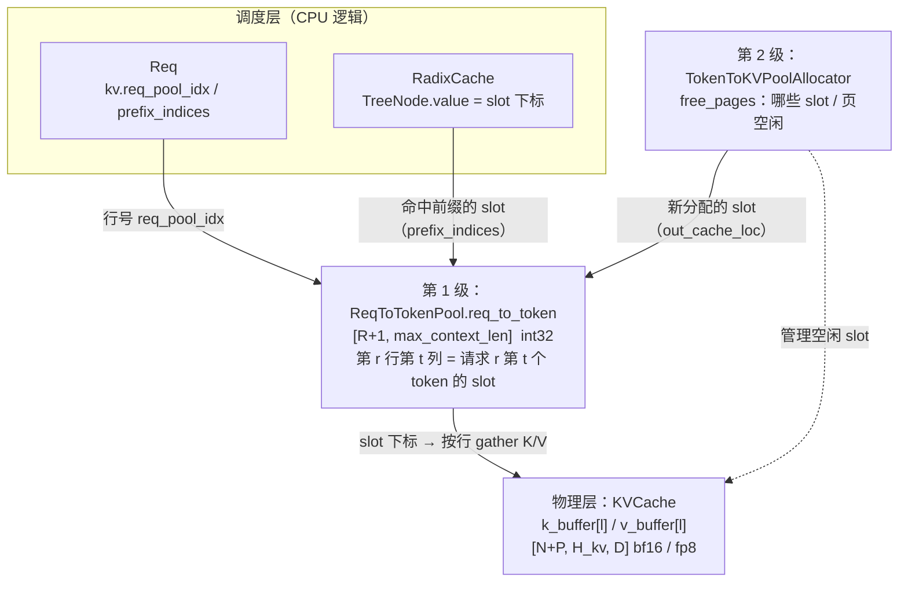

| 组件 | 管什么 | 单位 | 容量字段 |
| --- | --- | --- | --- |
| `ReqToTokenPool` | 请求 → 各 token 的 slot 映射表 | 行（每个在途请求占 1 行） | `size` $= R$（即 `max_running_requests`） |
| `TokenToKVPoolAllocator` | 空闲 slot / page 列表 | token slot，或 page | `size` $= N$ |
| `KVCache`（如 `MHATokenToKVPool`） | 真正的 K/V 显存 | token slot | `size` $= N$ |
| `RadixCache` | 可复用前缀 → slot 的前缀树 | 树节点 | 不单独占 KV，只引用 slot |

**两级映射的好处**：请求层（用哪一行）与物理层（KV 放在哪些 slot）解耦。
- 同一请求的 token 在物理上可以不连续；
- 多个请求可以共享同一段前缀的 slot（例如相同的 system prompt）；
- 分块 prefill 时同一请求始终用同一行，slot 分批追加即可。

---

## 2. `ReqToTokenPool`：请求 → token slot 映射表

维护 `[R+1, max_context_len]` 的映射表，把「请求 + 第几个 token」翻译成 KV slot 下标，是两级映射的第一级，也是调度器唯一能看到「逻辑 token → 物理槽位」的地方。

### 2.1 字段

| 字段 | 类型 / 形状 | 含义 |
| --- | --- | --- |
| `size` | int | 可同时容纳的请求数 $R$ |
| `max_context_len` | int | 每行的列数，见下方公式 |
| `req_to_token` | `[size+1, max_context_len]` int32，GPU | 映射表本体。`req_to_token[r, t]` 表示第 r 行请求的第 t 个 token 所在的 KV slot |
| `free_slots` | `List[int]`，CPU | 空闲行号，初始为 `[1, 2, ..., size]` |
| `req_generation` | `[size+1]` int64 | 每行被分配的代数，每次 alloc 时 +1，用来识别行被复用 |

- **第 0 行是 padding 行**：CUDA Graph 为补齐 batch 会把 `req_pool_indices` 填成 0，这些占位读写都落到第 0 行，不会污染真实请求，所以 `free_slots` 从 1 开始。
- **分配从尾部取，释放追加到尾部**：`alloc_rows` 取 `free_slots[-n:]`，`free_rows` 调用 `extend` 放回尾部。所以刚释放的行会最先被复用（LIFO）。

#### 每行列数

$$
\text{max\_context\_len} = \text{model\_config.context\_len} + \text{get\_req\_to\_token\_extra\_context\_len}()
$$

`model_config.context_len` 是服务端生效的上下文上限（由 `--context-length` 覆盖，或从 `max_position_embeddings` 推导）；后一项是给投机解码的 draft token 和按页对齐预留的 headroom，实现见 `python/sglang/srt/mem_cache/allocation_sizing.py`。

### 2.2 主要方法

| 方法 | 作用 |
| --- | --- |
| `alloc(reqs)` | 为还没有 `req_pool_idx` 的请求分配行，并写入 `req.kv.req_pool_idx`。已有行的请求（例如分块 prefill 的后续块）继续用原来的行 |
| `free(req)` | 归还行号，并把 `req.kv.req_pool_idx` 置为 `None` |
| `write(indices, values)` | 写映射，例如 `write((r, slice(3, 5)), [7, 8])` |
| `available_size()` | `len(free_slots)`，即还能接纳的请求数，调度器的 `get_num_allocatable_reqs` 会用到 |

### 2.3 数值示例

设 `size=4`，`max_context_len=8`。

**`free_slots` 的变化**：

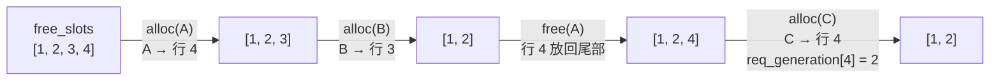

**`alloc(B)` 之后的 `req_to_token` 表**（A 有 3 个 token，B 有 5 个 token，数字为 slot 下标）：

```text
               t=0   t=1   t=2   t=3   t=4   t=5   t=6   t=7
             ┌─────┬─────┬─────┬─────┬─────┬─────┬─────┬─────┐
 行 0 (pad)  │  0  │  0  │  0  │  0  │  0  │  0  │  0  │  0  │  ← CUDA Graph 占位读写
             ├─────┼─────┼─────┼─────┼─────┼─────┼─────┼─────┤
 行 1 (空闲) │     │     │     │     │     │     │     │     │
             ├─────┼─────┼─────┼─────┼─────┼─────┼─────┼─────┤
 行 2 (空闲) │     │     │     │     │     │     │     │     │
             ├─────┼─────┼─────┼─────┼─────┼─────┼─────┼─────┤
 行 3 = B    │ 12  │ 13  │ 20  │ 21  │ 22  │     │     │     │  ← B 的 slot 可以不连续
             ├─────┼─────┼─────┼─────┼─────┼─────┼─────┼─────┤
 行 4 = A    │  7  │  8  │  9  │     │     │     │     │     │
             └─────┴─────┴─────┴─────┴─────┴─────┴─────┴─────┘
```

**显存估算**：

$$
\text{Mem}_{\text{req\_to\_token}} = (R + 1) \times \text{max\_context\_len} \times 4\ \text{B}
$$

以 Llama-3-8B 为例，`context_len`$=8192$，$R=256$：

$$
(256 + 1) \times (8192 + 4) \times 4\ \text{B} = 8{,}425{,}488\ \text{B} \approx 8.04\ \text{MiB}
$$

与 KV 本体（几十 GiB）相比可以忽略。

---

## 3. `TokenToKVPoolAllocator`：空闲 slot 管理

管理 KV slot 的分配与回收，只维护「哪些 slot 空闲」的账本，本身不持有显存，通过 `_kvcache` 引用对应的 `KVCache`。

### 3.1 字段

基类 `BaseTokenToKVPoolAllocator`（`allocator/base.py`）：

| 字段 | 类型 | 含义 |
| --- | --- | --- |
| `size` | `int` | 可分配的 slot 总数 $N$（token 数，不含 padding） |
| `page_size` | `int` | 每页的 token 数 $P$。$P=1$ 时用 `TokenToKVPoolAllocator`，$P>1$ 时用 `PagedTokenToKVPoolAllocator` |
| `dtype` | `torch.dtype` | KV 存储类型。分配器只做透传，真正用它的地方在 `KVCache` |
| `device` | `str` | 所在设备，如 `"cuda"` |
| `_kvcache` | `KVCache` | 底层物理 KV 存储的引用。分配器本身不持有显存 |
| `need_sort` | `bool` | PD 分离的 P/D 端为 `True`：释放先进 `release_pages`，不够分配时才 `merge_and_sort_free` 合并排序，让分配出的页尽量连续，提高 RDMA 传输效率 |
| `free_pages` | `torch.Tensor`（`int64`，1 维，GPU） | 可直接分配的空闲页号。初始化前为 `None`；`clear()` 后为 `torch.arange(1, N+1)`，第 0 页是 padding 页。$P=1$ 时页号就是 slot 下标 |
| `release_pages` | `torch.Tensor`（`int64`，1 维，GPU） | **已释放、待合并**的空闲页（不是「待释放」）。初始化前为 `None`；`clear()` 后为空张量 `torch.empty((0,))`。详见 §3.4 |
| `free_group` | `list[torch.Tensor] \| None` | 批量释放的暂存区。`free_group_begin()` 置为 `[]`，期间 `free` 只往里面 `append`；`free_group_end()` 一次性 `free(torch.cat(...))` 再置回 `None` |

分页版 `PagedTokenToKVPoolAllocator`（`allocator/paged.py`）额外字段：

| 字段 | 类型 | 含义 |
| --- | --- | --- |
| `num_pages` | `int` | $\lfloor N / P \rfloor$。**不含** padding 的 page 0，即可分配页数（物理总页数是 $\text{num\_pages} + 1$）。详见 §3.6 |
| `debug_mode` | `bool` | 由环境变量 `SGLANG_DEBUG_MEMORY_POOL` 控制。打开后每次 alloc/free 都断言页对齐、下标不重复 |
| `free_page_reps_group` | `list[torch.Tensor]` | `free_segment` 路径的页代表暂存区，和 `free_group` 一起在 `free_group_end` 归还 |

另外两点：`size_full` 是 `@property`（基类返回 `self.size`，SWA 等子类会重写），`available_size()` 是方法而不是字段。

slot 与 page 的换算：

$$
\text{slot} = \text{page} \times P + \text{offset}, \qquad 0 \le \text{offset} < P, \qquad \text{page} = \left\lfloor \frac{\text{slot}}{P} \right\rfloor
$$

可分配的 token 数：

$$
\text{available\_size} = \big(\lvert \text{free\_pages} \rvert + \lvert \text{release\_pages} \rvert\big) \times P
$$

- **分配从头部取**：`free_pages[:n]`。
- 在 radix cache 中可被淘汰（evictable）的 token 不算在 `available_size` 里；分配不足时，调度器会先调用 `evict` 再重试。

### 3.2 主要方法

| 方法 | 入参 | 出参 | 调用场景 |
| --- | --- | --- | --- |
| `alloc(need_size)` | `need_size: int`。分页版必须按页对齐 | `int64 [need_size]`，slot 下标；不足返回 `None` | 整段一次性申请，如外部 KV（LMCache / FlexKV）命中后为未命中段补分配 |
| `alloc_extend(prefix_lens, prefix_lens_cpu, seq_lens, seq_lens_cpu, last_loc, extend_num_tokens, num_new_pages=None)` | 各请求的命中前缀长度、extend 后总长（后两者各带一份 CPU 副本，用于算页数时免去 device→host 同步）、`last_loc`（已分配的最后一个 slot，没有则为 $-1$）、本批新 token 数 `extend_num_tokens` | `int64 [extend_num_tokens]`，新 token 的 slot 下标；不足返回 `None` | prefill / 分块 prefill 组批（`alloc_for_extend`）；`None` 时抛 prefill OOM |
| `alloc_decode(seq_lens, seq_lens_cpu, last_loc)` | 追加前的序列长度（GPU + CPU 副本）、`last_loc` | `int64 [bs]`，每个请求 1 个新 slot；不足返回 `None` | decode 组批（`alloc_for_decode`）；`None` 时抛 decode OOM、触发 `retract_decode` |
| `free(free_index)` | 要归还的 slot 下标，一维 `int64`；空张量直接返回 | 无 | radix cache 淘汰与去重、请求结束释放、beam search 分叉回滚 |
| `free_group_begin()` / `free_group_end()` | 无 | 无 | 一轮内批量释放，避免每次都做 `cat` / `unique`（`schedule_batch.py`、`batch_result_processor.py`） |
| `available_size()` | 无 | `int`：$(\lvert \text{free\_pages} \rvert + \lvert \text{release\_pages} \rvert) \times P$ | 调度器准入判断 |

prefill 需要的新页数（`alloc_extend`）：

$$
\text{num\_new\_pages} = \left\lceil \frac{\text{seq\_len}}{P} \right\rceil - \left\lceil \frac{\text{prefix\_len}}{P} \right\rceil
$$

decode 时，只有追加前的长度恰好写满整页才需要新页：

$$
\text{需要新页} \iff \text{seq\_len}_{\text{追加前}} \bmod P = 0
$$

### 3.3 数值示例

**非分页（$P=1$）**：

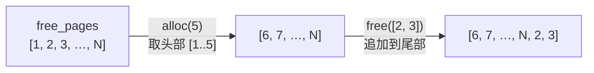

**分页（$P=4$）**：请求 A prefill 6 个 token（无前缀），随后 decode 3 个 token。

prefill 新页数：$\lceil 6/4 \rceil - \lceil 0/4 \rceil = 2$，取 page 1、2。

```text
            ┌──── page 0 ────┬──── page 1 ────┬──── page 2 ────┬──── page 3 ────┐
 slot       │  0   1   2   3 │  4   5   6   7 │  8   9  10  11 │ 12  13  14  15 │
            ├────────────────┼────────────────┼────────────────┼────────────────┤
 prefill    │ pad pad pad pad│ t0  t1  t2  t3 │ t4  t5  ░   ░  │                │  out_cache_loc = [4..9]
 decode t6  │                │                │ t4  t5  t6  ░  │                │  6 mod 4 = 2 → 不分新页，slot 10
 decode t7  │                │                │ t4  t5  t6  t7 │                │  7 mod 4 = 3 → 不分新页，slot 11
 decode t8  │                │                │                │ t8  ░   ░   ░  │  8 mod 4 = 0 → 新页 3，slot 12
            └────────────────┴────────────────┴────────────────┴────────────────┘
                                                         ░ = 已分配但未使用（页内碎片）
```

分页的代价是**页内碎片**，每个请求最后一页平均浪费：

$$
\mathbb{E}[\text{浪费}] \approx \frac{P - 1}{2}\ \text{个 slot}
$$

好处是 FlashInfer、TRT-LLM 等分页注意力 kernel 可以按页寻址，radix 前缀匹配也按页对齐。

### 3.4 空闲账本：`free_pages` 与 `release_pages`

分配器的空闲账本被拆成两份。容易误解的一点先说清楚：**`release_pages` 不是「可以释放但还没释放」，而是「已经释放、只差合并」**——这些页已经从请求手里收回了，只是还没并进可分配列表。

| 账本 | 含义 | 何时写入 | 能否直接分配 |
| --- | --- | --- | --- |
| `free_pages` | 可直接分配的空闲页 | `alloc` 从头部取走若干页；`need_sort=False` 时 `free` 直接追加；`merge` 后整体重建 | 能 |
| `release_pages` | **已归还、待合并**的空闲页 | 仅当 `need_sort=True` 时，`free` 写到这里 | 不能，必须先 merge 才能被分配 |

只有 `need_sort=True`（PD 分离的 P/D 端）才启用这套延迟机制；单机场景 `free` 直接进 `free_pages`。

**为什么要延迟合并**：合并时会排序，排序的目的是让后续分配出的页尽量连续（Paged attention 的局部性、PD 分离下 RDMA 传输效率）。排序本身有开销，所以不每次释放都做，而是「先攒着，等真的不够分时再做一次」。

**状态流转**：

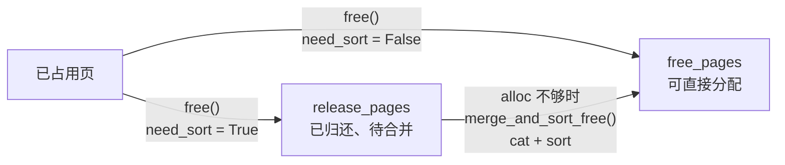

由此推出三条使用规则：

1. **`alloc` 绝不直接读 `release_pages`**：`need_sort` 且 `free_pages` 不够分时才触发一次合并，合并后再判断是否真的耗尽。
2. **`available_size` 必须把两份都算上**，否则会把「已释放但未合并」的页误判成没有内存。守恒关系为

$$
\lvert \text{free\_pages} \rvert + \lvert \text{release\_pages} \rvert + \text{已占用页数} = \left\lfloor \frac{N}{P} \right\rfloor
$$

3. **`release_pages` 不保证有序**（非分页版往后追加、分页版往头部插入），真正的排序只发生在合并那一刻，所以「已按大小排好」不能作为假设。

### 3.5 分配与释放的细节语义（非分页 vs 分页）

两个子类接口一致，但细节有几处**故意相反**，很容易写错：

| 行为 | `TokenToKVPoolAllocator`（$P=1$） | `PagedTokenToKVPoolAllocator`（$P>1$） |
| --- | --- | --- |
| 0 号 slot / 0 号页 | 两版都保留作 padding，**永不分配**（`free_pages` 从 1 开始） | 同左 |
| `alloc` 取值位置 | 空闲表**头部** | 空闲表**头部**，再按页展开成连续 slot |
| `alloc(0)` | 返回空张量，账本不变 | 返回空张量，账本不变 |
| 空间不足 | 直接返回 `None`，**不做部分分配** | 同左 |
| `free` 归还位置 | **追加到尾部**：刚释放的最后才被复用（FIFO 式） | **插到头部**：刚释放的最先被复用（LIFO 式） |
| `free` 的粒度 | 按 token，逐个归还 | **按页去重**：同一页出现多次只归还一次（入参可以是非对齐的 token 下标；**页内没有「部分空闲」**，见下表后说明） |
| `alloc` 的粒度 | 任意 | 必须按页对齐；否则按 $\lfloor \text{need\_size}/P \rfloor$ **静默向下取整**（只有 `debug_mode` 打开时才断言报错） |
| `alloc_extend` / `alloc_decode` | 不实现，调用即抛 `NotImplementedError` | 按页扩展 / 追加实现（走 kernel） |
| `available_size` 公式 | $\lvert \text{free\_pages} \rvert + \lvert \text{release\_pages} \rvert$（$P=1$ 时可省掉乘法） | $(\lvert \text{free\_pages} \rvert + \lvert \text{release\_pages} \rvert) \times P$ |
| `free_group` 挂起 | 支持；挂起期间释放不生效，结束时一次性归还 | 支持，另有一条 `free_segment` 路径的页代表暂存区 |
| `free_group` 的取值语义 | 挂起时对入参张量做 **clone（取所有权）**，因此调用方复用自己的缓冲区、或在调用后改写它，都不会污染账本 | 同左 |

两版的归还顺序差异举例（$N$ 足够大）：

```text
非分页：free_pages = [6, 7, 8, 9]  --free([2, 3])-->  [6, 7, 8, 9, 2, 3]
分页  ：free_pages = [3, 4]        --free(page 1)-->  [1, 3, 4]
```

**分页版的释放粒度：页内没有「部分空闲」**

页是最小可分配单位。`free` 只从 slot 下标里取出页号再去重：

$$
\text{page} = \left\lfloor \frac{\text{slot}}{P} \right\rfloor, \qquad \text{归还页集合} = \operatorname{unique}\left(\{\text{page}\}\right)
$$

所以**只要归还了该页的任意一个 token，整页就变成可（重新）分配的**——分配器不知道、也不关心调用方只传了页里的哪几个 token。举例（$P=4$，page 1 覆盖 slot $4 \sim 7$）：

```text
free([4, 5, 5, 4])  →  页号 [1, 1, 1, 1]  →  去重后 [1]
free_pages: [3, 4]  →  [1, 3, 4]        （长度只 +1，而不是 +4 或 +2）
```

由此推出两条调用约束：

1. **一页只能属于一个请求**——页是独占单位，不存在两个请求各占同页一半的合法状态；
2. **一页只能归还一次**（no double free）——重复放回空闲表会让同一页被两次分配，后续请求的 KV 因此被覆盖。

也就是说：没有「页内部分保留、部分释放」这种合法调用。想保住页内某几个 token，就只能整页不释放；真要按 token 粒度精细释放，得用非分页版（$P=1$，页与 slot 等价，粒度一致）。

两个相关佐证：

- 真实路径天然满足该约束：一个请求的 KV row 是按页分配、页内连续的，释放时以页为单位，页内空洞只会出现在最后一页的尾部（分配时整页给出、末尾几个 token 未用），随请求结束整页归还一并回收。
- `free_segment` 用「跨步取页代表」替代 `unique`（避免数据依赖导致的 device 同步），前提同样是「页内连续、一页只释放一次」。

几条外围契约：

- `size_full` 是属性而非字段，基类返回 `size`，SWA 等子类会重写；`available_size()` 是方法而不是字段。
- `resize` 按新的 `max_total_num_tokens` 重建空闲表；分页版还会重算 $\text{num\_pages} = \lfloor \text{size}/P \rfloor$。
- `translate_kv_indices_for_transfer` 在静态池下是**恒等映射**（返回同一个张量），只有虚拟 id 池才需要重写。
- `get_cpu_copy` / `load_cpu_copy` 由分配器**转发给 `KVCache`**：分配器只维护账本，不碰数据搬运。

最后提醒一个易混点：这里的 `free_pages` 管的是 **KV slot / page**，而 §2 里 `ReqToTokenPool.free_slots` 管的是**请求行号**。两者都是「头部取、尾部还」的池，但一个分配映射表的行，一个分配物理 KV 槽位。

### 3.6 易错提示：`num_pages` 不含 page 0，slot 从 $P$ 开始

写代码或读日志时最容易错的两点，单独拎出来：

**① `num_pages` 是「可分配的页数」，不含 padding 的 page 0。**

$$
\text{num\_pages} = \left\lfloor \frac{\text{size}}{P} \right\rfloor, \qquad \text{物理总页数} = \text{num\_pages} + 1
$$

可分配页号是 $1 \sim \text{num\_pages}$，因此 $\text{available\_size} = \text{num\_pages} \times P \le \text{size}$（`size` 不是 $P$ 的整数倍时，尾部余下的 slot 会被丢弃）。`resize` 重算时同样是 $\lfloor \text{max\_total\_num\_tokens} / P \rfloor$，同样不含 padding 页。

**② 第一个可分配的 slot 是 $P$，不是 0。**

page 0 占据 $[0,\ P)$，page 1 的首 slot 就是 $P$：

$$
\text{可分配 slot} \in [P,\ \text{size} + P - 1] \qquad (\text{非分页 } P=1 \text{ 时退化为 } [1,\ \text{size}])
$$

这也是「分页版输出始终按页对齐」的由来：起始 slot 必是 $P$ 的倍数（$\text{slot} = \text{page} \times P + \text{offset}$）。与之对应，KVCache 的 buffer 行数必须是 $\text{size} + P$，多出来的那一页专门吸收 padding token 的 dummy 写入。

自检清单（以 $P=4$、$\text{size}=16$ 为例）：

| 检查项 | 期望值 | 例（$P=4$, size=16） |
| --- | --- | --- |
| `num_pages` | $\lfloor \text{size}/P \rfloor$（不含 page 0） | 4 |
| 可分配页号 | $1 \sim \text{num\_pages}$ | 1, 2, 3, 4 |
| padding 占用 slot | $[0,\ P)$ | 0 \~ 3 |
| 最小可分配 slot | $P$（非分页为 1），**绝不是 0** | 4 |
| 可分配 slot 上界 | $\text{size} + P - 1$ | 19 |
| `available_size()` | $\text{num\_pages} \times P$ | 16 |
| KV buffer 行数 | $\text{size} + P$ | 20 |

---

## 4. `KVCache`：K/V 物理存储

真正持有 KV 显存的基类：按层保存 K/V 张量，对外提供 attention 的读写接口。不同模型结构对应不同子类。

§4.1~§4.3 展开三条主线池（MHA、MLA、SWA）。下表是**继承 `KVCache` 的全部池类**速览（除注明 NPU 外均在 `srt/mem_cache/`；NPU 变体在 `srt/hardware_backend/npu/`）；量化、后端、共享缓冲等变体只在存储布局 / dtype / 视图上不同，接口与主线一致。

| 家族 | 类 | 父类 | 源码位置 | 用途 |
| --- | --- | --- | --- | --- |
| MHA | `MHATokenToKVPool` | `KVCache` | `memory_pool.py:1846` | 标准 MHA / GQA（§4.1） |
| MHA | `NoOpMHATokenToKVPool` | `MHATokenToKVPool` | `memory_pool.py:2989` | 不分配物理 K/V（embedding-only prefill + `fa_skip_kv_cache`） |
| MHA | `MHATokenToKVPoolFP4` | `MHATokenToKVPool` | `memory_pool.py:3103` | FP4 量化 KV + per-block scale |
| MHA | `MHATokenToKVPoolMXFP8` | `MHATokenToKVPool` | `memory_pool.py:3327` | MXFP8 块缩放 FP8（每 32 元素一个 UE8M0 scale） |
| MHA | `PageMajorMHATokenToKVPool` | `MHATokenToKVPool` | `memory_pool.py:3257` | page-major 页粒度布局（当前不可构造，占位） |
| MHA | `NPUMHATokenToKVPool` | `MHATokenToKVPool` | `npu/memory_pool_npu.py:57` | NPU 后端 |
| MHA | `UnifiedMHATokenToKVPool` | `MHATokenToKVPool` | `unified_memory_pool.py:500` | 各层 buffer 是共享 byte buffer 的 view |
| K-only | `MHATokenToKOnlyPool` | `KVCache` | `memory_pool.py:4680` | 只分配 K（MiniMax sparse 的 index 分支不读 V） |
| MLA | `MLATokenToKVPool` | `KVCache` | `memory_pool.py:4045` | DeepSeek MLA（§4.2） |
| MLA | `MLATokenToKVPoolFP4` | `MLATokenToKVPool` | `memory_pool.py:4327` | FP4 量化 |
| MLA | `DSATokenToKVPool` | `MLATokenToKVPool` | `memory_pool.py:4467` | MLA + DSA indexer K cache |
| MLA | `HiSparseDSATokenToKVPool` | `DSATokenToKVPool` | `hisparse_memory_pool.py:28` | HiSparse 变体（host/device 分层） |
| MLA | `LayerSplitDSATokenToKVPool` | `DSATokenToKVPool` | `dsa_cache_layer_split.py:194` | 按 CP rank 切分层 + owner-broadcast 读 |
| MLA | `NPUMLATokenToKVPool` | `MLATokenToKVPool` | `npu/memory_pool_npu.py:525` | NPU 后端 |
| MLA | `UnifiedMLATokenToKVPool` | `MLATokenToKVPool` | `unified_memory_pool.py:605` | 共享 byte buffer 的 view |
| SWA | `BaseSWAKVPool` | `KVCache` | `base_swa_memory_pool.py:9` | SWA 类池的抽象基类 |
| SWA | `SWAKVPool` | `BaseSWAKVPool` | `swa_memory_pool.py:21` | full + SWA 双子池（§4.3） |
| SWA | `UnifiedSWAKVPool` | `SWAKVPool` | `unified_memory_pool.py:1315` | 共享 buffer 版本（仅借继承做 `isinstance`） |
| SWA | `DeepSeekV4TokenToKVPool` | `BaseSWAKVPool` | `deepseek_v4_memory_pool.py:463` | DSV4 多子池（SWA + C4 + C128） |
| SWA | `DSV4NPUTokenToKVPool` | `DeepSeekV4TokenToKVPool` | `npu/dsv4/dsv4_memory_pool.py:225` | NPU 后端 |
| 线性 | `HybridLinearKVPool` | `KVCache` | `memory_pool.py:3688` | full 层与线性注意力层分开建池 |
| 线性 | `UnifiedHybridLinearKVPool` | `HybridLinearKVPool` | `unified_memory_pool.py:1064` | 共享 buffer 版本 |
| 稀疏 | `MiniMaxSparseKVPool` | `KVCache` | `memory_pool.py:4779` | MiniMax 稀疏注意力池 |
| 稀疏 | `NPUMiniMaxSparseKVPool` | `MiniMaxSparseKVPool` | `npu/memory_pool_npu.py:499` | NPU 后端 |
| DSV4 | `DeepSeekV4SingleKVPool` | `KVCache` | `deepseek_v4_memory_pool.py:59` | 单池（C4 / C128 压缩状态） |
| DSV4 | `NPUDeepSeekV4SingleKVPool` | `DeepSeekV4SingleKVPool` | `npu/dsv4/dsv4_memory_pool.py:33` | NPU 后端 |
| DSV4 | `DeepSeekV4IndexerPool` | `KVCache` | `deepseek_v4_memory_pool.py:260` | indexer 的量化 index K + scale 池 |

> 另有测试 / 占位用的 `_DummyKVCache`（`hardware_backend/mlx/model_runner_stub.py:36`），不是真实池。

### `KVCache` 基类：公共字段与公共方法

所有池都从 `KVCache`（`srt/mem_cache/memory_pool.py:1699`）继承：公共字段在 `__init__` 中奠定，读写、卸载、量化等接口由基类给出；**子类只需实现 5 个抽象方法**。

**公共字段**（即构造参数 `size`、`page_size`、`dtype`、`layer_num`、`device`、`enable_memory_saver`、`start_layer`、`end_layer`、`allocation_label`）：

| 字段 | 类型 | 含义 |
| --- | --- | --- |
| `size` | `int` | 本池可缓存的 token slot 数 $N$ |
| `page_size` | `int` | 每页 token 数 $P$（分页 KV） |
| `dtype` | `torch.dtype` | KV 计算 dtype |
| `store_dtype` | `torch.dtype` | 实际存储 dtype；`dtype` 为 fp8 时统一为 `uint8`，读写时再重解释 |
| `layer_num` | `int` | 本池负责的注意力层数 |
| `start_layer` / `end_layer` | `int` | 层范围，默认 $[0,\ \text{layer\_num}-1]$；开 PP 时只含本 stage 的层 |
| `device` | `str` | 所在设备，如 `"cuda"` |
| `mem_usage` | `float` | 本池显存占用（GB），由 `_finalize_allocation_log` 统计写入 |
| `allocation_label` | `Optional[str]` | 显存分配标签，用于日志与多池区分 |
| `memory_saver_adapter` | `TorchMemorySaverAdapter` | 显存节省适配器（由 `enable_memory_saver` 构造） |
| `cpu_offloading_chunk_size` | `int` | 分块 CPU offload 的块大小（默认 8192） |
| `layer_transfer_counter` | `Optional[LayerDoneCounter]` | 逐层 KV 传输完成计数器，默认 `None` |
| `enable_custom_mem_pool` / `custom_mem_pool` | `bool` / 可选对象 | PD + NVLink 场景的自定义内存池，未启用时为 `None` |

类级开关（子类可覆写，均为 `bool`）：`layer_shard_enabled`、`post_capture_active`、`cpu_copy_carries_mamba`。

**公共方法**：

| 方法 | 入参 | 出参 | 说明 |
| --- | --- | --- | --- |
| `__init__`（抽象） | `size: int`、`page_size: int`、`dtype: torch.dtype`、`layer_num: int`、`device: str`、`enable_memory_saver: bool`、`start_layer: int = None`、`end_layer: int = None`、`allocation_label: str = None` | 无（`None`） | 初始化上述公共字段 |
| `get_key_buffer`（抽象） | `layer_id: int`（全局层号） | `torch.Tensor`，形状 `[size + page_size, ...]` | 返回某层的 K buffer |
| `get_value_buffer`（抽象） | `layer_id: int` | `torch.Tensor` | 返回某层的 V buffer |
| `get_kv_buffer`（抽象） | `layer_id: int` | `Tuple[torch.Tensor, torch.Tensor]` | 一次返回 `(K, V)` |
| `set_kv_buffer`（抽象） | `layer: RadixAttention`、`loc: torch.Tensor`（待写入槽位）、`cache_k: torch.Tensor`、`cache_v: torch.Tensor` | 无（`None`） | 把本步新算的 K/V 写入 `loc`。子类可扩展参数（如 MLA 的 `layer_id_override`） |
| `get_kv_buffer_shape` | 无 | `Tuple[torch.Size, torch.Size]` | 返回 `(K shape, V shape)` |
| `register_layer_transfer_counter` | `counter: LayerDoneCounter` | 无（`None`） | 注册逐层传输完成计数器 |
| `_finalize_allocation_log`（内部） | `num_tokens: int` | 无（`None`） | 统计显存占用并写入 `mem_usage`，打印日志 |
| `get_cpu_copy`（子类实现） | `indices: torch.Tensor`、`mamba_indices: Optional[torch.Tensor] = None` | CPU 侧 KV 副本 | 取 CPU 侧 KV（HiCache offload）；基类不实现 |
| `load_cpu_copy`（子类实现） | `kv_cache_cpu`、`indices: torch.Tensor`、`mamba_indices=None` | 无（`None`） | 把 CPU 副本回灌（HiCache load back）；基类不实现 |
| `get_kv_cache_quant_method` | 无 | `Optional[Any]`（量化方法对象） | 返回 KV 量化方法，会向下钻取 `full_kv_pool` / `swa_kv_pool` |
| `maybe_get_custom_mem_pool` | 无 | `Optional[...]` | 返回自定义内存池或 `None` |

**子类的义务**：只需实现 5 个抽象方法（`__init__`、`get_key_buffer`、`get_value_buffer`、`get_kv_buffer`、`set_kv_buffer`），其余接口由基类给出通用实现；`MLATokenToKVPool` 等子类会额外覆写写入路径（如 `set_mla_kv_buffer`）。下文各池的字段表只列**该子类特有**字段，公共字段不再重复。

### 4.1 `MHATokenToKVPool`（MHA / GQA）

标准 MHA / GQA 的 KV 存储，每一层各有一份 `k_buffer` 和 `v_buffer`。类定义在 `srt/mem_cache/memory_pool.py:1846`。

该子类特有字段（`size`、`page_size`、`dtype` / `store_dtype`、`layer_num` / `start_layer` / `end_layer`、`mem_usage` 等公共字段见上文基类）：

| 字段 | 类型 | 含义 |
| --- | --- | --- |
| `head_num` | `int` | 本 rank 上的 KV head 数，见下方公式 |
| `head_dim` / `v_head_dim` | `int` | K / V 每个头的维度 |
| `k_buffer` / `v_buffer` | `Optional[List[torch.Tensor]]`，每层一项 | 默认 NHD（Num tokens–Heads–Dim）布局，形状为 `[size + page_size, head_num, head_dim]`（V 用 `v_head_dim`）；`layer_num=0` 时为 `None` |
| `kv_cache_layout` | `str` | 维度顺序：`nhd` = Num tokens–Heads–Dim（默认）、`hnd` = Heads–Num tokens–Dim（`SGLANG_USE_HND_KVCACHE`，形状 `[num_pages, head_num, page_size, head_dim]`）、`vectorized_5d`（ROCm AITER） |
| `k_data_ptrs` / `v_data_ptrs` / `data_strides` | `torch.Tensor`（device 上；指针为 `uint64`，步长为 `int64`） | 各层 buffer 的首地址和每个 slot 的字节跨度，供 KV 拷贝、PD 传输等 kernel 直接按地址寻址 |
| `row_dim` / `v_row_dim` | `int` | 单行 K / V 的元素数：`head_num × head_dim` / `head_num × v_head_dim`，供 store_cache kernel 使用 |

本 rank 的 KV head 数：

$$
H_{kv}^{\text{local}} = \max\left(1,\ \frac{H_{kv}}{\text{attn\_tp\_size}}\right)
$$

- **多出的一页 $+P$**：padding 页，接收 CUDA Graph 补齐 token 的 dummy 写入，对应 allocator 中不分配的第 0 页。
- **读写入口**：
  - 写：`set_kv_buffer(layer, loc, cache_k, cache_v)`，`loc` 就是 `out_cache_loc`；
  - 读：`get_kv_buffer(layer_id)` 返回 `(k_buffer[l], v_buffer[l])`，注意力 kernel 再按 `req_to_token` 查出的 slot 去 gather。

**存储结构图**（NHD = Num tokens–Heads–Dim，$L=32$，$H_{kv}^{\text{local}}=8$，$D=128$）：

```text
 k_buffer = [ layer0, layer1, …, layer31 ]      v_buffer 结构完全相同

 k_buffer[l]  形状 [N+P, 8, 128]
            ┌─────────────── head 0 ───────────────┬─ head 1 ─┬ … ┬─ head 7 ─┐
 slot 0     │ pad                                  │          │   │          │
 slot 1     │ k[0..127]  (token 的第 l 层 K 向量)   │          │   │          │
 slot 2     │ …                                    │          │   │          │
   ⋮        │                                      │          │   │          │
 slot N+P-1 │                                      │          │   │          │
            └──────────────────────────────────────┴──────────┴───┴──────────┘
 每个 slot 一行 = 8 × 128 × 2 B = 2 KiB（bf16，单层单个 K）
```

### 4.2 `MLATokenToKVPool`（DeepSeek MLA）

MLA（Multi-head Latent Attention）不为每个头缓存 K、V，而是每个 token 只缓存一份低秩压缩的 latent 向量，再加一小段带 RoPE 的 key。所以池里只有 `kv_buffer`，没有 `k_buffer` / `v_buffer` 之分。类定义在 `srt/mem_cache/memory_pool.py:4045`，DSA 变体 `DSATokenToKVPool` 在 `memory_pool.py:4467`。

> MLA 的模型结构（投影流程图、权重吸收推导、两种注意力实现）见 [`MLA.md`](../arch/MLA.md)。这里只记结论：每 token 每层只缓存 $d_c + d_h^{R} = 512 + 64 = 576$ 个元素；按 MHA 展开则需要 $128 \times (128 + 64 + 128) = 40960$ 个，约为 MLA 的 $71$ 倍。

#### (1) 字段

| 字段 | 类型 | 含义 |
| --- | --- | --- |
| `kv_lora_rank` | `int` | latent 维度 $d_c$，DeepSeek-V2/V3 为 $512$ |
| `qk_rope_head_dim` | `int` | RoPE key 维度 $d_h^{R}$，为 $64$ |
| `kv_cache_dim` | `int` | 每个 slot 的元素数，默认 $d_c + d_h^{R} = 576$；DSA + fp8 缩放布局时会被改写（见下文） |
| `kv_buffer` | `List[torch.Tensor]`，每层一项 | 形状为 `[size + page_size, 1, kv_cache_dim]`，dtype 为 `store_dtype` |
| `use_dsa` / `dsa_kv_cache_store_fp8` | `bool` | 是否为 DSA 模型 / 是否用带 scale 的 fp8 字节布局 |
| `data_ptrs` | `torch.Tensor`（`uint64`，device 上） | 各层 `kv_buffer` 的首地址，供 PD 传输、拷贝使用 |

- **中间维度固定为 1**：MLA 的 latent 所有头共享，相当于一个 KV head。这让它可以复用 MQA 风格的注意力 kernel（FlashMLA、FlashInfer MLA 等）。
- **TP 间不切分**：latent 不按头拆分，每个 TP rank 都存完整的 576 维。因此 `cell_size` 与 TP 大小无关，TP 越大，相对 MHA 越浪费。DP attention 可以缓解这个问题：每个 DP rank 只存自己请求的 KV。

#### (2) 存储结构

```text
 kv_buffer = [ layer0, layer1, …, layer60 ]            （DeepSeek-V3：61 层）

 kv_buffer[l]  形状 [N+P, 1, 576]   bf16
            ┌──────────────── c_kv（kv_lora_rank = 512）───────────────┬──── k_rope（64）────┐
 slot 0     │ pad                                                      │                    │
 slot 1     │ c_kv[0] … c_kv[511]                                      │ k_rope[0] … [63]   │
 slot 2     │ …                                                        │ …                  │
   ⋮        │                                                          │                    │
 slot N+P-1 │                                                          │                    │
            └──────────────────────────────────────────────────────────┴────────────────────┘
             ◄────────────── get_value_buffer：[..., :512] ────────────►
             ◄──────────────────────── get_key_buffer：全部 576 维 ──────────────────────────►
 每个 slot 一行 = 576 × 2 B = 1152 B（bf16，单层）
```

#### (3) 读写接口

| 接口 | 入参 | 出参 | 行为 |
| --- | --- | --- | --- |
| `set_mla_kv_buffer` | `layer: RadixAttention`、`loc: torch.Tensor`、`cache_k_nope: torch.Tensor`（`[n, 1, 512]`）、`cache_k_rope: torch.Tensor`（`[n, 1, 64]`） | 无（`None`） | 主写入路径。用 Triton kernel 把 `c_kv` 与 `k_rope` 拼接后写入 `kv_buffer[l][loc]`，不需要先在外面 concat |
| `set_kv_buffer` | `layer: RadixAttention`、`loc: torch.Tensor`、`cache_k: torch.Tensor`（已拼好的 576 维）、`cache_v`（忽略） | 无（`None`） | 通用接口 |
| `get_key_buffer` | `layer_id: int` | `torch.Tensor`，`[size + page_size, 1, 576]` | 返回整个 `kv_buffer[l]`（576 维），作为 K 使用 |
| `get_value_buffer` | `layer_id: int` | `torch.Tensor`，`[size + page_size, 1, 512]` | 返回 `kv_buffer[l][..., :512]`，即 V 就是 latent 本身，**与 K 共用同一块显存**，只是切片视图 |
| `get_mla_kv_buffer` | `layer_id: int`、`loc: torch.Tensor` | `Tuple[torch.Tensor, torch.Tensor]`，即 `(c_kv, k_rope)` | 按 `loc` gather，并拆成两个张量返回 |

注意力计算时通常采用「权重吸收」：把 $W^{UK}$ 吸收进 query、把 $W^{UV}$ 吸收进输出投影，kernel 直接在 576 维的 latent 上计算注意力，不需要把每个头的 K/V 展开。

#### (4) fp8 与 DSA 变体

| 场景 | `kv_cache_dim` | 每 slot 字节布局 |
| --- | --- | --- |
| bf16（默认） | $576$ | $\underbrace{512 \times 2}_{c_{kv}} + \underbrace{64 \times 2}_{k_{rope}} = 1152\ \text{B}$ |
| 普通 fp8 | $576$ | 按 uint8 存储：$\underbrace{512 \times 1}_{c_{kv}} + \underbrace{64 \times 1}_{k_{rope}} = 576\ \text{B}$ |
| DSA + fp8（带 scale 布局，DeepSeek-V3.2） | $512 + \frac{512}{128} \times 4 + 64 \times 2 = 656$ | $\underbrace{512}_{c_{kv}\ \text{fp8}} + \underbrace{16}_{4\ \text{个 fp32 scale}} + \underbrace{128}_{k_{rope}\ \text{bf16}} = 656\ \text{B}$ |

DSA + fp8 布局：

$$
\text{kv\_cache\_dim} = d_c + \frac{d_c}{\text{quant\_block\_size}} \times 4 + d_h^{R} \times \text{bytes}(\text{bf16})
$$

其中 $\text{quant\_block\_size} = 128$，$\text{bytes}(\text{bf16}) = 2$。`c_kv` 每 $128$ 维一个 fp32 缩放因子；`k_rope` 对精度敏感，不做量化。

```text
 DSA + fp8：kv_buffer[l] 形状 [N+P, 1, 656]  uint8
            ┌──────── c_kv fp8（512 B）────────┬ scale ×4（16 B）┬── k_rope bf16（128 B）──┐
 slot 1     │ ████████████████████████████████ │ ▒▒▒▒            │ ██████                  │
            └──────────────────────────────────┴─────────────────┴─────────────────────────┘
```

此外，`DSATokenToKVPool` 还会额外分配 indexer 的 K cache，供 DSA 的稀疏 token 选择使用，这部分不在 `kv_buffer` 中。

#### (5) 数值示例：DeepSeek-V3，bf16，$\text{TP}=8$

- 每 slot 每层：$576 \times 2 = 1152\ \text{B}$
- 每 token 全部层：$\text{cell\_size} = 61 \times 1152 = 70272\ \text{B} \approx 68.6\ \text{KiB}$
- 若按 MHA 展开存储，每 token 需要 $61 \times 40960 \times 2\ \text{B} \approx 4.77\ \text{MiB}$，相差约 $71$ 倍
- 每个 rank 有 $40\ \text{GiB}$ 预算时：

$$
N = \frac{40 \times 2^{30}}{70272} \approx 6.11 \times 10^{5}\ \text{tokens}
$$

$\text{TP}=8$ 时 8 个 rank 各存一份相同的 latent，所以整机可存的**不重复** token 数仍约为 $6.11 \times 10^{5}$。改用 DP attention 后，8 个 rank 各自服务不同的请求，整机可存约 $8 \times 6.11 \times 10^{5} \approx 4.89 \times 10^{6}$ 个 token。

### 4.3 `SWAKVPool`（滑窗混合池）

滑窗层每个 head 只关注最近 $W = \text{sliding\_window\_size}$ 个 token，所以它的 KV 只需要保留窗口内的 $W$ 个 slot，与序列总长度无关。Gemma、GPT-OSS 这类模型是 full 层和 SWA 层交替的混合结构，`SWAKVPool` 就是为它们设计的：**把两类层拆成两个独立的子池，各用一套 slot**。类定义在 `srt/mem_cache/swa_memory_pool.py:21`（基类 `BaseSWAKVPool` 在同文件）。

#### (1) 结构：两个独立子池

| 字段 | 类型 | 含义 |
| --- | --- | --- |
| `full_kv_pool` | `KVCache`（如 `MHATokenToKVPool` / MLA / DSA 池实例） | full 层子池，层数 $L_{full}$、容量 `size`（记作 $N$） |
| `swa_kv_pool` | `KVCache`（通常为 `MHATokenToKVPool`） | SWA 层子池，层数 $L_{swa}$、容量 `size_swa`（记作 $N_{swa}$） |
| `layer_num` | `int` | $L_{full} + L_{swa}$，即全部层数 |
| `layers_mapping` | `Dict[int, Tuple[int, bool]]` | `{全局 layer_id: (子池内下标, 是否 SWA 层)}`，读写时用来分发到正确的子池 |
| `size` / `size_swa` | `int` | 两个子池各自的 token 容量 |
| `full_to_swa_index_mapping` | `Optional[torch.Tensor]`（`int64`） | full slot → SWA slot 的映射表，见下文；未注册时为 `None` |
| `swa_layer_nums` / `full_layer_nums` | `int` | 两类层的层数 |
| `is_mla()` | 方法，返回 `bool` | 两个子池都是 MLA 池时返回 True |

两个子池的 head 配置可以不同：SWA 子池支持 `swa_head_num` / `swa_head_dim` / `swa_v_head_dim` 覆盖，因此 SWA 层可以用更少的 head 或不同的 head 维度。这是必须拆成两个池而不能共用一份 buffer 的原因之一。

```text
 full_kv_pool（L_full = 8 层，size = N）        swa_kv_pool（L_swa = 24 层，size_swa = N_swa）
 ┌────────────────────────────────────────┐    ┌────────────────────────────────────────┐
 │ layer 0: k_buffer [N+P, H_kv, D]       │    │ layer 0: k_buffer [N_swa+P, H_kv, D]   │
 │          v_buffer [N+P, H_kv, D]       │    │          v_buffer [N_swa+P, H_kv, D]   │
 │ layer 1: …                             │    │ layer 1: …                             │
 │   ⋮                                    │    │   ⋮                                    │
 └────────────────────────────────────────┘    └────────────────────────────────────────┘
        ▲ full 层用这套 slot                        ▲ SWA 层用这套 slot
        └────────── full_to_swa_index_mapping ──────────┘
                 full slot ──► swa slot（1 对 1）
```

#### (2) `full_to_swa_index_mapping`

长度是 $N + P + 1$，第 $i$ 项是 full slot $i$ 对应的 SWA slot。

```text
 index:   0      1      2      3      4    …    N+P-1   N+P
        ┌─────┬──────┬──────┬──────┬─────┬─────┬───────┬──────┐
 value: │  0  │ 17   │  3   │ 42   │  0  │ ... │   0   │  -1  │
        └─────┴──────┴──────┴──────┴─────┴─────┴───────┴──────┘
          ↑      ↑  full slot 1 ──► SWA slot 17        ↑
          │      └ 0 = 该 full slot 暂无对应 SWA slot    └ -1 哨兵：使 last_loc = -1 映射后仍为 -1
          └ 0 号是 dummy slot，不从 SWA 空闲表分配
```

两个特殊值：

- **`-1`**：最后额外加的一项，保证 `last_loc = -1` 映射后还是 `-1`。`alloc_extend` 里首个 `full_last_loc` 就是 $-1$。
- **`0`**：空洞。`free_swa` 只释放映射值 $> 0$ 的项，避免把 0 号 dummy slot 推进空闲表。

#### (3) 读写分发

| 接口 | full 层 | SWA 层 |
| --- | --- | --- |
| `get_key_buffer(layer_id)` / `get_value_buffer` / `get_kv_buffer` | 转发给 `full_kv_pool` | 转发给 `swa_kv_pool` |
| `set_kv_buffer` / `set_mla_kv_buffer` | 用 full slot 写入 | 用 `swa_loc` 写入 |
| `translate_loc_from_full_to_swa(loc)` | — | 查映射表做整表查询 |
| `move_kv_cache` | 直接搬 | 先把 src/tgt 都翻译成 SWA slot 再搬 |
| `get_cpu_copy` / `load_cpu_copy` | 只拷映射值 $> 0$ 的 SWA 项 | — |

关键是：**`req_to_token` 里存的一律是 full slot**。SWA 层在写 KV 和注意力计算前，都要先把 full slot 翻译成 SWA slot：

```
 req_to_token[row] = [f3, f9, f11, f12]          （full slot）
                          │
                          ▼  full_to_swa_index_mapping
 SWA 层实际访问    = [s7, s0, s2, s3]           （SWA slot）
```

翻译在每个 forward 里只算一次，由 attention backend 把结果打包进 `loc_info`（`unwrap_write_loc` 拆出 `loc` 和 `swa_loc`）；`set_kv_buffer` 内部不会自己再翻译。

#### (4) 分配与释放

`SWATokenToKVPoolAllocator`（`srt/mem_cache/allocator/swa.py:20`）内部持有两个 allocator，成对操作：

| 字段 / 方法 | 含义 |
| --- | --- |
| `full_attn_allocator` / `swa_attn_allocator` | 两个子池各自的 slot 分配器 |
| `_size_full` / `_size_swa` | $N$ / $N_{swa}$ |
| `size` | $\min(N, N_{swa})$，用于准入判断 |
| `available_size()` | $\min(\text{full\_available},\ \text{swa\_available})$ |
| `alloc(n)` | 两个子池各分 $n$ 个 slot，再写映射 |
| `alloc_extend(...)` | 同上，$\text{page\_size} > 1$ 时按页分配 |
| `alloc_decode(...)` | 成对分配，把新映射写进表 |
| `free(idx)` | 同时释放 full slot 和映射到的 SWA slot |
| `free_swa(idx)` | 只释放 SWA 侧：查表取出 SWA slot，清空映射项 |
| `free_full(idx)` | 只释放 full 侧（墓碑区间用，避免顺便释放 SWA） |

`alloc` 的成对分配流程：

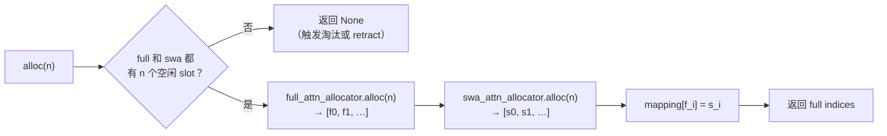

还有一个 PD 分离专用的 `alloc_extend_swa_tail`：D 端接收 KV 时，full 层会拿到整段 prompt 的 KV，而 SWA 层只需要滑窗内的那段。所以它给 full 层分配整个 extend，只给 SWA 层分配尾部 `swa_tail_len` 个 slot。

#### (5) 窗口淘汰

decode 每步只新增 1 个 token，但滑窗会把最早的 token 挤出窗口。挤出后那个 SWA slot 就没用了（全局唯一映射已失效），可以回收。这就是 SWA 池能小得多的原因。

调度器在一批请求准备前，对每个开启的请求判断：

$$
\text{seqlen} - 1 - W \;\ge\; \text{swa\_evicted\_seqlen} + \text{eviction\_interval}
$$

满足才淘汰，避免每步都做一次碎片化的释放。淘汰时 `free_swa_out_of_window_slots` 计算可丢弃的上界：

$$
\text{evict\_threshold} =
\begin{cases}
\text{pre\_len} - W, & \text{chunk cache} \\[4pt]
\text{pre\_len} - \max(W,\ P), & \text{radix cache}
\end{cases}
$$

再与 `swa_retain_floor` 取较小值（不能把 checkpoint 需要的部分释放掉），按页对齐后，释放 $[\text{swa\_evicted\_seqlen},\ \text{evict\_threshold})$ 区间内的 SWA slot，并把游标推进到 `evict_threshold`。radix cache 分支多留一页，是为了避免插入边界所在叶子被淘汰成整片墓碑。

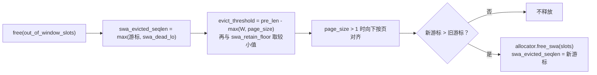

slot 随窗口滑动的示意（$W = 4$，page_size $= 1$，已生成 10 个 token）：

```text
 逻辑位置 t:     0     1     2     3     4     5     6     7     8     9
 full pool:    [f0]  [f1]  [f2]  [f3]  [f4]  [f5]  [f6]  [f7]  [f8]  [f9]
 swa  pool:    [s0]  [s1]  [s2]  [s3]  [s4]  [s5]  [s6]  [s7]  [s8]  [s9]
                 └──── 已释放（窗口外）────┘└──────── 窗口内 W = 4 ────────┘
               ↑                                   ↑
          可被重新分配                    swa_evicted_seqlen = 6

 full 池：10 个 slot 全部保留（full 层需要看全部历史）
 swa 池：只需 4 个活跃 slot，另 6 个已回到空闲表
```

两个防误淘汰的保护：

- `swa_evict_floor`：开启 `prefill_aware_swa` 时，prefill 结束会把该请求的 floor 设成 `extend_range.end`，保证刚 prefill 出来的 token 不会被立刻淘汰。
- `swa_dead_lo()`：请求自己可释放的最低位置，取 `max(cache_protected_len, swa_evict_floor)`。树锁住的前缀不能动。

#### (6) 容量计算与数值示例

两个池的容量按同一个比例切分，比例来自 `--swa-full-tokens-ratio`（默认 $0.8$）：

$$
\text{ratio} = \frac{N_{swa}}{N_{full}}, \qquad
N_{swa} = \left\lfloor N \times \text{ratio} \right\rfloor \quad \text{（再向下按页对齐）}
$$

**`--swa-full-tokens-ratio` 的含义**：

- **定义**：SWA 层 KV 池 token 容量与 full 层 KV 池 token 容量的比值，**与 swa:full 的层数无关**——$0.8$ 表示"full 池能放 $T$ 个 token 时，SWA 池只能放 $0.8T$ 个"。
- **取值**：$(0, 1.0]$，默认 $0.8$（越界会报 `should be in range (0, 1.0]`）。
- **为什么可以 $<1$**：滑窗层每个请求只保留窗口内 $W$ 个 KV，与序列总长度无关，所以 SWA 池不需要和 full 池一样大。
- **调参方向**：调小 → 把 SWA 池省下的显存让给 full 池，提升可容纳的上下文 / 并发；调大 → 给 SWA 池更多余量，缓解窗口淘汰压力。
- **特例**：纯 SWA 模型（$L_{full}=0$）不应用该比例；部分模型会覆盖默认值，如 DeepSeek-V4 / inkling 取 $0.1$，Step3p5 的层级缓存重置为 $1.0$。

`cell_size` 也按比例折算，把 SWA 层的实际开销摊到每个 full token 上：

$$
\text{cell\_size}_{\text{hybrid}} = \text{per\_token}_{full} \times L_{full} \;+\; \text{ratio} \times \text{per\_token}_{swa} \times L_{swa}
$$

所以显存占用为：

$$
B_{kv} \approx N \times \text{per\_token}_{full} \times L_{full} \;+\; N_{swa} \times \text{per\_token}_{swa} \times L_{swa}
$$

有一个硬约束（`_solve_pool_sizes` 里校验）：SWA 池至少要能装下一个请求的 prefill 准入窗口，否则报错 `Increase --swa-full-tokens-ratio or the total KV budget`：

$$
W + P < N_{swa}
$$

**数值示例**（示意）：$L_{full} = 8$，$L_{swa} = 24$，$H_{kv} = 8$，$D = 128$，bf16，ratio $= 0.25$，$B_{kv} = 40\ \text{GiB}$。

每 token 每层：

$$
\text{per\_token} = 2 \times 8 \times 128 \times 2 = 4096\ \text{B} = 4\ \text{KiB}
$$

折算到每个 full token：

$$
\text{cell\_size}_{\text{hybrid}} = 4 \times 8 + 0.25 \times 4 \times 24 = 32 + 24 = 56\ \text{KiB/token}
$$

容量：

$$
N = \frac{40 \times 2^{30}}{56 \times 1024} \approx 7.49 \times 10^{5}\ \text{tokens},
\qquad N_{swa} = N \times 0.25 \approx 1.87 \times 10^{5}
$$

两个池的显存与占比：

| 子池 | 层数 | 容量 | 显存 |
| --- | --- | --- | --- |
| full | 8 | $7.49 \times 10^{5}$ | $8 \times 7.49 \times 10^{5} \times 4096\ \text{B} \approx 22.8\ \text{GiB}$ |
| SWA | 24 | $1.87 \times 10^{5}$ | $24 \times 1.87 \times 10^{5} \times 4096\ \text{B} \approx 17.1\ \text{GiB}$ |
| 合计 | 32 | — | $\approx 39.9\ \text{GiB}$ |

对比：如果 32 层全部当 full 层处理，$\text{cell\_size} = 32 \times 4 = 128\ \text{KiB/token}$，同样 40 GiB 只能存 $3.28 \times 10^{5}$ 个 token。混合池把容量提升到 $2.28$ 倍。

再看单个请求：生成 32768 个 token、$W = 4096$ 时，full 池要为它留 32768 个 slot，SWA 池只需留 4096 个（加不超过 `eviction_interval` 的过冲），相差 $8$ 倍。

#### (7) 与 `SWARadixCache` 的配合

前缀树也要区分两类层，`SWARadixCache` 的额外处理：

- 树里只保留窗口内的 SWA token，窗口外的位置是**墓碑**；匹配时只统计墓碑之后、且在窗口内的长度。
- `inc_lock_ref` 只为每个节点锁 $W$ 个 SWA token，不会因为序列很长就多锁。
- prefill 阶段会额外锁住刚算出的 SWA 前缀；decode 越过窗口后用 `dec_swa_lock_only` 把它从 protected 转成可淘汰，SWA LRU 就能在内存吃紧时回收。

### 4.4 每 token 字节数（`cell_size`）与容量

`DefaultPoolConfigurator._compute_cell_size`（`srt/model_executor/pool_configurator.py:143`、`:241`）给出每个 token 在所有层上的 KV 字节数。

MHA / GQA：

$$
\text{cell\_size}_{\text{MHA}} = 2 \times L \times H_{kv}^{\text{local}} \times D \times \text{bytes}(\text{dtype})
$$

MLA：

$$
\text{cell\_size}_{\text{MLA}} = L \times (\text{kv\_lora\_rank} + \text{qk\_rope\_head\_dim}) \times \text{bytes}(\text{dtype})
$$

KV 预算（`_profile_available_bytes`，`srt/mem_cache/kv_cache_configurator.py:1834`）：

$$
B_{kv} = M_{\text{free}} - M_{\text{pre}} \times (1 - \text{mem\_fraction\_static})
$$

其中 $M_{\text{free}}$ 是加载完权重后的空闲显存，$M_{\text{pre}}$ 是加载权重前的空闲显存。

容量：

$$
N = \left\lfloor \frac{B_{kv}}{\text{cell\_size}} \right\rfloor
$$

之后还会应用 `--max-total-tokens` 上限和页对齐等约束。

**数值示例 1：Llama-3-8B，bf16，TP=1**

$L=32$，$H_{kv}=8$，$D=128$，bf16 占 2 B：

$$
\text{cell\_size} = 2 \times 32 \times 8 \times 128 \times 2 = 131{,}072\ \text{B} = 128\ \text{KiB/token}
$$

假设 $B_{kv} = 40\ \text{GiB}$：

$$
N = \frac{40 \times 2^{30}}{131{,}072} = 327{,}680
$$

单层 `k_buffer` 形状为 `[327681, 8, 128]`（$P=1$），大小为：

$$
327{,}681 \times 8 \times 128 \times 2\ \text{B} \approx 640\ \text{MiB}, \qquad 640\ \text{MiB} \times 2 \times 32 \approx 40\ \text{GiB}
$$

显存划分示意（80 GB 卡，数值为示意）：

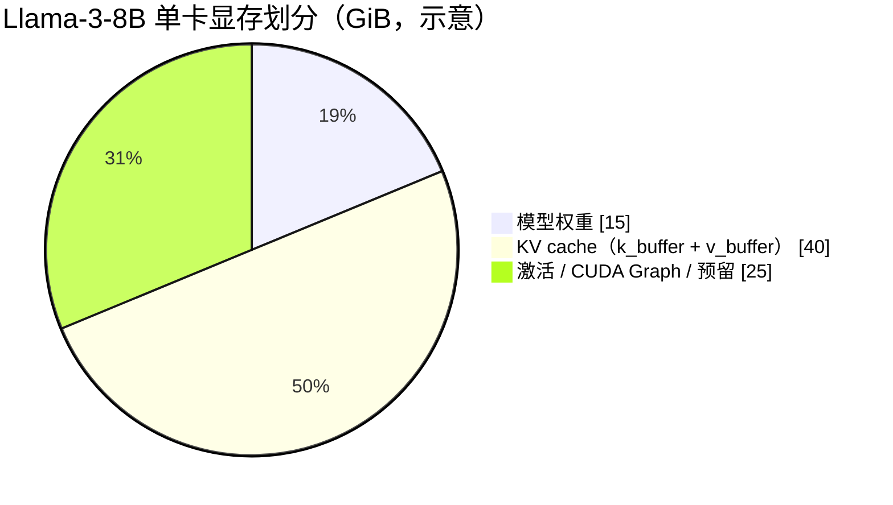

**数值示例 2：同一模型 TP=4**

$$
H_{kv}^{\text{local}} = \frac{8}{4} = 2, \qquad \text{cell\_size} = 2 \times 32 \times 2 \times 128 \times 2 = 32\ \text{KiB/token}
$$

同样 40 GiB 预算，每个 rank 可容纳：

$$
N = \frac{40\ \text{GiB}}{32\ \text{KiB}} = 1{,}310{,}720
$$

**数值示例 3：DeepSeek-V3 MLA，bf16**

$$
\text{cell\_size} = 61 \times 576 \times 2 = 70{,}272\ \text{B} \approx 68.6\ \text{KiB/token}
$$

与 TP 大小无关。

**三种配置对比**：

| 配置 | $\text{cell\_size}$ | 40 GiB 可存 token 数 $N$ |
| --- | --- | --- |
| Llama-3-8B，TP=1 | 128 KiB | 327,680 |
| Llama-3-8B，TP=4（每 rank） | 32 KiB | 1,310,720 |
| DeepSeek-V3 MLA（每 rank） | 68.6 KiB | 约 611,000 |

**`max_num_reqs` 的推导**（`resolve_max_num_reqs`）：

未指定 `--max-running-requests` 时：

$$
\text{estimated} = \operatorname{clip}\left(\left\lfloor \frac{N}{\text{context\_len}} \times 512 \right\rfloor,\ 2048,\ 4096\right), \qquad R = \min\left(\text{estimated},\ \left\lfloor \frac{N}{2} \right\rfloor\right)
$$

指定时：

$$
R = \min\left(\left\lfloor \frac{\text{max\_running\_requests}}{\text{attn\_dp\_size}} \right\rfloor,\ \left\lfloor \frac{N}{2} \right\rfloor\right)
$$

以示例 1 为例（`context_len`$=8192$）：

$$
\frac{327{,}680}{8192} \times 512 = 20{,}480 \xrightarrow{\ \operatorname{clip}\ } 4096, \qquad R = \min(4096,\ 163{,}840) = 4096
$$

### `MambaPool`（Mamba / 线性注意力状态池）

Mamba、GDN 等线性注意力 / 状态空间层不做全序列点积注意力，而是每层维护一份**固定大小的递归状态**（state）。因此它的显存不随序列长度增长，也不能像 KV 那样按 token 切分或复用片段。SGLang 用 `MambaPool` 存这份 state，用 `MambaSlotAllocator` 做请求级 slot 分配，并挂在 `HybridReqToTokenPool` 上。

**与 KV 池的关键区别**：

| 维度 | `KVCache`（MHA / MLA / SWA） | `MambaPool` |
| --- | --- | --- |
| 存储单位 | 每个 token 一个 KV slot | 每个请求一份固定大小的 state |
| 随序列长度增长 | 是 | 否 |
| 分配粒度 | token / 页 | 请求（通常 1 slot / 请求） |
| 分配器 | `TokenToKVPoolAllocator` | `MambaSlotAllocator`（不继承 KV allocator 基类） |
| 树上复用 | KV slot 可共享 / 驱逐 | 通过 `mamba_pool_idx` 由 mamba 感知的 RadixCache 持有 / 复用 |

**`MambaPool` 字段**（`srt/mem_cache/memory_pool.py:404`）：

| 字段 | 类型 | 含义 |
| --- | --- | --- |
| `size` | `int` | state slot 数（可并存的请求数） |
| `mamba_layer_ids` | `List[int]` | 本池负责的 Mamba / 线性层 |
| `conv_state` | `List[torch.Tensor]` | 各层深度可分离卷积状态，形状 `[num_mamba_layers, size + 1, *conv_shape]` |
| `temporal_state` | `torch.Tensor` | 各层 SSM 递归状态，形状 `[num_mamba_layers, size + 1, *temporal_shape]` |
| `spec_state_size` | `int` | 投机解码 verify 状态预留的 slot 数 |
| `enable_linear_replayssm` / `linear_replayssm_cache_len` | `bool` / `int` | ReplaySSM ring 开关与长度 |
| `replayssm_d/k/g/rawv/rawk/beta` | `Optional[torch.Tensor]` | ReplaySSM ring 记录，默认 `None` |
| `memory_saver_adapter` | `TorchMemorySaverAdapter` | 显存节省适配器 |
| `device` | `str` | 所在设备 |

- **每 slot 大小固定**：由 `mamba_entry_bytes(layer_num, conv_state_shapes, conv_dtype, temporal_state_shape, temporal_dtype)` 给出，与序列长度无关。
- **slot 0 是 dummy**：与 KV 池一样，形状带 `+1`，接收 padding token 的写入。
- **`envelope_layout`**：page 粒度布局下，所有层 / slot 共用一个连续 byte buffer，`conv_state` / `temporal_state` 是其 strided view。
- 内部控制 dataclass `State`（单请求：`conv` + `temporal`）与 `SpeculativeState`（投机解码：额外 `intermediate_ssm`、`intermediate_conv_window`）。

**`MambaSlotAllocator`**（`srt/mem_cache/allocator/mamba.py:30`）：请求级 slot free-list，不继承 KV 的 allocator 基类。

| 方法 | 入参 | 出参 | 说明 |
| --- | --- | --- | --- |
| `available_size` | 无 | `int` | 空闲 slot 数 |
| `schedulable_available_size` | 无 | `int` | 供调度器准入；静态池下等同 `available_size` |
| `alloc_group_begin` | `num_reqs: int` | 无（`None`） | 为匹配前缀批量预分配 |
| `alloc` | `need_size: int` | `Optional[torch.Tensor]` | 取 slot；不足返回 `None` |
| `free` | `free_index: torch.Tensor` | 无（`None`） | 归还 slot |
| `clear` | 无 | 无（`None`） | 重置为 `arange(1, size + 1)`（slot 0 保留） |
| `alloc_group_end` | 无 | 无（`None`） | 归还组内未用的 slot |

**`HybridReqToTokenPool`**（`memory_pool.py:1226`）：`ReqToTokenPool` 的混合子类，在 token 映射表之外再持有一套 Mamba 池：

- 字段：`mamba_pool: MambaPool`、`mamba_allocator: MambaSlotAllocator`、`mamba_map: {layer_id: index}`、`req_index_to_mamba_index_mapping`（`torch.Tensor`，`[req_pool_size]` `int32`，请求行 → mamba slot）。
- `alloc(reqs)` 覆写：先分 token 行，再对每个还没有 slot 的请求 `mamba_allocator.alloc(1)`，写入 `req.mamba_pool_idx` 并置 `req.mamba_needs_clear = True`；分块续跑或命中缓存（已有 `mamba_pool_idx`）的请求复用原 slot。
- `free_mamba_cache(req)` 归还 slot；`mamba_ping_pong_track_buffer`（重叠调度时 size = 2）用于「写新状态」与「读旧状态」之间的双缓冲。
- `clone_with_new_mamba` 供多层 EAGLE draft 复刻池。

**分配 / 释放路径**：`ReqToTokenPool.alloc` → `HybridReqToTokenPool.alloc` → `mamba_allocator.alloc(1)` → `req.mamba_pool_idx`；请求结束由 `release_kv_cache`（`srt/mem_cache/common.py:201`）与 mamba 感知的 `RadixCache` 处理——`HybridReqToTokenPool` 且树支持 mamba 时 state 由树持有，否则在 `free_mamba_cache` 中归还。容量由 `--mamba-full-memory-ratio` / `--max-mamba-cache-size` 控制。

> HiCache 场景的 host 侧对应物是 `MambaPoolHost`（`srt/mem_cache/pool_host/mamba.py:41`）。

---

## 5. 请求级字段：`Req` 与 `ReqKvInfo`

### 5.1 `ReqKvInfo`（`req.kv`）

挂在 `Req` 上的 KV 生命周期状态：占了 `req_to_token` 哪一行、哪段被树保护、已提交和已分配到哪。

`ReqKvInfo` 定义见 `srt/managers/schedule_batch.py:894`，是 `@dataclass(slots=True, kw_only=True)`，下面每个字段都有默认值。

| 字段 | 类型 | 含义 |
| --- | --- | --- |
| `req_pool_idx` | `Optional[int]` | 在 `req_to_token` 中的行号；为 `None` 表示还没分配或已释放（`is_held` 就是“是否为 `None`”） |
| `cache_protected_len` | `int` | $[0,\ \text{cache\_protected\_len})$ 由 radix tree 持有：可能是命中的前缀，也可能是分块时已插入树的部分。请求释放时不 free 这一段，只解锁 |
| `kv_committed_len` | `int` | KV 内容已确认到此处 |
| `kv_allocated_len` | `int` | 已为该请求分配 slot 的长度。投机解码会预先多分配，导致 allocated 大于 committed |
| `swa_evict_floor` | `int` | $[0,\ \text{swa\_evict\_floor})$ 永不因滑窗被淘汰（prefill-aware SWA 的保护下界） |
| `swa_evicted_seqlen` | `int` | SWA 淘汰游标：$[\text{swa\_dead\_lo}(P),\ \text{swa\_evicted\_seqlen})$ 的 slot 已被释放 |

三个长度满足：

$$
0 \le \text{cache\_protected\_len} \le \text{kv\_committed\_len} \le \text{kv\_allocated\_len}
$$

请求自有的 KV 区间为 $[\text{cache\_protected\_len},\ \text{kv\_allocated\_len})$。

**区间示意**（投机解码场景：命中前缀 4 个 token，已确认 10 个，额外预分配 4 个 draft slot）：

```text
 token 位置   0   1   2   3   4   5   6   7   8   9  10  11  12  13
            ┌───────────────┬───────────────────────┬───────────────┐
            │ ▓▓ 树持有 ▓▓  │ ██ 请求自有，已写好 ██ │ ░ 已分配未确认 ░│
            └───────────────┴───────────────────────┴───────────────┘
            0               4                       10              14
                    cache_protected_len = 4   kv_committed_len = 10   kv_allocated_len = 14
```

请求结束时（`release_kv_cache`）：

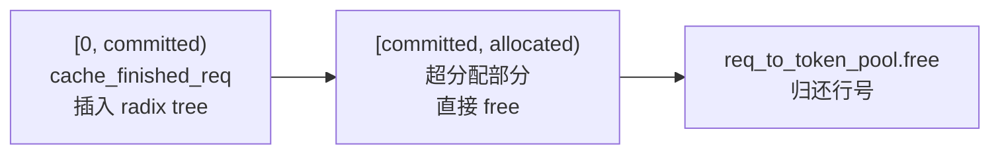

插入树时，如果某段与树中已有前缀重复，重复的这份 slot 会被 free。

### 5.2 `Req` 上的前缀匹配字段

`Req` 是贯穿请求整个生命周期的全状态对象（输入输出 token、采样参数、KV 状态、PD 传输状态等），这里只列与 KV 前缀匹配相关的字段。

字段类型取自 `Req.__init__`（`srt/managers/schedule_batch.py`）。

| 字段 | 类型 | 含义 |
| --- | --- | --- |
| `prefix_indices` | `torch.Tensor`，1D `int64`，在 device 上 | radix 命中前缀在 device 上的 slot 下标；`len(prefix_indices)` 即可复用的前缀 token 数 |
| `last_node` | `TreeNode`（源码标注为 `Any`） | 最后一个命中的 device 树节点，请求运行期间会对它 `inc_lock_ref`，防止被淘汰 |
| `last_host_node` | `Optional[TreeNode]`（源码标注为 `Any`） | HiCache 场景：host（CPU）侧额外命中的树节点，需要回载到 device |
| `host_hit_length` | `int` | HiCache 场景：host 侧额外命中的 token 数（决定是否需要 H2D 回载） |
| `extend_range` | `Optional[Range]`，即 `NamedTuple(start: int, end: int)` 并带 `length` 属性（`srt/utils/common.py:1202`） | 本轮要计算的 token 区间 $[\text{start},\ \text{end})$，分块 prefill 时每块不同 |

---

## 6. 批级字段：`ScheduleBatch` / `ForwardBatch`

一批请求的前向输入视图：把各请求的行号、长度和本轮新 token 的 slot 汇总成 attention kernel 直接可用的张量。

| 字段 | 形状 | 含义 |
| --- | --- | --- |
| `req_pool_indices` | `[bs]` | 各请求在 `req_to_token` 中的行号 |
| `seq_lens` / `seq_lens_cpu` | `[bs]` | 各请求本轮前向后的总长度（前缀 + 本轮新 token） |
| `prefix_lens` | `List[bs]` | 各请求已有 KV 的长度（命中前缀，或之前块已算完的部分） |
| `extend_lens` | `List[bs]` | 各请求本轮要计算的 token 数 |
| `extend_num_tokens` | int | 本批要写入的 KV 总数 |
| `out_cache_loc` | `[extend_num_tokens]`（decode 时为 `[bs]`） | 本批新 token 的 KV 写入 slot，由 allocator 分配 |
| `seq_lens_sum` | int | 所有序列长度之和，供注意力 kernel 预估工作量 |

字段间关系：

$$
\text{extend\_len}_i = \text{seq\_len}_i - \text{prefix\_len}_i, \qquad \text{extend\_num\_tokens} = \sum_{i=1}^{bs} \text{extend\_len}_i, \qquad \text{seq\_lens\_sum} = \sum_{i=1}^{bs} \text{seq\_len}_i
$$

**prefill 写映射**（`write_cache_indices`）：

```python
req_to_token[r, 0:prefix_len]       = prefix_indices                   # 复用前缀的 slot
req_to_token[r, prefix_len:seq_len] = out_cache_loc[pt:pt+extend_len]  # 新分配的 slot
```

**decode 写映射**（`alloc_for_decode`）：

```python
req_to_token[req_pool_indices, seq_lens] = out_cache_loc   # 每个请求追加 1 个 slot
```

**一个 2 请求的 prefill 批**：请求 1 命中 3 个 token、新增 2 个，请求 2 无命中、新增 4 个。

```text
 out_cache_loc（按请求拼接） ┌────┬────┬────┬────┬────┬────┐
                             │  7 │  8 │ 10 │ 11 │ 12 │ 13 │
                             └────┴────┴────┴────┴────┴────┘
                              └ 请求 1 ┘ └────── 请求 2 ──────┘
 prefix_lens = [3, 0]    extend_lens = [2, 4]    seq_lens = [5, 4]
 extend_num_tokens = 2 + 4 = 6                   seq_lens_sum = 5 + 4 = 9

 req_to_token[行 4] = [ 1,  2,  3 │  7,  8 ]          ← prefix_indices = [1, 2, 3]
 req_to_token[行 3] = [10, 11, 12, 13 ]
```

---

## 7. `RadixCache`：键、节点与匹配/插入/淘汰

> 源码：`srt/mem_cache/radix_cache.py`（`RadixKey:73`、`TreeNode:267`、`RadixCache:340`），淘汰策略在 `srt/mem_cache/evict_policy.py`。
> 树里只存**元数据 + slot 索引张量**，KV 本体仍在 §4 的池里；树能决定的是「哪些 slot 可以复用、哪些可以回收」。

### 7.1 `RadixKey`：前缀键

一条前缀键 = `token_ids` + 命名空间标签。定义见 `radix_cache.py:73`。

| 字段 | 类型 | 含义 |
| --- | --- | --- |
| `token_ids` | `array("q")` | 原始 token 序列。用 `array` 而不是 `list`，切片比较在 C 层完成，比逐元素 Python 循环快得多 |
| `extra_key` | `Optional[str]` | 调用方指定的缓存分类标签；启用 LoRA 时，`Req` 会把 `lora_id` 追加进去。不同最终 `extra_key` 在 Python radix 树中隔离 |
| `cache_salt` | `Optional[str]` | 独立的缓存命名空间，适合实现“即使前缀完全相同，也不允许跨租户复用”的策略。不是采样随机种子，也不是身份认证，不会自动按用户生成；与 `extra_key` 分开存放，避免两者取值混淆 |
| `is_bigram` | `bool` | EAGLE 投机解码下把「相邻二元组」当作逻辑单元 |
| `limit` | `Optional[int]` | 只取前 `limit` 个 token，语义等于 `token_ids[:limit]`，但不做 $O(n)$ 拷贝 |

逻辑单元数（下文所有「长度」都指它）：

$$
\text{len} = \begin{cases} n - 1, & \text{bigram 模式} \\ n, & \text{普通模式} \end{cases},\qquad n = \min(\text{len}(\text{token\_ids}),\ \text{limit})
$$

- `page_aligned(page_size)`（`:171`）：把长度截到 $P$ 的整数倍，**不足一页的尾部不入树**；
- `match(other, page_size)`（`:205`）：返回公共前缀长度再按页向下取整。实现是**倍增 + 二分**——先用 `t0[lo:hi] != t1[lo:hi]` 这种整段比较快速跳过相同部分，再在包含分歧点的窗口内二分，避免逐 token 循环；
- `child_key(page_size)`（`:242`）：取前 `page_size` 个逻辑单元做成可哈希对象，并把 `extra_key`、`cache_salt` 作为命名空间前缀，作为父节点 `children` 字典的键；
- `hash_page(start, end, prior_hash)`（`:260`）：对 `[start, end)` 逐页算 SHA256（用 `prior_hash` 链式接上前缀），只服务外部 KV 事件，不参与匹配；
- `maybe_to_bigram_view()`（`:179`）：$O(1)$ 翻转标志位，不物化二元组列表。

### 7.2 `TreeNode`：树节点

一个节点持有一段 token 片段，以及这段片段在 device 上对应的 slot。定义见 `radix_cache.py:267`。

| 字段 | 类型 | 含义 |
| --- | --- | --- |
| `key` | `RadixKey` | 本节点持有的 token 片段（相对父节点的增量）。分页时长度按页对齐 |
| `value` | `Optional[torch.Tensor]` | 这段 token 在 device 上的 slot 下标；为 `None` 表示已被淘汰到 host 或已丢弃（即 `evicted`） |
| `children` | `defaultdict[Any, TreeNode]` | 子节点表，键为 `child_key()` |
| `parent` | `TreeNode`（根节点为 `None`） | 父节点 |
| `lock_ref` | `int` | 引用计数。大于 0 表示有请求在用，不可淘汰 |
| `last_access_time` | `float`（`time.monotonic()`） | LRU / MRU / SLRU 等策略使用 |
| `creation_time` | `float`（`time.monotonic()`） | FIFO / FILO 策略使用 |
| `hit_count` | `int` | LFU / SLRU 策略使用 |
| `priority` | `int` | 请求优先级（`--radix-eviction-policy priority` 时使用）；沿路径向上取 max 传播 |
| `id` | `int` | 全局自增 id（`TreeNode.counter`），用于事件上报与调试 |
| `host_value` | `Optional[torch.Tensor]` | HiCache 中该段 KV 在 host 内存的位置（为 `None` 表示没有 host 备份） |
| `host_ref_counter` | `int` | host 侧引用计数，大于 0 时 host 备份不可淘汰 |
| `write_through_pending_id` | `Optional[int]` | 正在进行的 write-through（写穿透到 host）标识 |
| `hash_value` / `event_hash_value` | `Optional[List[str]]` | 按页缓存的哈希（后者带命名空间），惰性计算 |

配套的 3 个轻量接口：

- 属性 `evicted`（`:301`）= `value is None`，属性 `backuped`（`:306`）= `host_value is not None`；
- `protect_host()` / `release_host()`（`:310`、`:314`）：host 侧加解锁，重复释放会直接 `RuntimeError`；
- `__lt__`（`:335`）按 `last_access_time` 比较，所以节点可以直接丢进堆里参与淘汰排序。

**易错点**：`children` 是 `defaultdict(TreeNode)`，**下标取值会静默创建节点**。所以判断「有没有这个孩子」必须写成 `child_key in node.children`（源码里都是这么写的），不要直接 `node.children[child_key]`。

### 7.3 `RadixCache` 的字段与对外接口

#### (1) 字段

| 字段 | 类型 | 含义 |
| --- | --- | --- |
| `root_node` | `TreeNode` | 根节点。`lock_ref = 1` 永久加锁、`priority = -sys.maxsize`（保证任何真实优先级都能盖过它）、`key` 为空 `array("q")`、`value = []`、`hash_value = []` |
| `req_to_token_pool` | `ReqToTokenPool` | 第一级映射表（§2）。`cache_finished_req` / `cache_unfinished_req` 用它读写本请求的 slot |
| `token_to_kv_pool_allocator` | `BaseTokenToKVPoolAllocator` | slot 分配器（§3）。淘汰与释放 slot 都通过它 |
| `evictable_size_` | `int` | 可淘汰 token 的**增量账本**，由加解锁和插删维护，不是每次遍历统计 |
| `protected_size_` | `int` | 受保护（被锁）token 的增量账本 |
| `evictable_leaves` | `Set[TreeNode]` | 可淘汰叶子集合，避免每次淘汰都遍历全树找叶子 |
| `eviction_policy` | `str` | 策略名（来自 `--radix-eviction-policy`，构造时已 `.lower()`） |
| `eviction_strategy` | `EvictionStrategy` | 解析出的策略对象，`evict` 靠它的 `get_priority` 排序（§7.7） |
| `page_size` | `int` | 树的最小粒度：对齐、分裂、淘汰都以页为单位 |
| `disable` | `bool` | 为真时 `match_prefix` 恒返回空、`insert` 不建树（`--disable-radix-cache`） |
| `is_eagle` | `bool` | 决定 `RadixKey` 是否走 bigram 视图 |
| `disable_finished_insert` | `bool` | 确定性推理下禁止「请求结束」时入树 |
| `kv_events` | `KVCacheEventRecorder` | 事件记录器（`record_store` / `record_remove` / `record_all_cleared`）。`RadixCache.__init__` 总会构造；`enabled=False` 时方法为空操作 |
| `metrics_collector` | `Optional[RadixCacheMetricsCollector]` | 指标采集器，仅当 `enable_metrics` 为真时在 `__init__` 里初始化 |
| `cache_controller` | `Optional[HiCacheController]` | HiCache 控制器句柄。基类默认 `None`，只有 HiCache 系子类会设置 |
| `device` | `torch.device` | 从 allocator 推断（缺省 CPU），用于构造空结果张量 |
| `_empty_match_result` | `MatchResult` | 预构造的空匹配结果（`device_indices` 为长度 0 的 int64 张量、末节点 = root），`disable` 或空 key 时直接复用，避免反复分配 |

**完整性**：上表 17 行 = `RadixCache` 的 15 个实例字段 + 从 `BasePrefixCache` 继承的 2 个类属性（`metrics_collector`、`cache_controller`）；`kv_events` 在基类里也声明过，但 `__init__` 会把它赋成实例字段，因此只出现一次。类内没有其他 `self.x` 赋值，也没有外部注入的字段——运行期动态挂属性只出现在子类（`HiRadixCache` / `SWARadixCache` / `UnifiedRadixCache` 等）里。

字段来源：多数在 `__init__`（`:341`）里从 `CacheInitParams` 拷贝；`root_node`、`evictable_size_`、`protected_size_`、`_empty_match_result` 等在 `reset()`（`:394`）里初始化（重置缓存时会重新走一遍）。

#### (2) 构造参数里**不**落成字段的部分

`CacheInitParams` 里有相当一部分参数 `RadixCache` 只是「过路」——不存成字段，由调度器、子类或其他组件自己读取：

| 参数 | 谁在用 |
| --- | --- |
| `tp_cache_group` / `attn_tp_cache_group` / `attn_cp_cache_group` / `pp_cache_group` | 跨 rank 同步缓存元数据的通信组（由 `kv_cache_builder.py:303-308` 组装）；`HiRadixCache`（存成 `tp_group` / `attn_tp_group` / `attn_cp_group` / `pp_group`）、`UnifiedRadixCache`、`RadixCacheCpp` 取用 |
| `pp_rank` / `pp_size` / `attn_cp_rank` / `attn_cp_size` | 并行拓扑，变体与调度器判断用 |
| `chunked_prefill_size` | 调度器据此把请求切成多块，并以 `chunked=True` 调 `cache_unfinished_req` |
| `sliding_window_size` | SWA 系变体（§4.3） |
| `cache_ttl_seconds` | TTL 预留参数，当前 `srt/` 内没有读取方 |
| `enable_metrics` | `RadixCache.__init__` 里唯一的用途：决定是否调 `init_metrics_collector()` |
| `enable_kv_cache_events` | 传给 `KVCacheEventRecorder(enabled=...)`，不单独存字段 |
| `enable_session_radix_cache` / `enable_mamba_extra_buffer(_lazy)` | 流式会话 / Mamba 变体 |
| `tree_components` / `component_registry_override` | `UnifiedRadixCache` 组合多分量树时用 |
| `mtp_draft_device_pools` | 投机解码（MTP）草稿模型的独立 device 池，由 host 池（`pool_host/mha.py`、`pool_host/dsa.py`）消费 |

#### (3) 对外接口（方法）

`RadixCache` 自己实现 23 个方法（含 `__init__` 与 8 个私有 helper），其余接口从 `BasePrefixCache` 继承。基类默认实现大多是「能力声明」或空操作，只有具相应能力的变体才覆写：

| 方法 | 来源 | 作用 |
| --- | --- | --- |
| `reset()` | RadixCache 覆写 | 清空树与两个账本 |
| `match_prefix(params)` | RadixCache 覆写 | 最长前缀匹配，可能分裂节点；返回 `MatchResult`（§7.4） |
| `insert(params)` | RadixCache 新增 | 插入 key/value，返回 `InsertResult(prefix_len, last_device_node)`（§7.5） |
| `evict(params)` | RadixCache 覆写 | 只淘汰可淘汰叶子，返回 `EvictResult`（§7.6） |
| `evict_for_alloc(params)` | 基类默认 | 给 allocator 的入口，默认与 `evict` 同语义；共享内存的多组件缓存会覆写它以便「顺手释放够用即停」 |
| `inc_lock_ref(node)` / `dec_lock_ref(node, params)` | RadixCache 覆写 | 路径加 / 解锁，在 `evictable` 与 `protected` 之间搬运 token（§7.7） |
| `cache_finished_req(req, is_insert, *, kv_len_to_handle)` | RadixCache 覆写 | 请求结束时把已算前缀交给树（§7.8） |
| `cache_unfinished_req(req, chunked)` | RadixCache 覆写 | 分块 prefill 的中间态入树（§7.8） |
| `evictable_size()` / `protected_size()` | RadixCache 覆写 | 读两个账本（注意与字段 `evictable_size_` / `protected_size_` 只差一个下划线） |
| `full_evictable_size()` / `full_protected_size()` / `swa_evictable_size()` / `swa_protected_size()` | 基类默认（返回 0） | 混合模型的「分池」视图；纯 `RadixCache` 不覆写，只有 SWA / Unified 系变体给真实值 |
| `total_size()` | RadixCache 覆写 | 树中在册 token 总数（DFS，跳过 `evicted` 的子树） |
| `all_values_flatten()` | RadixCache 新增 | DFS 把所有节点的 `value` 拼成一维张量（调试 / 统计） |
| `pretty_print()` | RadixCache 覆写 | 打印树形 |
| `create_simulated(...)` | RadixCache 类方法 | 不接内存池直接建一棵树，测试与仿真用（`:374`） |
| `take_events()` | 基类默认 | 转发 `kv_events.take()`；`kv_events` 为空时返回 `[]` |
| `is_tree_cache()` / `is_chunk_cache()` | 基类默认 | 能力探测：`is_tree_cache()` 定义为 `not is_chunk_cache()`，`RadixCache` 下为 `True` |
| `supports_swa()` / `supports_mamba()` / `supports_streaming_session()` / `supports_fast_match_prefix()` | 基类默认（`False`） | 能力声明，由变体覆写成 `True`；调度器据此选择更轻量的路径 |
| `session_held_*()` / `release_session()` / `release_radix_session()` | 基类默认（返回 0 / 空操作） | 流式会话钩子，由 `StreamingSession` 覆写 |
| `init_load_back()` / `ready_to_load_host_cache()` / `check_hicache_events()` / `release_host_resources()` | 基类默认（`NotImplementedError` 或空操作） | HiCache 分级缓存的写回 / 回载钩子 |
| `init_metrics_collector()` / `update_eviction_metrics(num_evicted, start_time)` | 基类提供 | 指标采集，`enable_metrics` 为真时启用 |

`RadixCache` 的 8 个私有 helper 与调用关系：`_match_prefix_helper`（§7.4）、`_split_node`（§7.4）、`_insert_helper`（§7.5）、`_inc_hit_count`（§7.5）、`_delete_leaf` / `_update_leaf_status`（§7.6）、`_print_helper` / `_total_size_helper`（调试与统计）。

### 7.4 `match_prefix`：最长前缀匹配

入口 `match_prefix`（`:417`）→ `_match_prefix_helper`（`:727`）：

```text
key ← page_aligned(bigram_view(key))
if disable or len(key) == 0: 返回空结果（末节点 = root）
value[], node ← _match_prefix_helper(root, key)

_match_prefix_helper(node, key):
    while len(key) > 0 and child_key in node.children:
        child ← node.children[child_key]
        l ← child.key.match(key)          # 公共长度，已按页向下取整
        if l < len(child.key):            # 只吃下 child 的一部分 → 分裂
            new_node ← _split_node(child, l)
            value.append(new_node.value); break
        value.append(child.value)         # 整段吃下 → 继续下沉
        node ← child; key ← key[l:]
    return value, node
```

要点：

- **命中即分裂**：匹配终止在某条边内部时，`_split_node`（`:756`）把它拆成 `parent → new_node(前 l 个) → child(剩余)`，并让 `new_node` 继承 child 的 `lock_ref` / `hit_count` / `priority`，保证「受保护」语义不被拆分破坏；
- **不搬 KV**：`new_node.value = child.value[:l].clone()`、`child.value = child.value[l:].clone()`，只是把一张索引表切成两段，KV 数据一个字节都不动；
- 返回的 `device_indices` 是沿途各段 `value` 拼接成的**一维** `torch.int64` 张量，就是 §5.1 的 `prefix_indices`；
- 复杂度：每条边一段（压缩前缀树，节点数远小于 token 数），段内比较走 C 层整段切片 + 倍增二分，整体近似 $O(\text{命中长度})$；
- **副作用**：刷新沿途节点的 `last_access_time`（喂给淘汰策略），并可能分裂节点改变树形——但分裂只是让边界更精确，不改变语义。

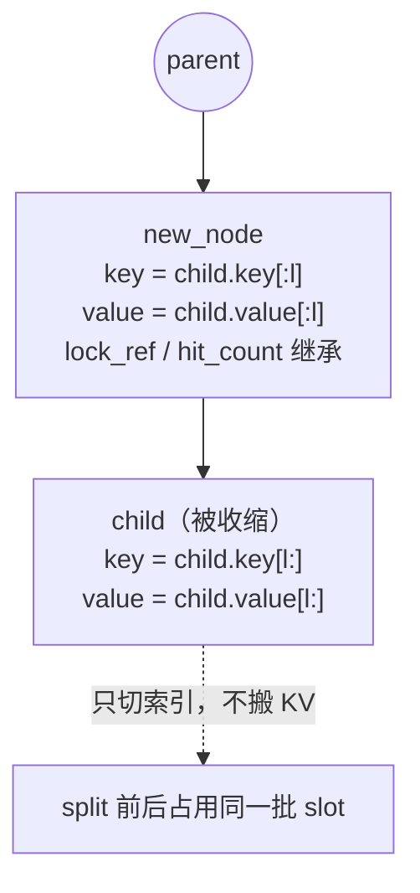

匹配结束后调度器对 `last_node` 调 `inc_lock_ref`，这条路径上的 token 就从 evictable 变成 protected（见 §7.8）。

### 7.5 `insert`：插入的三种情况

`insert`（`:472`）→ `_insert_helper`（`:790`）。先把 `key` 按页对齐、把 `value` 截到 `len(key)`，然后沿树走：

1. **完全命中**：`key` 走完，只更新 `hit_count` / `priority` / `last_access_time`，**不新建节点**，返回累计的 `prefix_len`；
2. **部分命中**（`prefix_len < len(node.key)`）：先 `_split_node` 分裂出共享前缀节点，再把剩余部分挂成它的新子节点（对应 §8.2 里 `[A B C D E F]` 被 `[A B C]` 请求分裂的场景）；
3. **完全未命中**：循环结束仍有剩余 `key`，新建 `TreeNode`（`parent = node`、`key = 剩余部分`、`value = value.clone()`），挂到 `node.children[child_key]`，并 `evictable_size_ += len(key)`。

返回的 `prefix_len` 是**真正复用的长度**，`cache_finished_req` 靠它区分「树里已有的重复 slot（可 free）」和「刚插进树、由树接管（不可 free）」。

`priority` 沿路径向上传播（`node.priority = max(node.priority, priority)`），所以祖先优先级不低于后代。`chunked=True` 时跳过 `hit_count` 累加，避免一个分块请求对自己前几块创建的节点反复「自我命中」而虚增热度。

### 7.6 `evict`：只淘汰可淘汰叶子

`evict`（`:631`）。候选是 `evictable_leaves`：**未被淘汰、`lock_ref == 0`、且没有任何在册子节点**。

```text
堆 ← [(strategy.get_priority(node), node) for node in evictable_leaves]  # 最小堆
while 已淘汰 < num_tokens and 堆非空:
    node ← heappop(堆)                    # 优先级最小者最先淘汰
    allocator.free_segment(node.value, start_pos=0)   # 归还这段页对齐的 slot
    已淘汰 += len(node.value)
    _delete_leaf(node)                    # 从 parent.children 摘除
    if len(node.parent.children) == 0 and node.parent.lock_ref == 0:
        heappush(堆, node.parent)         # 父节点新晋为叶子 → 级联成为候选
```

- **级联淘汰**：摘掉一个叶子后父节点可能变成新叶子，同一个循环继续向上回收，所以一次 `evict` 能整条链地释放；
- 淘汰以**页**为单位（树里的 `value` 本身就是页对齐片段）；
- `_delete_leaf`（`:866`）负责摘除、`evictable_size_ -= len(node.key)`、从 `evictable_leaves` 移除、并重估父节点状态；`_update_leaf_status`（`:878`）决定谁是叶子；
- 策略在 `evict_policy.py`，`get_priority` 返回值**越小越先淘汰**：

| 策略 | `get_priority` | 先淘汰谁 |
| --- | --- | --- |
| `lru`（Least Recently Used，默认） | `last_access_time` | 最久未访问 |
| `lfu`（Least Frequently Used） | `(hit_count, last_access_time)` | 命中次数最少，其次最久未访问 |
| `fifo`（First In First Out） | `creation_time` | 最早创建 |
| `filo`（First In Last Out） | `-creation_time` | 最晚创建 |
| `mru`（Most Recently Used） | `-last_access_time` | 最近刚访问过 |
| `slru`（Segmented Least Recently Used） | 试用段 0 / 保护段 1，段内再按 `last_access_time` | 试用段优先，热点（`hit_count ≥ 2`）留到最后 |
| `priority`（Priority-Aware） | `(priority, last_access_time)` | 请求优先级低的先淘汰 |

> `fifo` / `mru` / `filo` 在 `evict_policy.py` 与 `get_eviction_strategy`（`utils.py:56`）里都已实现，但当前 `--radix-eviction-policy` 的 CLI 可选项只有 `lru`、`lfu`、`slru`、`priority` 四个（`server_args.py:327`）。

### 7.7 淘汰策略详解（`EvictionStrategy`）

`RadixCache` 本身不管「淘汰谁」，只负责维护候选集合与最小堆；具体的排序规则交给策略对象。策略定义在 `srt/mem_cache/evict_policy.py`，由 `get_eviction_strategy`（`utils.py:67`，注册表在 `utils.py:56`）按名字实例化，名字来自 `--radix-eviction-policy`（`server_args.py:1230`，缺省 `lru`）。

每个策略都只实现一个方法：

```python
class EvictionStrategy(ABC):
    @abstractmethod
    def get_priority(self, node: TreeNode) -> float | tuple: ...
```

统一约定：`get_priority` 返回值**越小越先淘汰**；返回值既可以是单个浮点数，也可以是元组——元组按字典序逐项比较，从而把「主关键字 + 次级 tie-break」叠加起来。`evict` 正是用这些值建最小堆（见 §7.6）。

**策略可用的节点元数据**（由 `match_prefix` / `insert` / `_split_node` 维护）：

| 字段 | 何时更新 | 使用者 |
| --- | --- | --- |
| `last_access_time` | 命中路径上每次刷新（`match` / `insert`） | `lru` / `mru` / `lfu` / `slru` / `priority` 的次级关键字 |
| `creation_time` | 节点创建时写一次 | `fifo` / `filo` |
| `hit_count` | 非分块请求命中时 +1（`_inc_hit_count`，`radix_cache.py:783`） | `lfu` / `slru` |
| `priority` | `insert` 时沿路径取 `max` 传播（`radix_cache.py:804`） | `priority` |

**策略缩写与英文全称对照**（源码、CLI 参数与下文均用缩写）：

| 缩写 | 英文全称 | 中文 |
| --- | --- | --- |
| LRU | Least Recently Used | 最近最少使用 |
| LFU | Least Frequently Used | 最不经常使用 |
| FIFO | First In First Out | 先进先出 |
| FILO | First In Last Out | 后进先出（等价 LIFO） |
| MRU | Most Recently Used | 最近最常使用 |
| SLRU | Segmented Least Recently Used | 分段最近最少使用 |
| — | Priority-Aware | 优先级感知 |

下面逐个展开（源码行号均在 `evict_policy.py`）。

#### `lru`：Least Recently Used / 最近最少使用（`LRUStrategy:29`，默认）

$$p_{\text{LRU}}(n) = t_{\text{access}}(n)$$

最久未访问的节点先淘汰。适用面最广的通用默认值：KV 前缀复用通常带有时间局部性（同一会话、多轮对话会反复命中同一前缀），LRU 能自然地把「最近还在用」的前缀留下。

#### `lfu`：Least Frequently Used / 最不经常使用（`LFUStrategy:37`）

$$p_{\text{LFU}}(n) = \big(c_{\text{hit}}(n),\; t_{\text{access}}(n)\big)$$

先比命中次数、少的先淘汰；次数相同再退回 LRU。适合热点前缀稳定、访问分布很偏的负载。代价是**缓存污染**：新插入的节点 `hit_count = 0`，会排在所有老节点之前，哪怕它马上要被高频复用——所以纯 LFU 对「热度会漂移」的负载不友好。

#### `fifo`：First In First Out / 先进先出（`FIFOStrategy:46`）

$$p_{\text{FIFO}}(n) = t_{\text{create}}(n)$$

最早创建的节点先淘汰，完全不看访问热度。结构最简单，但可能淘汰掉「创建得早、却仍被频繁使用」的老前缀。

#### `filo`：First In Last Out / 后进先出（`FILOStrategy:63`）

$$p_{\text{FILO}}(n) = -t_{\text{create}}(n)$$

最新创建的节点先淘汰。适合大量「一次性短前缀」的负载：刚出现的新前缀大概率用完即弃，先回收它们能少动被反复命中的老热点。

#### `mru`：Most Recently Used / 最近最常使用（`MRUStrategy:54`）

$$p_{\text{MRU}}(n) = -t_{\text{access}}(n)$$

最近刚访问过的反而先淘汰，与 LRU 正好相反。适合**扫描式 / 流式**访问（每个前缀只访问一次、几乎不重复）：此时 LRU 会把刚扫过的冷数据留在缓存里挤掉即将复用的数据，MRU 更优；但只要访问存在重复，MRU 就会显著劣于 LRU。

#### `slru`：Segmented Least Recently Used / 分段最近最少使用（`SLRUStrategy:81`）

$$p_{\text{SLRU}}(n) = \big(\mathbb{1}[\,c_{\text{hit}}(n) \ge \tau\,],\; t_{\text{access}}(n)\big),\qquad \tau = \texttt{protected\_threshold} = 2$$

把缓存分成两段：`hit_count < τ` 的节点在**试用段**（分段 0），`hit_count ≥ τ` 的晋升**保护段**（分段 1）。淘汰时试用段永远先于保护段，段内再按 LRU。效果是「多命中一次」才能换来保护——少量一次性前缀不会把真正的热点挤出缓存，比纯 LRU 更抗扫描、抗污染。适合「少数热点 + 大量长尾一次性前缀」混合的负载。

#### `priority`：Priority-Aware / 优先级感知（`PriorityStrategy:72`）

$$p_{\text{priority}}(n) = \big(\text{prio}(n),\; t_{\text{access}}(n)\big)$$

先按节点 `priority`（来自请求优先级，`insert` 时沿路径 `max` 传播）排序，低优先级先淘汰，同级再按 LRU。适合多优先级 / 多租户：让高优请求（如在线交互）的前缀比低优请求（如离线批处理）的更持久。注意 `priority` 沿路径 `max` 传播，祖先优先级不低于后代，因此一个高优请求会「顺带」抬高其共享前缀路径上的保护等级。

选型速查（`k` 为可淘汰叶子数，各策略的堆操作均为 $O(\log k)$）：

| 策略 | 英文全称 | 主关键字 | 一句话适用场景 |
| --- | --- | --- | --- |
| `lru` | Least Recently Used | 最久未访问 | 通用默认、有时间局部性 |
| `lfu` | Least Frequently Used | 命中次数最少 | 热点稳定、访问偏斜 |
| `slru` | Segmented Least Recently Used | 试用段优先 | 热点 + 大量一次性前缀 |
| `priority` | Priority-Aware | 优先级最低 | 多优先级 / 多租户 |
| `fifo` | First In First Out | 最早创建 | 只要简单、不关心热度 |
| `filo` | First In Last Out | 最晚创建 | 一次性新前缀多 |
| `mru` | Most Recently Used | 最近访问 | 扫描 / 流式、几乎不重复 |

> **可用性**：`--radix-eviction-policy` 的 CLI 可选项目前只有 `lru`、`lfu`、`slru`、`priority` 四个（`RADIX_EVICTION_POLICY_CHOICES`，`server_args.py:327`）；`fifo` / `mru` / `filo` 已在 `evict_policy.py` 与 `_EVICTION_POLICY_FACTORIES`（`utils.py:56`）里实现，只是没有暴露到 CLI，可通过 `add_radix_eviction_policy_choices`（`server_args.py:328`）扩展后使用。

### 7.8 `inc_lock_ref` / `dec_lock_ref`：锁沿路径传播

- `inc_lock_ref(node)`（`:665`）：从 `node` **一路向根**遍历（不含根，根永久 `lock_ref = 1`），每级 `lock_ref += 1`；当某节点从 0 变 1 时 `evictable_size_ -= len(node.key)`、`protected_size_ += len(node.key)`，每级都调 `_update_leaf_status`；
- `dec_lock_ref(node)`（`:682`）：逆操作，`lock_ref` 从 1 变 0 时把 token 从 protected 挪回 evictable；
- 语义：锁的是**从根到该节点的整条路径**——「某请求正在用这段前缀」意味着路径上所有 token 都不可淘汰，但同树的其他分支照常可淘汰；
- `dec_lock_ref` 里有一条防御断言：若走到 `parent is None`，说明该请求持有了**另一棵树**的节点。

### 7.9 `cache_unfinished_req` / `cache_finished_req`

树与请求生命周期的两个衔接点（对应 §5.1 的 `cache_protected_len` / `kv_committed_len` / `kv_allocated_len`）：

- `cache_unfinished_req(req, chunked)`（`:552`，分块 prefill 的中间态）：
  1. 把 `req.get_fill_ids()` 这段 key/value 插入树；
  2. 用返回的 `prefix_len` 释放「树里已有、本请求重复持有」的那段 slot；
  3. **重新 `match_prefix`** 一次拿到去重后的索引与新末节点——因为插入可能分裂或改写了节点，只有重新匹配才知道树实际持有的索引；
  4. 把新索引回写 `req_to_token[row][cache_protected_len:]`，更新 `req.kv.cache_protected_len`，并转移锁：`dec_lock_ref(旧 last_node)` + `inc_lock_ref(新 last_node)`。
- `cache_finished_req(req, kv_len_to_handle)`（`:495`，请求结束）：
  1. 把 `(origin_input_ids + output_ids)[:kv_len_to_handle]` 这段 key/value 插入树，这段 slot **由树接管、不 free**；
  2. 只释放 `[cache_protected_len, freed_end)`（树里已有的重复项）与 `[key_len:)`（不足一页的尾部）；
  3. `dec_lock_ref(req.last_node)`，归还请求槽位。

`page_size > 1` 时命中长度按页取整，但请求前缀可能有不足一页的零头，这部分**不会进树**；`cache_protected_len` 就是为了保证这截零头最终能被正确释放而不泄漏（源码注释见 `radix_cache.py:602`）。

### 7.10 分页、命名空间与变体

- **分页**：`page_size > 1` 时 key 先被 `page_aligned` 截到页的整数倍，`match` 也按页向下取整，树的最小粒度是页；
- **命名空间**：`extra_key` 与 `cache_salt` 进入 `child_key`，所以即便 token 完全相同，不同 LoRA / salt 的请求也会各建一条边、绝不共享节点；
- **主要变体**（都实现 `BasePrefixCache` 的同一套接口）：

| 实现 | 位置 | 与 `RadixCache` 的区别 |
| --- | --- | --- |
| `HiRadixCache` | `hiradix_cache.py:82` | 继承 `RadixCache`，增加 host 分层：`host_value` 存 CPU 备份，可回载而非重算 |
| `SWARadixCache` | `swa_radix_cache.py:345` | 只保留窗口内的 SWA token，窗口外是墓碑（见 §4.3(7)） |
| `PureSWARadixCache` | `pure_swa_radix_cache.py:24` | 纯滑窗模型，树里只维护窗口 |
| `MambaRadixCache` | `mamba_radix_cache.py:443` | 额外管理 Mamba state 槽位与写时复制 |
| `UnifiedRadixCache` | `unified_radix_cache.py:153` | 跨 pool 统一 KV / 线性注意力的树 |
| `RadixCacheCpp` | `radix_cache_cpp.py:38` | C++ 实现，接口兼容 |
| `ChunkCache` | `chunk_cache.py:35` | 分块 prefill 的临时缓存，**不做前缀树** |
| `FlexKVRadixCache` / `LMCRadixCache` | `storage/flexkv/`、`storage/lmcache/` | 接外部 KV 存储 |

另有一份逐行中文注释版 `radix_cache_annotated_zh.py` 可对照阅读。

### 7.11 显存账本与守恒

树的两级账本（`evictable_size_` / `protected_size_`）最终要与其他部分的 slot 数量对齐。调度器空闲时（没有运行中的请求），`SchedulerInvariantChecker._check_pool_invariant` 会校验下面的等式，不相等就判定为显存泄漏。

$$
\text{available} + \text{evictable} + \text{protected} + \text{session\_held} + \text{uncached} = N
$$

各项来源：

| 项 | 含义 | 由谁维护 |
| --- | --- | --- |
| `available` | allocator 里空闲的 slot | §3 的 `free_pages` |
| `evictable` | 树里 `lock_ref == 0` 的 token | `RadixCache.evictable_size_` |
| `protected` | 树里被锁住的 token | `RadixCache.protected_size_` |
| `session_held` | 会话（session）持有的 token | session 管理逻辑 |
| `uncached` | 已分配但尚未插入树的 slot（分块 prefill 中间态、不足一页的尾部等） | 请求侧 `ReqKvInfo` |

运行期间还会额外多出「各请求自有、尚未插入树的 slot」，所以只在空闲时校验。

### 7.12 数值示例：增 / 查 / 删的完整流程

用一组具体 token 与 slot 编号走完整趟，看树形与两个账本怎么变。

**场景**：`page_size = 2`（命中长度必须按页取整），slot 编号从 10 开始。

| 记号 | 含义 |
| --- | --- |
| `n1` / `n2` / `n3` | 树节点（`key` = 本段 token，`value` = 该段 slot） |
| `lock_ref` | 节点被请求锁定的次数（`> 0` 时整条路径的 token 不可淘汰） |
| `evictable / protected` | `evictable_size_ / protected_size_` |
| `leaves` | `evictable_leaves` 集合（可被淘汰的候选） |

#### ⓪ 初始：空树

```text
 root   lock_ref=1（永久锁定，不参与淘汰）
```

| 状态 | total | evictable | protected | leaves |
| --- | --- | --- | --- | --- |
| 初始 | 0 | 0 | 0 | `{}` |

#### ① 增：`insert([1,2,3,4,5,6], value=[10..15])`

- `key` 页对齐后仍为 6 个 token（3 页）；
- 沿 `root` 找 `child_key = (1,2)`：不在 `root.children` → **新建 `n1`**，把整段挂上去；
- 记账：`evictable_size_ += len(key) = 6`（新插入的内容默认可淘汰）。

```text
 root
  └── n1  key=[1,2,3,4,5,6]  value=[10,11,12,13,14,15]  lock_ref=0
```

| 状态 | total | evictable | protected | leaves |
| --- | --- | --- | --- | --- |
| ① 插入后 | 6 | 6 | 0 | `{n1}` |

#### ② 查：`match_prefix([1,2,3,4,9,9])` —— 命中即分裂

- `(1,2)` 命中 `n1`，逐段比较 `n1.key.match(key, page_size=2)`：前 4 个 token 相同（下标 4 处 `5 ≠ 9`），原始匹配长度 4，按页取整后仍是 4；
- `4 < len(n1.key) = 6` → `_split_node(n1, 4)`：
  - 新节点 `n2: key=[1,2,3,4] value=[10,11,12,13]`，继承 `n1` 的 `lock_ref` / `hit_count` / `priority`；
  - `n1` 收缩为 `key=[5,6] value=[14,15]`，改为挂在 `n2` 下；
- 返回 `device_indices = [10,11,12,13]`，**`total_size` 不变**——分裂只是把一张索引表切成两段（`value[:4]` 与 `value[4:]`），KV 数据一个字节都没搬；
- 调度侧随后 `inc_lock_ref(n2)`：`n2.lock_ref` 0→1，`evictable_size_ -= 4`、`protected_size_ += 4`。

```text
 root
  └── n2  key=[1,2,3,4]  value=[10,11,12,13]  lock_ref=1   ← 被请求锁住
       └── n1  key=[5,6]  value=[14,15]         lock_ref=0
```

| 状态 | total | evictable | protected | leaves |
| --- | --- | --- | --- | --- |
| ② 分裂后 | 6 | 6 | 0 | `{n1}` |
| ② 加锁后 | 6 | 2 | 4 | `{n1}`（`n2` 有子节点，不是叶子） |

#### ③ 增：`insert([1,2,3,4,7,8], value=[10,11,12,13,40,41])` —— 挂新分支

- **`value` 必须与 `key` 等长**（一个 token 一个 slot），前 4 个槽位正好是刚才复用的 `n2` 那几个；
- `(1,2)` → `n2`，整段吃掉 4 个 token，剩余 `[7,8]`，于是 `value` 也被切成 `value[4:] = [40,41]`；
- `child_key = (7,8)` 不在 `n2.children` → **新建 `n3`**，只把新段的 `[40,41]` 存进去；
- 记账：`evictable_size_ += 2`（只有新段 2 个 token 进树，已存在的前缀不会被重复计数）。

> ⚠️ 如果这里只传 `[40,41]` 两个元素，`_insert_helper` 里 `value[prefix_len:]` 会切出**空张量**：节点照样建出来，但 `value` 为空、`total_size` 不增，后续匹配这段会拿不到索引。`insert` 内部只做 `value = value[: len(key)]` 截断，不会校验长度，所以调用方必须传全长。

```text
 root
  └── n2  key=[1,2,3,4]  value=[10,11,12,13]  lock_ref=1
       ├── n1  key=[5,6]  value=[14,15]         lock_ref=0
       └── n3  key=[7,8]  value=[40,41]         lock_ref=0
```

| 状态 | total | evictable | protected | leaves |
| --- | --- | --- | --- | --- |
| ③ 插入后 | 8 | 4 | 4 | `{n1, n3}` |

#### ④ 查：`match_prefix([1,2,3,4,7,8])` —— 完整命中

沿 `root → n2 → n3` 全部命中，返回 `[10,11,12,13,40,41]`；`inc_lock_ref(n3)`：`n3.lock_ref` 0→1（`n2` 1→2，因为它的 `lock_ref` 本来就不是 0，**不重复记账**）。

| 状态 | total | evictable | protected | leaves |
| --- | --- | --- | --- | --- |
| ④ 加锁后 | 8 | 2 | 6 | `{n1}`（`n3` 被锁，退出候选） |

#### ⑤ 删：`evict(EvictParams(num_tokens=2))` —— 只淘汰可淘汰叶子

- 候选 = `evictable_leaves = {n1}`，最小堆里只有它；
- 弹出 `n1` → `allocator.free_segment(n1.value)` 归还 `[14,15]` → `evictable_size_ -= 2`；
- `_delete_leaf(n1)` 从 `n2.children` 摘除；检查父节点 `n2`：它还有一个子节点 `n3`，且 `lock_ref = 2 > 0` → **不入候选**，级联到此为止；
- 已释放 2 个 token，达到目标，返回 `EvictResult(num_tokens_evicted=2)`。

```text
 root
  └── n2  key=[1,2,3,4]  value=[10,11,12,13]  lock_ref=2
       └── n3  key=[7,8]  value=[40,41]         lock_ref=1
```

| 状态 | total | evictable | protected | leaves |
| --- | --- | --- | --- | --- |
| ⑤ 淘汰后 | 6 | 0 | 6 | `{}`（`n3` 仍被锁；`n2` 有子节点） |

#### ⑥ 解锁：两个请求依次结束

- `dec_lock_ref(n3)`：`n3` 1→0，`evictable += 2`、`protected -= 2`；`n3` 无子节点 → 重新进入 `leaves`；
- `dec_lock_ref(n2)`：`n2` 2→1（仍大于 0，记账不变）；
- 持有 `n2` 的那个请求也结束后再 `dec_lock_ref(n2)`：1→0，`evictable += 4`、`protected -= 4`。

```text
 root
  └── n2  key=[1,2,3,4]  value=[10,11,12,13]  lock_ref=0
       └── n3  key=[7,8]  value=[40,41]         lock_ref=0
```

| 状态 | total | evictable | protected | leaves |
| --- | --- | --- | --- | --- |
| ⑥ 全部解锁后 | 6 | 6 | 0 | `{n3}`（`n2` 有子节点，不算叶子） |

#### ⑦ 收尾：再查被淘汰过的那段

`match_prefix([1,2,3,4,5,6])` → 只有 `[1,2,3,4]` 还能命中，返回 4 个 slot（`[10,11,12,13]`），`[5,6]` 那部分已经被回收、需要重算。这体现了一个重要性质：**淘汰某一段不会影响它所在路径的其余部分**——`n2` 的前缀照常可复用。

#### 小结

| 观察 | 说明 |
| --- | --- |
| 查也会改树 | `match_prefix` 命中在节点内部时会触发 `_split_node`，但 `total_size` 与两个账本都不变 |
| 分裂不搬 KV | 只对 `value` 索引张量做 `[:l]` / `[l:]` 切片，`new_node` 继承 `lock_ref` / `hit_count` / `priority` |
| 锁是引用计数 | 两个请求锁同一条前缀时，只有第一次（`lock_ref` 0→1）会做 `evictable → protected` 的搬运 |
| 淘汰只动叶子 | 候选必须 `lock_ref == 0` 且没有在册子节点；摘掉叶子后父节点可能新晋为叶子，同一循环继续向上回收 |
| 页对齐生效 | ⑥ 步中 `[5,6]` 是完整一页所以能独立成段；若尾部不足一页，那段根本不会进树 |
| `value` 必须与 `key` 等长 | 树只消费 `value[prefix_len:]`（新段那部分）；传短了会建出 `value` 为空的节点，`total_size` 不增且该段匹配不到 |

各步骤对应的单测（`test/registered/unit/mem_cache/test_radix_cache_unit.py`）：

| 步骤 | 用例 |
| --- | --- |
| ① / ④ 插入与完整命中 | `test_insert_and_match_basic`、`test_total_size` |
| ② 匹配中分裂、`total_size` 不变 | `test_advanced_prefix_match_with_node_splits` |
| 页对齐取整 | `test_page_alignment_boundary`、`test_match_page_size_gt_1_rounds_down` |
| ④ 锁在两个账本间搬运 | `test_lock_ref_operations` |
| ⑤ 淘汰与级联 | `test_evict_functionality`、`test_kv_cache_events_with_eviction` |
| 分裂后事件哈希按页切分 | `test_hash_value_split`、`test_cache_salt_event_hashes_are_preserved_across_node_split` |

---

## 8. 端到端数值示例

条件：$P=1$，$N=9$（slot 1~9 可用，slot 0 为 padding），$R=4$，radix cache 开启。

先给出「对象 + 调用时序」总览，再按 8.1~8.3 展开数值细节。图中泳道用简称，各对象在 KV 生命周期中的角色：

| 对象 | 角色 | 只负责 |
| --- | --- | --- |
| `Req` / `ReqKvInfo`（§5） | 请求级状态 | 发起前缀匹配；保存本请求用了哪一行、哪段被树保护、已提交/已分配到哪 |
| `ScheduleBatch` / `ForwardBatch`（§6） | 批级视图 | 把一批请求汇总成 kernel 直接可用的张量 |
| `ReqToTokenPool`（§2） | 映射表 | 「请求的第 t 个 token」→ 物理 slot |
| `TokenToKVPoolAllocator`（§3） | 空闲账本 | 只管 slot 的分配与归还，不持有显存 |
| `KVCache` / `MHATokenToKVPool`（§4） | 物理存储 | 按 slot 读写 K/V 张量 |
| `RadixCache` / `TreeNode`（§7） | 前缀树 | 决定哪些 slot 可复用、哪些可淘汰 |

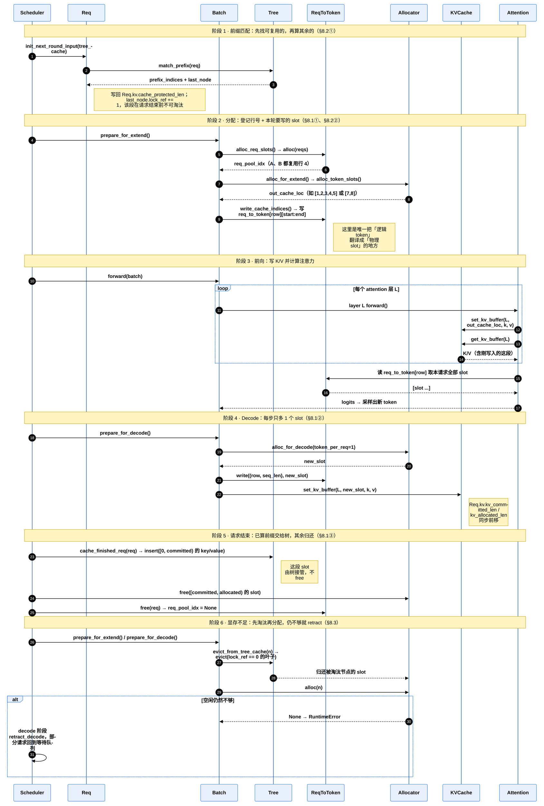

### 8.1 请求 A：prompt = `[A B C D E]`，输出 2 个 token

**① Prefill**：未命中前缀，分到行 4，allocator 分配 slot 1~5。

```text
 batch: req_pool_indices=[4]  prefix_lens=[0]  extend_lens=[5]  seq_lens=[5]  out_cache_loc=[1,2,3,4,5]

 req_to_token[4]   t=0   t=1   t=2   t=3   t=4
                  ┌─────┬─────┬─────┬─────┬─────┐
                  │  1  │  2  │  3  │  4  │  5  │
                  └──┬──┴──┬──┴──┬──┴──┬──┴──┬──┘
                     ▼     ▼     ▼     ▼     ▼
 KV slot     0     1     2     3     4     5     6     7     8     9
          ┌─────┬─────┬─────┬─────┬─────┬─────┬─────┬─────┬─────┬─────┐
          │ pad │  A  │  B  │  C  │  D  │  E  │     │     │     │     │
          └─────┴─────┴─────┴─────┴─────┴─────┴─────┴─────┴─────┴─────┘
 free_pages = [6, 7, 8, 9]          A.kv: protected=0, committed=5, allocated=5
```

采样得到首 token `F`。

**② Decode 第 1 步（输入 `F`）**：分配 slot 6，写入 `req_to_token[4, 5] = 6`。

```text
 req_to_token[4] = [1, 2, 3, 4, 5, 6]

 KV slot     0     1     2     3     4     5     6     7     8     9
          ┌─────┬─────┬─────┬─────┬─────┬─────┬─────┬─────┬─────┬─────┐
          │ pad │  A  │  B  │  C  │  D  │  E  │  F  │     │     │     │
          └─────┴─────┴─────┴─────┴─────┴─────┴─────┴─────┴─────┴─────┘
 free_pages = [7, 8, 9]
```

采样得到 `G`，达到 `max_new_tokens`，请求结束。

**③ 释放**：`[A B C D E F]` 连同 slot 1~6 插入 radix tree，slot 不 free，而是由树持有。行 4 归还，`free_slots = [1, 2, 3, 4]`。

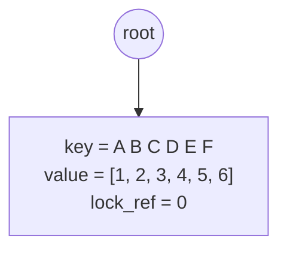

此时调度器空闲，校验守恒等式：

$$
\underbrace{3}_{\text{available：7,8,9}} + \underbrace{6}_{\text{evictable：1..6}} + \underbrace{0}_{\text{protected}} = 9 = N \quad \checkmark
$$

### 8.2 请求 B：prompt = `[A B C X Y]`

**① 前缀匹配**：命中 `[A B C]`，树节点被分裂，`[A B C]` 被 B 锁住。

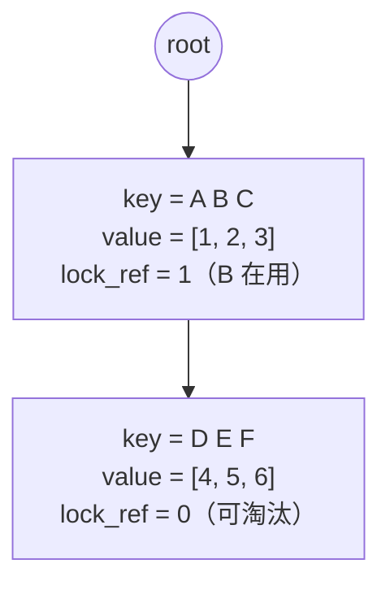

**② Prefill**：B 复用行 4，只为 `X Y` 分配 slot 7、8。

```text
 batch: prefix_lens=[3]  extend_lens=[2]  seq_lens=[5]  out_cache_loc=[7, 8]

 req_to_token[4]   t=0   t=1   t=2   t=3   t=4
                  ┌─────┬─────┬─────┬─────┬─────┐
                  │  1  │  2  │  3  │  7  │  8  │
                  └──┬──┴──┬──┴──┬──┴──┬──┴──┬──┘
                     │  与 A 共享 │     │ B 自有 │
                     ▼     ▼     ▼     ▼     ▼
 KV slot     0     1     2     3     4     5     6     7     8     9
          ┌─────┬─────┬─────┬─────┬─────┬─────┬─────┬─────┬─────┬─────┐
          │ pad │ A ▓ │ B ▓ │ C ▓ │  D  │  E  │  F  │  X  │  Y  │     │
          └─────┴─────┴─────┴─────┴─────┴─────┴─────┴─────┴─────┴─────┘
                  ▓ = protected（被 B 锁住）   D E F = evictable
 free_pages = [9]         B.kv: protected=3, committed=5, allocated=5
```

只计算 `X`、`Y` 两个 token 的 KV。注意力 kernel 通过 `req_to_token[4, 0:5]` 拿到 `[1, 2, 3, 7, 8]`，再从 `k_buffer` / `v_buffer` 中 gather 出完整 5 个 token 的 K/V。

### 8.3 显存不足时：请求 C 需要 3 个 slot

B 仍在运行，allocator 只剩 1 个空闲 slot（slot 9），不够分配。

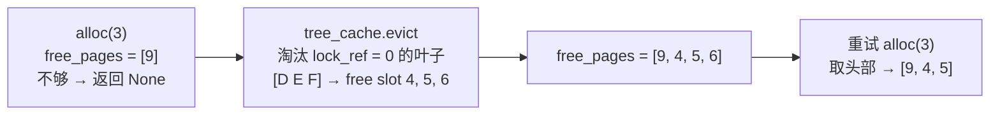

```text
 KV slot     0     1     2     3     4     5     6     7     8     9
          ┌─────┬─────┬─────┬─────┬─────┬─────┬─────┬─────┬─────┬─────┐
 淘汰前    │ pad │ A ▓ │ B ▓ │ C ▓ │  D  │  E  │  F  │  X  │  Y  │     │
          ├─────┼─────┼─────┼─────┼─────┼─────┼─────┼─────┼─────┼─────┤
 淘汰后    │ pad │ A ▓ │ B ▓ │ C ▓ │ C1  │ C2  │  ·  │  X  │  Y  │ C0  │
          └─────┴─────┴─────┴─────┴─────┴─────┴─────┴─────┴─────┴─────┘
                         C0/C1/C2 = 请求 C 的 3 个 token，slot 为 [9, 4, 5]，物理上不连续
 free_pages = [6]
```

如果被锁住的前缀和运行中的请求占满了所有 slot，淘汰也腾不出空间，decode 阶段会触发 `retract_decode`，把部分请求踢回等待队列。

---

## 9. 扩展池简表

| 池类型 | 适用模型 | 与 MHA 池的区别 |
| --- | --- | --- |
| `MLATokenToKVPool` | DeepSeek V2/V3 | 每 token 一份 latent，`[size+page, 1, 576]`，TP 间不切分 |
| `DSATokenToKVPool` | DeepSeek V3.2（DSA） | MLA 池基础上增加 indexer K cache |
| `SWAKVPool` + `SWATokenToKVPoolAllocator` | Gemma、GPT-OSS 等滑窗模型 | full 层与 SWA 层分两个子池、两套 slot，窗口外的 SWA slot 可以提前释放（详见 §4.3） |
| `HybridReqToTokenPool` + `MambaPool` | Qwen3-Next、Mamba 混合模型 | 每个请求额外占 1 个 Mamba state 槽位（`mamba_pool_idx`），state 大小固定，与序列长度无关（详见上文 `MambaPool` 小节） |
| `HybridLinearKVPool` | 线性注意力混合模型 | 只为 full attention 层分配 KV |
| `DecodeReqToTokenPool` | PD 分离 D 端 | 额外预留 `pre_alloc_size` 行，给正在接收 KV 的请求使用 |
