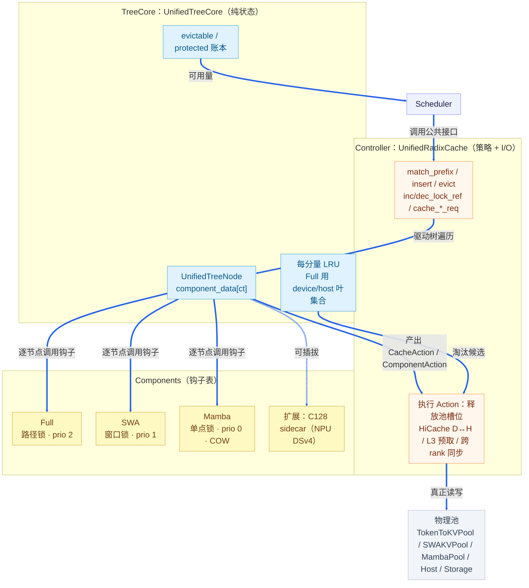

# UnifiedRadixCache：多分量统一前缀树

> 源码：`srt/mem_cache/unified_radix_cache.py`（Controller）、`srt/mem_cache/unified_cache/`（TreeCore、Components、Action）、选择链 `srt/mem_cache/registry.py`。
> 引入：`bc59cc0f9`（2026-04-13，#21206「Unified HybridRadixTree V2」）；2026-07-14 起成为 SWA / Mamba / DSA 模型的默认实现（#30468），2026-08-21 起所有场景默认使用（#35081）。

## 目录

1. [第一性原理降维](#1-第一性原理降维)
2. [高阶结构化类比](#2-高阶结构化类比)
3. [边界与对立面限定](#3-边界与对立面限定)
4. [语义压缩与动机演进](#4-语义压缩与动机演进)
5. [附：架构与关键接口速查](#5-附架构与关键接口速查)

---

## 1. 第一性原理降维

### 1.1 不可再降维的事实

**事实 A：因果模型的状态只由前缀决定。** 对任意层，位置 $t$ 的缓存状态是前缀的确定函数：

$$
S_t = F(x_1,\dots,x_t)
$$

所以"前缀相同 ⇒ 状态相同"，前缀缓存本质上是**按内容寻址的记忆化（memoization）**，radix tree 就是这张记忆表的索引：键 = token 序列，值 = 状态在显存池里的下标。

**事实 B：不同注意力类型对前缀的依赖跨度不同。** 要在位置 $\ell$ 处复用，需要保留的东西各不相同：

| 分量 | 位置 $\ell$ 能复用所需的数据 | 依赖形状 | 存储量 |
|---|---|---|---|
| Full | $[1,\ell]$ 全部 KV | **路径**（root → 节点） | $O(\ell)$ |
| SWA | 只需 $(\ell-W,\ell]$ 的 KV | **窗口**（向上 $W$ 个 token） | $O(W)$ |
| Mamba / SSM | 恰好 $\ell$ 处的一份递归状态 | **点**（单个节点） | $O(1)$ |

**事实 C：这些分量占用彼此独立的物理池**（`TokenToKVPool` / `SWAKVPool` / `MambaPool`），容量各自受限、各自耗尽。

### 1.2 核心矛盾

一个前缀能否复用，是**所有分量各自判定结果的交集**：

$$
\ell^{*}=\max\Big\{\ell\ \text{（按页对齐）}\ :\ \bigwedge_{c\in\mathcal{C}} V_c(\ell)\Big\}
$$

- $V_{\text{Full}}(\ell)$：路径上每个节点都有 Full 值；
- $V_{\text{SWA}}(\ell)$：从 $\ell$ 往回累计的 SWA 有效长度 $\ge W$；
- $V_{\text{Mamba}}(\ell)$：$\ell$ 处的节点存有 Mamba 状态。

矛盾就在于：**拓扑共用**（同一份前缀只建一棵树），**资源却各自独立**（三个池分别满、分别淘汰）。只要某一个分量把节点数据丢了，其他分量即使还在，这段前缀也可能已经不能用。于是需要同时满足三条约束：

1. **一致性**：任何时候都不能出现"可匹配，但某个分量的下标已经悬空"的节点；
2. **独立性**：SWA 池满时只回收 SWA，不能连带清掉还有价值的 Full；
3. **结构性**：Full 是骨架，没有 Full 的节点没有意义；而只剩 Full（SWA 已成墓碑）的节点是合法的。

由此推出 UnifiedRadixCache 的三条设计结论：

| 结论 | 推导依据 |
|---|---|
| 节点 = **各分量数据的向量**（`component_data[ct]`），值可为 `None`（墓碑） | 资源独立，但拓扑共用 |
| 匹配校验 = **各分量校验器取交集**；加锁策略按依赖形状区分：路径锁 / 窗口锁 / 单点锁 | 事实 B |
| 内部节点的淘汰优先级 Full(2) > SWA(1) > Mamba(0)，淘汰时**同一节点上优先级不高于触发者的分量一并淘汰** | 依赖跨度越短越先丢；丢了骨架，依附在上面的分量必须一起丢 |

---

## 2. 高阶结构化类比

### 2.1 主类比：Bigtable / Cassandra 的列族（Column Family）

| Bigtable / Cassandra | UnifiedRadixCache | 同构点 |
|---|---|---|
| Row key（字典序有序） | token 前缀（radix 路径） | 按内容寻址，按前缀组织 |
| Column family（各有 TTL 与 compaction 策略） | Component：Full / SWA / Mamba | 共用行键，存储与回收策略各自独立 |
| Tombstone（删除标记，行结构保留） | `ComponentData.value = None` | 数据已删，但结构保留，后续还可"复活" |
| Compaction 清理已无数据的行 | `_iteratively_delete_tombstone_leaf` 向上回收空墓碑链 | 惰性回收结构 |
| 读取需各列族数据都满足一致性要求 | `match_prefix` 要求所有校验器为真 | 读路径取交集 |
| Memtable → SSTable → 冷存储 | Device → Host（HiCache L2）→ Storage（L3） | 纵向分层与横向分族正交 |

关键区别：Bigtable 的列族之间互不依赖；而这里的分量有**支配关系**（Full 是 SWA / Mamba 的骨架），所以多了一条级联规则——删掉骨架，依附的分量必须一起删。

### 2.2 次类比：SDN 的控制面 / 数据面分离

| SDN | UnifiedRadixCache |
|---|---|
| 控制器决定路由策略，**不转发包** | `UnifiedTreeCore`：只改树和账本，**不碰显存池** |
| 下发 flow rule | 产出延迟执行的 `CacheAction` / `ComponentAction`（如 `FreeDeviceKV`、`BackupKV`、`SWARebuild`） |
| 交换机执行转发 | `UnifiedRadixCache` Controller：执行释放、D↔H 传输、异步 ack |

即"**树决定，缓存执行**"（tree decides, cache executes）。这样树的变更就是纯状态转移，所有 I/O、异步与跨 rank 同步都集中在 Controller 里，避免在树遍历中途重入池操作。

### 2.3 扩展点类比：Linux VFS 的 `inode_operations`

`TreeComponent` 是一张钩子表（`create_match_validator`、`update_component_on_insert_overlap`、`redistribute_on_node_split`、`evict_component`、`acquire/release_component_lock`…），主树只调用表里的钩子，不写 `if swa:` 这类特判。新增一种状态（例如 NPU 上 DSv4 的 `C128SidecarComponent`）就像新增一种文件系统：实现一组钩子，再通过 `component_registry_override` 注册即可。

---

## 3. 边界与对立面限定

### 3.1 与邻近方案的分界线

| 方案 | 与 UnifiedRadixCache 的本质分界 |
|---|---|
| `RadixCache` | 单分量（同质节点）。Unified 取 `(FULL,)` 时语义等价，分界在**节点是否为分量向量** |
| `SWARadixCache` / `MambaRadixCache` | 语义相同但写死在代码里：复用判定、加锁、淘汰都是硬编码特判。分界在**复用判定是否为可插拔的交集** |
| `HiRadixCache` | 纵向分层（device/host/storage），节点同质。Unified 是**分量 × 层级**的二维矩阵，每个分量各有 `host_value` / `host_lock_ref` |
| `ChunkCache` / `SWAChunkCache` | 不做前缀复用，只为分块 prefill 暂存。分界在**有没有索引** |
| `LMCRadixCache` / FlexKV | 外部 KV 存储后端。分界在"**索引 vs 存储**"：Unified 是索引与调度，存储由 `StorageAttachment` 接入 |
| HiSparse | 与 radix 复用互斥（要求 `--disable-radix-cache`）：稀疏热池下标不是内容稳定的 |

**最细的那条线**：Unified 复用的是**内容稳定**（content-stable）的槽位。槽位语义一旦变成"按请求、按位置"（例如 unified_kv 下的 SWA ring：`req_pool_idx × W + pos mod W`），它就不能进树。

### 3.2 极限边界（Edge Case）

| 场景 | 行为 / 极限 |
|---|---|
| 纯滑窗模型（`full_tokens_per_layer == 0`） | 没有骨架，Unified 不适用 → `PureSWARadixCache`；host-pool retraction 直接报错 |
| 长前缀中段的 SWA 已成墓碑 | SWA 校验器在墓碑处重新累计，要再攒够 $W$ 才放行 → 命中长度回退到最后一个"窗口完整"的位置 |
| unified_kv（DSv4 的 SWA ring） | ring 不入树，复用前缀时尾部必须留出 $W$ 个 token 重算：$\ell_{\text{reuse}}\le \ell^*-W$（`swa_reprefill_tail_tokens`） |
| Mamba | 状态只在跟踪点上存在，命中长度会被吸附到 `mamba_branching_seqlen`；命中后**写时复制**一份新槽位（`finalize_match_result_in_cache`） |
| `page_size > 1` | 键先按页截断，尾部不足一页的部分不入树，在 `cache_finished_req` 中直接 free |
| 节点几乎全部被锁 | 淘汰扫描代价为 $O(E\cdot H+L)$，$L$ = 跳过的锁定节点数；回收不到所需量就进入 retraction / OOM |
| DSv4 压缩 KV（C4/C128） | **不作为分量**：c4 下标由 full 下标 `//4` 推导，前缀匹配需按压缩块边界对齐；索引器 key 缓存不入树；只有 NPU 把 C128 作为 sidecar 分量挂上树 |
| 叶子只剩 Full | 合法（leaf survives on Full alone）；**内部节点不能没有 Full** |

淘汰级联规则（内部节点）：

$$
\text{evict}(c)\ \Rightarrow\ \text{evict}\big(\{c' : \text{prio}(c')\le \text{prio}(c)\}\big),\qquad
\text{prio}:\ \text{Full}=2>\text{SWA}=1>\text{Mamba}=0
$$

叶子节点上所有优先级都为 0：淘汰任一分量即删除整个节点，再沿父链回收空墓碑。

### 3.3 反模式（Anti-Pattern）

| 反模式 | 后果 | 灾难等级 |
|---|---|---|
| **复用非内容稳定的槽位**（例如把别的请求残留的 SWA ring 当作命中） | **静默算错**：输出看似正常但语义已错，不会触发任何报错 | ★★★★★（正确性） |
| 新分量的淘汰优先级违反支配关系（丢了 Full 却保留 SWA） | 下标悬空 / double free（为此专门有 `FreeDeviceKVFullOnly`，防止对已墓碑化节点的 SWA 侧重复释放） | ★★★★ |
| 在树钩子里直接做池 I/O（绕过 Action） | 遍历中途重入、与 HiCache 异步 ack 竞态，多 rank 账本不一致 | ★★★★ |
| 把墓碑当成未命中、直接删除节点 | 丢掉可复活的结构，SWA 命中率骤降，频繁全量重算 | ★★★ |
| 对压缩 KV 做逐 token 粒度的复用 | 压缩条目跨越前缀边界，复用到"半个压缩块" | ★★★★ |
| 用 `match_prefix` 的命中长度直接当作可跳过的 prefill 长度，忽略分量回退量（SWA 尾窗、Mamba 吸附点） | 少算 KV，状态缺失 | ★★★★ |
| 只 `inc_lock_ref` 不配对 `dec_lock_ref`（或 SWA 解锁时丢了 uuid） | 可淘汰量被永久锁住，表现为"泄漏"；空闲时守恒校验失败 | ★★★ |

---

## 4. 语义压缩与动机演进

### 4.1 前人的痛点：$M\times N$ 组合爆炸

在 Unified 之前，每种"状态类型 × 特性"都要单独实现一棵树：

| 旧实现 | 行数 | 职责 |
|---|---|---|
| `radix_cache.py` | 925 | Full |
| `swa_radix_cache.py` | 1456 | Full + SWA（双 LRU、墓碑） |
| `mamba_radix_cache.py` | 1426 | Full + Mamba（写时复制） |
| `hiradix_cache.py` | 2197 | Full + 分层 |

每棵树都重复实现一遍匹配 / 插入 / 分裂 / 淘汰 / 加锁。叠加的特性（HiCache、session、PD retraction、streaming、PP/TP 同步、KV events）都要在每棵树里各写一遍，变体数量随"状态类型数 $M$ × 特性数 $N$"增长，组合覆盖不到的地方就是 bug 高发区。

### 4.2 推翻的假设

旧假设：**一个节点 = 一个值张量 + 一个 `lock_ref` + 进一条 LRU**（同质节点）。

新模型：

$$
\text{node}=\big(\text{key},\ \{\,c\mapsto(\text{value}_c,\ \text{lock}_c,\ \text{host\_value}_c,\ \text{host\_lock}_c)\,\}_{c\in\mathcal{C}}\big)
$$

- 复用 = 各分量校验取交集；加锁 = 各分量按自己的依赖形状加锁；淘汰 = 各分量从自己的 LRU 驱动，再按优先级级联；
- 树只操作逻辑键，物理资源只通过钩子和 Action 管理。

工程上，代码从 $O(M\times N)$ 降为 $O(M+N)$：新增分量只写钩子，新增特性只改 Controller 一处。统一框架约 1.05 万行（Controller 3071 + TreeCore 2598 + 组件与接口），比四棵旧树合计（约 6000 行）更多；它换来的是组合封闭性，不是行数减少。

### 4.3 演进时间线

| 时间 | commit | 事件 |
|---|---|---|
| 2026-04-13 | `bc59cc0f9` | 引入 Unified HybridRadixTree V2 |
| 2026-06-11 | `5e0271536` | 混合模型默认通过 UnifiedTree 启用 HiCache |
| 2026-07-14 | `afa3c06d1` | SWA / Mamba / DSA 模型默认切换（DSv4 自此走 Unified） |
| 2026-08-17 | `2e7c85da6` | PD decode retraction 在 HiCache 下保留 KV（host_pool 后端） |
| 2026-08-21 | `44806dc50` | 所有场景默认使用统一树 |

### 4.4 一句话本质

**用一棵按内容索引的前缀树统一记账，把"这段前缀还能不能用"拆成每种状态各自的判断再取交集；每种状态需要保留的历史越短，就越先被丢弃。**

---

## 5. 附：架构与关键接口速查

### 5.1 三层结构

### 5.2 分量行为对照

| 行为 | Full | SWA | Mamba |
|---|---|---|---|
| 匹配校验 | 有 device 值（HiCache 下 host 也算） | 累计窗口长度 $\ge W$ | 有状态值（HiCache 下 host 也算） |
| 加锁 | 路径锁 root → node | 窗口锁，边界用 `component_uuid` 标记 | 单节点锁 |
| 分裂 | `lock_ref` 复制到父节点 | 切分 SWA 值，复制 uuid | 父节点为 `None`，状态留在叶子 |
| 插入重叠 | 不接管 | 窗口内墓碑可复活 | 不接管 |
| 内部节点淘汰优先级 | 2 | 1 | 0 |
| 淘汰驱动 | device / host 叶集合 | SWA LRU：内部节点墓碑化，叶子删除 | Mamba LRU：内部节点墓碑化，叶子删除 |

### 5.3 复杂度

记 $K$ = 键长，$D$ = 匹配深度（$D\le K/P$），$C$ = 分量数（常数）：

$$
T_{\text{match}}=T_{\text{insert}}=O(K + D\cdot C)=O(K),\qquad
T_{\text{evict}}=O(E\cdot H + L),\qquad
T_{\text{lock}}=O(D)
$$

### 5.4 构造路径

`registry.default_radix_cache_factory` → `_create_unified_radix_cache`：

- 基础分量为 `FULL`；`is_hybrid_swa` 时加 `SWA`；`is_hybrid_ssm` 时加 `MAMBA`；`req_to_token_pool` 带 `req_to_c128_sidecar` 时（NPU DSv4）加 `C128`；
- TreeCore 后端由 `SGLANG_UNIFIED_RADIX_TREE_CORE_BACKEND` 选择（默认 `python`，可通过 `register_tree_core_backend` 替换）；
- 开启 `--enable-hierarchical-cache` 或 host_pool retraction 时，构造后再调用 `init_hicache()`。
