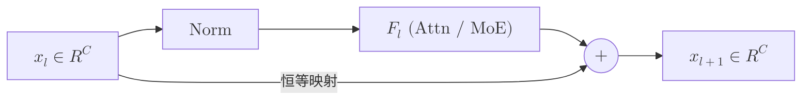
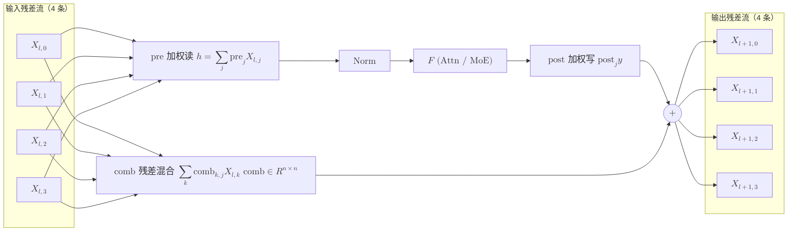
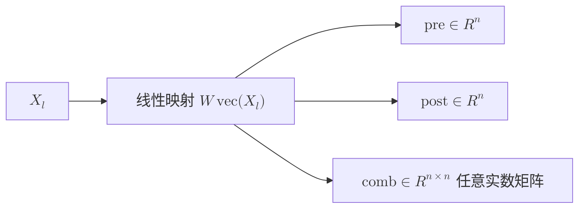
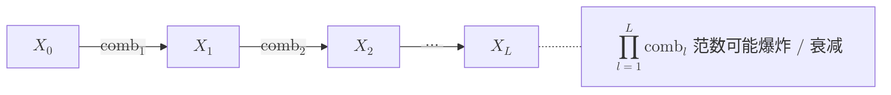
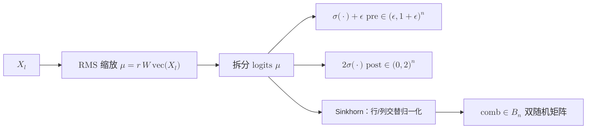
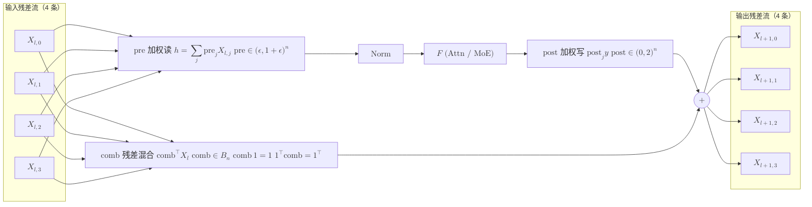
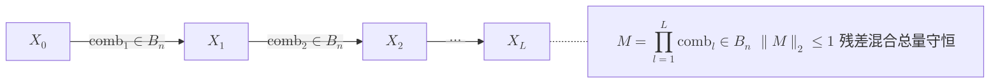

# mHC Mixer（Manifold-Constrained Hyper-Connections）原理

> 本文讲解 DeepSeek-V4 用来替代普通残差连接的 **mHC（Manifold-Constrained Hyper-Connections，流形约束超连接）**
> 混合器：为什么需要它、每层具体算什么、Sinkhorn 投影起什么作用、整网数据如何流动，以及它的计算代价。

## 目录

1. [背景：从残差连接到 Hyper-Connections 再到 mHC](#1-背景从残差连接到-hyper-connections-再到-mhc)
2. [符号与参数](#2-符号与参数)
3. [单个子层的计算过程](#3-单个子层的计算过程)
4. [Sinkhorn-Knopp：把混合矩阵投影成双随机矩阵](#4-sinkhorn-knopp把混合矩阵投影成双随机矩阵)
5. [整网数据流：扩流 → 逐层混合 → 收流](#5-整网数据流扩流--逐层混合--收流)
6. [代价分析](#6-代价分析)
7. [常见问题速答](#7-常见问题速答)

---

## 1. 背景：从残差连接到 Hyper-Connections 再到 mHC

### 1.1 普通残差（Pre-Norm）

$$
x_{l+1} = x_l + F_l\big(\mathrm{Norm}(x_l)\big),\qquad x_l \in \mathbb{R}^{C}
$$

结构示意：



残差流只有**一条**宽度为 $C$ 的通道。恒等映射项 $x_l$ 保证深层网络梯度可直达，但"层与层之间信息如何混合"被固定为简单相加。

### 1.2 Hyper-Connections（HC）

HC 把残差流扩成 $n$ 条并行通道（DeepSeek-V4 中 $n=4$）：

$$
X_l \in \mathbb{R}^{n\times C}
$$

每个子层（attention 或 MoE）前后各加一组**可学习的、依赖输入的**混合系数：

- **pre**：$n$ 条流 → 1 个子层输入（读），$\text{pre}\in\mathbb{R}^{n}$
- **post**：子层输出 → 写回 $n$ 条流（写），$\text{post}\in\mathbb{R}^{n}$
- **comb（res）**：$n$ 条流之间的残差混合，$\text{comb}\in\mathbb{R}^{n\times n}$

结构示意（$n=4$）：



三组系数由当前残差流动态生成（HC 中不加约束）：



跨层看，残差路径是 comb 的连乘：



问题：comb 是无约束矩阵，堆叠 $L$ 层后残差路径等价于 $\prod_{l=1}^{L} \mathrm{comb}_l$，范数可能指数爆炸或衰减，**破坏了残差的恒等映射性质**，大规模训练不稳定。

### 1.3 mHC：把 comb 约束到双随机流形上

mHC 的核心改动只有一点：**把 comb 投影到双随机矩阵集合（Birkhoff 多面体）**：

$$
\mathcal{B}_n = \left\{ M\in\mathbb{R}^{n\times n}_{\ge 0} \;\middle|\; M\mathbf{1}=\mathbf{1},\ \mathbf{1}^\top M=\mathbf{1}^\top \right\}
$$

带来的性质：

| 性质 | 含义 |
|---|---|
| $\lVert M\rVert_2 \le 1$ | 单层混合不会放大信号 |
| 乘法封闭：$M_1 M_2\in\mathcal{B}_n$ | 叠加任意多层仍是双随机，深度方向稳定 |
| 行/列和为 1 | $\sum_j X'_j=\sum_k X_k$，多条流的"总量"守恒，退化情形即恒等映射 |

pre / post 则用 sigmoid 约束到正区间，避免符号抵消。

结构示意：数据通路与 HC 相同，区别在于**系数生成时加了约束**：



完整的一个子层：



跨层看，双随机矩阵乘法封闭，残差路径始终稳定：



三者对比：

| | 普通残差 | HC | mHC |
|---|---|---|---|
| 残差流宽度 | $C$ | $nC$ | $nC$ |
| 读入子层 | $x$ | $\sum_j \text{pre}_j X_j$（无约束） | $\sum_j \text{pre}_j X_j$，$\text{pre}>0$ |
| 写回 | $+F$ | $\text{post}_j\, y$（无约束） | $\text{post}_j\, y$，$\text{post}\in(0,2)$ |
| 残差混合 | 恒等 $I$ | $\text{comb}\in\mathbb{R}^{n\times n}$ | $\text{comb}\in\mathcal{B}_n$ |
| 深层稳定性 | 稳定 | 可能爆炸 / 衰减 | 稳定 |

---

## 2. 符号与参数

DeepSeek-V4 配置：$n=4$，Sinkhorn 迭代 $20$ 轮，$\epsilon_{\text{hc}}=10^{-6}$。

记 $n$ 为流数，$C$ 为 hidden size，$m = (2+n)\,n$（$n=4$ 时 $m=24$）。

每个 decoder layer 有两组参数（attention 前一组、MoE 前一组），每组包含：

| 参数 | 形状 | 作用 |
|---|---|---|
| $W$ | $\mathbb{R}^{m\times nC}$ | 从整条残差流生成 $m$ 个 mixing logits |
| $b$ | $\mathbb{R}^{m}$ | logits 的静态偏置 |
| $\alpha$ | $\mathbb{R}^{3}$ | 分别缩放 pre / post / comb 三段 logits |

$m$ 个 logits $\mu$ 的布局：

$$
\underbrace{\mu_{0},\dots,\mu_{n-1}}_{\text{pre}}\;\Big|\;
\underbrace{\mu_{n},\dots,\mu_{2n-1}}_{\text{post}}\;\Big|\;
\underbrace{\mu_{2n},\dots,\mu_{2n+n^2-1}}_{\text{comb（行优先 } n\times n\text{）}}
$$

系数同时有**静态部分**（$b$）和**动态部分**（$\alpha\cdot\mu$，依赖当前 token 的残差流），因此每个 token 的混合方式都不同。

---

## 3. 单个子层的计算过程

对每个 token 独立计算（下式省略 token 下标），$F$ 表示 attention 或 MoE。

**Step 1：动态 logits（带 RMS 归一化的线性映射）**

$$
\tilde{x}=\mathrm{vec}(X)\in\mathbb{R}^{nC},\qquad
r=\left(\frac{1}{nC}\sum_{i=1}^{nC} \tilde{x}_i^2+\epsilon_{\text{rms}}\right)^{-1/2}
$$

$$
\mu = r\cdot W\tilde{x}\in\mathbb{R}^{m}
$$

RMS 归一化只是一个标量 $r$，所以 $\mathrm{RMSNorm}(\tilde{x})$ 再乘 $W$ 等价于先乘 $W$ 再乘 $r$。

**Step 2：拆分并约束三组系数**

$$
\text{pre}_j = \sigma\big(\alpha_0\,\mu_j + b_j\big) + \epsilon_{\text{hc}},\qquad j=0,\dots,n-1
$$

$$
\text{post}_j = 2\,\sigma\big(\alpha_1\,\mu_{n+j} + b_{n+j}\big)\in(0,2)
$$

$$
\text{comb} = \mathrm{Sinkhorn}\Big(\big[\alpha_2\,\mu_{2n+jn+k}+b_{2n+jn+k}\big]_{j,k}\Big)\in\mathcal{B}_n
$$

- pre 加 $\epsilon_{\text{hc}}$ 保证严格为正；
- post 乘 $2$，使初始化 $\sigma(0)=0.5$ 时 $\text{post}=1$，与普通残差对齐；
- comb 投影到双随机矩阵（见 §4）。

**Step 3：读（pre）→ 子层 → 写（post + comb）**

$$
h=\sum_{j=0}^{n-1}\text{pre}_j\,X_j\in\mathbb{R}^{C},\qquad
y = F\big(\mathrm{RMSNorm}(h)\big)
$$

$$
X'_j = \text{post}_j\, y + \sum_{k=0}^{n-1}\text{comb}_{k,j}\,X_k
$$

矩阵形式：

$$
X' = \text{post}\,y^\top + \text{comb}^\top X
$$

一个 decoder layer 里做两次：

```
X --pre(attn)--> h --norm--> Attn --post+comb--> X'
X'--pre(ffn) --> h --norm--> MoE  --post+comb--> X''
```

与普通残差对比：若 $n=1$ 且 $\text{pre}=\text{post}=\text{comb}=1$，就退化为 $x+F\big(\mathrm{Norm}(x)\big)$。

---

## 4. Sinkhorn-Knopp：把混合矩阵投影成双随机矩阵

Sinkhorn-Knopp 定理：任意元素全正的方阵，交替做行归一化、列归一化，会收敛到唯一的双随机矩阵 $D_1 A D_2$（$D_1, D_2$ 为正对角阵）。

给定 logits 矩阵 $A\in\mathbb{R}^{n\times n}$：

1. **第 1 次行归一化 = 行 softmax**（取指数保证元素全正，减行最大值防溢出）：

$$
M_{jk}=\frac{\exp\!\big(A_{jk}-\max_{k'} A_{jk'}\big)}{\sum_{k''}\exp\!\big(A_{jk''}-\max_{k'}A_{jk'}\big)}+\epsilon
$$

2. **列归一化**：

$$
M_{jk}\leftarrow \frac{M_{jk}}{\sum_{j'}M_{j'k}+\epsilon}
$$

3. 重复 $K-1$ 次（$K=20$）：先行归一化，再列归一化：

$$
M_{jk}\leftarrow \frac{M_{jk}}{\sum_{k'}M_{jk'}+\epsilon},\qquad
M_{jk}\leftarrow \frac{M_{jk}}{\sum_{j'}M_{j'k}+\epsilon}
$$

要点：

- 最后一步是**列归一化**，所以 $\mathbf{1}^\top M \approx \mathbf{1}^\top$ 精确成立（仅差 $\epsilon$），$M\mathbf{1}\approx\mathbf{1}$ 为近似，迭代 20 轮后误差很小。
- 截断迭代是可微的，训练时梯度直接穿过 $K$ 轮归一化反传。
- 矩阵只有 $n\times n=4\times4$，迭代计算量可忽略。
- 每个 token 的 comb 都不同（输入依赖），是 per-token 的 $n\times n$ 矩阵。

---

## 5. 整网数据流：扩流 → 逐层混合 → 收流

1. **扩流**：embedding 输出 $e\in\mathbb{R}^C$ 直接复制 $n$ 份：

$$
X_0 = \mathbf{1}_n e^\top\in\mathbb{R}^{n\times C}
$$

2. **逐层混合**：每层对 attention、MoE 各做一次 §3 的 pre / post / comb，残差流始终保持 $n\times C$。

3. **收流（head）**：最后一层后用一组只含 pre 的参数（$W_{\text{head}}\in\mathbb{R}^{n\times nC}$、$b_{\text{head}}\in\mathbb{R}^{n}$、$\alpha_{\text{head}}\in\mathbb{R}$）把 $n$ 条流合并为 1 条，**无 post / comb / Sinkhorn**：

$$
\text{pre}^{\text{head}} = \sigma\big(\alpha_{\text{head}}\cdot r\,W_{\text{head}}\tilde{x} + b_{\text{head}}\big)+\epsilon_{\text{hc}},\qquad
y_{\text{out}} = \sum_{j=0}^{n-1}\text{pre}^{\text{head}}_j X_j
$$

之后接最终 RMSNorm 与 LM head。

---

## 6. 代价分析

以 $n=4$、$C=7168$（$nC=28672$）、每 token 每个子层为例：

| 项目 | 量级 | 说明 |
|---|---|---|
| logits 线性映射 | $2\cdot m\cdot nC = 2\times24\times28672\approx 1.4\ \text{MFLOP}$ | 输出维度 $m=24$ 极窄，算力利用率低 |
| Sinkhorn | $\approx 2K n^2 = 640$ 次除法 | 可忽略 |
| 残差流读写 | $nC\times 2\,\text{B}=56\ \text{KB}$ / 次（bf16） | 普通残差的 $n$ 倍，**主要开销** |
| 参数 $W$ | $m\times nC\times 4\,\text{B}\approx 2.75\ \text{MB}$ / 组（fp32） | 每层 2 组 |

相对整层计算（attention + MoE），mHC 的 FLOPs 占比很小，但它是典型的**访存受限（memory-bound）**操作：开销主要来自 $n$ 倍宽的残差流读写。

---

## 7. 常见问题速答

**Q：mHC 和 MoE 的 gating 有关系吗？**
没有。mHC 混合的是"残差流的 $n$ 条通道"，MoE gating 选择的是"专家"。二者正交，mHC 包在 attention 和 MoE 外面。

**Q：mHC 会影响 KV cache 吗？**
不影响。KV 由子层输入 $\mathrm{RMSNorm}(h)\in\mathbb{R}^{C}$ 计算，宽度不变；但层间激活从 $C$ 变成 $nC$，激活显存与层间通信量变成 $n$ 倍。

**Q：为什么只约束 comb，不约束 pre / post？**
pre 只是 $n\to1$ 的加权读，post 只是 $1\to n$ 的加权写，它们不会在深度方向连乘；会跨层连乘的只有残差路径上的 comb，$\prod_l \mathrm{comb}_l$ 的稳定性才是关键，用 sigmoid 保正已足够约束 pre / post。

**Q：为什么用双随机矩阵而不是正交矩阵？**
双随机矩阵非负、谱范数 $\le 1$、乘法封闭，且可通过 Sinkhorn 用简单的归一化操作高效、可微地投影；正交约束需要 SVD/QR 等较重的操作，且允许负值混合，可能导致流之间相互抵消。

**Q：$n=1$ 时 mHC 是什么？**
$\mathcal{B}_1=\{1\}$，comb 恒为 1，mHC 退化为带标量门控的普通残差：$x' = \text{post}\cdot F\big(\mathrm{Norm}(\text{pre}\cdot x)\big) + x$。
