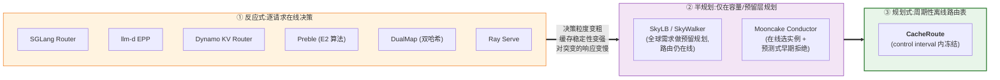
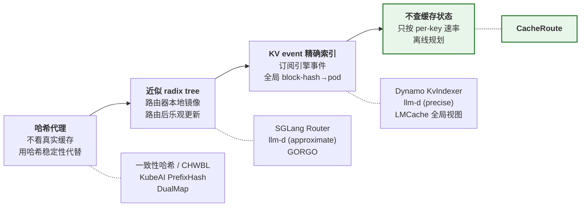
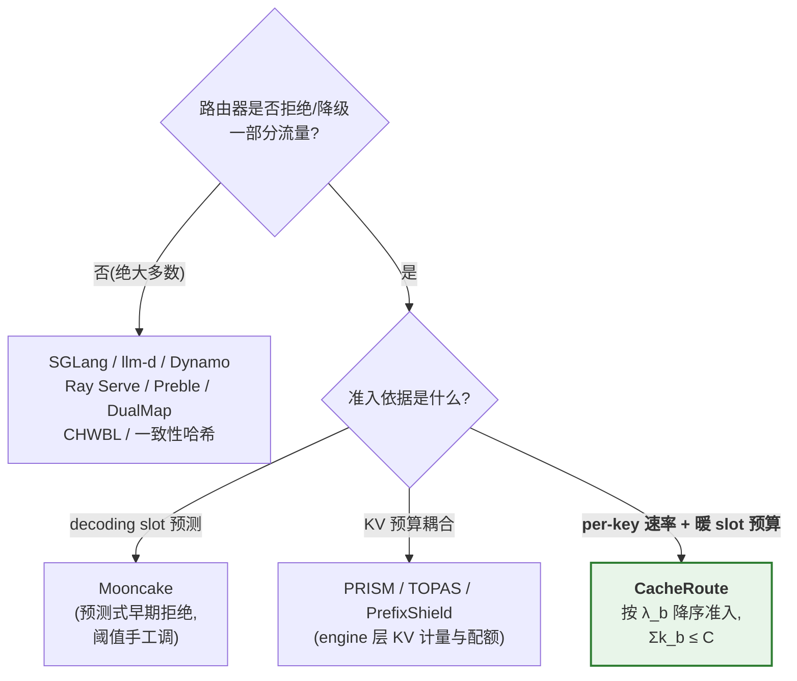
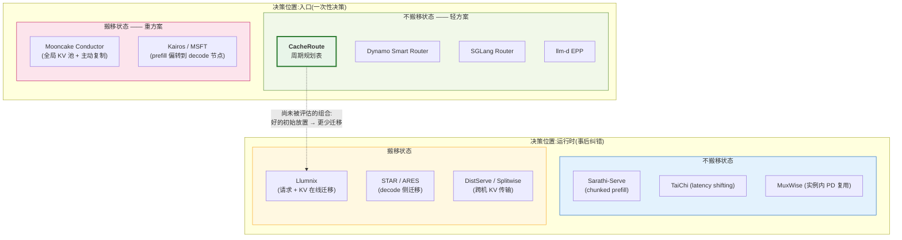
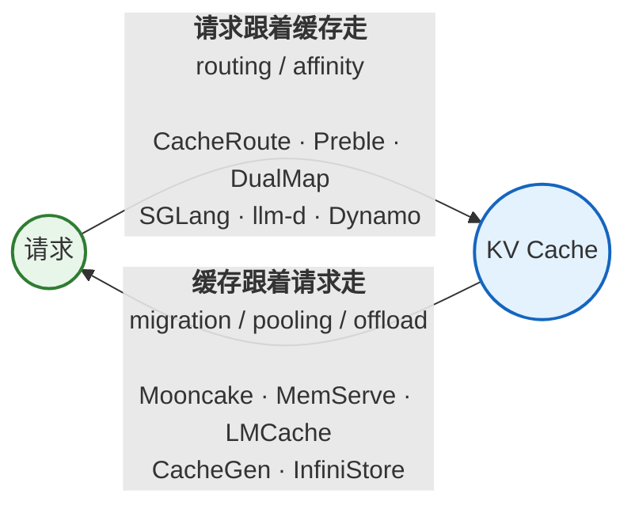
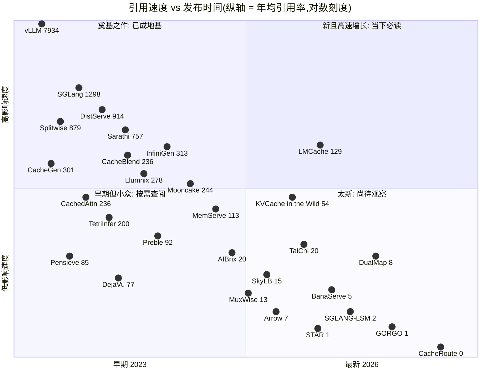
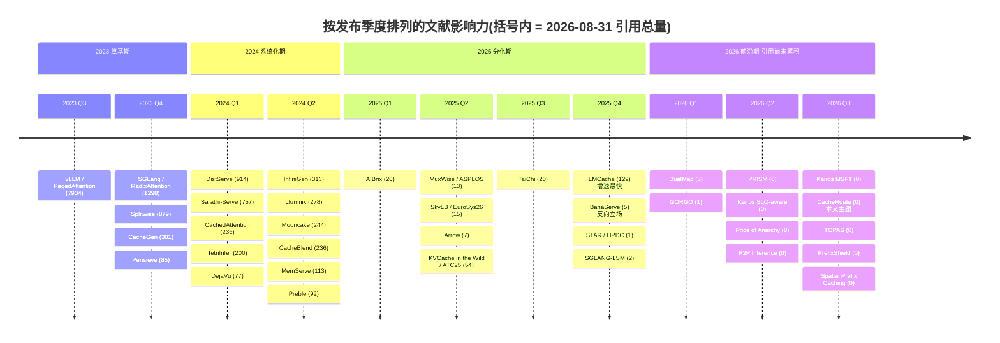
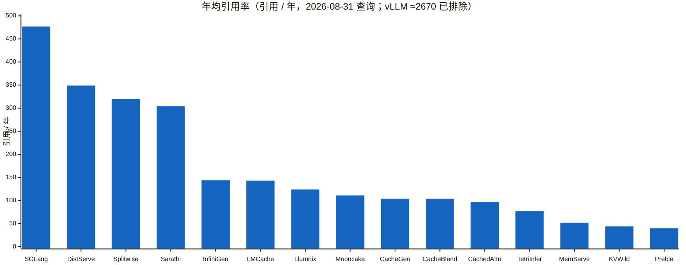
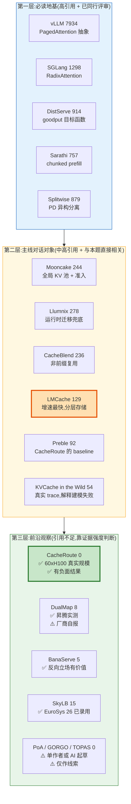

# 大模型推理服务的负载均衡与请求调度:文献综述

> 撰写时间:2026 年 8 月
> 出发点:*CacheRoute: Planned Prefix-Affinity Routing for Large-Scale LLM Serving*(Huang Cheng, Meta, Menlo Park;arXiv:2608.19677,2026-08)
> 论文链接:<https://arxiv.org/abs/2608.19677>

## 关于本文的证据标注约定

由于本领域大量新工作以预印本和工程文档形式存在,本文对每条引用标注证据等级:

| 标记 | 含义 |
|---|---|
| **[同行评审]** | 已在 SOSP/OSDI/FAST/ISCA/EuroSys/NeurIPS/ICLR/ATC/SIGCOMM 等发表 |
| **[预印本]** | 仅有 arXiv 版本,会议归属未确认 |
| **[工程]** | 开源项目文档 / 官方仓库,无论文 |
| **[厂商自报]** | 性能数字来自厂商博客,未经独立复现 |
| **[二手信息]** | **本文未能获取原文**,内容来自搜索引擎摘要或第三方转述,可信度低于以上各级。全文仅 §4.1 的「CacheRoute(K8s 版)」一条属此级 |
| **⚠️ 待核实** | 本次调研未能完全确认的信息 |
| **📊 N 引用** | Semantic Scholar `citationCount`,查询日期 **2026-08-31**;括号内为首发日期与年均引用率。方法学限制见 **§10.1**,完整数据与价值图谱见 **§10** |

> **两点消歧提醒**
> 1. **同名撞车**:除本文讨论的 arXiv:2608.19677(Meta)外,另有一篇《CacheRoute: KV-Cache-Aware Routing for LLM Backend Services on Kubernetes》(ResearchGate 406925855),两者**不是同一工作**,引用时务必区分。核心区别:Meta 版是 **60×H100 上的规划式路由 + 准入控制**,K8s 版是 **4×A100 上的反应式 EPP 打分、无准入**,按 §2.1 三轴分类落在完全不同的格子。**该文已作为独立条目收入 §4.1**,并在那里给出逐项对比;需注意它是全文唯一的 **[二手信息]** 条目。
> 2. 本文对 CacheRoute 作者单位(Meta, Menlo Park)的确认来自论文 PDF 首页;调研过程中部分检索渠道未能直连 arXiv abs 页面。

---

## 1. 问题的提出:一个被 LLM 放大的老矛盾

Prefix caching 已是 LLM 推理引擎的标准能力,但**缓存无法决定请求落在哪台机器上**。这就把一个在 CDN 和分布式缓存领域存在了二十多年的矛盾,以更尖锐的形式重新推到台前:

- **纯负载均衡(cache-blind)**:把速率为 $\lambda_b$ 的 key 均匀打散到 $R$ 台机器,单机重访间隔为 $R/\lambda_b$。**集群越大,单个前缀反而越冷**;一旦超过有效驱逐时间,每次请求都要重做 prefill。
- **纯亲和(sticky)**:一致性哈希能保住 locality,却把 key 的倾斜度**直接映射成队列倾斜度**,尾延迟由最热的那台机器决定。

Akamai 在 CDN 场景对这一权衡的经典表述是:**重路由缓解过载的代价,是在新节点产生 miss**(*Access-time aware cache algorithms*,<https://www.akamai.com/site/en/documents/research-paper/access-time-aware-cache-algorithms.pdf>)。LLM 场景让它变得更严重,原因有三:

1. **单次 miss 的代价极高**——不是回源拉一个文件,而是重跑一遍 prefill 的全部注意力计算;
2. **缓存条目极其短命**——真实云 trace 实测 to-B 负载的 KV 条目 P99 生命期仅 **97 秒**(ATC'25,详见 §6);
3. **可复用段可能很小**——CacheRoute 的工作负载中,真正可路由的稳定业务上下文只占 prompt 的 **15%**(约 180 tokens),67% 的相邻请求对因 RAG 检索块变化而打断精确前缀。

---

## 2. 分类框架

### 2.1 三轴定位

阅读这条线的文献,最有效的三个坐标轴是:

**轴一:决策时机**——从「每个请求都重新算一次」到「一个周期算一次、期间冻结」

**轴二:路由器从哪里获知缓存状态**——从「靠哈希假装知道」到「订阅事件精确知道」,再到 CacheRoute 的「干脆不看」

> 注意轴二上 CacheRoute 的位置有些反直觉:**它是"缓存感知路由"这条线上唯一完全不查询缓存状态的系统**。它赌的是「速率高的 key 大概率还在缓存里」这一统计假设,并用 shadow replay 来验证这个赌注是否成立。

**轴三:是否有准入控制(admission)**

**按业务 key 速率做路由层准入**,目前是 CacheRoute 较为独特的做法。

### 2.2 「决策位置 × 是否搬移状态」二维图

CacheRoute 落在**「入口决策 + 不搬移状态」这个最保守的格子**里。它的价值主张是:以极低的工程侵入性(不改模型执行、不预留 KV、不迁移 block)拿到大部分 cache 局部性收益;代价是**没有事后纠错能力**——而这恰恰是 Llumnix 一类工作论证为必要的能力(图中虚线所示的组合尚未被系统评估,详见 §9.4)。

### 2.3 术语轴:让缓存跟着请求走 vs. 让请求跟着缓存走

两者**正交可叠加**:路由降低「需要搬运的量」,池化兜住「路由不中的残差」。CacheRoute 声明不预留、不迁移 KV,正是把自己定位在前者的极简端。

---

## 3. 第一支:引擎内的 KV 复用基础设施

这一层是被路由的**对象本身**,决定了「命中」在物理上意味着什么。

**PagedAttention / vLLM** — Kwon et al., SOSP'23 **[同行评审]** ｜ 📊 **7934 引用**(2023-09,≈2670/年)
<https://arxiv.org/abs/2309.06180> ｜ DOI: [10.1145/3600006.3613165](https://doi.org/10.1145/3600006.3613165) ｜ <https://github.com/vllm-project/vllm>
分页式 KV block 管理 + block table,消除内外部碎片,支持跨请求 block 共享。同延迟下吞吐 2–4×(vs FasterTransformer/Orca);但注意力核本身比 FT 慢 20–26%。
**与 CacheRoute 的关系**:CacheRoute 直接依赖其 automatic prefix caching 的命中语义,且明确声明「共享引擎原生缓存与驱逐策略,不做预留」。

**RadixAttention / SGLang** — Zheng et al., NeurIPS'24 **[同行评审]** ｜ 📊 **1298 引用**(2023-12,≈477/年)
<https://arxiv.org/abs/2312.07104> ｜ [NeurIPS proceedings](https://proceedings.neurips.cc/paper_files/paper/2024/hash/724be4472168f31ba1c9ac630f15dec8-Abstract-Conference.html) ｜ <https://github.com/sgl-project/sglang>
用 radix tree 维护跨请求 KV 的 LRU 缓存,配 cache-aware 调度重排请求顺序。吞吐最高 6.4×;命中率 50%–99%,cache-aware 调度达理论最优的约 96%。
**关系**:这是 CacheRoute 的**机内同构版本**——单机内也在做「请求跟着缓存走」。两者可叠加:入口路由选机器,机内 radix 调度选顺序。

**Pensieve** — Yu et al., EuroSys'25 **[同行评审]** ｜ 📊 **85 引用**(2023-12,≈31/年)
<https://arxiv.org/abs/2312.05516> ｜ DOI: [10.1145/3689031.3696086](https://doi.org/10.1145/3689031.3696086)
多轮对话的状态化服务,GPU–CPU 多级缓存 + 支持非连续上下文的注意力核;淘汰同时考虑会话新近度与**位置相关的重算代价**。吞吐 1.14–1.70×(13B 单卡)、1.64–3.0×(66/70B 四卡)。

**CachedAttention / AttentionStore** — Gao et al., USENIX ATC'24 **[同行评审]** ｜ 📊 **236 引用**(2024-03,≈97/年)
<https://arxiv.org/abs/2403.19708> ｜ [ATC'24](https://www.usenix.org/conference/atc24/presentation/gao-bin-cost)
HBM/DRAM/SSD 分层 KV 存储,逐层预载 + 异步落盘,位置编码解耦以解决上下文溢出后缓存失效。**关键实测:ShareGPT 上重复 prefill 占 prefill 成本高达 98%**——这是整条路线最有力的动机数据。TTFT 降最多 87%(长序列 95%),端到端成本降 70%。

**InfiniGen** — Lee et al., OSDI'24 **[同行评审]** ｜ 📊 **313 引用**(2024-06,≈144/年)
<https://arxiv.org/abs/2406.19707> ｜ [OSDI'24](https://www.usenix.org/conference/osdi24/presentation/lee) ｜ <https://github.com/snu-comparch/InfiniGen>
与 CacheRoute **完全正交**:处理的是单请求内长生成的 KV 卸载,用上一层输入「预演」推测下一层重要 token 并只预取这部分。最多 3.00× 端到端提升。

---

## 4. 第二支:前缀缓存感知路由(与 CacheRoute 直接对话)

### 4.1 学术工作

**Preble** — Srivatsa et al., **ICLR 2025** **[同行评审]** ｜ 📊 **92 引用**(2024-05,≈40/年)
<https://arxiv.org/abs/2407.00023> ｜ [OpenReview](https://openreview.net/forum?id=meKEKDhdnx) ｜ <https://github.com/WukLab/preble>
分层调度:全局 request-level + 每 GPU iteration-level。核心是 **E2(Exploitation-Exploration)** 算法,逐请求在 KV 复用与负载分散间权衡;检测负载倾斜时重定向,热前缀超单卡容量时**自动复制**;用 cache 命中率做优先级实现多租户公平。报告平均延迟 1.5–14.5×、p99 2–10×(4×A6000 / 8×H100)。
**与 CacheRoute 的差异**:反应式逐请求决策,**无离线规划表、无 per-key 准入**;前缀复制是被动触发,而非按 $\lambda_b$ 预算显式计算副本数。CacheRoute 在 60×H100 上报告 176±11 QPS vs Preble 76±11(2.3×)——但注意 Preble 是在同一 harness 下的**重实现**,不等同于原系统复现。

**DualMap** — Yuan, Zuo et al.(华为), 2026-02 **[预印本]** ｜ 📊 **8 引用**(2026-02,发表 7 个月)
<https://arxiv.org/abs/2602.06502> ｜ [OpenReview](https://openreview.net/forum?id=zCadrJ32Xn)
用**两个独立哈希函数**把请求映射到两个候选实例,再按实时状态选优;三项技术为 SLO-aware routing(TTFT 超 SLO 才切轻载候选)、hotspot-aware rebalancing(只在候选对内迁移)、dual-hash-ring 扩缩容。报告有效请求容量 **2.25×**(5s TTFT SLO,8×Ascend 910B/节点)。其工作负载统计值得引用:**48% 对话请求共享 ≥50% 前缀,工具/Agent 请求达 76%**。
**差异**:仍是反应式 + 哈希驱动,副本数隐含固定为 2(即 power-of-two-choices);CacheRoute 按负载显式算 $k_b$ 并做 LPT 放置。

**SkyLB / SkyWalker** — Xia et al.(UC Berkeley), **EuroSys '26** **[同行评审]** ｜ 📊 **15 引用**(2025-05,≈12/年)
<https://arxiv.org/abs/2505.24095> ｜ DOI: [10.1145/3767295.3769353](https://dl.acm.org/doi/10.1145/3767295.3769353)
跨区域场景:每区域部署 LB,cache-aware 跨区转发 + selective pushing,并用**全球需求**(而非各区峰值)做预留实例规划。
**差异**:规划维度落在**容量预留层**,路由决策本身仍在线;无 per-key 准入。

**GORGO / Online Tuning for Cross-Region Network-Aware LLM Serving** — Toniolo et al., 2026 **[预印本]** ｜ 📊 **1 引用**(2026-02)
<https://arxiv.org/abs/2602.11688>
把前缀局部性、区域间实测网络延迟、队列/准入状态放进同一 TTFT 成本函数;每 LB 维护镜像 SGLang radix-trie 的轻量前缀索引。v2 用进化策略在线调参,报告 p95 TTFT 改善 6.9–15.5%。
⚠️ **v1 明确声明使用 AI 工具起草,引用需谨慎。**

**CacheRoute(K8s 版,与本文主题同名的另一工作)** — 作者不详 **[预印本]** **[二手信息]** ｜ 📊 无引用数据
<https://www.researchgate.net/publication/406925855_CacheRoute_KV-Cache-Aware_Routing_for_LLM_Backend_Services_on_Kubernetes>

> ⚠️ **本条为全文唯一的二手信息条目**。ResearchGate 页面返回 HTTP 403,Semantic Scholar 查询持续 429 限流,**本文未能获取 PDF 原文**;以下内容来自搜索引擎对该页面的摘要。**作者、发表日期、DOI 均未获取到**,引用前务必自行核实。

实现为兼容 **Kubernetes Gateway API Inference Extension** 的 **Endpoint Picker**(经 ext-proc 挂在 Inference Gateway 后),维护每实例元数据(已缓存前缀哈希、GPU 显存利用率、队列深度,由 sidecar 端点采集),用三信号复合打分选最高者:**前缀相似度 + 实时 GPU 显存利用率 + 预测 TTFT**。前缀匹配按 **16-token block 粒度**做 token 级 hash 比较。
**实验**:4 节点 × A100 40GB,vLLM v0.6 + LLaMA-2-7B-Chat BF16,开 automatic prefix caching;负载取自 LMSYS-Chat-1M,分短问答 / 多轮对话 / RAG 长上下文三档。对比 5 个 baseline,报告 p95 TTFT 降 **11–54%**(相对最强 baseline `prefix+load` 仅 **11–20%**)、KV 命中率 **+7–51pp**、复用前缀 token 占 51.8%、峰值显存降 3–13pp,路由开销亚毫秒。
**自述局限**:16-token block 的 hash 匹配识别不了语义相似;**线性 TTFT 预测器无法捕捉极端负载下的非线性排队效应**;仅测单模型 + 同构 A100。

**与本文主题 CacheRoute(Meta, arXiv:2608.19677)的关系——名字撞车,但不是竞品**:

| | Meta CacheRoute | K8s CacheRoute(本条) |
|---|---|---|
| 决策时机 | **规划式**(周期离线算表,interval 内冻结) | **反应式**(逐请求在线打分) |
| 准入控制 | 有(top-rate,$\sum_{b\in\mathcal{A}} k_b \le C$) | 无 |
| 集群规模 | 60×H100 | 4×A100 |
| 模型 | 70B fp8 | 7B BF16 |
| 载体 | 自研入口路由 | K8s GAIE 标准扩展 |
| 主张 | 提出新的**决策时机** | **工程实现 + 评测** |

按 §2.1 三轴分类,本条落在「**反应式 + 近似缓存状态 + 无准入**」一档,与 §4.2 的 llm-d EPP、Dynamo KV Router、Ray Serve **同类**,学术上不构成新的调度原语;其价值在于为 GAIE 生态提供了一个带评测数据的 EPP 参考实现。

**两点交叉印证**(本文认为这是该条目最有价值的部分):

1. **它的自述局限被 Meta 版的负面结果实证了**。它承认线性 TTFT 预测器"可能"无法捕捉非线性排队效应——这是保留性措辞;而 Meta 版**实测**了这件事:解析驻留模型预测偏差中位 14.3pp、p90 44.7pp,最终放弃解析预测改用 shadow replay(见 §8.1)。两篇独立工作从不同方向指向同一结论:**这类预测器目前不可靠**。
2. **4 节点规模恰好测不出 Meta 版要解决的问题**。Meta 版的核心论证是重访间隔 $\mathbb{E}[\Delta t_{\text{revisit}}] \approx R/\lambda_b$,$R$ 越大缓存越冷;$R=4$ 与 $R=60$ 是数量级差异。因此**本条在 4 节点上的「前缀亲和有效」结论不构成对大集群的证据**,反之 Meta 版的 2.3× 也不适用于小集群。这也解释了为何它相对最强 baseline 仅有 11–20% 提升——**小集群上朴素的 prefix+load 启发式已接近够用**。

**Mooncake(Conductor 全局调度器)** — Qin et al., **FAST'25 最佳论文** / ACM TOS **[同行评审]** ｜ 📊 **244 引用**(2024-06,≈111/年)
<https://arxiv.org/abs/2407.00079> ｜ [FAST'25](https://www.usenix.org/conference/fast25/presentation/qin) ｜ DOI: [10.1145/3773772](https://doi.org/10.1145/3773772) ｜ <https://github.com/kvcache-ai/Mooncake>
Conductor 为每请求选 prefill/decode 实例对,按块 hash 做去重复用,热块复制、冷块换出;`kvcache_balancing_threshold` 控制亲和/均衡取舍。**它是少数具备准入控制的系统**(基于 decoding slot 预测的早期拒绝),但论文承认阈值是**手工调**的。
**关系**:两条路线的**混合体**,也是 CacheRoute 最重要的对照面——「重方案(全局 KV 池 + 主动迁移)vs 轻方案(纯入口决策)」。

**2025–2026 新工作**(均 **[预印本]**,⚠️ 作者与发表场所未逐一核实):

| 工作 | 链接 | 要点 |
|---|---|---|
| **PRISM** 📊0 | <https://arxiv.org/html/2605.08581v1> | demand-aware radix tree,把**请求准入**与精确前缀 KV 保留对齐;p99 TTFT 降 23.3%/37.1%。与 CacheRoute 的「准入 × 缓存」耦合最接近,但在 engine 层 |
| **TOPAS** 📊0 | <https://arxiv.org/html/2608.25523> | 把前缀驻留当作 **workflow 级**调度变量,面向多 Agent 服务 |
| **PrefixShield** 📊0 | <https://arxiv.org/html/2608.01657v1> | 多租户下的「准入责任缺口」、KV 块计量与配额 |
| **BanaServe** 📊5(**已确认发表于 *Software, Practice & Experience***) | <https://arxiv.org/html/2510.13223v1> | **反向立场**:认为 prefix-aware 路由必然造成负载倾斜,主张全局 KV store + 模块迁移,让路由纯负载感知 |
| **P2P 分布式推理** 📊1 | <https://arxiv.org/html/2606.17059v1> | 去中心化、无中央协调器的近似 radix tree 复制 + anti-entropy 同步 |
| **Spatial Prefix Caching(无线边缘)** 📊0 | <https://arxiv.org/abs/2608.01126> | 排队论 + 随机几何视角,用 prefix forest + ancestor-closed cache profile 建模。结论值得注意:**queue-unaware 的 prefix 路由在倾斜亲和下会崩溃,TTFT 对缓存前缀深度非单调** |

### 4.2 生产系统与开源网关

这一层的信息量常被学术综述低估,但它恰恰记录了「亲和路由在真实流量下会怎样翻车」。

| 系统 | 链接 | 机制 | 与 CacheRoute 的差异 |
|---|---|---|---|
| **SGLang Router / Model Gateway** | [docs](https://docs.sglang.ai/advanced_features/sgl_model_gateway.html) ｜ [LMSYS v0.4 blog](https://www.lmsys.org/blog/2024-12-04-sglang-v0-4/) | Rust 实现,维护 worker radix tree 的**近似副本**;先判系统是否均衡,均衡则取最长前缀匹配(超 `--cache-threshold`),否则最小队列 | 反应式;阈值手工;多 router 间 radix tree **不同步**(已知限制);无准入 |
| **vLLM production-stack** | [docs](https://docs.vllm.ai/projects/production-stack/en/latest/use_cases/prefix-aware-routing.html) ｜ [repo](https://github.com/vllm-project/production-stack) | prefix-aware / KV-aware(依赖 LMCache)两条路径,K8s CRD 化 | 同上 |
| **vLLM Router**(2025-12) | [repo](https://github.com/vllm-project/router) ｜ [release blog](https://vllm-project.github.io/2025/12/13/vllm-router-release.html) | fork 自 SGLang gateway,一致性哈希 sticky + PoT + P/D 编排 | 声称 req/s 比 llm-d 高 25%、比 K8s LB 高 100% **[厂商自报]** |
| **llm-d** | [precise prefix cache](https://llm-d.ai/docs/guide/Installation/precise-prefix-cache-aware) ｜ [KV wins blog](https://llm-d.ai/blog/kvcache-wins-you-can-see) ｜ [sticky-until-saturated](https://llm-d.ai/blog/sticky-until-saturated-token-aware-routing) | EPP 打分:approximate(路由后乐观更新本地索引)与 **precise**(订阅 vLLM KVEvents 维护 block-hash→pod 全局索引)两档;打分 = prefix affinity + KV 利用率 + 队列深度加权 | **已公开承认纯亲和导致 hot spotting**,转向 token-aware「sticky until saturated」——这正是 CacheRoute 要用规划 + 准入解决的问题 |
| **NVIDIA Dynamo KV Router** | [docs](https://docs.nvidia.com/dynamo/latest/router/README.html) ｜ [kv_cache_routing.md](https://github.com/ai-dynamo/dynamo/blob/main/docs/architecture/kv_cache_routing.md) | 成本函数 `cost = w × potential_prefill_blocks + potential_active_blocks`,取最小;KvIndexer 用 KV events 建全局前缀树 | **最接近显式代价模型的工业实现**,但权重手工调、无规划表、无准入。CacheRoute 相当于「只保留 Smart Router、去掉 KV 搬移」的极简化版本 |
| **AIBrix**(字节) 📊20 | <https://arxiv.org/abs/2504.03648> ⚠️(abs 链接由 HTML 页推得,待核实) ｜ [docs](https://aibrix.readthedocs.io/latest/features/gateway-plugins.html) | Envoy Gateway 扩展;策略含 hash-token prefix + load aware、`prefix-cache-preble`(Preble 复现)、VTC 公平路由 | 有论文,可作为「生产网关」的引用锚点 |
| **GAIE / Envoy AI Gateway / KServe** | [GAIE repo](https://github.com/kubernetes-sigs/gateway-api-inference-extension) ｜ [Envoy EPP blog](https://aigateway.envoyproxy.io/blog/endpoint-picker-for-inference-routing/) ｜ [KServe 0.17](https://kserve.github.io/website/blog/kserve-0.17-release) | EPP 内存前缀图,无匹配则回退 `vllm:kv_cache_usage_perc` 最低者 | 标准化载体 |
| **KubeAI PrefixHash (CHWBL)** | [blog](https://www.kubeai.org/blog/2025/02/26/llm-load-balancing-at-scale-chwbl/) | xxHash(首条 user message + LoRA 名) → 有界负载一致性哈希 | **CacheRoute 的 CHWBL baseline 出处**;cap 触发后溢出请求落冷机、前缀白费,正是 CacheRoute 批评的点 |
| **Ray Serve** | [docs](https://docs.ray.io/en/latest/serve/llm/user-guides/prefix-aware-routing.html) | 队列长度差低于阈值才走前缀树;≥10% 匹配选最高匹配,<10% 选缓存利用率最低者,无数据则 PoT | 三段式启发式,阈值手工 |
| **GKE Inference Gateway** | [blog](https://cloud.google.com/blog/products/containers-kubernetes/gke-inference-gateway-prefix-caching-accelerates-ai-inference) | 托管版前缀缓存感知路由 | — |

**常被引用的生产数字**(**[厂商自报]**,未经独立复现):llm-d 在 8 pods/16×H100 报告 TTFT 57×、吞吐 2×;KubeAI CHWBL 报告 TTFT −95%、吞吐 +127%;Dynamo 报告 KV Router 相对 round-robin TTFT 快 20×;Snap 在 GAIE 上前缀命中率 75–80%。

> **生产先例的历史回响**:HAProxy 1.7 的 `hash-balance-factor` 就是 CHWBL 的工业实现,Vimeo 报告 memcached 出口带宽从峰值约 8 Gbit/s 降到每机 <100 Mbit/s(<https://medium.com/vimeo-engineering-blog/improving-load-balancing-with-a-new-consistent-hashing-algorithm-9f1bd75709ed>)。今天的 LLM 网关在重走同一条路。

---

## 5. 第三支:集群级调度、PD 分离与请求迁移

这一支与 CacheRoute **大多正交**,但提供了「入口决策失误后怎么办」的答案。

### 5.1 PD 分离奠基工作

**DistServe** — Zhong et al., **OSDI'24** **[同行评审]** ｜ 📊 **914 引用**(2024-01,≈349/年)
<https://arxiv.org/abs/2401.09670> ｜ [OSDI'24](https://www.usenix.org/conference/osdi24/presentation/zhong-yinmin) ｜ <https://github.com/LLMServe/DistServe>
prefill 与 decode 放到不同 GPU 消除相互干扰;在 TTFT/TPOT SLO 下联合优化资源分配与并行策略。首次把 **goodput**(满足 SLO 前提下的每 GPU 有效请求率)立为目标函数——CacheRoute 的「SLO capacity」指标与此一脉相承。报告 7.4× 请求量或 12.6× 更严 SLO。
**关系**:DistServe 自身的分派策略只是「最短队列 FCFS」,**恰是 CacheRoute 这类前缀亲和路由可以替换的位置**。

**Splitwise** — Patel et al., **ISCA'24** **[同行评审]** ｜ 📊 **879 引用**(2023-11,≈320/年)
<https://arxiv.org/abs/2311.18677> ｜ DOI: [10.1109/ISCA59077.2024.00019](https://dl.acm.org/doi/10.1109/ISCA59077.2024.00019)
按两阶段的算力/带宽/功耗差异拆到**异构机型**,KV 经 InfiniBand 传输。同成本 1.76× 吞吐 + 降 15% 功耗;同成本同功耗 2.35× 吞吐。

**TetriInfer** — Hu et al., 2024 **[预印本]** ⚠️ 会议归属待核实 ｜ 📊 **200 引用**(2024-01,≈77/年)
<https://arxiv.org/abs/2401.11181>
固定大小 prefill 分块 + 可弹性翻转角色的虚拟 P/D 实例 + **带输出长度预测的两级调度**。其长度预测思路可为路由器提供负载估计信号。

**DéjàVu** — Strati et al., **ICML 2024** **[同行评审]** ｜ 📊 **77 引用**(2024-03,≈31/年)
<https://arxiv.org/abs/2403.01876> ｜ [PMLR](https://proceedings.mlr.press/v235/strati24a.html) ｜ <https://github.com/msr-fiddle/dejavu>
KV cache 流式库,支撑 prompt/token 分离、microbatch 级 KV 换入换出、KV 复制到远端以实现故障续跑。OPT-66B 1.88×、BLOOM-176B 2× 吞吐。

### 5.2 请求迁移(运行时纠错)

**Llumnix** — Sun et al.(阿里), **OSDI'24** **[同行评审]** ｜ 📊 **278 引用**(2024-06,≈124/年)
<https://arxiv.org/abs/2406.03243> ｜ [OSDI'24](https://www.usenix.org/conference/osdi24/presentation/sun-biao) ｜ <https://github.com/AlibabaPAI/llumnix>
把跨实例运行时重调度类比 OS 的 CPU 上下文切换,核心是**请求 + GPU 内存状态的在线迁移**(近零 downtime,与序列长度无关),用统一策略覆盖负载均衡、碎片整理、优先级、自动伸缩。尾延迟改善约一个数量级;等尾延迟下成本节省最高 36%。
**这是与 CacheRoute 最值得对比的一段**:CacheRoute 在入口「一次性决策、事后不纠错」;Llumnix 承认入口决策必然出错,用事后迁移修复。**两者理论上可叠加(好的初始放置 → 更少迁移),这是尚未被充分探索的方向。**

**ARES / STAR** — Wang et al., 2025-10(v2 2026-05 改名), **HPDC** **[同行评审]** ｜ 📊 **1 引用**(2025-10)
> ✅ **本次核实结果**:`venue` 返回 *IEEE International Symposium on High-Performance Parallel Distributed Computing*(HPDC)。
<https://arxiv.org/abs/2510.13668>
针对长输出推理任务的 **decode 侧**失衡,用 LLM 隐状态预测剩余生成长度,在 decode 实例间迁移请求。报告 goodput 2.24×–2.63×、P99 TPOT −74.8%。⚠️ 版本间数字不同,引用需注明版本。

### 5.3 Chunked prefill 与「要不要分离」的争论

**Sarathi-Serve** — Agrawal et al., **OSDI'24** **[同行评审]** ｜ 📊 **757 引用**(2024-03,≈304/年)
<https://arxiv.org/abs/2403.02310> ｜ [OSDI'24](https://www.usenix.org/conference/osdi24/presentation/agrawal)
chunked-prefill 把 prefill 切成近等长块,配 **stall-free 调度**(先填 decode token,再塞一个 prefill chunk)。Mistral-7B 2.6×、Falcon-180B 5.6× 服务容量。与 CacheRoute 完全正交,但作为 PD 分离的**替代路线**值得并列呈现。

**TaiChi** — Wang et al.(CUHK + 华为云), 2025-08 **[预印本]** ｜ 📊 **20 引用**(2025-08,≈19/年)
<https://arxiv.org/abs/2508.01989>
论证「紧 TTFT/松 TPOT 宜聚合,严 TPOT/松 TTFT 宜分离,均衡 SLO 下两者都不优」,提出混合实例 + latency shifting。均衡 SLO 下 goodput 最高 +77%。

**MuxWise(PD 多路复用)** — 2025, **ASPLOS** **[同行评审]** ｜ 📊 **13 引用**(2025-04,≈10/年)
> ✅ **本次核实结果**:Semantic Scholar 的 `venue` 字段返回 *International Conference on Architectural Support for Programming Languages and Operating Systems*,ASPLOS 归属**已确认**。
<https://arxiv.org/abs/2504.14489>
GPU 内 prefill-decode 多路复用。**其批评对前缀复用类工作有直接影响:静态 PD 分离会切碎 KV cache 池,降低有效缓存容量。**

### 5.4 2025–2026 新调度器

**Kairos(Microsoft, prefill deflection)** — Arun et al., 2026-07 **[预印本]** ｜ 📊 **0 引用**(2026-07,过新)
<https://arxiv.org/abs/2607.02043> ｜ <https://github.com/sudokara/Kairos>
打破「prefill 必须在 prefill 节点做完」的假设,把 prefill **偏转到 decode 节点**以 chunked 形式插入其 batch。关键观测极具价值:**P95 TTFT 中真正的 prefill 执行只占 2–23%,其余是排队与 KV 传输**。P95 TTFT 最高 −81%。
**关系**:同样是「决定请求去哪」,但由 SLO/负载驱动而非 cache 驱动,可与前缀亲和路由组合。

**Arrow** — Wu et al., 2025-05 **[预印本]** ｜ 📊 **7 引用**(2025-05,≈5/年) <https://arxiv.org/abs/2505.11916>
无状态实例 + 按实时指标动态调整 P/D 实例数量比。⚠️ 数字待核实。

**Kairos(SLO-aware,同名不同工作)** — 2026-05 **[预印本]** ⚠️ 作者待核实 ｜ 📊 **0 引用**(2026-05)
<https://arxiv.org/abs/2605.02329>
prefill 侧 urgency-based 优先级 + decode 侧 slack-guided 自适应批处理,不依赖输出长度预测、不需抢占。

**NVIDIA Dynamo** — **[工程]**,无官方论文
<https://github.com/ai-dynamo/dynamo> ｜ <https://developer.nvidia.com/dynamo>
Planner(P/D 池间动态重分配 GPU + SLO Planner 决定是否分离)、KV-aware Smart Router、分层 KV Block Manager(HBM/DRAM/SSD/网络存储)、NIXL 传输库。报告 DeepSeek-R1 on GB200 NVL72 请求量最高 30× **[厂商自报]**。

**The Price of Anarchy in Disaggregated Inference** — Georgiou, 2026-06 **[预印本]** ⚠️ 单作者、未见同行评审 ｜ 📊 **0 引用**(2026-06)
<https://arxiv.org/abs/2606.17081>
首个对分离式推理的**博弈论分析**,建模为三个耦合博弈(P/D 资源博弈、KV 分层缓存的自私缓存博弈、带正外部性的**路由拥塞博弈**),在 3 节点 B200 集群实测。结论:未饱和时 PoA 有界,饱和后超线性延迟与缓存外部性主导。
**这是 CacheRoute 在理论层面的直接对话对象**——路由拥塞博弈正是它所处的场景。

---

## 6. 第四支:KV 池化、分层存储与非前缀复用

**MemServe** — Hu et al., 2024 **[预印本]** ｜ 📊 **113 引用**(2024-06,≈52/年)
<https://arxiv.org/abs/2406.17565>
MemPool 弹性内存池统一管理集群 HBM+DRAM,提供内存/索引/传输三类 API;首次把 context caching 与 PD 分离结合,全局调度器用**全局 prompt tree 的局部性感知策略**。ShareGPT 上分离式较合置 JCT 改善最多 42%,叠加 context caching 再降 29%。

**CacheGen** — Liu et al., **SIGCOMM'24** **[同行评审]** ｜ 📊 **301 引用**(2023-10,≈104/年)
<https://arxiv.org/abs/2310.07240> ｜ DOI: [10.1145/3651890.3672274](https://doi.org/10.1145/3651890.3672274)
面向「KV 要过网」的场景:分层量化 + 算术编码压缩 KV 比特流,按带宽自适应调整压缩级别,必要时回退重算。KV 体积降 3.5–4.3×。

**CacheBlend** — Yao et al., **EuroSys'25 最佳论文** **[同行评审]** ｜ 📊 **236 引用**(2024-05,≈104/年)
<https://arxiv.org/abs/2405.16444> ｜ DOI: [10.1145/3689031.3696098](https://doi.org/10.1145/3689031.3696098) ｜ TOCS: [10.1145/3790254](https://doi.org/10.1145/3790254)
**突破「只能复用前缀」的限制**:融合多段非前缀 KV,逐层只对少量高 KV 偏差(HKVD)token 选择性重算,重算与 KV 拉取流水化。TTFT 降 2.2–3.3×,吞吐 2.8–5×。
**与 CacheRoute 的关系值得特别强调**:CacheRoute 的工作负载中,**67% 的相邻请求对因 RAG 检索块变化而打断精确前缀**,它对此无能为力(只能救完全前缀匹配的那 15%);CacheBlend 恰好把复用扩展到 RAG 式的中段片段。**两者高度互补,组合潜力显著。**

**LMCache** — Cheng et al., 2025 **[预印本]** / **[工程]** ｜ 📊 **129 引用**(2025-10,≈143/年,**增速最快**)
<https://arxiv.org/abs/2510.09665> ｜ <https://github.com/LMCache/LMCache> ｜ <https://lmcache.ai/tech_report.pdf>
把上述能力产品化:跨引擎(vLLM/SGLang)抽取 KV,分层存于 CPU/本地盘/远端(Mooncake、InfiniStore、S3、NIXL、GDS、Redis/Valkey),提供 pin/lookup/move/compress API。**论文明确指出线上 KV 总量已远超 GPU 显存容量**——这是 CacheRoute 那类「暖 slot 配额」假设的现实背景。

**InfiniStore**(字节) — **[工程]** <https://github.com/bytedance/InfiniStore>
跨节点 KV 池,兼容 PD 分离与混部。

**SGLANG-LSM: On 10x Better Scalability** — 2025-11 **[预印本]** ⚠️ 作者名单待核实 ｜ 📊 **2 引用**(2025-11)
<https://arxiv.org/abs/2511.16138>
指出 file-per-object 的磁盘 KV 缓存受文件系统元数据与局部性拖累,改用 LSM-tree + KV 分离 + **前缀保序**存储引擎。2025–26 分层存储线上最值得关注的新工作。

**综述与资源清单**:*Towards Efficient LLM Serving: A Survey on System-Aware KV Cache Optimization*(ACL 2026)配套清单 <https://github.com/jjiantong/Awesome-KV-Cache-Optimization>

---

## 7. 第五支:经典理论基础

CacheRoute 自称「不宣称新的调度原语」,其算法骨架完全由经典技术组成。梳理这些源头有助于判断它偏离标准结论的地方。

**Graham (1969) — LPT 界** **[同行评审]** ｜ 📊 **2566 引用**
R. L. Graham, *Bounds on Multiprocessing Timing Anomalies*, SIAM J. Appl. Math. 17(2):416–429.
DOI: [10.1137/0117039](https://doi.org/10.1137/0117039) ｜ [公开 PDF](https://people.irisa.fr/Sophie.Pinchinat/AA/Graham1969SIAM.pdf)
任意 list scheduling 的 makespan $\le (2 - 1/m) \cdot \mathrm{OPT}$;按最长作业优先排序可收紧到 $\frac{4}{3} - \frac{1}{3m}$。
> ⚠️ **引用陷阱**:$2-1/m$ 界出自 Graham 1966 (BSTJ 45:1563–1581),$4/3$ 界出自 1969;两者常被混引,建议同时列出。
**CacheRoute 的偏离**:因存在 **split job**(同一 key 拆到 $k_b$ 台)与 **distinct-destination 约束**,问题已非经典 $P||C_{\max}$,论文明确声明 $\frac{4}{3}-\frac{1}{3m}$ 不适用,仅借用「降序贪心」结构。

**Power of two choices** **[同行评审]** ｜ 📊 Balanced Allocations **827 引用**(1999)、Mitzenmacher TPDS **1528 引用**(2001)
- Azar, Broder, Karlin, Upfal, *Balanced Allocations*, STOC'94 / SICOMP 29(1):180–200, 1999. DOI: [10.1137/S0097539795288490](https://doi.org/10.1137/S0097539795288490) ｜ [PDF](https://homes.cs.washington.edu/~karlin/papers/AzarBKU99.pdf)
- Mitzenmacher, Richa, Sitaraman, *The Power of Two Random Choices: A Survey*, in *Handbook of Randomized Computing*, 2001, pp. 255–312. [权威副本](https://works.bepress.com/ramesh_sitaraman/19/)
- Mitzenmacher, IEEE TPDS 12(10):1094–1104, 2001. DOI: [10.1109/71.963420](https://doi.org/10.1109/71.963420)

$n$ 球入 $n$ 桶随机放置的最大负载约 $\log n / \log\log n$;改为随机取 $d \ge 2$ 桶放入较空者后降为 $\ln\ln n / \ln d + O(1)$,**指数级改善**;$d$ 从 2 再增大只有常数收益。
**CacheRoute 的用法**:P2C 作为「未准入流量的兜底」——正是利用 $d=2$ 已获绝大部分收益且只需两次探测的低开销性质。

**一致性哈希** — Karger et al., STOC'97 **[同行评审]** ｜ 📊 **2327 引用**
DOI: [10.1145/258533.258660](https://doi.org/10.1145/258533.258660)
节点增删时仅需迁移 $O(1/n)$ 比例的键;但其**负载均衡能力不优于随机分配**,仍有 $\Theta(\log n/\log\log n)$ 的过载桶。这正是 CacheRoute 中 Sticky baseline 表现最差(30 QPS、p99 8.5s)的理论原因。

**Consistent Hashing with Bounded Loads (CHWBL)** — Mirrokni, Thorup, Zadimoghaddam, SODA'18 **[同行评审]** ｜ 📊 **60 引用**(arXiv 版 2016-08,≈6/年)
DOI: [10.1137/1.9781611975031.39](https://doi.org/10.1137/1.9781611975031.39) ｜ <https://arxiv.org/abs/1608.01350> ｜ [Google 博客](https://research.google/blog/consistent-hashing-with-bounded-loads/)
给定平衡参数 $c = 1+\epsilon > 1$,为每桶设容量上限 $\lceil c \cdot m/n \rceil$,超限时沿环线性探测转发;保证无桶超载,而每次增删的期望迁移量仅增加 $O(1/\epsilon^2)$。
**已知缺陷**:*Revisiting Consistent Hashing with Bounded Loads*, AAAI 2021, <https://arxiv.org/abs/1908.08762> 指出 **cascaded overflow**——高负载下连续满桶形成长串,退化严重。这与 CacheRoute 批评的「cap 触发后溢出到冷机」是同一现象的两个侧面。
> ⚠️ **比较陷阱**:CHWBL 的 $\epsilon$ 是**硬容量比例**,CacheRoute 的 top-rate 阈值是**收益率排序截断**,语义不同,不宜直接对齐参数。

**Che's approximation / characteristic time** **[同行评审]** ｜ 📊 Che 2002 **513 引用**、Fricker 2012 **320 引用**、Garetto **342 引用**
- Che, Tung, Wang, IEEE JSAC 20(7):1305–1314, 2002. [IEEE Xplore](https://ieeexplore.ieee.org/document/1031903/) ⚠️ DOI 待核实
- Fricker, Robert, Roberts, *A versatile and accurate approximation for LRU cache performance*, ITC 24, 2012. <https://arxiv.org/abs/1202.3974>
- Garetto, Leonardi, Martina, ACM ToMPECS 2016. DOI: [10.1145/2896380](https://doi.org/10.1145/2896380)

引入特征时间 $T_C$ 解耦各对象,LRU 命中率近似为

$$
h_i = 1 - e^{-\lambda_i T_C}, \qquad \sum_i h_i = B \;(\text{缓存容量})
$$

**CDN 中的亲和 vs 均衡** **[同行评审]**
- Sundarrajan et al., *Footprint Descriptors*, CoNEXT'17. [Akamai PDF](https://www.akamai.com/site/en/documents/research-paper/footprint-descriptors-theory-and-practice-of-cache-provisioning-in-a-global-cdn.pdf)
  > ❌ **已证伪**:先前标注的 DOI `10.1145/3143361.3143398` 经 Semantic Scholar 查询返回的是另一篇论文(*Typhoon: An SDN Enhanced Real-Time Big Data Streaming Framework*),**该 DOI 系错配,已从本文移除**。请以上方 Akamai 官方 PDF 为准,DOI 仍待核实。
- Sundarrajan, Sitaraman, *Midgress-aware traffic provisioning*, USENIX ATC'20. [PDF](https://www.usenix.org/system/files/atc20-sundarrajan.pdf) —— 把亲和/均衡建模为「流量类 $j$ 分配到站点 $i$ 的比例 $x_{ij}$」,目标是最小化回源带宽。**这是 CacheRoute 规划问题的 CDN 前身。**
- Huang et al., *An Analysis of Facebook Photo Caching*, SOSP'13. DOI: [10.1145/2517349.2522722](https://doi.org/10.1145/2517349.2522722) ｜ 📊 **287 引用**

**JSQ 与 locality-aware 调度理论** **[同行评审]**
- Winston, *Optimality of the shortest line discipline*, J. Appl. Prob. 14(1):181–189, 1977. DOI: [10.2307/3213271](https://doi.org/10.2307/3213271)
- Weber, *On the optimal assignment of customers to parallel servers*, J. Appl. Prob. 15(2):406–413, 1978. [PDF](https://www.statslab.cam.ac.uk/~rrw1/publications/Weber%201978%20On%20the%20optimal%20assignment%20of%20customers%20to%20parallel%20servers.pdf)
- **Weng, Zhou, Srikant, *Optimal Load Balancing with Locality Constraints*, SIGMETRICS/POMACS 2020. DOI: [10.1145/3428330](https://doi.org/10.1145/3428330)** ｜ 📊 **46 引用**
- Zaharia et al., *Delay Scheduling*, EuroSys'10. DOI: [10.1145/1755913.1755940](https://doi.org/10.1145/1755913.1755940) ｜ 📊 **1562 引用**
- *Locality-aware Load-Balancing for Serverless Clusters* (CH-RLU), HPDC'22. DOI: [10.1145/3502181.3531459](https://doi.org/10.1145/3502181.3531459) ｜ 📊 **48 引用**
- Lu et al., *Join-Idle-Queue*, Performance Evaluation 68(11), 2011. [PDF](https://www.microsoft.com/en-us/research/wp-content/uploads/2011/10/idleq.pdf)

其中 **Weng/Zhou/Srikant (2020) 是 KV-cache 亲和路由最贴切的理论模型**:用二部图(作业类型 × 服务器,边 = 数据/模型驻留)刻画局部性约束,提出 JFSQ/JFIQ 并证明重流量最优性。目前尚未见到有 LLM serving 工作显式建立与它的联系——**这是一个明显的理论空白**。

**CacheRoute 与经典结论的对应关系**:P2C 兜底本质是 JSQ 的 $d$-sample 近似;「亲和优先、超阈值才均衡」在思想上对应 delay scheduling,只是把「等待」换成了「准入拒绝」。

---

## 8. 横切议题:为什么缓存驻留难以解析建模

这是本领域一个**尚未解决且代价可量化**的问题,也是 CacheRoute 最有价值的负面结果。

### 8.1 实证锚点

CacheRoute 测试了 single-characteristic-time 占用模型:组件级插桩通过了 7 项隔离检查,每个 TP2 destination 暴露 40,071 个实测 KV block,**预测 served 命中率仍在中位数偏差 14.3 个百分点、p90 偏差 44.7 个百分点**。实测驻留曲线「先陡降后平台」,形状落在所测模型族之外。因此论文用 **shadow replay** 取代解析预测作为部署门禁。

### 8.2 机理解释

**《KVCache Cache in the Wild》** — Wang et al.(SJTU IPADS / 阿里), **USENIX ATC'25** **[同行评审]** ｜ 📊 **54 引用**(2025-06,≈44/年)
<https://arxiv.org/abs/2506.02634> ｜ [ATC'25](https://www.usenix.org/conference/atc25/presentation/wang-jiahao)

这是首个基于大型云厂商真实 trace 的 KV$ 系统性刻画,其结论**直接解释了 CacheRoute 的建模失败**:

1. KV 复用高度**偏斜**,单轮请求间的复用与多轮同等重要;
2. **复用时间与复用概率在全体请求上高度离散,但在特定请求类别内可预测**——即全局解析模型必然失准,需按类别条件建模;
3. to-B 负载中 KV 条目 **P99 生命期仅 97 秒**,极其短命;因此缓存容量约 2× 单卡 HBM 即逼近无穷容量的理想命中率;
4. 也正因短命,**LFU 不适用**(历史高频项可能已失效)。

### 8.3 为什么直接搬 Che's approximation 会失效

综合上述证据,至少有三个结构性原因:

1. **前缀缓存是 radix/前缀树结构,块之间非独立**——父节点驻留支配子节点,需要 ancestor-closure 约束而非独立的 $\lambda_i$;
2. **LLM 负载违反 IRM/Zipf 假设**——用户轮次间存在长停顿,重用间隔非泊松;
3. **条目生命期极短**($P99 \approx 97\,\mathrm{s}$),特征时间 $T_C$ 与到达过程强耦合。

### 8.4 相关尝试

- *Learned Prefix Caching for Efficient LLM Inference*, <https://openreview.net/pdf?id=Vj48eXaQDM> —— 指出 LRU 无法捕捉语义/任务相关的复用信号。⚠️ 会场与作者待核实
- *Spatial Prefix Caching for Wireless Edge LLM Inference*, <https://arxiv.org/abs/2608.01126> —— 用 prefix forest + ancestor-closed cache profile 做随机几何/排队建模,**形式化程度最接近**,但场景为无线边缘,向数据中心的迁移性待核实

> **结论**:截至 2026 年 8 月,**尚未检索到**把 Che's approximation / characteristic time 严格应用于 LLM 前缀 KV cache 并给出误差界的工作。CacheRoute 的 14.3pp / 44.7pp 偏差可作为「该空白存在且代价可量化」的实证锚点,ATC'25 的 in-the-wild 刻画则提供了机理解释。

---

## 9. 开放问题

### 9.1 「前缀亲和何时不该开」正在成为新问题

这是 2026 年这条线上最值得注意的转向,三个独立证据同时指向它:

1. **llm-d 已公开承认**纯亲和导致 hot spotting,转向 token-aware 的「sticky until saturated」(<https://llm-d.ai/blog/sticky-until-saturated-token-aware-routing>);
2. **BanaServe 主张彻底放弃** cache-aware 路由,改用全局 KV store + 模块迁移,让路由纯负载感知(<https://arxiv.org/html/2510.13223v1>);
3. **CacheRoute 自己报告**两个 32B 负载上亲和使容量降到 **0.50–0.67×**——亲和只带来 8–11 个百分点的命中提升,不足以抵消残留倾斜。

判据可以形式化为:设亲和带来的命中增益为 $\Delta h$、残留不均衡度为 $\rho = L_{\max}/\bar{L}$,值得启用当且仅当

$$
\Delta h \cdot c_{\text{prefill}} \;>\; (\rho - 1)\cdot \bar{L}
$$

但目前**没有任何工作能事先解析地估计这两项**(§8),因此 CacheRoute 提出的 shadow replay 门禁,与其说是工程保守,不如说是当前理论水平的必然结果。

### 9.2 规划式路由的重规划(replanning)问题

CacheRoute 实测:从头重算 LPT 会改动 **94.5%** 的 key→destination 映射(即使 $k_b$ 未变),装新表带来 **13.6 个百分点**的瞬时命中跌幅,而不换表的过期代价平均只有 1.0 个百分点。作者承认**尚未实现 churn-aware(带滞回)的重规划器**。

这与一致性哈希的单调性设计目标(Karger et al. 1997:增删节点只迁移 $O(1/n)$)形成鲜明对比——**规划式路由丢掉了一致性哈希最重要的性质,却没有补上等价的稳定性保证**。这可能是这条线最紧迫的技术空白。

### 9.3 异构前缀大小与长上下文

CacheRoute 的等 slot 准入($C = R \cdot W$)假设稳定前缀大小大致均匀,作者明确声明**未做 byte-aware 价值函数,不宣称 byte-knapsack 或最优准入**。而 Agent、长文档等当下主流场景恰恰是前缀大小高度异构的。PrefixShield(<https://arxiv.org/html/2608.01657v1>)的 KV 块计量与配额是一个可能的方向。

### 9.4 「好初始放置 + 迁移兜底」的组合

CacheRoute(入口规划,无纠错)与 Llumnix(运行时迁移纠错)在设计上完全互补,但**尚无工作系统评估两者的叠加效应**。直觉上,更好的初始放置应显著降低迁移频率,从而降低 Llumnix 的迁移开销;但也可能出现「规划表把负载推到边界,任何扰动都触发迁移」的反效果。

### 9.5 前缀复用的边界:超越精确前缀

CacheRoute 的工作负载中 **67% 的相邻请求对因 RAG 块变化打断精确前缀**,可路由段仅占 prompt 的 15%。CacheBlend(EuroSys'25 最佳论文)的选择性重算能把复用扩到非前缀中段。**「路由把请求引回正确的机器 + CacheBlend 把非前缀片段也用起来」的组合,可能显著抬高天花板**,目前尚未见到有工作做这个组合。

### 9.6 缺失的理论桥梁

Weng/Zhou/Srikant 的 *Optimal Load Balancing with Locality Constraints*(SIGMETRICS'20)提供了带局部性约束的二部图排队模型与重流量最优性证明,是 KV-cache 亲和路由最贴切的理论框架,但**目前没有 LLM serving 工作显式建立这一联系**。

---

## 10. 文献价值图谱:引用数 × 发布时间

### 10.1 数据来源与方法说明

**数据源**:全部引用数取自 [Semantic Scholar Graph API](https://api.semanticscholar.org/graph/v1/paper/batch)(`citationCount` 字段),查询日期 **2026-08-31**。arXiv 论文按 `arXiv:XXXX.XXXXX` 查询,经典论文按 DOI 查询。

**三条必须说明的方法学限制**:

1. **引用数不能评价 12 个月内的论文**。本文涉及的 2026 年预印本(CacheRoute、Kairos、PoA、TOPAS、PRISM、PrefixShield、Spatial Prefix)引用数均为 0——这是**时间不足**,不是**价值低**。对这批文献,唯一可用的判据是证据强度(见 §10.4)。
2. **本文用「年均引用率」而非引用总量做主指标**,即 $\text{rate} = \text{citationCount} / \text{(查询日期} - \text{首次发布日期)}$,单位为「引用/年」。这样才能让 2025 年的新工作与 2023 年的奠基工作可比。
3. **系统类论文的引用被开源代码稀释**。vLLM、SGLang、LMCache 的真实影响力远超引用数所示,因为大量工程使用不产生学术引用;反之,理论性论文(如 Weng/Zhou/Srikant)引用数低但可能是唯一的理论基础。**引用数衡量的是学术可见度,不是工程价值。**

> ⚠️ 一次**反向验证**:查询 `DOI:10.1145/3143361.3143398`(先前标注为 Footprint Descriptors, CoNEXT'17)返回的却是 *Typhoon: An SDN Enhanced Real-Time Big Data Streaming Framework*(19 引用)。该 DOI 系错配,已在 §7 中移除并标注。这说明用 API 交叉验证引用元数据本身也能纠错。

### 10.2 主图:影响速度 × 新鲜度

横轴为发布时间(越右越新),纵轴为年均引用率(**对数刻度**,因 vLLM 与新工作相差三个数量级)。

> 说明:下图已通过 `config` 放大到 1100×850,点半径 8、标签 16px。若你的渲染器不支持 frontmatter 配置(部分旧版 mermaid),图会以默认 500×500 显示而显得拥挤——此时请改看 **§10.2b 的时间线视图**或 **§10.5 完整数据表**,信息量完全一致。

### 10.2b 时间线视图(与主图等价,不受渲染尺寸影响)

同一批数据按发布季度排列,括号内为引用总量。这张图更直观地回答「哪些论文在什么时候产生了多大影响」。

**读图要点**:

- **左上(奠基)**:vLLM、SGLang、DistServe、Splitwise、Sarathi-Serve 五篇构成整个领域的地基,年均引用 300+。任何这条线上的新工作都在它们定义的抽象上做事。
- **右上(新且高速)**:只有 **LMCache** 一篇(2025-10 发表,10 个月获 129 引用,年化 ≈143/年,增速仅次于 vLLM/SGLang 梯队)。这是一个强信号——**KV 分层存储与跨引擎池化正在成为下一层基础设施**。
- **右下(太新)**:CacheRoute 本身、以及所有 2026 年预印本都在这里。它们的价值**不能用引用数判断**。
- **左下(早期但小众)**:Preble、Pensieve、DéjàVu 引用速度中等偏低。但注意 **Preble 是 CacheRoute 的直接 baseline**——低引用不等于不重要,只说明前缀亲和路由这条子线本身仍是小众方向。

### 10.3 年均引用率排名(不含 vLLM)

vLLM 的 ≈2670/年远超其他所有工作,单列显示会压平全图,故下图排除。

| 排名 | 工作 | 年均引用 | 引用总量 |
|---:|---|---:|---:|
| — | *(vLLM,已排除)* | *≈2670* | *7934* |
| 1 | SGLang | 477 | 1298 |
| 2 | DistServe | 349 | 914 |
| 3 | Splitwise | 320 | 879 |
| 4 | Sarathi-Serve | 304 | 757 |
| 5 | InfiniGen | 144 | 313 |
| 6 | **LMCache** | **143** | **129** |
| 7 | Llumnix | 124 | 278 |
| 8 | Mooncake | 111 | 244 |
| 9 | CacheGen | 104 | 301 |
| 10 | CacheBlend | 104 | 236 |
| 11 | CachedAttention | 97 | 236 |
| 12 | TetriInfer | 77 | 200 |
| 13 | MemServe | 52 | 113 |
| 14 | KVCache in the Wild | 44 | 54 |
| 15 | Preble | 40 | 92 |

**LMCache 是唯一以 2025 年发布身份挤进前六的工作**,与 2024 年 OSDI 梯队同速——这是本图最值得注意的一点。注意它的**引用总量只有 129,在表中排倒数第四**,但年均引用率排第六:这正是「结合发布时间看」与「只看引用总量」会得出完全相反结论的典型例子。

### 10.4 价值分层:引用数 + 证据强度的联合判断

对 12 个月内的新文献,引用数失效。此时应改用**证据强度**(是否同行评审、是否有真实 trace、是否给出负面结果)。下图把两类判据合并成三层实用分级。

### 10.5 完整引用数据表

| 工作 | 发布 | 引用总量 | 年均引用 | 场所 | 分层 |
|---|---|---:|---:|---|---|
| PagedAttention/vLLM | 2023-09 | **7934** | ≈2670 | SOSP'23 | 地基 |
| SGLang/RadixAttention | 2023-12 | **1298** | ≈477 | NeurIPS'24 | 地基 |
| DistServe | 2024-01 | **914** | ≈349 | OSDI'24 | 地基 |
| Splitwise | 2023-11 | **879** | ≈320 | ISCA'24 | 地基 |
| Sarathi-Serve | 2024-03 | **757** | ≈304 | OSDI'24 | 地基 |
| InfiniGen | 2024-06 | 313 | ≈144 | OSDI'24 | 正交 |
| CacheGen | 2023-10 | 301 | ≈104 | SIGCOMM'24 | 主线 |
| Llumnix | 2024-06 | 278 | ≈124 | OSDI'24 | **主线** |
| Mooncake | 2024-06 | 244 | ≈111 | FAST'25 / TOS | **主线** |
| CacheBlend | 2024-05 | 236 | ≈104 | EuroSys'25 | **主线** |
| CachedAttention | 2024-03 | 236 | ≈97 | ATC'24 | 主线 |
| TetriInfer | 2024-01 | 200 | ≈77 | 预印本 | 正交 |
| **LMCache** | 2025-10 | **129** | **≈143** | 预印本/工程 | **主线(增速最快)** |
| MemServe | 2024-06 | 113 | ≈52 | 预印本 | 主线 |
| Preble | 2024-05 | 92 | ≈40 | ICLR'25 | **主线(直接 baseline)** |
| Pensieve | 2023-12 | 85 | ≈31 | EuroSys'25 | 正交 |
| DéjàVu | 2024-03 | 77 | ≈31 | ICML'24 | 正交 |
| CHWBL | 2016-08 | 60 | ≈6 | SODA'18 | 理论 |
| KVCache Cache in the Wild | 2025-06 | 54 | ≈44 | ATC'25 | **主线(机理证据)** |
| AIBrix | 2025-02 | 20 | ≈13 | 预印本 | 工程 |
| TaiChi | 2025-08 | 20 | ≈19 | 预印本 | 正交 |
| SkyLB / SkyWalker | 2025-05 | 15 | ≈12 | EuroSys'26 | 主线 |
| MuxWise | 2025-04 | 13 | ≈10 | 预印本 | 正交 |
| Revisiting CHWBL | 2019-08 | 12 | ≈2 | AAAI'21 | 理论 |
| DualMap | 2026-02 | 8 | — | 预印本 | **主线(前沿)** |
| Arrow | 2025-05 | 7 | ≈5 | 预印本 | 正交 |
| BanaServe | 2025-10 | 5 | ≈6 | SPE | **主线(反向立场)** |
| SGLANG-LSM | 2025-11 | 2 | ≈2 | 预印本 | 前沿 |
| GORGO | 2026-02 | 1 | — | 预印本 | 前沿 |
| STAR / ARES | 2025-10 | 1 | ≈1 | HPDC | 正交 |
| P2P 分布式推理 | 2026-05 | 1 | — | 预印本 | 前沿 |
| **CacheRoute**(Meta) | **2026-08** | **0** | — | 预印本 | **本文主题** |
| CacheRoute(K8s 版,同名另一工作) | 日期不详 | 无数据 | — | ResearchGate | **[二手信息]** |
| Kairos(MSFT) | 2026-07 | 0 | — | 预印本 | 前沿 |
| Kairos(SLO-aware) | 2026-05 | 0 | — | 预印本 | 前沿 |
| Price of Anarchy | 2026-06 | 0 | — | 预印本 | 前沿 |
| PRISM | 2026-05 | 0 | — | 预印本 | 前沿 |
| TOPAS | 2026-08 | 0 | — | 预印本 | 前沿 |
| PrefixShield | 2026-08 | 0 | — | 预印本 | 前沿 |
| Spatial Prefix Caching | 2026-08 | 0 | — | 预印本 | 前沿 |

**经典理论基础**(引用数为跨领域累计,与上表不可比):

| 工作 | 年份 | 引用总量 |
|---|---:|---:|
| Graham, LPT 界 | 1969 | **2566** |
| Karger, 一致性哈希 | 1997 | **2327** |
| Zaharia, Delay Scheduling | 2010 | **1562** |
| Mitzenmacher, P2C (TPDS) | 2001 | **1528** |
| Azar et al., Balanced Allocations | 1999 | 827 |
| Che et al., characteristic time | 2002 | 513 |
| Garetto et al., unified approach | 2013 | 342 |
| Fricker et al., LRU 近似 | 2012 | 320 |
| Huang et al., Facebook Photo Caching | 2013 | 287 |
| CH-RLU, Serverless 局部性负载均衡 | 2022 | 48 |
| **Weng/Zhou/Srikant, 局部性约束负载均衡** | 2020 | **46** |

> **最后一行值得单独说**:Weng/Zhou/Srikant 只有 46 引用,是全表最低之一,但它是本文 §9.6 指出的**唯一贴切的理论框架**。这正好印证 §10.1 的第 3 条限制——**引用数低不代表价值低,只代表还没人去用**。对做研究的人来说,这类「低引用 + 高相关」的论文往往是最好的切入点。

### 10.6 一句话结论

如果只有时间读五篇:**vLLM**(抽象基础)、**SGLang**(前缀缓存机制)、**Mooncake**(全局 KV + 准入的完整形态)、**LMCache**(增速最快的下一层基础设施)、**KVCache Cache in the Wild**(唯一的真实 trace 证据)。CacheRoute 本身应作为**方法论样本**而非结论来读——它最有价值的是负面结果和 shadow replay 的门禁方法,而不是那个 2.3×。

---

## 11. 小结

将 CacheRoute 放回文献脉络,可以看到三点:

1. **技术组件全部是经典的**(top-rate 准入、P2C、LPT、CHWBL 对照),作者也坦承不宣称新的调度原语。真正的新意在于**决策时机的转变**——从逐请求反应式到周期性规划式,这在这条线上目前是独一份的。

2. **它选择了最保守的设计位置**(入口决策 + 不搬移状态),因而与 Mooncake/LMCache 这类「缓存跟着请求走」的重方案、以及 Llumnix 这类运行时迁移方案都**正交可叠加**,而非竞争。工业界最接近的对照物是 NVIDIA Dynamo 的 KV Router——CacheRoute 约等于「只保留 Smart Router、去掉 KV 搬移能力」。

3. **它最有价值的贡献可能不是那个 2.3×,而是两个负面结果**:32B 负载上亲和使容量降到 0.5–0.67×,以及解析驻留模型 14.3pp/44.7pp 的预测偏差。前者与 llm-d 的实践转向、BanaServe 的反向立场相互印证;后者被 ATC'25 的 in-the-wild 研究从机理上解释。**这两点共同说明:「前缀亲和该不该开」目前只能测,不能算——这既是本领域的现状,也是最值得投入的方向。**

---

## 附录:引用清单(按出现顺序)

### 同行评审论文

| 工作 | 场所 | 链接 |
|---|---|---|
| PagedAttention/vLLM | SOSP'23 | <https://arxiv.org/abs/2309.06180> ｜ [DOI](https://doi.org/10.1145/3600006.3613165) |
| RadixAttention/SGLang | NeurIPS'24 | <https://arxiv.org/abs/2312.07104> |
| Pensieve | EuroSys'25 | <https://arxiv.org/abs/2312.05516> ｜ [DOI](https://doi.org/10.1145/3689031.3696086) |
| CachedAttention | ATC'24 | <https://arxiv.org/abs/2403.19708> |
| InfiniGen | OSDI'24 | <https://arxiv.org/abs/2406.19707> |
| Preble | ICLR'25 | <https://arxiv.org/abs/2407.00023> |
| SkyLB/SkyWalker | EuroSys'26 | <https://arxiv.org/abs/2505.24095> ｜ [DOI](https://dl.acm.org/doi/10.1145/3767295.3769353) |
| Mooncake | FAST'25(最佳论文) | <https://arxiv.org/abs/2407.00079> ｜ [DOI](https://doi.org/10.1145/3773772) |
| DistServe | OSDI'24 | <https://arxiv.org/abs/2401.09670> |
| Splitwise | ISCA'24 | <https://arxiv.org/abs/2311.18677> |
| DéjàVu | ICML'24 | <https://arxiv.org/abs/2403.01876> |
| Llumnix | OSDI'24 | <https://arxiv.org/abs/2406.03243> |
| Sarathi-Serve | OSDI'24 | <https://arxiv.org/abs/2403.02310> |
| CacheGen | SIGCOMM'24 | <https://arxiv.org/abs/2310.07240> |
| CacheBlend | EuroSys'25(最佳论文) | <https://arxiv.org/abs/2405.16444> |
| KVCache Cache in the Wild | ATC'25 | <https://arxiv.org/abs/2506.02634> |
| Graham LPT | SIAM 1969 | [DOI](https://doi.org/10.1137/0117039) |
| Balanced Allocations | STOC'94/SICOMP | [DOI](https://doi.org/10.1137/S0097539795288490) |
| 一致性哈希 | STOC'97 | [DOI](https://doi.org/10.1145/258533.258660) |
| CHWBL | SODA'18 | [DOI](https://doi.org/10.1137/1.9781611975031.39) ｜ <https://arxiv.org/abs/1608.01350> |
| Revisiting CHWBL | AAAI'21 | <https://arxiv.org/abs/1908.08762> |
| Che's approximation | JSAC 2002 | [IEEE](https://ieeexplore.ieee.org/document/1031903/) |
| LRU versatile approximation | ITC 24, 2012 | <https://arxiv.org/abs/1202.3974> |
| Midgress-aware provisioning | ATC'20 | [PDF](https://www.usenix.org/system/files/atc20-sundarrajan.pdf) |
| Optimal LB with Locality Constraints | SIGMETRICS'20 | [DOI](https://doi.org/10.1145/3428330) |
| Delay Scheduling | EuroSys'10 | [DOI](https://doi.org/10.1145/1755913.1755940) |

### 预印本(会议归属未确认)

DualMap <https://arxiv.org/abs/2602.06502> ｜ GORGO <https://arxiv.org/abs/2602.11688> ｜ MemServe <https://arxiv.org/abs/2406.17565> ｜ LMCache <https://arxiv.org/abs/2510.09665> ｜ TetriInfer <https://arxiv.org/abs/2401.11181> ｜ STAR/ARES <https://arxiv.org/abs/2510.13668> ｜ TaiChi <https://arxiv.org/abs/2508.01989> ｜ MuxWise <https://arxiv.org/abs/2504.14489> ｜ Kairos(MSFT) <https://arxiv.org/abs/2607.02043> ｜ Kairos(SLO) <https://arxiv.org/abs/2605.02329> ｜ Arrow <https://arxiv.org/abs/2505.11916> ｜ PoA in Disaggregated Inference <https://arxiv.org/abs/2606.17081> ｜ AIBrix <https://arxiv.org/abs/2504.03648> ｜ SGLANG-LSM <https://arxiv.org/abs/2511.16138> ｜ Spatial Prefix Caching <https://arxiv.org/abs/2608.01126> ｜ PRISM <https://arxiv.org/html/2605.08581v1> ｜ TOPAS <https://arxiv.org/html/2608.25523> ｜ PrefixShield <https://arxiv.org/html/2608.01657v1> ｜ BanaServe <https://arxiv.org/html/2510.13223v1> ｜ P2P Inference <https://arxiv.org/html/2606.17059v1>

### 二手信息(本文未获取原文)

CacheRoute(K8s 版,与本文主题同名的另一工作)<https://www.researchgate.net/publication/406925855_CacheRoute_KV-Cache-Aware_Routing_for_LLM_Backend_Services_on_Kubernetes> —— ResearchGate 403 + Semantic Scholar 429,作者/日期/DOI 均未获取,详见 §4.1

### 工程项目与文档

NVIDIA Dynamo <https://github.com/ai-dynamo/dynamo> ｜ llm-d <https://llm-d.ai/> ｜ SGLang Gateway <https://docs.sglang.ai/advanced_features/sgl_model_gateway.html> ｜ vLLM production-stack <https://github.com/vllm-project/production-stack> ｜ vLLM Router <https://github.com/vllm-project/router> ｜ GAIE <https://github.com/kubernetes-sigs/gateway-api-inference-extension> ｜ Envoy AI Gateway <https://aigateway.envoyproxy.io/blog/endpoint-picker-for-inference-routing/> ｜ KubeAI CHWBL <https://www.kubeai.org/blog/2025/02/26/llm-load-balancing-at-scale-chwbl/> ｜ Ray Serve <https://docs.ray.io/en/latest/serve/llm/user-guides/prefix-aware-routing.html> ｜ InfiniStore <https://github.com/bytedance/InfiniStore> ｜ Awesome-KV-Cache-Optimization <https://github.com/jjiantong/Awesome-KV-Cache-Optimization>

---

## 待核实事项汇总

1. AIBrix 的 arXiv abs 链接(2504.03648)由 HTML 页面推得,未直接确认
2. TOPAS / PRISM / PrefixShield / P2P Inference 仅确认 arXiv HTML 页存在,一作与发表场所未逐一核实(**BanaServe 已确认**发表于 *Software, Practice & Experience*)
3. TetriInfer 的会议归属未确认(**MuxWise 已确认 ASPLOS、STAR/ARES 已确认 HPDC**,见 §5.3 / §5.2)
4. GORGO v1 明确声明使用 AI 工具起草
5. Che, Tung, Wang (2002) 的 DOI 未最终确认;**Footprint Descriptors 的 DOI 已证伪**——先前标注的 `10.1145/3143361.3143398` 经查询返回的是另一篇论文(*Typhoon*),已从 §7 移除,正确 DOI 仍待核实,当前以 Akamai 官方 PDF 为准
6. SGLANG-LSM(arXiv:2511.16138)作者名单未核实
7. *Learned Prefix Caching* 的发表场所未核实
8. Kairos(arXiv:2605.02329)作者未核实
9. 所有标注 **[厂商自报]** 的性能数字均未经独立复现
10. *The Price of Anarchy in Disaggregated Inference* 为单作者预印本,未见同行评审
11. **引用数快照的时效性**:§10 全部引用数为 **2026-08-31** 单次查询结果,会随时间变化;2026 年发布的论文引用数为 0 属正常现象,不构成价值判断(见 §10.1)
12. **Semantic Scholar 覆盖率**:极少数工程项目(NVIDIA Dynamo、InfiniStore、SGLang Router 等)无论文,不在引用统计范围内
13. **§4.1 的「CacheRoute(K8s 版)」为全文唯一 [二手信息] 条目**:ResearchGate 返回 HTTP 403、Semantic Scholar 持续 429,未获取 PDF 原文;**作者、发表日期、DOI 全部未知**,所述机制与实验数字均来自搜索引擎摘要,引用前必须自行下载原文核实
