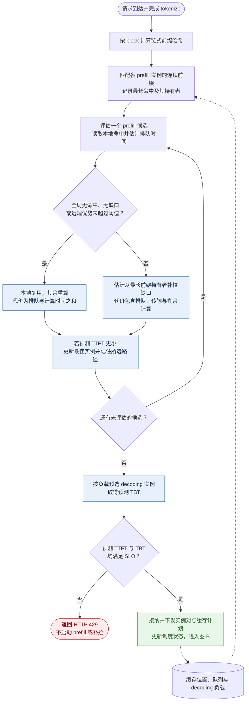
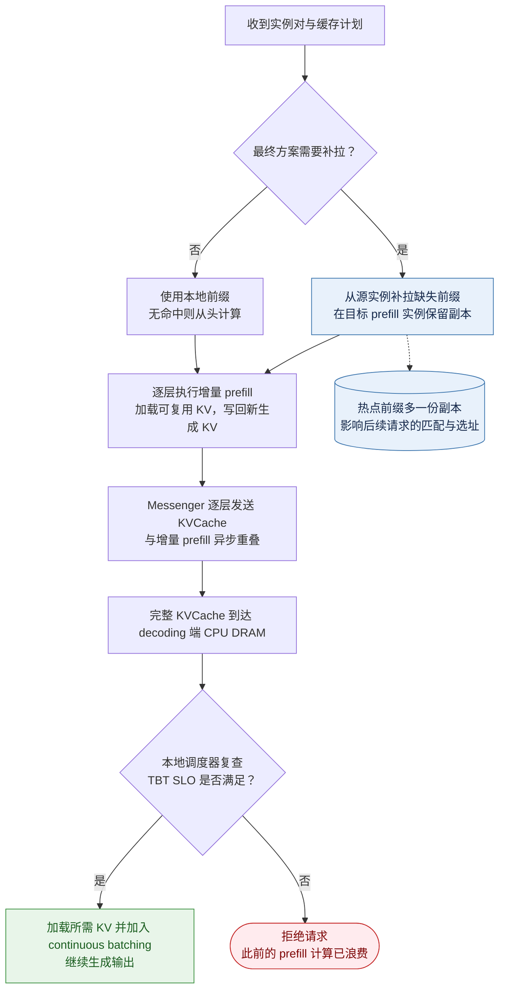
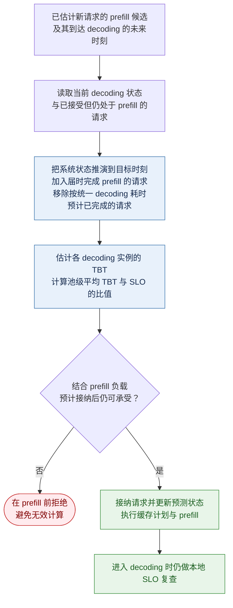

# Mooncake: A KVCache-centric Disaggregated Architecture for LLM Serving —— 论文解读（聚焦 Conductor 全局调度器）

> **论文信息**
> - arXiv:2407.00079v4（2025-09-03），FAST'25 **Best Paper**，另发表于 ACM TOS
> - Moonshot AI（月之暗面）+ 清华 MadSys
> - Ruoyu Qin, Zheming Li（共同一作）, Weiran He, Mingxing Zhang, Yongwei Wu, Weimin Zheng, Xinran Xu
> - 开源：https://github.com/kvcache-ai/Mooncake （含 **23,608 条真实请求 trace**）
> - 本仓库其他解读中被引用次数最多的一篇（244 citations）

> **本篇解读的取舍**：Mooncake 是一篇覆盖面很广的系统论文（PD 分离、CPP、layer-wise prefill、分布式 KVCache 池、Messenger、过载调度）。按用户要求，**本文重点解读 Conductor 全局调度器**（§6 KVCache-centric Scheduling 与 §7 Overload-oriented Scheduling），其余部分只交代到"足以理解 Conductor 为什么这么设计"的程度。

---

## 1. 一句话概括

**Mooncake 把"KVCache 的分布"提升为调度的一等公民**：全局调度器 Conductor 为每个请求选一对 (prefill 实例, decoding 实例)。Prefill 侧不只看负载，而是比较**预测的首 token 延迟** $\widehat{\mathrm{TTFT}} = T_{\text{queue}} + T_{\text{prefill}} + [T_{\text{transfer}}]$（排队时间、考虑前缀命中后的 prefill 时间，以及可选的远端前缀补拉时间）；decoding 侧按负载预选实例。若预测不能满足 TTFT/TBT SLO，则**在执行 prefill 前返回 HTTP 429 拒绝**。

真实负载下让 Kimi **多处理 75% 的请求**；长上下文模拟数据上相比 vLLM 吞吐提升 **50%–525%**。

**这篇论文在本仓库这条研究线里的特殊地位**：它是唯一一篇**由真实大规模商业服务（Kimi）驱动、并且把"过载"当作常态而非异常**的工作。其他所有论文（Preble / DualMap / SkyWalker / GORGO / CacheRoute）都隐含假设"所有请求都会被处理"，只优化怎么处理得更快。Mooncake 明确指出这个假设在商业 MaaS 里是错的：

> "existing research on LLM serving **assumes sufficient resources**... In contrast, the current GPU/accelerator supply is limited, and many MaaS providers face **severe overload problems**."

---

## 2. 问题定义：为什么调度必须以 KVCache 为中心

### 2.1 两条互斥的吞吐优化路径

论文在 §1.1 给了一个非常干净的问题陈述。提升吞吐有两条通路，**但两条都会撞上延迟 SLO**：

| 优化路径 | 手段 | 代价 |
|---|---|---|
| 1. **复用 KVCache** 以减少计算 | 从远端加载已有前缀 cache | 远端加载**拉长 TTFT** |
| 2. **增大 batch 内 token 数** 以提升 MFU | 更大的 decoding batch | 更大 batch **拉长 TBT** |

$$
\text{目标}: \max\ \text{effective throughput} \quad \text{s.t.}\quad \text{TTFT SLO},\ \text{TBT SLO}
$$

所以调度问题的本质是：**在"复用"和"延迟"之间，为每个请求单独做决策**。而"复用什么、从哪里复用、值不值得传"三个问题的答案，全都取决于 **KVCache 当前在集群里的物理分布**。这就是"KVCache-centric"的含义。

### 2.2 Goodput 的严格定义（这个定义比看上去重要）

Mooncake 的 goodput 定义比 DistServe 等工作**更严格**：

> "**only requests that fully complete their execution are counted**. Otherwise, all previously consumed/generated tokens are not counted, and the corresponding resources are wasted."

即：一个请求如果做完 prefill 却在 decoding 阶段被拒，**之前的 prefill 计算全部作废，不计入 goodput**。

这个定义直接推出了整篇论文后半部分的动机：

> "a request should be **rejected as early as possible** if it cannot finish its full execution under the SLO."

**这是 §7 Early Rejection 的全部理论基础。** 如果你用宽松的 goodput 定义（按已产出 token 计），Early Rejection 就没那么重要了。

### 2.3 SLO 如何设定：相对阈值与绝对阈值

**SLO 是预先设定的延迟约束，Conductor 负责预测能否满足，而不是决定阈值。** 它的目标是在满足 SLO 的前提下，尽可能提高有效吞吐量，而非无条件接收更多请求。

#### 相对阈值：公开数据集与模拟实验（论文 §2、§8.1）

论文 §2 以**同等条件下单请求无干扰时的延迟**解释基线；§8.1 的实验具体采用**最低请求速率（RPS）下测得的延迟**作为基线。两个指标分别设定如下：

| 指标 | 含义 | 实验要求 |
|---|---|---|
| TTFT | 从请求到达到生成首个 token 的时间 | P90 不超过基线的 $10$ 倍 |
| TBT | 同一请求相邻两个输出 token 的生成间隔 | P90 不超过基线的 $5$ 倍 |

**P90 是第 90 百分位**：分别要求至少 $90\%$ 的观测值不超过对应阈值，并不意味着每个请求都必须达标，也不能直接推导出 $90\%$ 的请求同时满足两个指标。论文 §2 中的 $4\times$ 只是解释相对 SLO 含义的例子，不是这里的实验设置。

实验图将延迟除以对应 SLO 上限进行归一化，因此 **$1.0$ 表示 SLO 边界，超过即不达标**。

相对阈值便于比较不同请求长度等条件下的延迟退化程度，但不能据此理解为生产系统会按每个请求的长度自动调整 SLO。

#### 绝对阈值：真实请求回放实验（论文 §8.1.3）

真实 trace 回放实验直接设定：

$$
\mathrm{TTFT} \le 30\,\mathrm{s}, \qquad
\mathrm{TBT} \le 0.1\,\mathrm{s/token} = 100\,\mathrm{ms/token}
$$

**论文没有推导为什么选择上述倍数和绝对数值，它们是实验设定，而非调度算法计算出来的最优阈值。** 论文 §2 还说明，实际生产部署采用固定的 TTFT/TBT SLO，由服务协议约定；但不能把这组回放实验数值直接当作 Kimi 所有线上业务的生产 SLO。

---

## 3. 架构速览（为理解 Conductor 所必需）

```
                          ┌──────────────────────────────┐
   请求 ──── tokenize ───▶│  Conductor (全局调度器)       │
                          │  · Cache-aware Prefill Sched │
                          │  · KVCache Balance Scheduler │
                          │  · Load-balance Decoding Sched│
                          └────────┬──────────┬──────────┘
                            选 p   │          │  选 d
                   ┌───────────────┘          └────────────────┐
                   ▼                                            ▼
        ┌────────────────────┐                       ┌────────────────────┐
        │   Prefill Pool     │                       │   Decoding Pool    │
        │  GPU/VRAM: Paged KV│  ── RDMA (Messenger) ─▶│  GPU/VRAM: Paged KV│
        │  Local Chunked     │   layer-wise streaming │  Local Scheduler   │
        │  Prefill Scheduler │                       │  (二次校验 TBT SLO) │
        │  CPP (X 节点流水)   │                       └────────────────────┘
        └────────────────────┘
                   ▲                                            ▲
                   └──────────── CPU/DRAM/SSD ──────────────────┘
                        Distributed KVCache Pool（复用 GPU 集群的闲置资源）

        优化目标（prefill）:               优化目标（decoding）:
          max Cache Reuse                    max Throughput
          s.t. TTFT SLO                      s.t. TBT SLO
               Minimum MFU                        KVCache < VRAM
               KVCache < DRAM
```

**两个池子的优化目标和约束完全不同**——这是 Conductor 必须分两段调度的根本原因，也是理解整个设计的钥匙。

### 3.1 请求的四步工作流

1. **KVCache Reuse**：选中的 prefill 节点收到 (原始输入, 可复用前缀 cache 的 block IDs, 该请求完整 cache 的 block IDs)，从远端 CPU memory 加载前缀 cache 到 GPU memory。
2. **Incremental Prefill**：用前缀 cache 完成 prefill，新产生的增量 KVCache 存回 CPU memory。未命中 token 数超过 `prefill_chunk`（通常 $> 1000$）时分 chunk 流水执行。
3. **KVCache Transfer**：**Messenger**（每实例一个独立进程，GPUDirect RDMA）**逐层流式**把 KVCache 传到 decoding 节点的 CPU memory。此步与第 2 步**异步重叠**。
4. **Decoding**：全部 KVCache 到达 decoding 节点 CPU DRAM 后，请求加入 continuous batching。

**第 4 步有一个关键设计（也是后面所有麻烦的来源）**：

> "Conductor **pre-selects** the decoding node based on its current load... However, this SLO is **double-checked by the local scheduler** because the anticipated load may have changed after the prefill stage. This double-checking **may lead to the rejection of the request, in which case the corresponding prefill costs are wasted**."

即 **decoding 节点是"预选 + 本地二次校验"的两阶段确认**，而两次确认之间隔着整个 prefill 阶段。**这个时间差就是 §7 全部问题的物理来源。**

### 3.2 KVCache 池的哈希设计

```
tokens:   a    b    c    d    e    f    g    h    i
hash:     A    B    C    D    E    F    G    H    I
          │    │    │    │    │    │
       A=Hash(a)
       B=Hash(A+b)      ← 每个 block 的 hash 包含"自身 + 全部前缀"
       C=Hash(B+c)
       ...
```

每个 block 的哈希按链式计算：

$$
h_i = \operatorname{Hash}(h_{i-1} \mathbin{\Vert} x_i)
$$

其中 $h_i$ 是第 $i$ 个 block 的 hash，$x_i$ 是该 block 的 token 序列，$\Vert$ 表示拼接。这保证了：

$$
\text{hash 相同} \iff \text{该 block 及其全部前置 token 都相同} \implies \text{KVCache 可复用}
$$

匹配时逐 block 比对，遇到第一个 mismatch 即停：

```
A ✅  B ✅  C ✅  D ✅  E ✅  F ❌  ← prefix_len = 5 blocks
```

这个链式哈希是本领域的标准做法（vLLM / SGLang RadixAttention 都是），但 Mooncake 的**开源 trace 直接把 remapped hash_ids 放出来了**，这是它对社区最实在的贡献之一。

淘汰算法支持 LRU / LFU / 基于请求特征的策略。

---

## 4. 开源 Trace 的统计特征（这是本文最有传播价值的部分）

23,608 条，采样自 **1 小时**的线上数据，**优先采集同 session 内的请求以保留 caching 关系**。

### 4.1 数据格式

```json
{
  "timestamp": 27482,
  "input_length": 6955,
  "output_length": 52,
  "hash_ids": [46,47,48,49,50,51,52,53,54,55,56,57, 2353, 2354]
}
{
  "timestamp": 30535,
  "input_length": 6472,
  "output_length": 26,
  "hash_ids": [46,47,48,49,50,51,52,53,54,55,56,57, 2366]
}
```

- `timestamp`：相对到达时间，0 – 3,600,000 ms
- `hash_ids`：**block size 为 $512\,\text{tokens}$** 的前缀哈希映射成的全局唯一 ID
- 上例中前 12 个 hash_id 相同，因此共享前 **$12 \times 512 = 6{,}144\,\text{tokens}$** 的前缀 cache

**这是（作者宣称）第一个可用于真实复用分析的开源数据集**。GORGO 论文用的就是这个 trace 格式（含 `time_scale` 缩放）。

#### 4.1.1 什么是 "remapped" hash_ids

论文 §1.2 特别声明 trace 里放的是 **"the remapped block hash"**，`remapped`（重映射）这个词不是装饰，而是一个**隐私保护步骤**，值得单独说清楚。

**原始链式哈希为什么不能直接放出来**：前缀哈希是 token 内容的确定性函数（$h_i = \operatorname{Hash}(h_{i-1} \Vert x_i)$）。如果直接把原始哈希值开源，攻击者就可以：

- 拿已知文本（系统提示、常见文档、公开语料）逐 block 计算哈希，**反查/匹配**出对应的是哪段内容；
- 通过字典式爆破逐个还原 **前缀**（block 哈希包含全部前置 token，命中一个就等于确认一长段前缀）。

也就是说，**哈希本身在"内容空间相对可枚举"的前提下是可逆的**，直接发布等于泄露用户输入。

**重映射做了什么**：把所有出现过的不同前缀哈希值，**一对一地**替换成一组全新的、全局唯一但**与原值无关**的 ID：

$$
\text{原始前缀哈希 } h \;\longmapsto\; \text{新的整数 ID } \mathrm{id}(h)
$$

例如示例里的 `46, 47, …, 2354` 只是重映射后分配的编号，**与真实哈希值无关**，编号相邻也不代表内容相似。

**保留了什么**（这正是能让复用分析成立的关键）：

$$
\mathrm{id}(h_a) = \mathrm{id}(h_b) \iff h_a = h_b \iff \text{同一 block 及其全部前置 token 都相同}
$$

即**相等关系与"前缀包含"结构被完整保留**——所以仍然可以统计命中率、复用长度、block 热度等一切与复用相关的量。

**隐藏了什么**：由于映射关系（等价于一个置换/加盐）不公开，攻击者拿到 ID 后**无法反推原始哈希，也就无法再反查内容**。

| | 原始 block hash | remapped hash_ids（开源 trace） |
|---|---|---|
| 相等关系 / 前缀结构 | ✅ 保留 | ✅ 保留 |
| 复用分析（命中率、复用长度、热度） | ✅ 可做 | ✅ 可做 |
| 能否反查 token 内容 | ⚠️ 可（字典/爆破） | ❌ 不可 |

**一句话**：remapped hash_ids = **把"哪些请求共享哪些前缀"这一结构原样开源，但把"这些前缀具体是什么内容"彻底切断**。这也解释了为什么示例里两条请求的前 12 个 ID 完全相同——说明它们前缀真正相同，而不是编号碰巧一样。

### 4.2 关键统计量

| 指标 | 值 |
|---|---|
| 平均输入长度 | **7,590 tokens** |
| 平均输出长度 | **182 tokens** |
| 输入/输出比 | **$\approx 720$**（论文原文如此） |
| 输入长度分布 | 长尾至 **128k** |
| 输出长度分布 | 集中在 2000 以内 |

> ⚠️ **注意 "$\text{input-output ratio} \approx 720$" 这个数字有问题**：$\frac{7{,}590}{182} \approx 41.7$，不是 720。论文原文写的是 720，但与它自己给出的两个均值不一致。可能是笔误，也可能指的是某种别的比值（如 prefill FLOPs / decoding FLOPs 之比）。**引用时建议直接用 7,590 和 182，不要用 720。**

**"输入是输出的 40 倍"这个特征极其重要**，它解释了为什么 Mooncake 全篇都在优化 prefill 而不是 decoding——这是 Kimi「长文档理解」这个产品定位决定的。**对于输入/输出比接近 1 的对话型服务，Mooncake 的很多设计权重会完全不同。**

### 4.3 缓存策略分析（Table 1）

假设单一全局缓存池：

| Block 容量 | $\infty$ | 100000 | 50000 | 30000 | 10000 | 1000 |
|---|---|---|---|---|---|---|
| **LRUCache** | 0.51 | 0.51 | **0.50** | 0.48 | 0.40 | 0.30 |
| LFUCache | 0.51 | 0.51 | 0.49 | 0.43 | 0.35 | 0.30 |
| LengthAwareCache | 0.51 | 0.50 | 0.48 | 0.42 | 0.35 | 0.30 |

三条结论：

1. **容量从 $1{,}000 \to 50{,}000$ block，命中率 $30\% \to 50\%$；再往上几乎不涨**。存在明显的边际收益拐点。
2. **LRU 最优**，作者归因于"请求利用的时间邻近性"（temporal proximity）。这与直觉一致：多轮会话的复用发生在很短的时间窗内。
3. **理论上限只有 51%**。论文在 §9 特别强调了这一点：

> "the real reusability in our online traces is **much smaller than the results reproduced by open-source benchmarks**. Theoretically, **up to only 50% of the KVCache can be reused** in our current workloads, **even if we assume both the capacity of storage and the TTFT SLO are infinite**. However, this reusability highly depends on the application scenario and **can be as large as 90%** for certain scenarios, such as our chat-to-paper service."

**这段话是整篇论文里对读者最有用的一句话之一。** 它明确说了：
- 学术 benchmark 上复现的复用率**系统性高于真实线上负载**
- Kimi 主线负载的复用率天花板为 **$51\%$**
- 但特定场景（论文问答 papers.cool）可达 **90%**

对照本仓库其他论文：GORGO 的 ART-Chat-2.5M 是 89.4% intra-user 复用，正好落在这个"特定场景 90%"的区间；而 LMSYS-Chat-1M 只有 3.4% 全局复用。**同一个调度算法在 3.4% / 51% / 90% 三种复用率下的收益差异是数量级的**——这是读所有这类论文时必须先问的第一个问题。

### 4.4 Block 热度的极端不均衡（Figure 6）

> "over **50% of cache blocks remain unused** while certain blocks are accessed **tens of thousands of times**."

一半的 block 从未被复用，少数 block 被访问上万次。**这直接推出了 §6.2 的热点复制机制**：不复制热点 block，持有它的那台机器会成为传输瓶颈。

---

## 5. ⭐ Conductor 核心：KVCache-centric 调度算法（Algorithm 1）

Conductor 对每个新请求依次回答三个问题：**在哪个 prefill 实例上执行、是否先把远端前缀搬过去、后续 decoding 是否还能承接**。它不是先选“命中最长”的机器再做补救，而是先把候选方案换算成时间，再选择预计 TTFT 最短的方案。

> **阅读依据**：以下对应本地论文 arXiv:2407.00079v4 的 Algorithm 1、§6.1–§6.2（PDF 第 10–11 页）；执行流程补充自 §3、§5.2，预测式准入来自 §7.4。公式中的简写、数值示例和流程图是本文的解释性整理，不是论文额外给出的算法或实测结果。

#### 调度前需要哪些状态

| 记号 | 含义 | 在决策中的作用 |
|---|---|---|
| $R,\ N$ | 当前请求及其输入 token 数 | 计算前缀哈希、预测 prefill 时间 |
| $P,\ D$ | Prefill、decoding 实例池 | 分别进行 prefill 选址和 decoding 预选；prefill 实例也可代表 CPP 节点组 |
| $B,\ \mathrm{block\_keys}$ | Block 大小及请求的链式前缀哈希序列 | 逐 block 查询缓存，确定可连续复用的前缀 |
| $h_i$ | 请求在 prefill 实例 $i$ 上的本地前缀命中长度 | 决定本地还有多少 prefill 工作；**不是实例上缓存的总 token 数** |
| $H=\max_{i\in P}h_i,\ s$ | 最长命中长度及其持有实例 | 对应 `best_prefix_len` 与 `best_matched_instance`；$s$ 是补拉源，不一定是最终执行实例 |
| $Q_i$ | 实例 $i$ 的预测排队时间 | 将已有请求负载换算成时间，而非只比较队列中的请求数 |
| $F(N,h)$ | 总输入长度为 $N$、命中前缀为 $h$ 时的预测 prefill 时间 | 由离线测量拟合；对应 `EstimatePrefillExecutionTime` |
| $X_{s\to i}(H-h_i)$ | 从源实例 $s$ 向 $i$ 补拉缺失前缀的预测耗时 | 对应 `EstimateKVCacheTransferTime` |
| $\tau$ | `kvcache_balancing_threshold` | 控制远端命中优势多大时才考虑补拉，论文采用人工调节 |
| $l_{\mathrm{ttft}},\ l_{\mathrm{tbt}}$ | 两个预设 SLO 上限 | 决定是否准入，不参与生成“最优阈值” |

这里的 $h_i$ 表示**命中长度**，与 §3.2 表示哈希值的 $h_i$ 不同；本节所有长度统一按 token 计，block 数需先按 $B$ 换算。缓存匹配只接受连续前缀，不能把散落在不同位置的命中 token 相加。Algorithm 1 选取一个最长前缀持有者作为补拉源，**没有展开多源拼接或多副本源节点择优算法**。

缓存位置、队列和 decoding 负载是不同的状态：缓存多不代表机器忙，机器空闲也不代表网络发送端不拥塞。论文没有给出这些元数据的完整同步协议，不应把某种具体索引或心跳实现当成既定设计。

#### Algorithm 1：保留论文的行号与分支

```text
输入: prefill 实例池 P, decoding 实例池 D, 请求 R, block 大小 B
输出: 处理 R 的实例对 (p, d)

 1: block_keys ← PrefixHash(R.prompt_tokens, B)
 2: TTFT ← inf
 3: p ← ∅
 4: best_prefix_len, best_matched_instance ← FindBestPrefixMatch(P, block_keys)
 5: for instance ∈ P do
 6:     prefix_len ← instance.prefix_len
 7:     T_queue ← EstimatePrefillQueueTime(instance)
 8:     if best_prefix_len / prefix_len < kvcache_balancing_threshold then
                                                    ▷ 分支 A: 本地 cache 够好，就地算
 9:         T_prefill ← EstimatePrefillExecutionTime(len(R.prompt_tokens), prefix_len)
10:         if TTFT > T_queue + T_prefill then
11:             TTFT ← T_queue + T_prefill
12:             p ← instance
13:         end if
14:     else                                        ▷ 分支 B: 本地 cache 太差，考虑拉取
15:         transfer_len ← best_prefix_len − prefix_len
16:         T_transfer ← EstimateKVCacheTransferTime(instance, best_matched_instance, transfer_len)
17:         T_prefill ← EstimatePrefillExecutionTime(len(R.prompt_tokens), best_prefix_len)
18:         if TTFT > T_transfer + T_queue + T_prefill then
19:             TTFT ← T_transfer + T_queue + T_prefill
20:             p ← instance
21:         end if
22:     end if
23: end for
24: d, TBT ← SelectDecodingInstance(D)               ▷ decoding 侧仅做负载均衡
25: if TTFT > TTFT_SLO or TBT > TBT_SLO then
26:     reject R; return                             ▷ HTTP 429
27: end if
28: if best_prefix_len / p.prefix_len > kvcache_balancing_threshold then
29:     TransferKVCache(best_matched_instance, p)    ▷ KVCache 热点迁移
30: end if
31: return (p, d)
```

### 5.1 第 8 行的分支条件是整个算法的灵魂

$$
\frac{\text{best\_prefix\_len}}{\text{prefix\_len}} < \text{kvcache\_balancing\_threshold}
$$

这个比值衡量的是：**「全集群最好的前缀匹配」相对于「这台机器上已有的前缀匹配」好多少倍**。

- **比值小（分支 A）**：本机 cache 已经接近最好了，**直接就地算，不传输**。代价为 $T_{\text{queue}} + T_{\text{prefill}}$。
- **比值大（分支 B）**：本机 cache 差得多，**考虑从 best_matched_instance 拉取**。代价为 $T_{\text{transfer}} + T_{\text{queue}} + T_{\text{prefill}}(\text{best\_prefix\_len})$。

论文 §6.2 的表述更直白：

> "we prefer to **compute the input tokens** if the best remote prefix match length is **no larger than the current local reusable prefix multiplied by a threshold**."

**即：宁可多算一点，也不轻易走网络。** 这是一个非常务实的偏好设定——RDMA 再快，也要和 KVCache 的主干传输争带宽。

用上面的简写，当 $h_i>0$ 时，Algorithm 1 为实例 $i$ 生成的候选代价是：

$$
C_i =
\begin{cases}
Q_i + F(N,h_i), & H/h_i < \tau \quad \text{（本地复用，其余重算）},\\
Q_i + X_{s\to i}(H-h_i) + F(N,H), & H/h_i \ge \tau \quad \text{（补拉后复用）}.
\end{cases}
$$

然后选择：

$$
p = \operatorname*{arg\,min}_{i\in P} C_i,
\qquad \widehat{\mathrm{TTFT}}=C_p.
$$

**两个不同层次的判断不要混在一起**：

1. **阈值选路径**：对每个实例，只按前缀长度比值决定采用“本地重算”还是“远端补拉”的估价路径。
2. **TTFT 选实例**：比较所有实例按所选路径算出的 $C_i$，取最小者。即使命中最长，队列太长也可能落选；即使命中较短，补拉太慢也可能落选。

因此，原伪代码**没有对每台实例都计算两条路径再取最小值**，也没有用“传输时间小于省下的计算时间”直接替代第 8 行。它是一种阈值约束下的贪心调度，不是对所有执行方式求全局最优。

> **估价与执行分开**：第 5–23 行只评估候选，不会为了试算就把 KVCache 复制到每台机器；第 28–30 行才针对最终实例触发传输。但原文有一个边界不一致：第 8 行的 `else` 包含 $H/h_i=\tau$，第 28 行却只在严格大于阈值时执行传输。不能把它们称为完全等价；零命中和等号边界见 §5.7。

### 5.2 三个估计函数怎么实现的

| 函数 | 实现方式 | 论文对精度的说明 |
|---|---|---|
| `EstimatePrefillExecutionTime` | **离线测试数据拟合的预测模型**，输入为 $(\text{请求长度},\,\text{prefix 命中长度})$ | "Thanks to the **regular computation pattern of Transformers**, the error bound of this prediction is **small** as long as enough offline data is available." |
| `EstimatePrefillQueueTime` | **累加队列中所有请求的 prefill 时间** | 直接聚合，无额外模型 |
| `EstimateKVCacheTransferTime` | 根据传输数据量和网络状态估计；论文未给具体公式或预测器实现 | "**More difficulty lies in predicting the transfer time** because it is determined not only by the size of the transferred data but also by the **current network status, especially whether the sending node is under congestion**." |

**Prefill 为什么要同时输入 $N$ 和 $h$？** 命中 $h$ 个 token 后，新计算的 query 仍要关注已有前缀。即使未命中长度 $N-h$ 相同，总上下文不同也可能带来不同的 attention 代价。因此不能直接假设 $F(N,h)=F(N-h,0)$，更不能只把未命中 token 数乘一个固定常数当作论文模型。

**排队时间为什么不直接用请求数？** 按论文的聚合描述，可写成：

$$
Q_i \approx \sum_{r\in\mathcal{Q}_i} \widehat{T}_{\mathrm{prefill}}(r,i),
$$

其中 $\mathcal{Q}_i$ 是实例 $i$ 的等待队列。一个低命中的长请求与一个高命中的短请求可能相差很大，单纯比较队列长度会丢失这种区别。正在执行的请求还剩多少时间、CPP 流水如何折算，属于实际估计器需要处理的细节；论文未给完整计算规则。

**传输项为什么只算差额？** 本地已有连续前缀 $h_i$，最长前缀是 $H$，所以只需补齐区间 $[h_i,H)$ 对应的 KVCache；之后仅对 $[H,N)$ 做增量 prefill。下面只是理解传输代价的量纲近似，**不是论文公布的实现公式**：

$$
X_{s\to i}(\Delta h)
\approx \frac{S_{\mathrm{KV}}(\Delta h)}{\mathrm{BW}^{\mathrm{eff}}_{s\to i}}
+ T_{\mathrm{setup/queue}},
\qquad \Delta h=H-h_i.
$$

$S_{\mathrm{KV}}$ 是缺失前缀的 KV 字节数，有效带宽取决于路径和并发传输，不能直接用网卡标称带宽替代。**源实例 GPU 忙导致 $Q_s$ 大，与源实例网络拥塞导致 $X_{s\to i}$ 大，是两类不同瓶颈**。

这三个估计器中，论文认为 prefill 时间相对易预测，传输时间更难预测，**但没有声称网络状态完全不可观测**。传输估计影响候选 TTFT 和最终落点；分支 A/B 本身仍由长度阈值决定。热点复制通过增加可用副本缓解源端集中取数压力，而不是保证消除所有拥塞。

### 5.3 与本仓库其他论文的 TTFT 模型对照

| | TTFT 分解 |
|---|---|
| **Mooncake** | $T_{\text{queue}} + T_{\text{prefill}}(N,h) + [T_{\text{transfer}}]$ |
| **CacheRoute(K8s)** | $a\cdot\lvert p_r\rvert(1-S) + b\cdot Q + c$ |
| **GORGO** | $T_{\text{network}} + T_{\text{queue}} + T_{\text{prefill}}(x_r \setminus c_i)$ |
| **DualMap** | $T_q(r,i) + T_c(r,i)$ |

**四篇独立工作收敛到了同一个分解形式**：$\text{排队} + \text{未命中 prefill} + [\text{数据移动}]$。差别只在"数据移动"那一项指的是什么：

- Mooncake：**KVCache 跨机传输**（集群内 RDMA）
- GORGO：**请求跨区域网络 RTT**（跨大洲）
- CacheRoute(K8s) / DualMap：**没有这一项**（单区域，且不传 cache）

**Mooncake 是唯一一个把"把 cache 搬过去"当作可选动作纳入代价计算的**。其他几篇都只做"把请求路由过去"。这是一个本质区别：**Mooncake 的调度空间里，cache 的位置是可以被主动改变的决策变量，而不是只能被动适应的环境状态。**

### 5.4 Decoding 侧调度为什么这么简单

第 24 行 `SelectDecodingInstance(D)` 是**负载均衡式预选**，不再按跨请求的前缀命中长度给 decoding 实例排序。论文把它作为抽象函数，没有公开其精确评分公式、平局规则或完整显存准入实现。

这并不意味着“decoding 不使用 KVCache”：**decoding 始终读取并追加当前请求的 KVCache**。区别是，前缀复用已由 prefill 侧处理，目标 decoding 实例需要接收本请求的完整上下文状态，不必为了跨请求前缀命中而跟随原缓存持有者。

在 Algorithm 1 层面，准入条件为：

$$
\mathrm{accept}(R)
\iff \widehat{\mathrm{TTFT}}\le l_{\mathrm{ttft}}
\;\land\;\widehat{\mathrm{TBT}}_d\le l_{\mathrm{tbt}}.
$$

图 1 还明确列出 decoding 的 KVCache 显存容量约束。**不能把上面的两项 SLO 判断当成完整的资源可行性检查**；大 batch 除了可能拉长 TBT，还可能放不下 KVCache。

**选出实例对不等于已经保留未来 decoding 槽位**。执行时先复用前缀并做增量 prefill，再由 Messenger 逐层流式发送 KVCache；目标 decoding 节点收到完整状态后，本地调度器仍要重新检查 TBT SLO。若此时过载，仍可能拒绝，已做的 prefill 就被浪费了。§7 的预测式 Early Rejection 是为减少这种浪费而加的准入机制，不是取消二次校验。

因此，Algorithm 1 虽然输出 $(p,d)$，但采用的是**先按 TTFT 选 $p$、再按负载选 $d$ 的分解式决策**，没有枚举 $P\times D$ 并联合优化所有网络路径。PD 分离减少了两个阶段的相互干扰，但没有让它们的容量与准入决策完全独立。

### 5.5 完整流程：先评估方案，再执行数据移动

#### 图 A：Conductor 的候选评估与准入

图中实线表示决策顺序，虚线表示状态输入；蓝色是估价，绿色是接纳，红色是拒绝。为消除原伪代码的零命中和等号歧义，**图中采用“远端优势严格超过阈值且确有缺口才补拉”的统一约定**，详见 §5.7；这不是对论文第 8 行等号行为的逐字复刻。



按图走一遍，对应原算法的六步：

| 步骤 | 原算法位置 | 决策结果 |
|---|---|---|
| 1. 匹配 | 第 1–4 行 | 得到各实例的命中长度、最长命中及源实例；此时**不搬 cache** |
| 2. 生成候选 | 第 5–9、14–17 行 | 按阈值为当前实例选估价路径，计入排队、计算和必要的传输 |
| 3. 选 prefill | 第 10–23 行 | 持续保留最小 TTFT 的候选，而非遇到第一个可用实例就返回 |
| 4. 预选 decoding | 第 24 行 | 得到 decoding 落点与预测 TBT |
| 5. 准入 | 第 25–27 行 | 任一 SLO 不满足即拒绝，避免先做 prefill 再发现下游承接不了 |
| 6. 提交与执行 | 第 28–31 行及 §6.1 正文 | 只为最终方案触发必要的补拉，更新相应缓存与队列状态 |

论文说明，实践中各实例的 TTFT 估计可并行计算；图中的循环是逻辑表达，**不意味着逐台发同步 RPC**。接受后的队列更新使后续请求能看到新增工作；缓存何时被视为“可复用”、在途传输如何记账，论文没有详细定义，不能把预计生成的缓存直接等同于已就绪缓存。

#### 图 B：执行、自动复制与本地二次校验



图 B 的箭头表示依赖关系，**不是所有步骤严格串行**：逐层加载、计算、存储和发送可以重叠。蓝色节点突出缓存复制，绿色/红色分别表示继续执行/拒绝。具体加载流水见论文 §5.2。

**两种跨机传输必须分开理解**：

| 数据移动 | 起点与终点 | 数据范围 | 与 Algorithm 1 的关系 |
|---|---|---|---|
| **远端前缀补拉** | 最长前缀持有者 $s\to p$ | 目标缺失的前缀区间 $[h_p,H)$ | 可选动作，是候选代价中显式的 $T_{\mathrm{transfer}}$；会产生额外副本 |
| **PD 状态交接** | Prefill 实例 $p\to d$ | Decoding 执行所需的完整上下文 KVCache | 常规 PD 流程的一部分，按层流式发送并与 prefill 重叠；不是第 15 行的缺口长度 |

所以不能把 Algorithm 1 的加法估价理解成“完整端到端链路的每段传输都串行相加”，也不能据此认为 PD 传输没有成本。它没有单列所有网络、CPU/GPU 拷贝和首 token 返回开销；实际 TTFT 还取决于重叠程度及未被隐藏的尾部延迟。

### 5.6 数值例子：为什么最终既不选最长命中，也不只看空闲程度

以下数值**仅用于演示算法，不是论文实测值或默认参数**。设输入长度 $N=8192$、block 大小 $B=512$、最长命中 $H=6144$，阈值 $\tau=1.5$。最长前缀在实例 A 上，离线模型对两个命中长度的估计为：

$$
F(8192,6144)=2.0\,\mathrm{s},
\qquad F(8192,5120)=2.4\,\mathrm{s}.
$$

| 候选实例 | 本地命中 $h_i$ | 排队 $Q_i$ | $H/h_i$ | 阈值选出的路径 | 预测 TTFT |
|---|---|---|---|---|---|
| A：最长命中持有者 | $6144$ | $4.0\,\mathrm{s}$ | $1$ | 本地复用，计算剩余 $2048$ tokens | $4.0+2.0=6.0\,\mathrm{s}$ |
| B：接近最长命中 | $5120$ | $0.6\,\mathrm{s}$ | $1.2$ | 不补拉，计算剩余 $3072$ tokens | $0.6+2.4=3.0\,\mathrm{s}$ |
| C：命中短但空闲 | $1024$ | $0.2\,\mathrm{s}$ | $6$ | 从 A 补拉 $5120$ tokens 的 KV，假设耗时 $0.4\,\mathrm{s}$ | $0.2+0.4+2.0=2.6\,\mathrm{s}$ |

**决策过程**：

1. A 命中最长，但排队抵消了复用收益；它作为计算落点落选，仍可作为缓存补拉源。
2. B 的命中已接近最好，阈值让它直接多算一部分，不为补齐最后的前缀差额使用网络。
3. C 的补拉收益足以使候选 TTFT 最短，因此选择 $p=\mathrm{C}$。只有它真正接纳后，才执行 A 到 C 的前缀补拉。
4. 若 decoding 预选结果为 $80\,\mathrm{ms/token}$，而 SLO 为 TTFT 不超过 $5\,\mathrm{s}$、TBT 不超过 $100\,\mathrm{ms/token}$，则通过 Algorithm 1 的两项 SLO 检查。

**网络一拥塞，选择就可能改变**：若 A 到 C 的补拉估计涨到 $1.5\,\mathrm{s}$，其他条件不变，则 C 的候选 TTFT 变成 $3.7\,\mathrm{s}$，转而选择 B 的 $3.0\,\mathrm{s}$。这说明“最空闲”也不是无条件最优。

**Prefill 最优也不等于能够接纳**：在原始数值下，若 TTFT SLO 收紧为 $2.5\,\mathrm{s}$，所有 prefill 候选都不可行；或者 decoding 池已找不到满足 TBT SLO 的实例，也必须拒绝。

**一次请求还会改变后续调度状态**：C 补拉并保留前缀后，在缓存尚未被淘汰时，后续相同前缀的请求可在 C 本地命中至少 $6144$ tokens。热点流量不再只有 A 一个高命中落点，这就是 §6 的自动复制反馈。

#### “搬过去”到底省的是什么

对于相同的 prefill 预测模型，若比较“在源实例 $s$ 排队”与“补拉到目标 $i$ 执行”，两者都可复用到 $H$，剩余计算相同，因此：

$$
C_s=Q_s+F(N,H),\qquad
C_i^{\mathrm{fetch}}=Q_i+X_{s\to i}(H-h_i)+F(N,H),
$$

$$
C_i^{\mathrm{fetch}}<C_s
\iff Q_s-Q_i>X_{s\to i}(H-h_i).
$$

即：**目标少排的队能覆盖搬运开销，就可能值得把 cache 搬过去**。

如果比较的是“同一目标实例上多算一些”与“补拉后少算一些”，则另一条盈亏条件为：

$$
C_i^{\mathrm{fetch}}<C_i^{\mathrm{local}}
\iff X_{s\to i}(H-h_i)<F(N,h_i)-F(N,H).
$$

右侧是补拉省下的 prefill 时间。**这两条是从代价模型推导出的解释式，不是 Algorithm 1 额外执行的两项分支检查**；原算法仍然按阈值为每台实例选择一条路径，再跨实例比较。

### 5.7 边界与原文歧义：不能直接照抄成生产代码

| 情况 | 应如何理解 | 论文覆盖程度 |
|---|---|---|
| $H=0$，全局都没命中 | 没有可补拉的前缀，应走无缓存 prefill，不能计算 $0/0$ | 原伪代码未显式处理 |
| $h_i=0<H$，本地没命中但远端有 | 可以评估补拉整个长度为 $H$ 的前缀；不能直接做除零运算 | 原伪代码未显式处理 |
| $h_i=H$，本地已是最长命中 | 没有缺口，无需额外补拉；本地 CPU/GPU 加载成本并不因此消失 | 原伪代码未单列此情况 |
| $H/h_i=\tau$ | 原文第 8 行按补拉估价，第 28 行却不触发传输 | **估价与执行的等号边界不一致** |
| 多个源命中同样长 | 不能默认论文会选择网络最空闲的源，或从多个源并行取块 | 只抽象返回 `best_matched_instance` |
| 估价后源缓存被淘汰、传输失败 | 需要重新验证、重算或重调度等处理，不能把一次命中查询当成永久保证 | 论文没有给完整一致性与失败恢复协议 |
| 内存不足或实例不可用 | SLO 合格不代表资源一定可用；prefill DRAM 与 decoding VRAM 仍是约束 | 图 1 给出容量约束，Algorithm 1 未展开全部检查 |

**图 A 使用的统一解释约定**是：

$$
\mathrm{fetch}_i
\iff (H>h_i)\;\land\;(H>\tau h_i).
$$

这个乘法形式避免除零，零命中和无缺口也有明确结果；等号时选择本地计算。估价时记住所选路径，执行时使用同一个决策，而不是再用另一套边界条件判断。**这是本文为了让流程自洽而做的整理，不能宣称是论文或开源代码已采用的修复**。论文也没有给出可直接照用的阈值默认值。

另一个歧义来自 §6.2：原文写的是在 “estimated additional prefill time is **shorter than** the transfer time” 时转发缓存位置并拉取 KV。这与上述“传输耗时小于节省的计算耗时”的盈亏推导方向相反，疑似文字问题。应同时保留这个原文事实与 Algorithm 1 的真实判断，**不要把更合理的推导悄悄改写成论文原有条件**。

最后，论文所谓 **hot-spot migration 在这里体现为目标节点拉取并本地保留，即增加副本**，没有说明传完就删除源副本。调度同时改变请求位置与缓存分布，但不应把“迁移”理解成搬空源节点。

---

## 6. ⭐ Cache Load Balancing：启发式热点迁移（§6.2）

### 6.1 为什么放弃"预测未来使用"

论文先给了一个 straw-man 方案并否定了它：

> "A **straw-man** solution could be collecting the global usages of each block, using a **prediction model to forecast their future usages**, and making scheduling decisions accordingly. However, unlike the estimation of prefill time, **workloads are highly dynamic and change significantly over time**. Especially for a MaaS provider experiencing **rapid growth in its user base, it is impossible to accurately predict future usage**."

**"用户量在快速增长，所以历史分布无法外推"**——这是只有真实商业服务才会遇到、也才会承认的约束。学术系统默认负载是平稳的（stationary），Kimi 的负载是非平稳且趋势性增长的。

### 6.2 启发式方案：让复制"自动发生"

Mooncake 的做法是**不预测，让复制成为调度的副产品**：

1. 请求因为负载高而没被路由到"前缀匹配最长"的那台机器；
2. Conductor 把 **cache 的位置** 和请求一起转发给替代实例；
3. **按 Algorithm 1**，只有远端命中优势达到阈值分支时才按补拉路径估价，且该替代实例的候选 TTFT 要在比较中胜出；这不等价于直接检查“省下的计算时间大于传输时间”（见 §5.6–§5.7）；
4. 该实例**主动从持有者拉取 KVCache 并存到本地**；
5. **副作用**：这个热点 block 现在多了一份副本。

> "Both strategies not only reduce the prefill time for requests but also **facilitate the automatic replication of hot-spot caches**, allowing for their broader distribution across multiple machines."

**这个设计的优雅之处在于反馈的自然性**：

```
某 block 越热
  → 持有它的机器越忙
    → 越多请求被路由到别处
      → 越多次触发"拉取 + 本地存储"
        → 该 block 副本越多
          → 该 block 的可用性越高、单机压力越小
```

**热度直接驱动复制度，无需任何显式的热度统计或预测模型。** 冷 block 因为很少造成负载冲突，自然不会被复制。

这是我在本仓库这几篇论文里见到的最漂亮的机制设计。对比：
- **DualMap** 用双哈希在结构上限制亲和自由度 —— 静态、无状态
- **Meta CacheRoute** 用全局重规划 —— 集中式、代价高（94.5% churn）
- **Mooncake** 让复制成为调度冲突的自然产物 —— **无需额外机制，自适应**

### 6.3 阈值仍是手调的

论文有一个诚实的脚注：

> "This threshold is currently **adjusted manually**, but can be adaptively adjusted by an algorithm in the future."

`kvcache_balancing_threshold` 是**人工调的**。结合 GORGO 的 reward hacking 教训（§7.1 of CacheRoute-K8s 解读），这未必是坏事——但它确实意味着 Mooncake 的性能对这个手调参数敏感，而论文没有给灵敏度分析。

### 6.4 调度策略对比实验（Figure 8）

集群：**$8\,\text{prefill} + 8\,\text{decoding}$**（用夜间闲置机器搭的），回放 **23,000 条真实请求**。

| 策略 | 平均 TTFT (s) |
|---|---|
| **KVCache-centric**（完整方案，§6.1 + §6.2） | **6.26** |
| **cache-aware**（仅 §6.1，无热点迁移） | 14.36 |
| **load-balancing**（选负载最轻） | 60.41 |
| **random** | 92.07 |

**这张图的数字对比非常剧烈**：

- random → load-balancing：$92.07 \to 60.41$（**$-34\%$**）
- load-balancing → cache-aware：$60.41 \to 14.36$（**$-76\%$**，$4.2\times$）
- cache-aware → KVCache-centric：$14.36 \to 6.26$（**$-56\%$**，$2.3\times$）

**两个结论**：

1. **加入 cache 感知的收益（$4.2\times$）远大于加入负载均衡的收益（$1.5\times$）**。在长上下文负载下（平均输入 7,590 tokens），prefill 计算成本是绝对主导项，省下 prefill 比均衡负载重要得多。
2. **热点迁移单独贡献了 $2.3\times$**。这说明「知道 cache 在哪」和「能把 cache 搬到该去的地方」是两件事，后者的价值和前者同量级。

> ⚠️ **需要注意的实验局限**：这个实验只报告了**平均 TTFT**（图中还有 SLO 达标率但论文正文未给数字），没有 P90/P99，没有吞吐，没有方差，也没有多次重复。而 60.41s / 92.07s 这样的绝对值意味着 baseline 已经严重超载（SLO 线在图中远低于这两个值）。**在一个 baseline 已经崩溃的工作点上比较，容易放大差距。** 对照 Preble / DualMap 的实验规范性，这一组实验是偏弱的。

---

## 7. ⭐ 过载调度：Early Rejection 与它引发的振荡（§7）

**这一节是整篇论文最独特、也是最少被其他工作复现的部分。**

### 7.1 什么是"系统负载"

在耦合系统里，prefill 和 decoding 互相干扰，TTFT/TBT 难以预测，所以负载通常用 $\frac{\text{处理中请求数}}{\text{最大容量}}$ 这个粗糙代理。

Mooncake 因为做了 PD 分离，可以**直接用 SLO 满足度作为负载度量**：

- 定义 $l_{\text{ttft}}$、$l_{\text{tbt}}$ 为 TTFT/TBT 的 SLO 约束
- prefill 实例的负载：$L_{\text{prefill}} = \frac{\widehat{\mathrm{TTFT}}_{\max}}{l_{\text{ttft}}}$
- decoding 实例的负载：$L_{\text{decoding}} = \frac{\widehat{\mathrm{TBT}}_{\max}}{l_{\text{tbt}}}$

其中 $\widehat{\mathrm{TTFT}}_{\max}$、$\widehat{\mathrm{TBT}}_{\max}$ 分别表示实例上预测的最大 TTFT、TBT。

**用 SLO 达成度而非资源占用率来定义负载，是 PD 分离带来的一个不太被强调但很实在的好处。** 因为"负载"这个概念最终要服务于"是否还能满足 SLO"这个决策，直接测量后者显然更准。

### 7.2 Early Rejection：把 decoding 的负载判断提前

**问题**：请求在 prefill 完成后才被 decoding 实例拒绝，**prefill 的算力全部浪费**（回顾 §2.2 的严格 goodput 定义）。

**方案**：请求到达时，Conductor 就同时评估 **prefill 池和 decoding 池中负载较大者**，据此决定是否接受。

> "Upon the arrival of a request, Conductor evaluates whether to accept the request based on the **greater load between the prefill and decoding pools**."

### 7.3 Early Rejection 引发的反相振荡（Figure 9）

**这是本文最有价值的负面发现。**

在 20 台机器的真实集群上观测 20 分钟，出现了 **prefill 与 decoding 负载的显著反相振荡（anti-phase fluctuations）**：

```
Prefill  ──▁▁▁███▁▁▁███▁▁▁███──  ← 满载/空载 交替
Decoding ──███▁▁▁███▁▁▁███▁▁▁──  ← 与 prefill 恰好错相
```

论文给出的四阶段机理（Figure 10a）：

| 阶段 | prefill 负载 | decoding 负载 | Conductor 行为 |
|---|---|---|---|
| **Stage 1** | 低 → 打满 | 低 | **大量接受**请求，直到 prefill 打满 |
| **Stage 2** | 降低 | **高**（Stage 1 的请求流入） | **拒绝**请求 → prefill 空下来 |
| **Stage 3** | 低 → 打满 | **降低**（无新请求流入） | 又开始**大量接受** |
| **Stage 4** | 降低 | **升高** | 又开始**拒绝** |

**根本原因**：

> "this load fluctuation problem is rooted in the **time lag between predicting the decoding load and its actual execution**. Scheduling based on the **current** decoding load is inherently **delayed**."

**用当前的 decoding 负载做准入决策，而这个负载反映的是「一个 prefill 周期之前接受的请求」。** 这是一个典型的**带延迟的负反馈控制系统**，而延迟足够大的负反馈必然产生振荡。

> 💡 **这个现象值得单独记住**：任何"根据下游当前负载决定上游是否准入"的两级流水系统，只要两级之间的处理延迟不可忽略，都会出现这种振荡。这不是 LLM 特有的，是控制论的基本结论。**但据我所知，这是第一篇在 LLM serving 语境下明确记录并给出解法的论文。**

论文还指出了加剧条件：**prefill 机器越少、prefill 阶段越长，振荡越剧烈**——完全符合控制系统中"延迟越大越不稳定"的直觉。

### 7.4 基于预测的 Early Rejection

解法：**不看当前的 decoding 负载，看 prefill 完成之后的 decoding 负载**。

论文对比了两种预测粒度：

| 粒度 | 做法 | 论文评价 |
|---|---|---|
| **Request level** | 预测每个请求的**输出长度**，进而算出 TTFT/TBT 和完成时间 | "challenging due to **high costs** or **low accuracy**, especially under overload conditions" → **留作 future work** |
| **System level** ✅ | 不预测单个请求，只估计**一段时间后整体的 batch count 或 TBT 状态** | "**ongoing** and requires **less precision**, making it **more appropriate** for overload scenarios" |

**Mooncake 采用 system level**，具体算法（假设每个请求的 decoding 耗时统一为 $t_d$）：

1. 对给定时刻 $t$，把「在 $t$ 时刻能被 prefill 实例完成的请求」加到 decoding 实例上
2. 把「在 $t$ 之前会完成的请求」（执行时间超过 $t_d$）从 decoding 实例移除
3. 计算所有 decoding 实例的**平均 TBT 与 SLO 阈值的比值** $\frac{\overline{\mathrm{TBT}}}{l_{\text{tbt}}}$，作为预测负载

#### 预测式准入如何接到 Conductor 主流程

下面将论文 §7.4 的文字描述展开为概念流程。它补充的是 §5.5 图 A 的**准入判断**，不是新增一个与 Algorithm 1 无关的路由器，也不是原文提供的完整实现伪代码。



蓝色表示未来负载推演，绿色表示接纳后的执行，红色表示提前拒绝。关键是：**当前在 prefill 队列里的请求，虽然还没占用 decoding batch，却已经代表一批未来的下游负载**，预测时不能漏掉；同样，也不能假定当前所有 decoding 请求到未来时刻都还在。

用请求数做解释性记账，可以写成：

$$
\widehat n_j(t)
= n_j(t_0)
+ \widehat A_j(t_0,t)
- \widehat E_j(t_0,t),
\qquad
\widehat L_D(t)
=\frac{1}{|D|}\sum_{j\in D}
\frac{\widehat{\mathrm{TBT}}_j(t)}{l_{\mathrm{tbt}}}.
$$

其中 $t_0$ 是当前时刻，$t$ 是预计新请求进入 decoding 的未来时刻；$\widehat A_j$ 表示期间预计进入实例 $j$ 的请求数，$\widehat E_j$ 表示预计完成数。做“若接纳”的评估时也要计入新请求；统一 $t_d$ 的假设用于估计离开事件。这个记账式**不意味着 TBT 只由请求数决定**，论文没有公开从预测 batch 状态映射到 TBT 的完整函数。

这里计算的是**池级平均负载**，不同于 §7.1 的单实例最大延迟指标；平均可承受不保证每台实例都不过载，因此不能用它替代目标实例的容量约束和实际执行前的二次校验。

**这个模型简单到几乎粗暴**（统一 $t_d$，忽略输出长度差异），但作者的论证是对的：**过载场景下需要的是趋势判断而非精确预测**。你只需要知道"3 秒后 decoding 会不会满"，不需要知道每个请求什么时候结束。

> **和 GORGO 的对照**：GORGO 花大力气在线学三个权重去精确优化 TTFT，结果被 reward hack；Mooncake 用一个"所有请求 decoding 耗时相同"的粗糙假设去做趋势预测，反而稳。**在过载这种高噪声场景下，鲁棒的粗模型胜过脆弱的精模型。**

### 7.5 过载实验结果（Table 3）

$8\,\text{prefill} + 8\,\text{decoding}$，回放 23,000 条真实 trace，**回放速度 $2\times$** 以制造过载：

| 策略 | 被拒请求数 |
|---|---|
| **Baseline**（两阶段开始前分别按负载拒绝） | 4,183 |
| **Early Rejection** | 3,771（**$-9.9\%$**） |
| **Early Rejection based on Prediction** | **3,589**（**$-14.2\%$**） |

**这个提升幅度（14.2%）不算惊人，但要注意它的性质**：这是在**不增加任何硬件**的前提下，纯靠调度策略多服务了 594 个请求。对于 GPU 供给受限的商业服务，这是直接的收入。

> ⚠️ **实验的局限**：只报告了"被拒数"这一个指标。没有报告这三种策略下**被接受请求的 SLO 达标率**——理论上一个策略可以通过"少拒但都超时"来降低拒绝数。论文没有排除这种可能。另外 $8+8$ 的规模远小于生产的 20+ 台。

---

## 8. 端到端结果（简述）

### 8.1 测试床与方法

| 项 | 配置 |
|---|---|
| 节点 | **$8\times$ NVIDIA A800-SXM4-80GB**（NVLink 互联），**800 Gbps RDMA** |
| 模型 | **dummy model，架构同 LLaMA2-70B**（保护商业机密 + 保证可复现） |
| Baseline | **vLLM**（耦合 prefill/decoding） |
| SLO | $\text{TTFT}_{P90} = 10\times$，$\text{TBT}_{P90} = 5\times$ |

> **"dummy model"这个做法值得注意**：用同架构的随机权重模型跑性能测试。对于**系统性能**评测这是完全合理的（FLOPs、显存、通信量都一样），也解决了商业模型不能公开的问题。**但它意味着任何与输出内容相关的结论都无法验证**（比如输出长度分布是真实 trace 给的，不是模型生成的）。

### 8.2 数据集

| Dataset | 平均输入 | 平均输出 | Cache Ratio | 到达模式 |
|---|---|---|---|---|
| ArXiv Summarization | 8,088 | 229 | **$\approx 0\%$** | Poisson |
| L-Eval | 19,019 | 72 | **$> 80\%$** | Poisson |
| Simulated | 16k/32k/64k/128k | 512 | **50%** | Poisson |
| **Real Data** | 7,955 | 194 | **$\approx 50\%$** | 按 timestamp 回放 |

**这组数据集的 cache ratio 覆盖 0% / 50% / 80% 三档，是很好的设计**——可以看出方法的收益如何随复用率变化。

### 8.3 主要结果

| 场景 | 配置 | 结果 |
|---|---|---|
| **ArXiv Summarization**（cache $\approx 0\%$） | Mooncake-[3P+1D] vs vLLM-[4M] | 吞吐 **$+20\%$** |
| **L-Eval**（cache $> 80\%$） | Mooncake-[3P+1D] vs vLLM-[4M] | 吞吐 **$+40\%$** |
| **Simulated 16k–128k** | [3P+1D] / [2P+2D] vs vLLM-[4M] | 吞吐 **$+50\%$ 至 $+525\%$** |
| **Real Workload** | Mooncake-[10P+10D] vs vLLM-[20M] | **多处理 75% 请求** |

**真实负载的细节（Figure 13）非常说明问题**：

- **TTFT 分布：两者几乎完全相同**，都接近 100% 满足 SLO
- **TBT 分布：Mooncake $\approx 100\%$ 达标，vLLM 只有 57% 达标**，且部分请求 TBT 极高

**即：Mooncake 相对 vLLM 的 75% 提升，几乎全部来自 TBT 而非 TTFT。** 机理很清楚——vLLM 把长 prefill 混进 decoding batch，一个 128k 的 prefill 会让同 batch 的所有 decoding 请求卡住，造成 TBT 长尾。PD 分离**从物理上消除了这种干扰**。

> "its two-stage disaggregation design effectively minimizes the impact of the prefill stage on the decoding stage, **ensuring it never breaks the TBT SLO**."

**"never breaks the TBT SLO"是一个结构性保证，不是统计性改善**——这是 PD 分离最核心的价值，也是 525% 这个数字的来源（在长上下文模拟数据上，vLLM 为了保 TBT 不得不**逐个处理请求而非批处理**，吞吐自然崩溃）。

### 8.4 一个被作者主动指出的负面结果

> "despite having lower TBT latency, **Mooncake-[2P+2D] does not perform as well on the TTFT metric** compared to Mooncake-[3P+1D] and vLLM-[4M]. This discrepancy arises from an **imbalance in the load between prefill and decoding instances**."

**[2P+2D] 在 TTFT 上输给了 vLLM-[4M]。** 原因是 prefill/decoding 配比不对——Kimi 的负载输入是输出的 40 倍，需要**更多 prefill 实例**，$2:2$ 的配比让 prefill 侧成为瓶颈。

作者的回应是"生产中配比可以预设，因为需求在一段时间内是稳定的"，并把动态配比留作 future work。

**这是 PD 分离架构最大的实际负担**：你必须提前决定 $P:D$ 配比，而这个配比取决于负载的输入/输出比。**如果你的服务同时承载"长文档摘要"（输入重）和"创意写作"（输出重）两类负载，静态配比一定是错的。**

---

## 9. 局限与我的评述

### 9.1 作者自陈 / 论文中明确留白的

1. **$P:D$ 配比是静态预设的**（§8.1.1），动态转换留作 future work。
2. **`kvcache_balancing_threshold` 手工调节**（§6.2 脚注）。
3. **Request-level 输出长度预测未实现**（§7.4），只用了粗糙的 system-level 预测。
4. **传输时间预测困难**（§6.1），尤其依赖发送端拥塞等动态网络状态；论文未给出具体预测器。
5. **未做请求优先级调度**（§1.1 提到"需要对请求分优先级"，§10 列为 future work）。
6. **未探索异构加速器**（§10）。

### 9.2 我补充的

7. **§6.2 的调度对比实验（Figure 8）规范性偏弱**：只有平均 TTFT，无 P90/P99、无吞吐、无重复次数、无方差。且 baseline（random 92s、load-balancing 60s）已经远超 SLO，在崩溃点上比较容易放大差距。

8. **过载实验只报告"被拒数"**（Table 3），未报告被接受请求的 SLO 达标率，无法排除"少拒但都超时"的可能。

9. **"$\text{input-output ratio} \approx 720$"与自身数据矛盾**（$\frac{7{,}590}{182} \approx 41.7$）。见 §4.2。

10. **51% 的复用上限是针对 Kimi 长文档负载的，不可外推**。作者自己说了 papers.cool 场景可达 90%。**任何引用"真实负载复用率只有 50%"的说法都应该带上这个限定。**

11. **所有实验用 dummy model**。对系统性能结论无影响，但意味着**没有任何端到端的质量验证**。

12. **Conductor 本身的可扩展性缺少定量评估**。Algorithm 1 的候选评分循环是 $O(\lvert P\rvert)$，但这**不包含前缀匹配与 decoding 选择**。若请求有 $M$ 个 block，按正文逐实例、逐 block 匹配的朴素工作量是 $O(\lvert P\rvert M)$；更高效索引可改变这部分开销。论文 §6.1 说明 TTFT 估计可并行、调度耗时相对推理很小，但没有给出 Conductor 的 QPS 上限、扩展性曲线或高可用设计。对比 Preble 给出 scheduler 吞吐（245 / 2931 req/s），这里仍缺少量化依据。

13. **振荡问题的解法未给稳定性分析**。§7.3 识别出了一个典型的延迟负反馈振荡，§7.4 给了一个基于预测的解法，但**没有证明或实测新方案不会振荡**——Figure 10b 是示意图不是实测曲线。理论上，如果预测本身有偏差，振荡仍可能出现（只是频率/幅度不同）。**这里缺一张"用了预测之后"的实测负载曲线，来对应 Figure 9。**

---

## 10. 与本仓库其他论文的定位

| | 调度对象 | cache 是否可移动 | 是否处理过载 | 规模 | 负载特征 |
|---|---|---|---|---|---|
| **Preble** | 请求 → GPU | 否 | 部分 | 8–32 GPU | 混合 |
| **DualMap** | 请求 → 实例（双候选） | 否（迁移的是请求） | 否 | 8 NPU | 12k in / 343 out |
| **SkyWalker** | 请求 → 区域 → 副本 | 否 | 否 | $12\times$ L4 跨三洲 | 对话 |
| **GORGO** | 请求 → 跨区副本 | 否 | 否 | 3 副本 | 17,964 tokens in |
| **Meta CacheRoute** | 请求 → 分片（计划式） | 否 | 否 | $60\times$ H100 | — |
| **CacheRoute (K8s)** | 请求 → Pod | 否 | 否 | $4\times$ A100 | 混合 |
| **Mooncake** | 请求 → **(prefill, decoding) 实例对** | **是（热点自动复制）** | **是（Early Rejection）** | 8–20 节点 A800 | **7,590 in / 182 out** |

**Mooncake 在三个维度上是唯一的**：

1. **唯一调度"实例对"而非单实例**。因为它做了 PD 分离，调度空间是二维的。
2. **唯一把 cache 位置当作决策变量**。其他论文的 cache 分布是给定的环境状态，只能适应；Mooncake 可以主动复制/迁移。
3. **唯一处理过载**。其他论文都假设所有请求都会被处理。

### 10.1 与 DualMap 的深层对照

两者都在解「cache 亲和 vs 负载均衡」，但解法在**不同层次**：

- **DualMap**：限制**请求的选择空间**（双哈希给两个候选），cache 分布不变
- **Mooncake**：扩展**系统的状态空间**（热点 block 自动多副本），让"cache 亲和"和"负载均衡"**同时可满足**

**Mooncake 的思路更根本**：如果一个热点 prefix 在 5 台机器上都有副本，那么"路由到有 cache 的机器"和"路由到负载轻的机器"就不再冲突了。**矛盾被复制消解了，而不是被权衡缓解了。**

代价当然是内存——但 Mooncake 恰好用的是 GPU 集群里**本来就闲置的 CPU DRAM 和 SSD**，边际成本接近零。这是整个设计能成立的物质基础。

### 10.2 与 GORGO 的对照

GORGO 用 Mooncake 的 trace 格式做实验（含 `time_scale` 缩放）。两者的方法论恰好相反：

| | Mooncake | GORGO |
|---|---|---|
| 参数确定 | 手调 threshold + 离线拟合 prefill 模型 | 在线 $(1+1)$-ES 自动学 |
| 预测粒度 | **粗（统一 $t_d$，system level）** | 细（三信号加权精确建模 TTFT） |
| 目标 | 多维（TTFT + TBT + goodput + 拒绝数） | **单维（TTFT）** |
| 结果 | 稳定 | **被 reward hack** |

**这组对照的教训**：在高噪声、非平稳的真实负载下，**目标函数的维度比优化算法的先进程度更重要**。

---

## 11. 工程落地清单

如果要实现 Conductor 这类全局调度器：

1. **先确定你的输入/输出比**。Mooncake 的一切设计都建立在"输入是输出的 40 倍"之上。如果你的比值接近 1，PD 分离的收益会小得多，$P:D$ 配比也完全不同。
2. **先测你的真实复用率上限**。用 Mooncake 的方法：链式前缀哈希 + 无限容量假设，算出理论上限。**如果上限只有 3%（如 LMSYS），整条 cache-aware 路线的投入产出比需要重新评估。**
3. **block hash 用 $h_i = \operatorname{Hash}(h_{i-1} \mathbin{\Vert} x_i)$ 的链式构造**。这保证 $\text{hash 相同} \implies \text{全部前缀相同} \implies \text{可安全复用}$。
4. **cache 淘汰先用 LRU**。Mooncake 实测 LRU 优于 LFU 和 LengthAware，因为复用有强时间局部性。
5. **容量规划找拐点**。Mooncake 的数据是 $1{,}000 \to 50{,}000$ block 命中率 $30\% \to 50\%$，再往上几乎不涨。你的拐点需要自己测。
6. **TTFT 估计的三项分别处理**：prefill 时间离线拟合（Transformer 计算规整，误差小）、排队时间直接累加、**传输时间承认预测不准，用复制规避**。
7. **让热点复制成为调度冲突的副产品，不要单独做热度统计**。这是 Mooncake 最优雅的设计（§6.2）。
8. **"宁可多算，不轻易走网络"**。设一个 threshold，只有远端匹配显著优于本地时才触发传输。
9. **KVCache 传输必须逐层流式、与 prefill 计算重叠**（layer-wise）。否则传输延迟无法隐藏，长上下文尤其致命。
10. **⚠️ 警惕两级流水的准入振荡**。任何"看下游当前负载决定上游准入"的设计，只要两级间延迟不可忽略，就会振荡。**监控 prefill 和 decoding 的负载曲线是否反相**——这是一个非常容易被忽略但一旦出现就严重浪费资源的故障模式。
11. **准入预测用粗模型即可**。过载场景需要趋势判断，不需要精确预测。统一 $t_d$ 的假设在 Mooncake 上是够用的。
12. **用 SLO 达成度而非资源占用率定义"负载"**。PD 分离后这变得可行，而且更贴近决策目标。
13. **goodput 定义要严格**（只计完整完成的请求）。宽松定义会让你低估 Early Rejection 的价值。
14. **$P:D$ 配比预设，但要监控是否失衡**。Mooncake 自己的 [2P+2D] 就因为配比错误在 TTFT 上输给了 vLLM。

---

## 12. 个人评述

### 亮点

- **问题定义的真实性无可替代**。「过载是常态」「用户量快速增长导致历史分布无法外推」「学术 benchmark 的复用率系统性高于线上」——这三条只有真正在跑商业服务的团队说得出来，而且每一条都直接推翻了学术工作的一个默认假设。**光是这三句话就值得读这篇论文。**
- **热点自动复制机制（§6.2）是全文最漂亮的设计**。让复制成为调度冲突的自然副产品，热度直接驱动复制度，无需任何显式预测。这个思路可以迁移到很多有"亲和 vs 均衡"张力的分布式系统。
- **识别并命名了 Early Rejection 的反相振荡（§7.3）**。这是一个真实存在、机理清晰、但此前无人在 LLM serving 语境下记录的故障模式。价值在于**它是可复现的、结构性的，不是调参问题**。
- **开源了带 hash_ids 的真实 trace**。这是对社区最实在的贡献，GORGO 等后续工作直接受益。
- **主动报告了 [2P+2D] 输给 vLLM 的负面结果**（§8.1.1）。
- **dummy model 的做法**在"商业机密"和"可复现"之间找到了合理平衡。

### 需要留意的

- **实验规范性与论文的影响力不匹配**。§6.2 的核心调度对比只有平均 TTFT 一个指标、无方差、无重复次数；§7.5 的过载实验只有"被拒数"。作为 FAST Best Paper，这部分是偏弱的。
- **Conductor 自身的可扩展性缺少量化**。论文提到并行估价和较小的调度开销，但没有吞吐上限、扩展性曲线与高可用方案。
- **振荡的解法缺少实测验证**。Figure 9 是实测的问题曲线，Figure 10b 却只是示意图，没有对应的"修好之后"的实测曲线。
- **多处 magic number 手工调节**（threshold、$P:D$ 配比、$t_d$），且无灵敏度分析。
- **"720" 那个数字与自身数据矛盾**，说明校对不够严谨。

### 一句话定位

**本仓库这条研究线里唯一一篇从真实商业压力（而非学术假设）出发的论文——它的问题定义和机制设计（尤其是热点自动复制、准入振荡）价值远高于它的实验数字，应该当作"生产级 LLM 调度器的设计经验总结"来读。**

---

## 附录：与本仓库其他解读的交叉引用

- **`Preble-论文解读.md`** —— $E^2$ 算法。Preble 的 $\text{Cost}_i = L_i + M_i + P_i$ 与 Mooncake Algorithm 1 的 TTFT 分解同构，但 Preble 不移动 cache，也不处理过载。Preble 明确给了 scheduler 吞吐（245 / 2931 req/s），可补 Mooncake 的缺失。
- **`DualMap-论文解读.md`** —— 见 §10.1 的深层对照。**"限制选择空间" vs "扩展状态空间"是两种根本不同的解法**，值得对照读。
- **`SkyWalker-论文解读.md`** —— 跨区域。SkyWalker 的"区域快照前缀树"与 Mooncake 的"分布式 KVCache 池"都在解"cache 在哪"，但前者只读、后者可写。
- **`GORGO-论文解读.md`** —— 见 §10.2。GORGO 直接用了 Mooncake 的 trace 格式。两篇在"粗模型 vs 精模型"上形成了很好的对照。
- **`CacheRoute-论文解读.md`**（Meta 版）—— $60\times$ H100 计划式重规划。Meta 的 94.5% cache churn 现象与 Mooncake 的"启发式渐进复制"是两种完全不同的 cache 布局哲学：**一次性全局重排 vs 增量自适应**。
- **`CacheRoute-K8s-论文解读.md`** —— 三信号线性加权。它的 Eq.3 与 Mooncake Algorithm 1 第 7/9 行是同一件事的简化版（无传输项）。
- **`LLM服务负载均衡与调度-文献综述.md`** —— Mooncake 是综述中被引用最多的一篇（244 citations）。
