# 调度与执行层：Scheduler 详解（PD 分离 + 重叠调度）

> 本文是《推理请求全过程处理详解：从 POST /v1/chat/completions、POST /v1/messages 到 SSE/JSON 响应》（`docs/learn/request/chat_request_processing_zh.md`）第 4 节的独立拆出篇。小节编号保持 `4.x`，以便与原文及原文中的交叉引用对照；本文出现的「第 ③ 层」「第 ⑤ 节」等均指原文的对应章节。

Scheduler 是**每 TP rank 一个的子进程**（进程划分见 `docs/learn/arch/why_three_processes_zh.md`），它把第 ③ 层经 ZMQ 送来的 `TokenizedGenerateReqInput` 真正跑成 token。一个「调度–执行」循环负责：收请求 → 选批 → 前向（GPU）→ 采样 → 出结果。

本文以 **overlap（重叠调度）** 为主线讲通用主循环，再讲 **PD 分离（prefill/decode 拆成两组实例）** 下 prefill 与 decode 两侧各自的循环。整体脉络：

```text
                    Scheduler 主循环（每 TP rank 一个子进程）
   ┌───────────────────────────────────────────────────────────────────────────┐
   │ recv_requests                                                                 │
   │   └─ process_input_requests → _request_dispatcher → 各 handler                │
   │        ├─ 生成请求：_add_request_to_queue（普通→waiting；PD→bootstrap/prealloc）│
   │        └─ 控制请求：abort / update_weights / flush_cache / ... → 立刻回包     │
   │ get_next_batch_to_run（选批）                                                  │
   │   ├─ 前一个 prefill 批的收尾合并（last_batch → running_batch）                  │
   │   ├─ get_new_batch_prefill（优先 prefill）                                     │
   │   └─ update_running_batch（否则 decode，含 OOM 回退 retract）                   │
   │ run_batch（GPU 前向 + 采样；overlap 时在 forward_stream 上发起）                │
   │ process_batch_result（把新 token 组织成输出；overlap 时延后一拍）               │
   │   └─ output_streamer → Detokenizer → TokenizerManager（第 ⑤ 节）              │
   └───────────────────────────────────────────────────────────────────────────┘
```

## 4.1 Scheduler 的组织方式：主类 + Mixin

`Scheduler` 本身是「编排者」，用多重继承把各类能力以 Mixin 拼装进来，`__init__` 只按固定顺序调用一系列 `init_*` 单元：

```423:442:python/sglang/srt/managers/scheduler.py
# 中译：主类编排调度流程；不同部署模式的专用能力通过 Mixin 组合进来。
class Scheduler(
    SchedulerDisaggregationDecodeMixin,   # PD decode：KV 接收、预分配与解码调度。
    SchedulerDisaggregationPrefillMixin,  # PD prefill：握手、预填充与 KV 发送。
    SchedulerMultiplexMixin,              # 同卡 P/D 资源切分与并发调度。
    SchedulerPPMixin,                     # PP：维护 micro-batch 并组织 stage 间通信。
    SchedulerDllmMixin,                   # 扩散语言模型的专用调度。
    SchedulerMlxOverlapMixin,             # MLX 后端的重叠调度。
):
    """A scheduler that manages a tensor parallel GPU worker.
    ...
    """
```

与本文强相关的两个 Mixin 是：

- `SchedulerDisaggregationPrefillMixin`（定义在 `srt/disaggregation/prefill.py`）：PD 分离下 prefill 节点的事件循环与处理逻辑；
- `SchedulerDisaggregationDecodeMixin`（定义在 `srt/disaggregation/decode.py`）：PD 分离下 decode 节点的事件循环与处理逻辑。

事件循环并不是一个统一函数，而是按「**PD 模式 × 是否 PP × 是否重叠**」分派到不同实现：

```5705:5733:python/sglang/srt/managers/scheduler.py
def dispatch_event_loop(scheduler: Scheduler):
    # 中译：按"PD 分离模式 + 是否 PP + 是否 pdmux/MLX + 是否重叠"组合，选择并进入对应的事件循环。
    disaggregation_mode: DisaggregationMode = scheduler.disaggregation_mode
    if disaggregation_mode == DisaggregationMode.NULL:
        # 中译：聚合部署中 P/D 共用实例；先匹配专用循环，再选择通用循环。
        if scheduler.enable_pdmux:
            # 中译：同卡划分 SM 资源，让 P/D 在不同 stream 上并发。
            scheduler.event_loop_pdmux()
        elif get_parallel().pp_size > 1:
            # 中译：PP 需要多份 micro-batch 状态与 stage 间收发，使用独立循环。
            scheduler.event_loop_pp()
        elif scheduler.enable_overlap_mlx:
            # 中译：Apple MLX 后端使用自己的重叠实现。
            scheduler.event_loop_overlap_mlx()
        elif scheduler.enable_overlap:
            # 中译：先提交本批前向，再等待并处理上批结果。
            scheduler.event_loop_overlap()
        else:
            # 中译：当轮消费本批结果后，才开始下一轮调度。
            scheduler.event_loop_normal()
    elif disaggregation_mode == DisaggregationMode.PREFILL:
        # 中译：P 端负责 prefill 与 KV 发送；PP 分支优先于普通的重叠开关。
        if get_parallel().pp_size > 1:
            scheduler.event_loop_pp_disagg_prefill()
        elif scheduler.enable_overlap:
            scheduler.event_loop_overlap_disagg_prefill()
        else:
            scheduler.event_loop_normal_disagg_prefill()
    elif disaggregation_mode == DisaggregationMode.DECODE:
        # 中译：D 端负责 KV 接收与后续 decode，同样区分 PP / 重叠 / 非重叠。
        if get_parallel().pp_size > 1:
            scheduler.event_loop_pp_disagg_decode()
        elif scheduler.enable_overlap:
            scheduler.event_loop_overlap_disagg_decode()
        else:
            scheduler.event_loop_normal_disagg_decode()
```

**执行流程图**（`run_event_loop` → `dispatch_event_loop`）：

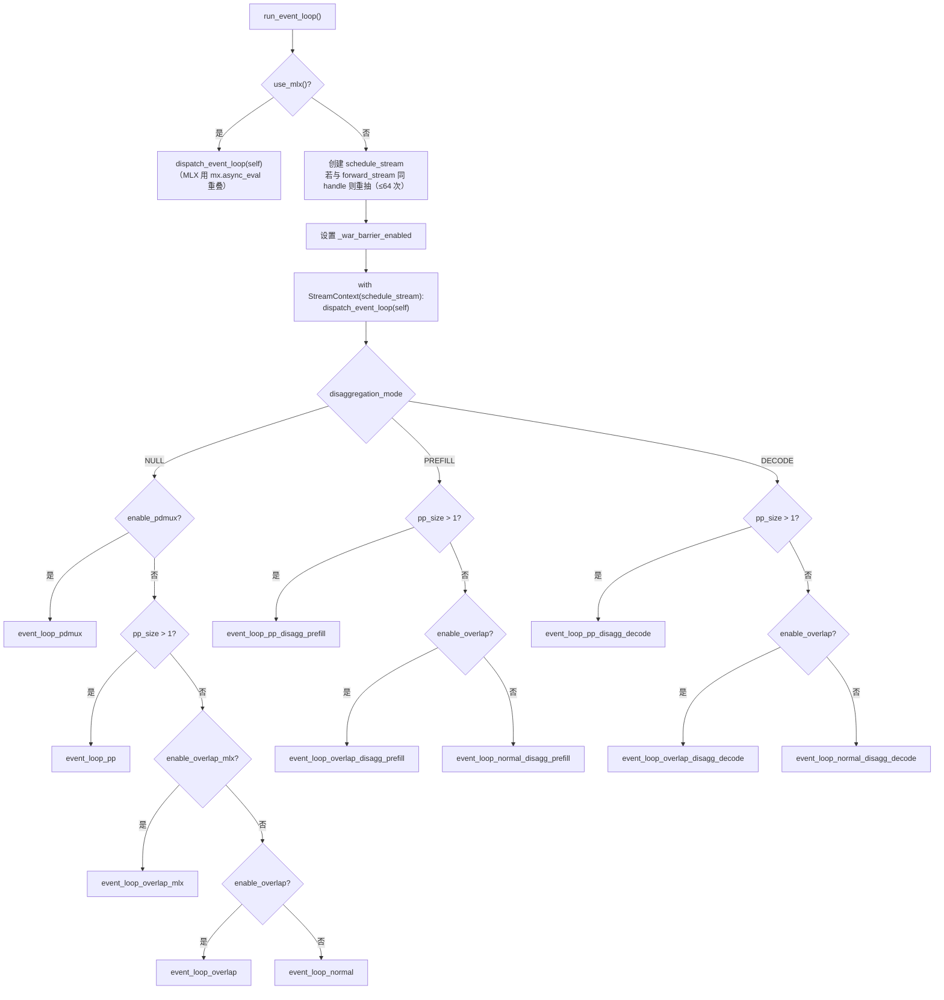

据此可以列出全部循环：

| PD 模式 | 重叠 | 事件循环 | 位置 |
| --- | --- | --- | --- |
| NULL（聚合） | 否 | `event_loop_normal` | `scheduler.py:1909` |
| NULL（聚合） | **是** | `event_loop_overlap` | `scheduler.py:1954` |
| PREFILL | 否 | `event_loop_normal_disagg_prefill` | `disaggregation/prefill.py:692` |
| PREFILL | **是** | `event_loop_overlap_disagg_prefill` | `disaggregation/prefill.py:736` |
| DECODE | 否 | `event_loop_normal_disagg_decode` | `disaggregation/decode.py:2681` |
| DECODE | **是** | `event_loop_overlap_disagg_decode` | `disaggregation/decode.py:2724` |

> PP（流水线并行）各有一组变体；MLX / pdmux 另有专门循环。本节只展开上表中与 **PD 分离 + overlap** 直接相关的路径。

### 4.1.1 循环赖以工作的运行时设施

重叠调度依赖几条独立的 CUDA Stream 与一个跨迭代的中继缓冲。它们在 `init_overlap` / `run_event_loop` 中建立：

- **`schedule_stream`**：所有「CPU 端调度准备」产生的 GPU 操作都跑在这条 stream 上（`Scheduler.run_event_loop`，`scheduler.py:1851-1893`）。它与前向 stream 分离，是重叠的关键；若被随机分配到与 `forward_stream` 相同的 handle，会重新抽取（`scheduler.py:1877-1888`）。
- **`forward_stream` + `copy_stream`**：前者跑前向，后者做结果 D2H（设备→主机）异步拷贝，让拷贝与下一次前向并发（`init_overlap`，`scheduler.py:1647-1658`）。
- **`result_queue`**：`(batch, result)` 队列，缓存「已提交前向但尚未处理结果」的批次。正常稳态每轮结束留存 1 批；先入队本批、再出队上批的间隙可短暂有 2 批（见 §4.3）。
- **`batch_record_buf`**：长度为 2 的环形缓冲，钉住最近两轮批次的 GPU 张量引用，防止被 PyTorch 缓存分配器在前向 stream 仍在用时提前回收（`scheduler.py:1663-1667`，`record_batch_in_overlap`，`scheduler.py:4156-4172`）。
- **`future_map`**：跨迭代值的中继站（`FutureMap`），**即使不开 overlap 也始终创建**，因为非重叠路径同样靠它在迭代间中继 decode 的 `input_ids`（`scheduler.py:1604-1628`）。详见 §4.7。

**执行流程图**（各设施在一次重叠迭代中的协作关系）：

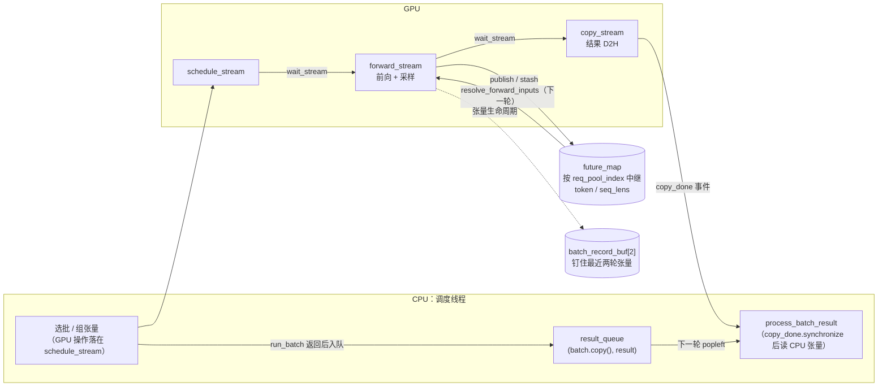

## 4.2 主循环形态一：非重叠 `event_loop_normal`

非重叠循环逻辑最简单：每轮按「收请求 → 选批 → 提交前向 → 等待并处理本批结果」推进，之后才开始下一轮调度。它没有跨批隐藏 CPU 调度与结果处理的开销，因此吞吐通常低于重叠版，但最易调试：

```1909:1946:python/sglang/srt/managers/scheduler.py
    def event_loop_normal(self):
        """A normal scheduler loop.
        ...
        """
        while True:
            if self.gracefully_exit:
                break

            # Receive requests
            # 中译：从 TokenizerManager/RPC 拉取新请求，并入队/分发处理。
            recv_reqs = self.request_receiver.recv_requests()
            self.process_input_requests(recv_reqs)
            # 中译：引擎被暂停（如权重热更新期间）时只收请求不跑前向。
            if self._engine_paused:
                continue

            # Get the next batch to run
            # 中译：核心调度决策——决定本轮跑哪个批次（优先 prefill，否则 decode，可能为 None）。
            plan = self.get_next_batch_to_run(
                running_batch=self.running_batch, last_batch=self.last_batch
            )
            ...
            if batch:
                # 中译：提交前向后当轮消费本批结果；同步等待也可能发生在结果处理阶段。
                result = self.run_batch(batch)
                self.process_batch_result(batch, result)
            else:
                # When the server is idle, do self-check and re-init some states.
                # 中译：无可跑批次=服务器空闲，做不变量自检、重置状态、按需休眠。
                self._sched_idled = True
                self.on_idle()
```

**执行流程图**：

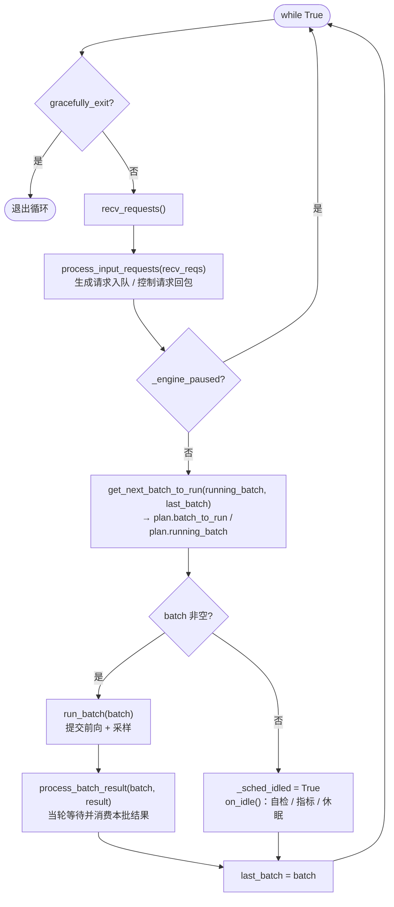

要点：

- **`_engine_paused`**：引擎暂停（如权重热更新/`flush_cache` 期间）时只收请求、不跑前向，`continue` 进入下一轮。
- **`batch is None`**：说明 `running_batch` 为空且攒不出新的 prefill 批 → 服务空闲，调用 `on_idle()` 做不变量自检、指标上报、`maybe_sleep_on_idle()`（`scheduler.py:4747-4813`）。
- **`last_batch` 的传递**：本轮跑过的 `batch` 会成为下一轮的 `last_batch`，`get_next_batch_to_run` 依赖它把「上一个 prefill 批」的请求合并进 `running_batch` 进入 decode（§4.5）。

## 4.3 主循环形态二：重叠 `event_loop_overlap`

重叠循环的精髓是**先提交本批前向，再等待并处理上一批结果**；「提交」不代表 GPU 已实际开始执行。这样，本轮 CPU 调度准备可与上批 GPU 前向重叠，上批 CPU 结果处理又可与本批 GPU 前向重叠，尽量隐藏 CPU 开销。实现手段是 `result_queue`：

```1953:2051:python/sglang/srt/managers/scheduler.py
    @DynamicGradMode()
    def event_loop_overlap(self):
        """A scheduler loop that overlaps the CPU processing and GPU computation.
        ...
        """
        # 中译：保存已提交、尚未消费的结果；稳态轮末留 1 批，先入后出时可短暂有 2 批。
        self.result_queue: Deque[
            Tuple[ScheduleBatch, Union[GenerationBatchResult, EmbeddingBatchResult]]
        ] = deque()

        def pop_and_process():
            # 处理上一批的前向结果
            tmp_batch, tmp_result = self.result_queue.popleft()
            self.process_batch_result(tmp_batch, tmp_result)

        while True:
            if self.gracefully_exit:
                break

            recv_reqs = self.request_receiver.recv_requests()
            self.process_input_requests(recv_reqs)
            if self._engine_paused:
                continue

            # Get the next batch to run
            plan = self.get_next_batch_to_run(
                running_batch=self.running_batch, last_batch=self.last_batch
            )
            # 中译：running_batch 是持续解码的运行态；batch 才是本轮选中的执行批。
            self.running_batch = plan.running_batch
            batch = plan.batch_to_run
            self.cur_batch_for_debug = batch
            # 中译：连续 prefill 或 grammar 依赖可能要求先消费上批，临时打破重叠。
            disable_overlap_for_batch = self.is_disable_overlap_for_batch(
                batch, last_batch=self.last_batch
            )

            # If we do not need to overlap the current batch with the last batch,
            # we can process the last batch immediately.
            # 中译：特殊分支在本批提交前回收上批，保证延迟或状态依赖要求。
            if disable_overlap_for_batch:
                pop_and_process()
                ...
            # Launch the current batch
            if batch:
                # 中译：启动本批前向，但不立即处理结果——把它（连同 batch 的副本）压入队列，
                #       下一轮再处理，从而实现 CPU/GPU 重叠。batch.copy() 是为了快照本批状态。
                batch_result = self.run_batch(batch)
                # 中译：给后续 schedule_stream 写入加依赖，防止覆盖前向仍在读取的共享缓冲。
                #       这是 stream 间屏障，不等于在此阻塞 CPU 等待整个前向完成。
                self._apply_war_barrier()
                self.result_queue.append((batch.copy(), batch_result))
            else:
                batch_result = None
                self._sched_idled = True

            # Process the last batch
            # 中译：常规路径此时才消费上批；即使本轮无新批，也要排空上批结果。
            if self.last_batch:
                if not disable_overlap_for_batch:
                    pop_and_process()
            elif batch is None:
                # 中译：本轮无批且上批也不存在，才进入空闲处理。
                self.on_idle()

            # Run sample of the current batch
            # 中译：依赖上批 grammar 状态的采样，等上批结果处理完后再提交。
            if self.is_generation:
                self.launch_batch_sample_if_needed(batch_result, batch)

            # Update last_batch
            # 中译：本批成为下一轮待回收的上一批，维持一拍错位。
            self.last_batch = batch
```

**执行流程图**：

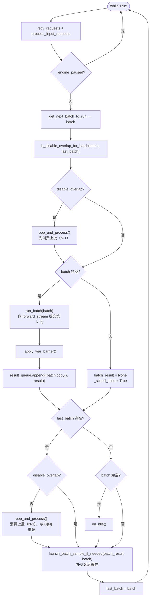

逐点解读：

1. **一拍错位**：常规重叠路径中，本轮 `run_batch(batch)` 向 `forward_stream` 提交 GPU 工作，返回结果对象后将 `(batch.copy(), batch_result)` 入队，而不当轮消费本批结果。第 N 批的 `process_batch_result` 推迟到下一轮、提交第 N+1 批之后执行，因此可与第 N+1 批的 GPU 前向重叠。正常稳态每轮结束留存 1 批；本批入队、上批出队之间可短暂有 2 批。
2. **`batch.copy()`**：处理的是「上一轮的快照」，因为 `batch` 在下一轮可能已被复用/改写。
3. **`_apply_war_barrier()`**（`scheduler.py:1895-1906`）：WAR（Write-After-Read）屏障——本批前向提交后，让 `schedule_stream` 等待本批共享缓冲的读取完成事件（必要时退化为等待 `forward_stream`），约束后续结果处理及下一轮调度发起的 GPU 写入，避免改坏仍在被读取的数据。这是 stream 间依赖，不等于阻塞 CPU 线程。
4. **`launch_batch_sample_if_needed`**（`scheduler.py:4582-4617`）：延后采样。某些批的采样被推迟（如结构化输出要等上一批 grammar 状态），必须等上一批结果处理完再采样，所以放在 `pop_and_process()` 之后。
5. **`is_disable_overlap_for_batch`**（`scheduler.py:2054-2090`）：决定本批是否要「关闭重叠」——

```2057:2090:python/sglang/srt/managers/scheduler.py
        # For two consecutive prefill batches, we disable overlap to improve the TTFT of the first batch.
        # ...
        # 中译：需要 MLP 跨 rank 同步时，使用批次上的 extend 标记判断是否包含 prefill。
        if self.require_mlp_sync:
            is_extend = lambda b: b and b.is_extend_in_batch
        else:
            is_extend = lambda b: b and b.forward_mode.is_extend()

        batch_is_extend = is_extend(batch)
        last_batch_is_extend = is_extend(last_batch)

        # 中译：开关开启且连续两批均为 prefill 时，先处理上批以改善它的首 token 延迟。
        disable_overlap_for_batch = (
            envs.SGLANG_DISABLE_CONSECUTIVE_PREFILL_OVERLAP.get()
            and batch_is_extend
            and last_batch_is_extend
        )

        # Sync so the FSM advance lands before the next batch's bitmask. ...
        # 中译：投机 decode 的 grammar 若依赖上批状态，须先推进状态机再生成本批采样掩码。
        #       队列非空说明确有尚未消费的上批结果。
        need_grammar_sync = (
            batch
            and not batch.spec_algorithm.is_none()
            and batch.grammar_needs_sync()
            and batch.forward_mode.is_decode()
            and len(self.result_queue) > 0
        )

        return disable_overlap_for_batch or need_grammar_sync
```

关闭重叠的两类情形：**连续两个 prefill 批**（为改善首批 TTFT，仅当开启 `SGLANG_DISABLE_CONSECUTIVE_PREFILL_OVERLAP`）与 **spec + grammar 需要 FSM 同步**。关闭时立即 `pop_and_process()`，本轮不做错位。

### 4.3.1 本质区别：当轮消费结果 vs 跨轮延迟消费结果

**关键不是 `run_batch` 是否阻塞，而是「等待并消费本批结果」与「调度、提交下一批」的先后顺序。** normal 在当轮消费本批结果，再进入下一轮；overlap 则先准备并提交下一批，再消费本批结果，把 CPU 工作与 GPU 计算流水化。

下图用字母简写标记各阶段以便对齐时间轴，含义见图内图例：

```text
图例（k 为批次编号；N-1、N、N+1 分别表示上一批、本批、下一批）：
  S[k]：CPU 调度准备——收请求、选批、准备输入。
  L[k]：CPU 向 GPU 提交第 k 批工作——run_batch 的提交动作。
  G[k]：GPU 执行第 k 批计算。
  W[k]：CPU 等待第 k 批结果可读。
  P[k]：CPU 拿到第 k 批结果后的处理。
  注：W[k] 与 P[k] 可能发生在同一次 process_batch_result 调用里；
      分开画是为了区分等待与处理，结果已就绪时等待可以很短。

event_loop_normal

  时间 ------------------------------------------------------------------------------------------>
  CPU : |  S[N]  |  L[N]  |               W[N]                |  P[N]  | S[N+1] | L[N+1] | ...
  GPU : |      空闲       |============== G[N] ===============|           空闲           | G[N+1] ...

  G[N] 执行期间 CPU 等待；P[N] 完成后，才进行 S[N+1] 和 L[N+1]。


event_loop_overlap（稳态；图示开始前已提交 L[N]）

  时间 ------------------------------------------------------------------------------------------>
  CPU : | P[N-1] | S[N+1] | L[N+1] |  W[N]  |  P[N]  | S[N+2] | L[N+2] | W[N+1] | ...
  GPU : |============== G[N] ===============|============= G[N+1] ==============| ...

  G[N] 与 P[N-1]、S[N+1] 均可重叠；先执行 L[N+1]，再执行 W[N] 和 P[N]。
```

> 这是普通生成路径的理想化示意，不按实际耗时比例；省略采样、结果 D2H 拷贝与 stream 依赖开销。overlap 截取的是已进入流水的稳态，不包含首批启动与最后一批排空，也不包含主动关闭重叠、延后采样等特殊分支。图中 GPU 连续执行不代表实际一定没有气泡。

读图要点：

1. **normal 的等待不一定在 `run_batch` 内**：CUDA 操作本身可以异步提交，`run_batch` 也可能先返回带 GPU 张量的结果对象，再由结果处理中的 `.tolist()` 等操作同步取回数据。因此不能用「返回结果 vs 返回未来凭证」区分两者。
2. **overlap 同时隐藏两段 CPU 工作**：`G[N]` 可与 `P[N-1]`（上一批结果处理）、`S[N+1]`（下一批调度准备）重叠。相邻批次的前向仍在同一条 `forward_stream` 上顺序执行，**不是两个模型前向同时跑**；提前提交 `L[N+1]` 也不表示 `G[N+1]` 立即开始。decode 的跨步 token 依赖由 `future_map` 中继，不必先在 CPU 上消费上一批结果（§4.7；normal 也使用 `future_map`）。
3. **overlap 仍可能等待，只是改变了等待的位置**：在 `W[N]` 等待时，下一批已经提交；若结果尚未拷回，`copy_done.synchronize()` 仍会阻塞 CPU。stream 依赖与 CPU 工作过长也可能造成 GPU 气泡，因此收益是**尽量隐藏 CPU 开销、减少气泡**，不是保证零等待。

> **旁注：PP 为何另起一套循环（`event_loop_pp`）** 普通循环一轮只有一个批、一份 `running_batch`/`last_batch`；PP 下一条请求要依次流过所有 stage，必须用 micro-batch 错位填流水线：按槽位维护多份状态（`running_mbs[mb_id]` 等），本轮回收 `(mb_id+1) % pp_loop_size` 的结果，并在固定位置插入收 request/proxy、发 request/proxy/output 的 P2P 通信（异步 send + 同步 recv、按 rank 奇偶定序防死锁）。「结果处理与 GPU 计算重叠」因此已内建其中，重叠深度由 `pp_async_batch_depth` 连续调节，而非 normal/overlap 的二选一 —— 它是 overlap 版的泛化，故无法复用通用循环。

## 4.4 收请求与入队：`process_input_requests`

两个事件循环都先调 `process_input_requests`。它把本轮收到的请求按类型经 `_request_dispatcher` 路由到对应 handler，并把控制类响应回传 tokenizer：

```2102:2143:python/sglang/srt/managers/scheduler.py
    def process_input_requests(self, recv_reqs: List):
        # 中译：处理本轮收到的所有请求对象。对每个请求按其类型经分发器（_request_dispatcher）
        #       路由到对应 handler（生成/嵌入/权重更新/中止/会话管理等），handler 的返回值
        #       （若有）再回传给 TokenizerManager 或 RPC 端。
        now = time.monotonic()
        # 中译：按当前时间清理过期会话，避免遗留会话资源持续占用。
        self.session_controller.maybe_reap(now)
        ...
        for recv_req in recv_reqs:
            ...
            output = self._request_dispatcher(recv_req)
            if output is not None:
                # 中译：RPC 类输出走 recv_from_rpc 通道回传，其余输出走 send_to_tokenizer。
                if self.rust_server is not None:
                    ...
                elif isinstance(output, RpcReqOutput):
                    ...
                else:
                    self.ipc_channels.send_to_tokenizer.send_output(output, recv_req)
```

生成请求最终进入 `_add_request_to_queue`。这里按 PD 模式分流，**这一步决定了请求先进哪个队列**：

```3127:3152:python/sglang/srt/managers/scheduler.py
    def _add_request_to_queue(self, req: Req, is_retracted: bool = False):
        # 中译：把请求送入相应队列。非分离模式进 waiting_queue；PD 分离的 prefill 节点进
        #       bootstrap 队列、decode 节点进 prealloc 队列。
        if not self._set_or_validate_priority(req):
            return
        if self.disaggregation_mode == DisaggregationMode.NULL:
            # 中译：先检查排队上限；允许入队时按需发起缓存预取，再等待 prefill 组批。
            if self._abort_on_queued_limit(req):
                return
            self._prefetch_kvcache(req)
            self.waiting_queue.append(req)
            req.time_stats.set_wait_queue_entry_time()
        elif self.disaggregation_mode == DisaggregationMode.PREFILL:
            # 中译：P 端先建 sender 并启动握手，不直接把新请求放进可执行队列。
            self._prefetch_kvcache(req)
            self.disagg_prefill_bootstrap_queue.add(
                req, self.model_config.num_key_value_heads
            )
            req.time_stats.set_prefill_bootstrap_queue_entry_time()
        elif self.disaggregation_mode == DisaggregationMode.DECODE:
            # 中译：D 端区分新请求与回退请求；预分配队列负责握手、资源准入或恢复。
            self.disagg_decode_prealloc_queue.add(req, is_retracted=is_retracted)
            if not is_retracted:
                req.time_stats.set_decode_prealloc_queue_entry_time()
            else:
                req.time_stats.set_retract_time()
        else:
            raise ValueError(f"Invalid {self.disaggregation_mode=}")
```

**执行流程图**（从 ZMQ 收包到请求落入各队列）：

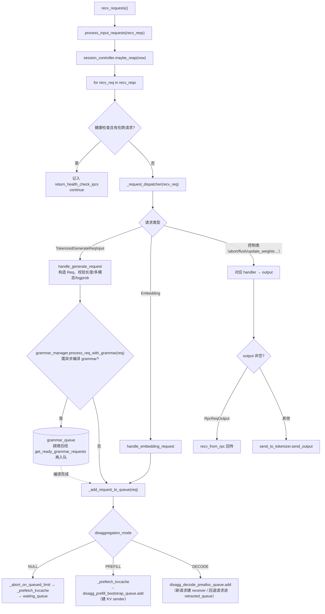

- **聚合模式**：直接进 `waiting_queue`。
- **PD prefill 节点**：进 `disagg_prefill_bootstrap_queue`（先建 KV sender + 握手）。
- **PD decode 节点**：进 `disagg_decode_prealloc_queue`（建 KV receiver + 预分配）。

`_engine_paused`（权重热更新/暂停）时控制请求仍会被处理（如 `update_weights`），但主循环 `continue` 不跑前向。

## 4.5 选批：`get_next_batch_to_run`

这是**调度决策核心**：决定本轮到底跑哪个批次。整体优先级是「**先把上一轮 prefill 批收尾合并 → 能攒出新 prefill 就优先 prefill → 否则对 running_batch 跑一步 decode**」。

```3440:3474:python/sglang/srt/managers/scheduler.py
    def get_next_batch_to_run(
        self, running_batch: ScheduleBatch, last_batch: Optional[ScheduleBatch]
    ) -> NextBatchPlan:
        # 中译：先处理分块请求延迟到安全时机的中止，避免带着失效状态继续组批。
        self.process_pending_chunked_abort()

        if self.enable_fpm:
            self._fpm_batch_t0 = time.monotonic()
        # 中译：先按超时规则中止等待过久 / 运行过久的请求。
        self._abort_on_waiting_timeout()
        self._abort_on_running_timeout(running_batch)
        if self.dllm_config is not None:
            self.dllm_manager.filter_finished_reqs()

        # Merge the prefill batch into the running batch
        chunked_req_to_exclude = set()
        ...
        if self.chunked_req is not None:
            # 中译：把分块请求移出批次，这样合并进 running_batch 的就只有真正 prefill 完成的请求。
            chunked_req_to_exclude.add(self.chunked_req)
            if self.chunked_req.extend_range.end > len(self.chunked_req.prefix_indices):
                self.stash_chunked_request(self.chunked_req)
```

**执行流程图**：

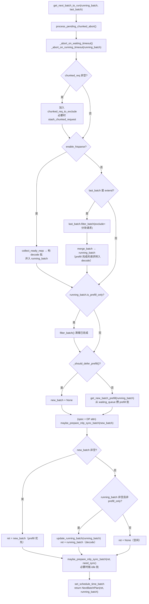

关键阶段：

1. **合并上一批**：若 `last_batch` 是 prefill（extend）批，先 `filter_batch` 去掉仍在分块中（`chunked_req`）的请求，再把剩下的「已 prefill 完成」请求 `merge_batch` 进 `running_batch`，它们进入 decode（`scheduler.py:3501-3531`）。
2. **攒新 prefill**：`get_new_batch_prefill(running_batch)` 从 `waiting_queue` 攒一个新 prefill 批；`_should_defer_prefill()` 为真时本轮故意不攒（用于调节 prefill/decode 节奏）（`scheduler.py:3544-3552`）。
3. **prefill 优先**：有 prefill 批就先跑它；否则对 `running_batch` 走 `update_running_batch` 跑 decode（`scheduler.py:3572-3584`）。
4. **DP attention 同步**：`maybe_prepare_mlp_sync_batch` 让各 DP rank 步调一致（必要时插 idle 批），避免某些 rank 空转导致死锁（`scheduler.py:3586-3601`）。
5. 记录 `set_schedule_time_batch` 并返回 `NextBatchPlan(batch_to_run, running_batch)`。

### 4.5.1 `update_running_batch`：decode 步的准备与 OOM 回退

```4058:4154:python/sglang/srt/managers/scheduler.py
    def update_running_batch(self, batch: ScheduleBatch) -> Optional[ScheduleBatch]:
        """Update the current running decoding batch.
        中译：为 decode 步准备 running_batch。关键步骤：
              1. filter_batch：移除已完成的请求；
              2. check_decode_mem：检查 KV 缓存是否还够再 decode 一步，若不够则触发
                 retract_decode（回退部分请求到等待队列，腾出显存），并调整 new_token_ratio；
              3. prepare_for_decode：构建 decode 前向所需的张量（位置、序列长度等）。
        """
        initial_bs = batch.batch_size()
        batch.filter_batch()
        if batch.is_empty():
            batch.batch_is_full = False
            return batch

        if (kv_full_retract_flag := not batch.check_decode_mem()) or (
            TEST_RETRACT and self.forward_ct % TEST_RETRACT_INTERVAL == 0
        ):
            ...
            # 中译：回退部分请求以腾出 KV 空间，并返回新的 token 预算比例及需中止的请求。
            retracted_reqs, new_token_ratio, reqs_to_abort = batch.retract_decode()
            ...
            for req in retracted_reqs:
                # 中译：按部署模式重新入队；聚合模式待重算，PD decode 进入回退恢复流程。
                self._add_request_to_queue(req, is_retracted=True)
        else:
            # 中译：本轮未触发回退，按跟踪器策略逐步调整后续 token 预算。
            self.new_token_ratio_tracker.decay_step()
        ...
        # 中译：为保留下来的请求准备下一步 decode 的序列长度、位置和 KV 落点等。
        batch.prepare_for_decode()
        return batch
```

**执行流程图**：

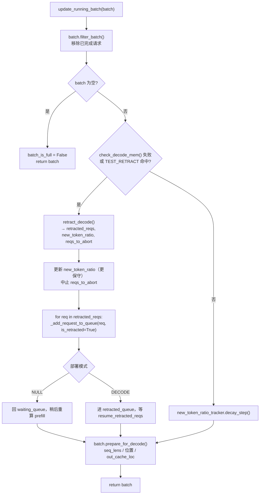

- **`filter_batch`**：剔除已完成的请求。
- **`check_decode_mem` 失败 → `retract_decode`**：显存不够再走一步 decode 时，把一部分请求**回退**（KV 释放、请求状态退回，重新入队 `waiting_queue`，标记 `is_retracted`），腾出显存给剩下的请求；同时下调 `new_token_ratio` 使后续更保守。这是「decode 阶段 OOM 的自救」，也是长序列高并发下允许「回退重算」的来源。
- **`prepare_for_decode`**：把 decode 前向要用到的张量（`input_ids` 由 `future_map` 重建、`seq_lens`、位置等）准备好。

## 4.6 前向与采样：`run_batch`

`run_batch` 是 prefill/decode 共用的前向入口，按「是否生成模型 / 是否重叠 / 是否投机 / 是否 PD 复用」分多条路径：

```4225:4272:python/sglang/srt/managers/scheduler.py
    def run_batch(
        self,
        batch: ScheduleBatch,
        pp_proxy_tensors: Optional[PPProxyTensors] = None,
    ) -> Union[GenerationBatchResult, EmbeddingBatchResult]:
        """Run a batch.

        中译：在 model worker 上执行一个批次的前向。本方法是 prefill/decode 共用的前向入口，
              内部按以下维度分多条路径：是否生成模型、是否重叠、是否投机解码、是否 PD 复用。
              重叠路径（enable_overlap）的要点：在 forward_stream 上跑前向，前向产出的
              next-token 等"未来值"通过 future_map.publish/stash 在迭代间中继，因此前向后
              立即把 batch.input_ids 置 None（下一轮从 future_map 重建）；并用 copy_stream
              异步把结果拷回 CPU，延后等待；CPU 真正消费结果前仍须确认拷贝完成。
        """
        self.forward_ct += 1
        batch.forward_iter = self.forward_ct
        batch.launch_ts = time.monotonic()
        ...
        # PD 分离 decode 事件循环中的"占位（prebuilt）"批处理：这类批的 KV 已由
        # prefill 节点传来，无需再跑正常前向，走专用的 _run_batch_prebuilt 路径。
        if batch.forward_mode.is_prebuilt():
            return self._run_batch_prebuilt(batch)
```

**重叠生成路径**（`self.is_generation and self.enable_overlap`，`scheduler.py:4273-4393`）是本节的重点，其骨架：

```4283:4384:python/sglang/srt/managers/scheduler.py
                with self.forward_stream_ctx:
                    # 中译：让前向 stream 等待调度 stream——保证本批前向所依赖的调度准备已完成。
                    self.forward_stream.wait_stream(self.schedule_stream)
                    # 中译：在前向入口重建输入：prefill 来自 CPU 暂存，decode 来自上轮 token 中继。
                    resolve_forward_inputs(batch, self.future_map)
                    # 中译：隔离前向对 batch 的临时修改，并保留张量引用，避免影响后续调度。
                    with self._forward_isolation(batch, overlap=True):
                        # 中译：请求池槽位是 FutureMap 的稳定索引，不依赖本轮批内的排列位置。
                        future_indices = batch.req_pool_indices
                        ...
                        # 中译：提交模型前向与按需采样；Python 返回不表示 GPU 已全部执行完毕。
                        batch_result = self.model_worker.forward_batch_generation(
                            batch, **fwd_kwargs
                        )
                        # 中译：非投机解码把下一步序列长度（+1）发布到 future_map，
                        #       供后续迭代解析；相关 GPU 操作仍按 stream 依赖顺序执行。
                        if batch.spec_algorithm.is_none():
                            self.future_map.publish(future_indices, batch.seq_lens + 1)
                        ...
                        # 中译：结果处理阶段用此事件确认异步 D2H 拷贝完成。
                        batch_result.copy_done = self.device_module.Event()
                        if batch_result.delay_sample_func is None:
                            # 中译：无需延后采样时，立即提交 token 等跨迭代数据的中继写入。
                            self._relay_forward_payload(
                                batch, future_indices, batch_result
                            )
                            ...
                            # 中译：拷贝必须排在本批计算之后；独立 copy_stream 可与后续前向重叠。
                            self.copy_stream.wait_stream(self.forward_stream)
                            with self.copy_stream_ctx:
                                batch_result.copy_to_cpu(
                                    return_logprob=batch.return_logprob,
                                    return_hidden_states=batch.return_hidden_states,
                                )
                        else:
                            # 中译：采样尚未执行，先记住中继槽位；延后采样时再补齐 relay 与拷贝。
                            batch_result.future_indices = future_indices

                # Next-iter input_ids relayed via future_map.
                # 中译：清掉本轮输入，下一轮从中继重建，避免复用已经过时的 token。
                batch.input_ids = None
```

**执行流程图**（`run_batch` 整体分派 + 重叠生成路径展开）：

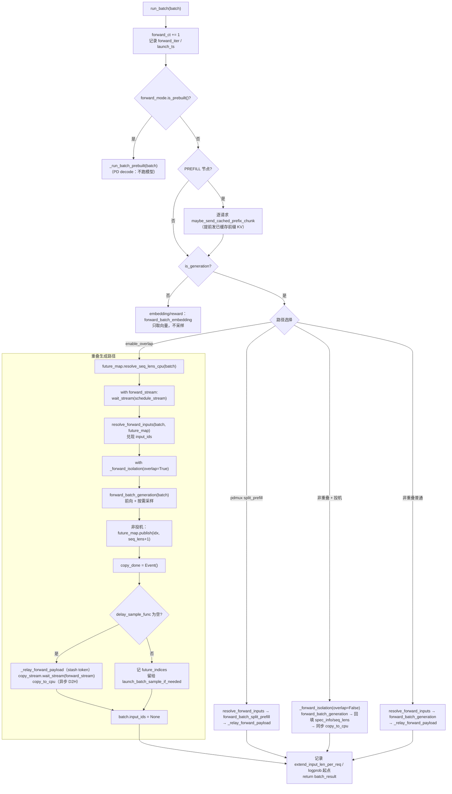

关键动作：

1. **`forward_stream.wait_stream(schedule_stream)`**：前向必须等本轮调度准备（张量填充、KV 分配等）完成。
2. **`resolve_forward_inputs`**：在 forward 入口「兑现」本批 `input_ids`——prefill 段来自 pinned CPU 暂存（H2D 拷贝），decode 段来自 `future_map`（上一轮采样结果）。见 §4.7。
3. **`_forward_isolation`**（`scheduler.py:4174-4222`）：把前向期间对 `ScheduleBatch` 的修改变成「事务性」——进入快照、退出还原，避免污染下一轮调度；同时把 `sampling_info` 换成「仅供本次前向使用的副本」，并（overlap 时）把快照钉进 `batch_record_buf` 保证张量跨 stream 存活。
4. **`publish/stash`**：前向产出的「未来值」（`seq_lens+1`、采样出的 token、投机草稿信息）写回 `future_map`，供下一轮调度读取——这是重叠能成立的中继机制。
5. **`copy_to_cpu` on `copy_stream`**：结果 D2H 拷贝挂在 `copy_stream` 上，与下一次前向重叠，不阻塞 `forward_stream`；`copy_done` 事件用于稍后同步。
6. **`batch.input_ids = None`**：下一轮的 `input_ids` 改由 `future_map` 中继，这里清空避免读到旧值。

**非重叠、非投机生成路径**（`scheduler.py:4432-4451`）同样执行 `resolve_forward_inputs` → `forward_batch_generation` → relay，并按需拷贝辅助输出，但不能据此理解为每一步都同步等待 GPU。普通 token 结果可能在后续 `process_batch_result` 的 `.tolist()` 等操作中才同步取回；关键是当轮消费完本批结果后，才开始下一轮调度。**embedding/reward 模型路径**（`scheduler.py:4473-4499`）只做前向取向量、不采样。

**`_run_batch_prebuilt`**（`decode.py:2790-2800`）：PD 分离 decode 侧首次拿到「KV 已就绪」的批时，`forward_mode.is_prebuilt()`，此批**不跑模型前向**，只由 `process_batch_result_prebuilt` 做完成态更新与流式输出（首 token 已在 prefill 侧产生并随 KV 传来）。详见 §4.11.5、§4.11.6。

## 4.7 重叠调度原理小结：`FutureMap` 与三条 Stream

为什么要 `FutureMap`？重叠调度下，第 N 轮前向还在 GPU 上跑时，调度器已经为第 N+1 轮做 CPU 准备（选下一批、组张量）。但「下一批要喂给模型的 `input_ids`」此刻还没算出来——它正是第 N 轮采样的结果。于是采用**占位 + 延迟解析**：

```1:12:python/sglang/srt/managers/overlap_utils.py
"""Overlap-scheduling helpers for relaying cross-iteration values.

中译：overlap（计算/CPU 处理重叠）调度的辅助工具。
      overlap 调度的核心思想是：在第 N 轮 forward 还在 GPU 上跑时，调度器就提前为第 N+1 轮
      做 CPU 端准备（取下一批请求、组 batch 等）。但「下一批要喂给模型的 input_ids」此刻
      还没算出来——它正是第 N 轮采样的结果。于是用占位 + 延迟解析的方式：
        - 第 N 轮 forward 结束后，把采样得到的 token（及投机解码的额外信息）写入 FutureMap
          中「按 req_pool_index 索引」的常驻缓冲区（publish / stash）。
        - 第 N+1 轮 forward 真正进入时，再从 FutureMap 把这些值取出、填回 batch
          （resolve_forward_inputs / resolve_seq_lens_cpu）。
      FutureMap 因此扮演「跨迭代值的中继站」角色，使 CPU 准备与 GPU 计算得以重叠。
"""
```

`FutureMap` 的所有缓冲区都以 **`req_pool_index`（请求在 req-to-token 池中的槽位）为下标**，槽位 0 对应 KV 的 padding 行，故 CUDA Graph 填充批读写都落在无害位置：

```285:294:python/sglang/srt/managers/overlap_utils.py
class FutureMap:
    """Always-on pool-indexed relay for cross-iter values. Forward writes via
    publish/stash; next iter reads via resolve_forward_inputs / resolve_seq_lens_cpu.

    中译：跨迭代值的「常驻中继站」，所有缓冲区都以 req_pool_index 为下标（请求在 req-to-token
          池中的槽位），故称 pool-indexed。
          写入侧：本轮 forward 结束后通过 publish（写 seq_lens）/ stash（写采样 token 及投机额外信息）。
          读取侧：下一轮 forward 进入时通过 resolve_forward_inputs / resolve_seq_lens_cpu 取回。
          槽位 0 对应 KV 的 padding 行，因此 CUDA Graph 的填充批（req_pool_idx == 0）读到的是无害值。
    """
```

`resolve_forward_inputs` 在 forward 入口重建 `input_ids`，两种来源 + 混合批拼接：

```111:148:python/sglang/srt/managers/overlap_utils.py
def resolve_forward_inputs(batch: ScheduleBatch, future_map: FutureMap) -> None:
    """Materialize input_ids at forward entry. Two sources:

    - Prefill: H2D copy from pinned CPU staging (prefill_input_ids_cpu).
    - Decode/spec_v2: gather from FutureMap (last iter's sampled token).
    ...
    """
    if batch.prefill_input_ids_cpu is not None:
        # 中译：prefill 段——把 CPU 暂存的 input_ids 异步拷到设备。
        prefill_gpu = batch.prefill_input_ids_cpu.to(batch.device, non_blocking=True)
        if batch.mix_running_indices is not None:
            # 中译：混合批的 decode 部分按请求池槽位取回上一轮 token，再接在 prefill 输入后面。
            decode_gpu = future_map.output_tokens_buf[batch.mix_running_indices]
            ...
            batch.input_ids = torch.cat([prefill_gpu, decode_gpu])
        else:
            # 中译：没有混入 decode 请求时，整批输入就是本次 prefill 的 token。
            batch.input_ids = prefill_gpu
        # 中译：输入已经物化，清理本轮暂存标记，避免下一轮再次走旧的 H2D 路径。
        batch.prefill_input_ids_cpu = None
        batch.mix_running_indices = None
    elif batch.input_ids is None and future_map.spec_algo.is_none():
        # 中译：纯 decode 且非投机解码——直接按 req_pool_indices 从 FutureMap 取上一轮采样 token。
        batch.input_ids = future_map.output_tokens_buf[batch.req_pool_indices]
        ...
```

**执行流程图**（以纯 decode 为例，`FutureMap` 在相邻两轮间的写入与读取）：

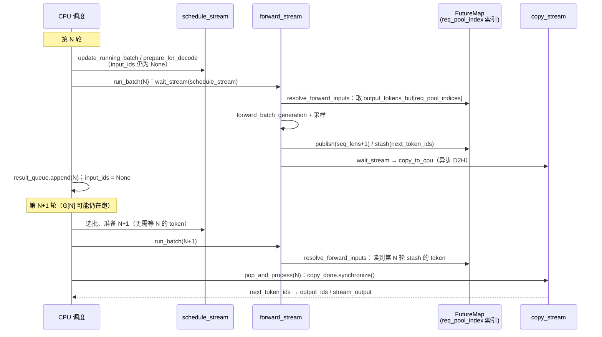

一句话总结三条 Stream 的分工：**`schedule_stream` 做 CPU 侧调度准备，`forward_stream` 跑模型前向，`copy_stream` 把结果异步拷回 CPU**；CPU 借 `result_queue` 把「处理上一批结果」叠到「本批 GPU 前向」之上，`future_map` 则负责把跨迭代依赖的值（input_ids / seq_lens）在两条流水间中继。

## 4.8 结果处理：`process_batch_result`

前向完成后（重叠模式下是**下一轮**），`process_batch_result` 按 `forward_mode` 分派到具体处理函数：

```4619:4651:python/sglang/srt/managers/scheduler.py
    def process_batch_result(
        self,
        batch: ScheduleBatch,
        result: Union[GenerationBatchResult, EmbeddingBatchResult],
    ):
        # 中译：处理一个批次前向后的结果。按 forward_mode（decode / extend(prefill) / prebuilt / idle）分流。
        flush_trace_batch(batch.reqs)
        snapshot = self.publish_load_snapshot(force=batch.forward_mode.is_extend())
        ...
        if batch.forward_mode.is_decode():
            # 中译：提交本步接受的 token，推进完成态并准备输出。
            self.batch_result_processor.process_batch_result_decode(batch, result)
        elif batch.forward_mode.is_extend():
            if batch.is_dllm():
                # 中译：扩散语言模型使用自己的结果处理逻辑。
                self.process_batch_result_dllm(batch, result)
            elif self.disaggregation_mode == DisaggregationMode.PREFILL:
                # 中译：PD 的 P 端需发送 KV，而不是把请求留在本实例继续 decode。
                self.process_batch_result_disagg_prefill(batch, result)
            else:
                # 中译：聚合部署完成 prefill 收尾，未结束请求后续并入 running_batch。
                self.batch_result_processor.process_batch_result_prefill(batch, result)
        elif batch.forward_mode.is_prebuilt():
            # 中译：首 token 和 KV 已由 P 端提供，只做完成态更新与输出，不重复前向。
            self.batch_result_processor.process_batch_result_prebuilt(batch)
        elif batch.forward_mode.is_idle():
            # 中译：处理用于跨 rank 同步等场景的空闲批，而不是正常的 token 生成。
            self.batch_result_processor.process_batch_result_idle(batch, result)
```

**执行流程图**：

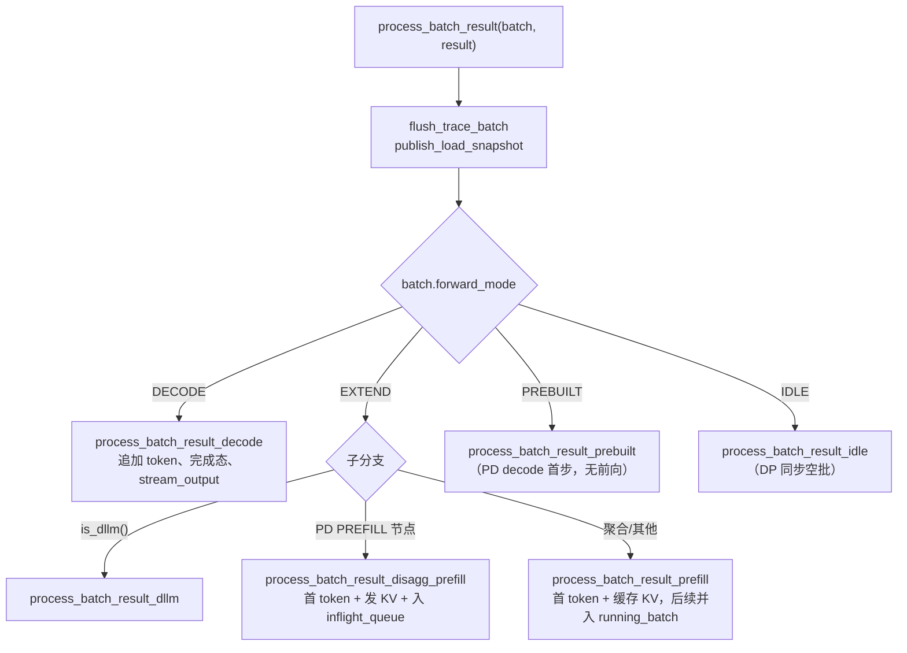

注意这里的分派维度：**同为 extend 批，PD prefill 节点走 `process_batch_result_disagg_prefill`，聚合模式走 `process_batch_result_prefill`**。

### 4.8.1 普通 prefill 结果处理 `process_batch_result_prefill`

对每个请求：把前向采样出的**首个 token** 追加到 `output_ids`、更新完成态、写 KV 缓存、处理 logprob/grammar；若是分块 prefill 的中间块，则只递减 `inflight_middle_chunks` 并跳过流式输出：

```358:384:python/sglang/srt/managers/scheduler_components/batch_result_processor.py
                # 中译：没有待处理的中间 chunk，说明本次是该请求的 prefill 收尾结果。
                if req.inflight_middle_chunks <= 0:
                    req.time_stats.set_prefill_finished_time()
                    if req.beam_group is not None:
                        # 中译：beam 请求交给协调器提交，不走普通的单 token 追加逻辑。
                        self.beam_coordinator.commit_prefill(
                            req, up_to_tick=batch.forward_iter
                        )
                    else:
                        # req output_ids are set here
                        # 中译：普通请求追加首 token，并检查停止条件；可能首 token 后就结束。
                        req.output_ids.append(next_token_id)
                        self._maybe_update_reasoning_tokens(req, next_token_id)
                        req.update_finish_state()
                    if req.finished():
                        # 中译：先收集需要返回的辅助结果，再释放请求占用的 KV 资源。
                        self._maybe_collect_routed_experts(req)
                        self._maybe_collect_indexer_topk(req)
                        release_kv_cache(req, self.tree_cache)
                        req.time_stats.set_completion_time()
                    elif not batch.decoding_reqs or req not in batch.decoding_reqs:
                        # 中译：缓存本次新完成 prefill 的未结束请求；不重复处理混合批中的 decode 请求。
                        maybe_cache_unfinished_req(req, self.tree_cache)
                        ...
                else:
                    # being chunked reqs' prefill is not finished
                    # 中译：中间 chunk 只推进在途计数，本轮不把它的采样结果作为正式输出。
                    req.inflight_middle_chunks -= 1
                    skip_stream_req = req
```

**执行流程图**：

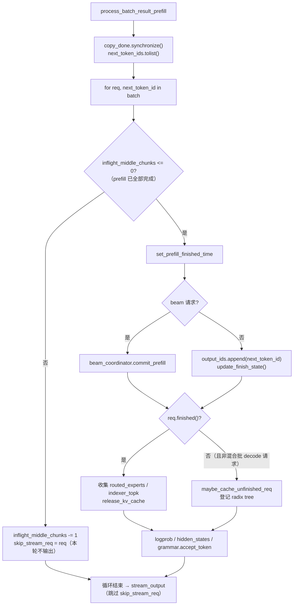

### 4.8.2 普通 decode 结果处理 `process_batch_result_decode`

逐请求把新 token（非投机 1 个，投机一步可接受多个）追加进 `output_ids`，推进完成态，处理 logprob/hidden states/grammar，最后统一 `stream_output` 并上报 decode 指标：

```1022:1060:python/sglang/srt/managers/scheduler_components/batch_result_processor.py
        for i, req in enumerate(batch.reqs):
            req: Req
            ...
            if (self.enable_overlap or self.enable_overlap_mlx) and (
                req.finished() or req.is_retracted
            ):
                # 中译：overlap 延迟消费结果，快照中的请求可能已完成或回退，跳过以防重复提交。
                continue

            # 中译：非投机解码每步只接受 1 个 token；投机（v2）解码一步可能接受多个 token。
            next_token_id = next_token_ids[i]
            is_spec = not batch.spec_algorithm.is_none()

            # 中译：next_token_id 在这里是本步接受的 token 列表；统一追加并统计接受长度。
            req.output_ids.extend(next_token_id)
            new_accept_len = len(next_token_id)

            self._maybe_update_reasoning_tokens(req, next_token_id)
            req.time_stats.set_last_decode_finish_time()
            req.update_finish_state(new_accept_len)

            # 中译：根据最新完成态处理资源释放、辅助结果及 grammar 等逐请求收尾。
            self._handle_finish_state_updated_req(req, batch, result, i, logits_output)
```

**执行流程图**：

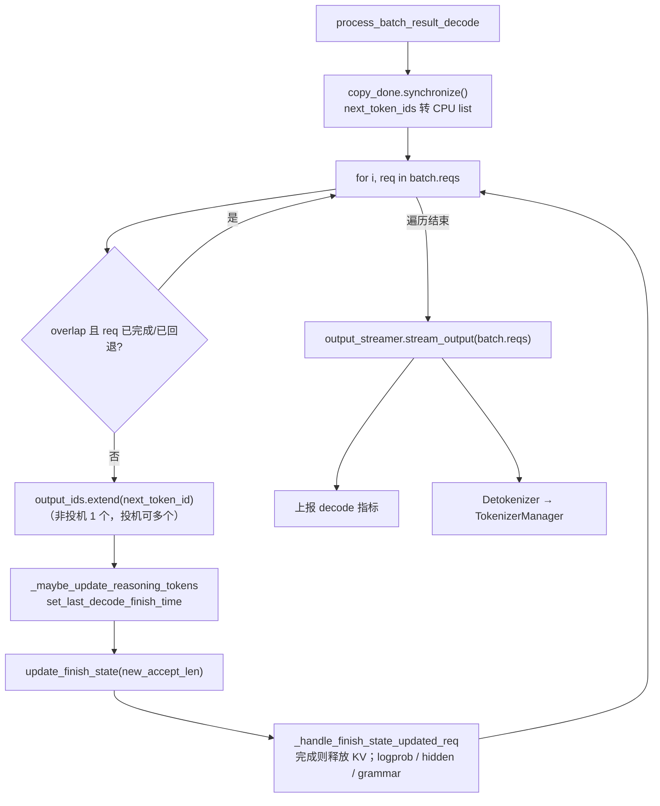

最后 `self.output_streamer.stream_output(batch.reqs, batch.return_logprob)` 把新 token 交给 `OutputStreamer`，经 Detokenizer 转文本后回传给 TokenizerManager（第 ⑤ 节）。

> 至此「聚合模式」的完整链路已讲清。下面的 §4.9~§4.11 讲 **PD 分离**：把 prefill 与 decode 拆到两组实例后，两侧各自如何组织循环。

> **旁注：PD-Multiplexing（`--enable-pdmux`）** 是另一条路线——不拆实例，而在**同一张 GPU** 上用 green context 把 SM 切成多组，一部分跑 prefill、一部分跑 decode，各占一条 CUDA stream 并发（`event_loop_pdmux`）。P/D 算力被切开，但共享同一份权重与 KV，因而**无需跨卡传输**；本质是共卡混合调度，而非真正的分离。

## 4.9 PD 分离（Prefill/Decode Disaggregation）总览

**动机**：prefill（一次性算完整个 prompt，计算密集、显存瞬时压力大）与 decode（逐 token 生成，访存密集、长尾）对硬件的偏好不同；且 prefix cache 命中率高的场景下，单个实例同时做 prefill 与 decode 会互相干扰（prefill 长任务会拉高 decode 的 TPOT）。把两者拆到不同实例，可分别按比例扩容，并用高速网络把 KV cache 从 prefill 实例搬到 decode 实例。

**角色与数据流**：

```text
 客户端 ──►  Prefill 实例(P节点)                        Decode 实例(D节点)
            ①握手 bootstrap  ◄──────── bootstrap_room ───────┐
            ②prefill 前向，算 KV                             │
            ③首 token + KV ───────── RDMA/Mooncake ─────────► │ ④落 KV、得首 token
                                                              └► ⑤进入正常 decode 循环
```

- 请求携带 `bootstrap_host / bootstrap_port / bootstrap_room` 三个字段（在第 ② 层 `GenerateReqInput` 中定型，见原文 §2.3），用来让 P、D 两侧把同一个请求**配对**。
- **`bootstrap_room`** 是配对键：decode 侧先发起握手（`bootstrap_room`），prefill 侧据此找到对应的 KV 落点并回填。
- KV 传输后端由 `disaggregation_transfer_backend` 决定（Mooncake / NIXL / Mori / Ascend 等），`get_kv_class` 按后端类型给出 `KVManager / Sender / Receiver` 的实现。

**四条队列（分离架构的记忆点）**：

| 侧 | 队列 | 语义 |
| --- | --- | --- |
| Prefill | `disagg_prefill_bootstrap_queue` | 握手/预分配尚未完成的请求（`PrefillBootstrapQueue`） |
| Prefill | `disagg_prefill_inflight_queue` | 已算完 KV、正在把 KV 发往 D 节点的请求（一个 list） |
| Decode | `disagg_decode_prealloc_queue` | 正在（或等待）预分配本地 KV 空间的请求（`DecodePreallocQueue`） |
| Decode | `disagg_decode_transfer_queue` | 已分配好落点、正在轮询等待 KV 到达的请求（`DecodeTransferQueue`） |

这些队列在 `init_disaggregation` 中按模式创建（`scheduler.py:1437-1602`）。以 decode 侧为例：

```1512:1542:python/sglang/srt/managers/scheduler.py
            # The decode requests polling kv cache
            # 中译：传输队列轮询已分配落点的请求；KV 和元数据就绪后才能进入等待队列。
            self.disagg_decode_transfer_queue = DecodeTransferQueue(
                gloo_group=self.attn_tp_cpu_group,
                req_to_metadata_buffer_idx_allocator=self.req_to_metadata_buffer_idx_allocator,
                tp_rank=self.ps.tp_rank,
                metadata_buffers=self.disagg_metadata_buffers,
                scheduler=self,
                tree_cache=self.tree_cache,
            )

            # The decode requests pending for pre-allocation
            # 中译：预分配队列管理握手与资源准入，使用请求池/KV 池为接收数据准备本地落点。
            self.disagg_decode_prealloc_queue = DecodePreallocQueue(
                req_to_token_pool=self.req_to_token_pool,
                token_to_kv_pool_allocator=self.token_to_kv_pool_allocator,
                ...
                bootstrap_port=get_disagg().disaggregation_bootstrap_port,
                ...
            )
```

**执行流程图**（一条请求在 P/D 两侧队列间的完整流转）：

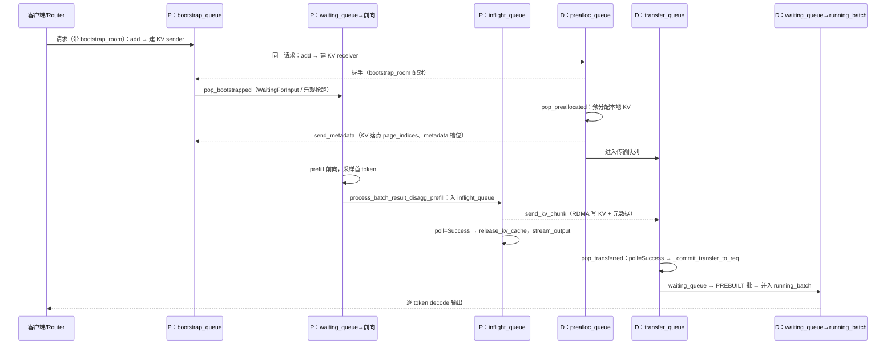

**元数据缓冲（metadata buffer）**：KV 传输之外，还要把 prefill 侧产出的**首 token、logprob、hidden states、cached_tokens、多模态 token 计数**等「随 KV 一起走」的元数据带给 decode 侧。这套数据放在一块独立的 `MetadataBuffers` 中，每个请求占用一个槽位（`metadata_buffer_index`）。decode 侧 `_commit_transfer_to_req` 会校验 `bootstrap_room` 是否与元数据里的一致，以检测槽位碰撞/上下文错乱（`decode.py:2264-2334`）。

## 4.10 事件循环一：Prefill 节点

### 4.10.1 非重叠版 `event_loop_normal_disagg_prefill`

```692:733:python/sglang/srt/disaggregation/prefill.py
    def event_loop_normal_disagg_prefill(self: Scheduler) -> None:
        """A normal scheduler loop for prefill worker in disaggregation mode."""
        while True:
            # 中译：接收请求。接收新到达的请求并做输入处理（其中会为新请求创建 sender 并放入 bootstrap 队列）。
            recv_reqs = self.request_receiver.recv_requests()
            self.process_input_requests(recv_reqs)
            # 中译：暂停时仍可处理控制请求，但本轮不推进组批与前向。
            if self._engine_paused:
                continue
            # 中译：把握手已就绪的请求（或允许乐观抢跑的请求）移入 waiting_queue。
            self.waiting_queue.extend(
                self.disagg_prefill_bootstrap_queue.pop_bootstrapped()
            )

            # 中译：组取下一个要跑的批次。
            plan = self.get_next_disagg_prefill_batch_to_run(
                running_batch=self.running_batch, last_batch=self.last_batch
            )
            self.running_batch = plan.running_batch
            batch = plan.batch_to_run
            batch = self.ngram_embedding_manager.prepare_for_forward(
                batch, chunked_req=self.chunked_req
            )
            self.cur_batch_for_debug = batch

            # 中译：启动当前批次。
            if batch:
                # 中译：若开启 staging，提前触发 decode 端 staging 预分配以重叠时延。
                if self.enable_staging:
                    self.maybe_prefetch_staging_for_batch(batch)
                # 中译：运行前向并处理结果（产出首 token、缓存 KV、发起 KV 传输、入在途队列）。
                result = self.run_batch(batch)
                self.process_batch_result(batch, result)
            else:
                # 中译：无批可跑时执行空闲自检/状态重初始化。
                self.on_idle()

            # 中译：轮询在途传输队列，完成传输的请求会被回收并向客户端返回。
            self.process_disagg_prefill_inflight_queue()
            self.last_batch = batch
```

**执行流程图**：

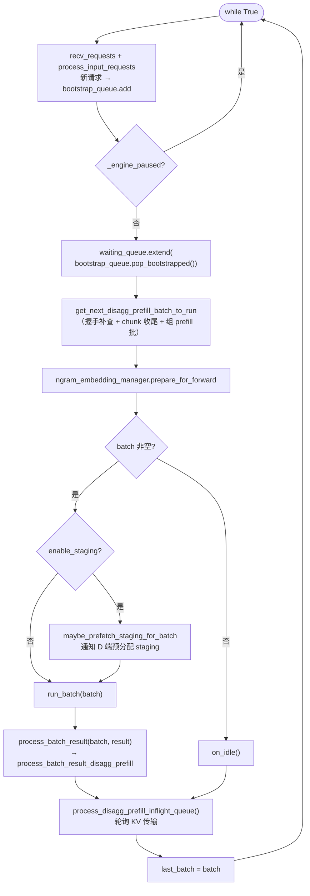

与聚合版 `event_loop_normal` 的差别：

1. 多了 `pop_bootstrapped()`：把 bootstrap 完成的请求从 bootstrap 队列「毕业」到 `waiting_queue`（§4.10.2）。
2. 选了 `get_next_disagg_prefill_batch_to_run` 而非 `get_next_batch_to_run`：prefill 节点**不需要进入 `update_running_batch`**（它不跑 decode），并额外处理分块 prefill 的收尾。
3. 每轮末尾多调 `process_disagg_prefill_inflight_queue()`：轮询 KV 传输是否完成（§4.10.5）。
4. `if self.enable_staging`：提前把 staging 需求发给 D 节点，让 D 端在前向计算期间并行预分配，降低端到端时延。

### 4.10.2 bootstrap：从握手到可调度

新请求先经 `PrefillBootstrapQueue.add` 创建 KV sender 并入队（`prefill.py:453-462`）。队列的 `pop_bootstrapped` 每个循环轮询 sender 的握手状态并分流（`prefill.py:483-583`）：

- **`WaitingForInput`**：握手完成、等待输入 → `finalize_bootstrap`（分配 `metadata_buffer`、`sender.init(num_pages, ...)`）→ 移入 `waiting_queue`；
- **`Bootstrapping`**：仍在握手。若允许**乐观 prefill**（`optimistic_prefill_attempts`）且还有重试额度，则先「抢跑」进入 `waiting_queue` 参与前向，稍后再校验握手结果；
- **`Failed`**：握手失败 → `handle_bootstrap_failure`（中止请求、释放资源、回包），从队列剔除。

**执行流程图**（`pop_bootstrapped`）：

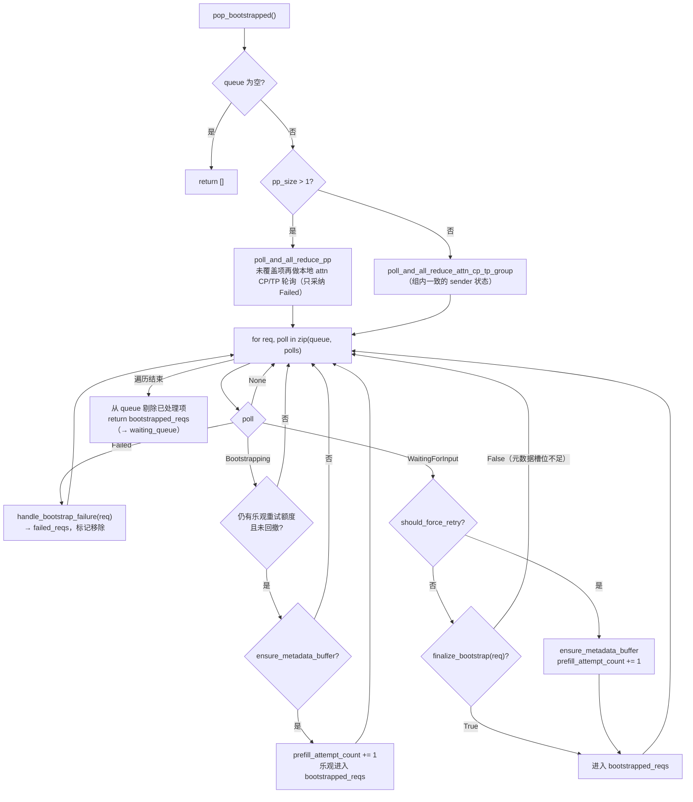

`finalize_bootstrap` 还会从 sender 取 `decode_prefix_len`（D 端已缓存的前缀长度），据此把待发送 KV 从 `decode_prefix_len` 起算，避免重复传输：

```427:451:python/sglang/srt/disaggregation/prefill.py
    def finalize_bootstrap(self, req: Req) -> bool:
        """Initialize the sender after bootstrap completes.
        Returns False if no metadata buffer is available (non-terminal)."""
        # 中译：同一轮握手只能完成一次；重复 finalize 会破坏 sender/元数据槽位状态。
        assert req.pending_bootstrap, "finalize_bootstrap is not idempotent"
        # 中译：元数据槽位不足只是暂时无法推进，返回 False 等后续重试，不直接中止请求。
        if not self.ensure_metadata_buffer(req):
            return False
        req.time_stats.set_bootstrap_done_time()
        # 中译：D 端已有的前缀无需重复传输；发送游标从此前缀之后开始。
        decode_prefix_len = req.disagg_kv_sender.pop_decode_prefix_len()
        num_kv_indices = len(req.origin_input_ids)
        req.start_send_idx = decode_prefix_len
        req.disagg_decode_prefix_len = decode_prefix_len
        # 中译：把尚需发送的 token 数换算为 KV 页数，交给 sender 跟踪传输规模。
        num_kv_indices_to_send = num_kv_indices - decode_prefix_len
        num_pages = kv_to_page_num(
            num_kv_indices_to_send,
            self.scheduler.token_to_kv_pool_allocator.page_size,
        )
        # 中译：绑定传输页数和元数据槽位；清除待握手标记后，后续可正常发送 KV。
        req.disagg_kv_sender.init(num_pages, req.metadata_buffer_index)
        req.pending_bootstrap = False
        return True
```

### 4.10.3 组批与分块 prefill 收尾

```662:689:python/sglang/srt/disaggregation/prefill.py
    def get_next_disagg_prefill_batch_to_run(
        self: Scheduler,
        running_batch: ScheduleBatch,
        last_batch: Optional[ScheduleBatch],
    ) -> NextBatchPlan:
        self.process_pending_chunked_abort()

        # HACK (byronhsu): reset the batch_is_full flag because we never enter update_running_batch which resets it
        # 中译：P 端不走 decode 的 update_running_batch，需在这里自行重置满批标记。
        running_batch.batch_is_full = False

        # 中译：补查乐观请求的握手状态，按状态完成初始化或处理失败。
        self.resolve_waiting_queue_bootstrap()
        # 中译：处理上轮遗留 chunk，推进分块请求，并按需发送已完成部分的 KV。
        self.process_prefill_chunk(last_batch=last_batch, running_batch=running_batch)

        # 中译：复用通用 prefill 组批器；P 端不会转入正常 decode 选批分支。
        prefill_plan = self.get_new_batch_prefill(running_batch)
        batch = prefill_plan.batch_to_run
        running_batch = prefill_plan.running_batch
        # 中译：需要时补齐各 DP rank 的 MLP 同步批，避免部分 rank 缺席 collective。
        batch = self.dp_attn_adapter.maybe_prepare_mlp_sync_batch(batch)

        if batch:
            set_schedule_time_batch(batch)
        return NextBatchPlan(batch_to_run=batch, running_batch=running_batch)
```

**执行流程图**（含 `resolve_waiting_queue_bootstrap` 与 `process_prefill_chunk` 展开）：

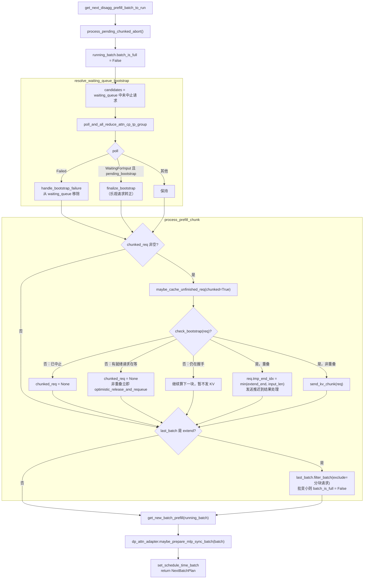

- `resolve_waiting_queue_bootstrap`：对刚进 `waiting_queue` 的乐观请求做二次握手校验，握手中途失败的直接中止；已完成的补做 `finalize_bootstrap`。
- `process_prefill_chunk`（`prefill.py:1277-1320`）：处理上一轮遗留的**分块（chunked）prefill** 请求——推进它、按需发送已完成部分的 KV、校验其握手状态。
- `get_new_batch_prefill`：与聚合模式共用同一套 prefill 攒批（`PrefillAdder`）。
- 直接返回，**不进入 `update_running_batch`**，因为 prefill 节点不跑 decode。

### 4.10.4 前向结果处理与 KV 传输发起：`process_batch_result_disagg_prefill`

这是 prefill 节点的核心收尾：对**已完成整个 prefill**的请求，产首 token、缓存 KV、把它加入**在途传输队列**并**发起 KV 传输**；对**仍在分块中**的请求，则只递减剩余分块计数、按需发送中间 chunk 的 KV。

```893:953:python/sglang/srt/disaggregation/prefill.py
        # 中译：按原批次顺序匹配请求与采样结果，strict=True 防止数量不一致时静默截断。
        for i, (req, next_token_id) in enumerate(
            zip(batch.reqs, next_token_ids, strict=True)
        ):
            # 中译：没有待处理的中间 chunk，才提交正式首 token 并进入最终传输收尾。
            if req.inflight_middle_chunks <= 0:
                req.time_stats.set_prefill_finished_time()
                ...
                # 中译：把采样出的首个 next token 追加到请求的输出序列。
                req.output_ids.append(next_token_id)
                # 中译：把已计算 KV 的缓存索引登记到 radix tree，便于前缀复用；不是重算 KV。
                maybe_cache_unfinished_req(req, self.tree_cache)
                # 中译：把请求加入"在途传输队列"，后续 process_disagg_prefill_inflight_queue 轮询。
                self.disagg_prefill_inflight_queue.append(req)
                ...
                # 中译：握手就绪后发送最后一段尚未发送的 KV，并附带首 token 等元数据。
                #       若仍在乐观握手中，先留在在途队列，待握手完成后再发。
                if not req.pending_bootstrap:
                    self.send_kv_chunk(req, last_chunk=True)
                req.time_stats.set_prefill_transfer_queue_entry_time()
                ...
            else:
                # 中译：这是中间 chunk 的结果，只推进计数，不提交正式输出 token。
                req.inflight_middle_chunks -= 1
                ...
                # 中译：重叠模式下，中间 chunk 跑完即可把这一块的 KV 先发出去（last_chunk=False）。
                if self.enable_overlap and not req.pending_bootstrap:
                    self.send_kv_chunk(req, last_chunk=False, end_idx=req.tmp_end_idx)
```

**执行流程图**：

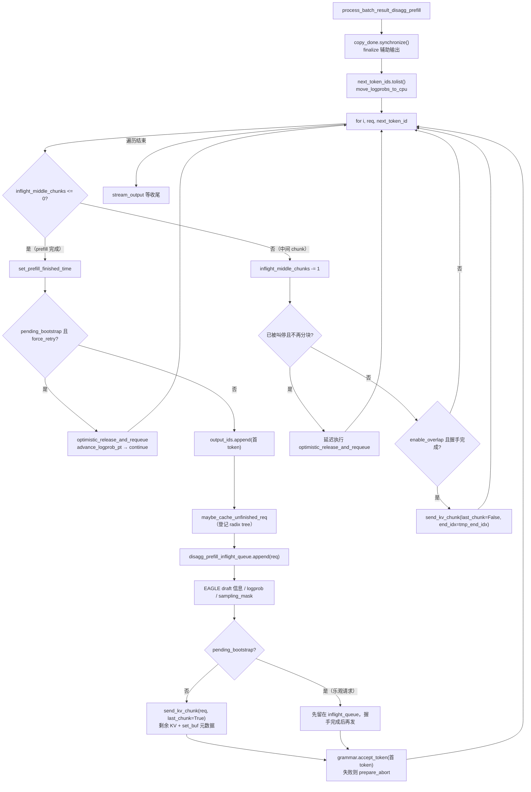

与普通 `process_batch_result_prefill` 的差异：

1. **不在本节点做 decode**：产出首 token 后立刻把 KV 传给 decode 节点，`max_new_tokens` 被强制为 1（`_process_req`，`prefill.py:475-481`）。
2. **乐观 bootstrap 的副作用前校验**：请求可能在握手未完成时就乐观进入前向，这里在产生副作用（追加 token、缓存、入队）前会再次轮询握手状态，失败则 `optimistic_release_and_requeue` 回退重排队。
3. **分块 prefill 的增量传输**：非重叠模式下中间 chunk 的 KV 在 `process_prefill_chunk` 里发；重叠模式下延后到 `process_batch_result_disagg_prefill`（此时结果已解析），用 `req.tmp_end_idx` 作为分块边界。

`send_kv_chunk`（`prefill.py:1361`）把 `[start_send_idx, end_idx)` 区间对应的 KV 页发给 D 节点；`last_chunk=True` 时额外 `set_buf` 写入元数据（首 token、logprob、hidden states 等），并处理 Mamba/SWA 等「状态页」。开启 `SGLANG_DISAGG_PREFILL_EARLY_SEND_CACHED_PREFIX` 时，还会在 forward 之前**提前发已缓存的前缀 KV**（`maybe_send_cached_prefix_chunk`，`prefill.py:1322-1359`），与前向重叠。

### 4.10.5 轮询在途传输：`process_disagg_prefill_inflight_queue`

```1040:1111:python/sglang/srt/disaggregation/prefill.py
    def process_disagg_prefill_inflight_queue(
        self: Scheduler, rids_to_check: Optional[List[str]] = None
    ) -> List[Req]:
        """Poll the requests in the middle of transfer. If done, return the request.
        ...
        """
        if len(self.disagg_prefill_inflight_queue) == 0:
            return []
        done_reqs = []
        # 中译：轮询 sender，并在 attention CP/TP 组内汇总状态，保证各 rank 一致推进队列。
        polls = poll_and_all_reduce_attn_cp_tp_group(
            [req.disagg_kv_sender for req in self.disagg_prefill_inflight_queue],
            self.attn_cp_cpu_group,
            self.attn_tp_cpu_group,
        )
        undone_reqs: List[Req] = []
        for req, poll in zip(self.disagg_prefill_inflight_queue, polls):
            ...
            if poll in [KVPoll.WaitingForInput, KVPoll.Transferring]:
                # 中译：尚未完成，保留请求及其 KV 引用，供下一轮继续轮询。
                undone_reqs.append(req)
            elif poll == KVPoll.Success:  # transfer done
                # 中译：P 端职责结束；已有中止原因需保留，不能被正常完成标记覆盖。
                if not isinstance(req.finished_reason, FINISH_ABORT):
                    req.finished_reason = FINISH_LENGTH(length=0)
                # 中译：传输完成后才解除 KV 引用/锁并清理 sender，避免传输中释放源数据。
                release_kv_cache(req, self.tree_cache)  # unlock the tree
                req.disagg_kv_sender.clear()
                done_reqs.append(req)
                req.time_stats.set_prefill_kv_transfer_finish_time()
            elif poll == KVPoll.Failed:
                # 中译：失败走中止与资源清理路径，同样从在途请求中移出。
                self.handle_inflight_transfer_failure(req)
                done_reqs.append(req)
            ...
```

**执行流程图**：

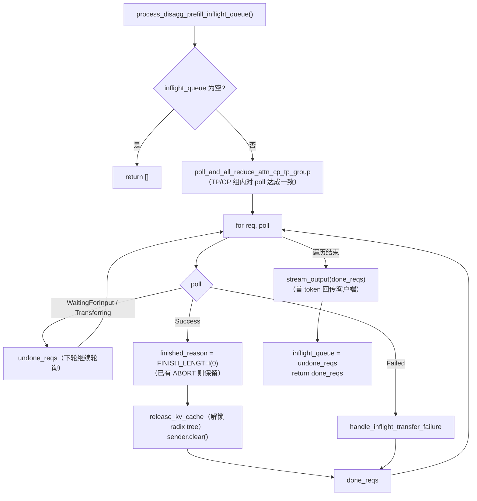

传输成功 → 解锁该请求在 radix tree 中的 KV、`sender.clear()`、标记完成（`FINISH_LENGTH(length=0)`，因为首 token 已产出、prefill 节点职责结束），最后 `stream_output` 把首 token 流式发给客户端。传输失败 → `handle_inflight_transfer_failure` 中止。注意 `poll_and_all_reduce_attn_cp_tp_group`：TP/CP 组内各 rank 必须**对 poll 结果达成一致**，否则队列推进会出现分歧。

### 4.10.6 重叠版 `event_loop_overlap_disagg_prefill`

与聚合版 `event_loop_overlap` 同构，只是把「选批」换成 `get_next_disagg_prefill_batch_to_run`，并在每轮末尾加 `process_disagg_prefill_inflight_queue` / `launch_batch_sample_if_needed`：

```742:794:python/sglang/srt/disaggregation/prefill.py
    def event_loop_overlap_disagg_prefill(self: Scheduler) -> None:
        # 中译：本批结果先入队，下一轮才消费，让 P 端也能隐藏 CPU 调度与收尾开销。
        self.result_queue = deque()
        while True:
            # 中译：收新请求与控制请求；新生成请求先进入 bootstrap 流程。
            recv_reqs = self.request_receiver.recv_requests()
            self.process_input_requests(recv_reqs)
            if self._engine_paused:
                continue
            # 中译：放行握手已就绪或允许乐观抢跑的请求，再处理 chunk 并组 prefill 批。
            self.waiting_queue.extend(
                self.disagg_prefill_bootstrap_queue.pop_bootstrapped()
            )
            plan = self.get_next_disagg_prefill_batch_to_run(
                running_batch=self.running_batch, last_batch=self.last_batch
            )
            ...
            if batch:
                if self.enable_staging:
                    # 中译：提前通知 D 端准备 staging 空间，与 P 端计算重叠。
                    self.maybe_prefetch_staging_for_batch(batch)
                # 中译：先提交本批，再给后续调度写入加 WAR 依赖并保存批次快照。
                batch_result = self.run_batch(batch)
                self._apply_war_barrier()
                self.result_queue.append((batch.copy(), batch_result))
            else:
                batch_result = None

            if self.last_batch:
                # 中译：此处消费上批结果，提交首 token/分块进度并按需发起 KV 发送。
                tmp_batch, tmp_result = self.result_queue.popleft()
                self.process_batch_result(tmp_batch, tmp_result)
            elif batch is None:
                # 中译：没有前向待执行或结果待处理时做空闲维护；随后仍会轮询在途传输。
                self.on_idle()

            # 中译：KV 传输独立推进，成功后才能释放 P 端请求占用的相关资源。
            self.process_disagg_prefill_inflight_queue()
            # 中译：若本批采样依赖上批状态，在上批结果处理完后补交采样。
            self.launch_batch_sample_if_needed(batch_result, batch)
            self.last_batch = batch
```

**执行流程图**：

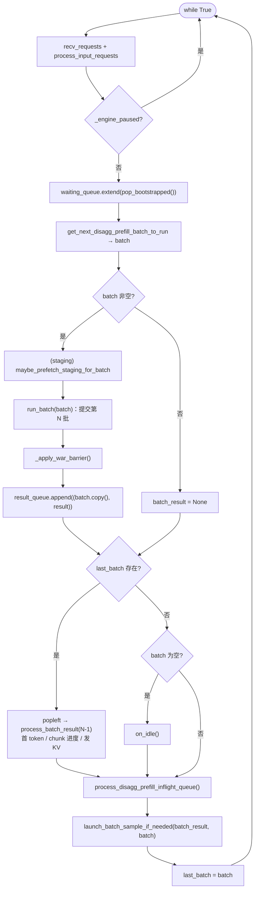

## 4.11 事件循环二：Decode 节点

Decode 节点拿到的是「KV 已由 P 节点算好」的请求，它自己**不再算 prefill**，而是把请求沿「预分配 → 传输 → 等待」三级队列推进，KV 到齐后作为 **PREBUILT 批**直接进入 decode。

### 4.11.1 队列流转：`process_decode_queue`

```2917:2983:python/sglang/srt/disaggregation/decode.py
    def process_decode_queue(self: Scheduler):
        """推进 decode 端 PD 分离请求在各生命周期队列间的流转。
        中译：这是 decode 端每轮事件循环都会调用的核心驱动函数，负责把请求沿着
              「预分配队列 → 传输队列 → 等待队列」逐级推进。它并不做真实的解码前向，
              只负责队列间的状态搬运与准入控制。整体分为四步：
              1. 处理 HiCache 异步事件与 KV 卸载进度（若启用）；
              2. 优先恢复被回退（retracted）的请求——只有回退队列清空后才接纳新请求；
              3. 按轮询间隔（polling_interval）节流，避免每轮都做昂贵的跨 rank 轮询；
              4. 在轮询周期到达时，把已预分配好的请求送入传输队列，并把「KV 已到达」
                 的请求移入等待队列，交给后续 get_next_disagg_decode_batch_to_run 构批解码。
        """
        ...
        # 中译：优先恢复因资源压力回退的请求；恢复成功后直接重新进入等待队列。
        resumed_reqs = self.disagg_decode_prealloc_queue.resume_retracted_reqs()
        self.waiting_queue.extend(resumed_reqs)
        if len(self.disagg_decode_prealloc_queue.retracted_queue) > 0:
            # 中译：若回退队列仍未清空，则本轮不接纳新请求。
            return
        ...
        # 中译：轮询计数归零才执行预分配/传输检查，减少跨 rank 协调开销。
        self.polling_count = (self.polling_count + 1) % self.polling_interval
        if self.polling_count % self.polling_interval == 0:
            # 中译：完成本地 KV 预分配并告知 P 端落点后，将连接移入传输队列。
            req_conns, _ = self.disagg_decode_prealloc_queue.pop_preallocated()
            self.disagg_decode_transfer_queue.extend(req_conns)
            # 中译：确认 KV 到达并提交首 token 等元数据，取回可进入后续调度的 Req。
            transferred_reqs = (
                self.disagg_decode_transfer_queue.pop_transferred()
            )  # the requests which kv has arrived
            ...
            # 中译：只有传输/恢复已就绪的请求，才进入等待队列供 PREBUILT 组批。
            self.waiting_queue.extend(transferred_reqs)
```

**执行流程图**：

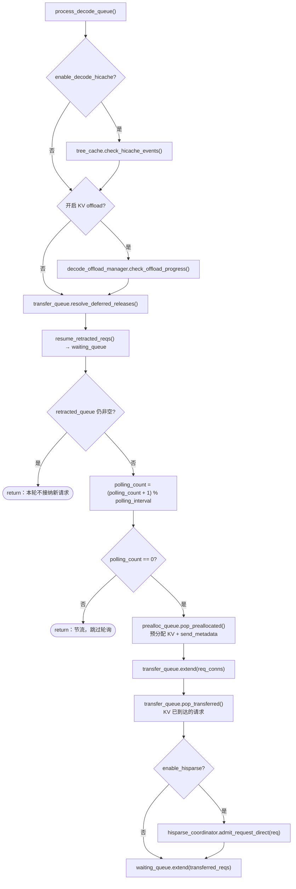

四个要点：

1. **优先恢复回退请求**：`resume_retracted_reqs()` 尝试把此前因显存不足被换出的请求重新预分配；只要 `retracted_queue` 非空，本轮就**不接纳新请求**，避免新请求继续抢占显存导致回退请求长期饿死。
2. **轮询节流**：跨 rank 的 poll 开销大，用 `polling_interval` 控制「多少轮才真正做一次队列推进」。
3. **`pop_preallocated` → `extend` 传输队列**：把已完成 KV 预分配的请求送入传输队列，此刻才向 P 端正式告知「KV 落点」。
4. **`pop_transferred` → `waiting_queue`**：KV 到达的请求进入等待队列，后续由构批逻辑取出。

### 4.11.2 请求的包装：`DecodeRequest`

decode 侧用一个包装类承载握手与传输的运行时状态，它随请求在预分配队列与传输队列间流转，KV 传输完成后 `kv_receiver` 被置 `None`，包装使命结束：

```337:358:python/sglang/srt/disaggregation/decode.py
class DecodeRequest:
    """decode 侧对一个请求的包装，贯穿「预分配 → 传输」两个队列的生命周期。
    ...
    """
    req: Req                              # 原始请求：保存输入、输出及采样等状态。
    kv_receiver: CommonKVReceiver         # 本请求的接收器：握手、告知落点并轮询传输。
    waiting_for_input: bool = False        # 握手已进入等待输入态，后续可尝试预分配。
    metadata_buffer_index: int = -1        # 首 token 等元数据的槽位；-1 表示未分配。
    is_rebootstrap: bool = False           # 是否属于重新 bootstrap 的请求。
```

`add` 时会为该请求创建 KV receiver 并尝试解析 `prefill_dp_rank`（快路径查本地缓存，未命中则进 `pending_reqs` 走慢路径）：

```705:745:python/sglang/srt/disaggregation/decode.py
    def add(
        self, req: Req, is_retracted: bool = False, is_rebootstrap: bool = False
    ) -> None:
        ...
        if is_retracted:
            # 中译：回退请求走恢复队列，不按新请求立即创建 receiver/重新握手。
            req.retraction_mb_id = None
            self.retracted_queue.append(req)
        else:
            # 中译：创建 DecodeRequest 与接收器；完成包装不等于 KV 已到达。
            decode_req = self._create_receiver_and_enqueue(
                req, is_rebootstrap=is_rebootstrap
            )
            if _is_fake_transfer(req):
                # 中译：模拟传输路径使用固定 rank 初始化，跳过真实的 P 端 rank 查询。
                decode_req.kv_receiver.init(0)
                return
            # Fast path: cache-only lookup, no network calls
            # 中译：先查本地缓存解析 P 端 DP rank，避免在请求接收路径上阻塞网络查询。
            prefill_dp_rank = self._resolve_prefill_dp_rank(req)
            if prefill_dp_rank is not None:
                decode_req.kv_receiver.init(prefill_dp_rank)
                return
            # 中译：缓存未命中，交给 pending 队列的异步查询路径继续处理。
            self.pending_reqs.append(decode_req)
```

**执行流程图**（`DecodePreallocQueue.add` 与 `DecodeRequest` 生命周期）：

```mermaid
flowchart TD
    A["prealloc_queue.add(req, is_retracted)"] --> B{"is_retracted?"}
    B -- 是 --> B1["retraction_mb_id = None<br/>→ retracted_queue（等 resume）"]
    B -- 否 --> C["_create_receiver_and_enqueue<br/>包装 DecodeRequest(req, kv_receiver) → queue"]
    C --> D{"_is_fake_transfer?"}
    D -- 是 --> D1["kv_receiver.init(0)"]
    D -- 否 --> E["_resolve_prefill_dp_rank(req)<br/>查本地缓存"]
    E --> F{"命中?"}
    F -- 是 --> F1["kv_receiver.init(prefill_dp_rank)<br/>发起握手"]
    F -- 否 --> F2["pending_reqs（异步查询 rank）"]
    F2 -. "prefetch_prefill_dp_rank_queries /<br/>_resolve_pending_reqs" .-> F1
    F1 --> G["握手进入 WaitingForInput<br/>waiting_for_input = True"]
    D1 --> G
    G --> H["pop_preallocated：分配 KV、metadata_buffer_index<br/>→ transfer_queue"]
    H --> I["pop_transferred：Success → _commit_transfer_to_req"]
    I --> J["kv_receiver = None，释放 metadata 槽位<br/>返回原始 Req → waiting_queue"]
```

### 4.11.3 `pop_preallocated`：预分配 KV 并告知落点

`pop_preallocated`（`decode.py:1202`）在各项预算允许的前提下，为已握手请求逐个预分配本地 KV 空间。两条约束值得记住：

- **反死锁约束**：必须保证「在途 token 数 + 可分配 token 数」大于每个在途请求的最大输入+输出长度；否则可能出现「正在 decode 的请求 OOM，而其它请求都卡在无法回退的传输队列里」的死锁（`decode.py:1225-1253`）。
- **超限即中止**：预分配失败的请求（`FINISH_ABORT`）被清出队并 `stream_output` 回包给客户端。

预分配完成后，D 端把「KV 落点」通过 `send_metadata` 告知 P 端，P 端据此开始 RDMA 写。

**执行流程图**：

```mermaid
flowchart TD
    A["pop_preallocated()"] --> B["_resolve_pending_reqs()<br/>_update_handshake_waiters()"]
    B --> C["retractable_tokens = running_batch 已占 token<br/>计算 full/SWA 可分配预算，扣除 HiCache 待回载"]
    C --> D{"开启优先级调度?"}
    D -- 是 --> D1["queue 按 priority 排序"]
    D -- 否 --> E
    D1 --> E["第一步：扫描 FINISH_ABORT<br/>stream_output + receiver.clear → failed_reqs"]
    E --> F["计算 hisparse_req_budget"]
    F --> G["第二步：for decode_req in queue（FIFO）"]
    G --> H{"已移除 或 未 waiting_for_input?"}
    H -- 是 --> G
    H -- 否 --> I{"req_pool / metadata_buffer /<br/>hisparse 预算耗尽?"}
    I -- 是 --> Z(["break"])
    I -- 否 --> J{"启用 decode radix cache?"}
    J -- 是 --> J1["_match_prefix_and_lock<br/>prefix_len(L1) / total_prefix_len(L1+L2+L3)<br/>刷新加锁后的预算"]
    J -- 否 --> J2["prefix_len = 0<br/>required = _pre_alloc_fill_len"]
    J1 --> K{"需求 token > 可分配<br/>（含反死锁约束）?"}
    J2 --> K
    K -- 是 --> K1["释放前缀锁 → break"]
    K -- 否 --> L["_pre_alloc(req, prefix...)<br/>→ dst_kv_indices"]
    L --> M["(HiCache) _start_hicache_prefetch<br/>刷新下一项预算"]
    M --> N["取前缀之后的 delta kv_indices<br/>构造 Mamba/SWA/DSA 等 state_indices"]
    N --> O["分配 metadata_buffer_index"]
    O --> P["kv_receiver.send_metadata(page_indices,<br/>metadata_buffer_index, state_indices)"]
    P --> Q["preallocated_reqs.append，标记移除"]
    Q --> G
    G -- "遍历结束" --> R["queue 剔除已处理项<br/>return preallocated_reqs, failed_reqs"]
    Z --> R
    K1 --> R
```

### 4.11.4 `pop_transferred`：KV 到达后提交结果

```2545:2569:python/sglang/srt/disaggregation/decode.py
            elif poll == KVPoll.Success:
                # 中译：网络传输成功还不够；若命中的前缀仍在 HiCache 回载，继续等待。
                if (
                    self.scheduler.enable_decode_hicache
                    and hicache_restore_status == HiCacheRestoreResult.PENDING
                ):
                    continue
                # 中译：校验 bootstrap_room，并把首 token、logprob 等元数据写回 Req。
                self._commit_transfer_to_req(decode_req)
                indices_to_remove.add(i)
                if isinstance(decode_req.req.finished_reason, FINISH_ABORT):
                    # 中译：提交校验失败等中止情形走回包和清理，不能进入正常解码队列。
                    ...
                else:
                    # 中译：传输与元数据均就绪，返回原始 Req，后续进入 waiting_queue。
                    transferred_reqs.append(decode_req.req)
```

**执行流程图**：

```mermaid
flowchart TD
    A["pop_transferred()"] --> B{"queue 为空?"}
    B -- 是 --> B1["return []"]
    B -- 否 --> C["(HiCache) _process_hicache_local_restores"]
    C --> D["polls = _poll_with_staging() 或<br/>_poll_with_metadata_gate()"]
    D --> E["for decode_req, poll"]
    E --> F{"poll / HiCache 状态"}
    F -- "Failed 或 restore FAILED" --> G["prepare_abort + stream_output"]
    G --> G1{"D 端发起的 abort 且开启延迟释放?"}
    G1 -- 是 --> G2["_defer_release（等 P 端 drain）"]
    G1 -- 否 --> G3["release_kv_cache(is_insert=False)<br/>receiver.clear()"]
    F -- Success --> H{"HiCache restore PENDING?"}
    H -- 是 --> E
    H -- 否 --> I["_commit_transfer_to_req<br/>校验 bootstrap_room，写回首 token/logprob/cached_tokens"]
    I --> J{"FINISH_ABORT?（槽位错乱）"}
    J -- 是 --> J1["stream_output + release_kv_cache(is_insert=False)"]
    J -- 否 --> J2["transferred_reqs.append(req)"]
    F -- "Bootstrapping / WaitingForInput / Transferring" --> E
    G2 --> E
    G3 --> E
    J1 --> E
    J2 --> E
    E -- "遍历结束" --> K["逐项：unregister staging<br/>metadata_buffers.bootstrap_room[idx] = 0，free(idx)"]
    K --> L["queue 剔除已处理项<br/>return transferred_reqs"]
```

`_commit_transfer_to_req`（`decode.py:2264`）从 `metadata_buffer` 里取出 P 端写的首 token、`cached_tokens`、logprob、hidden states、多模态计数等，写回 `Req`：追加首 token、填充 `cached_tokens`、按需填投机解码的 topk/hidden states。随后请求进入 `waiting_queue`。

### 4.11.5 组批为 PREBUILT 批：`get_new_prebuilt_batch`

decode 侧的构批与聚合模式不同：它把 `waiting_queue` 里的请求组装成一个 **PREBUILT** 批（KV 已就绪，无需真跑前向）：

```2837:2915:python/sglang/srt/disaggregation/decode.py
    def get_new_prebuilt_batch(
        self: Scheduler, running_batch: ScheduleBatch
    ) -> Optional[ScheduleBatch]:
        """Create a schedulebatch for fake completed prefill"""
        # 中译：先领取 grammar 已准备好的请求，交回请求入队流程。
        if self.grammar_manager.has_waiting_grammars():
            ...
        if len(self.waiting_queue) == 0:
            return None
        ...
        can_run_list: List[Req] = []
        ...
        for i in range(len(self.waiting_queue)):
            req = self.waiting_queue[i]
            # 中译：仅接纳 running_batch 剩余容量允许的请求，避免超出并发/请求池上限。
            if i < num_not_used_batch:
                can_run_list.append(req)
                ...
                # 中译：整理下一轮输入与前缀状态；这一步不重新执行 prefill。
                req.init_next_round_input(tree_cache)
                if req.kv.kv_committed_len is not None:
                    # 中译：范围截至已提交的 KV，不能把尚未计算 KV 的末尾输出 token 算进去。
                    req.set_extend_range(
                        len(req.prefix_indices), req.kv.kv_committed_len
                    )
            else:
                # 中译：容量不足的请求留在等待队列，后续轮次再尝试接纳。
                waiting_queue.append(req)
        ...
        # 中译：组装批次并标记 PREBUILT；复用已接收的 KV，仅准备元数据。
        new_batch = ScheduleBatch.init_new(can_run_list, ...)
        new_batch.prepare_for_prebuilt()
        # 中译：此处省略的 process_prebuilt 会把首 token 等写入 FutureMap，供首次 decode 使用；
        #       overlap 下写入前还会添加 stream 依赖，防止旧的在途前向覆盖复用的槽位。
        ...
        return new_batch
```

`prepare_for_prebuilt`（`decode_schedule_batch_mixin.py:31-123`）把批标记为 `ForwardMode.PREBUILT`，为「首 token 已知、KV 已在本地」的场景组装前向所需的元数据（`req_pool_indices`、`seq_lens`、`out_cache_loc`、`sampling_info`），但**不重新分配/计算 KV**：

```38:46:python/sglang/srt/disaggregation/decode_schedule_batch_mixin.py
        # 标记为 PREBUILT 前向模式（区别于普通的 EXTEND / DECODE）。
        self.forward_mode = ForwardMode.PREBUILT
        reqs = self.reqs
        # PREBUILT never enters a model forward. ...
        # 中译：不把整段 prompt 再搬到 GPU 做 prefill，只整理已到达 KV 对应的批次元数据。
        seq_lens = []          # 各请求已有 KV 对应的序列长度。
        pre_lens = []          # 各请求的缓存前缀长度。
        req_pool_indices = []  # 请求池槽位，用于定位 KV 以及 FutureMap 中继行。
```

随后 `process_prebuilt`（`decode_schedule_batch_mixin.py:125`）把 prefill 传来的首 token 作为「首次迭代的输入」经 `future_map` 暂存，并让 grammar 接受首 token。

**执行流程图**：

```mermaid
flowchart TD
    A["get_new_prebuilt_batch(running_batch)"] --> B{"has_waiting_grammars?"}
    B -- 是 --> B1["get_ready_grammar_requests<br/>→ _add_request_to_queue"]
    B -- 否 --> C
    B1 --> C{"waiting_queue 为空?"}
    C -- 是 --> C0(["return None"])
    C -- 否 --> C1["(优先级) policy.calc_priority"]
    C1 --> D["num_not_used_batch =<br/>min(req_pool.size, max_running) - running_bs"]
    D --> E["for i, req in waiting_queue"]
    E --> F{"i < num_not_used_batch?"}
    F -- 否 --> F1["留在 waiting_queue"]
    F -- 是 --> G["can_run_list.append(req)<br/>init_next_round_input(tree_cache)"]
    G --> G1["set_extend_range(prefix_len, kv_committed_len)"]
    F1 --> E
    G1 --> E
    E -- "遍历结束" --> H{"can_run_list 为空?"}
    H -- 是 --> C0
    H -- 否 --> I["ScheduleBatch.init_new(can_run_list, ...)"]
    I --> J["prepare_for_prebuilt()<br/>forward_mode = PREBUILT，组 req_pool_indices/seq_lens 等"]
    J --> K{"enable_overlap?"}
    K -- 是 --> K1["schedule_stream.wait_stream(forward_stream)<br/>防止旧前向覆盖复用槽位"]
    K -- 否 --> L
    K1 --> L["process_prebuilt(future_map)"]
    L --> L1["逐请求：last_token = output_ids[-1]<br/>maybe_cache_unfinished_req<br/>grammar.accept_token（回退请求跳过）"]
    L1 --> L2{"投机解码?"}
    L2 -- 是 --> L3["build_disagg_draft_input → spec_info"]
    L2 -- 否 --> L4["future_map.stash(req_pool_indices, bonus_tokens)<br/>input_ids = None"]
    L3 --> M(["return new_batch"])
    L4 --> M
```

### 4.11.6 事件循环：`event_loop_normal/overlap_disagg_decode`

decode 侧事件循环结构清晰——每轮：**收请求 → `process_decode_queue`（推进三级队列）→ 组批 → 前向 → 处理结果**：

```2681:2721:python/sglang/srt/disaggregation/decode.py
    def event_loop_normal_disagg_decode(self: Scheduler):
        """A normal scheduler loop for decode worker in disaggregation mode."""
        while True:
            # Pending rooms from the prior cycle can overlap request intake and
            # 中译：提前查询上轮待解析请求的 P 端 DP rank，与本轮请求接收重叠。
            if not self._engine_paused:
                self.disagg_decode_prealloc_queue.prefetch_prefill_dp_rank_queries()
            recv_reqs = self.request_receiver.recv_requests()
            self.process_input_requests(recv_reqs)
            if self._engine_paused:
                continue
            # 中译：推进预分配/传输/恢复流程，把可用请求送入 waiting_queue。
            self.process_decode_queue()

            # 中译：先处理新到请求的 PREBUILT 状态，再选出本轮真正执行的 decode 批。
            plan = self.get_next_disagg_decode_batch_to_run(
                running_batch=self.running_batch
            )
            self.running_batch = plan.running_batch
            batch = plan.batch_to_run
            batch = self.ngram_embedding_manager.prepare_for_forward(
                batch, chunked_req=self.chunked_req
            )
            self.cur_batch_for_debug = batch

            if batch:
                # 中译：非重叠路径当轮等待并消费本批结果，之后才进入下一轮调度。
                result = self.run_batch(batch)
                self.process_batch_result(batch, result)
            else:
                # 中译：本轮没有可执行批，进行空闲维护，下轮仍继续检查传输状态。
                self.on_idle()

            self.last_batch = batch
```

**执行流程图**：

```mermaid
flowchart TD
    A(["while True"]) --> B{"_engine_paused?"}
    B -- 否 --> B1["prefetch_prefill_dp_rank_queries()<br/>预取 P 端 DP rank"]
    B -- 是 --> C
    B1 --> C["recv_requests + process_input_requests<br/>新请求 → prealloc_queue.add"]
    C --> D{"_engine_paused?"}
    D -- 是 --> A
    D -- 否 --> E["process_decode_queue()<br/>prealloc → transfer → waiting"]
    E --> F["get_next_disagg_decode_batch_to_run<br/>PREBUILT 收尾并入 + update_running_batch"]
    F --> G["ngram_embedding_manager.prepare_for_forward"]
    G --> H{"batch 非空?"}
    H -- 是 --> I["run_batch(batch)（DECODE 前向）"]
    I --> J["process_batch_result → process_batch_result_decode"]
    H -- 否 --> K["on_idle()"]
    J --> L["last_batch = batch"]
    K --> L
    L --> A
```

`get_next_disagg_decode_batch_to_run` 先把 `get_new_prebuilt_batch` 得到的 PREBUILT 批做结果处理 + 过滤 + 合并进 `running_batch`，再对 `running_batch` 走 `update_running_batch` 跑 decode：

```2802:2835:python/sglang/srt/disaggregation/decode.py
    def get_next_disagg_decode_batch_to_run(
        self: Scheduler, running_batch: ScheduleBatch
    ) -> NextBatchPlan:
        """Process prebuilt batch and schedule the next decode batch."""
        # 中译：接纳 KV 已就绪的请求，构造 PREBUILT 批并准备首次 decode 的输入中继。
        new_prebuilt_batch = self.get_new_prebuilt_batch(running_batch)
        if new_prebuilt_batch:
            assert self.chunked_req is None
            # 中译：直接处理 P 端已产生的首 token；不把 PREBUILT 当作普通 prefill 再算一遍。
            self.batch_result_processor.process_batch_result_prebuilt(
                new_prebuilt_batch
            )
            # 中译：首 token 就满足停止条件的请求在此剔除，其余才加入持续解码批。
            new_prebuilt_batch.filter_batch()
            if not new_prebuilt_batch.is_empty():
                if running_batch.is_empty():
                    running_batch = new_prebuilt_batch
                    ...
                else:
                    running_batch.merge_batch(new_prebuilt_batch)

        # Schedule decode batch
        if running_batch.is_empty():
            ret = None
        else:
            # 中译：对合并后的请求检查 KV 预算、必要时回退，并准备真正的 DECODE 前向。
            running_batch = self.update_running_batch(running_batch)
            ret = running_batch if not running_batch.is_empty() else None
        ...
        return NextBatchPlan(batch_to_run=ret, running_batch=running_batch)
```

**执行流程图**（`get_next_disagg_decode_batch_to_run`）：

```mermaid
flowchart TD
    A["get_next_disagg_decode_batch_to_run(running_batch)"] --> B["get_new_prebuilt_batch(running_batch)"]
    B --> C{"new_prebuilt_batch 非空?"}
    C -- 否 --> F
    C -- 是 --> D["process_batch_result_prebuilt(new_prebuilt_batch)<br/>update_finish_state + stream_output 首 token"]
    D --> D1["new_prebuilt_batch.filter_batch()<br/>剔除首 token 即结束的请求"]
    D1 --> E{"过滤后非空?"}
    E -- 否 --> F
    E -- 是 --> E1{"running_batch 为空?"}
    E1 -- 是 --> E2["running_batch = new_prebuilt_batch"]
    E1 -- 否 --> E3["running_batch.merge_batch(new_prebuilt_batch)"]
    E2 --> F{"running_batch 为空?"}
    E3 --> F
    F -- 是 --> G["ret = None"]
    F -- 否 --> H["update_running_batch(running_batch)<br/>显存检查 / retract / prepare_for_decode"]
    H --> I["ret = running_batch（DECODE）"]
    G --> J["(DP attn) maybe_prepare_mlp_sync_batch<br/>return NextBatchPlan(ret, running_batch)"]
    I --> J
```

对应地，`run_batch` 遇到 `forward_mode.is_prebuilt()` 会短路到 `_run_batch_prebuilt`（**不跑模型**；`_run_batch_prebuilt` 见 `decode.py:2790-2800`）：

```4258:4262:python/sglang/srt/managers/scheduler.py
        # Place holder handling for pd-disagg decode event loop
        # 中译：PD 分离 decode 事件循环中的"占位（prebuilt）"批处理：这类批的 KV 已由
        #       prefill 节点传来，无需再跑正常前向，走专用的 _run_batch_prebuilt 路径。
        if batch.forward_mode.is_prebuilt():
            return self._run_batch_prebuilt(batch)
```

`process_batch_result_prebuilt`（`batch_result_processor.py:108-130`）只做完成态更新、必要时释放 KV、流式输出首 token（logprob 由 prefill 引擎负责）：

```112:130:python/sglang/srt/managers/scheduler_components/batch_result_processor.py
        # 中译：PREBUILT 收尾仅用于 PD 的 D 端；这里没有模型计算或重新采样。
        assert self.disaggregation_mode == DisaggregationMode.DECODE
        use_free_group = get_disagg().disaggregation_decode_enable_radix_cache
        if use_free_group:
            # 中译：启用 decode radix cache 时，成组处理本轮 KV 释放。
            self.token_to_kv_pool_allocator.free_group_begin()
        for req in batch.reqs:
            req.time_stats.set_decode_prebuilt_finish_time()
            # 中译：首 token 已写入 output_ids，现在检查长度、停止符或中止等完成条件。
            req.update_finish_state()
            if req.finished():
                # 中译：可能还未在 D 端跑任何 decode 就已完成，直接记录并释放资源。
                req.time_stats.set_quick_finish_time()
                if get_memory().enable_hisparse:
                    self.hisparse_coordinator.request_finished(req)
                release_kv_cache(req, self.tree_cache)
        # Note: Logprobs should be handled on the prefill engine.
        # 中译：将已接收的首 token 交给输出通道；其 logprob 由 P 端负责处理。
        self.output_streamer.stream_output(batch.reqs, batch.return_logprob)
        if use_free_group:
            self.token_to_kv_pool_allocator.free_group_end()
```

**执行流程图**（`process_batch_result_prebuilt`）：

```mermaid
flowchart TD
    A["process_batch_result_prebuilt(batch)"] --> B{"decode radix cache?"}
    B -- 是 --> B1["free_group_begin()"]
    B -- 否 --> C
    B1 --> C["for req in batch.reqs"]
    C --> D["set_decode_prebuilt_finish_time<br/>update_finish_state()"]
    D --> E{"req.finished()?"}
    E -- 是 --> E1["set_quick_finish_time<br/>(hisparse) request_finished<br/>release_kv_cache"]
    E -- 否 --> C
    E1 --> C
    C -- "遍历结束" --> F["stream_output(batch.reqs)<br/>（首 token；logprob 由 P 端负责）"]
    F --> G{"decode radix cache?"}
    G -- 是 --> G1["free_group_end()"]
```

此后这些请求就并入 `running_batch`，在 decode 节点上以普通 decode 的方式逐步生成后续 token——即回到 §4.5/§4.8 的通用流程。

### 4.11.7 重叠版 `event_loop_overlap_disagg_decode`

```2724:2788:python/sglang/srt/disaggregation/decode.py
    def event_loop_overlap_disagg_decode(self: Scheduler):
        # 中译：保存尚未消费的 decode 结果；last_batch 标记是否有上批结果待回收。
        self.result_queue = deque()
        self.last_batch: Optional[ScheduleBatch] = None

        def pop_and_process():
            # 中译：按 FIFO 消费最早提交的一批；其中可能等待 D2H，但后续前向可已提交。
            tmp_batch, tmp_result = self.result_queue.popleft()
            self.process_batch_result(tmp_batch, tmp_result)

        while True:
            if not self._engine_paused:
                # 中译：预先发起 P 端 DP rank 查询，避免把解析时延串在新请求处理之后。
                self.disagg_decode_prealloc_queue.prefetch_prefill_dp_rank_queries()
            recv_reqs = self.request_receiver.recv_requests()
            self.process_input_requests(recv_reqs)
            if self._engine_paused:
                continue
            # 中译：推进三级队列与回退恢复；KV 未就绪的请求不能进入正常解码。
            self.process_decode_queue()

            # 中译：先接纳并收尾 PREBUILT 请求，再与已有请求合并，准备本轮 DECODE 批。
            plan = self.get_next_disagg_decode_batch_to_run(
                running_batch=self.running_batch
            )
            ...
            # 中译：存在特殊状态依赖时，先消费上批，再提交本批，避免 grammar 等状态落后。
            disable_overlap_for_batch = self.is_disable_overlap_for_batch(
                batch, last_batch=self.last_batch
            )
            if disable_overlap_for_batch and self.last_batch:
                pop_and_process()

            if batch:
                # 中译：常规路径先提交本批；WAR 保护共享缓冲，batch.copy() 保留结果处理快照。
                batch_result = self.run_batch(batch)
                self._apply_war_barrier()
                self.result_queue.append((batch.copy(), batch_result))
            else:
                batch_result = None

            if self.last_batch:
                if not disable_overlap_for_batch:
                    # 中译：本批提交后才消费上批；本轮无新批时也要把最后一批结果排空。
                    pop_and_process()
            elif batch is None:
                self.on_idle()

            # 中译：上批结果处理完成后，按需补交本批延迟采样，再进入下一轮。
            self.launch_batch_sample_if_needed(batch_result, batch)
            self.last_batch = batch
```

**执行流程图**：

```mermaid
flowchart TD
    A(["while True"]) --> B["(未暂停) prefetch_prefill_dp_rank_queries()"]
    B --> C["recv_requests + process_input_requests"]
    C --> D{"_engine_paused?"}
    D -- 是 --> A
    D -- 否 --> E["process_decode_queue()"]
    E --> F["get_next_disagg_decode_batch_to_run → batch"]
    F --> G["is_disable_overlap_for_batch(batch, last_batch)"]
    G --> H{"disable_overlap 且 last_batch?"}
    H -- 是 --> H1["pop_and_process()：先消费上批"]
    H -- 否 --> I
    H1 --> I{"batch 非空?"}
    I -- 是 --> J["run_batch(batch) → _apply_war_barrier()<br/>result_queue.append((batch.copy(), result))"]
    I -- 否 --> K["batch_result = None"]
    J --> L{"last_batch 存在?"}
    K --> L
    L -- 是 --> L1{"disable_overlap?"}
    L1 -- 否 --> L2["pop_and_process()：消费上批，与本批 GPU 重叠"]
    L1 -- 是 --> M
    L -- 否 --> L3{"batch 为空?"}
    L3 -- 是 --> L4["on_idle()"]
    L3 -- 否 --> M
    L2 --> M["launch_batch_sample_if_needed(batch_result, batch)"]
    L4 --> M
    M --> N["last_batch = batch"]
    N --> A
```

与聚合版 `event_loop_overlap` 的差异仅在于「选批」和「队列推进」：多了 `process_decode_queue()`，选批用 `get_next_disagg_decode_batch_to_run`。**overlap + 投机解码 + grammar 三者组合不受支持**（会导致 DP rank 间失步），这也是 §4.3 中 `is_disable_overlap_for_batch` 要处理 `need_grammar_sync` 的原因之一。

## 4.12 两种模式、两侧循环对照

| 维度 | 聚合（NULL） | PD prefill 节点 | PD decode 节点 |
| --- | --- | --- | --- |
| 请求入队 | `waiting_queue` | `disagg_prefill_bootstrap_queue` | `disagg_decode_prealloc_queue` |
| 选批函数 | `get_next_batch_to_run` | `get_next_disagg_prefill_batch_to_run` | `get_next_disagg_decode_batch_to_run` |
| 事件循环 | `event_loop_(normal/overlap)` | `event_loop_(normal/overlap)_disagg_prefill` | `event_loop_(normal/overlap)_disagg_decode` |
| 前向 | prefill + decode 都在本进程 | 只 prefill，产首 token | 不 prefill，收 KV 后 decode |
| 结果处理 | `process_batch_result_prefill/decode` | `process_batch_result_disagg_prefill` | `process_batch_result_prebuilt`（首步）、之后 `process_batch_result_decode` |
| 关键补充 | — | `pop_bootstrapped` / `process_disagg_prefill_inflight_queue` | `process_decode_queue` / `pop_preallocated` / `pop_transferred` |
| `forward_mode` | `EXTEND` / `DECODE` | `EXTEND` | `PREBUILT` → `DECODE` |

**执行流程图**（三种角色下一条请求的队列与 forward_mode 路径对照）：

```mermaid
flowchart LR
    subgraph NULL["聚合 NULL"]
        N1["waiting_queue"] --> N2["EXTEND 批<br/>process_batch_result_prefill"]
        N2 --> N3["merge → running_batch"]
        N3 --> N4["DECODE 批（循环）<br/>process_batch_result_decode"]
        N4 --> N4
    end
    subgraph P["PD Prefill 节点"]
        P1["bootstrap_queue"] -- pop_bootstrapped --> P2["waiting_queue"]
        P2 --> P3["EXTEND 批<br/>process_batch_result_disagg_prefill"]
        P3 --> P4["inflight_queue<br/>send_kv_chunk"]
        P4 -- "poll Success" --> P5["释放 KV，返回首 token"]
    end
    subgraph D["PD Decode 节点"]
        D1["prealloc_queue"] -- pop_preallocated --> D2["transfer_queue"]
        D2 -- pop_transferred --> D3["waiting_queue"]
        D3 --> D4["PREBUILT 批<br/>process_batch_result_prebuilt"]
        D4 --> D5["merge → running_batch"]
        D5 --> D6["DECODE 批（循环）<br/>process_batch_result_decode"]
        D6 --> D6
    end
    P4 -. "RDMA KV + 元数据" .-> D2
```

> 更细的 KV cache 池管理（`req_to_token_pool` / `token_to_kv_pool_allocator` / radix tree）、CUDA Graph 捕获、`PrefillAdder` 的显存估算，属于 scheduler/model_executor 主题，本文不展开。
