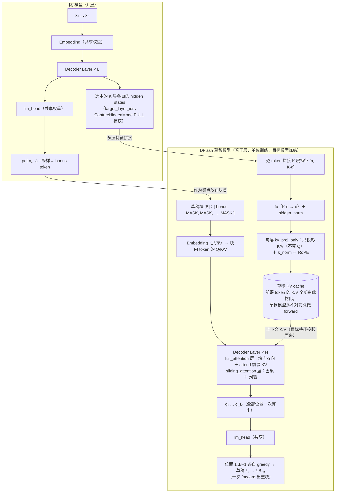
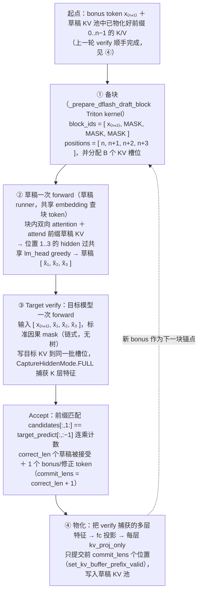
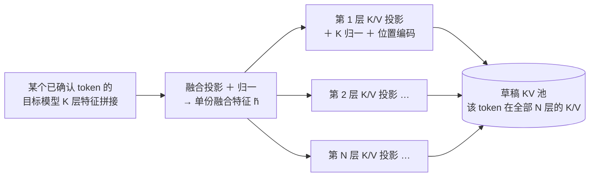
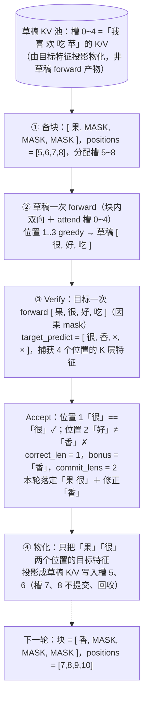
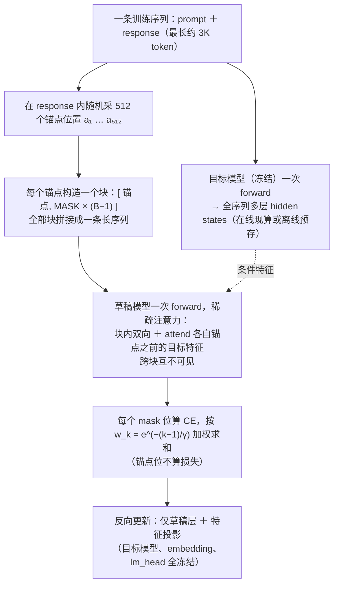

# DFlash（Block Diffusion 并行起草）原理详解

DFlash 的全称是 **DFlash: Block Diffusion for Flash Speculative Decoding**（用块扩散实现极速投机解码，arXiv 2602.06036，ICML 2026）。

本文介绍 DFlash 的原理与它在 SGLang 中的实现。投机解码基础、拒绝采样无损性见同目录 [speculative_decoding.md](./speculative_decoding.md)；EAGLE 见 [eagle.md](./eagle.md)；树形草稿见 [tree_draft.md](./tree_draft.md)；MTP 见 [mtp.md](./mtp.md)。

## 1. 核心思想：起草本身也并行化

EAGLE / MTP 的草稿头再便宜，**起草仍是自回归的**：想要 $k$ 个草稿 token 就得串行跑 $k$ 次草稿 forward，每次一个 kernel launch 一轮访存。当草稿头本身已经足够小，这串行 $k$ 步反而成了新的延迟瓶颈。

DFlash 的破局点：**把起草从自回归换成块扩散（block diffusion）——一次 forward 并行产出一整块草稿**。做法借自掩码扩散语言模型：

1. 构造一个长度为 `block_size`（$B$，默认 16）的块：第 0 位放上一轮的 bonus token（锚点，anchor），其余 $B-1$ 位全部填 **[MASK] 占位 token**；
2. 草稿模型对这个块做**一次** forward——块内 [MASK] 位置之间用**双向（非因果）注意力**互相看，同时 attend 已确认前缀的上下文；
3. 每个 [MASK] 位置的输出 hidden 过目标模型共享的 lm_head，**同时**得到 $B-1$ 个草稿 token。

草稿质量的保障与 EAGLE 同源：**草稿模型以目标模型的多层 hidden states 为条件**（不是从零预测），但注入方式更彻底——目标特征被直接投影成草稿模型**每一层的 K/V**（见第 3 节）。

与 EAGLE 的关键对比：

| | EAGLE / MTP | DFlash |
|---|---|---|
| 起草方式 | 自回归，$k$ 步串行 forward | 块扩散，**1 次** forward 出整块 |
| 块内注意力 | 因果 | **双向**（full_attention 层） |
| 草稿输入 | 目标特征 + token embedding 拼接，走完整草稿层 | [MASK] embedding 做 Q，目标特征投影**直接做上下文 K/V** |
| 草稿形状 | 树（top-k 分叉） | **链**（每位置 1 个候选，标准因果 mask 验证，无树） |
| 草稿模型对前缀 | 需要 forward（或 frozen 复用目标 KV） | **从不 forward**——前缀 K/V 由目标特征投影物化 |
| 论文效果 | EAGLE-3 为 SOTA 基线 | 接受长度与 EAGLE-3 相当，但起草并行 → 端到端最高 6× 无损加速、较 EAGLE-3 最高 2.5× |

## 2. 模型结构

草稿模型（`DFlashDraftModel`，`python/sglang/srt/models/dflash.py`）是若干层 Qwen3 风格 decoder layer（QK-Norm + RoPE + SwiGLU），**不带 embedding 和 lm_head**（都借目标模型的）。checkpoint 里额外带两样 DFlash 专属权重：

- `fc.weight`：$[K \cdot d \to d]$ 的线性投影，把目标模型 $K$ 层特征的拼接压回草稿隐层维度；
- `hidden_norm.weight`：投影后的 RMSNorm。



两点与 EAGLE 结构上的本质差异：

1. **目标特征不走草稿层的正向计算，而是"变成 KV"**。EAGLE 把 $f_t$ 拼进输入再跑草稿层；DFlash 把目标多层特征经 `fc` 融合后，用每层的 `kv_proj_only`（只切出 QKV 权重中的 K/V 部分，一次 GEMM，`dflash.py:192`）直接算出该 token 在草稿每层的 K/V 写进草稿 KV 池。前缀 token 对草稿模型来说只以 K/V 的形态存在——**草稿模型的 forward 只发生在 $B$ 个块 token 上**。
2. **层类型可混搭**（`config.layer_types`）：`full_attention` 层注册为 `ENCODER_ONLY`（块内双向）；`sliding_attention` 层注册为 `DECODER` + 滑动窗口（`dflash.py:44`）。

### 目标层的选择

草稿以目标模型哪几层的特征为条件由 `target_layer_ids` 决定（checkpoint 配置指定，或按 `build_target_layer_ids` 规则自动生成，`dflash_utils.py:289`）：草稿只有 1 层时取目标模型中间层（$L/2$）；多层时在 $[1, L-3]$ 区间均匀取点——兼顾低层的词法信息与高层的语义信息（与 EAGLE-3 的多层特征融合动机相同）。

## 3. 一轮解码 step-by-step

设已确认前缀长 $n$，上一轮 bonus token 为 $x_{n+1}$，$B = 4$：



逐步说明：

**① 备块**：`block_ids` 填满 `mask_token_id`（默认 token `<|MASK|>`，可由 checkpoint 的 `dflash_config` 覆盖），第 0 位换成 bonus token；positions 是连续的 $n..n{+}B{-}1$（不像树形要同深度共位）；同时从 `req_to_token` 表取出这 $B$ 个位置的 KV 槽——**草稿 forward 和目标 verify 复用同一批槽位**（各写各的池子）。

**② 草稿 forward**：走独立的草稿 runner（有自己的注意力后端和 KV 池），`forward_mode=TARGET_VERIFY`。[MASK] 的 embedding 提供 Q，前缀的"目标特征投影 KV"提供上下文，块内位置互相双向可见——这正是扩散模型"一次去噪整块"的推理形态。输出 $B$ 个位置的 hidden，取位置 $1..B{-}1$ 过共享 lm_head 做 greedy（TP 下用 vocab-parallel argmax 归约，不物化完整 logits），得到 $B-1$ 个草稿 token。

**③ 验证**：草稿是链不是树，所以**不需要 tree mask**（`custom_mask=None`），标准因果 mask 的 target-verify 一次搞定。`CaptureHiddenMode.FULL` 让目标模型顺手把整块 $B$ 个位置的 $K$ 层特征都捕获出来——下一步要用。

**Accept 规则**（greedy 路径，`compute_dflash_correct_drafts_and_bonus`，`dflash_utils.py:578`）：

```
matches     = candidates[:, 1:] == target_predict[:, :-1]   # 草稿 vs 目标 argmax 逐位比
correct_len = matches.cumprod(dim=1).sum(dim=1)             # 连续匹配前缀长度（不含 bonus）
bonus       = target_predict[:, correct_len]                # 第一个不匹配位置的目标 argmax
commit_lens = correct_len + 1                               # 本轮实际前进（含 bonus）
```

非 greedy 采样时复用 `tree_speculative_sampling_target_only` kernel 的**链式退化**（每层只有 1 个候选的"树"）做标准拒绝采样，无损性与链式投机相同（`compute_dflash_sampling_correct_drafts_and_bonus`）。

**④ 物化（materialize）——DFlash 版的"draft extend"**：被接受的 token 将来会成为草稿注意力的上下文，草稿 KV 池需要它们的 K/V。但 DFlash 不跑草稿 forward 补账，而是把 ③ 刚捕获的目标多层特征走 `fc → kv_proj_only → k_norm → RoPE` 直接写成草稿每层的 K/V（fused Triton kernel 一次算完全部层，`fused_kv_materialize.py`）。只写前 `commit_lens` 个位置——被拒草稿的槽位不提交。

> 对照 [mtp.md](./mtp.md) 3.3 节的两条路径：普通 EAGLE 的 ④ 是**再跑一次草稿 forward** 补写草稿 KV；FROZEN_KV_MTP 干脆**没有草稿 KV**；DFlash 介于两者之间——**有草稿 KV，但从不用草稿 forward 生产它**，用一串 GEMM 从目标特征"抄"过来。prefill 阶段同理：目标 prefill 用 `CaptureHiddenMode.FULL` 捕获全部 prompt token 的特征，立即批量物化进草稿 KV 池（radix cache 安全性要求，`dflash_worker_v2.py:1237`）。

### 3.1 展开讲讲「物化」：为什么不跑 forward 也能得到 KV

「物化」（materialize）一词借自数据库的物化视图——**把本来要按需计算的东西提前算好、直接存成结果**。这里被物化的是：前缀 token 在草稿模型每一层的 K/V。

**先看为什么常规模型做不到这件事。**标准 transformer 里，第 $\ell$ 层某 token 的 K/V 是对第 $\ell{-}1$ 层输出的线性投影，而第 $\ell{-}1$ 层输出已经混入了注意力（看过其他 token）和 FFN——层与层是一条链，想要第 $N$ 层的 K/V 就必须从第 1 层完整 forward 下来。EAGLE / MTP 的草稿 KV 正因如此只能靠草稿 forward（含 draft extend 补账）生产。

**DFlash 从架构定义上剪断了这条链。**它规定：上下文 token 在草稿**每一层**的 K/V，都从**同一份**融合特征直接投影而来——

$$
\text{每层 } \ell:\quad
K^{(\ell)} = W^K_{\ell}\,\tilde{h}, \quad V^{(\ell)} = W^V_{\ell}\,\tilde{h},
\qquad
\tilde{h} = \mathrm{RMSNorm}\big(\mathrm{fc}([h^{(l_1)}; \dots; h^{(l_K)}])\big)
$$

$\tilde{h}$ 是该 token 的目标模型 $K$ 层特征拼接投影的结果。注意三个「不依赖」：不依赖草稿模型自己前几层的输出（层间无链条）、不依赖其他 token（无注意力参与，逐 token 独立）、不依赖块内正在起草的内容。于是每个前缀 token 的全部 $N$ 层 K/V 就是一串纯 GEMM：融合投影一次 + 每层各一次 K/V 投影（加 K 归一与位置编码），一个 fused kernel 一炉端出。



**关键在于：这不是近似，而是模型的精确执行。**训练时（§5）草稿模型看到的上下文 K/V 就是这么算出来的——它从没见过"由草稿自己 forward 产生的前缀 KV"。所以推理时物化写入的 K/V 与训练分布严格一致；反过来说，草稿模型的注意力天生就是「Q 来自块内 [MASK]，上下文 K/V 来自目标特征投影」这种**不对称设计**（见 §2 的对比表）。

**物化 vs 草稿 forward 的成本对比**：一次草稿 forward = embedding + $N$ 层（注意力 + FFN）+ lm_head；物化 = $1 + 2N$ 次小 GEMM，无注意力、无 FFN、无 lm_head，且所有 token、所有层可完全并行。这就是 §1 对比表里「草稿模型对前缀从不 forward」的底层机制。

**物化发生的两个时机**（与 [eagle.md](./eagle.md) §1.3 草稿 KV 的两个 extend 时机一一对应）：

1. **prefill 后**：目标模型 prefill 顺手捕获全部 prompt token 的多层特征，批量物化进草稿 KV 池——对应 EAGLE 的 prefill draft extend；
2. **每轮 verify 后**（即 ④）：verify 已捕获整块 $B$ 个位置的特征，但只物化前 `commit_lens` 个（接受的草稿 + bonus/修正 token），被拒槽位不提交——对应 EAGLE 的 per-round draft extend，但把「一次草稿 forward」换成了「一串 GEMM」。

一句话总结：**EAGLE 的前缀记忆是草稿模型"亲眼看过"前缀后自己写下的；DFlash 的前缀记忆是把目标模型的理解直接"翻译"成草稿的 K/V 存进去**——草稿模型从头到尾只对当前块的 $B$ 个 token 做过 forward。

## 4. 实际执行的例子

沿用 [mtp.md](./mtp.md) 3.3 节的场景：前缀 x₁..₅ =「我 喜 欢 吃 苹」（槽位 0~4），bonus x₆ =「果」，$B = 4$，真实续写是「果 很 香 甜」：



值得盯住的细节：

- **一次 forward 出 3 个草稿**：EAGLE 出「很 好 吃」要 3 次串行草稿 forward，DFlash 只要 1 次；
- **位置 2 的草稿「好」猜错不影响位置 3 已经算完**——反正整块一起送验，错的位置由 verify 兜底拒掉，无损性不受影响（只影响接受长度）；
- **物化只提交 commit_lens 前缀**：草稿 ② 时块 token 也写过草稿 KV（槽 5~8），但那是 [MASK]/草稿的 K/V，④ 用目标特征投影的"真值"覆盖已接受的部分，被拒部分随槽位回收作废。

## 5. 训练怎么教会它"从锚点起草"

训练任务被设计得与推理时的"备块"一模一样：给一个干净的锚点 + 一串 [MASK]，以目标模型的多层特征为条件，把 [MASK] 恢复出来。四个关键设计逐一拆开。

### 5.1 随机锚点采样：把一条样本变成几百条

从每条训练序列的回复部分**随机采样锚点位置**（论文配置：每条序列采 512 个锚点，最大序列长 3072）。每个锚点 $x_a$ 独立构造一个训练块：

$$
[\,x_a,\ \mathrm{MASK},\ \dots,\ \mathrm{MASK}\,]\ (\text{共 } B \text{ 位})
\quad\xrightarrow{\text{监督目标}}\quad
[\,x_{a+1},\ \dots,\ x_{a+B-1}\,]
$$

两个动机：

- **对齐推理分布**：推理时块首永远是刚被验证过的"干净"token（bonus 或修正 token），且可能落在文本任何位置——随机采样锚点恰好复现了这个分布。锚点位本身不算损失（它是输入不是预测目标，对应推理时 vLLM Speculators 所述"slot 0 不训练、只有 mask 位预测"）；
- **数据增广**：同一条回复被切成数百个互相重叠的块，每个 token 会在不同块内、不同位置上被预测多次。论文消融显示随机锚点采样直接提升接受长度与端到端加速比。

### 5.2 多块拼接 + 稀疏注意力：一次 forward 训几百个块

512 个块不是 512 次 forward——全部**拼接成一条长序列**，用一张稀疏注意力 mask 一次算完：

- 块内 token **双向互注意**（与推理时的块内 attention 完全一致）;
- 每个块可以 attend **自己锚点之前**的目标模型上下文特征（对应推理时 attend 已物化的前缀 KV）；
- **跨块互相不可见**——块 A 的 mask 位看不到块 B 的任何位置。

这张 mask 就是推理时注意力模式的"多副本平铺"，训练与推理的 attention 语义严格同构（实现上用 Flex Attention 一次前向/反向搞定）。[dspark.md](./dspark.md) §4 的 anchor-bounded sequence packing 沿用同一思路。

### 5.3 条件来源：目标特征在线算或离线存

草稿块的条件是目标模型多层 hidden states（经 `fc` 拼接投影 + 归一，见 §2）。目标模型全程**冻结**，特征有两种供给方式：

- **在线**：训练时目标模型同步 forward 现算特征——省磁盘，但每步多付一次目标模型前向；
- **离线**：预先把整个数据集的特征算好存盘，训练时直接读——目标模型 70B 级别时这是唯一现实的选择，代价是多层 × 全序列的特征存储量可观。

可训练参数只有草稿侧：$N$ 层块扩散层 + 特征投影（`fc` / `hidden_norm`）；embedding 与 lm_head 从目标模型拷贝并**冻结**——草稿输出空间被锚死在目标词表上，这也是拒绝采样 $p/q$ 可比的前提之一。

### 5.4 按位置衰减的加权交叉熵

每个 mask 位算标准交叉熵，但按块内位置加权：

$$
\mathcal{L} = \sum_{k=1}^{B-1} w_k \cdot \mathrm{CE}\big(q_k,\ x_{a+k}\big),
\qquad
w_k = \exp\!\big({-}(k-1)/\gamma\big)
$$

$\gamma$ 随块长配套（$B{=}16$ 用 $\gamma{=}7$，$B{=}10$ 用 $\gamma{=}5$，$B{=}8$ 用 $\gamma{=}4$）。以 $B{=}16, \gamma{=}7$ 为例：第 1 位权重 $1.0$，第 8 位 $e^{-1} \approx 0.37$，第 15 位 $e^{-2} \approx 0.14$——首位的梯度话语权约是末位的 8 倍。

动机与验证过程的结构直接挂钩：接受是**从左到右的连乘**，位置 1 错则整块作废、位置 15 错只损失一个 token，所以前面位置的准确率天然更值钱。同一逻辑在 Medusa 的 $\lambda^k$ 衰减（[medusa.md](./medusa.md) §5）和 DSpark 的 $w_k = e^{-(k-1)/\gamma}$ 三项损失（[dspark.md](./dspark.md) §4）中反复出现——凡是"一次出多位草稿"的方法，都会给损失配上这条衰减。

### 5.5 训练一轮长什么样



读图要点：整个 pipeline 里**没有任何自回归展开**——不需要 EAGLE 的 training-time test（[eagle.md](./eagle.md) §2.5），因为推理时块内本来就没有递归；训练与推理的差异被压缩到最小（同样的锚点+MASK 输入、同样的块内双向 attention、同样的特征条件），这是 DFlash 训练便宜且稳的根源。

### 5.6 数据量与目标模型一致性

**数据量是 SFT 量级，不是预训练量级。**论文用 UltraChat-200K + ShareGPT（与 EAGLE-3 完全同套数据，为公平对比），约 20~30 万条对话。这么少就够，靠两个放大数据效率的因素：随机锚点采样（§5.1，一条 3K 序列切 512 个块，等效样本量放大百倍级）＋ 每块 $B{-}1$ 个监督位置。训练成本与 EAGLE-3 同量级（天级、少量 GPU）。

**草稿头是目标模型的专属配件**，四个层面的一致性要求：

| 一致性要求 | 原因 | 不一致的后果 |
|---|---|---|
| **词表 / tokenizer**（硬约束） | embedding / lm_head 从目标模型拷贝冻结，$q$ 与 $p$ 必须定义在同一词表上，拒绝采样 $p/q$ 才可比 | 根本没法用 |
| **特征接口**（硬约束） | `fc` 输入维度 = 目标 $K$ 层 × $d_{\text{target}}$，`target_layer_ids` 训练时固定写死 | 换目标模型、甚至只换抽取层都必须重训 |
| **输出分布**（软约束，决定接受率） | 训练数据的 response 由**目标模型重新生成**（不用数据集原文）——草稿拟合的是 $q \approx p$，接受率 $\alpha = 1 - \frac{1}{2}\lVert p - q\rVert_1$ 直接取决于分布贴合度 | 能跑，但接受长度显著缩水 |
| **chat template / 数据域** | 草稿只在见过的分布上贴得紧 | 域外场景（如只用 chat 数据训、拿去跑 code）接受率下滑 |

一句话：数据上要的不是"多"，而是**"像目标模型自己说的话"**；接口上词表与特征维度把草稿头焊死在特定目标 checkpoint 上，不可跨模型复用。

## 6. 与 EAGLE / MTP / FROZEN_KV_MTP / DSpark 全景对照

| | EAGLE-3 | MTP（DeepSeek） | FROZEN_KV_MTP | DFlash | DSpark |
|---|---|---|---|---|---|
| 草稿权重来源 | 单独训练 | 与主模型联合预训练 | 同 MTP | 单独训练（目标冻结） | 单独训练（目标冻结） |
| 起草 $k$ 个 token | $k$ 次串行 forward | $k$ 次串行 forward | $k$ 次串行 forward | **1 次 forward** | 1 次 forward ＋ 逐位轻量偏置（近乎免费） |
| 草稿间依赖的载体 | hidden 自递归 + 草稿 KV | 同左 | 仅 hidden 接力（KV 冻结在前缀） | 块内**双向 attention**（无递归） | 双向 attention ＋ **顺序 head 补前缀条件**（半自回归） |
| 块内条件分布 | 精确条件（逐位给定前缀） | 同左 | 同左 | 边缘化（suffix decay） | 边缘 logits ＋ 前缀偏置修正 |
| 草稿 KV 池 | 有，草稿 forward 写 | 有 | **无** | 有，但由**目标特征投影物化** | 同 DFlash（backbone 沿用） |
| draft extend / 补账 | 再跑一次草稿 forward | 同左 | 无（欠账推到下轮 seed） | GEMM 物化，无草稿 forward | 同 DFlash |
| 草稿形状 | 树（top-k） | 链或树 | 链或树 | **链**（每位 1 候选） | 链 |
| 验证长度 | 静态（启动参数定死） | 静态 | 静态 | 静态（块长 $B$ 定死） | **动态**——置信调度按请求/按步裁剪 |
| 对目标模型的要求 | 捕获多层 hidden | 捕获末层 hidden | 同左 + KV 池只读视图 | 捕获**指定多层** hidden（FULL） | 同 DFlash ＋ 变长验证 kernel |

DSpark 一列可概括为「DFlash + 三处增量」：anchor 作首预测位（省一列算力）、顺序 head（补回块内依赖、缓解 suffix decay）、置信头 + 调度器（验证长度从静态变动态）。详见 [dspark.md](./dspark.md)。

## 7. SGLang 实现导览

代码在 `python/sglang/srt/speculative/`，核心文件：

| 文件 | 职责 |
|---|---|
| `dflash_worker_v2.py` | `DFlashWorkerV2`：整轮串联（备块 → 草稿 forward → verify → accept → 物化），独立草稿 runner 管理 |
| `models/dflash.py` | 草稿模型结构：`DFlashDraftModel` / `kv_proj_only` / `project_target_hidden` |
| `dflash_utils.py` | 配置解析（`parse_dflash_draft_config`）、目标层选择、greedy/采样 accept 计算 |
| `dflash_info.py` / `dflash_info_v2.py` | `DFlashVerifyInput` / `DFlashDraftInputV2`（轮间携带 bonus 与 seq_lens 状态） |
| `triton_ops/dflash_prepare_block.py` | 备块 kernel（填 MASK ＋ 锚点 ＋ positions ＋ 槽位，一炉出） |
| `triton_ops/dflash_accept_bonus.py` | accept/bonus/out_tokens/new_seq_lens 一炉出 kernel |
| `triton_ops/fused_kv_materialize.py` | 全层 KV 物化 fused kernel（逐层 GEMM ＋ RMSNorm ＋ RoPE ＋ 写池） |

目标模型侧的适配点是 `set_dflash_layers_to_capture`（如 `models/qwen3.py:709`）：按 `target_layer_ids` 注册待捕获层（SGLang 捕获点是"层 i 之前"，所以映射时 +1）。

启动方式：

```bash
python -m sglang.launch_server \
  --model-path <target> \
  --speculative-algorithm DFLASH \
  --speculative-draft-model-path <dflash-draft> \
  --speculative-num-draft-tokens 16       # 即 block_size，别名 --speculative-dflash-block-size
  # 可选：--speculative-draft-window-size N   草稿只 attend 最近 N 个 token 的紧凑 KV 视图
```

要点与限制：

- `block_size` = `speculative_num_draft_tokens`，通常直接采用草稿 checkpoint 配置里的值（默认 16），二者不一致会告警；
- **draft window**（`--speculative-draft-window-size`）：草稿注意力只看最近 N 个 token。启用后草稿 worker 维护一张私有紧凑 `req_to_token` 表（同一全局 KV 索引空间上的滑窗视图），radix cache 前缀命中不受影响；
- 草稿 KV 池与目标 KV 池共享总显存预算，按层数比例折算 token 容量（`scale_kv_cell_size_per_token_for_dflash`）；
- 暂不支持：`return_logprob`、语法约束解码（json_schema / regex / ebnf / structural_tag）、overlap 下的 `return_hidden_states`（`validate_dflash_request`，`dflash_utils.py:807`）；
- 观测指标与 EAGLE 相同：`accept_length`（$\tau$）≈ `commit_lens` 的均值。DFlash 的收益公式变了——EAGLE 一轮成本 ≈ $k \cdot c_{draft} + c_{verify}$，DFlash ≈ $1 \cdot c_{draft} + c_{verify}$，$\tau$ 相同时轮次开销更低，这就是论文"接受长度与 EAGLE-3 相当、端到端却快 2.5×"的来源。

## 参考文献

- Cheng et al., *DFlash: Block Diffusion for Flash Speculative Decoding*, ICML 2026（[arXiv:2602.06036](https://arxiv.org/abs/2602.06036)）
- [vLLM Speculators 的 DFlash 文档](https://docs.vllm.ai/projects/speculators/en/latest/user_guide/algorithms/dflash/)（锚点模式与 block_size 语义）
- [NVIDIA Model-Optimizer 的 DFlash 训练示例](https://github.com/NVIDIA/Model-Optimizer/blob/main/examples/speculative_decoding/doc/dflash.md)（损失衰减超参）
- Li et al., *EAGLE-3: Scaling up Inference Acceleration of Large Language Models via Training-Time Test*, 2025（对比基线）
