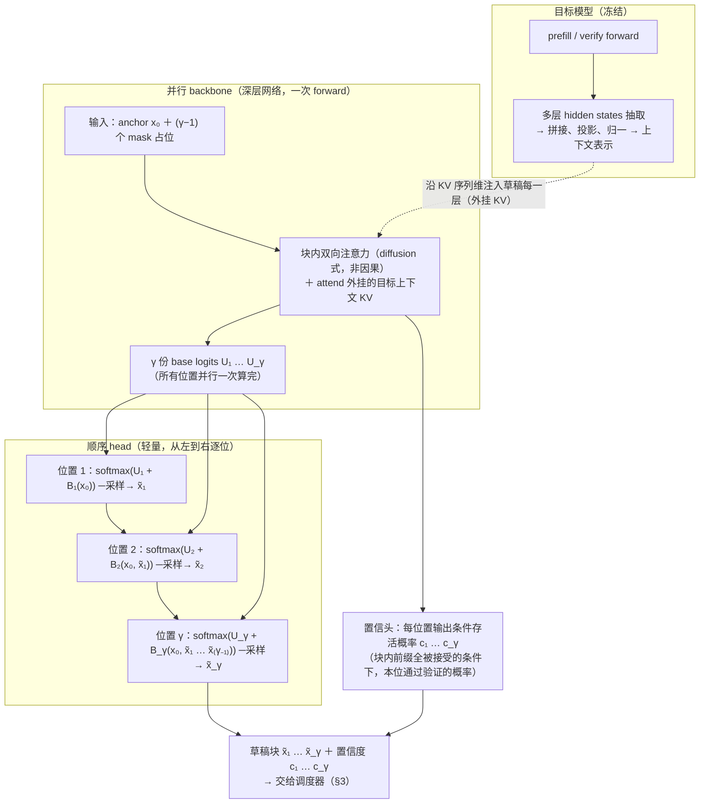
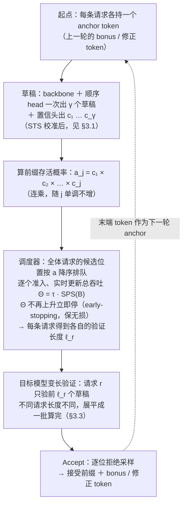
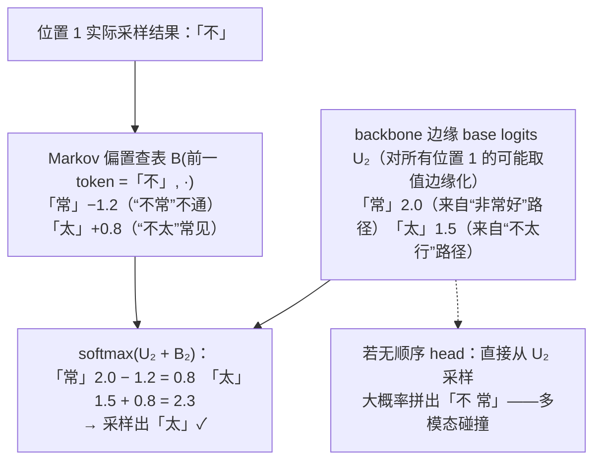
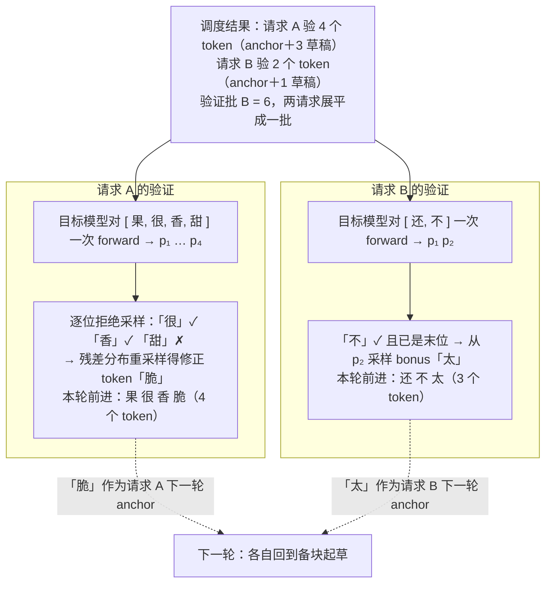

# DSpark 原理详解：置信度调度的半自回归投机解码

DSpark 是 DeepSeek 于 2026 年 6 月发布的投机解码框架（论文 *DSpark: Confidence-Scheduled Speculative Decoding with Semi-Autoregressive Generation*，arXiv:2607.05147，与北京大学合作），部署于 DeepSeek-V4 线上服务。它把两件事统一在一个框架里：

1. **草稿侧**：半自回归（semi-autoregressive）架构——重型**并行** backbone 一次出整块草稿，再叠加一个轻量**顺序**模块补回块内 token 依赖，解决并行 drafter 的后缀衰减（suffix decay）；
2. **验证侧**：置信度调度验证（confidence-scheduled verification）——按每条请求的前缀存活概率与引擎实时负载，**动态裁剪**每条请求的验证长度，最大化系统总吞吐。

投机解码基础、拒绝采样无损性见 [speculative_decoding.md](./speculative_decoding.md)；树形草稿见 [tree_draft.md](./tree_draft.md)；EAGLE 见 [eagle.md](./eagle.md)。

## 1. 背景：两类 drafter 的谱系与各自瓶颈

每 token 平均延迟可分解为：

$$
L = \frac{T_{\text{draft}} + T_{\text{verify}}}{\tau}
$$

$\tau$ 为每轮接受长度。三条优化杠杆：降 $T_{\text{draft}}$（draft faster）、升 $\tau$（draft better）、降有效 $T_{\text{verify}}$（verify smarter）。DSpark 同时押注第一和第三条，用架构设计保住第二条。

### 1.1 自回归 drafter vs 并行 drafter

| | 自回归（EAGLE 系 / MTP） | 并行（Medusa / DART / DFlash） |
| --- | --- | --- |
| 生成方式 | 逐 token 条件生成，$T_{\text{draft}} \propto \gamma$ | 一次 forward 出全部 $\gamma$ 个位置的 logits，$T_{\text{draft}}$ 与块长近乎无关 |
| 网络深度 | 被迫用浅网络（EAGLE-3 仅 1 层）、小 $\gamma$ | 可承受深网络（5 层）、大块（$\gamma = 16$） |
| 块内依赖 | 有（条件于实际采样的前缀） | 无（对所有可能前驱**边缘化**） |

### 1.2 并行 drafter 的 suffix decay

并行生成的每个位置不知道前面实际采样出了哪个 token，只能对所有可能前缀边缘化，导致**多模态碰撞**：比如目标分布里 "of course" 和 "no problem" 都是高概率续写，边缘化后可能拼出 "of problem"。实测（Qwen3-4B）：DFlash 的位置级条件接受率在 Code 上从 0.87 衰减到 0.78，Chat 上从 0.72 衰减到 0.63；而 EAGLE-3 反而随位置**上升**（Chat 从 0.53 升到 0.74）——自回归模型每一步都拿到真实前缀，越往后条件信息越足。

### 1.3 反直觉发现：位置 1 的容量优势

尽管有 suffix decay，DFlash 整体 $\tau$ 仍反超 EAGLE-3。原因是并行 drafter 的 $O(1)$ 草稿延迟允许用**深得多的网络**，首 token 准确率显著更高（Math 0.88 vs 0.81，Chat 0.72 vs 0.53）。前缀存活是连乘过程，首 token 的杠杆最大——深网络赢在起跑线。DSpark 的架构选择正源于此：**保留并行 backbone 的深度红利，用便宜的方式补回块内依赖**。

### 1.4 高并发下无差别验证的浪费

验证长度的最优值沿两轴变化：**数据侧**（代码类结构化文本接受率天然高于开放式聊天）；**系统侧**（轻载时多验一个 token 近乎免费，重载时高拒绝风险的 token 占用批容量、挤占其他请求）。静态多 token 草稿（MTP-3/5）在高并发下严格劣化聚合吞吐——这正是 DeepSeek 生产线此前长期只敢用 MTP-1 的原因。

## 2. 半自回归架构

一轮解码周期：anchor token（上一轮 bonus token）→ 并行 backbone + 顺序 head 生成 $\gamma$ 个草稿及置信度 $c_1 \dots c_\gamma$ → 调度器裁剪低置信后缀 → 目标模型验证。

草稿侧三个组件的数据流如下（并行 backbone 一次算完所有位置的 base logits；顺序 head 从左到右逐位补偏置并采样；置信头每位置出一个存活概率标量）：



读图要点：贵的语义计算（深层 backbone + 目标 KV 注入）只做一次、与块长无关；便宜的依赖修正（$B_k$ 查表或轻循环）必须逐位串行，但成本近乎零——这就是「半自回归」的分工。

### 2.1 并行阶段：DFlash backbone

backbone 沿用 DFlash（block diffusion 式并行 drafter），共享并冻结目标模型的 embedding 与 lm_head。与 EAGLE 一样复用目标模型 hidden states，但机制是 **KV 注入**而非逐位递归输入：

- prefill 时从目标模型多层 $\{l_1, \dots, l_m\}$ 抽取 hidden states，拼接投影：

$$
H_{\text{ctx}} = \mathrm{RMSNorm}\big(W_c\,[H^{(l_1)}; \dots; H^{(l_m)}]\big)
$$

- 沿 KV 序列维注入草稿模型的每一层：$K_i = [W_i^K H_{\text{ctx}};\; W_i^K H_d]$，即目标模型的上下文语义以"外挂 KV"的形式供草稿层 attend；
- 块内位置**双向互注意**（diffusion 式，非因果）。

DSpark 对 DFlash 的一处修改：不再"anchor + $\gamma$ 个 mask 占位、只预测 mask 位"，而是把 anchor 本身作为第一个预测位——$\gamma$ 个输入（anchor + $\gamma{-}1$ 个 mask）产出 $\gamma$ 个草稿 logits，省一列算力且质量相当。

层数：离线实验用 5 层（vs EAGLE-3 的 1 层）；V4 线上为 3 层 MoE + 128 滑窗注意力。

### 2.2 顺序阶段：前缀依赖的 transition bias

这是 DSpark 架构的核心创新。块内分布因子化为：

$$
P(X \mid x_0) = \prod_{k=1}^{\gamma} p_k(x_k \mid x_0, x_{<k}),
\qquad
p_k(v) = \frac{\exp\big(U_k(v) + B_k(x_0, x_{<k}, v)\big)}{\sum_{u \in \mathcal{V}} \exp\big(U_k(u) + B_k(x_0, x_{<k}, u)\big)}
$$

即**并行 base logits $U_k$（backbone 一次算完）+ 前缀相关偏置 $B_k$（轻量顺序模块逐位补上）**。局部 softmax 保证每个 token 的概率精确可算——这是投机解码拒绝采样 $p/q$ 判定的硬要求（CRF 的全局配分函数、CTC 的对齐边缘化都给不出精确 per-token 概率，因此不能直接当 drafter 用）。

偏置模块两种实现：

- **Markov head**（默认）：$B$ 只依赖前一 token，低秩分解 $B = W_1 W_2$（$W_1 \in \mathbb{R}^{V \times r}$，$W_2 \in \mathbb{R}^{r \times V}$，$r = 256$），查表即得 $B(x_{k-1}, \cdot) = W_1[x_{k-1}]\, W_2$——成本近乎零；
- **RNN head**：门控循环状态累积块内完整前缀，$z_k = [s_{k-1}; W_1[x_{k-1}]; h_k]$，$s_k = \sigma(W_g z_k) \odot s_{k-1} + (1 - \sigma(W_g z_k)) \odot \tanh(W_c z_k)$，$B_k = W_2^\top \tanh(W_o z_k)$。仅在长块（$\gamma \ge 12$）下有边际收益。

顺序采样循环从左到右执行，要求 $T_{\text{sequential}} \ll T_{\text{parallel}}$。实测草稿块从 4 加长到 16，全轮延迟只增加 0.2%–1.3%。

一句话概括这套设计：**并行 backbone 负责"贵但一次性"的语义计算，顺序 head 负责"便宜但必须逐位"的依赖修正**——把自回归的钱花在刀刃上。

## 3. 置信度调度验证

先看一轮解码在验证侧的完整闭环（与 [mtp.md](./mtp.md) §2.1 的固定长度验证对比：这里每条请求的验证长度是**逐轮、逐请求**动态决定的）：



被调度器裁掉的低置信后缀并未白费——它们本来大概率被拒，裁掉后腾出的批容量给了其他请求的高置信草稿，这就是 $\Theta = \tau \cdot \mathrm{SPS}(B)$ 两个因子的联合最大化。

### 3.1 Confidence head 与校准

草稿的每个位置额外输出条件存活概率 $c_k \in (0,1)$：给定块内前缀全部被接受的条件下，位置 $k$ 通过验证的概率。结构极轻：

$$
c_k = \sigma\big(w^\top [h_k;\; W_1[x_{k-1}]]\big)
$$

监督信号是解析接受率（即 [speculative_decoding.md](./speculative_decoding.md) 第 3 节的 $\alpha$ 公式）：

$$
c_k^* = 1 - \tfrac{1}{2}\lVert p_k^d - p_k^t \rVert_1
$$

**Sequential Temperature Scaling（STS）校准**：调度器要用的是累积存活概率 $\prod_{i \le k} c_i$ 的**绝对数值**（不是只需排序正确的阈值判断），而原始置信头判别力强（ROC-AUC 0.81–0.90）但系统性过度自信（ECE 3%–8%）。STS 在验证集上从左到右逐位置做 1D 温度网格搜索，最小化累积乘积的 ECE，保序不破坏排序，校准后 ECE 降至约 1%。

### 3.2 硬件感知前缀调度器

设 $R$ 个活跃请求，请求 $r$ 的前缀存活概率 $a_{r,j} = \prod_{i \le j} c_{r,i}$；给每条请求分配验证长度 $\ell_r$ 后，验证批大小 $B = \sum_r (1 + \ell_r)$，期望接受数 $\tau = \sum_r \big(1 + \sum_{j=1}^{\ell_r} a_{r,j}\big)$。优化目标是**系统总吞吐**：

$$
\max_{\{\ell_r\}} \;\; \Theta = \tau \cdot \mathrm{SPS}(B)
$$

其中 $\mathrm{SPS}(B)$ 是引擎初始化时一次性 profile 出的「批大小 → steps/s」容量曲线（硬件感知的来源）。求解用贪心：$a_{r,j}$ 随 $j$ 单调不增，每个 token 的边际收益恰为 $a_{r,j}$，全局按 $a_{r,j}$ 降序逐个准入、实时更新 $\Theta$。

**无损性的微妙之处（early-stopping 的必要性）**：Markov 置信度依赖已采样的 token——若允许调度器回溯式全局搜索，$x_{r,k}$ 的取值会泄漏进「是否验证位置 $k$」的决策，造成选择偏差、破坏输出分布。论文附录给出反例：$R{=}1, \gamma{=}2$，$a_1 = 0.8$，$\mathrm{SPS}(1,2,3) = (1.0, 0.5, 0.45)$ 时，无 early-stopping 的调度会把输出分布从 $(0.7, 0.3)$ 扭成 $(0.85, 0.15)$。因此贪心必须在 $\Theta \le \Theta_{\text{best}}$ 时立即停止（non-anticipating 性质）。

**生产落地的变体**：真实 SPS 曲线呈锯齿阶梯状，且 CUDA Graph 要求提前确定批大小。线上改为**异步调度**：用两步之前的置信输出预估容量上限 $K$（动态 top-$K$ 截断），当前步 token 仍按最新累积置信排序准入。由于准入决策只依赖两步前的信息，天然构成因果屏障——可以安全移除 early-stopping、做无约束全局搜索跨越硬件"悬崖"，同时保持无损。

### 3.3 变长验证的 kernel 支持

不同请求验证长度不同，物理执行与逻辑序列解耦：全部 token 展平为独立元素，序列内依赖用 marker tensor 传给稀疏注意力 kernel。DeepSeek-V4 上只需改 index-attention 与 compress kernel。

### 3.4 端到端数值实例

设引擎里有 2 条活跃请求，$\gamma = 4$，Markov head：

- **请求 A**（代码类，确定性强）：前缀「我 喜 欢 吃 苹」，anchor =「果」（上一轮 bonus）；
- **请求 B**（闲聊，开放性强）：前缀「今天天气怎么样？」，anchor =「还」。

**第一步：草稿侧——顺序 head 怎么纠偏。**以请求 B 的位置 2 为例。目标模型的两条高概率续写是「还非常好」（0.5）和「还不太行」（0.3），backbone 对位置 1 的实际采样不可知，只能给出边缘化的 base logits；顺序 head 拿到位置 1 实际采样的「不」后，用 Markov 偏置修正：



逐位跑完后两条请求各得 4 个草稿与置信度（置信头输出经 STS 校准），累积存活 $a_j = \prod_{i \le j} c_i$：

| | 草稿 | $c_1 \dots c_4$ | $a_1 \dots a_4$ |
|---|---|---|---|
| 请求 A | 很 香 甜 呀 | 0.9, 0.8, 0.7, 0.6 | **0.90, 0.72, 0.50, 0.30** |
| 请求 B | 不 太 行 吧 | 0.6, 0.4, 0.3, 0.2 | **0.60, 0.24, 0.07, 0.01** |

**第二步：调度器贪心准入。**假设 profile 出的容量曲线 $\mathrm{SPS}(B)$ = {2→1.00, 3→0.95, 4→0.90, 5→0.85, 6→0.80, 7→0.74}。基线是只验 anchor（$\ell_A = \ell_B = 0$，$B = 2$）；候选按 $a$ 降序全局排队：A₁ 0.90 → A₂ 0.72 → B₁ 0.60 → A₃ 0.50 → A₄ 0.30 → B₂ 0.24 → …，逐个试入并更新 $\Theta = \tau \cdot \mathrm{SPS}(B)$：

| 试入 | $B$ | $\tau$（期望接受数） | $\Theta$ | 判定 |
|---|---|---|---|---|
| （基线） | 2 | 2.00 | 2.00 × 1.00 = **2.000** | — |
| A₁（0.90） | 3 | 2.90 | 2.90 × 0.95 = **2.755** | ↑ 准入 |
| A₂（0.72） | 4 | 3.62 | 3.62 × 0.90 = **3.258** | ↑ 准入 |
| B₁（0.60） | 5 | 4.22 | 4.22 × 0.85 = **3.587** | ↑ 准入 |
| A₃（0.50） | 6 | 4.72 | 4.72 × 0.80 = **3.779** | ↑ 准入 |
| A₄（0.30） | 7 | 5.02 | 5.02 × 0.74 = **3.717** | **↓ 立即停**（early-stopping） |

结果：$\ell_A = 3$，$\ell_B = 1$——代码请求验 3 个草稿，闲聊请求只验 1 个，A₄ 和 B 的后 3 个草稿直接丢弃（它们本来大概率被拒，占批容量不划算）。注意 early-stopping 在 $\Theta$ 首次不升时**立即**终止，不回头搜——这是无损性的要求（§3.2）。

**第三步：变长验证与接受。**



复盘两个反事实：若不裁剪（都验满 4 草稿），$B = 10$、SPS 掉出高效区，B 的 3 个低置信草稿几乎必被拒、纯占容量；若像 MTP-1 那样静态只验 1 个草稿，A 本轮只能前进 2 个 token 而不是 4 个。动态裁剪同时避开了这两头的浪费——这就是 §3.2 目标函数 $\Theta = \tau \cdot \mathrm{SPS}(B)$ 里两个因子的具体含义。

## 4. 训练方法

- **数据**：从目标序列随机采样多个 anchor 切出 $\gamma$-token 块；目标模型冻结，只训 backbone、sequential head、confidence head（embedding / lm_head 共享冻结）。离线实验用 Open-PerfectBlend 130 万条（math 39.4% / code 38.9% / chat 17.6% / IF 4.1%），只取 prompt、response 由目标模型重新生成，训 10 epochs。
- **损失**：三项，均带位置衰减权重 $w_k = \exp(-(k-1)/\gamma)$（前缀存活连乘，靠前的位置更重要）：

$$
\mathcal{L} = \alpha_{\text{ce}} \underbrace{\Big({-}\sum_k w_k \log p_k^d(x_k^*)\Big)}_{\text{交叉熵}}
+ \alpha_{\text{tv}} \underbrace{\sum_k w_k \lVert p_k^d - p_k^t \rVert_1}_{\text{TV 距离蒸馏}}
+ \alpha_{\text{conf}} \underbrace{\mathrm{BCE}(c_k, c_k^*)}_{\text{置信头}}
$$

默认权重 $(0.1,\, 0.9,\, 1.0)$——TV 距离是接受率的**直接代理**（$\alpha = 1 - \frac{1}{2}\lVert p - q \rVert_1$），所以蒸馏项占大头。

- 注意：EAGLE-3 的 training-time test（TTT）是其基线特性，DSpark 本身**不使用 TTT**。
- 规模化训练优化：只跨机传 lm_head 之前的 hidden states（$O(d)$，规避 $V \approx 10^5$ 的 logits 通信）；anchor-bounded sequence packing 用 token 级 attention index 替代 2D mask。

**数据量与目标模型一致性**：

- 130 万条是 **SFT 量级**（对比 DFlash 的 20~30 万条更充裕，因为多了顺序 head 和置信头两个训练对象），远小于预训练；随机锚点切块（同 [dflash.md](./dflash.md) §5.1）与块内多监督位置放大了等效样本量。
- **只取 prompt、response 由目标模型重新生成**——草稿要拟合的是 $q \approx p$，接受率 $\alpha = 1 - \frac{1}{2}\lVert p - q \rVert_1$ 直接取决于分布贴合度。DSpark 比 DFlash 走得更远：损失里权重最大的就是 TV 蒸馏项（0.9），**显式**最小化这个距离；置信头的监督信号 $c^* = 1 - \frac{1}{2}\lVert p^d - p^t \rVert_1$ 同样以目标分布为锚。
- **硬约束**：词表 / tokenizer 必须与目标模型一致（embedding / lm_head 共享冻结，拒绝采样 $p/q$ 才可比）；特征接口（抽取哪几层、$K \times d_{\text{target}}$ 维度）训练时固定，换目标模型必须重训。完整的四层一致性分析见 [dflash.md](./dflash.md) §5.6。
- **数据域影响接受率**：math/code 接受长度 5+ 而 chat 仅 3.5（§5.1）既有任务本身熵的因素，也有训练数据域贴合度的因素——这正是置信调度按请求裁剪的价值所在。

## 5. 实验结果

### 5.1 离线接受长度（关闭调度器、固定块长、温度 1.0、链式草稿、含 bonus）

目标模型 Qwen3-{4B, 8B, 14B} + Gemma4-12B，9 个 benchmark 宏平均 $\tau$：

| 对比 | 提升幅度 |
| --- | --- |
| vs EAGLE-3 | +30.9% / +26.7% / +30.0%（4B / 8B / 14B） |
| vs DFlash | +16.3% / +18.4% / +18.3% |

代表性数字（Qwen3-4B）：GSM8K 上 DSpark 6.11 vs DFlash 5.40 vs EAGLE-3 5.14；MT-Bench 上 3.64 vs 3.07 vs 2.39。域效应明显：math 平均 5.57、code 5.12、chat 仅 3.49——这正是置信调度按请求裁剪验证长度的动机。

### 5.2 关键消融

- **深度**：块长固定 7 时，**2 层 DSpark 已超过 5 层 DFlash**——顺序 head 补依赖比堆并行层更划算；
- **块长**：优势随 $\gamma$ 扩大——$\gamma{=}7$ 时相对 DFlash 提升 16%/15%/18%（math/code/chat），$\gamma{=}15$ 时扩至 30%/26%/22%（块越长 suffix decay 越致命，依赖建模的价值越大）；
- **Markov vs RNN head**：RNN 仅长块下有边际收益，默认 Markov 足够；
- **置信裁剪**：阈值扫描下 Chat 接受率可从 45.7% 提到 95.7%，结构化任务（Math/Code）被裁剪得更温和。

### 5.3 DeepSeek-V4 线上部署

配置 DSpark-5（$\gamma = 5$，Markov head）对比生产基线 MTP-1，真实用户流量：

- **匹配吞吐下**，V4-Flash 单用户生成速度 +60%–85%，V4-Pro +57%–78%；
- **匹配延迟 SLA 下**，V4-Flash 在 80 tok/s/user 约束下聚合吞吐 +51%；120 TPS 严格档位下基线几乎不可用，DSpark 解锁该档位（名义 +661%，应解读为"解锁不可达档位"而非代表性倍数）；
- **负载动态**：中等并发时验证预算从 MTP-1 的静态 2 token 自动扩到约 4–6；并发饱和时预算随负载平滑收缩——这就是"verify smarter"的运行时形态。

已开源：DSpark checkpoints（V4-Flash/Pro preview）与 **DeepSpec** 训练库（含 EAGLE-3 / DFlash / DSpark 的训练、评测复现，支持 Qwen、Gemma 等目标模型）。注意所有数字均为 DeepSeek 自报，截至发布时无独立第三方复现。

## 6. 方法谱系定位

```
                     块内依赖建模
                     强 ◄──────────────► 弱
   草稿深度/容量  ┌─────────────────────────────┐
        深        │  DSpark          DFlash     │  ← 并行 backbone
        ▲         │  (并行+顺序头)   (纯并行)     │
        │         │                  Medusa     │
        ▼         │  EAGLE-1/2/3                │
        浅        │  (逐位自回归)     MTP-k      │  ← 受串行成本约束
                  └─────────────────────────────┘
```

- **vs EAGLE**：EAGLE 用自回归特征外推 + 浅网络，靠树形验证补偿短块；DSpark 用深并行 backbone 拿下首 token 容量、轻量顺序 head 拿回依赖，且只用**链式**草稿（不建树）。两者都复用目标 hidden states，但 EAGLE 逐位递归输入特征，DSpark 走 DFlash 式多层特征 KV 注入。
- **vs MTP**：MTP 是目标模型自带的多 token 头，静态多头在高并发下必然吞吐劣化（生产只敢开 MTP-1）；DSpark 的置信调度正是解开这一约束的钥匙。
- **vs DFlash**：DSpark = DFlash backbone + 三处增量（anchor 作首预测位、sequential head、confidence head + 调度器），即「纯并行 → 半自回归 + 负载感知验证」。

### 与 SGLang 的关系

SGLang 已内置 DFlash 路径（`SpeculativeAlgorithm.DFLASH`，`python/sglang/srt/speculative/dflash_worker_v2.py` 等）——即 DSpark 的并行 backbone 部分。DSpark 的增量（sequential head、confidence head、变长验证调度）截至本文撰写尚未进入 SGLang；其中变长验证调度与现有的 `--speculative-adaptive`（`adaptive_spec_params.py`，按运行时接受率调整草稿参数）思路同源，但 DSpark 做到了 per-request、per-step 粒度并带无损性证明。

## 局限与展望（论文自述）

并行 backbone 的整块草稿开销是固定的，遇到低接受率的难 query 无法回收；未来方向是草稿侧的 difficulty-aware early exit。

## 参考资料

- 论文：[DSpark: Confidence-Scheduled Speculative Decoding with Semi-Autoregressive Generation (arXiv:2607.05147)](https://arxiv.org/abs/2607.05147)
- 官方博客：[DeepSeek DSpark Speculative Decoding](https://deepseek.ai/blog/deepseek-dspark-speculative-decoding)
- 报道：[MarkTechPost](https://www.marktechpost.com/2026/06/27/deepseek-releases-dspark-a-speculative-decoding-framework-that-accelerates-deepseek-v4-per-user-generation-60-85-over-mtp-1/)、[TechTimes](https://www.techtimes.com/articles/319236/20260628/deepseek-releases-dspark-speculative-decoding-makes-v4-85-percent-faster.htm)
