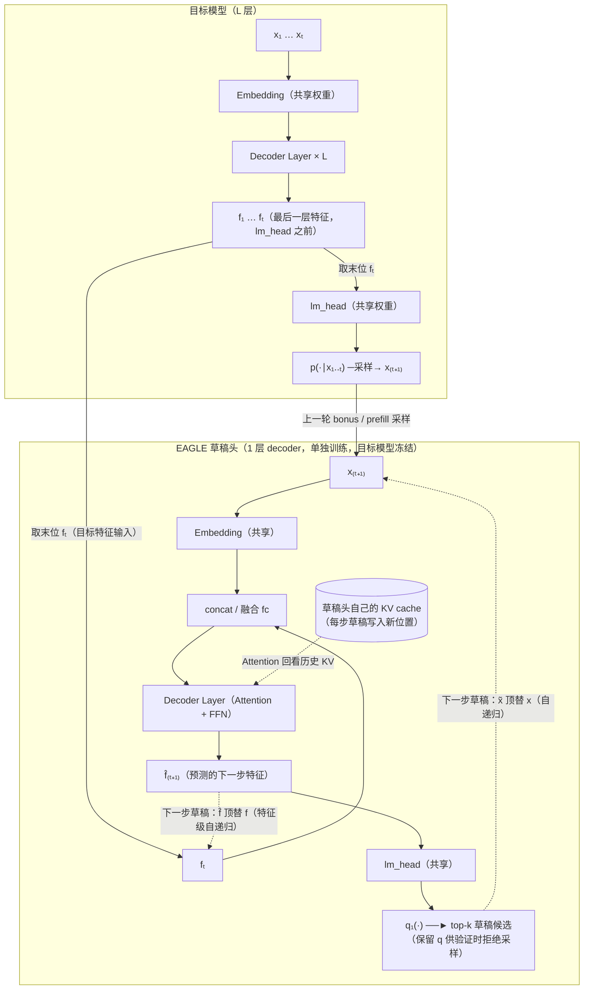
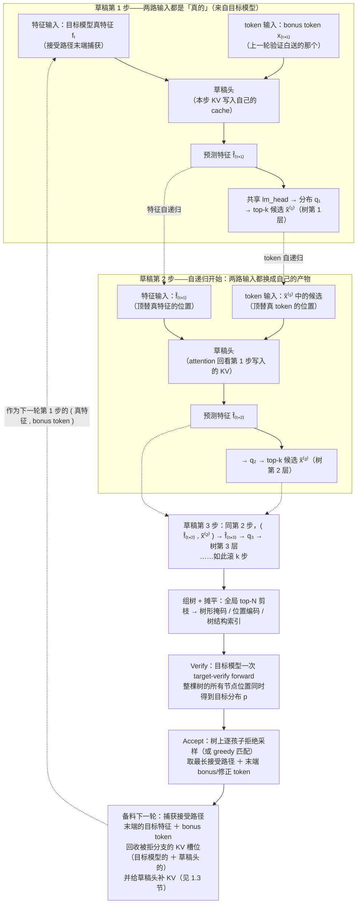
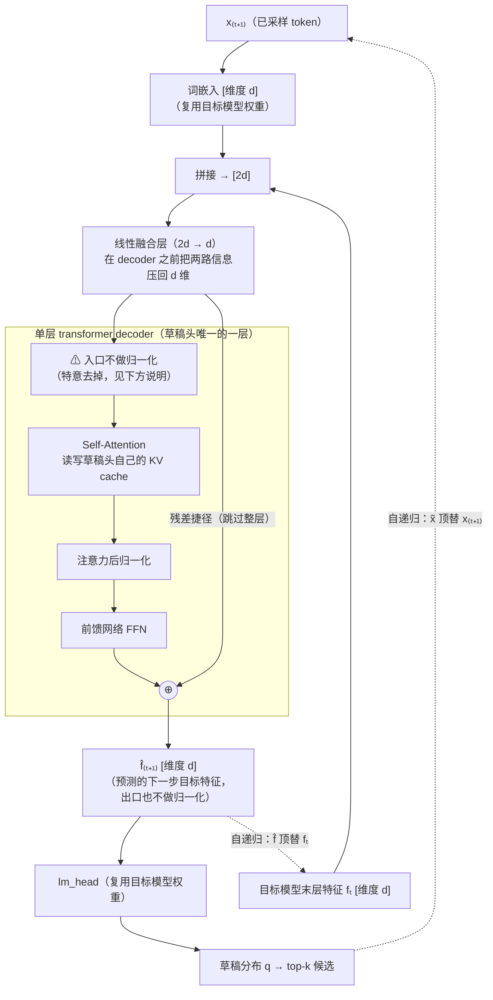
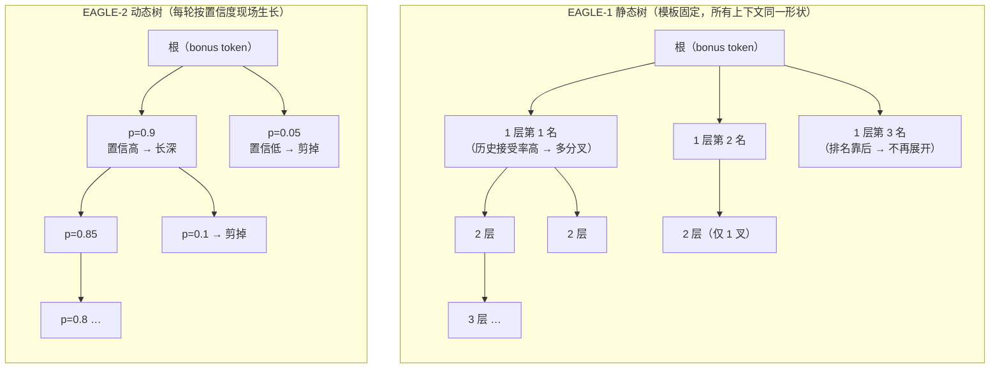
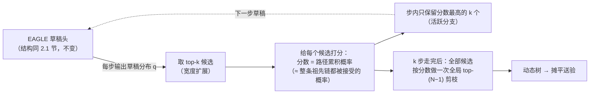
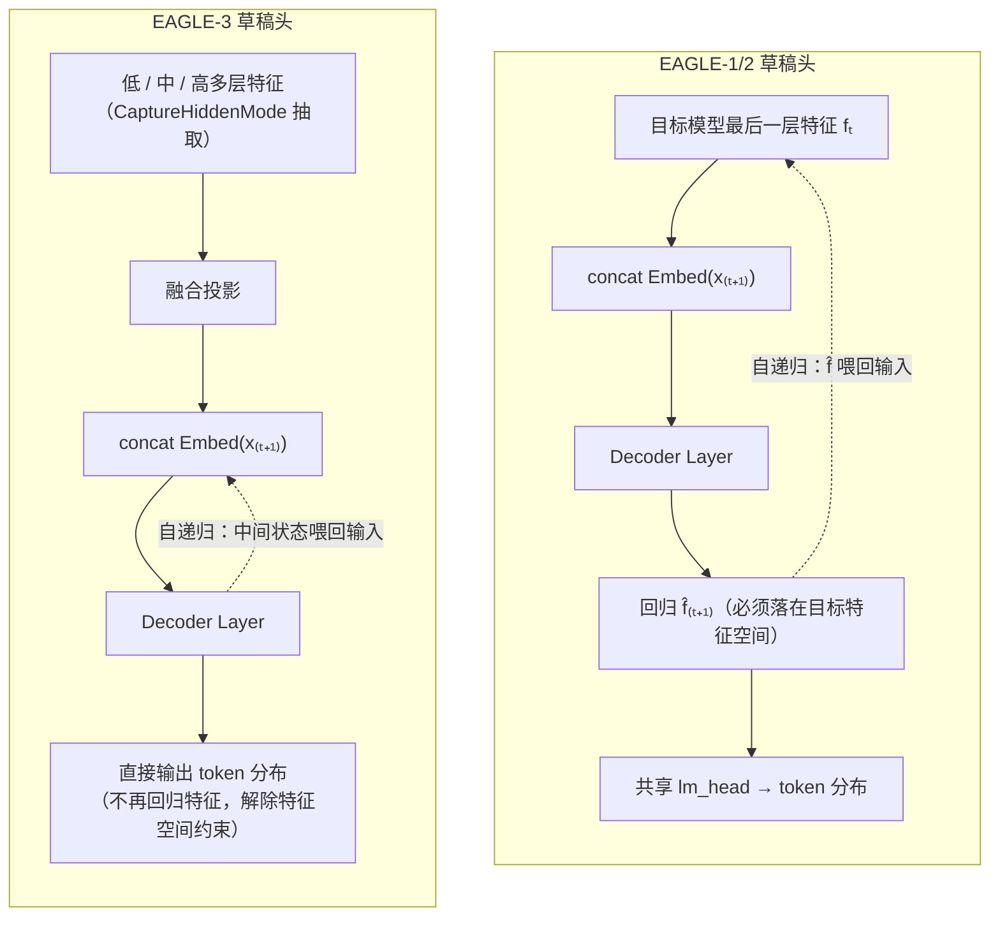
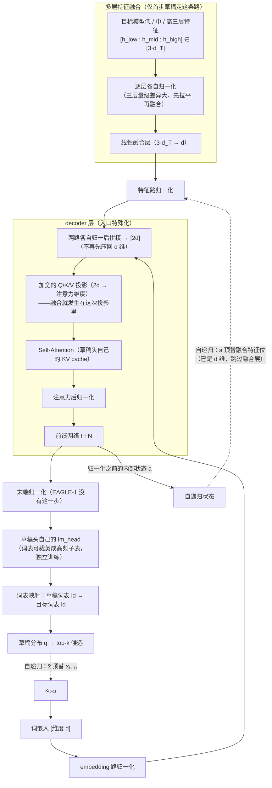
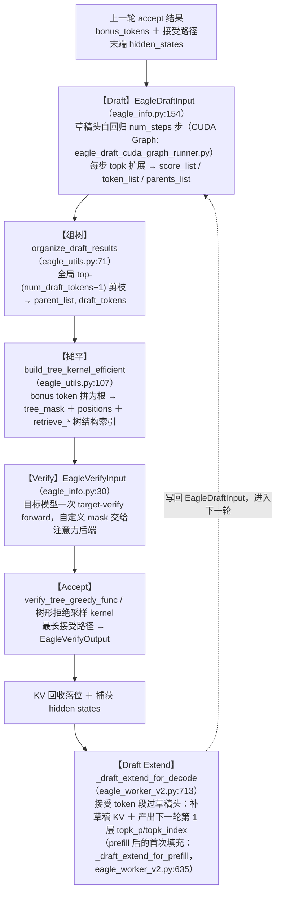

# EAGLE 原理详解

EAGLE 的全称是 **Extrapolation Algorithm for Greater Language-model Efficiency**（面向更高语言模型效率的外推算法）。

本文介绍 EAGLE 系列（EAGLE-1/2/3）草稿头的原理与它们在 SGLang 中的实现。投机解码的基础流程、拒绝采样的无损性证明见同目录 [speculative_decoding.md](./speculative_decoding.md)；树的构建 / 摊平 / 树形掩码 / 树形验证等通用机制见 [tree_draft.md](./tree_draft.md)。

## 1. 核心思想：在特征层做自回归，而不是 token 层

独立小草稿模型的困境：要像目标模型，就得大；要便宜，就得小。EAGLE 的破局点是**不从零预测，而是复用目标模型已经算出来的语义特征**。

观察：目标模型最后一层（lm_head 之前）的 hidden state $f_t$ 携带了「下一个 token 是什么」的几乎全部信息，且特征序列比 token 序列**规律得多**（token 是采样出来的离散随机变量，特征是连续、平滑的）。EAGLE 训练一个单层 decoder（草稿头），做**特征级自回归**：

$$
\hat{f}_{t+1} = \text{DraftHead}\big(\,f_t \oplus \mathrm{Embed}(x_{t+1})\,\big)
$$

输入是两样东西的拼接：

1. **目标模型的特征 $f_t$**：包含目标模型对上文的全部理解；
2. **已采样 token $x_{t+1}$ 的 embedding**：消除采样随机性带来的不确定——特征只决定分布，实际走了哪个分支必须显式告诉草稿头（这是 EAGLE 论文标题 "feature uncertainty" 的含义，也是它比同类方法接受率高的关键）。

预测出 $\hat{f}_{t+1}$ 后，直接过**目标模型自己的 lm_head**（共享，不另训）得到下一 token 分布；把 $\hat{f}_{t+1}$ 再喂回草稿头就能继续往深处滚，滚 $k$ 步长出深度为 $k$ 的树。

### 1.1 结构与一步草稿的数据流

（Embedding / lm_head 均与目标模型共享权重；草稿头有自己的 KV cache，attention 回看历史所有位置；虚线是自递归时"$\hat{f}$ 顶替 $f$、$\tilde{x}$ 顶替 $x$"的回边）：



### 1.2 自递归 $k$ 步与验证的整体流程

草稿头每步都吃**两路输入**（一个特征 + 一个 token）、吐**两样产物**（一个预测特征 + 一个 token 分布）。自递归的含义是：从第 2 步起，这两路输入**都换成自己上一步的产物**。以 $k = 3$ 步为例，把每步的输入来源画开（树形细节见 [tree_draft.md](./tree_draft.md)）：



读图要点：

- **第 1 步与后续步的本质区别**：第 1 步的两路输入都有目标模型背书（真特征 + 已验证的 bonus token），预测最准；第 2 步起输入是自己的估计值，误差逐步累积——这就是「接受率随草稿深度衰减」的根源，也是 EAGLE-3 用 training-time test 专门治的问题（见 2.4 节）。
- **两条自递归回路是独立的**：特征回路（$\hat{f}$ 顶替 $f$）让草稿头维持对语义的估计；token 回路（$\tilde{x}$ 顶替 $x$）告诉它每一步实际押了哪个分支。缺了 token 回路就退化成"只看特征猜整条序列"，正是 EAGLE 论文批评的 feature uncertainty 问题。
- **每步 top-k 而非 top-1**：每步产出的是 k 个候选（树上同层的兄弟节点），第 2 步起对每个活跃分支分别递归——图中为清晰只画了单条路径，多分支的展开与剪枝见 [tree_draft.md](./tree_draft.md)。
- **草稿头的 KV cache 独立于目标模型**：每步草稿把本步的 KV 写入草稿头自己的 cache，下一步 attention 回看的是这份 cache——它从哪里初始化、验证后如何修补，是下一节的主题。

成本上：草稿头只有一层 transformer decoder（目标模型的 1/N），且 embedding / lm_head 都与目标模型共享，单步草稿成本约为目标模型的几十分之一；效果上：因为站在目标模型特征的肩膀上，接受率远高于同成本的独立小模型——正是 [speculative_decoding.md](./speculative_decoding.md) 第 7 节所说「便宜（$c$ 小）」与「像目标模型（$\alpha$ 高）」的双赢。

### 1.3 extend 阶段：草稿头自己的 KV cache 从哪来

1.2 节的 draft→verify 循环有一个隐含前提被跳过了：草稿头是一个真正的 attention 层，每一步都要**回看从 prompt 第一个 token 到当前位置的全部历史 KV**——但上面的流程里，草稿头只对草稿 token 做过前向，prompt 段和每轮新接受的 token 段它从来没算过。这两段缺失的 KV 由专门的 **draft extend**（草稿头扩展前向）补上，发生在两个时机。

**先说输入的错位对齐**。草稿头在位置 $i$ 的输入是 $(f_i,\ x_{i+1})$——特征取第 $i$ 位的，token 取第 $i+1$ 位的（「看到模型对前文的理解＋实际采样出的下一词，预测再下一词」）。所以给草稿头填历史 KV 时，送入的 token 序列要相对目标模型**整体左移一位**，末尾空出的位置用刚采样出的新 token 补上。

**时机一：prefill 之后（每请求一次）**。目标模型 prefill 产出了 prompt 每个位置的末层特征和第一个采样 token。草稿头随即对整段 prompt 做一次**并行 extend 前向**：输入 =（prompt 全部位置的真特征，左移一位的 token 序列）。这一次前向一石二鸟：

1. prompt 段每个位置的 KV 写入草稿头的 cache——草稿头从此"读过"整个 prompt；
2. **最后一个位置的输出就是第一轮草稿的第 1 步**——它的输入恰好是 $(f_t,\ x_{t+1})$，与 1.2 节图中"草稿第 1 步"完全相同，top-k 候选直接可用，第一轮 draft 阶段不必重算这一步。

**时机二：每轮 verify 之后（每轮一次）**。本轮接受的 token（含 bonus）成为确认历史，必须进入草稿头的 KV——但草稿头在 draft 阶段算过的那些 KV 靠不住：被拒分支的作废回收；接受路径的虽然 token 对了，可它当时是按**树上的假设位置**算的；bonus/修正 token 更是从没经过草稿头。于是每轮验证后，对「本轮接受的 token 段」再跑一次小规模 draft extend（输入 = 这些位置的目标真特征 + 相应左移的 token），同样一石二鸟：补齐 KV，且末位输出直接就是**下一轮树的第 1 层候选**。

把 extend 放回全景，一轮的完整时序是：

> Draft 自递归（从上一次 extend 给出的第 1 层候选继续往深滚）→ 组树/摊平 → Verify → Accept → **Draft Extend（补接受段 KV ＋ 产出下一轮第 1 层候选）** → 下一轮

1.2 节图末尾"备料下一轮"节点的主要内容就是这次 extend。它的成本很低（一层 decoder × 每轮平均 $\tau$ 个 token），但不可省略——漏掉它，草稿头下一轮的 attention 历史就是残缺的，接受率会莫名其妙地塌掉。对应的实现入口见第 4 节导览。

## 2. EAGLE-1 → 2 → 3 的演进

| 版本 | 关键改进 | 说明 |
| --- | --- | --- |
| **EAGLE-1** | 特征级自回归 + 静态树 | 树形状离线固定（对所有上下文用同一棵树） |
| **EAGLE-2** | **动态树** | 用草稿头的置信度（路径累积概率）现场决定树的形状：置信高长深、置信低长宽，再全局 top-N 剪枝。即 [tree_draft.md](./tree_draft.md) 第 2 节描述的构建方式 |
| **EAGLE-3** | **多层特征融合 + 直接 token 预测** | 输入从「最后一层特征」换成低/中/高多层特征的拼接融合；放弃「回归特征再过 lm_head」，改为草稿头直接预测 token 分布，训练时用 training-time test（训练中模拟多步草稿展开）对齐多步预测，接受率进一步提升，且允许草稿头随训练数据扩展持续变强 |

下面按版本逐个展开差异，并各配一个数值计算实例。

### 2.1 EAGLE-1：特征回归损失 + 静态树

EAGLE-1 的两个标志性设计：

1. **训练目标是「回归特征」而非只分类 token**：草稿头输出 $\hat{f}_{t+1}$ 必须逼近目标模型真实特征 $f_{t+1}$（Smooth L1 回归），token 交叉熵只是辅助项：

$$
\mathcal{L} = \mathcal{L}_{\text{SmoothL1}}\big(\hat{f}_{t+1}, f_{t+1}\big) + w_{\text{cls}} \cdot \mathcal{L}_{\text{CE}}, \qquad w_{\text{cls}} = 0.1
$$

2. **静态树**：树形状离线固定（见 2.2 节）。

**数值实例（特征回归一步 + 损失计算）**。为便于手算，取极小的维度 $d=3$，忽略 attention 只看数据流：

- 输入：目标特征 $f_t = [0.8,\ -0.2,\ 0.5]$，已采样 token 的 embedding $\mathrm{Embed}(x_{t+1}) = [0.1,\ 0.9,\ -0.3]$；
- 拼接成 6 维 $[0.8, -0.2, 0.5, 0.1, 0.9, -0.3]$，过 fc（$6 \to 3$）与单层 decoder，设输出 $\hat{f}_{t+1} = [0.6,\ 0.1,\ 0.4]$；
- 训练时目标模型对同一位置算出的真特征是 $f_{t+1} = [0.7,\ 0.0,\ 0.45]$，逐维误差 $[0.1,\ 0.1,\ 0.05]$，均小于 1，Smooth L1 走二次段：

$$
\mathcal{L}_{\text{SmoothL1}} = \tfrac{1}{3}\big(0.5 \cdot 0.1^2 + 0.5 \cdot 0.1^2 + 0.5 \cdot 0.05^2\big) = \tfrac{1}{3}(0.005 + 0.005 + 0.00125) \approx 0.00375
$$

- $\hat{f}_{t+1}$ 过共享 lm_head 得草稿分布 $q$，设真实下一 token 的 $q$ 概率为 $0.62$，则 $\mathcal{L}_{\text{CE}} = -\ln 0.62 \approx 0.478$；
- 总损失 $\mathcal{L} = 0.00375 + 0.1 \times 0.478 \approx 0.0515$——回归项与加权后的分类项同量级，训练主要被「特征要像」牵引。

推理时静态树的填充：设模板树规定「第 1 层展开 3 叉、其中第 1 名节点再展开 2 叉、第 2 名展开 1 叉」，草稿头首步给出 top-3 候选（很 0.6、也 0.3、还 0.05）就按排名对号入座填进模板——**不管 0.6 和 0.05 差多远，形状都不变**，这正是 2.2 节要说的缺陷。

**详细结构图**（目标模型 hidden size 为 $d$；词嵌入与 lm_head 均直接复用目标模型的权重，草稿头真正新增的参数只有一个融合层和一个 decoder 层）：



三处容易被忽略的设计及其原理：

- **入口不做归一化**：一般 decoder 层进 attention 前先做 RMSNorm，EAGLE-1 特意去掉了它。原因：输入里的 $f_t$ 是目标模型已经归一化过的成品特征，其**量级本身携带信息**（残差流的范数逐层累积），再归一化一次会把这份信息抹掉；
- **融合发生在 decoder 之外**：先用独立线性层把 $2d$ 压回 $d$，decoder 层看到的输入维度与普通 transformer 层完全一致——草稿头可以原封不动继承目标模型的层结构（对比 EAGLE-3 把融合挪进了 attention 内部）；
- **出口也不做归一化**：残差相加的结果直接作为 $\hat{f}$，不像普通语言模型末尾还有一个最终 norm。原因同样是空间对齐：$\hat{f}$ 要模仿的目标特征 $f$ 生活在残差流的原始量级上，量级对不上，回归损失就学不像。

一句话概括这三处：**EAGLE-1 的输出必须「冒充」目标模型的特征**（下一步还要顶替 $f$ 喂回来、还要过共享 lm_head），所以从入口到出口，一切可能扭曲特征空间的操作都被移除了。

**前向推理数值示例**（沿结构图从上到下走一遍。为便于手算，取极小的维度 $d = 2$、词表 $V = 4$ = {很, 也, 还, 不}；attention/MLP 内部不展开，只给层输出）：

*Step 1（首步草稿）*：

1. 输入两路：目标特征 $f_t = [1.0,\ -0.5]$；已采样 token「果」的 embedding $= [0.5,\ 0.8]$；
2. 拼接（embedding 在前、特征在后）：$z = [0.5,\ 0.8,\ 1.0,\ -0.5] \in \mathbb{R}^4$；
3. 线性融合层（$4 \to 2$），设权重为「两路对应维取平均」：$h_0 = [\tfrac{0.5 + 1.0}{2},\ \tfrac{0.8 - 0.5}{2}] = [0.75,\ 0.15]$；
4. $h_0$ **不做入口归一化**直接进 decoder 层；设 attention + FFN 的总增量为 $[0.15,\ 0.35]$，则残差相加得 $\hat{f}_{t+1} = h_0 + \Delta = [0.9,\ 0.5]$（出口同样不归一化）；本步同时把该位置的 K/V 写入草稿头 KV cache；
5. lm_head（共享目标权重），4 个 token 的行向量分别为 很$[1.0, 0.2]$、也$[0.6, 0.4]$、还$[0.2, 0.5]$、不$[-0.5, 0.3]$，logits = $\hat{f} \cdot W^\top$：

$$
\text{很: } 0.9{\times}1.0 + 0.5{\times}0.2 = 1.00,\quad
\text{也: } 0.74,\quad
\text{还: } 0.43,\quad
\text{不: } -0.30
$$

6. softmax：$e^{1.0}, e^{0.74}, e^{0.43}, e^{-0.30} = 2.72, 2.10, 1.54, 0.74$，和 $= 7.10$，得 $q_1 = [0.38,\ 0.30,\ 0.22,\ 0.10]$ → top-2 候选：很（0.38）、也（0.30）。**$q_1$ 保留**，verify 时拒绝采样要用。

*Step 2（自递归）*：输入换成 $(\hat{f}_{t+1} = [0.9, 0.5],\ \mathrm{Embed}(很))$，走完全相同的管线；区别只有两点——attention 此时能回看 Step 1 写入的 KV，RoPE 位置 +1。树形（topk=2）时「也」分支同样各展开一次，见 2.3 节的树构建实例。

### 2.2 静态树 vs 动态树

**静态树**（EAGLE-1）：树的**形状离线固定**——深几层、每层哪些节点各分几个叉，是在验证集上统计「哪些位置的草稿最容易被接受」后预先定死的一棵模板树（EAGLE-1 论文用一棵 26 节点、深 5 的树），推理时**所有请求、所有上下文都套用同一形状**，每轮只是往模板的各个槽位里填 top-k 候选 token。它的直觉是：第 1 个 token 的 top-1 候选接受率最高，值得往深处多展开；越靠后的排名、越深的层级接受率越低，分叉就越少。

**动态树**（EAGLE-2）：形状不再预设，而是每轮现场用草稿头的置信度（路径累积概率）决定往哪长——置信高的路径长深、置信低的长宽，最后全局 top-N 剪枝（即 [tree_draft.md](./tree_draft.md) 第 2 节的构建方式）。静态树的缺陷正在于「一刀切」：确定性强的上下文（如代码补全）浪费了本可以更深的预算，不确定的上下文又在注定被拒的深层节点上浪费验证名额。



### 2.3 EAGLE-2：动态树构建的数值实例

EAGLE-2 对 EAGLE-1 的改动只有一处——树怎么长（**草稿头结构、权重、损失与 2.1 节完全相同**）。变化全在草稿头外面的「树构建控制流」：



构建规则（详见 [tree_draft.md](./tree_draft.md) 第 2 节）：每步对活跃节点各展开 top-k 孩子，节点分数 = **路径累积概率**，步内保留全局 top-k，最后对全部候选做一次全局 top-$(N-1)$ 剪枝。

**数值实例**。参数 `topk = 2`、`num_steps = 3`、`num_draft_tokens = 6`（根 + 5 个草稿节点）。根为上一轮 bonus token「果」：

**Step 1**：草稿头给出 $q_1$，top-2 候选：很（0.6）、也（0.3）。分数即自身概率：

| 路径 | 分数 |
| --- | --- |
| 很 | 0.6 |
| 也 | 0.3 |

**Step 2**：两个活跃节点各展开 top-2，候选池 4 个，分数 = 父分数 × 本步概率：

| 路径 | 计算 | 分数 |
| --- | --- | --- |
| 很→好 | 0.6 × 0.7 | **0.42** ✅ |
| 也→很 | 0.3 × 0.5 | **0.15** ✅ |
| 也→不 | 0.3 × 0.4 | 0.12 |
| 很→香 | 0.6 × 0.2 | 0.12 |

步内取 top-2（✅），只有它们进入 Step 3。

**Step 3**：再展开：

| 路径 | 计算 | 分数 |
| --- | --- | --- |
| 很→好→吃 | 0.42 × 0.8 | **0.336** |
| 也→很→好 | 0.15 × 0.6 | 0.09 |
| 也→很→香 | 0.15 × 0.3 | 0.045 |
| 很→好→喝 | 0.42 × 0.1 | 0.042 |

**全局剪枝**：把三步产生的**全部** 8 个候选按分数排序，取 top-5：

$$
\underbrace{0.6}_{很}\ >\ \underbrace{0.42}_{很好}\ >\ \underbrace{0.336}_{很好吃}\ >\ \underbrace{0.3}_{也}\ >\ \underbrace{0.15}_{也很}\ \ \big|\ \ 0.12,\ 0.12,\ 0.09,\ \dots \text{（淘汰）}
$$

最终送验的树（6 节点）：

```
果 ─┬─ 很 ── 好 ── 吃      ← 置信高的方向自动长成深链
    └─ 也 ── 很            ← 置信居中的方向浅尝辄止
```

两个关键性质在数字里看得很清楚：

- **孩子分数 ≤ 父亲分数**（乘的是 ≤1 的概率），所以 top-5 里选了「很好吃」必然已选了「很好」和「很」——剪枝结果自动连通，无需修补；
- **形状随置信度自适应**：若把 Step 1 换成低置信场景（很 0.35、也 0.30，Step 2 各孩子概率也平坦），则第二层路径分数普遍落在 0.1~0.15，全局 top-5 会变成「第一层 2 个 + 第二层 3 个」的**宽树**——同样 6 个名额，钱花在了分歧处。而 EAGLE-1 的静态树在这两种场景下形状一模一样。

### 2.4 EAGLE-3：多层特征 + 直接 token 预测

EAGLE-1/2 与 EAGLE-3 的草稿头输入输出对比：



EAGLE-3 直接预测 token 而非回归特征，解除了「$\hat{f}$ 必须落在目标模型特征空间」的约束，代价是需要目标模型多层 hidden states 的抽取支持（SGLang 中对应 `CaptureHiddenMode` 与模型侧的 EAGLE3 适配）。

**详细结构图**（目标模型 hidden size $d_T$、草稿头 hidden size $d$，两者可以不同——草稿头不再被迫与目标模型同宽）：



与 EAGLE-1 结构图逐点对照的差异及原理：

| 部位 | EAGLE-1（2.1 节图） | EAGLE-3 | 为什么这么改 |
| --- | --- | --- | --- |
| 特征输入 | 末层 $f_t$，维度 $d$ | 低/中/高三层拼接 $3 d_T$，逐层归一后融合压到 $d$；**仅首步执行**，自递归步的输入已是 $d$ 维直接跳过 | 末层特征只剩「已决定说什么」，中低层还留着「为什么」的证据 |
| 融合位置 | decoder **之外**先压回 $d$ | decoder **之内**：两路拼成 $2d$ 直接交给加宽的 Q/K/V 投影 | 省掉一次有损压缩——让 attention 自己决定从两路各取什么 |
| 入口归一化 | 特意去掉（保护特征量级） | 两路**各自**归一化（与 MTP 的双 RMSNorm 同思路） | 输出不再回归特征，量级信息无需保护，归一化反而稳训练 |
| 末端归一化 | 无（输出要保持残差流量级） | 有，正常归一化后进 lm_head | 同上——输出只是内部状态，按普通语言模型处理 |
| lm_head | 共享目标模型权重 | **自己的** lm_head，词表可裁剪成高频子表，输出经映射表换回目标词表 id | 输出空间已与目标特征脱钩，共享失去意义；裁词表进一步降草稿成本 |
| 自递归喂回什么 | $\hat{f}$（预测的目标特征） | 归一化之前的内部状态 $a$——不承诺落在任何空间 | 配合 training-time test：训练时就见过「自己的输出当输入」 |

**前向推理数值示例**（沿 EAGLE-3 结构图走一遍。为便于手算，取极小的维度 $d_T = d = 2$，草稿词表 $V_{\text{draft}} = 3$，目标词表 $V = 4$；RMSNorm 取 $x / \sqrt{\mathrm{mean}(x^2)}$，忽略可学习增益）：

*Step 1（首步草稿，走多层融合）*：

1. 目标模型三层特征：$h_{\text{low}} = [0.2, 1.0]$、$h_{\text{mid}} = [0.8, -0.4]$、$h_{\text{high}} = [1.2, 0.3]$；
2. 逐层归一：rms 分别为 $0.72,\ 0.63,\ 0.87$，得 $[0.28, 1.39]$、$[1.27, -0.63]$、$[1.37, 0.34]$，拼成 6 维；
3. 线性融合层（$6 \to 2$），设权重为「三层对应维取平均」：$g = [\tfrac{0.28+1.27+1.37}{3},\ \tfrac{1.39-0.63+0.34}{3}] = [0.97,\ 0.37]$；
4. 双路各自归一：特征路 $g \to [1.32,\ 0.50]$（rms $\approx 0.73$）；embedding 路 $[0.5, 0.8] \to [0.75,\ 1.20]$（rms $\approx 0.67$）；
5. 拼成 4 维 $[0.75, 1.20, 1.32, 0.50]$ 直接交给**加宽的 Q/K/V 投影**（融合在 attention 内部完成）；设 decoder 层输出（归一化前）$a = [0.6,\ -0.2]$——这个 $a$ 就是自递归要喂回去的状态；
6. 末端归一化：rms $= \sqrt{(0.36 + 0.04)/2} \approx 0.45$，归一得 $[1.34,\ -0.45]$；
7. **草稿头自己的 lm_head**（$3 \times 2$），行向量 $[1.0, 0.1]$、$[0.4, -0.8]$、$[0.2, 0.6]$：logits $= [1.30,\ 0.89,\ 0.00]$，softmax（$e^{1.30}, e^{0.89}, e^{0} = 3.67, 2.44, 1.00$，和 $7.11$）→ $q_1 = [0.52,\ 0.34,\ 0.14]$；
8. **词表映射回目标词表**：草稿词表只有 3 个高频 token，设映射表为 $[3, 16, 42]$——草稿 id 0 的 0.52 概率押在目标词表的 token 3 上。top-2 草稿候选：目标 id 3（0.52）、id 16（0.34）。

*Step 2（自递归，跳过融合）*：输入 $(a = [0.6, -0.2],\ \mathrm{Embed}(\tilde{x}))$——$a$ 已是 $d = 2$ 维，无需再走三层融合，从第 4 步双路归一开始走同一管线。

与 EAGLE-1 数值示例对照最关键的一行：EAGLE-1 第 4 步的输出 $[0.9, 0.5]$ 必须**是**目标特征的预测值（训练时被 Smooth L1 拽着），EAGLE-3 第 5 步的 $a = [0.6, -0.2]$ 只是内部状态——没有任何损失项规定它长什么样，token 对了就行。

三处改动逐一拆开：

**① 多层特征融合的维度账**。以 LLaMA-3-8B（$L = 32$ 层，$d = 4096$）为例，抽取低/中/高三层（即第 2、16、29 层，对应代码默认值 `[2, num_layers // 2, num_layers - 3]`）的 hidden state：

$$
[\,h^{(2)};\ h^{(16)};\ h^{(29)}\,] \in \mathbb{R}^{3 \times 4096 = 12288}
\ \xrightarrow{\ \text{fc } 12288 \to 4096\ }\ g \in \mathbb{R}^{4096}
\ \xrightarrow{\ \oplus\, \mathrm{Embed}(x)\ }\ \text{decoder layer}
$$

低层带着「输入 token 表面信息」，中层带着「句法/局部语义」，高层带着「输出决策」——EAGLE-1 只用最后一层，等于只看见目标模型「已经决定说什么」，丢掉了「为什么这么决定」的中间证据。

**② 去掉特征回归项**。损失从「$\mathcal{L}_{\text{SmoothL1}} + 0.1\,\mathcal{L}_{\text{CE}}$」变成纯 $\mathcal{L}_{\text{CE}}$。用 2.1 节的简化数字对比：EAGLE-1 中即使 CE 已经很好（0.478），回归项仍强迫 $\hat{f}$ 精确落回目标特征空间——这个约束限制了草稿头的表达自由（它必须「模仿特征」而不是「预测 token」）；EAGLE-3 只考核 token 对不对，$\hat{f}$ 落哪无所谓。论文的消融显示这一步是接受率提升的主要来源之一，且解除了「训练数据加多反而回归更难」的瓶颈，草稿头能随数据规模持续变强。

**③ training-time test：训练时就模拟多步自递归**。EAGLE-1/2 训练时每个位置只学「输入真特征 $f$，预测一步」；但推理时第 2 步起输入的是自己上一步的输出 $\hat{f}$——训练/推理输入分布不一致（暴露偏差），步数越深偏得越远。EAGLE-3 在训练中就展开多步：第 1 步喂真特征，第 2 步喂自己第 1 步的输出，第 3 步喂第 2 步的输出……每步都算 CE。

**数值实例（示意数字，量级参考论文趋势）**：设逐步接受率（step-$i$ 草稿被接受的条件概率）如下：

| | step 1 | step 2 | step 3 | step 4 |
| --- | --- | --- | --- | --- |
| EAGLE-1（只训一步） | 0.80 | 0.68 | 0.55 | 0.42 |
| EAGLE-3（训练时模拟多步） | 0.82 | 0.78 | 0.74 | 0.70 |

按链式期望前进长度 $\mathbb{E}[\tau] = 1 + \alpha_1 + \alpha_1\alpha_2 + \alpha_1\alpha_2\alpha_3 + \cdots$（含 bonus 的 1）计算 4 步草稿：

$$
\text{EAGLE-1: } 1 + 0.80 + 0.80{\times}0.68 + 0.544{\times}0.55 + 0.299{\times}0.42 \approx 2.77
$$

$$
\text{EAGLE-3: } 1 + 0.82 + 0.82{\times}0.78 + 0.640{\times}0.74 + 0.473{\times}0.70 \approx 3.26
$$

第一步两者几乎持平（0.80 vs 0.82），差距全部来自**深处**——training-time test 治的正是「越滚越偏」的病，所以 EAGLE-3 相同预算下敢用更深的树，$\tau$ 增益随深度放大。

### 2.5 训练方式对比

三个版本对「目标模型」的态度一致——**全程冻结，输出分布一个比特不变**（无损性来自验证阶段的拒绝采样，与训练无关）。分歧在于草稿头怎么训：

| | EAGLE-1 | EAGLE-2 | EAGLE-3 |
| --- | --- | --- | --- |
| 是否需要训练 | 需要 | **不需要**——直接复用 EAGLE-1 的头 | 需要（结构变了，须重新训练） |
| 损失函数 | Smooth L1 特征回归 + 0.1 × CE（见 2.1 节数值实例） | 同左（无训练，权重照搬） | **纯 CE**（多步展开，每步一份） |
| 监督信号 | 目标模型的真特征 $f$（回归目标）＋真 token | 同左 | 只有 token——特征落哪不管 |
| 训练时的输入 | 每个位置喂**真特征**，只学一步（teacher forcing） | 同左 | 第 1 步喂真的三层特征，第 2 步起喂**自己上一步的输出**（training-time test，见 2.4 节 ③） |
| 需要目标模型提供什么 | 训练语料过一遍目标模型，取末层特征 | 同左 | 同样过一遍，但要取**低/中/高三层**特征 |
| 新增可训练参数 | 融合层 + 1 个 decoder 层（词嵌入 / lm_head 冻结共享） | 同左 | 融合层 + 1 个 decoder 层 + **自己的 lm_head**（草稿词表上从零训） |
| 加数据的收益 | 很快饱和（回归项越学越难） | 同左 | **持续上升**（scaling 曲线，见 2.4 节 ②） |

三点展开：

- **EAGLE-2 是纯推理算法升级**。它不动训练、不动权重，只把推理时的静态模板树换成按置信度现场生长的动态树。这能成立的前提是 EAGLE-1 训出的头**置信度校准良好**——草稿头给某 token 的概率与该 token 最终被目标模型接受的概率高度相关，所以路径累积概率可以直接当节点分数用（2.3 节的构建过程正是建立在这个性质上）。
- **teacher forcing 与 training-time test 的训练成本差异**。EAGLE-1 的单步 teacher forcing 是标准做法：整段语料一次前向，所有位置并行算损失。EAGLE-3 要在训练中展开 $k$ 步自递归——第 $i$ 步的输入依赖第 $i-1$ 步的输出，无法完全并行，需借助专门设计的注意力掩码在同一次前向内模拟多步，训练开销高于 EAGLE-1，换来的是推理时深步接受率不塌（2.4 节的数值对比）。
- **草稿词表的来源**。EAGLE-3 自己的 lm_head 只覆盖训练语料中的**高频 token**（如目标词表 128k 中的 32k），词表由语料词频统计离线确定，训练时 CE 就在这个小词表上计算；同时生成一张「草稿词表 → 目标词表」的映射表供推理时还原 token id。

### 2.6 三版本差异汇总

| 维度 | EAGLE-1 | EAGLE-2 | EAGLE-3 |
| --- | --- | --- | --- |
| 草稿头输入 | 末层特征 $f$ ⊕ token embedding | 同 EAGLE-1 | **低/中/高多层特征融合** ⊕ token embedding |
| 输出 | 回归 $\hat{f}$ → 共享 lm_head | 同 EAGLE-1 | **直接 token 分布**（不回归特征） |
| 训练损失 | Smooth L1 特征回归 + 0.1 × CE | 同 EAGLE-1 | 纯 CE |
| 多步暴露偏差 | 有（只训一步） | 有 | **training-time test 消除** |
| 树形状 | 静态模板 | **动态**（路径累积概率 + 全局剪枝） | 动态（同 EAGLE-2） |
| 数据可扩展性 | 回归项限制上限 | 同 EAGLE-1 | 随训练数据持续变强 |
| 对目标模型的要求 | 末层 hidden 捕获 | 同 EAGLE-1 | **多层 hidden 捕获**（`CaptureHiddenMode`） |

### 2.7 效果参数对比（论文官方数字）

三篇论文报告的端到端效果（相对 vanilla 自回归解码；均为无损投机，输出分布严格不变）：

| 指标 | EAGLE-1 | EAGLE-2 | EAGLE-3 |
| --- | --- | --- | --- |
| 加速比（区间） | 2.7×~3.5×（LLaMA2-Chat 70B）；MT-bench 上约 3× | **3.05×~4.26×**（比 EAGLE-1 快 20%~40%） | **3.0×~6.5×**（比 EAGLE-2 再快 20%~40%，约 1.4×） |
| 平均接受长度 $\tau$ | 约 3.5~4.5（随模型/任务） | 约 4.5~5.5 | **6+**：MT-bench 6.13、GSM8K 6.23（LLaMA-3.1-8B）、HumanEval 最高约 7.5 |
| 不用树（纯链式） | 2.3×~2.7× | —（动态树是其全部贡献） | — |
| 逐位置接受率曲线 | 随草稿深度明显衰减 | 同 EAGLE-1（头没变） | **近乎平坦**（约 70%~80%），深步不塌 |

几点解读：

- **任务相关性**：代码生成（HumanEval）模板化片段多、最好猜，三代都在该任务上拿到各自的最高加速比；对话（MT-bench）居中；数字都随模型/硬件浮动，第三方复测（如 Spec-Bench）通常略低于论文值，属正常现象。
- **τ 的增量来自哪里**：EAGLE-1 → 2 的提升全部来自树形状自适应（草稿头完全没变）；EAGLE-2 → 3 的提升来自草稿头本身变强（多层特征 + 去回归约束 + training-time test），对应 §2.4 里「深步接受率不衰减」的数值示例。
- **大 batch 下的表现分水岭**：投机解码每轮多算 `num_draft_tokens` 个位置，batch 大了以后 GPU 不再是 memory-bound，这笔开销开始吃掉收益。EAGLE-3 论文报告：EAGLE-1 在 batch size 24 时吞吐已经**负增长**，而 EAGLE-3 在 batch size 64 仍有 +38% 吞吐；SGLang 生产环境（单 H100）实测 EAGLE-3 在 bs=2 时 1.81× 吞吐、bs=64 时仍有 1.38×，而 EAGLE-2 在 bs=24 时已降到 0.93×。原因就是 τ 更高——同样的验证开销换回了更多接受 token。
- **数据可扩展性**：EAGLE-1/2 受特征回归项约束，训练数据加多收益很快饱和；EAGLE-3 去掉回归项后首次观察到接受率随训练数据规模持续上升的 scaling 曲线，意味着上表中 EAGLE-3 的数字会随社区训练更好的草稿头继续提高。

## 3. MTP：EAGLE 思路的近亲

DeepSeek-V3 等模型原生自带 MTP（multi-token prediction）头——训练时就学了「一步预测未来多个 token」。其结构与 EAGLE 头高度相似（轻量层 + 复用主干特征），因此可以直接当作草稿头做投机解码。SGLang 中 DeepSeek 系列的 MTP 投机即复用 EAGLE 的 worker 路径（`FROZEN_KV_MTP` 是其冻结 KV 的变体）。详见 [mtp.md](./mtp.md)。

## 4. SGLang 实现导览

代码在 `python/sglang/srt/speculative/`，一轮 EAGLE 投机在 `eagle_worker_v2.py` 中的串联：



关键数据结构字段与本文概念的对应：

| 代码字段 | 概念 |
| --- | --- |
| `EagleDraftInput.topk_p` / `topk_index` | 每步 top-k 扩展的候选概率 / token（分数与节点） |
| `EagleDraftInput.hidden_states` | EAGLE 草稿头的特征输入 $f_t$ |
| `EagleDraftInput.bonus_tokens` | 下一轮树的根（上一轮的 "+1" token） |
| `EagleVerifyInput.draft_token` | 摊平后的树节点 token 序列 |
| `EagleVerifyInput.custom_mask` / `positions` | 树形注意力掩码 / 树位置编码 |
| `EagleVerifyInput.retrieve_next_token` / `retrieve_next_sibling` | 第一孩子 / 下一兄弟树结构编码 |
| `EagleVerifyInput.spec_steps` / `topk` / `draft_token_num` | 树深 / 分支因子 / 送验节点总数 |

### 参数调优要点

- `num_steps`（深度）、`eagle_topk`（宽度）、`num_draft_tokens`（预算）三者独立可调：预算固定时，接受率高的模型/数据倾向加深，接受率低的倾向加宽；
- `num_draft_tokens` 直接决定 verify forward 的 token 数与树占用的临时 KV 槽位，大 batch 下应保守；
- 观测 `accept_length`（$\tau$）随参数的变化做网格搜索，$\tau$ 不再增长时预算已饱和；
- `--speculative-token-map` 可将草稿头 lm_head 裁剪到高频子词表，进一步降低草稿成本（FR-Spec）。

## 参考文献

- Li et al., *EAGLE: Speculative Sampling Requires Rethinking Feature Uncertainty*, ICML 2024
- Li et al., *EAGLE-2: Faster Inference of Language Models with Dynamic Draft Trees*, EMNLP 2024
- Li et al., *EAGLE-3: Scaling up Inference Acceleration of Large Language Models via Training-Time Test*, 2025
