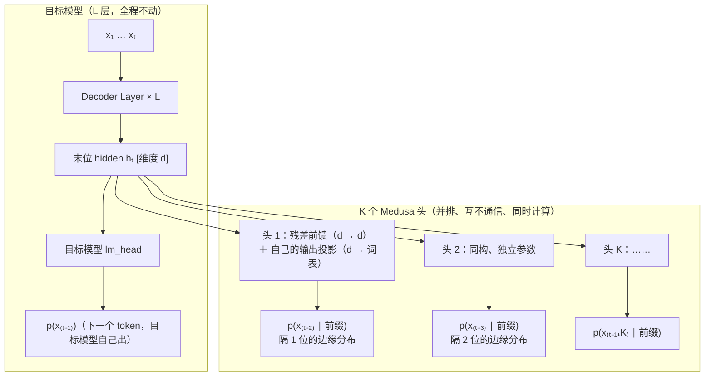

# Medusa（多解码头并行预测）原理详解

Medusa 的名字来自希腊神话里的多头蛇发女妖——**在目标模型头顶并排长出多个解码头，每个头独立预测未来某一个位置的 token**（arXiv 2401.10774，ICML 2024）。

本文介绍 Medusa 的原理、它与 EAGLE 的渊源，以及它在今天技术版图中的位置。投机解码基础、拒绝采样无损性见同目录 [speculative_decoding.md](./speculative_decoding.md)；EAGLE 见 [eagle.md](./eagle.md)；树形草稿见 [tree_draft.md](./tree_draft.md)。

## 1. 核心思想：不递归，多个头各管一个位置

EAGLE / MTP 的草稿头是**自回归**的：预测第 2 个草稿要先拿到第 1 个草稿的输出，$k$ 个草稿就要 $k$ 步串行。Medusa 走另一条路：**一次 forward、$K$ 个头同时开火**——

1. 目标模型正常 forward，得到末位 hidden state $h_t$（目标模型自己的 lm_head 用它预测 $x_{t+1}$）；
2. 第 $k$ 个 Medusa 头**也读同一个 $h_t$**，但预测的是 $x_{t+1+k}$（越过中间位置直接猜远处）；
3. $K$ 个头互相不通信、与目标 lm_head 也不通信，全部并行。

于是起草没有任何串行步骤——**草稿与目标模型的 forward 是同一次**，起草的边际成本只是几个头的矩阵乘。

代价也在这：第 2 个头猜 $x_{t+3}$ 时**不知道第 1 个头会押哪个 $x_{t+2}$**。它只能对"跳过一个未知 token 之后的位置"给出边缘分布——距离越远、中间未知 token 越多，命中率塌得越快。这正是后来 EAGLE 的出发点（用自回归 + token 反馈消除这个不确定性，见 [eagle.md](./eagle.md) §1）。

与 EAGLE 的关键对比：

| | Medusa | EAGLE |
|---|---|---|
| 起草方式 | $K$ 个头**一次并行**（与目标 forward 同批） | 草稿头自回归 $k$ 步串行 |
| 头之间的依赖 | 无——都只看同一个 $h_t$ | 有——上一步的特征与采样 token 都喂给下一步 |
| 第 $k$ 个草稿的条件 | $p(x_{t+1+k} \mid x_{1..t})$：**边缘分布**，中间 token 未知 | $p(x_{t+1+k} \mid x_{1..t}, \tilde{x}_{..})$：**条件分布**，沿路径逐步给定 |
| 草稿深度 | 头数 $K$ 固定死（训练时定，通常 4~5） | 步数 $k$ 推理时可调 |
| 树形状 | 静态**笛卡尔积树**（见 §3） | EAGLE-1 静态树 / EAGLE-2 起动态树 |
| 接受判定 | 默认 **typical acceptance（有损）** | 拒绝采样（严格无损） |
| 训练成本 | 极低（Medusa-1 冻结主干，单卡数小时） | 略高（自回归展开，仍是天级） |

## 2. 模型结构

每个 Medusa 头只有两笔参数：一个带残差的单层前馈变换，接一个自己的输出投影（词表大小）。



三处设计原因：

- **残差结构 + 零初始化**：前馈变换的第一层权重初始化为零，输出投影从目标模型 lm_head 拷贝初始化——训练开始时每个头的行为**恰好等于目标 lm_head**（预测 $x_{t+1}$ 的分布），再逐渐学会"往前挪 $k$ 位"。这让训练极其稳定，也是 Medusa 能"几小时训完"的原因之一。
- **每个头有自己的输出投影**：不同于 EAGLE 共享目标 lm_head——因为 Medusa 头的任务不是"回归目标特征空间"（那样才能复用 lm_head），而是直接拟合各自位置的 token 边缘分布，输出空间可以自由偏离。
- **头是加宽而非加深**：$K$ 个头并排一次算完，多一个头只多一笔 GEMM；而 EAGLE 加一步草稿深度就多一次串行 forward。宽是免费的，深是昂贵的——Medusa 选了宽。

## 3. 笛卡尔积树：兄弟共享同一套孩子

每个头取 top-$s_k$ 个候选，跨头组合成候选续写。由于头之间独立，组合就是**笛卡尔积**：头 1 取 $s_1$ 个、头 2 取 $s_2$ 个，就有 $s_1 \times s_2$ 条深度为 2 的路径。摊平成树送目标模型一次验证——**树形注意力（tree attention）正是 Medusa 首创**，后被 EAGLE / SpecInfer 等全面继承（机制详见 [tree_draft.md](./tree_draft.md)）。

数值例子（$K=2$，$s_1 = s_2 = 2$）。上下文「我喜欢吃苹果」，目标模型正在出 bonus token：

- 头 1（预测隔 1 位）：top-2 = {很 0.5, 也 0.3}；
- 头 2（预测隔 2 位）：top-2 = {好 0.4, 香 0.2}。

```
                 ┌─ 好          ┌─ 好
      root ──┬─ 很 ┤      ┌─ 也 ┤
             │     └─ 香   │    └─ 香
             └─────────────┘
```

注意与 EAGLE 动态树的本质区别：**「很」和「也」的孩子是同一套 {好, 香}**。头 2 不知道第一层押了谁，只能把自己的 top-2 无差别地分发给每个第一层候选。EAGLE 树上「很」的孩子（很→好、很→香）和「也」的孩子（也→不、也→许）是各自条件分布的 top-k，完全不同——同样 4 个深层节点，EAGLE 的每一个都比 Medusa 的"复制粘贴"命中率高。

组合爆炸的对策：$s_k$ 全取会得到 $\prod s_k$ 条路径（如 $10 \times 10 \times 10 \times 10 = 10^4$），远超验证预算。Medusa 用**离线校准的稀疏树模板**：在验证集上统计每个（层, 排名）组合的历史接受率，保留期望收益最高的若干节点（典型 64 节点），所有上下文套用同一棵——与 EAGLE-1 的静态树同思路（[eagle.md](./eagle.md) §2.2 对静态树缺陷的分析同样适用于此）。

## 4. typical acceptance：用无损换速度

Medusa 默认**不用**拒绝采样，而用一个有损的启发式判定：候选 token $x$ 被接受，当且仅当目标模型给它的概率超过一个与该位置分布熵挂钩的阈值——

$$
p_{\text{target}}(x) > \min\big(\epsilon,\ \delta \cdot e^{-H(p_{\text{target}})}\big)
$$

直觉：目标分布很尖（熵 $H$ 小，模型很确定）时阈值高，候选必须接近 argmax 才收；分布很平（熵大，怎么说都行）时阈值低，宽进——"典型"的续写都算对。第一个候选永远按 greedy 接受，保证每轮至少前进 1 个 token。

数值例子（$\epsilon = 0.3$，$\delta = 0.09$）：

| 场景 | 目标分布 | 熵 $H$ | 阈值 $\min(\epsilon, \delta e^{-H})$ | 候选 $p$ | 判定 |
|---|---|---|---|---|---|
| 确定性上下文（代码补全） | [0.9, 0.05, …] 很尖 | ≈ 0.4 | $\min(0.3, 0.09{\times}0.67) = 0.060$ | 0.05 | 拒 |
| 开放性上下文（闲聊） | [0.25, 0.2, 0.2, …] 很平 | ≈ 2.2 | $\min(0.3, 0.09{\times}0.11) = 0.010$ | 0.05 | **收** |

同一个 $p = 0.05$ 的候选，尖分布下被拒、平分布下被收——接受率大幅提高，但输出分布**不再严格等于**目标模型（temperature > 0 时无损性被放弃；temperature = 0 时退化为 greedy 精确匹配，仍无损）。这是 Medusa 与本目录其他方法最大的哲学分歧：[speculative_decoding.md](./speculative_decoding.md) §3 证明的无损保证，在 Medusa 的默认配置下不成立。

## 5. 训练：Medusa-1 与 Medusa-2

| | Medusa-1 | Medusa-2 |
|---|---|---|
| 主干 | **冻结** | 与头**联合微调** |
| 损失 | 各头 CE 按 $\lambda^k$ 衰减加权（$\lambda \approx 0.8$，远处的头目标本来就难，降权防主导） | 头的加权 CE ＋ 主干自己的下一 token CE |
| 训练技巧 | 零初始化即可，极稳 | 两阶段（先只训头再联合）＋ 主干用小得多的学习率，防止把主模型带偏 |
| 无 SFT 数据时 | 自蒸馏：拿目标模型自己生成的文本当训练集 | 同左 |
| 成本 | 单卡数小时 | 数卡一两天 |
| 效果 | 加速约 2.2× | 加速约 2.3~2.8× |

$\lambda^k$ 衰减与 DFlash 的按位置衰减损失（[dflash.md](./dflash.md) §5）动机相同：前面位置错则后面全作废，前面的准确率更值钱。Medusa-2 的"联合微调改善主干配合度"则与 MTP 的联合预训练思想一脉相承（[mtp_vs_eagle1.md](./mtp_vs_eagle1.md) §3）——只是 MTP 在预训练就做，Medusa-2 在 SFT 后补做。

## 6. 效果与局限

论文数字（Vicuna 7B/13B/33B）：Medusa-1 约 2.2× 加速，Medusa-2 约 2.3~2.8×；每步平均前进约 2.5~3.5 个 token（typical acceptance 下）。作为 2023 年的方法这很亮眼，但被 EAGLE 系列全面超越（EAGLE-1 论文直接对比：MT-bench 上比 Medusa 快 1.6×，且严格无损，见 [eagle.md](./eagle.md) §2.7）。

结构性局限，每一条都指向 EAGLE 的对应改进：

1. **无 token 反馈**——头 2 不知道头 1 押了谁，深位置只能猜边缘分布 → EAGLE 用自回归 + 已采样 token 输入解决（feature uncertainty）；
2. **深度锁死在头数**——加深要加头、要重训 → EAGLE 的深度是推理期参数，自递归想滚几步滚几步；
3. **笛卡尔积树兄弟共享孩子**——深层节点大量浪费 → EAGLE 树按条件分布逐分支展开，EAGLE-2 进一步动态成形；
4. **默认有损**——typical acceptance 换接受率 → EAGLE 全程拒绝采样无损（SGLang 中 `--speculative-accept-threshold-*` 提供类似的"有损换速度"旋钮，但默认关闭）。

## 7. 历史地位与 SGLang 中的位置

Medusa 的持久遗产是**树形注意力**：把多条候选路径摊平进一次 forward、用自定义 mask 隔离兄弟分支、验证后选最长接受路径——本目录 [tree_draft.md](./tree_draft.md) 讲的整套机制由它首创，EAGLE / SpecInfer 在其上发展。「多头并行出草稿」的思想也没有消亡：DFlash 的块扩散（[dflash.md](./dflash.md)）可以看作它的现代复活——同样一次 forward 出整块，但用块内双向 attention 补上了 Medusa 缺失的"草稿间通信"。

SGLang **没有实现 Medusa**：`SpeculativeAlgorithm`（`python/sglang/srt/speculative/spec_info.py`）的枚举中无 MEDUSA 路径。原因很直接——EAGLE 在相同成本下全面占优，社区新训的草稿头都是 EAGLE-3 式。需要"Medusa 式零门槛加速"的场景，今天的答案是：模型自带 MTP 头就直接用（[mtp.md](./mtp.md)），否则训一个 EAGLE-3 头，或用免训练的 n-gram 路径（`--speculative-algorithm NGRAM`）。

## 参考文献

- Cai et al., *Medusa: Simple LLM Inference Acceleration Framework with Multiple Decoding Heads*, ICML 2024（[arXiv:2401.10774](https://arxiv.org/abs/2401.10774)）
- Li et al., *EAGLE: Speculative Sampling Requires Rethinking Feature Uncertainty*, ICML 2024（对比基线与后继者）
- Miao et al., *SpecInfer: Accelerating Generative Large Language Model Serving with Tree-based Speculative Inference and Verification*, ASPLOS 2024（同期树形验证工作）
