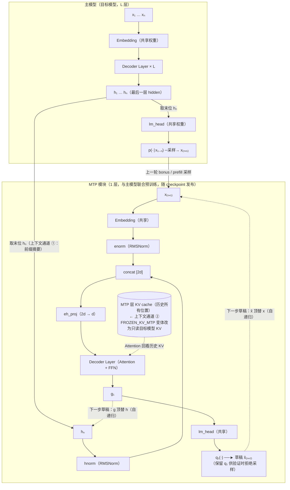
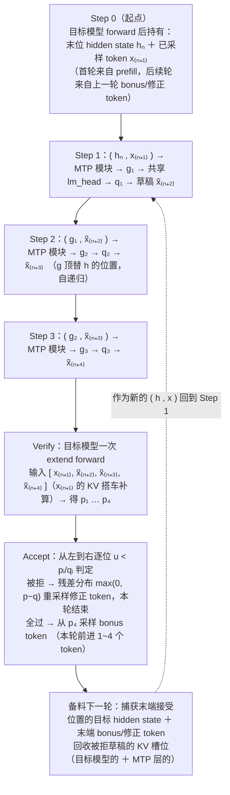
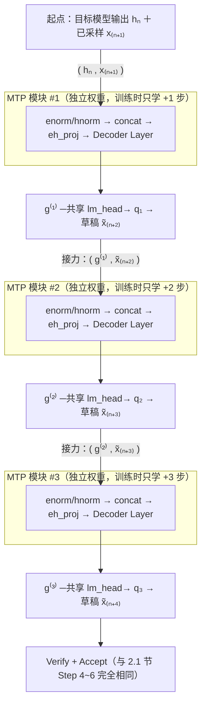
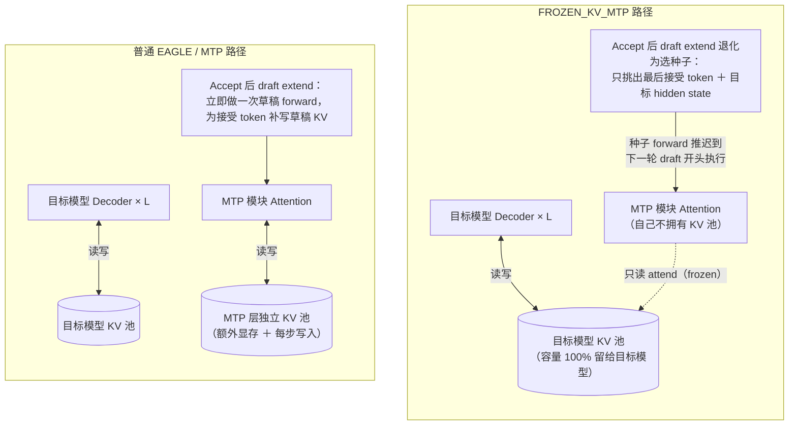
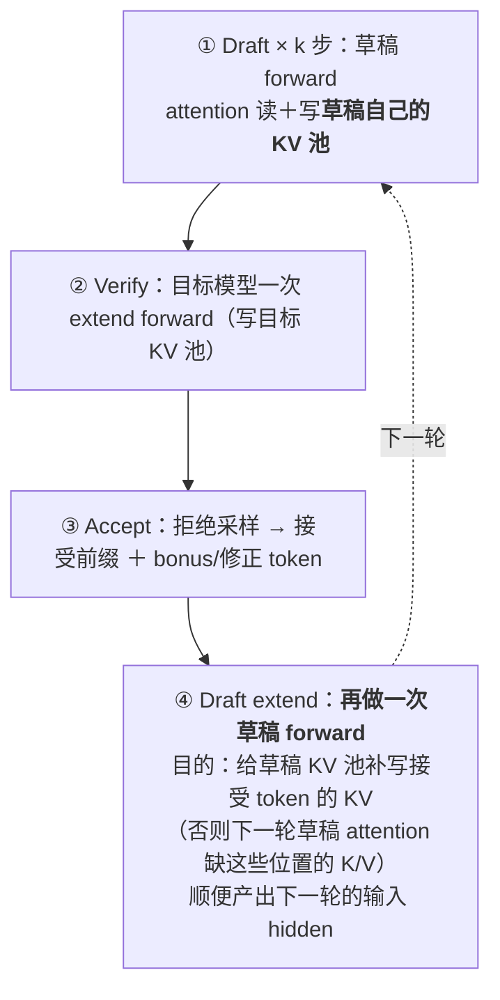
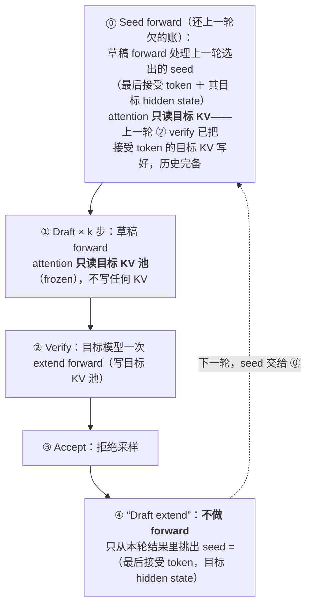
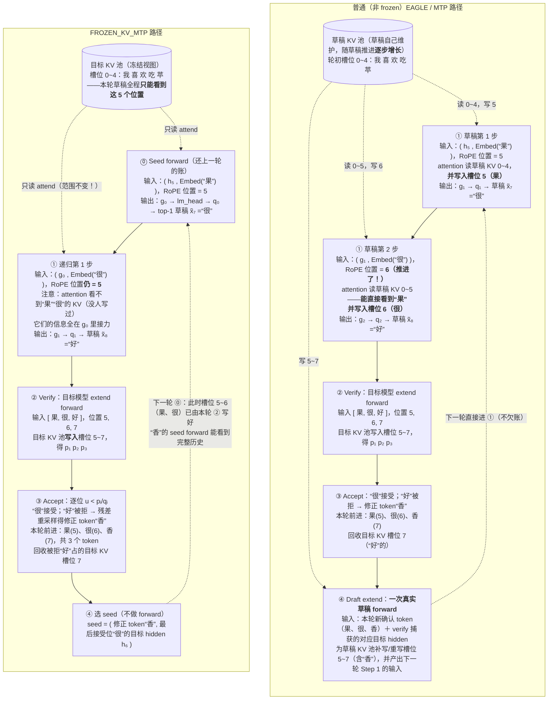

# MTP（Multi-Token Prediction）原理详解

MTP 既是一种**训练目标**（让模型在训练时一步预测未来多个 token，改善表征质量），也是一种**推理加速手段**（训练好的 MTP 头天然是投机解码的草稿模型）。本文两条线都讲，并对照 SGLang 中的实现。投机解码基础见 [speculative_decoding.md](./speculative_decoding.md)，树形草稿见 [tree_draft.md](./tree_draft.md)，EAGLE 见 [eagle.md](./eagle.md)，DSpark 中 MTP 作为生产基线的角色见 [dspark.md](./dspark.md)。

## 1. 训练目标视角：为什么要一步预测多个 token

标准语言模型训练目标是 next-token prediction：位置 $i$ 只预测 $x_{i+1}$。MTP 把它扩展为：位置 $i$ 同时预测 $x_{i+1}, x_{i+2}, \dots, x_{i+D}$（$D$ 为预测深度）。动机有二：

1. **训练信号更密**：同一次 forward 里每个位置产生 $D$ 份监督信号，数据效率更高；
2. **逼出"向前规划"的表征**：只预测下一个 token 时，模型可以走一步看一步；被迫同时押注未来多步，hidden state 必须编码更长程的意图（比如提前"想好"整个短语怎么说），这被认为能改善表征质量、间接提升下游能力。

### 1.1 两种实现流派

| | Meta 并行多头（Gloeckle et al. 2024） | DeepSeek-V3 顺序 MTP 模块 |
| --- | --- | --- |
| 结构 | 共享主干 + $D$ 个**并列**输出头，各自独立预测 $x_{i+k}$ | $D$ 个**串联**的轻量模块，第 $k$ 个模块以第 $k{-}1$ 个的输出为输入 |
| 因果链 | 各头之间无依赖，$x_{i+2}$ 的预测不知道 $x_{i+1}$ | **保持完整因果链**：预测 $x_{i+k}$ 时显式喂入 $x_{i+k-1}$ 的真实 embedding |
| 后果 | 类似并行 drafter，深度越大越容易"多模态碰撞" | 每一步都条件于真实前缀，草稿质量随深度衰减慢得多 |

DeepSeek-V3 选择顺序式正是为了推理时当草稿用——保持因果链的 MTP 模块本质上就是一个自回归 drafter。

### 1.2 DeepSeek-V3 MTP 模块的结构

第 $k$ 个 MTP 模块（$k = 1 \dots D$）的一步计算：

$$
h'_i = W_{\text{proj}}\Big[\mathrm{RMSNorm}\big(h_i^{(k-1)}\big) \,;\, \mathrm{RMSNorm}\big(\mathrm{Embed}(x_{i+k})\big)\Big], \qquad
h_i^{(k)} = \mathrm{TransformerBlock}\big(h'_i\big)
$$

拆开看：

- **两路输入**：上一级的 hidden state $h^{(k-1)}$（$k{=}1$ 时就是主模型最后一层输出）+ 下一个真实 token 的 embedding，各自 RMSNorm 后拼接；
- **投影**：线性层把 $2d$ 压回 $d$；
- **主体**：**一个完整的 transformer decoder layer**（与主模型同构，含 attention + MoE FFN）；
- **输出**：过与主模型**共享的 lm_head** 得到 $x_{i+k+1}$ 的分布。embedding 也与主模型共享。

这与 SGLang 中的实现逐项对应（`python/sglang/srt/models/deepseek_nextn.py` 的 `DeepseekModelNextN`）：`enorm` / `hnorm` 是两路 RMSNorm，`eh_proj` 是 $2d \to d$ 投影，主体是一个 `DeepseekV2DecoderLayer`，embedding 与 lm_head 复用主模型权重。

**为什么 embedding 和最后一层 hidden 可以拼接**——两者确实不在同一表征空间（embedding 是输入端静态查表，hidden 是残差流末端贴着 lm_head 的输出表征，且残差流范数逐层累积、量级差很大），架构用三步显式解决：① 两个**独立**的 RMSNorm（`enorm`/`hnorm`）先各自归一，消除量级不匹配；② 用**拼接**而非相加——相加才要求同空间，拼接把两路放在不同维度上互不干扰；③ 可学习投影 `eh_proj` 在训练中学会把两个空间融合映射到 decoder 层的输入空间。此外两者也非完全异质：残差流结构意味着 $h = \mathrm{Embed}(x) + \sum_l \Delta_l$，二者共享同一条残差流的基底。

### 1.3 训练损失

每个深度算一份交叉熵，对深度取平均后乘以权重 $\lambda$ 加到主损失上：

$$
\mathcal{L}_{\text{MTP}} = \frac{\lambda}{D} \sum_{k=1}^{D} \mathcal{L}_{\text{CE}}^{(k)},
\qquad
\mathcal{L} = \mathcal{L}_{\text{main}} + \mathcal{L}_{\text{MTP}}
$$

DeepSeek-V3 用 $D = 1$（一个 MTP 模块），训练全程开启；发布的 checkpoint 里 MTP 模块权重随主模型一起提供（HuggingFace config 中的 `num_nextn_predict_layers` 字段），推理框架可以选择加载（做投机解码）或丢弃（当纯主模型用）。

## 2. 推理视角：MTP 头做自投机解码（self-speculative decoding）

MTP 头是随 checkpoint 一起发布、与主模型联合预训练的，推理时可以直接当草稿模型用——不需要任何额外模型，目标模型"自带草稿"，故称 **self-speculative decoding**。

MTP-$k$ 的记法（如 DSpark 论文中的 MTP-1 / MTP-3）指**推理时用 MTP 头起草 $k$ 个 token**。

### 2.1 一轮 MTP 解码的 step-by-step 过程

以 $D = 1$（单 MTP 模块，DeepSeek-V3 的配置）、草稿步数 $k = 3$、链式草稿为例。设当前已确认的序列为 $x_{1..n}$。

先看模型结构与一步草稿的数据流（Embedding / lm_head 均与主模型共享权重；两条上下文通道均画出——`hnorm` 一路是主模型压缩的前缀摘要（通道 ①），MTP 层 attention 回看历史所有位置的 KV（通道 ②）；虚线是自递归时"g 顶替 h、x̃ 顶替 x"的回边）：



自递归 $k$ 步与验证的整体流程：



下面逐步展开：

**Step 0：起点（来自上一轮或首次 prefill）**

目标模型对 $x_{1..n}$ 做 forward 后，手里有两样东西：

- 最后一个位置的**最后一层 hidden state** $h_n$（推理引擎会显式捕获它，不是只留 logits）；
- 从 $p(\cdot \mid x_{1..n})$ 采样出的下一个 token $x_{n+1}$（首轮来自 prefill 的正常采样，后续轮次就是上一轮的 bonus/修正 token）。

注意此时 $x_{n+1}$ **已经确定**，但它的 hidden state 还没算过——MTP 草稿正是从这个"半成品"状态起步。

**Step 1：MTP 模块第一步草稿**

把手头两样东西喂进 MTP 模块：

$$
g_1 = \mathrm{Block}\Big(W_{\text{proj}}\big[\mathrm{RMSNorm}(h_n)\,;\, \mathrm{RMSNorm}(\mathrm{Embed}(x_{n+1}))\big]\Big)
$$

$g_1$ 过共享 lm_head 得到分布 $q_1(\cdot)$，从中得出草稿 token $\tilde{x}_{n+2}$（贪心取 argmax，或树形草稿时取 top-k）。**保留 $q_1$**——验证时拒绝采样要用。

直观理解：$h_n$ 提供"主模型对上文的全部理解"，$\mathrm{Embed}(x_{n+1})$ 告诉 MTP 模块"实际采样走了哪条路"，MTP 模块在此基础上向前多推一步。

**Step 2~3：自递归续草稿**

MTP 模块的输出 $g_1$ 顶替目标模型 hidden state 的位置，与刚起草的 token 一起再喂回同一个模块：

$$
g_2 = \mathrm{Block}\Big(W_{\text{proj}}\big[\mathrm{RMSNorm}(g_1)\,;\, \mathrm{RMSNorm}(\mathrm{Embed}(\tilde{x}_{n+2}))\big]\Big) \;\to\; q_2 \;\to\; \tilde{x}_{n+3}
$$

$$
g_3 = \mathrm{Block}\Big(W_{\text{proj}}\big[\mathrm{RMSNorm}(g_2)\,;\, \mathrm{RMSNorm}(\mathrm{Embed}(\tilde{x}_{n+3}))\big]\Big) \;\to\; q_3 \;\to\; \tilde{x}_{n+4}
$$

$k$ 步后得到草稿链 $[\tilde{x}_{n+2}, \tilde{x}_{n+3}, \tilde{x}_{n+4}]$ 及各步分布 $q_{1..3}$。注意训练时 $D{=}1$ 的 MTP 模块只学过"往前看一步"，自递归是把它当一步预测器反复套用——步数越深，输入 $g_i$ 偏离训练分布越远，草稿质量逐步衰减，这是 $k$ 不能取太大的原因之一。

MTP 模块自己的 attention 也需要 KV：每步草稿会为新位置写入 MTP 层的 KV cache（这份 KV 独立于目标模型的 KV 池；`FROZEN_KV_MTP` 变体则省掉它，见 3.3 节）。

**Step 4：目标模型一次验证 forward**

把 $[x_{n+1}, \tilde{x}_{n+2}, \tilde{x}_{n+3}, \tilde{x}_{n+4}]$（注意 $x_{n+1}$ 也在里面——它的 KV 还没算，正好搭车）拼进一次 extend forward，得到 4 个位置的目标分布 $p_{1..4}$。

**Step 5：拒绝采样判定**

从左到右对每个草稿做 $u < p_i(\tilde{x})/q_i(\tilde{x})$ 判定（完整规则见 [speculative_decoding.md](./speculative_decoding.md) 第 4.3 节）：

- 被拒 → 从残差分布重采样修正 token，本轮结束；
- 全过 → 从 $p_4$ 采样 bonus token。

本轮前进 1~4 个 token。

**Step 6：为下一轮备料**

最后一个接受位置的目标模型 hidden state 被捕获，连同末端的 bonus/修正 token，构成下一轮 Step 0 的 $(h, x)$ 起点；被拒绝草稿占用的 KV 槽位（目标模型的和 MTP 模块的）回收。回到 Step 1。

### 2.2 $D > 1$ 时的差别

多模块 MTP（如 DeepSeek-V4 系）不做自递归，而是**接力**：第 1 个模块拿 $(h_n, x_{n+1})$ 出第一个草稿，第 2 个模块拿（第 1 个模块的输出 hidden state，第一个草稿 token）出第二个……每个模块只干自己训练时学的那一步，不存在"输入偏离训练分布"的问题，深度上限即模块数 $D$。

以 $D = 3$ 为例（对比 2.1 节：$D{=}1$ 是**同一个模块**沿虚线自递归，这里是 $D$ 个**不同权重的模块**各走一步）：



关键差别一览：

| | $D = 1$ 自递归 | $D > 1$ 接力 |
|---|---|---|
| 模块权重 | 同一份，反复套用 | 每步一份独立权重 |
| 输入分布 | 步数越深偏离训练分布越远 | 每个模块的输入恰是它训练时见过的 |
| 草稿深度上限 | 理论无上限（质量衰减兜底） | 硬上限 $= D$ |
| 显存 | 1 份 MTP 模块权重 | $D$ 份 |

### 2.3 生产中的取舍

$k$ 大则草稿质量衰减、且高并发下低接受率的草稿 token 白白占用验证批容量，DeepSeek 生产线长期只用 MTP-1（每轮只起草 1 个 token，验证批 = 2 token/请求）——这一约束正是 [DSpark](./dspark.md) 置信度调度要解决的问题。

## 3. SGLang 中的实现

### 3.1 模型侧：nextn / mtp 模型类

每个支持 MTP 的模型家族在 `python/sglang/srt/models/` 下有独立的草稿模型类，命名为 `*_nextn.py` 或 `*_mtp.py`：

```
deepseek_nextn.py    deepseek_v4_nextn.py    qwen3_moe_mtp.py    qwen3_next_mtp.py
glm4_moe_nextn.py    mimo_mtp.py             gemma4_mtp.py       nemotron_h_mtp.py
longcat_flash_nextn.py  hunyuan_v3_nextn.py  bailing_moe_nextn.py  ...
```

它们只包含 MTP 模块本身（norm + 投影 + 1~2 层 decoder），embedding / lm_head 指向主模型权重。加载时从主 checkpoint 中按 `num_nextn_predict_layers` 抽取 MTP 层权重。

### 3.2 Worker 侧：复用 EAGLE 路径

MTP 投机没有独立的 worker——启动 DeepSeek V3/R1 的 MTP 投机就是走 EAGLE 算法路径：

```bash
python -m sglang.launch_server \
  --model-path deepseek-ai/DeepSeek-V3 \
  --speculative-algorithm EAGLE \
  --speculative-num-steps 2 \
  --speculative-eagle-topk 4 \
  --speculative-num-draft-tokens 4
```

（无需指定 `--speculative-draft-model-path`，MTP 权重就在主 checkpoint 里。）draft 循环、`organize_draft_results`、`build_tree_kernel_efficient`、target verify、树形拒绝采样全部与 EAGLE 共用（见 [eagle.md](./eagle.md) 第 4 节的流程图）。`num_steps > 1` 时就是让 $D{=}1$ 的 MTP 模块像 EAGLE 一样自递归多步、长出草稿树。

### 3.3 FROZEN_KV_MTP：冻结 KV 的变体

`SpeculativeAlgorithm.FROZEN_KV_MTP`（`frozen_kv_mtp_worker_v2.py` 等）是 MTP 投机的一个内存优化变体，核心差异：

- **草稿模块只读目标模型的 KV cache，自己不拥有 KV 池**——普通 EAGLE/MTP 草稿要为自己的 attention 维护一份独立 KV（额外显存 + 额外写入），frozen-KV 变体让草稿层直接 attend 目标模型已写好的 KV；
- 代价是草稿的 "draft extend" 不再是一次模型 forward：它只把最后接受的 token + 目标 hidden state 选出来作为下一轮的种子（seed），种子 forward 推迟到下一轮 draft 开始时执行；
- 收益：省掉草稿 KV 池的显存与维护开销，KV cache 容量完全留给目标模型。

两条路径的 KV 归属与一轮时序对比：



要点：左边草稿 attention 的 K/V 来自**自己维护**的 KV 池，每步草稿、每次 draft extend 都要写入；右边草稿 attention 直接读目标模型 verify 时已写好的 KV——目标 KV 在草稿眼里是"冻结"的（只读不写），代价是接受 token 的草稿侧计算（seed forward）延后一轮。

再从**一轮时序**的角度看差异（这是最容易困惑的点：同样的几件事，顺序被重排了）。

普通 EAGLE / MTP，一轮四步，**④ draft extend 是一次真实的草稿 forward**：



FROZEN_KV_MTP：草稿没有自己的 KV 池，**④ 无 KV 可补、退化成纯挑数据**，接受 token 的草稿 forward（seed forward）挪到**下一轮 ⓪** 执行：



对照着看：

- **④ 的本质**：普通路径的 draft extend forward 存在的唯一理由是"给草稿 KV 池补账"（接受 token 只被目标模型 verify 过，草稿 KV 池里没有它们的 K/V，不补的话下一轮草稿 attention 就缺历史）。frozen 路径草稿没有 KV 池，账本不存在，④ 自然只剩"挑 seed"一件事。
- **⓪ 为什么可行**：seed forward 需要 attend 接受 token 及其之前全部历史的 KV——这些正是上一轮 ② verify 时目标模型写好的，所以推迟到下一轮开头执行时目标 KV 已经齐了，草稿一行 KV 都不用自己写。
- **总 forward 次数不变**：每轮仍是"草稿侧 $k{+}1$ 次前向 + 目标 1 次 verify"，只是那 1 次从上一轮的 ④ 平移到了本轮的 ⓪；省下的是草稿 KV 池的显存和每步写 KV 的开销，不是计算量。

**一个实际执行的例子**（单请求、链式 top-1、草稿步数 $k=2$；已确认前缀 $x_{1..5}$ = "我 喜 欢 吃 苹"占据目标 KV 槽位 0~4，上一轮末尾采样出 bonus token $x_6$="果"、捕获了"苹"位置的目标 hidden $h_5$。左列普通路径——草稿自维护一份草稿 KV 池，prefill 后的 draft extend 已为槽位 0~4 写好草稿层 KV；右列 FROZEN_KV_MTP——同一场景、无草稿 KV 池）：



右列（frozen）三处最值得盯住的细节：

- **⓪ 和 ① 的 attention 范围一模一样**（都只有槽位 0~4），连 RoPE 位置都固定在 `seq_len - 1 = 5` 不推进——源码注释明说 "Seed + recurrent iters share the same `seq_lens - 1` rope position"（`frozen_kv_mtp_worker_v2.py`）。第 1 步草稿"很"对第 2 步不可见，"很"的信息只靠 $g_0 \to g_1$ 的 hidden 接力传递（上下文通道 ① 独自扛起链内依赖，通道 ② 被冻结在前缀处）。
- **② 是唯一写 KV 的地方**：草稿链 [果, 很, 好] 的目标 KV 由 verify 一次性补齐，草稿侧从头到尾零写入。
- **闭环成立的原因**：下一轮 ⓪ 处理"香"（位置 7）时需要 attend 位置 0~6 的 KV——0~4 本来就有，5~6（果、很）正是本轮 ② 刚写的，所以推迟执行的 seed forward 拿到的历史永远是完备的。

两列逐点对照：

| | 普通路径（左列） | FROZEN_KV_MTP（右列） |
|---|---|---|
| 草稿第 2 步能否看到第 1 步草稿"果" | **能**——attention 直接读草稿 KV 槽位 5 | 不能——只靠 $g$ 的 hidden 接力 |
| 草稿步的 RoPE 位置 | 逐步推进（5 → 6） | 固定在 `seq_len - 1 = 5` |
| 草稿阶段写 KV | 每步写草稿 KV 池 | 零写入 |
| ④ draft extend | 真实 forward，为接受 token（含修正 token"香"）补写草稿 KV | 纯挑 seed，无 forward |
| "香"的草稿侧计算发生在 | 本轮 ④（马上还账） | 下一轮 ⓪（延后还账） |
| 显存 | 目标 KV 池 + 一份草稿 KV 池 | 只有目标 KV 池 |

> 细节说明：链式 top-1 下草稿步写入的槽位 5~6（果、很）恰好落在接受路径上；树形 top-k（`topk > 1`）时草稿阶段写的是**推测树**的位置，验证后 ④ 需按实际接受路径重写草稿 KV——这也是普通路径 draft extend 不可省的原因之一。

### 3.4 多步 MTP（$D > 1$）

部分模型（如 DeepSeek-V4 系）带多个串联 MTP 模块，对应 `multi_layer_eagle_worker_v2.py` / `multi_layer_eagle_utils.py`：每个模块负责一个深度、各有自己的权重，草稿沿模块链条逐级传递 hidden state，而不是单模块自递归。

## 4. MTP 与相邻方法的定位

```
                自带 vs 外挂            块内依赖
  MTP           模型厂商联合预训练自带    完整因果链（顺序模块）
  EAGLE-1/2/3   事后蒸馏外挂            完整因果链（单头自递归）
  Medusa        事后外挂多头            无（并列头，各管一位）
  DFlash/DSpark 事后外挂并行 backbone   无 / 半自回归补偿
```

实践含义：

- 模型**自带 MTP 头**时（DeepSeek、GLM、Qwen-MoE 等），投机解码零训练成本开箱即用，首选；
- 模型没有 MTP 头时，训一个 EAGLE-3 头是接受率最高的通用方案；
- MTP 头与 EAGLE 头也可以叠加：以 MTP 头为起点继续蒸馏训练（DeepSpec 等训练库支持），通常比从零训 EAGLE 收敛更快。

## 参考文献

- Gloeckle et al., *Better & Faster Large Language Models via Multi-token Prediction*, ICML 2024
- DeepSeek-AI, *DeepSeek-V3 Technical Report*, 2024（第 2.2 节 Multi-Token Prediction）
- Li et al., *EAGLE: Speculative Sampling Requires Rethinking Feature Uncertainty*, ICML 2024
- DeepSeek-AI, *DSpark: Confidence-Scheduled Speculative Decoding with Semi-Autoregressive Generation*, arXiv:2607.05147, 2026
