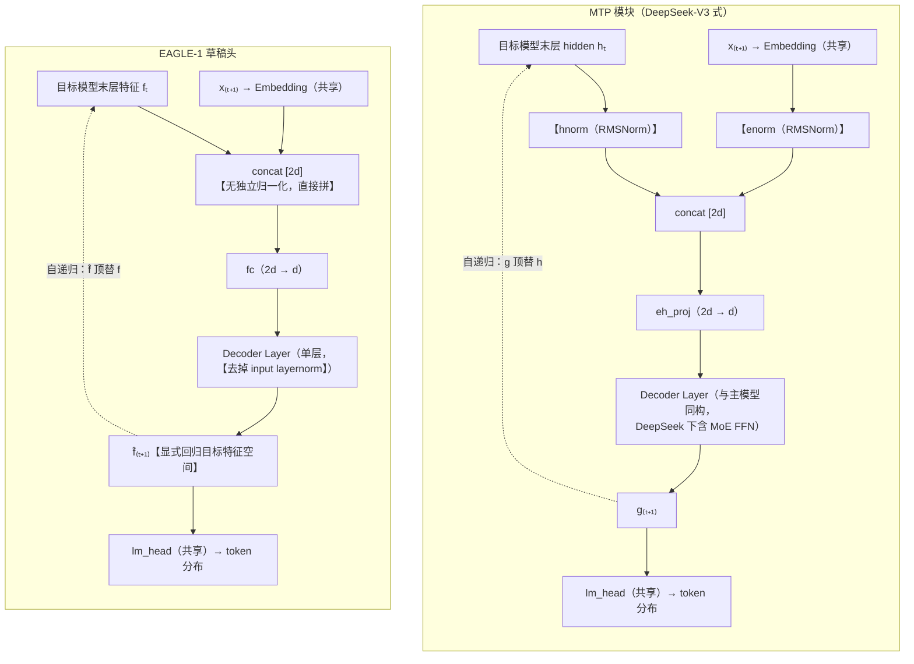
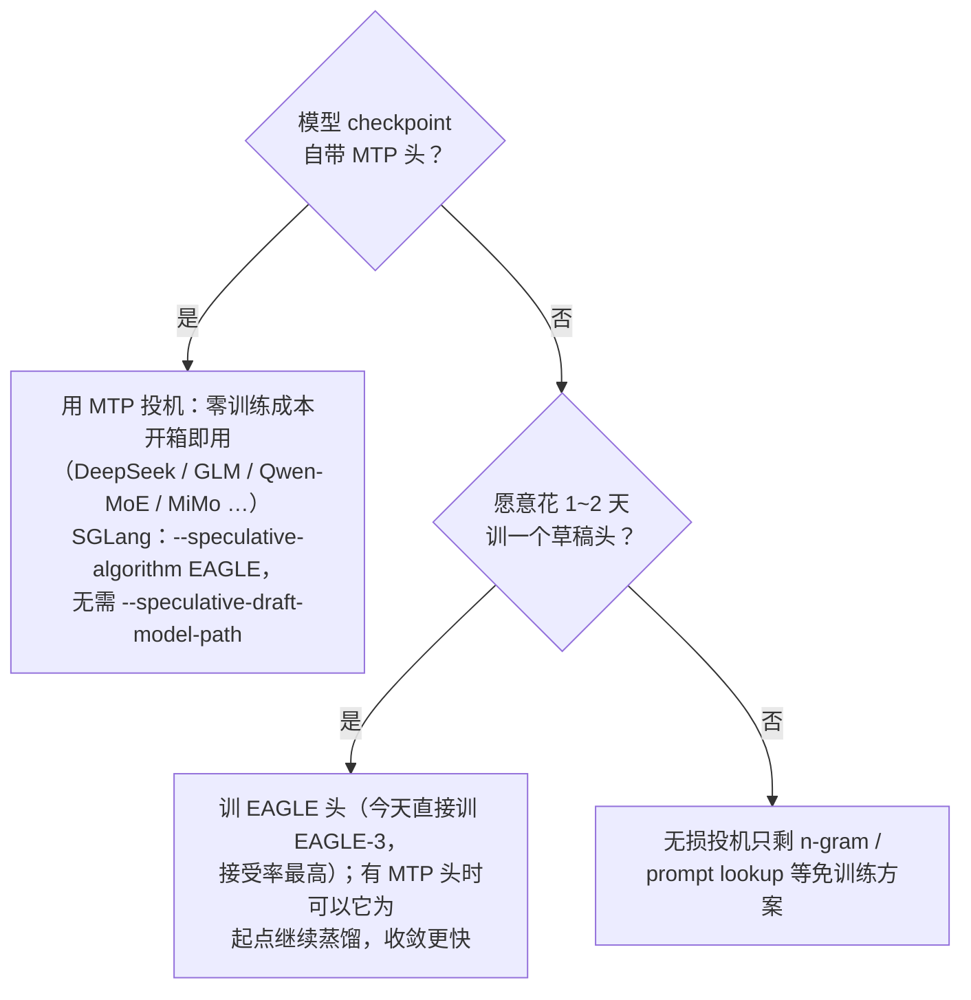

# MTP 与 EAGLE-1 的区别详解

MTP（DeepSeek-V3 式顺序 MTP 模块）与 EAGLE-1 的草稿头结构惊人地相似——都是「目标模型 hidden state ⊕ 已采样 token 的 embedding → 融合投影 → 一层 decoder → 共享 lm_head」。相似到 SGLang 里 MTP 投机直接复用 EAGLE 的 worker 路径、连启动参数都写 `--speculative-algorithm EAGLE`。

但两者的**出发点、训练方式、监督信号**完全不同。本文专门拆解这些区别。MTP 全貌见 [mtp.md](./mtp.md)，EAGLE 系列全貌见 [eagle.md](./eagle.md)，投机解码基础见 [speculative_decoding.md](./speculative_decoding.md)。

## 1. 一句话区别

> **MTP 是"模型厂商在预训练时顺手内置的草稿头"，EAGLE-1 是"任何人可以事后给任意模型外挂的草稿头"。**
>
> MTP 首先是一个**训练目标**（改善主模型表征），推理加速是副产品；EAGLE-1 从第一天起就**只为投机解码而生**（目标模型全程冻结）。

## 2. 结构对比：像，但不一样

两者的一步草稿数据流并排看（Embedding / lm_head 均与目标模型共享；差异处已用【】标出）：

骨架相同：**两路输入拼接 → 线性融合 → 一层 decoder → 共享 lm_head**，自递归方式也相同（自己的输出顶替目标 hidden 的位置继续滚）。这就是 SGLang 能用同一套 EAGLE worker 跑 MTP 的原因。

结构上的三处实质差异：

| | MTP 模块 | EAGLE-1 草稿头 |
| --- | --- | --- |
| 融合前归一化 | `enorm` / `hnorm` 两个**独立 RMSNorm**，先各自归一再拼接（消除 embedding 与残差流末端的量级差） | 无归一化，直接 concat 交给 fc 学 |
| decoder 层的成分 | 与主模型**同构**（DeepSeek 下带 MoE FFN，参数量不小） | 标准 dense 单层（通常比目标模型单层更轻） |
| 输出的身份 | $g$ 就是"这一层算出来的 hidden"，无特殊约束 | $\hat{f}$ 被训练**显式回归目标模型的特征空间**（见 §3 损失函数） |

## 3. 训练方式：分歧的根源

结构的相似掩盖不了训练的分野——这是两者最本质的区别。

| | MTP | EAGLE-1 |
| --- | --- | --- |
| 训练时机 | **与主模型联合预训练**，全程开启 | **事后训练**，目标模型完全冻结 |
| 谁在学 | 主模型 + MTP 模块**一起**更新 | 只有草稿头更新 |
| 对主模型的影响 | 有——MTP loss 反传进主干，逼出"向前规划"的表征（这是 MTP 的首要目的） | 零——目标模型输出分布一个比特都不变 |
| 损失函数 | 纯交叉熵：$\mathcal{L}_{\text{MTP}} = \frac{\lambda}{D}\sum_k \mathcal{L}_{\text{CE}}^{(k)}$，加权并入主损失 | 特征回归 + 分类双损失：$\mathcal{L} = \mathcal{L}_{\text{reg}}(\hat{f}, f) + w_{\text{cls}}\,\mathcal{L}_{\text{CE}}$（Smooth L1 回归目标特征，$w_{\text{cls}} \approx 0.1$） |
| 训练数据 | 预训练语料（万亿 token 级） | 少量指令数据（~7 万条对话即可），甚至不需要目标模型生成的文本 |
| 训练成本 | 摊入预训练（个体用户成本为零，但只有厂商能做） | 单独训练，1~2 天 × 少量 GPU |

两点展开：

**MTP 没有特征回归损失。** EAGLE-1 的核心假设是"特征序列比 token 序列更规律"，所以它让 $\hat{f}$ 直接逼近目标模型真实特征 $f$（Smooth L1），CE 只是辅助。MTP 则完全不关心 $g$ 落在哪个空间——它只要求 $g$ 过 lm_head 后 CE 正确。$g$ 事实上大致落在主干表征空间附近（残差流 + 共享 lm_head 的隐式约束），但没有显式回归项。

**联合预训练 vs 冻结蒸馏的效果差异。** MTP 模块见过万亿级 token、且主模型表征是"配合它"一起训出来的，所以单步预测质量极高；EAGLE-1 只能拿冻结特征做小数据蒸馏，单步质量略逊，但换来了**普适性**——任何开源模型都能事后挂一个 EAGLE 头，不需要厂商配合。

## 4. 推理行为对比

### 4.1 草稿组织方式

| | MTP（DeepSeek 生产实践） | EAGLE-1（论文设定） |
| --- | --- | --- |
| 草稿形状 | **链式**为主（MTP-1：每轮 1 个草稿 token） | **静态树**（离线固定形状，如 26 节点） |
| 深度来源 | 训练时 $D=1$ 只学过"+1 步"，自递归多步会偏离训练分布 | 训练时用 training 数据模拟自递归，多步衰减更平缓 |
| SGLang 中 | 走 EAGLE 路径，`num_steps`/`topk` 可配，也能长树 | 同一路径（SGLang 实现的是 EAGLE-2 动态树，静态树是 EAGLE-1 论文的做法） |

**静态树**指树的形状（深度、每层分叉数）在验证集上按各位置接受率统计后离线定死，所有上下文套用同一棵模板树；EAGLE-2 起改为按草稿头置信度现场生长的动态树。详细对比与图示见 [eagle.md](./eagle.md) §2.2。

注意方向相反的两个事实：

- MTP 模块**单步更准**（联合预训练 + 海量数据），所以链式浅草稿就有不错的接受率，DeepSeek 生产线长期只用 MTP-1；
- EAGLE-1 **多步更稳**（训练时见过自己的输出作为输入），所以敢自递归 5~6 步长深树。

### 4.2 一轮解码的流程

完全相同。两者都是：

流程细节（含 FROZEN_KV_MTP 时序重排的变体）见 [mtp.md](./mtp.md) §2.1/§3.3，树形版本见 [eagle.md](./eagle.md) §1.2 与 [tree_draft.md](./tree_draft.md)。

## 5. 获取方式与生态位

| | MTP | EAGLE-1 |
| --- | --- | --- |
| 谁能提供 | 只有模型厂商（要重跑预训练） | 任何人（目标模型冻结，事后训练） |
| 权重在哪 | 主 checkpoint 内（`num_nextn_predict_layers` 字段） | 独立的 draft checkpoint |
| 适用模型 | 只有训练时带了 MTP 目标的模型 | 任意 transformer LM |
| 主模型能力 | MTP 目标本身改善主模型表征（双重收益） | 不影响主模型 |

## 6. 汇总对照表

| 维度 | MTP（DeepSeek-V3 式） | EAGLE-1 |
| --- | --- | --- |
| 首要身份 | 训练目标（表征改善），推理加速是副产品 | 纯投机解码草稿头 |
| 训练时机 | 与主模型联合预训练 | 事后蒸馏，目标模型冻结 |
| 损失 | 纯 CE（$\lambda/D \cdot \sum \mathcal{L}_{\text{CE}}$，并入主损失） | Smooth L1 特征回归 + 0.1 × CE |
| 融合归一化 | enorm / hnorm 独立 RMSNorm | 无，直接 concat |
| decoder 层 | 与主模型同构（可含 MoE） | 轻量 dense 单层，去 input layernorm |
| 输出约束 | 无（只求 CE 正确） | 显式回归目标特征空间 |
| 单步草稿质量 | 更高（万亿 token 联合训练） | 略低（小数据冻结蒸馏） |
| 多步自递归稳定性 | 较差（$D{=}1$ 只学过一步） | 较好（论文即按多步使用设计） |
| 典型草稿形状 | 链式浅草稿（MTP-1） | 静态树（EAGLE-2 起动态树） |
| 获取门槛 | 厂商预置，用户零成本 | 任何人可训，1~2 天 |
| SGLang 路径 | `--speculative-algorithm EAGLE`（权重在主 checkpoint） | 同一路径 + `--speculative-draft-model-path` |

## 7. 相互转化：MTP 头是最好的 EAGLE 初始化

两者不是对立关系。模型自带 MTP 头时，可以**以 MTP 权重为起点继续做 EAGLE 式蒸馏训练**（DeepSpec 等训练库支持）：MTP 头已经会"看 hidden + token 预测下一个"，EAGLE 式训练再教它"自己的输出当输入也要预测得准"（缓解多步衰减）、并可升级到 EAGLE-3 的多层特征输入。通常比从零训 EAGLE 收敛快得多——这也从侧面印证了两者本是同一结构思想的两种训练路线。

## 参考文献

- DeepSeek-AI, *DeepSeek-V3 Technical Report*, 2024（第 2.2 节 Multi-Token Prediction）
- Gloeckle et al., *Better & Faster Large Language Models via Multi-token Prediction*, ICML 2024
- Li et al., *EAGLE: Speculative Sampling Requires Rethinking Feature Uncertainty*, ICML 2024
