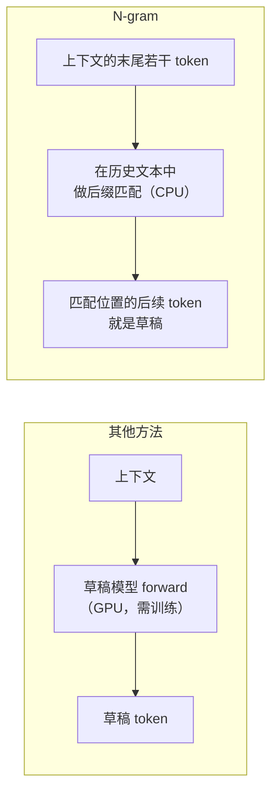
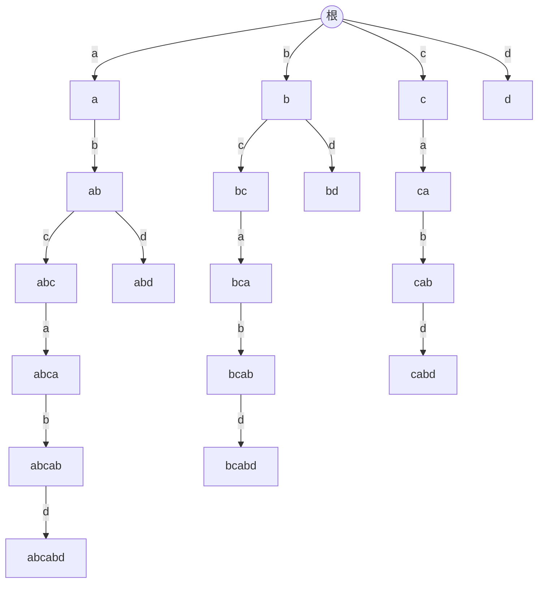
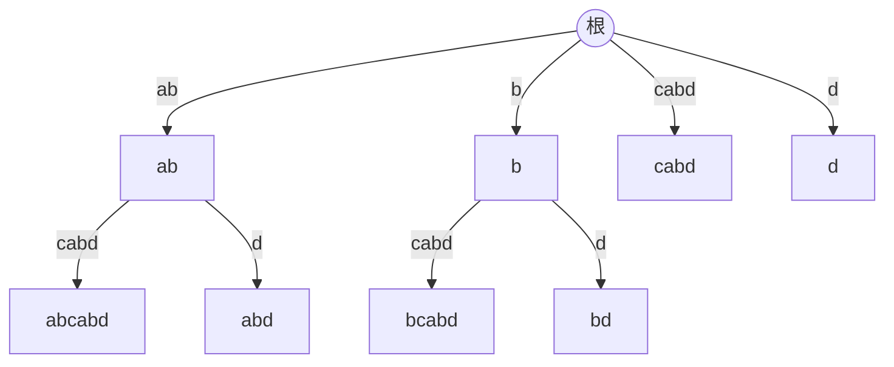
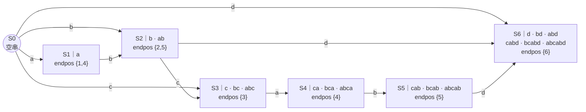
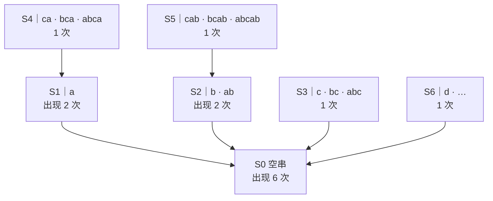
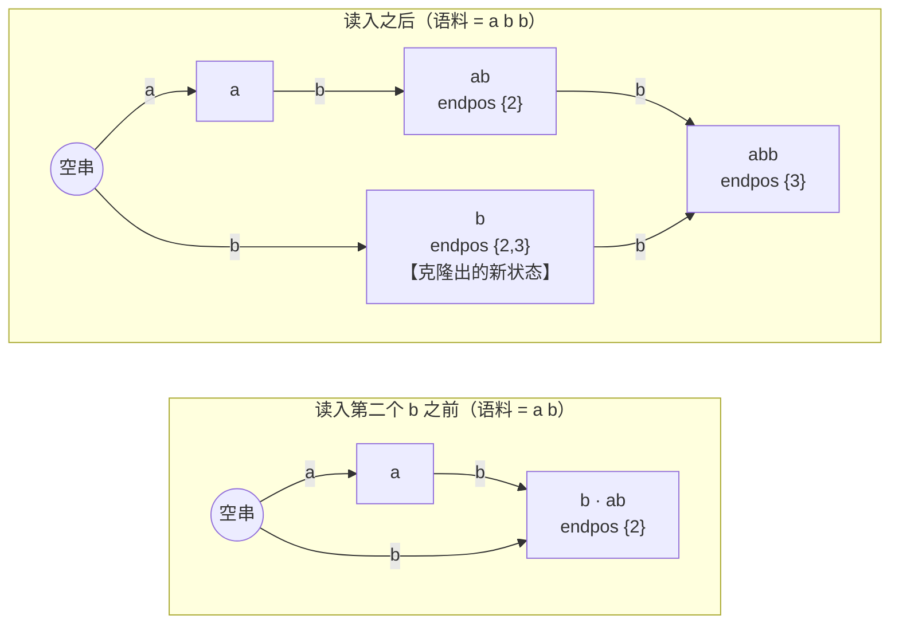
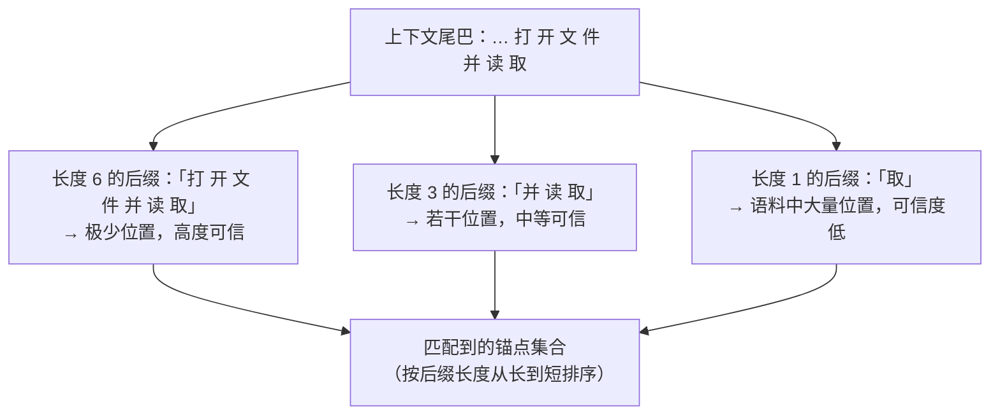
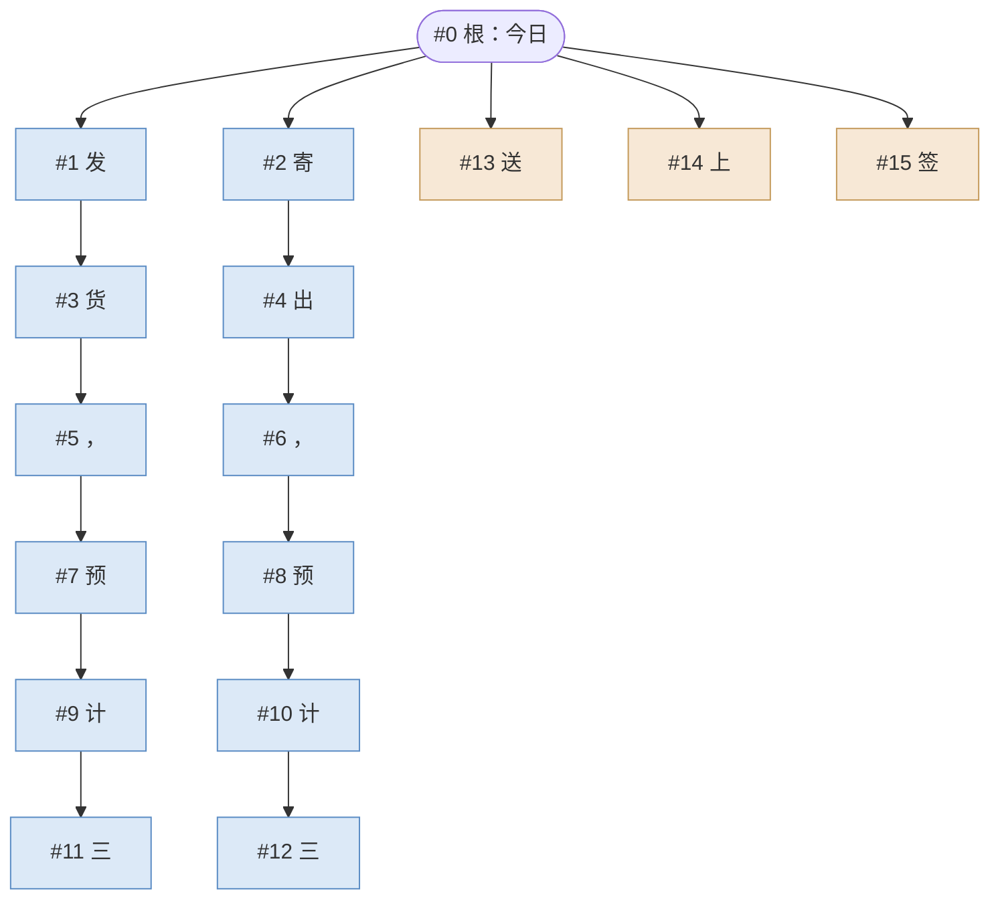

# N-gram 投机解码（检索式草稿）原理详解

其他投机方法都在想办法**预测**下一批 token——训一个草稿头、加几个解码头、复用 MTP 模块。N-gram 走的是完全相反的路：**不预测，只检索**。它假设"接下来要说的话，之前多半已经说过"，于是把历史文本存成一个可快速后缀匹配的结构，每一步拿当前上下文的尾巴去查表，查到什么就当草稿。

零训练、零显存、零草稿模型 forward——这是它最大的卖点，也是它全部局限的来源。

投机解码基础与拒绝采样的无损性见同目录 [speculative_decoding.md](./speculative_decoding.md)；树形草稿与树形注意力见 [tree_draft.md](./tree_draft.md)；作为对照的神经网络草稿方案见 [eagle.md](./eagle.md) 与 [medusa.md](./medusa.md)。

## 1. 核心思想：草稿来源与无损性无关

先说清楚一件容易被误解的事。[speculative_decoding.md](./speculative_decoding.md) §3 证明的无损性，其数学形式是：

$$
\text{接受判定只依赖 } p_{\text{target}}(x) \text{ 与草稿分布 } q(x)\text{，最终输出严格服从 } p_{\text{target}}
$$

这个证明里，$q$ 是什么、从哪来、有没有神经网络——**完全不重要**。哪怕草稿是随机数生成器吐的，只要验证过程照做，输出分布仍然精确等于目标模型。草稿质量只影响**速度**，不影响**正确性**。

N-gram 把这个自由度用到了极致：$q$ 退化成一个**查表**。



于是起草的边际成本从"一次 GPU forward"降到"一次 CPU 哈希查找"——在 GPU 满载的服务里，这个成本几乎等于零，因为它与目标模型的 forward 并行发生在 CPU 上。

代价是草稿质量**完全取决于运气**：上下文的尾巴恰好在历史里出现过，才有得抄。

## 2. 语料从哪来：在线记忆与离线知识

N-gram 的"历史"分两类，对应两种数据结构，解决两类不同的重复。

### 2.1 在线 trie：本次会话说过的话

每轮解码结束后，把该请求最新的一小段尾巴（默认末尾 18 个 token）插入一棵共享的前缀树。这棵树记录的是**服务启动以来所有请求生成过的文本片段**——不区分请求，跨请求共享。

这解决的是**局部自重复**：

- 代码补全里反复出现的 `for (int i = 0; i < n; i++)`；
- 多轮对话里用户反复引用同一段代码或表格；
- 摘要 / 翻译 / 改写任务中，模型大段照抄输入；
- Agent 循环里格式高度固定的 JSON 工具调用。

trie 容量有限（默认千万节点级），满了按 **LRU 淘汰**——最久没被匹配到的分支先被踢掉。这让它自然形成"近期热点记忆"的语义。

### 2.2 外部语料：预先灌进去的领域知识

在线 trie 有个冷启动问题：服务刚起来时它是空的，前几百轮完全没有草稿可用。而且它只记录**生成过的** token，prompt 本身不入库（实测收益不明显，故未开启）。

外部语料库解决这个问题：启动时把一批领域文本（API 文档、代码库、历史对话日志）切成 token 灌进一个**后缀自动机（Suffix Automaton, SAM）**。SAM 与 trie 的分工：

| | 在线 trie | 外部 SAM |
|---|---|---|
| 内容 | 本次服务生成过的文本 | 启动时加载的静态语料 |
| 更新 | 每轮解码后异步插入 | 只读，加载后不变 |
| 淘汰 | LRU | 无 |
| 匹配能力 | 从**已插入的那些后缀**出发匹配 | 匹配语料中**任意位置**的任意子串 |
| 结构代价 | 节点数 ∝ 插入的后缀总长 | 节点数 $O(n)$，$n$ 为语料 token 数 |
| 解决什么 | 局部自重复 | 领域重复、冷启动 |

选 SAM 而非 trie 的原因是空间：要支持"语料中任意子串"的匹配，用 trie 需要存全部后缀（$O(n^2)$），而后缀自动机用 $O(n)$ 个状态就等价地表达了同样的集合。

两者的草稿名额是**分开预算**的：外部 SAM 拿走固定一份配额，剩下的留给在线 trie，最后合并成一棵树。这防止了静态语料把动态记忆完全挤掉。

### 2.3 后缀自动机原理：为什么 $O(n)$ 就够

上表里"$O(n)$ 个状态就等价表达了全部后缀"这句需要解释——它是 SAM 唯一但足够关键的魔法。不过在讲 SAM 之前，得先说清楚它要取代的那个东西：后缀树。

#### 前置：后缀 trie 与后缀树

我们真正想要的能力是：**给定一段文字，判断它是否在语料中出现过；如果出现过，说出它后面跟的是什么**。

这个问题有一个直白的解法。注意到"$t$ 是 $S$ 的子串"等价于"$t$ 是 $S$ 的某个后缀的前缀"，所以只要把 $S$ 的**全部后缀**都塞进一棵 trie，从根按 $t$ 的 token 逐个往下走，能走通就说明出现过，走到的那个节点的子节点就是"后面能跟什么"。这棵树叫**后缀 trie**。

以语料 `a b c a b d` 为例，它的 6 个后缀是 `abcabd`、`bcabd`、`cabd`、`abd`、`bd`、`d`，逐个插入得到：



这棵树很好用，但太贵：节点数等于所有后缀的长度之和，即 $n(n+1)/2$。上图 6 个 token 就用掉了 21 个节点；1000 万 token 的语料要 $5 \times 10^{13}$ 个节点，直接出局。

省空间的第一步是观察到图里有大量"独苗链"——比如 `bca → bcab → bcabd` 这条路上每个节点都只有一个孩子，中间那些节点不承载任何分叉信息，纯属浪费。把每条独苗链压缩成一条边（边上标注"语料的第 $i$ 到第 $j$ 个 token"而不是单个 token），得到的就是**后缀树**：



压缩之后每个内部节点都至少有两个孩子，而叶子恰好 $n$ 个（每个后缀一个），所以节点总数不超过 $2n - 1$——降到了 $O(n)$。Ukkonen 算法能在 $O(n)$ 时间在线构造它。

那么问题来了：后缀树已经是 $O(n)$ 了，为什么 SGLang 还要用后缀自动机？三个原因：

- **边是变长的**。后缀树的一条边代表一段子串，匹配时"当前位置"不只是"在哪个节点"，还包括"在某条边的第几个 token 上"。而 NGRAM 的用法是逐 token 推进（每解码一步来一个新 token）、再逐 token 扩展草稿树，SAM 的每条转移恰好吃一个 token，状态即位置，实现上干净得多。
- **边上的子串是对原文的引用**。后缀树只存区间下标，必须把整份语料原样留在内存里才能解释这些边；SAM 的转移自带 token，语料本身可以丢掉。
- **统计信息的传播**。NGRAM 需要知道每个子串"出现了多少次""最后一次出现在哪"，用来排候选。SAM 的后缀链接天然构成一棵树，沿着它自底向上累加一遍就得到全部答案（详见下文）。

顺带一提，二者并非无关：**一个串的后缀自动机的后缀链接树，同构于它反串的后缀树**。它们本质是同一个东西的两种组织方式，SAM 只是更契合我们的访问模式。

#### 核心观察：结束位置相同的子串可以合并

设语料为 $S$。对任意子串 $t$，记 $\text{endpos}(t)$ 为 $t$ 在 $S$ 中所有出现的**结束位置**集合。

对我们要做的事（"匹配上这段文字之后，接下来能接什么"）而言，**两个 endpos 完全相同的子串是不可区分的**——它们出现的位置一模一样，后面跟着的东西自然也一模一样。既然如此，就没必要分别存储：把它们合并成**一个状态**。

以语料 `a b c a b d` 为例（位置从 1 开始）：

| 子串 | endpos | 归属 |
|---|---|---|
| `b` | {2, 5} | 同一状态 |
| `ab` | {2, 5} | 同一状态 |
| `cab` | {5} | 另一个状态 |
| `c` | {3} | 又一个状态 |

`b` 和 `ab` 合并是合理的：语料里凡是出现 `b` 的地方，前面必定是 `a`，两者携带的信息完全等价。而 `cab` 出现得更少（只在位置 5），必须单独成状态。

这个"合并"有两个漂亮的性质：

- **同一状态内的子串一定互为后缀**，并且长度是连续的一段。所以一个状态只需记住它所含**最长子串的长度**，其余的都是它的后缀，不必显式存储。
- **状态总数不超过 $2n$，转移总数不超过 $3n$**（$n$ 为语料 token 数）。这是可以严格证明的上界，也就是 §2.2 表里"$O(n)$"的来源。对比 trie 存全部后缀的 $O(n^2)$——1000 万 token 的语料，前者是千万量级的状态，后者是 $10^{14}$ 量级，完全不可行。

#### 完整结构：语料 `a b c a b d` 的 SAM

6 个 token 的语料，一共有 $6 \times 7 / 2 = 21$ 个子串（含重复），全部后缀建 trie 需要 21 个节点。而 SAM 只用 **7 个状态、10 条转移**就装下了它们——每个状态代表一个 endpos 等价类，实线是转移边：



**怎么读这张图**：从 S0 出发，沿任意一条路径走，读出的 token 序列就是语料的一个子串；走到哪个状态，就说明这个子串属于哪个等价类。比如 `a → b → c` 和 `b → c` 都终止于 S3——因为 `abc`、`bc`、`c` 的 endpos 都是 {3}，它们是同一个等价类。这正是压缩发生的地方：21 个子串被塞进 7 个状态。

反过来，**一个状态里装的子串是一段连续长度的后缀链**。S6 装了 6 个子串，从长度 1 的 `d` 到长度 6 的整个语料——因为 `d` 在语料里只出现过一次，那么以它结尾的所有更长子串必然也只在那一处出现，endpos 全是 {6}。所以状态只需记住"我最长的那个子串有多长"，短的都是它的后缀，不必列举。

#### 后缀链接：把"匹配失败"变成"缩短前缀"

每个状态还有一条**后缀链接**，指向"把最长子串的开头再砍掉一截、直到 endpos 发生变化"所落到的状态。砍掉开头只会让出现位置变多，所以链接必然指向 endpos 的**真超集**。全部链接构成一棵树，根是空串：



注意 S5 → S2 这条链接：`cab` 砍掉开头得到 `ab`，而 `ab` 的 endpos 是 {2,5}，比 `cab` 的 {5} 多了一个位置——出现得更多，所以是更"上层"的状态。同理 S4 → S1（`ca` 砍成 `a`）。

这棵树是 SAM 的第二副骨架，有两个用途：

- **匹配时的回退**：拿上下文尾巴沿转移边一路走，一旦下一个 token 无路可走，就顺着后缀链接往上跳一层再试——这等价于"丢掉最前面的几个 token、用更短的后缀重来"，但不用从头走一遍。整个匹配对每个 token 均摊 $O(1)$。
  这一步顺便**免费实现了 §3 说的多锚点**：回退路径上经过的每个状态都是一个更短的后缀锚点，长的在下、短的在上，天然按可信度排好了序。
- **聚合量的传播**：见下。

#### 构造：在线增量，均摊 $O(1)$

SAM 是逐 token 追加构造的。绝大多数情况只是新建一个状态、沿后缀链接把新转移补上去（上面 `abcabd` 的六步全是这种情形）。唯一复杂的情形是**分裂**：新 token 让某个已有等价类里的子串不再等价了。

以 `a b b` 为例。读入第二个 `b` 之前，`b` 和 `ab` 的 endpos 都是 {2}，同处一个状态；读入之后，`b` 多了位置 3，而 `ab` 没有——它们必须拆开：



做法是把原状态**克隆**一份：克隆体接管较短的那批子串（这里是 `b`），原状态留下较长的（`ab`），然后把指向原状态的部分转移改指到克隆体上。克隆是状态数上界为 $2n$ 而非 $n$ 的唯一原因——每读入一个 token 最多触发一次克隆。

#### 加载完成后的一次性预计算

语料灌完后要做一遍全局收尾，这一步决定了 SAM 为什么**必须只读**：

1. **出现次数**：新建状态初始计数为 1（克隆体为 0，因为它不对应任何新增的出现位置），然后沿后缀链接树**自底向上累加**。走完之后每个状态就知道自己代表的子串在语料里出现了多少次——这就是 §4.2 PROB 模式要的频次。
   上面链接树里的次数就是这么来的：S4 和 S1 各自初始为 1，S4 把自己的 1 累加给父节点 S1，于是 S1 变成 2——正确，`a` 在 `abcabd` 里确实出现两次。同理 S5 把 1 给了 S2，`b` / `ab` 各出现两次。最后 S0 收到 6，正好等于语料长度（空串在每个位置都"出现"一次）。
2. **最后出现位置**：同样沿树传播，但取最大值而非累加，得到该子串最近一次出现在语料的哪里——这就是 §4.1 BFS 模式要的新鲜度。S1 从 S4 收到 4，于是 `a` 的最后出现位置是 4 而不是 1。
3. **转移预排序**：按上面两个量，各把每个状态的出边排序缓存一份。查询时直接取前若干个，不必现场排序。

这三步都是**全局**操作：改动语料任意一处，出现次数和最后位置都可能需要重算。所以外部语料的语义只能是"加载完成后冻结"，运行时想更新只能整个替换。相对地，在线 trie 用局部的 LRU 与频次计数，才支持每轮增量插入——两种结构的动静之分，根子在这里。

#### 文档分隔符

多份文档拼进同一个 SAM 时，中间插入一个**不属于词表的分隔 token**。匹配和扩展都会跳过它，于是草稿不可能跨越文档边界——否则会缝合出"前半句来自文档 A、后半句来自文档 B"这种语料里根本不存在的续写，白白浪费草稿预算。

### 2.4 内存开销：便宜的是显存，不是内存

"零显存"这个卖点容易让人忽略另一头的账：trie 和 SAM 全部驻留在**主机内存**里，而且量级不小。

在线 trie 的容量参数（默认 1000 万）是**节点数**上限，且节点数组在启动时一次性分配好、立刻计入常驻内存。每个节点的成本分三部分：

| 组成 | 每节点约 | 说明 |
|---|---|---|
| 节点结构体本身 | 176 B | 一个子节点哈希表、一个 LRU 链表、一个按频次排序的集合，外加父指针、token、频次、版本号 |
| 作为父节点的一个子项 | ~125 B | 同一个子节点要在父节点的哈希表、LRU 链表、频次集合里各挂一份 |
| 全局 LRU 链表节点 + 空闲节点池指针 | ~40 B | 淘汰机制的簿记 |
| **合计** | **~340 B** | |

于是：

- **启动即占用** ≈ 1000 万 × 184 B ≈ **1.8 GB**（节点数组 + 空闲池指针，与实际用了多少无关）；
- **写满后** ≈ 1000 万 × 340 B ≈ **3.2～3.5 GB**。

三点容易踩的坑：

1. **每个 TP rank 各有一份**。投机 worker 是按 rank 实例化的，8 卡 TP 就是 8 份独立的 trie——默认容量下写满约 **26 GB 主机内存**。容量参数需要按 rank 数而不是按机器来估。
2. **启动时的 1.8 GB 是实打实的 RSS**，不是虚拟地址预留。容器内存 limit 卡得紧时，服务可能在还没接第一个请求时就被 OOM killer 干掉。
3. **节点数 ≠ token 数**。每次插入是把长度 $D$ 的尾巴的**所有后缀**都插进去，最坏情况一次插入新增 $O(D^2/2)$ 个节点（默认 $D=18$ 时约 160 个）。实际因为大量前缀共享，增速远低于此，但"1000 万节点能存多少文本"没有简单换算——重复度高的负载能撑很久，开放域负载很快就开始 LRU 淘汰。

外部 SAM 的账不同，它按 **token 数**计价（后缀自动机的状态数不超过 $2n$、转移数不超过 $3n$），综合每 token 约 **400～600 B**。默认的 token 数上限 1000 万意味着最坏情况约 **4～6 GB**，同样是每 rank 一份。这个上限参数存在的意义就是让超限在**启动时**直接失败，而不是运行中被 OOM。

结论很简单：**这两个默认值是按"内存管够"设的**。容量按实际负载调小往往没有明显损失——重复度高的场景几百万节点就足够覆盖热点，重复度低的场景再大的 trie 也没用。

> 上表按 Linux / libstdc++ 的容器布局估算。macOS / libc++ 下节点结构体是 136 B，总量约低两成；这只影响本地调试，不影响生产估算。

## 3. 匹配：多个长度的后缀同时当锚点

朴素做法是"拿末尾 $d$ 个 token 去查，查到就用"。但 $d$ 定死会两头不讨好：$d$ 太长几乎匹配不上，$d$ 太短匹配上了也不可信。

实际做法是**所有长度同时匹配**：对当前上下文尾巴，同时找出末尾 1 个、2 个、…、$D$ 个 token 各自在语料中对应的位置，得到一组**锚点**。



排序原则很直观：**匹配得越长，说明当前语境与历史越吻合，后续续写越可信**。所以造树时按后缀长度从长到短依次消耗草稿预算——长匹配优先占坑，短匹配只在还有余额时兜底。

匹配深度上限（默认 18）同时限制了三件事：插入 trie 时每次写入的尾巴长度、匹配时尝试的最长后缀、以及 trie 的最大层数。三者必须一致，否则会出现"查得到的深度插不进去"的错配。

### 3.1 一个具体的走查

设这次会话此前已经产出过下面几句话，它们都已进了在线 trie（回忆 §2.1：插入时是**每个起始位置各插一条尾巴**，所以 trie 里不只有整句，也有"读 取 配 置"这样从中间切开的片段）：

```
① 打 开 文 件 并 读 取 内 容
② 请 先 读 取 配 置 项
③ 并 读 取 数 据 库 连 接
④ 取 消 当 前 操 作
```

现在正在生成第五句，已经吐出的尾巴是：

```
… 用 户 打 开 文 件 并 读 取
```

匹配就是拿这条尾巴的各个长度的后缀，各自去 trie 的根往下走：

| 后缀长度 | 用来查的后缀 | 走到哪 | 该节点下的后续 token | 判断 |
| --- | --- | --- | --- | --- |
| 1 | 取 | 命中（①②③④ 都贡献过） | 内、配、数、消 | 命中多但杂，几乎等于瞎猜 |
| 2 | 读 取 | 命中（①②③） | 内、配、数 | 收窄了一点 |
| 3 | 并 读 取 | 命中（①③） | 内、数 | 语境开始对上 |
| 4 | 件 并 读 取 | 命中（①） | 内 | 只剩一个候选 |
| 6 | 打 开 文 件 并 读 取 | 命中（①） | 内 | 语境高度吻合 |
| 7 | 户 打 开 文 件 并 读 取 | **走不通**——第 7 步没有对应子节点 | — | 语料里没这么长的重复，放弃 |
| 8+ | … | 同上，全部落空 | — | — |

几个从这张表里能读出来的要点：

**长后缀不是"更好的匹配"，而是"更可信的匹配"。** 长度 6 和长度 4 给出的续写候选完全一样（都是"内"），但长度 6 的证据更强——它意味着历史上有整整六个 token 与当前语境逐字相同。所以造树时先让长度 6 的锚点占预算，长度 1 那种"命中一大片"的锚点排在最后，只在预算有富余时才兜底。

**命中不等于可用。** 如果某个长度的后缀恰好走到了 trie 的一个叶子（历史上这段文本正好在此结束，后面没再接过任何 token），那它虽然"匹配上了"，却拿不出任何续写候选。这类锚点在造树前会被直接筛掉——只有**还有子节点、能往下展开**的锚点才算数。上表里长度 7 是"走不通"，而叶子情形是"走通了但到头了"，两者结果一样：贡献零个草稿 token。

**不同长度的锚点可能给出同一个候选。** 长度 3、4、6 都指向"内"。这不会造成浪费——§4.3 讲的路径折叠会把它们合并成同一个分支，重复的续写只占一份预算。

**外部语料是并行的第二组锚点。** 如果还挂了外部语料（§2.2），同一条尾巴会在每个 SAM 上再做一遍同样的多长度匹配，得到另一组锚点。SAM 的匹配方式不同（走后缀链而不是从根重走），但产出的东西是同构的：一组"这里可以接着往下写什么"的位置。两组锚点各自造树、最后折叠。

### 3.2 锚点可以顺着推进，不必每步重来

上面这张表看起来要走 $D$ 遍 trie（每个长度一遍），如果每个解码步都从头做一次，CPU 成本会随深度上限线性增长。实际上不需要。

注意**相邻两步的后缀之间只差在末尾**：这一步接受了"内"之后，下一步要查的长度 4 后缀"并 读 取 内"，恰好就是这一步长度 3 的锚点"并 读 取"再往下走一个"内"。所以只要把上一步的全套锚点缓存下来，新来的 token 逐个喂进去让每个锚点各走一步，就能推出新的全套锚点——**摊销到每步是常数次指针跳转**，与深度上限无关。

这个缓存在两种情况下必须作废、退回到从头重建：

- **上下文不连续**：比如上一轮草稿被拒绝、实际接受的 token 与缓存假定的不一致，缓存代表的就不再是当前尾巴。
- **trie 发生了淘汰**：LRU 把某个节点腾走并复用给了别的路径（§2.1），缓存里指向它的锚点就成了悬空引用——指针还在，但它已经不是原来那个节点了。实现上靠给节点打版本号来识别这种"地址被回收复用"的情况，一旦发现对不上就整体重建。

## 4. 造树：把匹配结果扩展成候选树

有了锚点，还要决定从每个锚点往后取多少 token、怎么组织成树。这里有两种策略。

### 4.1 BFS 模式（默认）：按新鲜度、宽度随深度收窄

从每个锚点出发做广度优先扩展，每个节点取它在语料中**最近出现过的**若干个后继（LRU 顺序），逐层往下，直到草稿预算用完。

关键在于**宽度不是常数**，它随两个维度衰减：

- **锚点越长，起始宽度越窄**。长匹配意味着语境高度吻合，与其横向多押几个候选，不如把预算全砸在一条路上往深了走——"信得过就走得远"。
- **每往下一层，宽度再收窄一格**。越往后不确定性越大，但树的分叉本身也在指数增长，继续加宽只会摊薄每条路径的命中率。

用最小宽度 1、最大宽度 10、匹配上限 18 的默认配置举例，衰减步长约为 $(10-1)/17 \approx 0.53$：

| 锚点后缀长度 | 起始宽度 | 下一层 | 再下一层 | 形态 |
|---|---|---|---|---|
| 17（几乎全对上） | 1.0 | 1（下限） | 1 | 一条深链 |
| 9（中等） | ≈ 5.2 | ≈ 4.7 | ≈ 4.2 | 中等分叉 |
| 1（只对上一个 token） | ≈ 9.5 | ≈ 9.0 | ≈ 8.4 | 宽而浅 |

宽度有下限 1，所以再长的匹配也至少能一路走到底。

这套"长匹配窄而深、短匹配宽而浅"的分配，本质上是在做**置信度加权的预算分配**——与 EAGLE-2 用草稿模型的置信度动态调整树形状（[eagle.md](./eagle.md) §2.4）目标一致，只是这里的置信度信号不是概率，而是**匹配长度**这个免费的代理量。

### 4.2 PROB 模式：按频次做全局最优扩展

BFS 模式只用"最近出现"排序，不看出现了多少次。PROB 模式改用频次：每个节点的后继按历史出现次数归一化成一个概率，沿路径连乘得到路径分数，然后用一个全局优先队列，**每次都扩展当前分数最高的那个节点**，直到预算用完。

对比：

| | BFS 模式 | PROB 模式 |
|---|---|---|
| 排序依据 | 最近出现（新鲜度） | 出现频次（统计强度） |
| 扩展顺序 | 逐层广度优先 | 全局最优先 |
| 树形状 | 由宽度衰减规则决定 | 完全由数据决定，可能极不规则 |
| 擅长 | 局部重复（刚说过的话） | 稳定套路（反复出现的模式） |
| 类比 | 缓存的时间局部性 | EAGLE-2 的全局分数剪枝 |

PROB 的全局最优先扩展与 [tree_draft.md](./tree_draft.md) §2.2 描述的全局剪枝是同一个思想：预算应该给期望收益最高的节点，而不是均匀撒给每一层。

### 4.3 树的组织

无论哪种模式，同一父节点下重复出现的 token 会被合并成同一个子节点——不同锚点可能给出相同的续写，合并后省下预算。最终得到一棵以"当前最后一个 token"为根的候选树，摊平后连同树形注意力掩码一起交给目标模型。

**在线 trie 与外部 SAM 不会融合成同一个索引，合并只发生在这一步。** 两者始终是并列的独立结构：trie 要支持增量插入与 LRU 淘汰，SAM 加载后只读不变，更新方式和生命周期都不同（所以清缓存只清 trie，外部语料原样保留）。

每一轮匹配时，trie 和每份外部语料各自按 §2.2 划定的配额独立造出一棵小草稿树，再逐棵折叠：把每棵树拆成若干条"根到叶"的路径，按 trie 在前、外部语料在后的顺序重新插进一棵空树。公共前缀在这个重插过程中自然合并——两边给出同样的续写时只占一份预算。

顺序即优先级：trie 的路径先占坑，预算耗尽后外部语料剩下的路径直接丢弃。多份外部语料平分它们那一份固定配额，装得越多每份越薄。未配置外部语料时这一步整个跳过，全部预算归 trie。

### 4.4 一棵树的完整构造过程

用默认配置（草稿预算 16，即根 + 15 个草稿节点；最小/最大宽度 1/10；匹配上限 18）走一遍，看树是怎么长出来的。

场景：客服问答，历史里反复出现"您的订单已于今日发货，预计三日内送达"和"…已于今日寄出，预计三日内…"两种说法。当前上下文尾巴是"…您的订单已于今日"，根节点就是最后这个 token。

**第一轮：最长锚点（后缀长度 12）**

起始宽度 $(17-12) \times 0.53 + 1 \approx 3.6$，每下一层减 0.53。虽然允许取 3 个后继，但语料里"今日"后面只出现过"发"和"寄"两种，于是第一层只分出 2 叉；再往下每个节点的后继都唯一，于是变成两条平行的链，一直走到匹配深度上限、无后继可取为止。这一轮消耗 12 个节点。

**第二轮：短锚点（后缀长度 2）补位**

预算还剩 3 个。短锚点起始宽度 $(17-2) \times 0.53 + 1 \approx 9$，语料里这个短上下文后面跟过的 token 多得多。按新鲜度取前几个：前两个是"发"和"寄"——它们在根节点下**已经存在**，直接合并、不占预算；后三个是新的，各占一格。预算耗尽，构造结束。



<sub>蓝色：长锚点扩展出的两条深链（窄而深）。橙色：短锚点补上的横向候选（宽而浅）。</sub>

三处细节值得注意：

- **编号即摊平顺序**。节点是按广度优先的访问次序依次分配编号的，这个编号同时就是它在送进目标模型的一维序列里的位置。所以树结构不需要额外编码，只要再记一份"每个节点的父节点是谁"。
- **合并发生在同一父节点下**。短锚点给出的"发""寄"落到根节点下，发现同名子节点已存在，直接复用编号——所以图上看不到它们，但它们确实被短锚点"投票"过。跨父节点的相同 token 不合并（#5 与 #6 都是"，"，但父节点不同，必须分开）。
- **预算是全局的、按锚点可信度先到先得**。长锚点一直扩展到自己无路可走才让位；它若能一直走下去，短锚点就一个格子也拿不到。这正是 §4.1"长匹配优先占坑"的实际效果。

摊平后送去验证的就是这 16 个 token：

| 位置 | 0 | 1 | 2 | 3 | 4 | 5 | 6 | 7 | 8 | 9 | 10 | 11 | 12 | 13 | 14 | 15 |
|---|---|---|---|---|---|---|---|---|---|---|---|---|---|---|---|---|
| token | 今日 | 发 | 寄 | 货 | 出 | ， | ， | 预 | 预 | 计 | 计 | 三 | 三 | 送 | 上 | 签 |
| 父 | — | 0 | 0 | 1 | 2 | 3 | 4 | 5 | 6 | 7 | 8 | 9 | 10 | 0 | 0 | 0 |

树形注意力掩码由这份父指针关系生成：#3 只能看到 #1 和 #0，看不到 #2 或 #13——每条路径在注意力里都表现得像一条独立的序列（机制见 [tree_draft.md](./tree_draft.md) §3）。

验证时若目标模型逐位选择的是"发—货—，—预—计—三"，接受路径就是 #0 → #1 → #3 → #5 → #7 → #9 → #11：6 个草稿被接受，加上目标模型在 #11 之后给出的 bonus token，这一次前向推进了 7 个 token。其余 9 个草稿节点的 KV 被丢弃、槽位归还。

## 5. 验证：与其他算法完全共用

草稿树造好之后，N-gram 就没有任何特殊之处了：摊平、树形掩码、一次目标模型 forward、沿树贪心接受（或树上拒绝采样）、搬运被接受路径的 KV、释放猜错分支——整套流程与 EAGLE 逐字相同，机制见 [tree_draft.md](./tree_draft.md) §3–4。

这正是 §1 那个论断的工程体现：**验证只关心目标模型的分布和树的形状，不关心树是怎么来的**。

由此也带来一个结构性简化——N-gram 的解码循环里**只有一次 GPU 模型调用**：


对照 EAGLE 系的 **起草 → 验证 → 草稿扩展** 三段（每段都要 GPU forward，且草稿扩展是变长的），N-gram 少了两段：既没有草稿模型的多步前向，也不需要"让草稿模型的 KV 状态追上已接受序列"这一步——查表本来就是无状态的。

## 6. 一轮完整数值示例

§4.4 拆解了"树是怎么长出来的"，这里换一个场景，把匹配、造树、验证、写回四步串成一个完整闭环。

设草稿预算 16 个 token，BFS 模式。某个代码补全请求当前上下文结尾是 `... for (int i = 0; i <`。

1. **匹配**：在线 trie 里之前存过多条 `for (int i = 0; i < n; i++) {`，长度 8 的后缀成功匹配，同时长度 3、长度 1 的后缀也各自匹配到若干位置。
2. **造树**：长度 8 的锚点起始宽度接近 1，于是几乎一条直链往下抄出 `n ; i + + ) {`；预算还剩余，短锚点补上几个横向候选（如 `m`、`len`）。
3. **验证**：目标模型一次 forward 给出树上每个节点的下一 token 分布。
4. **接受**：直链前 6 个全部与目标模型的 greedy 选择一致，第 7 个分叉（历史里是 `n`，本次该是 `count`）——接受在此截断。
5. **结果**：接受长度 = 6 个猜对的草稿 + 1 个 bonus token = 7。这一步用一次 forward 推进了 7 个 token。
6. **写回**：把新的尾巴插进 trie，下次遇到 `i < count` 时就能直接抄对。

如果换成开放域闲聊，同样的流程通常在第 1 步就匹配不到长后缀，草稿全靠短锚点的宽扩展，接受长度大概率是 1——即"只拿到 bonus token"，等价于没有投机，白付一点点 CPU 匹配和树验证的开销。

## 7. 它什么时候有用，什么时候没用

命中率完全由**任务的重复度**决定，而不是模型质量：

| 场景 | 重复来源 | 效果 |
|---|---|---|
| 代码补全 / 重构 | 语法骨架、变量名反复出现 | 很好 |
| 文档摘要 / 抽取 | 大段照抄原文 | 很好 |
| 翻译 / 改写 / 格式转换 | 输入与输出高度同构 | 很好 |
| Agent 工具调用 | JSON 结构固定 | 很好 |
| 多轮对话引用上文 | 显式复述 | 好 |
| 开放域闲聊 | 几乎无重复 | 基本无收益 |
| 数学推理 / 创作 | 每步都是新内容 | 基本无收益 |

值得注意的是：**没收益时的损失也很小**。草稿全错时每轮仍能前进 1 个 token（bonus token 保底），额外开销只有 CPU 匹配（与 GPU 并行，隐藏）和验证时多算的十几个 token（在小 batch 下 GPU 有富余算力，接近免费）。真正的代价出现在**大 batch 高负载**时——那时 GPU 已经算力饱和，多验证的 token 是实打实的浪费，所以实现里支持按 batch size 调低草稿预算，负载越高投机越保守。

与神经网络草稿方案的定位对比：

| | N-gram | EAGLE-3 | MTP |
|---|---|---|---|
| 训练成本 | **零** | 数卡天级 | 需在预训练阶段就规划 |
| 额外显存 | 仅 CPU 内存（trie/SAM） | 草稿头权重 + KV | 模型自带 |
| 起草的 GPU 开销 | **零** | 每步一次小 forward | 每步一次小 forward |
| 草稿质量 | 取决于重复度，方差极大 | 稳定较高 | 稳定较高 |
| 典型接受长度 | 重复场景可很高，否则 ≈ 1 | 普遍 3~5 | 普遍 2~4 |
| 无损 | 是 | 是 | 是 |
| 适合 | 无草稿头可用、任务重复度高 | 通用加速 | 模型原生支持时 |

两者并不互斥——把外部语料当"领域先验"、把 EAGLE 当"通用先验"，在同一部署里按任务路由是常见做法。

## 8. SGLang 中的实现导览

启用方式：

```bash
--speculative-algorithm NGRAM --speculative-num-draft-tokens 16
```

主要参数（均为 `--speculative-ngram-` 前缀）：

| 参数 | 默认值 | 对应本文 |
|---|---|---|
| `match-type` | `BFS` | §4.1 / §4.2 的两种造树策略 |
| `min-bfs-breadth` / `max-bfs-breadth` | 1 / 10 | §4.1 的宽度衰减区间 |
| `max-trie-depth` | 18 | §3 的匹配深度上限（同时是插入长度） |
| `capacity` | 1e7 | §2.1 在线 trie 的节点上限（满则 LRU 淘汰）；**每 rank 约 1.8 GB 起、写满 3.5 GB，见 §2.4** |
| `external-corpus-path` | 无 | §2.2 外部语料文件 |
| `external-sam-budget` | 0 | §2.2 分给外部语料的草稿名额 |
| `external-corpus-max-tokens` | 1e7 | 外部语料 token 数硬上限，超出则启动失败；**每 rank 最坏约 4~6 GB，见 §2.4** |

代码入口：

- `python/sglang/srt/speculative/ngram_worker.py`：`NGRAMWorker.forward_batch_generation()` 是 §5 那张四阶段图的完整实现；`_prepare_draft_tokens()` 对应匹配与造树的调用，`_update_ngram_corpus()` 对应写回。
- `python/sglang/srt/speculative/ngram_info.py`：`NgramVerifyInput`，承载草稿树与树形掩码，接口与 EAGLE 的验证输入一致。
- `python/sglang/jit_kernel/csrc/ngram_corpus/`：C++ 侧核心。`trie.cpp` 的 `buildRecency` / `buildFrequency` 分别是 §4.1 / §4.2；`suffix_automaton.cpp` 是 §2.2 / §2.3 的外部语料结构；`ngram.cpp` 的 `batchMatch` 负责两类语料的预算分配与结果合并。
- `python/sglang/srt/speculative/external_corpus_manager.py`：外部语料的加载、注册与运行时增删。

两个值得留意的工程细节：

- **匹配状态增量推进**：每个请求缓存上一轮各长度后缀的匹配位置，下一轮只消费新增的那几个 token 往前走，而不是从根重新走一遍全部后缀。请求离开 batch 时按 rid 差集清理这些状态槽位。
- **batch 原地改写**：验证阶段会把 batch 的 forward mode 临时改成"树验证"，本轮结束必须还原成普通解码模式，否则调度器后续逻辑会错乱。

## 参考文献

- Yang et al., *Inference with Reference: Lossless Acceleration of Large Language Models*（[arXiv:2304.04487](https://arxiv.org/abs/2304.04487)）——检索式草稿的早期系统化工作
- Saxena, *Prompt Lookup Decoding*（[GitHub](https://github.com/apoorvumang/prompt-lookup-decoding), 2023）——从 prompt 中做 n-gram 匹配的极简实现，本方法的直接前身
- Fu et al., *Break the Sequential Dependency of LLM Inference Using Lookahead Decoding*, ICML 2024（[arXiv:2402.02057](https://arxiv.org/abs/2402.02057)）——n-gram 池 + Jacobi 迭代的另一条免训练路线
- Leviathan et al., *Fast Inference from Transformers via Speculative Decoding*, ICML 2023——无损性证明的来源
- Miao et al., *SpecInfer*, ASPLOS 2024——树形验证机制
