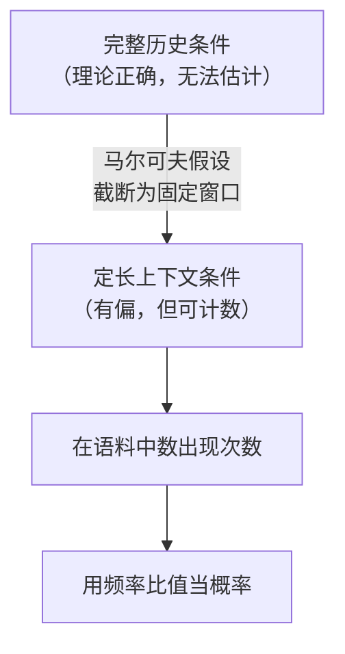
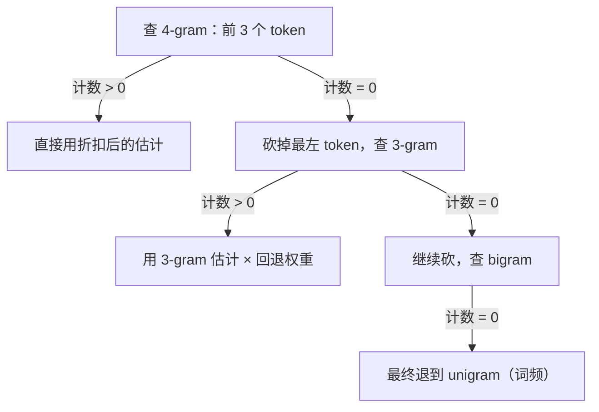

# N-gram 语言模型原理详解（非投机解码语境）

同目录的 [ngram.md](./ngram.md) 讲的是 N-gram 在投机解码里的用法——把历史文本当草稿库检索。那篇文档里 N-gram 只是个"查表工具"，它本来是什么、为什么这么定义、概率从哪来，全都被跳过了。

这篇补上前半段：N-gram 作为一个**独立的语言模型**，它的数学形式、它必然会遇到的稀疏性灾难、以及几十年里为了对抗稀疏性发明出来的一整套平滑技术。这些东西在神经语言模型时代看似过时，但理解它们能解释清楚两件事：为什么 N-gram 在某些任务上至今没被淘汰，以及为什么它作为草稿源恰好合适。

---

## 1. 语言模型要算的东西

语言模型的目标是给任意一个 token 序列赋一个概率：

$$
P(w_1, w_2, \dots, w_T)
$$

用链式法则拆开，这个联合概率总可以写成逐位置的条件概率乘积：

$$
P(w_1, \dots, w_T) = \prod_{t=1}^{T} P(w_t \mid w_1, \dots, w_{t-1})
$$

这一步是恒等变形，没有任何近似。问题出在 $P(w_t \mid w_1, \dots, w_{t-1})$ 上：条件部分的长度随 $t$ 增长，当 $t$ 很大时，这个条件几乎不可能在训练数据里出现第二次。你没法用统计的方式估计一个只出现过一次的事件的条件概率。

于是需要一个假设来截断条件。

## 2. 马尔可夫假设：只看最近的 N−1 个词

N-gram 模型的全部内容就是下面这个近似：

$$
P(w_t \mid w_1, \dots, w_{t-1}) \approx P(w_t \mid w_{t-N+1}, \dots, w_{t-1})
$$

**只有最近的 $N-1$ 个 token 影响下一个 token 的分布，再往前的一律忽略。**

按 $N$ 取值命名：

| $N$ | 名称 | 条件 | 直觉 |
|---|---|---|---|
| 1 | unigram | 无 | 只看词频，语序完全丢失 |
| 2 | bigram | 前 1 个词 | 能抓住"高兴地"→"跳" 这类搭配 |
| 3 | trigram | 前 2 个词 | 经典工程默认值 |
| 4–5 | 4/5-gram | 前 3–4 个词 | 大语料下的主流选择 |

这个假设显然是错的——语言里存在大量长距离依赖（主谓一致跨越整个从句、代词指代前文实体、篇章主题一致性）。N-gram 一概看不见。

但它换来了一个决定性的好处：**条件部分变成了固定长度的模式，因此可以被计数**。而可计数就意味着可以用最大似然估计。



这是一个非常纯粹的工程权衡：**用建模能力换可估计性**。理解这一点，后面所有的平滑技术就都好理解了——它们全都是在修补"可估计性"这一侧仍然存在的漏洞。

## 3. 最大似然估计：数数

给定语料，最直接的估计方式是频率比值：

$$
P_{\text{MLE}}(w_t \mid w_{t-N+1}^{t-1}) = \frac{C(w_{t-N+1}^{t-1}, w_t)}{C(w_{t-N+1}^{t-1})}
$$

分子是这 $N$ 个 token 连续出现的次数，分母是前 $N-1$ 个 token 连续出现的次数。二者相除就是"在见到这个前缀的所有场合中，下一个词是它的比例"。

用一个玩具语料感受一下。假设整个语料只有三句话（加上句首标记 `<s>` 和句尾标记 `</s>`）：

```
<s> 我 喜欢 猫 </s>
<s> 我 喜欢 狗 </s>
<s> 我 讨厌 雨 </s>
```

统计 bigram 计数：

| 前缀 | 后继 | 计数 | 前缀总计数 | $P_{\text{MLE}}$ |
|---|---|---|---|---|
| `<s>` | 我 | 3 | 3 | 1.00 |
| 我 | 喜欢 | 2 | 3 | 0.67 |
| 我 | 讨厌 | 1 | 3 | 0.33 |
| 喜欢 | 猫 | 1 | 2 | 0.50 |
| 喜欢 | 狗 | 1 | 2 | 0.50 |
| 讨厌 | 雨 | 1 | 1 | 1.00 |

于是 `<s> 我 喜欢 猫 </s>` 的概率就是 $1.00 \times 0.67 \times 0.50 \times 1.00 \approx 0.33$（末尾的 `猫 → </s>` 计数为 1/1）。

看起来一切正常。直到你问：`P(我 喜欢 雨)` 是多少？

`喜欢 雨` 这个 bigram 在语料里计数为 0，于是整句概率是 **0**。不是"很小"，是精确的零。

## 4. 稀疏性：N-gram 的根本困境

上面那个零不是玩具语料的偶然，它是 N-gram 的结构性问题。

设词表大小为 $V$，那么理论上存在 $V^N$ 个不同的 N-gram。取一个保守的 $V = 5\times10^4$：

| $N$ | 理论 N-gram 数量 |
|---|---|
| 2 | $2.5 \times 10^9$ |
| 3 | $1.25 \times 10^{14}$ |
| 4 | $6.25 \times 10^{18}$ |

而一个万亿 token 的语料，最多只能提供 $10^{12}$ 个 N-gram 实例。对 trigram 来说，能观测到的组合占理论空间的比例不到 1%；对 4-gram 更是可以忽略不计。

**绝大多数语法上完全合法的 N-gram，在任何有限语料里的计数都是 0。**

这带来两个致命后果：

1. **零概率传染**：链式法则是连乘，任何一项为 0，整句概率归零。模型无法区分"没见过但合理"和"根本不可能"。
2. **困惑度爆炸**：评估指标（见 §7）里有 $\log P$，$P = 0$ 意味着 $-\infty$，模型无法被评价。

这里必须区分两种零：

- **零计数（zero count）**：语料里没出现，但在语言中合法。这是需要修补的。
- **零概率（true zero）**：语言里真的不允许的组合。这类极少，且我们无法先验区分。

既然无法区分，唯一的选择就是：**给所有没见过的组合都留一点概率**。这就是平滑（smoothing）。


平滑技术之间的全部差异，就在最后那个框里的两个问题。

## 5. 平滑技术谱系

### 5.1 加一平滑（Laplace）

最朴素的想法：假装每个组合都多见过一次。

$$
P_{\text{Add-1}}(w \mid h) = \frac{C(h, w) + 1}{C(h) + V}
$$

分母加 $V$ 是为了让概率仍然归一（词表里每个词都多算了 1 次）。

问题在于**扣得太狠**。当 $V = 5\times10^4$ 而 $C(h) = 10$ 时，分母从 10 变成 50010——真实观测到的证据被稀释了五千倍。一个出现过 8 次的搭配，概率从 0.8 掉到 0.00018。这等于宣称"我们的先验比数据重要五千倍"，显然荒谬。

加 $k$ 平滑（$k < 1$）缓解了程度，但没改变本质：**它把概率质量均匀撒给所有未见事件，而未见事件之间的合理程度差异巨大**。

### 5.2 回退（Back-off）：长的没有就用短的

关键洞察：如果 `喜欢 雨` 没见过，我们不该退回到"完全无知"，而应该退回到**更短的上下文**。`雨` 这个词本身的 unigram 概率是知道的，`喜欢` 之后接名词也是常见模式。

Katz 回退的形式：

$$
P_{\text{katz}}(w \mid h) =
\begin{cases}
\dfrac{C^*(h, w)}{C(h)} & C(h, w) > 0 \\[2ex]
\alpha(h) \cdot P_{\text{katz}}(w \mid h') & C(h, w) = 0
\end{cases}
$$

其中 $h'$ 是把 $h$ 砍掉最左一个 token 得到的更短上下文，$C^*$ 是折扣后的计数（Good-Turing 折扣），$\alpha(h)$ 是归一化因子——它的值恰好等于在这个上下文下被折扣掉的全部概率质量，确保总和仍为 1。

这是一个**递归**结构：4-gram 退 3-gram，3-gram 退 bigram，bigram 退 unigram，unigram 退到均匀分布兜底。



### 5.3 插值（Interpolation）：不等到零才用短的

回退是"有长的就完全不看短的"。插值认为这太绝对——即使长上下文有观测，它的样本量可能也就 2、3 次，本身不可靠，短上下文的信息仍有参考价值。

于是各阶总是混合：

$$
P_{\text{interp}}(w \mid w_{t-2}, w_{t-1}) = \lambda_3 P(w \mid w_{t-2}, w_{t-1}) + \lambda_2 P(w \mid w_{t-1}) + \lambda_1 P(w)
$$

其中 $\sum \lambda_i = 1$。$\lambda$ 通常在留出集上调优，且可以让它依赖于上下文的计数——$C(h)$ 大时给高阶更多权重，$C(h)$ 小时倾向低阶。

实践中插值通常略优于纯回退，且实现更简单（无需计算 $\alpha$）。

### 5.4 Kneser-Ney：低阶概率该用"上下文多样性"而非词频

这是 N-gram 平滑的集大成者，它的洞察值得单独说清楚，因为它揭示了前面所有方法的一个共同错误。

考虑英文里的 `Francisco`。它词频不低（因为 `San Francisco` 常见），所以 unigram 概率不小。现在假设我们在估计 `P(w | 报道了)`，`报道了 Francisco` 没见过，需要回退到 unigram——按传统方法，`Francisco` 会因为高词频而拿到不小的概率。

但这是错的。`Francisco` 几乎**只**出现在 `San` 后面。它高频，但它的**上下文极其单一**。它不是一个"可以接在任意上下文之后的通用词"，恰恰相反。

Kneser-Ney 的修正：**回退时使用的低阶分布，不该基于该词出现了多少次，而该基于它跟在多少种不同的上下文之后**。

$$
P_{\text{cont}}(w) = \frac{\left|\{\, v : C(v, w) > 0 \,\}\right|}{\left|\{\, (v', w') : C(v', w') > 0 \,\}\right|}
$$

分子是"有多少个不同的词曾出现在 $w$ 前面"，分母是不同 bigram 类型的总数。按这个定义，`Francisco` 的分子接近 1，续接概率极低——正确反映了"它不适合出现在新上下文里"。

配合绝对折扣（absolute discounting，从每个正计数里减去一个固定的 $d$，而非按比例缩放），得到完整形式：

$$
P_{\text{KN}}(w \mid h) = \frac{\max\big(C(h,w) - d,\ 0\big)}{C(h)} + \frac{d \cdot N_{1+}(h \cdot)}{C(h)} \cdot P_{\text{cont}}(w)
$$

其中 $N_{1+}(h\cdot)$ 是上下文 $h$ 之后出现过的不同词的数量。第二项的系数恰好等于第一项折扣掉的总质量。

**Modified Kneser-Ney** 进一步对计数为 1、2、≥3 的情形使用不同的折扣值 $d_1, d_2, d_3$（低计数事件更不可靠，应折扣更多），是目前公认效果最好的 N-gram 平滑方法。

### 5.5 谱系总览

| 方法 | 扣多少 | 分给谁 | 核心问题 / 贡献 |
|---|---|---|---|
| 加一 | 每个词等价于多见 1 次，极重 | 均匀撒给所有词 | 稀释真实证据，仅有教学价值 |
| 加 k | 较轻 | 均匀撒给所有词 | 未见事件之间无区分度 |
| Good-Turing | 按计数频次的统计规律折扣 | 未见事件整体 | 首次给出折扣量的理论依据 |
| Katz 回退 | Good-Turing 折扣 | 递归交给低阶模型 | 引入"用短上下文兜底"的思想 |
| 插值 | 由权重隐式决定 | 各阶按权重混合 | 高阶不可靠时低阶仍能纠偏 |
| Kneser-Ney | 固定值绝对折扣 | 交给"续接概率"分布 | 低阶应衡量上下文多样性而非词频 |
| Modified KN | 按计数分档折扣 | 同上 | 当前最优 |

## 6. 数据结构：如何存下并快速查询

一个 5-gram 模型在大语料上可能包含数十亿条记录，每条是「上下文 → 后继词 → 概率 + 回退权重」。工程上有几种典型组织方式，它们的取舍直接决定了内存与延迟。

### 6.1 前缀树（Trie）

把上下文按 token 逐层展开成树，从根走到某个节点就对应一个前缀，节点上挂着该前缀的后继分布。

- 天然共享公共前缀，内存紧凑；
- 回退操作对应"从当前节点跳到它的更短后缀节点"，需要额外的后缀链接才能 $O(1)$ 完成；
- 查询复杂度 $O(N)$，与语料规模无关。

这是主流 N-gram 工具（如 KenLM 的 trie 后端）的默认结构。

### 6.2 哈希表

直接把整个 N-gram 序列哈希成键。查询是 $O(1)$，但不共享前缀，内存开销比 trie 大，回退时需要重新哈希更短的序列。以速度换空间的选择。

### 6.3 后缀自动机 / 后缀数组

如果需求不是"查某个固定阶数的概率"，而是"给定任意长度的后缀，找出它在语料中所有出现位置"，那么后缀自动机（SAM）或后缀数组更合适——它们能在 $O(1)$ 均摊时间内完成任意长度的后缀匹配，且支持"最长匹配"查询。

这正是 [ngram.md](./ngram.md) 里检索式草稿使用的结构。注意这里发生了一个关键的语义转变：**检索式草稿并不需要概率**，它只需要"找到匹配位置，把后面的 token 抄下来"。所以平滑、折扣、回退权重这一整套机器在那个场景下完全不需要——投机解码的验证阶段会用目标模型的真实分布做接受判定，草稿的概率估计根本不参与正确性保证。

这也解释了为什么 N-gram 能在投机解码里"零成本"复活：它被剥掉了作为概率模型最昂贵、最脆弱的那一半，只留下了最擅长的那一半——快速后缀检索。

## 7. 评估：困惑度

语言模型的标准内在评估指标是困惑度（perplexity）：

$$
\text{PPL} = P(w_1, \dots, w_T)^{-\frac{1}{T}} = \exp\left(-\frac{1}{T}\sum_{t=1}^{T} \log P(w_t \mid h_t)\right)
$$

它是每 token 平均负对数似然的指数，直觉上等于"模型在每一步平均在多少个候选词之间犹豫"。困惑度 100 意味着模型的不确定性相当于在 100 个等概率选项里猜。越低越好。

几点必须注意：

- **困惑度只能在相同词表、相同分词、相同测试集下比较**。换了分词器的困惑度数字之间没有可比性。
- 未平滑的模型在测试集上困惑度必然为 $\infty$（总会遇到零计数），所以平滑不是可选项，是能否被评估的前提。
- 困惑度低不等于下游任务好。它衡量的是分布拟合，不是可用性。

历史上的一个粗略参照：在英文新闻语料上，好的 Modified KN 5-gram 模型困惑度在 100 上下，而现代神经语言模型可以低到 20 以下——这个差距基本就是马尔可夫假设的代价。

## 8. N-gram 与神经语言模型

| 维度 | N-gram | 神经语言模型 |
|---|---|---|
| 上下文长度 | 固定且很短（≤4 个 token） | 长（数千至数十万 token） |
| 泛化方式 | 精确字符串匹配，靠平滑兜底 | 连续向量空间，语义相近的上下文自动共享统计强度 |
| 未见组合 | 只能靠回退猜测 | 可由语义相似性合理外推 |
| 训练成本 | 数一遍语料即可 | 大规模梯度训练 |
| 推理成本 | 一次查表（CPU，微秒级） | 一次前向（GPU，毫秒级） |
| 可解释性 | 完全透明，可追溯到具体计数 | 黑盒 |
| 增量更新 | 插入即生效 | 需要重新训练或微调 |

神经模型的根本优势在于**泛化**：`喜欢 猫` 和 `喜欢 狗` 在向量空间里天然接近，见过一个就能对另一个做出合理预测；而 N-gram 眼中这是两个毫不相干的字符串，必须各自被观测到。

但 N-gram 保留了两个神经模型给不了的性质，这让它在特定位置至今不可替代：

1. **极低的边际推理成本**。一次查表相对于一次 GPU 前向，成本可以视为零，且发生在 CPU 上，可与 GPU 计算并行。
2. **即时增量更新**。新数据插入立即生效，无需训练。这让它可以充当"会话级短期记忆"。

这两条正好是投机解码草稿源的理想属性——草稿只需要"便宜且偶尔猜对"，不需要"准确"。因此 N-gram 在被神经模型全面取代之后，又以另一种身份回到了推理系统里。

## 9. 现代 N-gram 仍在的位置

- **投机解码的检索式草稿**：本仓库的用法，详见 [ngram.md](./ngram.md)。
- **语音识别与机器翻译的浅层融合**：作为轻量先验与神经模型分数加权，用于快速适配领域词汇。
- **输入法与自动补全**：延迟预算极紧、需支持用户词库即时生效的场景。
- **语料去重与质量过滤**：用 N-gram 重叠度检测训练数据中的重复与测试集污染，这里用的是它的匹配能力而非概率。
- **快速领域适配**：在没有条件微调大模型时，用领域语料上的 N-gram 统计做加权干预。

共同点是：**这些场景要的是 N-gram 的"快"和"可即时更新"，而不是它的建模能力**。

---

## 参考文献

1. Shannon, C. E. *A Mathematical Theory of Communication*, 1948 —— N-gram 与信息论视角语言建模的源头。
2. Katz, S. M. *Estimation of Probabilities from Sparse Data for the Language Model Component of a Speech Recognizer*, IEEE ASSP, 1987 —— Katz 回退。
3. Kneser, R. & Ney, H. *Improved Backing-off for M-gram Language Modeling*, ICASSP, 1995 —— Kneser-Ney 平滑。
4. Chen, S. F. & Goodman, J. *An Empirical Study of Smoothing Techniques for Language Modeling*, Harvard TR-10-98, 1998 —— 平滑方法的系统性对比，Modified KN 出处。
5. Heafield, K. *KenLM: Faster and Smaller Language Model Queries*, WMT, 2011 —— trie 与哈希后端的工程实现。
6. Jurafsky, D. & Martin, J. H. *Speech and Language Processing*, 3rd ed., Ch. 3 —— 教科书级综述。
