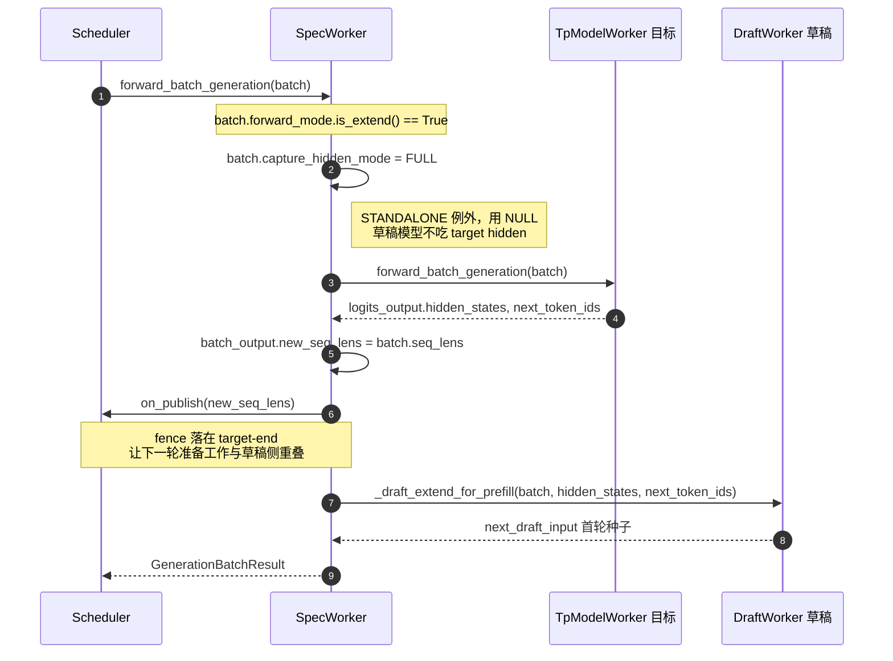
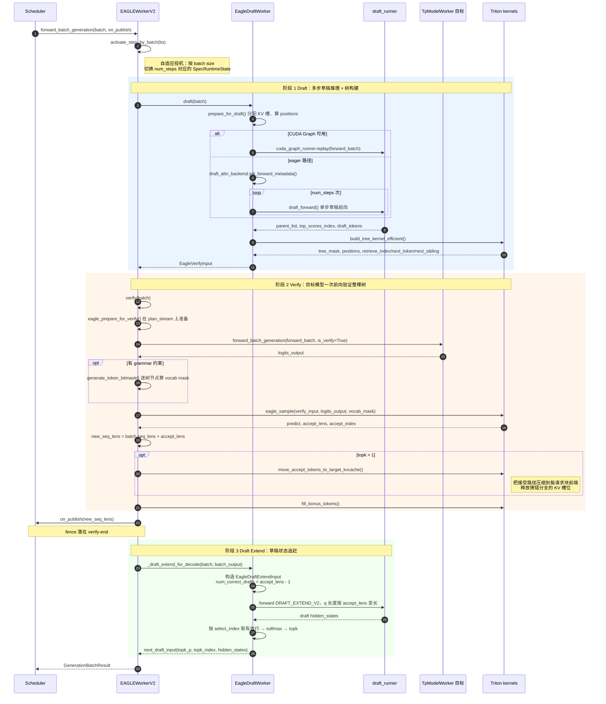
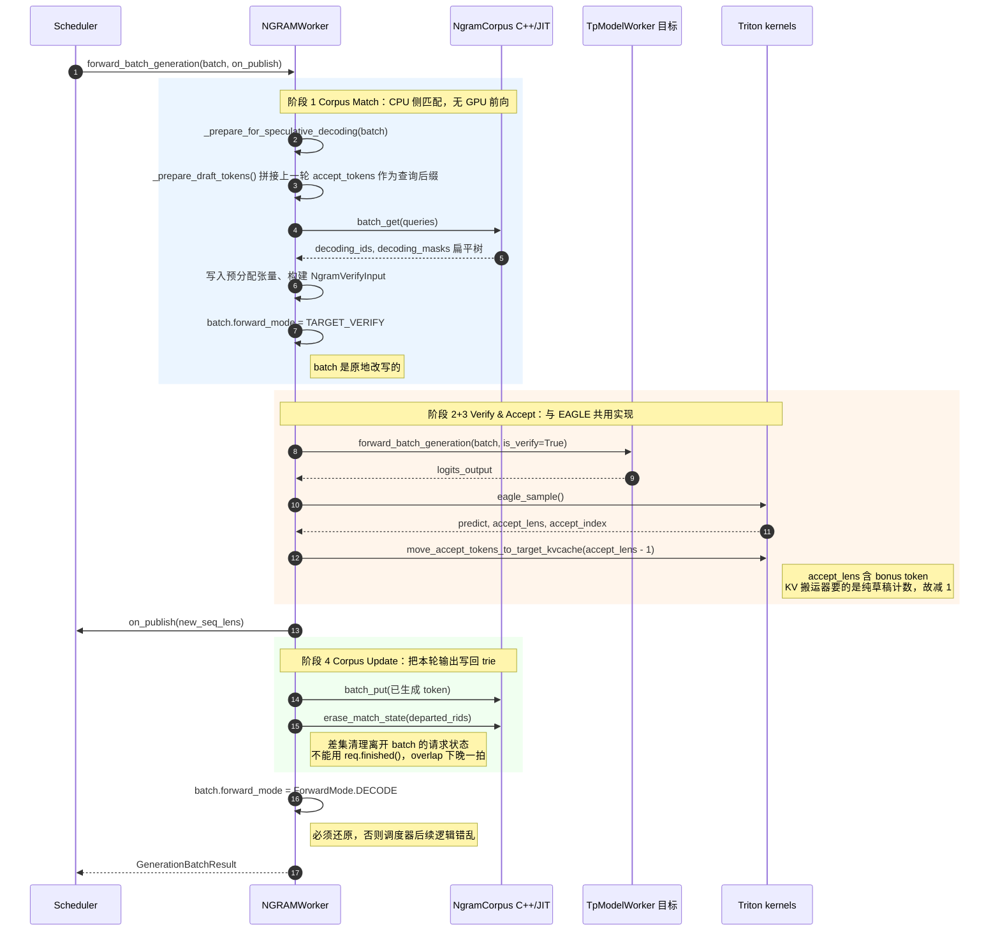
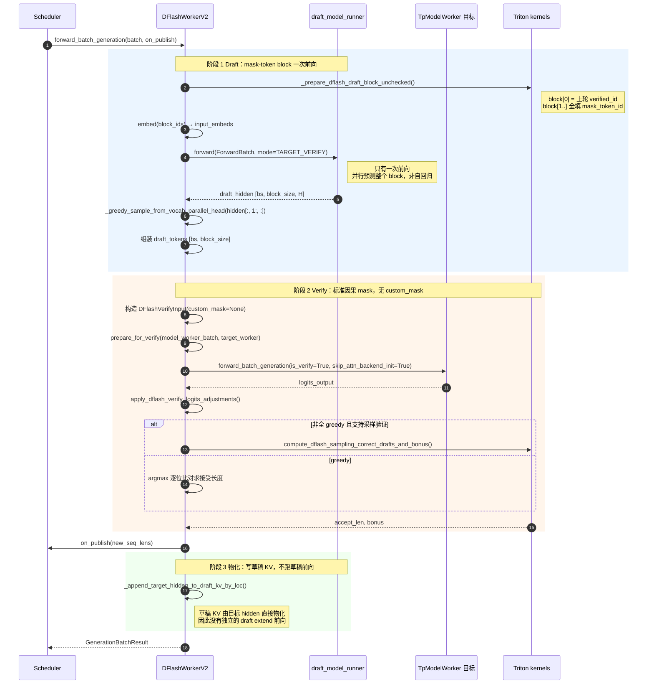
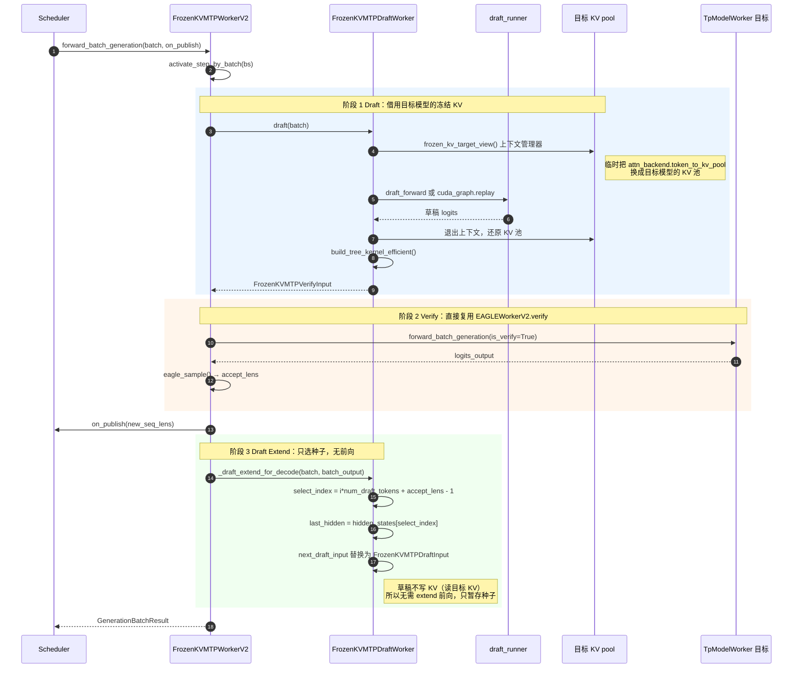
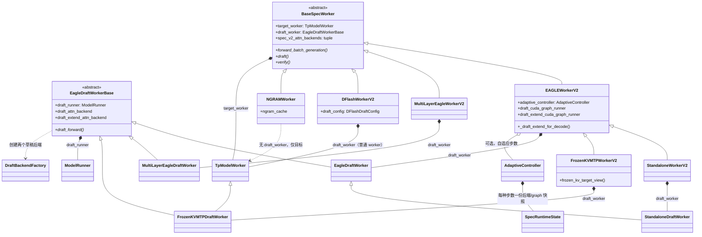
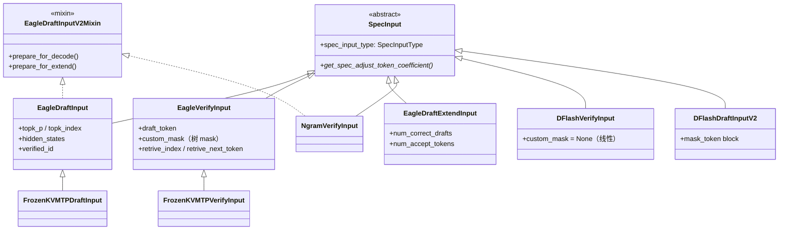
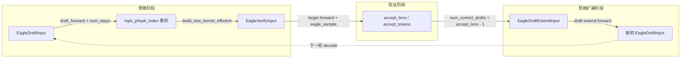

# SGLang 投机解码（Speculative Decoding）学习阅读计划

> 本文面向想系统掌握 SGLang `srt/speculative/` 目录的工程师，提供一份"架构全景 + 分阶段阅读 + 动手实践"的学习路线。
> 所有文件路径均相对于 `python/sglang/srt/speculative/`。
> 建议在完成主学习计划的阶段 0–4（架构、调度、内存、模型执行）后再进入本计划。

---

## 一、投机解码架构全景

### 1.1 核心思想

投机解码通过**草稿模型/机制提前生成候选 token**，再由**目标模型一次性验证**，从而在 decode 阶段成倍提速。数学等价于标准自回归采样，但实际吞吐因并行验证而提升。

$$\text{加速比} \approx \frac{\text{平均接受长度}}{1} \times \frac{t_{\text{draft}}}{t_{\text{target}}}$$

其中 $\text{平均接受长度}$ 是目标模型每步接受的 draft token 数（含 bonus token），$t_{\text{draft}} / t_{\text{target}}$ 是草稿模型与目标模型单步延迟之比。

### 1.2 支持的算法

| 算法 | 枚举值 | 一句话说明 | Worker 类 | 是否需要草稿模型 |
| --- | --- | --- | --- | --- |
| **EAGLE** | `EAGLE` | 单层草稿模型 + 树形验证，共享 embedding | `EAGLEWorkerV2` | ✅ |
| **EAGLE3** | `EAGLE3` | EAGLE v3，支持 aux hidden state | `EAGLEWorkerV2` | ✅ |
| **Standalone** | `STANDALONE` | 独立草稿模型，不共享 embedding/lm_head | `StandaloneWorkerV2` | ✅ |
| **Multi-Layer EAGLE** | `EAGLE` + `enable_multi_layer_eagle` | 多层草稿模型，更精准 | `MultiLayerEagleWorkerV2` | ✅ |
| **NGRAM** | `NGRAM` | 基于 N-gram 语料库匹配生成候选，无需草稿模型 | `NGRAMWorker` | ❌ |
| **DFlash** | `DFLASH` | DeepSeek Flash 投机，线性验证 | `DFlashWorkerV2` | ✅ |
| **Frozen-KV MTP** | `FROZEN_KV_MTP` | 冻结 KV 的 MTP（Multi-Token Prediction） | `FrozenKVMTPWorkerV2` | ✅ |

### 1.3 目录结构与分层

```
speculative/
├── spec_info.py              ★ 算法枚举 + SpecInput 抽象基类（入口）
├── spec_registry.py          ★ 插件注册系统（CustomSpecAlgo）
├── base_spec_worker.py       ★ BaseSpecWorker / EagleDraftWorkerBase（抽象基类）
├── spec_utils.py             ★ 通用工具集（缓存槽分配、KV搬运、采样等）
│
├── eagle_info.py             EAGLE 数据结构（DraftInput/VerifyInput/ExtendInput）
├── eagle_info_v2.py          EAGLE v2 Mixin（KV预分配、bonus token填充）
├── eagle_utils.py            EAGLE 树构建、树掩码、采样验证
├── eagle_worker_v2.py        ★ EAGLE V2 主 Worker（57KB，核心）
├── eagle_draft_cuda_graph_runner.py     EAGLE 草稿 decode CUDA Graph
├── eagle_draft_extend_cuda_graph_runner.py  EAGLE 草稿 extend CUDA Graph
│
├── ngram_info.py             NGRAM 验证输入
├── ngram_worker.py           NGRAM Worker
├── cpp_ngram/                N-gram 语料库 C++/JIT 实现
│
├── dflash_info.py            DFlash 验证输入
├── dflash_info_v2.py         DFlash V2 overlap 数据结构
├── dflash_utils.py           DFlash 工具集
├── dflash_worker_v2.py       DFlash V2 Worker（71KB）
│
├── frozen_kv_mtp_info.py     Frozen-KV MTP 数据结构
├── frozen_kv_mtp_utils.py    Frozen-KV MTP 上下文管理
├── frozen_kv_mtp_worker_v2.py Frozen-KV MTP Worker
├── frozen_kv_mtp_cuda_graph_runner.py  MTP 草稿 CUDA Graph
│
├── multi_layer_eagle_utils.py       多层 EAGLE Triton 内核
├── multi_layer_eagle_worker_v2.py   多层 EAGLE Worker
├── multi_layer_eagle_draft_extend_cuda_graph_runner.py
│
├── standalone_worker_v2.py   Standalone Worker（继承 EAGLEWorkerV2）
│
├── adaptive_spec_params.py   自适应投机参数配置
├── adaptive_runtime_state.py 自适应运行时状态管理
├── external_corpus_manager.py NGRAM 外部语料管理
├── eagle_disaggregation.py   EAGLE PD 分离支持
├── draft_utils.py            草稿后端工厂
├── triton_ops/               Triton kernel 集合
```

### 1.4 核心抽象（必须先理解的三层）

**第一层：算法枚举与注册**
- `SpeculativeAlgorithm`（`spec_info.py:28`）：枚举所有内置算法，提供 `is_eagle()` / `is_ngram()` / `create_worker()` 等方法
- `CustomSpecAlgo`（`spec_registry.py:24`）：插件注册的鸭子类型，与枚举共享相同接口
- `register_algorithm`（`spec_registry.py:186`）：注册自定义投机算法

**第二层：SpecInput 数据结构**
- `SpecInput`（`spec_info.py:235`）：抽象基类，所有算法的 draft/verify 输入都继承它
- `SpecInputType`（`spec_info.py:222`）：区分不同算法的 draft/verify 阶段
- 每个算法有自己的 `*DraftInput` / `*VerifyInput` 子类

**第三层：Worker 抽象**
- `BaseSpecWorker`（`base_spec_worker.py:265`）：所有 spec worker 的抽象基类
- `EagleDraftWorkerBase`（`base_spec_worker.py:69`）：草稿 worker 基类，定义 `draft()` / `draft_extend()`
- Worker 串联草稿生成 → 目标模型验证 → 接受逻辑

### 1.5 一次投机解码的执行流程

```
┌─────────────────────────────────────────────────────────────────────┐
│                    Scheduler event_loop_overlap                     │
│                                                                     │
│  ┌──────────┐    ┌──────────┐    ┌──────────┐    ┌──────────┐      │
│  │  Draft    │───►│  Target  │───►│  Draft   │───►│  Result  │      │
│  │  Forward  │    │  Verify  │    │  Extend  │    │  Process │      │
│  │  (草稿)   │    │  (验证)   │    │  (KV补齐) │    │  (采样)  │      │
│  └──────────┘    └──────────┘    └──────────┘    └──────────┘      │
│       │               │               │               │            │
│  EagleDraftInput  EagleVerifyInput  EagleDraftExtendInput           │
│  NgramVerifyInput DFlashVerifyInput  (EAGLE only)                  │
│  DFlashDraftInputV2                                                  │
│                                                                     │
│  ←← overlap 模式：draft 与上一轮 verify 重叠执行 ←←                  │
└─────────────────────────────────────────────────────────────────────┘
```

**EAGLE 的典型一轮**：
1. **Draft Forward**：草稿模型多步自回归生成 `topk × num_steps` 个候选 token，构建树
2. **Target Verify**：目标模型一次性前向验证树中所有候选，返回 logits
3. **Sample & Accept**：`eagle_sample()` 按树结构贪心采样，得到接受长度
4. **Draft Extend**：草稿模型 KV cache 追赶（把被接受的 token 的 hidden state 写入 draft KV）

**NGRAM 的典型一轮**（无草稿模型）：
1. **Corpus Match**：从 N-gram 语料库 BFS 匹配候选 token
2. **Target Verify**：目标模型验证
3. **Sample & Accept**：同 EAGLE
4. **Corpus Update**：把已生成的 token 写入语料库

### 1.6 各算法调用时序图

> 以下时序图对应 spec v2 架构（`*_worker_v2.py`）。统一入口是
> `Scheduler` → `BaseSpecWorker.forward_batch_generation(batch, on_publish)`，
> 内部按 `batch.forward_mode` 分成 **prefill** 和 **decode** 两条路径。

#### 1.6.0 公共 prefill 路径（EAGLE / Multi-Layer / Standalone / Frozen-KV / DFlash 一致）

prefill 阶段**不投机**：目标模型正常跑一遍 prompt，草稿侧只负责把自己的状态建起来。



**各算法在这一步的差异**：

| 算法 | `_draft_extend_for_prefill` 实际做什么 |
| --- | --- |
| EAGLE / EAGLE3 | 跑一次草稿模型 extend 前向，填充草稿 KV cache |
| Multi-Layer EAGLE | 同上，但草稿模型是多层 |
| Standalone | 同上，草稿模型独立权重，`capture_hidden_mode=NULL` |
| Frozen-KV MTP | **不跑前向**——只取最后一个 prompt 的 hidden + bonus token 存为种子 |
| DFlash | 不跑草稿前向——把目标 hidden state 直接写进草稿 KV（`_append_target_hidden_to_draft_kv_by_loc`） |
| NGRAM | 无此步——退化为普通目标模型前向，输出伪装成"接受了 1 个 token" |

#### 1.6.1 EAGLE / EAGLE3 / Standalone —— decode 路径

三阶段完整形态：草稿多步自回归 → 树形验证 → 草稿追赶。



**Standalone 的唯一差异**：`capture_hidden_mode` 用 `NULL` 而非 `FULL`/`LAST`（`eagle_worker_v2.py:1179`、`:1219`），因为独立草稿模型不消费目标模型的 hidden state。其余时序与 EAGLE 完全一致——`StandaloneWorkerV2` 直接继承 `EAGLEWorkerV2`，只覆盖 `init_lm_head()`。

**Multi-Layer EAGLE 的差异**（`multi_layer_eagle_worker_v2.py:965`）：时序骨架相同，两处不同——idle 输入的 topk 是 `topk × num_steps`（`:1013`），以及没有 `draft_tp_context` / MoE backend 的上下文包装。

#### 1.6.2 NGRAM —— decode 路径

没有草稿模型，因此**只有一次模型调用**。草稿来自 CPU 侧 C++ 后缀 trie 的匹配。



**关键特征**：没有 draft extend 阶段——NGRAM 的草稿树只存在于 verify 的 custom_mask 里，草稿侧没有任何需要"追赶"的模型状态（`spec_info.py:168` 的 `draft_writes_kv_chain()` 对 NGRAM 返回 False）。这也是 `NGRAMWorker.draft_worker` 返回 `None` 的原因。

#### 1.6.3 DFlash —— decode 路径

线性 block 验证，无树。草稿是**一次**前向出整块，而不是多步自回归。



**与 EAGLE 的三点结构差异**：

1. `topk` 恒为 1，验证是线性的，`custom_mask=None`（走标准因果 mask）
2. 草稿只前向**一次**，靠 mask token 并行预测整块，而非 `num_steps` 次自回归
3. 没有 `EagleDraftWorkerBase` 的 `draft` / `draft_extend` 拆分——`DFlashWorkerV2.draft_worker` 返回的是普通 `TpModelWorker`（`dflash_worker_v2.py:330`）

#### 1.6.4 Frozen-KV MTP —— decode 路径

时序骨架完全镜像 EAGLE（`frozen_kv_mtp_worker_v2.py:1273` 的注释明说 "Mirrors EAGLEWorkerV2"），差异全在两个钩子的内部实现。



**"Frozen" 的含义**：草稿模型不维护自己的 KV cache，而是通过 `frozen_kv_target_view()` 交换 `token_to_kv_pool` 指针，直接读目标模型已经算好的 KV。代价是草稿模型的层结构必须能映射到目标模型的层（`FrozenKVMTPContext.physical_layer_ids`），收益是省掉了草稿 KV 的显存和 draft extend 的那次前向。

#### 1.6.5 五种算法的阶段对照

| 阶段 | EAGLE 系 | NGRAM | DFlash | Frozen-KV MTP |
| --- | --- | --- | --- | --- |
| 草稿来源 | 草稿模型多步自回归 | CPU 后缀 trie 匹配 | 草稿模型单次 block 前向 | 草稿模型 + 目标 KV |
| 草稿 GPU 前向次数 | `num_steps` 次 | **0 次** | 1 次 | `num_steps` 次 |
| 树结构 | 树，`topk > 1` | 树 | 线性，`topk = 1` | 树 |
| verify custom_mask | 树 mask | 树 mask | `None`（因果） | 树 mask |
| draft extend | 变长 extend 前向 | **无** | 无（hidden 直接物化 KV） | 无（只选种子） |
| 注意力后端元组 | 3 个 | 1 个（仅目标） | 2 个 | 2 个 |
| 目标模型前向次数 | 1 次/轮 | 1 次/轮 | 1 次/轮 | 1 次/轮 |

> "注意力后端元组"指 `spec_v2_attn_backends` property（`base_spec_worker.py:387`），
> 被 `decide_needs_cpu_seq_lens()`（`overlap_utils.py:35`）按位或合并，
> 决定 `FutureMap` 是否需要维护 `seq_lens` 的 CPU 镜像。
> 只要元组里有**任一**后端声明 `needs_cpu_seq_lens`，就必须每轮做 D2H 拷贝。

---

## 二、分阶段阅读计划

> 节奏建议：每天 1.5–2 小时，全程约 3 周。每阶段包含**阅读 → 动手 → 自检**三步。

### 阶段 0：基础抽象层（第 0.5 周）★ 必读

**目标**：理解算法枚举、注册系统、SpecInput 体系、BaseSpecWorker 接口。

**阅读顺序**：

1. **`spec_info.py`**（335 行，完整通读）
   - `SpeculativeAlgorithm` 枚举（`:28`）：理解每种算法的 `is_*()` 方法
   - `SpecInputType`（`:222`）：区分 draft/verify 阶段
   - `SpecInput` 抽象基类（`:235`）：`is_draft_input()` / `is_verify_input()` / `get_spec_adjust_token_coefficient()`
   - `create_dummy_verify_input()`（`:274`）：CUDA Graph 捕获时如何构造虚拟输入
   - `create_worker()`（`:172`）：**关键入口**，算法枚举如何分发到具体 Worker 类

2. **`spec_registry.py`**（225 行，完整通读）
   - `CustomSpecAlgo`（`:24`）：插件注册的鸭子类型
   - `register_algorithm()`（`:186`）：注册机制
   - `_assert_custom_spec_algo_conforms()`（`:151`）：接口一致性校验
   - 理解内置算法（枚举）与插件算法（注册）如何统一调度

3. **`base_spec_worker.py`**（310 行，完整通读）
   - `EagleDraftWorkerBase`（`:69`）：草稿 worker 抽象基类
   - `prepare_for_draft()`（`:169`）：**核心方法**，为草稿前向准备 ForwardBatch（缓存槽分配、位置编码）
   - `prepare_for_draft_extend()`（`:91`）：为草稿 extend 准备 ForwardBatch
   - `duplicate_prefix_tail_to_draft_branches()`（`:22`）：页对齐时的前缀 KV 复制
   - `BaseSpecWorker`（`:265`）：顶层抽象，定义 `target_worker` / `draft_worker` / `on_verify_complete_cpu()` / `activate_step_by_batch()`

**自测题**：
1. `SpeculativeAlgorithm.create_worker()` 如何根据算法类型分发到不同的 Worker 类？如果新增一个算法需要修改哪些地方？
2. `SpecInput` 的 `get_spec_adjust_token_coefficient()` 返回什么？它在 token 计数中起什么作用？
3. `BaseSpecWorker.on_verify_complete_cpu()` 和 `activate_step_by_batch()` 的默认行为是什么？哪些 Worker 会覆盖它们？
4. `prepare_for_draft()` 中 `page_size > 1` 和 `topk > 1` 时为什么需要 `duplicate_prefix_tail_to_draft_branches()`？

**✅ 通关标准**：能画出"算法枚举 → create_worker → Worker 类 → SpecInput 数据结构"的派发关系图；能说清 `prepare_for_draft` 做了哪些准备工作。

---

### 阶段 1：NGRAM 投机解码（第 1 周前半）★ 入门最佳

**目标**：理解最简单的投机解码算法——不需要草稿模型，纯语料匹配。

**为什么先学 NGRAM**：
- 不涉及草稿模型前向，流程最简单
- 完整覆盖 verify → sample → accept 的核心路径
- 是理解 EAGLE 树形验证的基础

**阅读顺序**：

1. **`ngram_info.py`**（147 行，完整通读）
   - `NgramVerifyInput`（`:13`）：继承 `SpecInput` + `EagleDraftInputV2Mixin`
   - `generate_attn_arg_prefill()`（`:64`）：如何为 NGRAM 构建注意力参数
   - `filter_batch()` / `merge_batch()`：批处理动态调整

2. **`ngram_worker.py`**（522 行，完整通读）
   - `NGRAMWorker.__init__()`（`:46`）：理解 `NgramCorpus` 的初始化
   - `_prepare_draft_tokens()`（`:209`）：**核心**，从语料库匹配候选 token
   - `_prepare_for_speculative_decoding()`（`:267`）：构建树掩码、分配缓存槽
   - `forward_batch_generation()`（`:372`）：**主入口**，串联草稿准备 → 目标验证 → 采样 → 语料更新
   - `_update_ngram_corpus()`（`:346`）：验证后把已生成 token 写入语料库

3. **`cpp_ngram/`**（目录浏览）
   - `ngram_corpus.py`：C++/JIT 语料库的 Python 封装
   - 理解 `batch_get()` / `batch_put()` 的接口

**动手实践**：
```bash
# 启动 NGRAM 投机解码 server
python -m sglang.launch_server \
  --model-path Qwen/Qwen2.5-0.5B \
  --speculative-algorithm NGRAM \
  --speculative-num-draft-tokens 4 \
  --speculative-ngram-max-trie-depth 3

# 对比基准：不开投机解码
python -m sglang.launch_server --model-path Qwen/Qwen2.5-0.5B

# 发请求对比吞吐
python -m sglang.bench_serving \
  --backend sglang \
  --host 127.0.0.1 --port 30000 \
  --model Qwen/Qwen2.5-0.5B \
  --prompt "请详细介绍一下人工智能的发展历史" \
  --n-requests 50
```

**实验建议**：
- 用相同 prompt 多次请求，观察 NGRAM 在重复场景下的加速效果（语料库命中率高）
- 调整 `--speculative-num-draft-tokens`（2/4/8）观察接受率变化
- 加载外部语料：`--speculative-ngram-external-corpus-path <path>`

**自测题**：
1. NGRAM 为什么不需要草稿模型？它的"草稿"从哪里来？
2. `NgramCorpus.batch_get()` 如何构建候选树？`batch_put()` 何时被调用？
3. NGRAM 的树结构与 EAGLE 有什么不同？（提示：`max_tree_depth` 和 `tree_topk` 的差异）
4. overlap 模式下，`_prepare_draft_tokens()` 为什么要从 `spec_info.accept_tokens` 拼接 prev_tokens？
5. `USE_FULL_MASK` 的作用是什么？为什么有时用全掩码有时不用？

**✅ 通关标准**：能用 NGRAM 启动 server 并跑通请求；能说清"语料匹配 → 验证 → 采样 → 语料更新"的完整闭环；能用实验数据说明 NGRAM 在重复 prompt 场景下的加速效果。

---

### 阶段 2：EAGLE 投机解码（第 1 周后半 ~ 第 2 周）★ 核心

**目标**：深入理解 EAGLE 的草稿树构建、多步推理、树形验证、KV cache 管理。

**阅读顺序**（按数据流组织）：

#### 2a. 数据结构层

1. **`eagle_info.py`**（419 行，完整通读）
   - `EagleDraftInput`（`:153`）：草稿前向输入，包含 `topk_p` / `topk_index` / `hidden_states` / `bonus_tokens`
   - `EagleVerifyInput`（`:30`）：验证输入，包含 `draft_token` / `custom_mask` / `retrieve_index` / `retrieve_next_token` / `retrieve_next_sibling`
   - `EagleDraftExtendInput`（`:284`）：草稿 extend 输入，包含 `hidden_states` / `num_correct_drafts` / `num_accept_tokens`
   - `hidden_size_for()` / `dtype_for()`：理解 EAGLE vs EAGLE3 vs STANDALONE 的 hidden state 差异
   - `filter_batch()` / `merge_batch()`：批处理动态调整

2. **`eagle_info_v2.py`**（126 行，完整通读）
   - `EagleDraftInputV2Mixin`（`:29`）：V2 的 KV 预分配逻辑
   - `prepare_for_decode()`（`:30`）：**关键方法**，为 decode 分配 KV 缓存页
   - `fill_bonus_tokens`（triton kernel）：填充 bonus token

#### 2b. 工具层

3. **`eagle_utils.py`**（536 行，重点阅读）
   - `organize_draft_results()`（`:71`）：**核心**，把多步草稿结果组织成树
   - `TreeMaskMode`（`:101`）：树掩码模式（FULL_MASK / QLEN_ONLY / QLEN_ONLY_BITPACKING）
   - `build_tree_kernel_efficient()`（`:107`）：**核心 kernel**，构建树结构 + 位置编码 + 掩码
   - `eagle_prepare_for_verify()`：验证前的准备
   - `eagle_sample()`（搜索函数定义）：**核心**，树形贪心采样

4. **`spec_utils.py`**（631 行，选读关键函数）
   - `generate_token_bitmask()`：生成 grammar 约束的 token 掩码
   - `move_accept_tokens_to_target_kvcache()`：**关键**，把接受 token 的 KV 搬到目标缓存
   - `load_token_map()`：加载 token 映射表
   - `select_top_k_tokens()`：top-k 选择
   - `draft_tp_context`：草稿模型的 TP 上下文
   - `commit_mamba_states_after_verify()` / `prepare_mamba_track_for_verify()`：Mamba 模型支持

#### 2c. Worker 层

5. **`eagle_worker_v2.py`**（1441 行，**重点重点**）
   - `EAGLEWorkerV2.__init__()`（搜索类定义）：理解初始化流程
   - `EagleDraftWorker`（搜索类定义）：草稿 worker，管理草稿模型
   - `forward_batch_generation()`：**主入口**，串联完整流程
   - `draft_forward()`：草稿前向（多步自回归）
   - `verify_forward()`：目标模型验证
   - `draft_extend_forward()`：草稿 extend
   - 理解 overlap 模式下 draft 与 verify 的重叠执行

#### 2d. CUDA Graph 层

6. **`eagle_draft_cuda_graph_runner.py`**（557 行，选读）
   - `EAGLEDraftCudaGraphRunner`：草稿 decode 阶段的 CUDA Graph
   - `can_run()` / `capture()` / `replay()`

7. **`eagle_draft_extend_cuda_graph_runner.py`**（549 行，选读）
   - `EAGLEDraftExtendCudaGraphRunner`：草稿 extend 阶段的 CUDA Graph

**动手实践**：
```bash
# 需要 EAGLE 草稿模型，例如 lmsys/sglang-EAGLE-llama2-chat-7B
python -m sglang.launch_server \
  --model-path meta-llama/Llama-2-7b-chat-hf \
  --speculative-algorithm EAGLE \
  --speculative-draft-model-path lmsys/sglang-EAGLE-llama2-chat-7B \
  --speculative-num-steps 5 \
  --speculative-eagle-topk 8 \
  --speculative-num-draft-tokens 64

# 对比基准
python -m sglang.launch_server --model-path meta-llama/Llama-2-7b-chat-hf

# 性能对比
python -m sglang.bench_serving --backend sglang --port 30000 \
  --model meta-llama/Llama-2-7b-chat-hf --n-requests 100
```

**实验建议**：
- 调整 `--speculative-num-steps`（3/5/8）和 `--speculative-eagle-topk`（4/8/16），观察接受率与吞吐的变化
- 用 `--disable-overlap-schedule` 关闭重叠调度，对比性能差异
- 用 torch profiler 抓 trace，观察 draft → verify → extend 三个阶段的时间分布
- 查看日志中的 `accept_len` 统计

**自测题**：
1. EAGLE 的草稿树如何构建？`organize_draft_results()` 做了什么？`build_tree_kernel_efficient()` 的输出是什么？
2. `EagleDraftInput` 中的 `bonus_tokens` 是什么？为什么每次迭代需要它？
3. `EagleDraftExtendInput` 的作用是什么？为什么 EAGLE 需要 draft extend 而 NGRAM 不需要？
4. `eagle_sample()` 如何按树结构贪心采样？`retrieve_index` / `retrieve_next_token` / `retrieve_next_sibling` 各自的作用？
5. overlap 模式下，draft 和 verify 如何重叠？结果为什么"延后一拍"？
6. `move_accept_tokens_to_target_kvcache()` 搬运的是什么？为什么需要搬运？
7. EAGLE3 与 EAGLE 的区别是什么？`eagle_use_aux_hidden_state` 如何影响 hidden state 的维度？

**✅ 通关标准**：能画出 EAGLE 一轮的完整数据流图（draft → tree build → verify → sample → extend）；能解释树形验证的数学原理；能用实验数据说明 `num_steps` 和 `topk` 对性能的影响。

---

### 阶段 3：Standalone 与 Multi-Layer EAGLE（第 2.5 周）

**目标**：理解 EAGLE 的两个变体。

#### 3a. Standalone

1. **`standalone_worker_v2.py`**（191 行，完整通读）
   - `StandaloneDraftWorker`（`:38`）：继承 `EagleDraftWorker`，覆盖 `init_lm_head()` 不共享 embedding
   - `StandaloneWorkerV2`（`:138`）：继承 `EAGLEWorkerV2`
   - 理解与 EAGLE 的区别：草稿模型独立加载，不与目标模型共享权重

**动手实践**：
```bash
# Standalone 需要独立的草稿模型路径
python -m sglang.launch_server \
  --model-path <target-model> \
  --speculative-algorithm STANDALONE \
  --speculative-draft-model-path <draft-model> \
  --speculative-num-steps 4 \
  --speculative-eagle-topk 1 \
  --speculative-num-draft-tokens 5
```

#### 3b. Multi-Layer EAGLE

2. **`multi_layer_eagle_utils.py`**（34 行，通读）
   - Triton kernel：input_ids 旋转、隐藏状态池写入

3. **`multi_layer_eagle_worker_v2.py`**（924 行，选读关键方法）
   - `MultiLayerEagleWorkerV2`：理解多层草稿如何提升精度
   - 对比单层 EAGLE 的差异

4. **`multi_layer_eagle_draft_extend_cuda_graph_runner.py`**（744 行，选读）

**自测题**：
1. Standalone 与 EAGLE 的核心区别是什么？为什么有时要选 Standalone？
2. Multi-Layer EAGLE 如何提升草稿质量？它的额外开销是什么？
3. `init_lm_head()` 在 Standalone 中为什么是空实现？

**✅ 通关标准**：能说清 Standalone / Multi-Layer EAGLE 各自与标准 EAGLE 的区别、适用场景和开启参数。

---

### 阶段 4：DFlash 投机解码（第 3 周前半）

**目标**：理解 DeepSeek Flash 投机的线性验证机制。

**阅读顺序**：

1. **`dflash_info.py`**（150 行，完整通读）
   - `DFlashVerifyInput`（`:22`）：线性验证（非树形），`topk=1`
   - `prepare_for_verify()`（`:52`）：验证前准备

2. **`dflash_info_v2.py`**（351 行，重点阅读）
   - `DFlashDraftInputV2`（`:40`）：V2 overlap 数据结构
   - 理解 `verified_id` / `new_seq_lens` / `hidden_states` 等字段
   - `prepare_for_decode()`：KV 预分配

3. **`dflash_utils.py`**（826 行，选读关键函数）
   - DFlash 专用的树构建、采样、KV 管理工具

4. **`dflash_worker_v2.py`**（1686 行，选读主流程）
   - `DFlashWorkerV2`：主 Worker
   - `forward_batch_generation()`：主入口
   - 理解与 EAGLE 的差异：线性验证 vs 树形验证

**自测题**：
1. DFlash 为什么用线性验证而不是树形验证？它的 `topk` 为什么总是 1？
2. `DFlashDraftInputV2` 中的 `verify_done` 事件是什么作用？
3. DFlash 与 EAGLE 在 KV cache 管理上有什么区别？
4. `supports_target_verify_for_draft()` 为什么只有 DFlash 返回 True？

**✅ 通关标准**：能对比 DFlash 与 EAGLE 的验证策略差异；能说清 DFlash 适用于什么场景（DeepSeek 系列模型）。

---

### 阶段 5：Frozen-KV MTP（第 3 周后半）

**目标**：理解 Multi-Token Prediction with Frozen KV 机制。

**阅读顺序**：

1. **`frozen_kv_mtp_info.py`**（61 行，完整通读）
   - `FrozenKVMTPContext`（`:28`）：目标 KV 池 + 逻辑层到物理层的映射
   - `FrozenKVMTPDraftInput` / `FrozenKVMTPVerifyInput`：继承 EAGLE 的数据结构

2. **`frozen_kv_mtp_utils.py`**（156 行，完整通读）
   - `frozen_kv_target_view()`（`:30`）：**关键**，上下文管理器，切换注意力后端的 KV 池
   - `target_kv_pool_view()`（`:60`）：用目标模型的冻结 KV 池运行草稿模型

3. **`frozen_kv_mtp_worker_v2.py`**（774 行，选读主流程）
   - `FrozenKVMTPWorkerV2`：主 Worker
   - 理解如何复用 EAGLE 调度契约但有独立的类型

4. **`frozen_kv_mtp_cuda_graph_runner.py`**（430 行，选读）

**自测题**：
1. "Frozen KV"是什么意思？为什么草稿模型要用目标模型的 KV 池？
2. `FrozenKVMTPContext.physical_layer_ids` 是什么映射？为什么需要它？
3. `frozen_kv_target_view()` 如何通过交换 `token_to_kv_pool` 实现冻结 KV 访问？
4. Frozen-KV MTP 与 EAGLE 在数据结构上的关系是什么？（继承 vs 独立）

**✅ 通关标准**：能解释 Frozen-KV MTP 的核心机制（冻结目标模型 KV 作为草稿模型的 KV 来源）；能说清它与 EAGLE 的继承关系和差异。

---

### 阶段 6：自适应投机与进阶特性（第 3.5 周）

**目标**：理解自适应投机解码、PD 分离支持、外部语料管理。

#### 6a. 自适应投机

1. **`adaptive_spec_params.py`**（316 行，重点阅读）
   - `DEFAULT_ADAPTIVE_CONFIG`（`:23`）：默认配置，按 batch size 分档
   - `AdaptiveSpeculativeParams`：参数管理，基于 EMA 接受长度动态调整 `num_steps`
   - `adaptive_unsupported_reason()`（`:45`）：什么场景不支持自适应

2. **`adaptive_runtime_state.py`**（135 行，完整通读）
   - `SpecRuntimeState`（`:19`）：一套完整的运行时资源（attention backend + CUDA graph）
   - `AdaptiveController`（`:61`）：**核心**，管理多套 runtime state 的注册和切换
   - `activate_step_by_batch()`（`:113`）：根据 batch size 选择最优 step
   - `on_verify_complete()`（`:118`）：验证完成后根据 EMA 决定是否切换

**动手实践**：
```bash
# 开启自适应投机（EAGLE + adaptive）
python -m sglang.launch_server \
  --model-path <model> \
  --speculative-algorithm EAGLE \
  --speculative-draft-model-path <draft> \
  --speculative-num-steps 7 \
  --speculative-eagle-topk 1 \
  --speculative-num-draft-tokens 8 \
  --speculative-algorithm-adaptive
```

**自测题**：
1. 自适应投机解决什么问题？为什么固定 `num_steps` 不是最优？
2. `DEFAULT_ADAPTIVE_CONFIG` 如何按 batch size 分档？batch_size=1 和 batch_size=32 的策略差异？
3. `SpecRuntimeState` 包含哪些资源？为什么切换 step 需要切换整个 state？
4. `AdaptiveController.on_verify_complete()` 如何基于 EMA 决定升/降档？`up_hysteresis` 和 `down_hysteresis` 的作用？

#### 6b. PD 分离支持

3. **`eagle_disaggregation.py`**（67 行，通读）
   - `build_eagle_disagg_draft_input()`：PD 分离场景下构建草稿输入

#### 6c. 外部语料管理

4. **`external_corpus_manager.py`**（111 行，通读）
   - 外部语料的加载、提交、删除管理

#### 6d. 草稿后端工厂

5. **`draft_utils.py`**（348 行，选读）
   - `DraftBackendFactory`：为草稿模型创建注意力后端

**✅ 通关标准**：能说清自适应投机的决策机制；能解释 PD 分离场景下投机解码的特殊处理；能说清外部语料管理的接口。

---

## 三、详细实践路线

### 3.1 实践路线总览

```
Week 0.5: 基础抽象  ──────►  读完 spec_info / spec_registry / base_spec_worker
                              ↓
Week 1a:   NGRAM 入门  ──────►  跑通 NGRAM server + 对比基准
                              ↓
Week 1b-2: EAGLE 核心  ──────►  跑通 EAGLE server + 调参实验 + profiler
                              ↓
Week 2.5:  变体学习    ──────►  Standalone / Multi-Layer EAGLE
                              ↓
Week 3a:   DFlash      ──────►  理解线性验证（如有 DeepSeek 模型可实践）
                              ↓
Week 3b:   Frozen-KV   ──────►  理解 MTP 机制
                              ↓
Week 3.5:  自适应+进阶  ──────►  自适应投机实验 + PD 分离 + 外部语料
```

### 3.2 实验清单

| # | 实验 | 算法 | 预期学到的 | 难度 |
|---|------|------|-----------|------|
| 1 | 启动 NGRAM server，发送重复 prompt | NGRAM | 语料库匹配机制、接受率 | ★☆☆ |
| 2 | NGRAM 调 `num_draft_tokens` (2/4/8) | NGRAM | draft token 数量与接受率的关系 | ★☆☆ |
| 3 | NGRAM 加载外部语料 | NGRAM | 外部语料加载流程 | ★★☆ |
| 4 | 启动 EAGLE server，对比吞吐 | EAGLE | EAGLE 基本加速效果 | ★★☆ |
| 5 | EAGLE 调 `num_steps` (3/5/8) | EAGLE | 草稿深度 vs 接受率 | ★★☆ |
| 6 | EAGLE 调 `topk` (4/8/16) | EAGLE | 树宽度 vs 计算开销 | ★★☆ |
| 7 | EAGLE 开关 overlap schedule | EAGLE | overlap 对性能的影响 | ★★☆ |
| 8 | EAGLE torch profiler trace | EAGLE | draft/verify/extend 时间分布 | ★★★ |
| 9 | 启动 Standalone server | STANDALONE | 独立草稿模型加载 | ★★☆ |
| 10 | 开启自适应投机 | EAGLE+Adaptive | 动态 step 切换效果 | ★★★ |
| 11 | 在源码加日志追踪 accept_len | 通用 | 接受长度分布 | ★★☆ |
| 12 | 用 Nsight Systems 抓全链路 trace | EAGLE | GPU kernel 级分析 | ★★★ |

### 3.3 关键参数速查

| 参数 | 说明 | 典型值 | 影响什么 |
|------|------|--------|---------|
| `--speculative-algorithm` | 选择算法 | EAGLE / NGRAM / DFLASH | 算法类型 |
| `--speculative-draft-model-path` | 草稿模型路径 | lmsys/sglang-EAGLE-* | 草稿质量 |
| `--speculative-num-steps` | 草稿自回归步数 | 3–8 | 草稿深度 |
| `--speculative-eagle-topk` | 每步 top-k 候选 | 1–16 | 树宽度 |
| `--speculative-num-draft-tokens` | 总 draft token 数 | steps×topk+1 | 验证批量大小 |
| `--speculative-algorithm-adaptive` | 开启自适应 | flag | 动态调参 |
| `--speculative-ngram-max-trie-depth` | NGRAM trie 深度 | 3 | 匹配窗口 |
| `--speculative-ngram-external-corpus-path` | 外部语料路径 | file | NGRAM 语料来源 |
| `--enable-multi-layer-eagle` | 多层 EAGLE | flag | 草稿精度 |
| `--disable-overlap-schedule` | 关闭重叠调度 | flag | 对比实验 |

### 3.4 调试技巧

1. **查看接受长度**：在 `eagle_worker_v2.py` 的 `forward_batch_generation` 中加日志：
   ```python
   logger.info(f"accept_lens: {accept_lens.tolist()}, mean: {accept_lens.float().mean():.2f}")
   ```

2. **追踪 SpecInput 流转**：在 `batch.spec_info` 赋值处加断点 / 日志，观察从 `EagleDraftInput` → `EagleVerifyInput` → `EagleDraftExtendInput` 的变化

3. **CUDA Graph 问题**：如果投机解码结果异常，先用 `--disable-cuda-graph` 排查是否是 CUDA Graph 捕获问题

4. **OOM 问题**：投机解码需要额外 KV cache（草稿模型 + 验证批量），适当降低 `--mem-fraction-static` 或 `--max-running-requests`

---

## 四、源码阅读速查表

### 4.1 按问题找代码

| 想理解... | 看这个文件 | 看这个函数/类 |
|-----------|-----------|--------------|
| 算法如何选择 | `spec_info.py` | `SpeculativeAlgorithm.from_string()` / `create_worker()` |
| 草稿树如何构建 | `eagle_utils.py` | `organize_draft_results()` / `build_tree_kernel_efficient()` |
| 树形采样如何工作 | `eagle_utils.py` | `eagle_sample()` |
| KV cache 如何分配 | `eagle_info_v2.py` | `EagleDraftInputV2Mixin.prepare_for_decode()` |
| 接受 token 如何搬运 | `spec_utils.py` | `move_accept_tokens_to_target_kvcache()` |
| EAGLE 主流程 | `eagle_worker_v2.py` | `EAGLEWorkerV2.forward_batch_generation()` |
| NGRAM 主流程 | `ngram_worker.py` | `NGRAMWorker.forward_batch_generation()` |
| 自适应如何决策 | `adaptive_spec_params.py` | `AdaptiveSpeculativeParams.on_verify_complete()` |
| 如何注册新算法 | `spec_registry.py` | `register_algorithm()` / `SpeculativeAlgorithm.register()` |
| 草稿 CUDA Graph | `eagle_draft_cuda_graph_runner.py` | `EAGLEDraftCudaGraphRunner` |
| DFlash 线性验证 | `dflash_info.py` | `DFlashVerifyInput.prepare_for_verify()` |
| Frozen-KV 上下文 | `frozen_kv_mtp_utils.py` | `frozen_kv_target_view()` |

### 4.2 类继承关系

```
BaseSpecWorker (base_spec_worker.py)
├── NGRAMWorker (ngram_worker.py)          # 无草稿模型
├── EAGLEWorkerV2 (eagle_worker_v2.py)     # EAGLE/EAGLE3
│   ├── StandaloneWorkerV2 (standalone_worker_v2.py)     # 独立草稿
│   └── FrozenKVMTPWorkerV2 (frozen_kv_mtp_worker_v2.py) # 复用目标 KV
├── MultiLayerEagleWorkerV2 (multi_layer_eagle_worker_v2.py)
└── DFlashWorkerV2 (dflash_worker_v2.py)

EagleDraftWorkerBase (base_spec_worker.py)
├── EagleDraftWorker (eagle_worker_v2.py)
│   └── StandaloneDraftWorker (standalone_worker_v2.py)
├── MultiLayerEagleDraftWorker (multi_layer_eagle_worker_v2.py)
└── FrozenKVMTPDraftWorker (frozen_kv_mtp_worker_v2.py)   # 同时继承 TpModelWorker

SpecInput (spec_info.py)
├── EagleDraftInput (eagle_info.py)        # 同时混入 EagleDraftInputV2Mixin
│   └── FrozenKVMTPDraftInput (frozen_kv_mtp_info.py)
├── EagleVerifyInput (eagle_info.py)
│   └── FrozenKVMTPVerifyInput (frozen_kv_mtp_info.py)
├── EagleDraftExtendInput (eagle_info.py)
├── NgramVerifyInput (ngram_info.py)       # 同时混入 EagleDraftInputV2Mixin
├── DFlashVerifyInput (dflash_info.py)
└── DFlashDraftInputV2 (dflash_info_v2.py)
```

### 4.3 类依赖图（Mermaid）

4.2 的 ASCII 只画了「谁继承谁」，但真正决定运行时行为的是**组合关系**：一个 Worker 手里握着哪些子对象。下面三张图分别看继承、组合、数据流。

#### 4.3.1 Worker 继承 + 组合



**读图要点：**

- `NGRAMWorker` 是**唯一没有 `draft_worker` 的 worker**——草稿来自 CPU 端 n-gram 匹配，不需要任何草稿模型。
- `DFlashWorkerV2` 的 `draft_worker` 是**普通 `TpModelWorker`**，不是 `EagleDraftWorkerBase`——因为它只做一次前向，不需要 draft/draft_extend 的拆分。
- `FrozenKVMTPDraftWorker` 同时继承 `EagleDraftWorkerBase` 和 `TpModelWorker`（多继承）——它既要符合草稿 worker 接口，又要直接持有模型执行能力。
- `AdaptiveController` 持有多份 `SpecRuntimeState`，每份对应一个候选步数配置（各自的注意力后端 + CUDA Graph runner）；切换步数就是换指针，无需重建。

#### 4.3.2 SpecInput 数据结构族



**读图要点：**

- `EagleDraftInputV2Mixin` 是**混入类而非基类**：`NgramVerifyInput` 虽然是「verify 输入」，但也需要 v2 的 KV 分配逻辑（`prepare_for_decode`），于是直接混入。
- `DFlashVerifyInput.custom_mask` 恒为 `None`——线性草稿不需要树 mask，这是它比 EAGLE 快的关键。
- Frozen-KV 的两个 Input 直接继承 EAGLE 版本，只覆写 KV 指针相关的少量逻辑。

#### 4.3.3 一次 decode 中的对象流转



这个环是 EAGLE 系算法的骨架：**Draft → Verify → Draft Extend → Draft**。
- NGRAM 缺 draft extend（CPU 匹配不需要状态同步），环退化成 **Verify → Corpus Update → Verify**。
- DFlash 缺 draft extend（hidden 直接物化为 KV），环退化成 **Draft → Verify → Draft**。
- Frozen-KV MTP 的 draft extend **不含前向**，只从接受结果里挑种子 token。

---

## 五、学习进度追踪表

| 阶段 | 内容 | 预计耗时 | 状态 |
|------|------|---------|------|
| 0 | 基础抽象层 | 3h | ☐ 未开始 / ☑ 已完成 |
| 1 | NGRAM 投机解码 | 4h | ☐ 未开始 / ☑ 已完成 |
| 2 | EAGLE 投机解码 | 12h | ☐ 未开始 / ☑ 已完成 |
| 3 | Standalone & Multi-Layer | 4h | ☐ 未开始 / ☑ 已完成 |
| 4 | DFlash 投机解码 | 4h | ☐ 未开始 / ☑ 已完成 |
| 5 | Frozen-KV MTP | 3h | ☐ 未开始 / ☑ 已完成 |
| 6 | 自适应 & 进阶 | 4h | ☐ 未开始 / ☑ 已完成 |
| **合计** | | **~34h (3周)** | |

---

## 六、延伸阅读

- **理论文档**：
  - `docs/learn/speculative/speculative_decoding.md`：投机解码原理
  - `docs/learn/speculative/mtp_vs_eagle1.md`：MTP vs EAGLE 对比
  - `docs/learn/speculative/mtp.md`：MTP 详细原理
  - `docs/learn/speculative/dspark.md`：DFlash/DSpark 原理

- **论文**：
  - EAGLE: [Speculative Sampling](https://arxiv.org/abs/2401.15077)
  - EAGLE-2: [Drafting More Tokens](https://arxiv.org/abs/2406.16858)
  - EAGLE-3: [Training a Low-Cost Draft Model](https://arxiv.org/abs/2503.01840)

- **相关源码**：
  - `srt/model_executor/forward_batch_info.py`：`ForwardBatch` / `ForwardMode`（`DRAFT_EXTEND_V2` / `TARGET_VERIFY`）
  - `srt/model_executor/cuda_graph_config.py`：CUDA Graph 配置（`Phase.DRAFT` / `Phase.VERIFY` / `Phase.DRAFT_EXTEND`）
  - `srt/managers/overlap_utils.py`：`FutureMap`，overlap 模式下的跨阶段数据传递
  - `srt/server_args.py`：搜索 `speculative_` 前缀的所有参数

