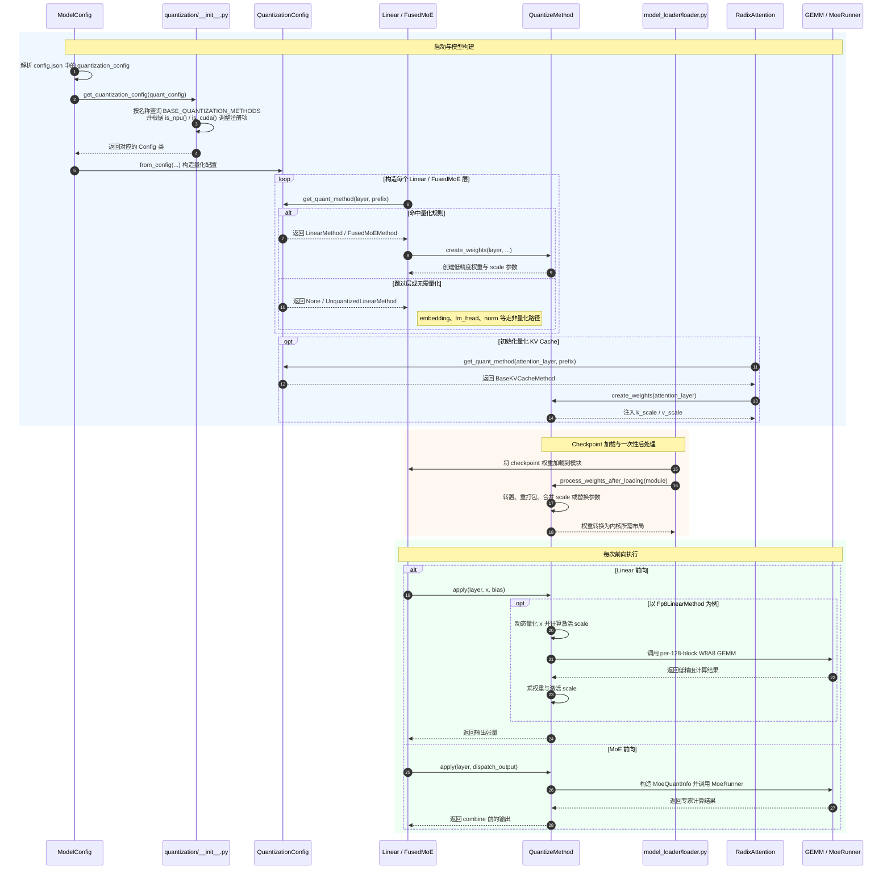

# SGLang 量化子系统（srt/layers/quantization）学习计划

> 本文面向想系统掌握 SGLang `python/sglang/srt/layers/quantization/` 目录的工程师，提供一份"理论 → 架构 → 分阶段阅读 → 动手实践"的学习路线。
> 建议在完成主学习计划的阶段 0–4（架构、调度、内存、模型执行）后再进入本计划。
> 参考文档：本目录下各模块的 `README_zh.md`（`fp8` 流程见 `README_zh.md` 顶层、`quark/README_zh.md`、`modelslim/README_zh.md`、`compressed_tensors/README_zh.md`）。

---

## 一、量化理论基础

### 1.1 为什么量化

大模型推理是**访存受限（memory-bound）**的：decode 阶段每生成一个 token，都要把全部权重从 HBM 读一遍。把权重从 FP16/BF16（2 字节）压到 INT8/FP8（1 字节）甚至 INT4/FP4（0.5 字节），可直接减少访存量与显存占用，并利用低精度 Tensor Core 获得更高的峰值算力。

$$
\text{理论加速} \approx \frac{\text{原位宽}}{\text{新位宽}} \quad \text{（访存受限时）}
$$

### 1.2 基本量化公式

对称量化（Symmetric）：

$$
x_q = \mathrm{round}\!\left(\frac{x}{s}\right), \qquad \hat{x} = s \cdot x_q, \qquad s = \frac{\max|x|}{q_{\max}}
$$

非对称量化（Asymmetric，带 zero-point）：

$$
x_q = \mathrm{round}\!\left(\frac{x}{s}\right) + z, \qquad \hat{x} = s \cdot (x_q - z)
$$

其中 $s$ 是缩放因子（scale），$z$ 是零点（zero-point）。量化粒度（granularity）决定 $s$ 的共享范围：

| 粒度 | scale 形状 | 典型场景 |
| --- | --- | --- |
| per-tensor | 1 个标量 | KV cache FP8 |
| per-token（动态激活）/ per-channel（权重） | 每行一个 | W8A8-FP8/INT8 |
| per-group | 每 group_size（如 128）个权重一个 | GPTQ/AWQ/W4A16 |
| block-wise（如 128×128） | 每个块一个 | DeepSeek 风格 block FP8 |

### 1.2.1 数值示例（INT8）：对称 vs 非对称

统一取一组已标定的数据（per-tensor 粒度）：

$$
x = [-2.5,\ 1.0,\ 3.0,\ -1.5,\ 0.5]
$$

#### （1）对称量化：int8，$q \in [-128,\ 127]$

$$
s = \frac{\max|x|}{q_{\max}} = \frac{3.0}{127} \approx 0.023622, \qquad z \equiv 0
$$

| $x$ | $x / s$ | $x_q = \mathrm{round}(x/s)$ | $\hat{x} = s \cdot x_q$ | 误差 $\hat{x} - x$ |
| --- | --- | --- | --- | --- |
| -2.5 | -105.833 | **-106** | -2.503937 | -0.003937 |
| 1.0 | 42.333 | **42** | 0.992126 | -0.007874 |
| 3.0 | 127.000 | **127** | 3.000000 | 0.000000 |
| -1.5 | -63.500 | **-64** | -1.511811 | -0.011811 |
| 0.5 | 21.167 | **21** | 0.496063 | -0.003937 |

最大绝对误差 $0.0118 \approx s/2$，符合量化误差上界。

#### （2）非对称量化：uint8，$q \in [0,\ 255]$

$$
s = \frac{x_{\max} - x_{\min}}{q_{\max} - q_{\min}} = \frac{3.0 - (-2.5)}{255 - 0} \approx 0.021569
$$

$$
z = \mathrm{round}\!\left(q_{\min} - \frac{x_{\min}}{s}\right) = \mathrm{round}\!\left(0 + \frac{2.5}{0.021569}\right) = \mathrm{round}(115.909) = 116
$$

| $x$ | $x / s$ | $x_q = \mathrm{clip}(\mathrm{round}(x/s) + z)$ | $\hat{x} = s \cdot (x_q - z)$ | 误差 $\hat{x} - x$ |
| --- | --- | --- | --- | --- |
| -2.5 | -115.909 | **0** | -2.501961 | -0.001961 |
| 1.0 | 46.364 | **162** | 0.992157 | -0.007843 |
| 3.0 | 139.091 | **255** | 2.998039 | -0.001961 |
| -1.5 | -69.545 | **46** | -1.509804 | -0.009804 |
| 0.5 | 23.182 | **139** | 0.496078 | -0.003922 |

注意 $x_q$ 是**无符号整数**，$x_{\min}$ 映射到码字 0、$x_{\max}$ 映射到码字 255——区间被完整铺满。

#### （3）两者对比

| 指标 | 对称 int8 | 非对称 uint8 |
| --- | --- | --- |
| 码字范围 | $[-128, 127]$ | $[0, 255]$ |
| scale $s$ | 0.023622 | 0.021569 |
| zero-point $z$ | 0（恒为 0） | 116 |
| 本例最大绝对误差 | 0.0118 | 0.0098 |
| GEMM 计算 | $\hat{Y} = s_x s_w (X_q W_q^\top)$ | 需额外 zero-point 修正项 |
| 硬件内核友好度 | 高（INT8 张量核 / dp4a 直接可用） | 较低（需 correction） |

非对称的 $s$ 略小（分辨率更细）且几乎无偏，代价是计算时要补一项：

$$
Y = s_x s_w \Big( X_q W_q^\top - z_x \textstyle\sum W_q - z_w \sum X_q + n\, z_x z_w \Big)
$$

#### （4）为什么偏斜分布必须用非对称

把数据换成 ReLU 之后的激活（全非负、长尾），体会"对称会浪费一半码字"：

$$
x = [0.0,\ 0.05,\ 0.2,\ 1.0,\ 3.0]
$$

| 方案 | $s$ | 实际用到的码字 | $s/2$（误差上界） | 0.05 的量化结果 |
| --- | --- | --- | --- | --- |
| 对称 int8 | $3.0/127 = 0.023622$ | 仅 $[0, 127]$（半个区间） | 0.0118 | $2 \times s = 0.047$，相对误差 ≈ 6% |
| 非对称 uint8 | $3.0/255 = 0.011765$ | 全部 $[0, 255]$ | 0.0059 | $4 \times s = 0.047$，但分辨率提升近 2× |

**结论**：分布关于 0 大致对称时（如权重、部分激活），对称量化损失小、计算最省；分布明显偏斜（全正激活、含长尾/离群点时），非对称能把 $[x_{\min}, x_{\max}]$ 完整铺满 255 个码字，精度更高。

> 这也解释了 SGLang 中的实现差异：FP8（e4m3）本身带符号、天然对称，`fp8.py` 的公式里没有 zero-point；而 `w8a8_int8.py` / `blockwise_int8.py` 的 INT8 路径必须显式处理 zero-point 及其 GEMM 修正项。此外现代内核多按 group / block 共享 scale，本质上就是把"非对称贴合分布"的能力下沉到更细粒度。

### 1.3 常见量化范式（按位宽组合命名）

约定 **WxAy = 权重 x bit、激活 y bit**：

| 范式 | 代表方法 | 特点 |
| --- | --- | --- |
| W8A8-FP8 | `fp8.py`、`w8a8_fp8.py` | e4m3 FP8，硬件原生支持（Hopper+），最主流的在线量化 |
| W8A8-INT8 | `w8a8_int8.py`、`blockwise_int8.py` | 整数 GEMM + 反量化，兼容老卡 |
| W4A16 | GPTQ、AWQ、`moe_wna16.py` | 仅压权重，激活保持 FP16，需要 Marlin 等专用 GEMM |
| W4A8 | `w4afp8.py`、quark mxfp4_w4a8 | 混合精度，MoE 场景常见 |
| W4A4-FP4 | NVFP4 / MXFP4（`mxfp4.py`、`modelopt_quant.py`、`petit.py`） | Blackwell FP4 Tensor Core，下一代主流 |
| 混合 | bitsandbytes、GGUF、modelopt_mixed | 端侧/异构/多精度共存 |

**关键概念**：
- **静态量化**：scale 离线算好存进 checkpoint（如 GPTQ 的 group scales）。
- **动态量化（online quant）**：前向时对激活现算 scale（如 per-token FP8：`fp8_quantize`）。
- **反量化（dequant）**：GEMM 结果乘回 scale：$\hat{Y} = s_x \cdot s_w \cdot (X_q W_q^T)$。
- **假量化（fake quant / weight-only）**：权重存储为低精度，计算前反量化回 FP16——W4A16 的本质。

### 1.4 推荐的离线学习材料（半天）

1. OCP FP8 规范摘要：e4m3 / e5m2 的数值范围与舍入。
2. MX 格式（Microscaling）：MXFP4 = 每 32 个元素共享一个 e8m0 指数 scale。
3. GPTQ 论文 §2（基于 Hessian 的逐层量化 + 误差补偿）。
4. AWQ 论文核心思想：按激活分布保护显著权重通道。
5. Marlin 论文/博客：为 W4A16 重排权重布局以实现接近 FP16 的 GEMM 吞吐。

---

## 二、SGLang 量化架构全景

### 2.1 目录结构（先建立地图）

```
quantization/
├── __init__.py            ★ 注册表：BASE_QUANTIZATION_METHODS + get_quantization_config
├── base_config.py         ★ 三大抽象基类：QuantizationConfig / QuantizeMethodBase
│                            / LinearMethodBase / FusedMoEMethodBase
├── base_scheme.py         scheme 抽象（compressed_tensors/quark/modelslim 子模块复用）
│
├── fp8.py                 ★ FP8 量化核心（Fp8Config + Linear/MoE/KVCache 三个 Method）
├── w8a8_fp8.py / w8a8_int8.py / blockwise_int8.py   INT8/FP8 标量实现
├── fp8_utils.py / fp4_utils.py / int8_utils.py      后端调度与工具
│
├── gptq/  awq/            目录式框架：顶层 Config + schemes/（linear/marlin/moe/cpu 变体）
├── compressed_tensors/    vLLM compressed-tensors 适配（Config + schemes/）
├── quark/                 AMD Quark 适配（Config + schemes/）
├── modelslim/             华为 NPU ModelSlim 适配（Config + schemes/）
│
├── mxfp4.py / modelopt_quant.py / petit.py / nvfp4_online.py   FP4 系
├── kv_cache.py            ★ BaseKVCacheMethod（k_scale/v_scale 加载）
├── kvfp4_tensor.py        KV cache FP4 量化工具
├── marlin_utils*.py       Marlin 内核工具（权重打包/permute/后端选择）
├── unquant.py             非量化默认实现（对照学习的"参考实现"）
└── configs/               块级 GEMM 的 Triton 调优 JSON
```

### 2.2 核心抽象：两套类体系

**第一层：`QuantizationConfig`（`base_config.py:140`）——"这个模型怎么量化"**

每个量化方法提供一个 Config，从 checkpoint 的 `config.json` / `quantization_config.json` 中解析参数，核心方法：

| 方法 | 职责 |
| --- | --- |
| `get_name()` | 注册名（如 `"fp8"`、`"gptq"`） |
| `get_config_filenames()` | 在模型目录里找哪个文件（如 `quant_config.json`） |
| `from_config()` | 从 HF 量化配置 dict 构造 Config |
| `get_min_capability()` | 最低 GPU 算力（如 FP8 需 89） |
| `get_quant_method(layer, prefix)` | ★ 判断某一层是否量化、返回哪个 Method（关键分发点） |

**第二层：`QuantizeMethodBase`（`base_config.py:24`）——"某一层的权重怎么建、前向怎么算"**

三个子接口对应三种层类型：

```
QuantizeMethodBase
├── LinearMethodBase        Linear / QKVParallelLinear 等线性层
│     create_weights(...) / apply(layer, x, bias)
├── FusedMoEMethodBase      FusedMoE 层
│     create_weights(...) / apply(layer, dispatch_output)
└── (KV cache)              BaseKVCacheMethod —— 只管 k_scale/v_scale
```

三个生命周期钩子（必须背下来）：

1. **`create_weights`**：模型构建时创建低精度参数（如 `weight: torch.int8` + `weight_scale`）。
2. **`process_weights_after_loading`**：权重从 checkpoint 载入后的一次性后处理——转置、重打包（Marlin repack）、scale 合并、参数替换（`utils.py: replace_parameter`）。
3. **`apply`**：每次前向调用——量化输入、调用低精度 GEMM 内核、反量化输出。

**第三层：Scheme（`base_scheme.py`）**——目录式框架（gptq/awq/quark/modelslim/compressed_tensors）把 Config→Method 的进一步细分抽成 `BaseLinearScheme`/`BaseMoEScheme`，同一 Config 可按硬件/后端挑不同 scheme（如 `gptq_scheme.py` 在 Marlin / Triton / CPU 间分发）。这是"一个量化方法多套内核"的标准解法。

### 2.3 端到端调用链（最重要的一条链）



---

## 三、分阶段阅读计划

> ★ = 必读精读；☆ = 选读/按需。每阶段给出目标、文件清单和自检问题。

### 阶段 1：框架骨架（第 1 天上午）

**目标**：能画出一个 Linear 层从 Config 注册到 `apply()` 被调用的完整链路。

| 顺序 | 文件 | 读什么 |
| --- | --- | --- |
| ★ | `__init__.py` | 注册表结构、平台条件注册、`get_quantization_config` |
| ★ | `base_config.py` | 三大基类的全部接口语义 |
| ★ | `base_scheme.py` | scheme 抽象与 `requires_weight_loader_v2` |
| ★ | `unquant.py` | 最简单的参考实现（UnquantizedLinearMethod） |
| ★ | `../linear.py:150-260` | `quant_method` 的注入与 forward 分发 |
| ☆ | `../model_loader/loader.py:936-1038` | `process_weights_after_loading` 的调用时机 |
| ☆ | `utils.py` | 标量类型工具、`replace_parameter`、层跳过判断 |

**自检问题**：
1. 为什么 `get_quant_method` 需要接收 `prefix`？（提示：按层名前缀跳过某些模块，如 `lm_head`）
2. `process_weights_after_loading` 为什么不能合并进 `create_weights`？（提示：权重值还没加载）
3. `packed_modules_mapping` 的作用？（QKV/MLP 合并列后权重名映射）

### 阶段 2：FP8 主线（第 1 天下午至晚上）★★★ 本目录最核心的文件

**目标**：完全读懂 `fp8.py`，理解 per-tensor 与 block-wise（DeepSeek 128×128）两种 FP8 的差异，以及激活动态量化的位置。

| 顺序 | 位置 | 读什么 |
| --- | --- | --- |
| ★ | `fp8.py:224-430` Fp8Config | `from_config` 解析、`get_quant_method` 对 Linear/MoE/KV 的分发、`weight_block_size` |
| ★ | `fp8.py:431-1060` Fp8LinearMethod | `create_weights`（per-tensor vs block 分支）、两种 `process_weights_after_loading`、`apply` 中激活动态量化 + GEMM 后端选择 |
| ★ | `fp8_utils.py` | `cutlass / triton / deepgemm / flashinfer` 后端调度与硬件检查 |
| ★ | `../quantization/fp8_kernel.py`（sglang.kernels） | Triton 的 per-token quantize、w8a8 block GEMM |
| ★ | `kv_cache.py` | k_scale/v_scale 的三种情况处理（结合中文注释） |
| ☆ | `fp8.py:1063-2725` Fp8MoEMethod | MoE 分支：与 Linear 的差异在于 scale 如何进 MoeQuantInfo |
| ☆ | `w8a8_fp8.py` / `w8a8_int8.py` / `blockwise_int8.py` | 对照 INT8 实现，体会"FP8 直接乘 scale vs INT8 需 zero-point"的差异 |

**自检问题**：
1. per-tensor FP8 和 128×128 block FP8 的权重形状与 scale 形状分别是什么？
2. 激活的 scale 是什么时候、在哪里算的？为什么权重 scale 不能这样做？
3. `process_weights_after_loading_block_quant` 做了哪些转置/重排？为什么 GEMM 需要这种布局？
4. KV cache 的 k_scale 为什么初始为 -1.0？FNUZ 平台为什么乘 2？

### 阶段 3：W4A16 权重量化与 Marlin（第 2 天上午）

**目标**：理解"只压权重"的方法如何依赖专用内核，掌握目录式框架（Config + schemes）的组织。

| 顺序 | 文件 | 读什么 |
| --- | --- | --- |
| ★ | `gptq/gptq.py` + `gptq/gptq_scheme.py` | scheme 的选择逻辑（Marlin / Triton / CPU / NPU） |
| ★ | `gptq/schemes/gptq_marlin.py` | 4bit 权重打包（`create_weights` 的 packed 形状）、repack、Marlin GEMM 调用 |
| ★ | `awq/awq.py` + `awq/schemes/awq_marlin.py` | 与 GPTQ 的异同（AWQ 带_act 预处理、scale 结构不同） |
| ★ | `marlin_utils.py` | 支持性检查、workspace、scale permute |
| ☆ | `moe_wna16.py` | 如何复用 AWQ/GPTQ 方法服务于 MoE |
| ☆ | `gptq/schemes/gptq_moe.py` | MoE 下的 4bit scheme |

**自检问题**：
1. W4A16 的 `apply` 与 FP8 的 `apply` 本质区别？（反量化进 GEMM vs GEMM 内混合精度）
2. Marlin 为什么要对权重做 permute/重排？`num_bits=4` 时 packed 权重 shape 怎么算？
3. `get_scaled_act_names()` 为什么只有 AWQ 用？

### 阶段 4：MoE 量化（第 2 天下午）

**目标**：理解量化方法如何接入 MoE 的 dispatch/combine 流水线。

| 顺序 | 文件 | 读什么 |
| --- | --- | --- |
| ★ | `base_config.py:90-137` FusedMoEMethodBase | `create_moe_runner` / `apply(dispatch_output)` / `get_moe_quant_info` |
| ★ | `fp8.py` 的 Fp8MoEMethod `apply` | 专家低精度 GEMM 如何嵌入 TritonMoeQuantInfo |
| ★ | `../moe/moe_runner/base.py` | MoeQuantInfo 的定义（量化态如何传给 runner） |
| ☆ | `w4afp8.py` | W4A8 MoE（DeepSeek W4AFp8 场景） |
| ☆ | `quark_int4fp8_moe.py`、`mxfp4_marlin_moe.py` | 厂商变体如何只重写 MoE 部分 |

**自检问题**：
1. MoE 的 `apply` 入参为什么是 `dispatch_output` 而不是 `x`？
2. `get_triton_quant_info` 为什么必须和 `apply` 内部构造保持一致？

### 阶段 5：KV Cache 量化（第 3 天上午）

**目标**：掌握 KV cache 量化的数据流（write 前 quantize / read 后 dequantize）。

| 顺序 | 文件 | 读什么 |
| --- | --- | --- |
| ★ | `kv_cache.py` | 全文（中文注释详细） |
| ★ | `kvfp4_tensor.py` | FP4 KV cache 的量化工具 |
| ★ | `fp4_kv_cache_quant_method.py` | FP4 KV cache 的 Method |
| ☆ | `../attention/` 下 attention backend 对 `k_scale_float` 的消费点 | 量化/反量化的真实发生位置 |

### 阶段 6：厂商框架适配（第 3 天上午，选一深入）

三个子模块结构高度一致（顶层 Config + `schemes/` + `README_zh.md`），选与自己硬件相关的一个精读，另两个浏览：

| 子模块 | 平台 | 精读顺序 |
| --- | --- | --- |
| `quark/` | AMD ROCm | `README_zh.md` → `quark.py` → `quark_scheme.py` → 任一 `quark_w8a8_fp8.py` |
| `modelslim/` | 华为 NPU | `README_zh.md` → `modelslim.py` → `modelslim_scheme.py` → 任一 mxfp scheme |
| `compressed_tensors/` | 通用（vLLM 生态 checkpoint） | `README_zh.md` → `compressed_tensors.py`（动态解析 checkpoint 的 strategy）→ `compressed_tensors_scheme.py` |

**自检问题**：compressed_tensors 为什么需要"从 checkpoint 动态选 scheme"，而 gptq 是"静态列表注册"？

### 阶段 7：FP4 前沿与在线量化（选读，穿插在空闲时间）

| 文件 | 内容 |
| --- | --- |
| `mxfp4.py` + `mxfp4_tensor.py` | MXFP4：e8m0 共享指数、flashinfer swizzle |
| `modelopt_quant.py` | ModelOpt FP8/NVFP4 checkpoint 与 `override_quantization_method` 机制 |
| `nvfp4_online.py` | 在线重量化（FP8→NVFP4） |
| `petit.py` / `petit_utils.py` | 第三方 petit 内核封装 |
| `fp4_utils.py` / `marlin_utils_fp4.py` | FP4 GEMM 后端选择与老卡回退 |
| `fp8.py` 与 `base_config.py:196-228` | `override_quantization_method` 的 override 逻辑（ModelOpt 自动探测） |

---

## 四、动手实践（边读边做，穿插在各天）

### 练习 1：跑通并观察（第 1 天，与阶段 1/2 并行）

```bash
# FP8 模型（有 H 系列卡时）
python -m sglang.launch_server --model deepseek-ai/DeepSeek-V2-Lite-Chat \
    --quantization fp8 --tp 1
# 观察 startup 日志中 quantization 相关输出、显存占用 vs BF16 对比
```

下载一个 GPTQ 模型（如 Qwen2.5-7B-Instruct-GPTQ-Int4），对比启动日志与 `config.json` 中 `quantization_config` 字段，验证它走了哪个 Config 类。

### 练习 2：断点追踪生命周期（第 1 天末）

在 `Fp8LinearMethod` 的三个钩子中打 breakpoint（或加 print），启动上面服务，回答：

- `create_weights` 时 `weight` 的 dtype/shape 是什么？`weight_scale` 呢？
- `process_weights_after_loading` 前后，`layer.weight` 的 shape 有无变化？
- prefill 一个请求，`apply` 被调用几次？x 的 shape 是多少？

### 练习 3：阅读并对比两条 GEMM 路径（第 2 天）

对照 `fp8_utils.py` 的后端调度，分别找到 per-tensor FP8 GEMM（`torch._scaled_mm`）与 block FP8 GEMM（Triton `w8a8_block_fp8_matmul`）的调用点，手写 10 行脚本在 CPU 侧模拟两者的量化-反量化流程，验证 $\hat{Y} \approx XY^T$ 的误差量级（$\sim 10^{-2}$ 相对误差即可接受）。

### 练习 4：写一个玩具量化方法（第 3 天下午，4–6 小时）

仿照 `blockwise_int8.py`（结构最简单），实现一个 `FakePerTokenInt4Config`：

1. 继承 `QuantizationConfig`，实现全部抽象方法；
2. 在 `__init__.py` 的 `BASE_QUANTIZATION_METHODS` 注册 `"fake_int4"`；
3. Linear method 用 `torch.float4` 位打包 → `apply` 时反量化回 BF16 做普通 matmul（不要求内核效率）；
4. 加载 `--quantization fake_int4` 模型跑通一次完整推理，输出正确。

完成后你就掌握了新增一种量化方法的全部接口契约。

### 练习 5：性能验证（选做，时间紧张可跳过）

用 `sglang.bench_serving` 对比同一模型 BF16 vs FP8 vs GPTQ-Int4 的 TTFT/ITL 与显存占用，画表总结；结合 `docs/theory/` 下的算子理论解释差异来源（weight-bound 的 decode 提升大，prefill 计算受限提升小甚至持平）。

---

## 五、测试与验证资源

- `test/srt/` 下按量化方法名搜索（如 `test_fp8*`、`test_awq`、`test_gptq`），读 2 个典型测试了解 eval 精度对比方式。
- `python/sglang/test/` 中的精度回归工具可用于量化前后 KL/困惑度对比。
- 新增/修改量化方法时，遵循仓库惯例：Config 注册 + `get_quant_method` 分发 + `README_zh.md` 表格同步更新。

---

## 六、附录

### 6.1 术语速查

| 术语 | 含义 |
| --- | --- |
| scale / zero-point | 缩放因子 / 非对称零点，见式 (1)(2) 与 §1.2.1 数值示例 |
| granularity | per-tensor / per-token / per-channel / per-group / block |
| WxAy | 权重 x bit、激活 y bit |
| online quant | 前向时动态计算激活 scale |
| repack | checkpoint 原始布局 → 内核所需布局（Marlin 常见） |
| e4m3 / e5m2 / e8m0 | FP8/MX 的浮点格式（4 位指数3 位尾数等） |
| nvfp4 / mxfp4 | 4bit 浮点的两种标准（NV 每 16 元素 / MX 每 32 元素共享 scale） |

### 6.2 按学习目标的 shortcuts

| 你想做什么 | 直接看 |
| --- | --- |
| 加载一个 FP8 checkpoint 报错 | `fp8.py` Fp8Config.from_config + `fp8_utils.py` 硬件检查 |
| 给 NPU 加一种量化 | `modelslim/` 目录 + `__init__.py` 的 `is_npu()` 分支 |
| 让 MoE 走自定义内核 | `base_config.py` FusedMoEMethodBase + 任一 `*_moe` 文件 |
| 理解 checkpoint 里的 quant_config.json | 对应 Config 的 `from_config` + `get_config_filenames` |
| 做量化前后精度对齐 | 阶段 5 测试资源 + `kl` 相关测试 |

### 6.3 建议时间总览

| 天 | 上午 | 下午 / 晚上 |
| --- | --- | --- |
| 第 1 天 | 量化理论 + 框架骨架（阶段 1）+ 练习 1 | FP8 主线（阶段 2）+ 练习 2 |
| 第 2 天 | W4A16/Marlin（阶段 3）+ 练习 3 | MoE 量化（阶段 4） |
| 第 3 天 | KV cache 量化（阶段 5）+ 厂商框架（阶段 6） | 练习 4：写玩具量化方法 |

选读项：阶段 7（FP4 前沿）、练习 5（性能验证）、厂商另两个子模块，穿插在空闲时间。
**合计：3 个工作日**（核心 = 阶段 1–4 + 练习 2/4；FP8 主线是重中之重）。

