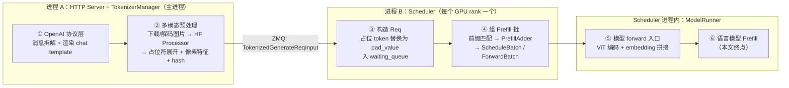
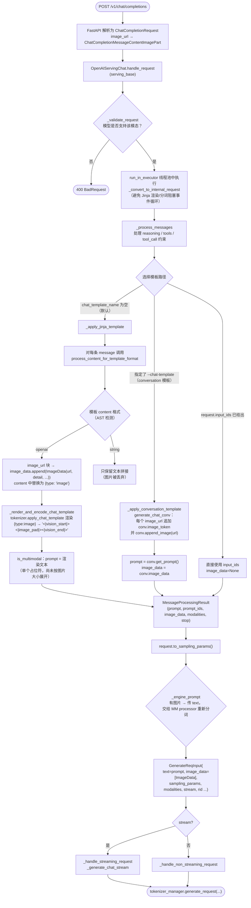
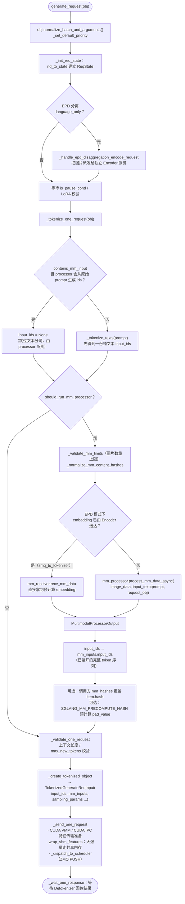
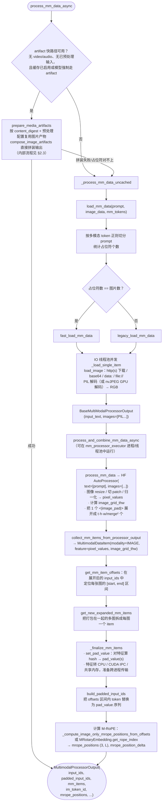
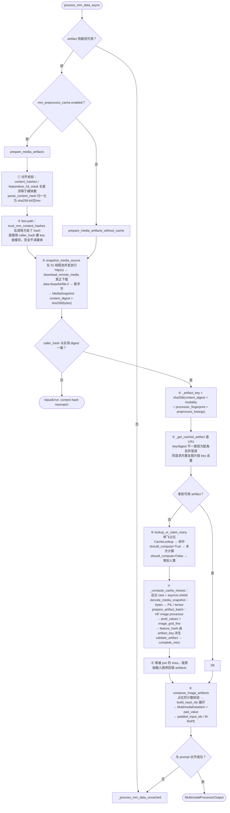
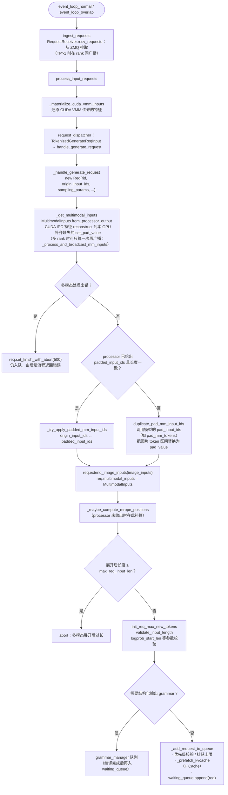
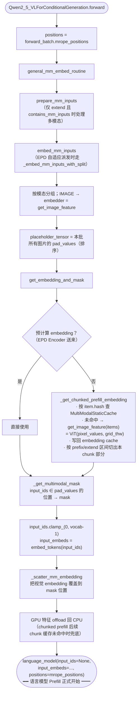
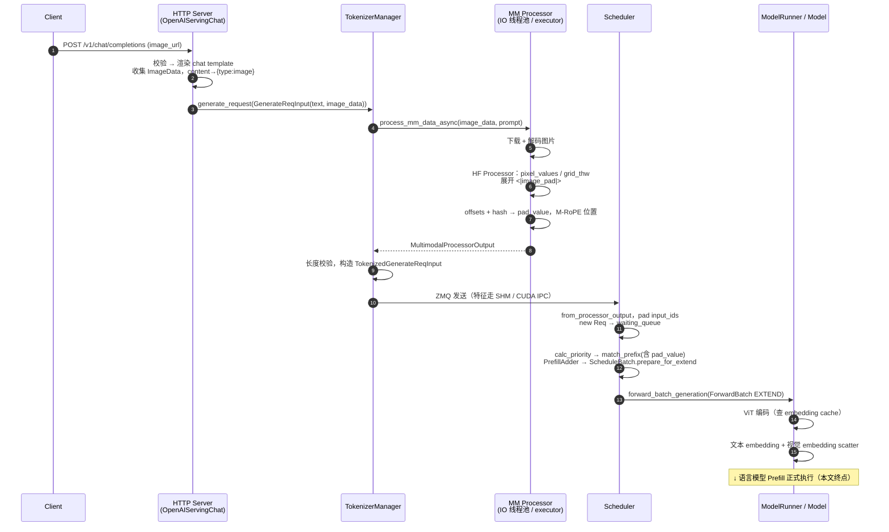

# Chat 接口带 `image_url` 的请求处理流程（至 Prefill 执行前）

本文梳理一条 `POST /v1/chat/completions` 请求，在 `messages[].content` 中携带 `image_url` 时，从 HTTP 入口一路走到 **语言模型 Prefill 正式执行前** 的完整链路。示例模型以 Qwen2.5-VL 为主（Jinja chat template 路径，最常见），其他 VLM 只在"模型专属"环节有差异。

示例请求：

```json
{
  "model": "Qwen/Qwen2.5-VL-7B-Instruct",
  "messages": [{
    "role": "user",
    "content": [
      {"type": "image_url", "image_url": {"url": "https://example.com/cat.jpg"}},
      {"type": "text", "text": "图里有什么？"}
    ]
  }]
}
```

---

## 0. 总览：三个进程、四个阶段



| 阶段 | 输入 | 输出 |
|---|---|---|
| ① 协议层 | OpenAI JSON | `GenerateReqInput(text=渲染后的 prompt, image_data=[ImageData])` |
| ② 多模态预处理 | prompt 文本 + 图片 URL | `input_ids`（占位已展开）、`mm_items`（pixel_values / grid_thw / offsets / hash）、`mrope_positions` |
| ③ Scheduler 收请求 | `TokenizedGenerateReqInput` | `Req`（`origin_input_ids` 中图片 token 已替换为 pad_value） |
| ④ 组批 | `waiting_queue` | `ScheduleBatch` → `ModelWorkerBatch` → `ForwardBatch` |
| ⑤ forward 入口 | `ForwardBatch` | `input_embeds`（文本 embedding 中图片位置被 ViT 输出覆盖） |

---

## 1. 阶段 ①：OpenAI 协议层（`serving_chat.py`）



要点：

- **图片在这一层不下载**，只把 URL（或 base64 / `data:` / `file://`）包装成 `ImageData` 收集起来。
- **占位符只有一个**：chat template 只渲染出 `<|image_pad|>` 一个 token，真实需要的 token 数（取决于分辨率）要等阶段 ② 的 HF Processor 计算后才展开。
- 对多模态模型，协议层**有意传文本而不是 token id**（`_engine_prompt`），因为 MM processor 需要在文本上定位并展开占位符。
- 流式请求会先 `__anext__()` 拉取第一个结果，使校验错误（如超长）能以 HTTP 400 返回，而不是混进 SSE 流。

---

## 2. 阶段 ②：TokenizerManager 与多模态预处理

### 2.1 TokenizerManager 主干



### 2.2 MM Processor 内部（以 `QwenVLImageProcessor` 为例）



要点：

- **占位符展开发生在这里**：一张 448×448 的图在 Qwen2.5-VL 中会从 1 个 `<|image_pad|>` 变成 256 个（patch=14，merge=2）。
- **pad_value 是 RadixCache 能复用图片前缀的关键**：每张图按特征内容 hash 派生出一组 ≥ `MM_PAD_SHIFT_VALUE`（1,000,000）的伪 token id，替换图片占位区。相同图片 → 相同 pad 序列 → 前缀树可命中；不同图片即便文本相同也不会误命中。
- 图像解码在 IO 线程池里完成，HF Processor 可在独立 executor 中执行，避免阻塞 TokenizerManager 的事件循环。
- **这里其实有两条路径**：`prepare_media_artifacts`（预处理器缓存打开，命中可省掉「下载 + 解码 + HF processor」）与 `_process_mm_data_uncached`（全量走 `load_mm_data`）。两者的产物最终都收敛成同一个 `MultimodalProcessorOutput`，流程细节见 §2.3。

### 2.3 `prepare_media_artifacts` 的内部执行流程

`process_mm_data_async`（`qwen_vl.py:1175`）先做一个分支判断，只有满足下列全部条件才走 artifact 快路径，否则直接用 `_process_mm_data_uncached` 全量处理：

- `image_data` 非空，且 `video_data` / `audio_data` 都为空（artifact 目前只覆盖图片）；
- `image_data` 里没有已预处理的输入（`_is_preprocessed_input`）；
- `mm_preprocess_cache.enabled`（`--mm-preprocess-cache-size-mb > 0`，按 tokenizer worker 均分预算）**或** 模型声明了 `uses_media_artifacts_without_cache`（`qwen3_vl` / `qwen3_vl_moe`，缓存关掉也走 artifact，只是不保留）。

随后按缓存是否启用在两个入口间二选一：`prepare_media_artifacts`（带 LRU + 单飞）或 `prepare_media_artifacts_without_cache`（每次都重算、不入缓存）。两者共用同一套 snapshot / decode / `prepare_artifact_batch` 契约。



逐步说明：

1. **参数对齐**：`content_hashes`、`featureless_hit_mask` 长度必须与媒体数一致；哈希统一走 `parse_content_hash`（只接受 `sha256:<64 hex>`，并转小写）。`featureless_hit_mask` 是给「只保留元数据、不留特征」的 artifact 开的绿灯——默认全 `False`，即本次请求必须拿到带特征的 artifact。
2. **可信 hash 快路径**：`trust_mm_content_hashes` 打开且调用方在 `image_url.content_hash` 里给了哈希时，直接用调用方 hash 算 key 查缓存；**命中就完全不读媒体**（不下载、不解码），这是最快的一条路。未命中则退回下一步重新实测。
3. **snapshot（这里是下载点）**：未命中的下标在 `io_executor` 线程池里并发 `snapshot_media_source` → `snapshot_media` → `_read_media_bytes`：`http(s)` 走 `get_image_bytes` → `download_remote_media`（`REQUEST_TIMEOUT`，默认 3s）；`file://` 读本地文件；`data:`/裸 base64 直接解码。得到 `MediaSnapshot(payload, content_digest, size_bytes)`。
   - **URL 本身不是身份**：路径/URL 每次都会被解析成字节再算 digest，远端内容变了自然 miss，不会复用错图。
   - 若调用方 hash 与实际 digest 不一致，直接报 `content hash mismatch`。
4. **建 artifact key**：`_artifact_key` = `sha256(canonical_json{content_digest, modality, processor_fingerprint, preprocess_kwargs})`。`processor_fingerprint` 覆盖 transformers 版本、processor 类名、`model_type`/`architectures`、模型 revision、`disable_fast_image_processor`、`mm_process_config` 以及 processor 自报的 `preprocess_fingerprint_payload`；`preprocess_kwargs` 把 `detail` 等会改变产物的请求选项纳入 key（未知选项也纳入，宁可 miss 不可误命中）。
5. **查缓存 + 去重**：`_get_cached_artifact` 在锁内比对 `artifact_key` 与 `content_digest`，不一致的条目按脏数据驱逐；`featureless` 条目若本次请求不能用，就留给 miss 路径处理。同一个请求里重复出现的同一张图按 key 去重，只预处理一次。
6. **单飞占位**：`lookup_or_claim_many` 对每个 unique key 返回 `CacheLookup`（命中）或 `CacheMiss`；并发请求打同一个 key 时，只有第一个 `should_compute=True`，其余 `should_compute=False` 去 `wait_for_miss` 等结果（`singleflight_joins` 计数）。
7. **计算 miss**：`create_background_task(_compute_cache_misses)` + `asyncio.shield`，所以本请求被取消也不会打断别的请求正在等的共享计算。内部两步：
   - `decode_media_snapshot`（IO 线程池）：bytes → PIL / numpy / tensor；这里再调 `load_image` 只是**解码已下载的字节**，不会重新下载。
   - `_run_preprocess_and_build_artifact_batch`：有 `mm_processor_executor` 就丢进 executor，否则本地执行。Qwen 侧就是 `prepare_artifact_batch`：`processor.image_processor(images=[...], return_tensors="pt")` 批处理 → `pixel_values` + `image_grid_thw`，再按网格长度把打包特征切成每图一份，`feature_hash = resolve_multimodal_item_hash(namespace=artifact_key)`，顺序、digest、key 都要与入参一致（`validate_artifact`）。
   - `complete_miss(artifact, cache_value=artifact.cache_value())`：等待者拿到完整 artifact，缓存里只留可缓存形态（必要时丢掉 CUDA 特征，只留元数据）。
8. **收尾**：等被 join 的 miss 全部返回，按原始处理器输入顺序回填；任一未解析即 `RuntimeError`（保证顺序与图片一一对应）。
9. **compose**：`compose_image_artifacts(input_text, artifacts)` 把「与 prompt 无关的产物」拼成当前请求的值：
   - 每图一个 grid，拼成 `image_grid_thw`；
   - `_normalize_prompt_for_fast_path` 用正则把占位符统一成原生 image token 并计数，数量与 artifact 数不等 → 返回 `None`；
   - `_cached_image_prompt_template`（`lru_cache(256)`，key = prompt + grid 形状）做 `build_input_ids`，展开占位符得到 `input_ids` / `offsets`，同时算 M-RoPE；
   - 组 `MultimodalDataItem`（`feature=artifact.feature`、`offsets`、`set_hash(feature_hash)`）→ `build_padded_input_ids` → `_prepare_mm_items_for_transport`（CPU / CUDA IPC / 共享内存）→ `MultimodalProcessorOutput`；
   - 任何一步对不上（占位符数不符、grid 非法），返回 `None` 并由调用方回退 `_process_mm_data_uncached`。

三个 hash 的分工，别混：

| 标识 | 覆盖范围 | 用途 |
|---|---|---|
| `content_digest` | 媒体字节的 sha256 | 媒体内容身份；与调用方 `content_hash` 比对 |
| `artifact_key` | digest + modality + processor fingerprint + 预处理选项 | 预处理器 LRU 的 key；变了就必然重算 |
| `feature_hash` | 由 `artifact_key` 派生 | `MultimodalDataItem.hash` → pad_value / ViT embedding cache / RadixCache 的 key |

要点：

- **artifact 与 prompt 解耦**：artifact 只装「模型相关、与文本无关」的产物（尺寸、token 数、encoder grid、可缓存的像素特征），**不含 prompt token 与 offsets**；这些在 compose 阶段才生成，所以同一张图配不同文本也能复用 artifact。
- **命中路径省掉的正是最贵的三件事**：下载、解码、HF image processor；剩下的只有 prompt 展开 + M-RoPE，开销与图片数量线性但很小。
- **失败不致命**：snapshot/decode/预处理异常会通过 `fail_miss` 传播给所有等待者；compose 对不齐时静默回退 uncached 路径，功能不受影响。

---

## 3. 阶段 ③：Scheduler 接收请求并构造 `Req`



此时 `req.origin_input_ids` 形如：

```
[<|im_start|>, user, \n, <|vision_start|>, PAD₀, PAD₁, PAD₂, PAD₃, PAD₀, ... (256 个), <|vision_end|>, 图, 里, 有, 什么, ？, <|im_end|>, \n, <|im_start|>, assistant, \n]
                                            └─────── 由该图片 hash 派生的 pad_value 序列 ───────┘
```

---

## 4. 阶段 ④：组 Prefill 批并下发到 ModelRunner

```mermaid
flowchart TD
    NB(["get_next_batch_to_run"]) --> GNP["get_new_batch_prefill → _get_new_batch_prefill_raw"]
    GNP --> RDY["grammar 就绪的请求补入 waiting_queue"]
    RDY --> EMP{"running_batch 已满<br/>或 waiting_queue 为空？"}
    EMP -- 是 --> NONE(["本轮不做 Prefill"])
    EMP -- 否 --> PRI["policy.calc_priority<br/>（LPM / FCFS / DFS-weight 等，<br/>LPM 会基于 radix 前缀匹配长度排序）"]
    PRI --> ADD["创建 PrefillAdder<br/>（token 预算、chunked_prefill_size、KV 余量）"]
    ADD --> LOOP["遍历 waiting_queue"]
    LOOP --> INR["req.init_next_round_input(tree_cache)<br/>用 fill_ids（含 pad_value）在 RadixCache 做 match_prefix<br/>→ prefix_indices / extend_input_len"]
    INR --> ONE["adder.add_one_req(req)<br/>预算不够时可截断为 chunked prefill"]
    ONE --> MORE{"还能加？"}
    MORE -- 是 --> LOOP
    MORE -- 否 --> SB["ScheduleBatch.init_new(can_run_list, ...)"]
    SB --> PFE["prepare_for_extend<br/>· 分配 req_to_token / KV slot<br/>· 拼接 input_ids（只含未命中前缀的部分）<br/>· 收集每个 req 的 multimodal_inputs<br/>· 设置 extend_prefix_lens / extend_seq_lens"]
    PFE --> MIX{"mixed chunk？"}
    MIX -- 是 --> MW["与 running decode 批合并"]
    MIX -- 否 --> RB
    MW --> RB["run_batch(batch)"]
    RB --> MWB["batch.get_model_worker_batch()<br/>→ ModelWorkerBatch(multimodal_inputs, ...)"]
    MWB --> FBG["tp_worker.forward_batch_generation"]
    FBG --> FB["ForwardBatch.init_new<br/>· mm_inputs = batch.multimodal_inputs<br/>· model_is_mrope：_compute_mrope_positions<br/>  按 extend 区间切出 (3, L) 位置"]
    FB --> MRF["model_runner.forward → _forward_raw<br/>forward_mode = EXTEND → forward_extend<br/>初始化 attention backend 元数据"]
    MRF --> MF(["model.forward(input_ids, positions, forward_batch)"])
```



要点：

- RadixCache 的 key 是**替换成 pad_value 后的 token 序列**，因此"同一张图 + 同样前缀"的第二次请求可以直接命中，跳过这部分 Prefill（也跳过 ViT）。
- 若图片被 chunked prefill 切开，`extend_prefix_lens / extend_seq_lens` 会传到下一阶段，用于只取出当前 chunk 覆盖到的那段视觉 embedding。

---

## 5. 阶段 ⑤：模型 forward 入口 —— 视觉编码与 embedding 拼接

这是"Prefill 正式执行"之前的最后一步：先把图片变成 embedding，塞进文本 embedding 序列里，然后才交给语言模型做 Prefill。



要点：

- pad_value 远超词表大小，所以查文本 embedding 前要先 `clamp`，这些位置的结果随后被视觉 embedding 覆盖。
- ViT 输出按图片 hash 缓存在 `MultiModalStaticCache`，chunked prefill 的后续 chunk 或相同图片的新请求都能复用。
- 至此得到 `input_embeds` + `mrope_positions`，进入语言模型各层的 attention / MLP，即真正的 Prefill。

---

## 6. 端到端时序图



---

## 7. 代码索引

| 环节 | 位置 |
|---|---|
| HTTP 路由 | `python/sglang/srt/entrypoints/http_server.py:1849` |
| 通用请求处理骨架 | `python/sglang/srt/entrypoints/openai/serving_base.py:80` `handle_request` |
| 转内部请求 | `python/sglang/srt/entrypoints/openai/serving_chat.py:1240` `_convert_to_internal_request` |
| 消息处理 / 模板分派 | `serving_chat.py:1470` `_process_messages` |
| Jinja 模板路径 | `serving_chat.py:1654` `_apply_jinja_template` |
| Conversation 模板路径 | `serving_chat.py:1975` `_apply_conversation_template`；`parser/conversation.py:608` `generate_chat_conv` |
| image_url 拆解 | `python/sglang/srt/parser/jinja_template_utils.py:183` `process_content_for_template_format` |
| 多模态传 text 的决策 | `serving_chat.py` `_engine_prompt` |
| `ImageData` 结构 | `python/sglang/srt/utils/common.py:2001` |
| TokenizerManager 入口 | `python/sglang/srt/managers/tokenizer_manager.py:895` `generate_request` |
| 分词 + MM 处理 | `tokenizer_manager.py:1096` `_tokenize_one_request` |
| 构造 Tokenized 对象 | `tokenizer_manager.py:1533` `_create_tokenized_object` |
| 发往 Scheduler | `tokenizer_manager.py:1769` `_send_one_request` |
| Qwen-VL processor | `python/sglang/srt/multimodal/processors/qwen_vl.py:1175` `process_mm_data_async`、`:1005` `_process_mm_data_uncached`、`:782` `prepare_artifact_batch`、`:864` `compose_image_artifacts` |
| artifact 缓存编排 | `multimodal/media_artifacts/base.py:259` `prepare_media_artifacts`、`:415` `prepare_media_artifacts_without_cache`、`:475` `_compute_cache_misses`、`:227` `_get_cached_artifact` |
| artifact 快照 / 解码 | `media_artifacts/base.py:165` `snapshot_media_source`、`:142` `decode_media_snapshot`；`multimodal/cache/identity.py:147` `snapshot_media`、`:130` `_read_media_bytes`、`:2182`（`utils/common.py`）`get_image_bytes` |
| 缓存 key 与指纹 | `multimodal/cache/identity.py:311` `build_artifact_key`、`:175` `media_preprocess_kwargs`、`:329` `resolve_multimodal_item_hash`、`:380` `build_processor_fingerprint` |
| LRU + 单飞 | `python/sglang/srt/multimodal/cache/preprocess_cache.py:121` `MultimodalPreprocessCache`、`:172` `get_if_present`、`:339` `lookup_or_claim_many`、`:390` `complete_miss`、`:432` `wait_for_miss` |
| 缓存开关 / 预算 | `arg_groups/fields/mm.py:99` `mm_preprocess_cache_size_mb`、`:111` `trust_mm_content_hashes`；`base_processor.py:286` 预算按 tokenizer worker 均分、`:353`（`qwen_vl.py`）`uses_media_artifacts_without_cache` |
| 媒体加载 | `multimodal/processors/base_processor.py:1239` `load_mm_data`、`:972` `_load_single_item`；`utils/common.py:2140` `load_image` |
| HF Processor 调用 | `base_processor.py:848` `process_mm_data` |
| 组装 mm_items / offsets | `base_processor.py:1805` `process_and_combine_mm_data`、`:1969` `_finalize_mm_items` |
| pad_value 与 hash | `python/sglang/srt/managers/schedule_batch.py:377` `MultimodalDataItem`、`:476` `set_pad_value`、`:684` `build_padded_input_ids` |
| Scheduler 主循环 | `python/sglang/srt/managers/scheduler.py:2021` `event_loop_normal` |
| 收请求 | `scheduler.py:2179` `ingest_requests`、`:2219` `process_input_requests` |
| 构造 Req + 多模态 | `scheduler.py:2938` `handle_generate_request`、`:2831` `_get_multimodal_inputs`、`:2843` `_try_apply_padded_mm_input_ids` |
| 模型侧 pad 函数 | `python/sglang/srt/managers/mm_utils.py:241` `duplicate_pad_mm_input_ids`、`:313` `pad_mm_tokens` |
| 入队 | `scheduler.py:3475` `_add_request_to_queue` |
| 组 Prefill 批 | `scheduler.py:4047` `get_new_batch_prefill`、`:4074` `_get_new_batch_prefill_raw` |
| prepare_for_extend | `schedule_batch.py:2870` |
| ForwardBatch 构造 / M-RoPE | `python/sglang/srt/model_executor/forward_batch_info.py:958` `init_new` |
| ModelRunner forward | `python/sglang/srt/model_executor/model_runner.py:1813` |
| Qwen2.5-VL forward / ViT | `python/sglang/srt/models/qwen2_5_vl.py:845` `forward`、`:765` `get_image_feature` |
| embedding 拼接 | `mm_utils.py:841` `general_mm_embed_routine`、`:694` `prepare_mm_inputs`、`:443` `embed_mm_inputs` |
| embedding 缓存 / 切 chunk / mask | `python/sglang/srt/managers/mm_schedule.py:719` `get_embedding_and_mask`、`:541` `_get_chunked_prefill_embedding`、`:655` `_get_multimodal_mask` |
